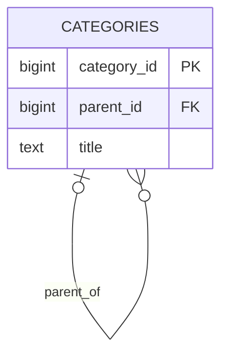

# 04. CTEs and recursive queries

> **Draft: written but not yet run.** The code and the expected output in this lesson were prepared by reading the code and the official documentation. They have not been executed yet. If something does not behave as described, trust your tool's real output and report it.

## What you will be able to do
- Factor an aggregate query into a named CTE.
- Traverse an unknown-depth hierarchy with an anchor and recursive term.
- Prevent recursive cycles and explicitly sort the result.

## Recap
- What does a self-referencing foreign key guarantee?
  <details><summary>Answer</summary>A non-NULL parent ID exists; it does not guarantee an acyclic tree.</details>
- Why keep applied migration files unchanged?
  <details><summary>Answer</summary>A ledger skips those versions; editing the old file would create different schemas across environments.</details>

## Why it matters
A category browser needs every descendant, not just children one level down. Repeated self-joins bake an arbitrary depth into the query. A recursive common table expression follows the relationship until there is no new work.

## What you will build
A four-node category tree, direct-child counts and a depth report with cycle protection.

## Before you start
- Finished [Databases 101](../../101-zero-to-hero/phase-3-designing/12-library-project.md): Docker PostgreSQL, psql/IDE connections, joins, transactions and basic indexes. No host PostgreSQL or psql install is needed.
- Docker in Linux-container mode with Compose, a text editor, and the same `postgres:17-alpine` image as 101. Docker/Compose versions above are the inherited authoring baseline, not a new runtime check. The tag pins major version/flavour, not a patch digest.
- Time: 45 minutes including reading, typing and exercise. Allow extra time if retyping files.
- Source pack (optional): every file is shown in full in this lesson, so you can follow without it. The finished code, the exercise starter and the solution are in the course repository https://github.com/Uee03/Code101 under `source/databases/201-hero-to-super-hero/phase-2-querying/04-ctes-and-recursive-queries/` (on that page choose **Code, Download ZIP**, or run `git clone https://github.com/Uee03/Code101.git`). Generated phase pack: `databases-201-phase-2-querying.zip`.
- **One database lab at a time:** stop the previous 101/201 or capstone lab before using 127.0.0.1:5432. Do not stop unrelated services. These lessons are independent; do not carry a schema forward.
- All reset scripts/passwords are disposable local examples. Never aim them at work data. `learner` is the official image's initial administrative user, not an application login design.
- SQL, Docker, negative cases and IDE steps have not been run for this lesson. Result rows are derived by hand; variable tool output is described, not invented.

## Steps
### Step 1. Prepare the lesson workspace
1. In your home folder create `code101` with your file manager. Obtain the source folder from the repository link above, or extract the phase ZIP: Windows **right-click > Extract All**; macOS double-click; Linux use your archive manager's **Extract Here**. Move `databases-201-phase-2-querying` into `code101`. Keep `04-ctes-and-recursive-queries/code` and its sibling `exercise` together.
2. Without a pack, create the same `databases-201-phase-2-querying/04-ctes-and-recursive-queries/code` structure and sibling `exercise/starter` and `exercise/solution` folders using **New Folder**. You will create every file shown below. Leave the finished solution unopened until you try the exercise.
3. Open a terminal (Windows: type `powershell` in File Explorer's address bar in the code folder; macOS/Linux: open Terminal). Do not type a prompt's `>` or `$`. The text before the prompt shows your current directory. Recover to this exact folder if needed:

**Terminal (PowerShell; folder: this lesson `code/`)**
```powershell
Set-Location "$HOME\code101\databases-201-phase-2-querying\04-ctes-and-recursive-queries\code"
```

**Terminal (macOS/Linux; folder: this lesson `code/`)**
```bash
cd "$HOME/code101/databases-201-phase-2-querying/04-ctes-and-recursive-queries/code"
```

Expected result, not yet run: the prompt is in this lesson code folder; Set-Location/cd normally print no text. Using the repository directly is also fine: open its matching source code folder and use the same subsequent relative commands.

4. Open that folder in your editor. For each file caption choose **File > New File > Save As** at the shown path relative to the lesson root (`code/` is where your terminal is). If supplied, open and compare instead of creating duplicates. Create displayed subfolders first. Save as UTF-8 without BOM; use LF for shell files. On Windows enable **View > Show > File name extensions** so `.sql.txt` cannot hide. Save with Ctrl+S (Cmd+S on macOS); an editor-tab dot often means unsaved changes.

### Step 2. Save the complete Compose configuration
**File: `code/docker-compose.yml`**
```yaml
services:
  db:
    image: postgres:17-alpine
    environment:
      POSTGRES_DB: ${POSTGRES_DB}
      POSTGRES_USER: ${POSTGRES_USER}
      POSTGRES_PASSWORD: ${POSTGRES_PASSWORD}
      PGDATABASE: ${POSTGRES_DB}
      PGUSER: ${POSTGRES_USER}
    ports:
      - "127.0.0.1:5432:5432"
    volumes:
      - pg_data:/var/lib/postgresql/data
      - .:/scripts:ro
      - ../exercise:/exercises:ro
    healthcheck:
      test: ["CMD-SHELL", "pg_isready -U $$POSTGRES_USER -d $$POSTGRES_DB"]
      interval: 2s
      timeout: 3s
      retries: 30
      start_period: 5s
volumes:
  pg_data:
```

This file is genuinely identical to [201 lesson 01, Step 2](../phase-1-schema-design/01-data-modeling-and-3nf.md#step-2-save-the-complete-compose-configuration). Repeat that step with only these differences: workspace `04-ctes-and-recursive-queries` instead of `01-data-modeling-and-3nf`, project `code101-db201-04` instead of `code101-db201-01`, and this lesson's SQL. **No YAML line changes.** Full configuration is repeated to keep this pack standalone.

| Configuration line(s) | Meaning and consequence of changing it |
|---|---|
| `services:`, `db:` | Define one service named db; commands below must use that name. |
| `image: postgres:17-alpine` | Use the unchanged official image. A different major version changes the data-directory compatibility contract. |
| `environment:` and POSTGRES_DB/USER/PASSWORD | Initialize the database/admin/password from .env only when the data volume is empty. |
| `PGDATABASE`, `PGUSER` | Set container-client defaults; commands also name user/database explicitly for clarity. |
| `ports:` with `127.0.0.1:5432:5432` | Publish only IPv4 loopback on host port 5432, not every host interface. Host tools use 127.0.0.1; another Compose service would use db. |
| `volumes:` and `pg_data:/var/lib/postgresql/data` | Keep data in this project's named volume. Removing the container alone does not erase it. |
| `.:/scripts:ro` | Mount this code folder read-only; saved host edits are visible to psql. It is not a writable backup location. |
| `../exercise:/exercises:ro` | Mount the sibling exercise folder read-only. Flattening the pack breaks the path. |
| `healthcheck:` and `test:` | Run pg_isready inside db. `$$` defers variable expansion to its shell, not Compose. Readiness is not a password/security test. |
| `interval: 2s`, `timeout: 3s` | Check every two seconds, allowing three seconds per probe. |
| `retries: 30`, `start_period: 5s` | Allow startup time before declaring failure; --wait uses health status. |
| Final `volumes:`, `pg_data:` | Declare the volume, scoped by the explicit project name. |

Indent with spaces. No Dockerfile/.dockerignore: nothing is built. No art is used (`assets: []`).

### Step 3. Create the local environment file
**File: `code/.env.example`**
```dotenv
# Disposable local practice only. Never reuse this password elsewhere.
POSTGRES_DB=code101
POSTGRES_USER=learner
POSTGRES_PASSWORD=learn_local_only
```

The comment marks local-only credentials. POSTGRES_DB names the initial database, POSTGRES_USER its administrator, and POSTGRES_PASSWORD its disposable password. Compose substitutes `${...}` in YAML using a file named exactly `.env`.

**Terminal (PowerShell; folder: this lesson `code/`)**
```powershell
Copy-Item .env.example .env
```

**Terminal (macOS/Linux; folder: this lesson `code/`)**
```bash
cp .env.example .env
```

Expected output, not yet run: a successful copy prints no text. The complete generated local file is:

**File: `code/.env`** (local copy, not shipped)
```dotenv
# Disposable local practice only. Never reuse this password elsewhere.
POSTGRES_DB=code101
POSTGRES_USER=learner
POSTGRES_PASSWORD=learn_local_only
```

**File: `code/.gitignore`**
```gitignore
.env
*.dump
```

These patterns exclude .env and dump archives from Git; they do not encrypt them or remove already tracked files. Editing .env later does not change an initialized database password. Reset only this disposable volume if reinitializing.

### Step 4. Model the feature, then save its files
A **common table expression (CTE)** names a result for one statement using WITH. It is not a permanent table or an automatic performance optimization. **CTE materialization** means calculating a CTE separately for reuse within the statement instead of folding it into the parent query. A **recursive query** refers to its own working result: an anchor starts the search; UNION ALL adds children found from the previous round.

The **adjacency list** representation stores each node and its immediate parent. Depth is the number of edges from the selected root. The CYCLE clause adds a flag and a path internally, stops expanding a path that repeats category_id, and lets the outer query exclude the flagged closing row. It does not repair bad stored data.

**Diagram: category relationship**

Shop has children Paper and Writing. Paper has child Notebooks. The nullable parent permits roots; the foreign key alone permits longer cycles.

Read/save all files before running. SQL ends statements with semicolons. Backslash commands are **psql client commands**, not server SQL: ON_ERROR_STOP stops at the first unexpected error; `\ir` includes relative to its containing script; unaligned format uses `|` between columns; footer off removes row-count footers; the null setting displays SQL NULL as `(null)`. Use psql for whole scripts; in an IDE select server SQL, not the backslash commands. The entry script arranges setup automatically. Never execute sample reset files on valuable data.

Defines the isolated example and seed. DROP SCHEMA app CASCADE removes the sample schema and its dependent objects. Use a disposable database.

**File: `code/setup.sql`**
```sql
DROP SCHEMA IF EXISTS app CASCADE;
CREATE SCHEMA app;
CREATE TABLE app.categories (
    category_id bigint GENERATED ALWAYS AS IDENTITY,
    parent_id bigint,
    title text NOT NULL,
    CONSTRAINT pk_categories PRIMARY KEY (category_id),
    CONSTRAINT fk_categories_parent FOREIGN KEY (parent_id)
        REFERENCES app.categories (category_id) ON DELETE RESTRICT
);
CREATE INDEX ix_categories_parent_id ON app.categories (parent_id);
INSERT INTO app.categories (title) VALUES ('Shop');
INSERT INTO app.categories (parent_id, title) VALUES (1, 'Paper'), (1, 'Writing');
INSERT INTO app.categories (parent_id, title) VALUES (2, 'Notebooks');
```

The entry script includes setup or the migration driver, then performs the worked example.

**File: `code/lesson.sql`**
```sql
\set ON_ERROR_STOP on
\pset format unaligned
\pset footer off
\pset null '(null)'
\ir setup.sql
WITH child_counts AS (
    SELECT parent_id, COUNT(*) AS direct_children
    FROM app.categories
    WHERE parent_id IS NOT NULL
    GROUP BY parent_id
)
SELECT c.title, cc.direct_children
FROM child_counts AS cc
JOIN app.categories AS c ON c.category_id = cc.parent_id
ORDER BY c.category_id;
WITH RECURSIVE tree AS (
    SELECT category_id, parent_id, title, 0 AS depth
    FROM app.categories WHERE category_id = 1
    UNION ALL
    SELECT c.category_id, c.parent_id, c.title, t.depth + 1
    FROM app.categories AS c
    JOIN tree AS t ON c.parent_id = t.category_id
) CYCLE category_id SET is_cycle USING path
SELECT category_id, title, depth FROM tree
WHERE NOT is_cycle
ORDER BY depth, category_id;
```

### Step 5. Start and inspect PostgreSQL
From this code folder use project `code101-db201-04` consistently. `-p` isolates names/volumes, not the shared host port. Keep Docker Desktop running. `up -d --wait` starts the service and waits for readiness; an initial image download takes extra time.

**Terminal (all OS; folder: this lesson `code/`)**
```powershell
docker compose -p code101-db201-04 up -d --wait
```

Expected output, not yet run: Compose creates the network, volume and db container, then reports healthy readiness. Progress order, IDs and timings vary; no startup transcript is claimed.

**Terminal (all OS; folder: this lesson `code/`)**
```powershell
docker compose -p code101-db201-04 ps --format "{{.Service}} {{.State}} {{.Health}}"
```

**Expected output, not yet run:**

```text
db running healthy
```

**Terminal (all OS; folder: this lesson `code/`)**
```powershell
docker compose -p code101-db201-04 logs --no-log-prefix --tail 10 db
```

Expected output, not yet run: timestamped PostgreSQL log lines indicating readiness to accept connections. Exact timestamps/process IDs are unpredictable. Read real logs if startup fails.

### Step 6. Connect using the existing 101 IDE pattern (optional)
The psql command below is sufficient. Repeat [101 lesson 02's IDE steps](../../101-zero-to-hero/phase-1-first-queries/02-connect-with-a-tool.md) with these fields; the differences are this lesson workspace and display name. No server install or Azure sign-in is needed for local access.

| Field | Value |
|---|---|
| Host / Server | `127.0.0.1` (IPv4 localhost) |
| Port | `5432` |
| Database | `code101` |
| User | `learner` |
| Password | `learn_local_only` (local only) |
| Authentication | Password / User & Password |
| SSL mode | Disable, only for this loopback lab |
| SSH tunnel | off |
| Display name | `Code101 DB201 04` |

- JetBrains: **Database / Database Explorer > + > Data Source > PostgreSQL**; enter General fields, **Download missing driver files** if offered, then **SSH/SSL** off for this local lab, **Test Connection > OK > New Query Console**. Run selected SQL with Ctrl+Enter (Cmd+Enter on macOS).
- VS Code: Microsoft's **PostgreSQL** extension (`ms-ossdata.vscode-pgsql`), **PostgreSQL > Connections > + / Add New Connection > Parameters**; enter fields, **Advanced** port/SSL, then **Test Connection > Save & Connect > New Query**. Run selected SQL with Ctrl+Shift+E (Cmd+Shift+E on macOS). UI labels may vary; 101 links the vendor directions.
- Visual Studio is not VS Code. Built-in SQL Server Object Explorer is not a PostgreSQL tool; Npgsql alone does not install a Server Explorer provider. Use the existing provider if available, or the terminal/IDE routes above.

Run only selected queries after setup; do not casually reapply destructive setup. A socket connection inside db does not prove a host-network password works. Require TLS for remote production connections; disabling SSL is only for local practice.

## Run it
**Predict first:** Predict the number of rows at depths 0, 1 and 2. Would the foreign key reject setting Shop.parent_id to Notebooks?


From this code folder run the entry file. `exec -T` runs the container client without a pseudo-terminal; `-X` ignores psql startup customization; `-q` suppresses routine tags; ON_ERROR_STOP fails fast; `-U`/`-d` name role/database; `-f` is the container file path. Quiet mode does not hide server errors/notices on stderr.

**Terminal (all OS; folder: this lesson `code/`)**
```powershell
docker compose -p code101-db201-04 exec -T db psql -X -q -v ON_ERROR_STOP=1 -U learner -d code101 -f /scripts/lesson.sql
```

**Expected output, not yet run:**

```text
title|direct_children
Shop|2
Paper|1
category_id|title|depth
1|Shop|0
2|Paper|1
3|Writing|1
4|Notebooks|2
```

Shop has two direct children and Paper has one. Recursion starts with Shop, then finds Paper/Writing, then Notebooks. Sorting by depth and category_id fixes the displayed order.

These are hand-derived unaligned result tables, not captured output. Missing-schema/dependency notices may appear on stderr; they are not data rows. An unexpected error means stop and inspect the first failing file/statement before continuing.

## How it works
The first CTE aggregates before joining, giving one direct-child count per parent. It counts only immediate children, not descendants. The second CTE starts from category 1 even if that node is later given a parent. Each round joins child.parent_id to the current node ID. UNION ALL preserves paths; substituting UNION is not reliable cycle protection when depth changes on each visit.

**Why this, not that:** use recursion for a variable-depth hierarchy, not a series of five hand-written joins. Use a simple join for one known level. On PostgreSQL 17 a side-effect-free, non-recursive CTE referenced once may be folded into its parent query; multiply referenced ones are normally materialized. MATERIALIZED and NOT MATERIALIZED are tools for a measured need, not default decorations.

Safety check: inside a disposable IDE transaction, set category 1 parent_id to 4, run the recursive SELECT, then ROLLBACK. CYCLE should keep the visible set at four categories. A disconnected cycle is not reachable from this anchor, so this traversal is not a whole-database integrity check. Do not rely on an outer LIMIT as a general recursion safety mechanism.

## Try it
Keep db running after Run it. The starter resets the disposable schema, except lesson 03 which expects the already-applied migrations and rolls back its trial column.

1. **Guided:** Complete the anchor and join for the Paper subtree. Return Paper at depth 0 and Notebooks at depth 1.
2. Copy the single starter file into your code folder. This is a file copy, not a folder copy; setup includes use the absolute container /scripts path. Without a pack create the file from the complete starter listing. Edit only your working copy and save it.

**Terminal (PowerShell; folder: this lesson `code/`)**
```powershell
Copy-Item ..\exercise\starter\exercise.sql .\exercise.sql
```

**Terminal (macOS/Linux; folder: this lesson `code/`)**
```bash
cp ../exercise/starter/exercise.sql ./exercise.sql
```

Expected output, not yet run: no text after a successful copy.

**File: `exercise/starter/exercise.sql`** (copy to `code/exercise.sql`)
```sql
\set ON_ERROR_STOP on
\pset format unaligned
\pset footer off
\pset null '(null)'
\ir /scripts/setup.sql
WITH RECURSIVE tree AS (
    -- TODO: anchor category 2, with depth 0; select category_id, title, depth.
    SELECT category_id, title, 0 AS depth FROM app.categories WHERE false
    UNION ALL
    -- TODO: join children to tree on parent_id = tree.category_id.
    SELECT c.category_id, c.title, t.depth + 1
    FROM app.categories AS c JOIN tree AS t ON false
) CYCLE category_id SET is_cycle USING path
SELECT title, depth FROM tree WHERE NOT is_cycle ORDER BY depth, category_id;
```

3. Fill the TODOs, save, then run your working file from this code folder.

**Terminal (all OS; folder: this lesson `code/`)**
```powershell
docker compose -p code101-db201-04 exec -T db psql -X -q -v ON_ERROR_STOP=1 -U learner -d code101 -f /scripts/exercise.sql
```

Target after completing the TODOs:

**Expected output, not yet run:**

```text
title|depth
Paper|0
Notebooks|1
```

The target is for the completed program, not the untouched starter, which deliberately may return no rows or an uncorrected value.

4. **Change:** Change only the anchor to Writing (category 3). Predict the single returned row before running.
5. **Stretch (optional):** Describe a write-time strategy to forbid cycles, including the race when two concurrent writers change different parents.

<details><summary>Solution (open after trying)</summary>

**File: `exercise/solution/exercise.sql`**
```sql
\set ON_ERROR_STOP on
\pset format unaligned
\pset footer off
\pset null '(null)'
\ir /scripts/setup.sql
WITH RECURSIVE tree AS (
    SELECT category_id, title, 0 AS depth FROM app.categories WHERE category_id = 2
    UNION ALL
    SELECT c.category_id, c.title, t.depth + 1
    FROM app.categories AS c JOIN tree AS t ON c.parent_id = t.category_id
) CYCLE category_id SET is_cycle USING path
SELECT title, depth FROM tree WHERE NOT is_cycle ORDER BY depth, category_id;
```

The solution implements the guided TODOs using the worked example's constructs. Compare its rows with the target above. To compare in your workspace, repeat the starter-copy step with only the source directory changed from starter to solution, then run the exact exercise command above:

**Terminal (PowerShell; folder: this lesson `code/`)**
```powershell
Copy-Item ..\exercise\solution\exercise.sql .\exercise.sql
```

**Terminal (macOS/Linux; folder: this lesson `code/`)**
```bash
cp ../exercise/solution/exercise.sql ./exercise.sql
```

</details>

### Stop and clean up before the next lab
Close IDE connections first. These commands apply only to this named disposable project.

**Terminal (all OS; folder: this lesson `code/`)**
```powershell
docker compose -p code101-db201-04 stop
docker compose -p code101-db201-04 ps -a --format "{{.Service}} {{.State}}"
```

Expected output, not yet run: variable stop progress, then:

```text
db exited
```

**Terminal (all OS; folder: this lesson `code/`)**
```powershell
docker compose -p code101-db201-04 down -v --remove-orphans
```

Expected output, not yet run: Compose removes this project container/network and saved volume; exact progress text varies. **-v destroys saved database data**, including the restored target in lesson 11. It does not erase other projects or the host dump file. Never use it on valuable data.

**Terminal (all OS; folder: this lesson `code/`)**
```powershell
docker compose -p code101-db201-04 ps -a --format "{{.Service}} {{.State}}"
```

Expected output, not yet run: no service rows; port 5432 is no longer held by this project.

## Check yourself
1. Is child_counts a persisted table?
   <details><summary>Answer</summary>No. The name exists for that statement only.</details>
2. Predict the recursive depth of Notebooks from Shop.
   <details><summary>Answer</summary>2: Shop -> Paper -> Notebooks.</details>
3. Why keep ORDER BY even with CYCLE?
   <details><summary>Answer</summary>Cycle handling does not promise result order. The outer ORDER BY defines it.</details>

## Common mistakes
No new error transcript has been captured. These are symptoms; wording marked typical message is illustrative, not observed output.

| Symptom | Cause | Fix |
|---|---|---|
| Compose cannot find its configuration (typical message) | Terminal is in the wrong folder | Recover to code using Step 1; keep code/exercise siblings. |
| Old behavior persists | Unsaved file, hidden .sql.txt extension or wrong project | Save, check filename extensions and use the exact -p name in every command. |
| Startup cannot claim 5432 (typical message) | Another lab owns the host port | Stop the previous lab from its own code folder; never kill unrelated processes. |
| The traversal loops or repeats changing depths | Cycle protection was removed; UNION alone need not help | Restore CYCLE and exclude the flagged closing rows. |
| Counts include only immediate children | The aggregate query does not recurse | Use the recursive result for descendants, with an explicit counting rule. |
| An IDE rejects a backslash line (typical message) | psql meta-commands were sent as SQL | Use psql for whole scripts; select only server SQL in an IDE. |

## Best practice
Make termination and result ordering explicit for recursive queries. Source: [PostgreSQL 17: WITH queries and CYCLE](https://www.postgresql.org/docs/17/queries-with.html).

## Going further
Official PostgreSQL **17** references checked for this draft:
- [PostgreSQL 17: WITH queries and CYCLE](https://www.postgresql.org/docs/17/queries-with.html)

This returns in [lesson 11](../phase-4-operations-and-security/11-roles-rls-backup-and-pooling.md): every schema/query/routine decision also needs a permission and recovery story.

## Summary
- You worked through how to factor an aggregate query into a named CTE.
- You worked through how to traverse an unknown-depth hierarchy with an anchor and recursive term.
- You worked through how to prevent recursive cycles and explicitly sort the result.
- The code and derived output remain written but not run; the draft notice is intentional.

## Next lesson
[05. Window functions](../phase-2-querying/05-window-functions.md): Rank detail rows per partition with deliberate tie behavior.
