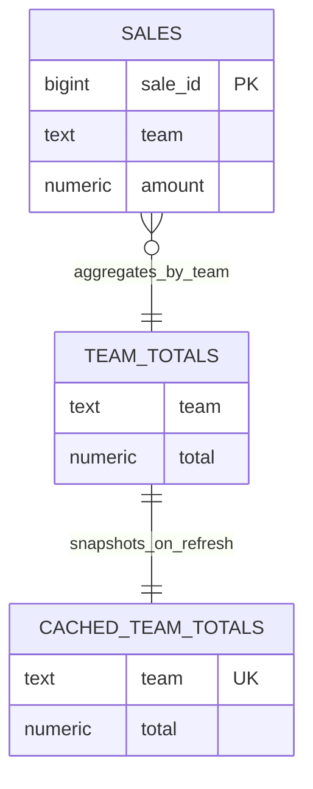

# 08. Views and materialized views

> **Draft: written but not yet run.** The code and the expected output in this lesson were prepared by reading the code and the official documentation. They have not been executed yet. If something does not behave as described, trust your tool's real output and report it.

## What you will be able to do
- Expose a stable query interface using a view.
- Demonstrate materialized-view staleness and refresh behavior.
- Explain the unique-index and permission requirements of concurrent refresh.

## Recap
- Is a CTE reusable across statements?
  <details><summary>Answer</summary>No. A view is a stored query definition that can be referenced by later statements.</details>
- Does a covering index store a reusable aggregate result?
  <details><summary>Answer</summary>No. It stores indexed row values, not the result of a GROUP BY query.</details>

## Why it matters
Repeated report SQL drifts across clients. A view gives the report one named definition; a materialized view trades freshness for reuse of saved results. That trade is only useful when you can state how stale the report is allowed to be.

## What you will build
A live team-total view and an indexed materialized copy, then a change that proves when each reflects the new amount.

## Before you start
- Finished [Databases 101](../../101-zero-to-hero/phase-3-designing/12-library-project.md): Docker PostgreSQL, psql/IDE connections, joins, transactions and basic indexes. No host PostgreSQL or psql install is needed.
- Docker in Linux-container mode with Compose, a text editor, and the same `postgres:17-alpine` image as 101. Docker/Compose versions above are the inherited authoring baseline, not a new runtime check. The tag pins major version/flavour, not a patch digest.
- Time: 45 minutes including reading, typing and exercise. Allow extra time if retyping files.
- Source pack (optional): every file is shown in full in this lesson, so you can follow without it. The finished code, the exercise starter and the solution are in the course repository https://github.com/Uee03/Code101 under `source/databases/201-hero-to-super-hero/phase-3-programmable-database/08-views-and-materialized-views/` (on that page choose **Code, Download ZIP**, or run `git clone https://github.com/Uee03/Code101.git`). Generated phase pack: `databases-201-phase-3-programmable-database.zip`.
- **One database lab at a time:** stop the previous 101/201 or capstone lab before using 127.0.0.1:5432. Do not stop unrelated services. These lessons are independent; do not carry a schema forward.
- All reset scripts/passwords are disposable local examples. Never aim them at work data. `learner` is the official image's initial administrative user, not an application login design.
- SQL, Docker, negative cases and IDE steps have not been run for this lesson. Result rows are derived by hand; variable tool output is described, not invented.

## Steps
### Step 1. Prepare the lesson workspace
1. In your home folder create `code101` with your file manager. Obtain the source folder from the repository link above, or extract the phase ZIP: Windows **right-click > Extract All**; macOS double-click; Linux use your archive manager's **Extract Here**. Move `databases-201-phase-3-programmable-database` into `code101`. Keep `08-views-and-materialized-views/code` and its sibling `exercise` together.
2. Without a pack, create the same `databases-201-phase-3-programmable-database/08-views-and-materialized-views/code` structure and sibling `exercise/starter` and `exercise/solution` folders using **New Folder**. You will create every file shown below. Leave the finished solution unopened until you try the exercise.
3. Open a terminal (Windows: type `powershell` in File Explorer's address bar in the code folder; macOS/Linux: open Terminal). Do not type a prompt's `>` or `$`. The text before the prompt shows your current directory. Recover to this exact folder if needed:

**Terminal (PowerShell; folder: this lesson `code/`)**
```powershell
Set-Location "$HOME\code101\databases-201-phase-3-programmable-database\08-views-and-materialized-views\code"
```

**Terminal (macOS/Linux; folder: this lesson `code/`)**
```bash
cd "$HOME/code101/databases-201-phase-3-programmable-database/08-views-and-materialized-views/code"
```

Expected result, not yet run: the prompt is in this lesson code folder; Set-Location/cd normally print no text. Using the repository directly is also fine: open its matching source code folder and use the same subsequent relative commands.

4. Open that folder in your editor. For each file caption choose **File > New File > Save As** at the shown path relative to the lesson root (`code/` is where your terminal is). If supplied, open and compare instead of creating duplicates. Create displayed subfolders first. Save as UTF-8 without BOM; use LF for shell files. On Windows enable **View > Show > File name extensions** so `.sql.txt` cannot hide. Save with Ctrl+S (Cmd+S on macOS); an editor-tab dot often means unsaved changes.

### Step 2. Save the complete Compose configuration
**File: `code/docker-compose.yml`**
```yaml
services:
  db:
    image: postgres:17-alpine
    environment:
      POSTGRES_DB: ${POSTGRES_DB}
      POSTGRES_USER: ${POSTGRES_USER}
      POSTGRES_PASSWORD: ${POSTGRES_PASSWORD}
      PGDATABASE: ${POSTGRES_DB}
      PGUSER: ${POSTGRES_USER}
    ports:
      - "127.0.0.1:5432:5432"
    volumes:
      - pg_data:/var/lib/postgresql/data
      - .:/scripts:ro
      - ../exercise:/exercises:ro
    healthcheck:
      test: ["CMD-SHELL", "pg_isready -U $$POSTGRES_USER -d $$POSTGRES_DB"]
      interval: 2s
      timeout: 3s
      retries: 30
      start_period: 5s
volumes:
  pg_data:
```

This file is genuinely identical to [201 lesson 01, Step 2](../phase-1-schema-design/01-data-modeling-and-3nf.md#step-2-save-the-complete-compose-configuration). Repeat that step with only these differences: workspace `08-views-and-materialized-views` instead of `01-data-modeling-and-3nf`, project `code101-db201-08` instead of `code101-db201-01`, and this lesson's SQL. **No YAML line changes.** Full configuration is repeated to keep this pack standalone.

| Configuration line(s) | Meaning and consequence of changing it |
|---|---|
| `services:`, `db:` | Define one service named db; commands below must use that name. |
| `image: postgres:17-alpine` | Use the unchanged official image. A different major version changes the data-directory compatibility contract. |
| `environment:` and POSTGRES_DB/USER/PASSWORD | Initialize the database/admin/password from .env only when the data volume is empty. |
| `PGDATABASE`, `PGUSER` | Set container-client defaults; commands also name user/database explicitly for clarity. |
| `ports:` with `127.0.0.1:5432:5432` | Publish only IPv4 loopback on host port 5432, not every host interface. Host tools use 127.0.0.1; another Compose service would use db. |
| `volumes:` and `pg_data:/var/lib/postgresql/data` | Keep data in this project's named volume. Removing the container alone does not erase it. |
| `.:/scripts:ro` | Mount this code folder read-only; saved host edits are visible to psql. It is not a writable backup location. |
| `../exercise:/exercises:ro` | Mount the sibling exercise folder read-only. Flattening the pack breaks the path. |
| `healthcheck:` and `test:` | Run pg_isready inside db. `$$` defers variable expansion to its shell, not Compose. Readiness is not a password/security test. |
| `interval: 2s`, `timeout: 3s` | Check every two seconds, allowing three seconds per probe. |
| `retries: 30`, `start_period: 5s` | Allow startup time before declaring failure; --wait uses health status. |
| Final `volumes:`, `pg_data:` | Declare the volume, scoped by the explicit project name. |

Indent with spaces. No Dockerfile/.dockerignore: nothing is built. No art is used (`assets: []`).

### Step 3. Create the local environment file
**File: `code/.env.example`**
```dotenv
# Disposable local practice only. Never reuse this password elsewhere.
POSTGRES_DB=code101
POSTGRES_USER=learner
POSTGRES_PASSWORD=learn_local_only
```

The comment marks local-only credentials. POSTGRES_DB names the initial database, POSTGRES_USER its administrator, and POSTGRES_PASSWORD its disposable password. Compose substitutes `${...}` in YAML using a file named exactly `.env`.

**Terminal (PowerShell; folder: this lesson `code/`)**
```powershell
Copy-Item .env.example .env
```

**Terminal (macOS/Linux; folder: this lesson `code/`)**
```bash
cp .env.example .env
```

Expected output, not yet run: a successful copy prints no text. The complete generated local file is:

**File: `code/.env`** (local copy, not shipped)
```dotenv
# Disposable local practice only. Never reuse this password elsewhere.
POSTGRES_DB=code101
POSTGRES_USER=learner
POSTGRES_PASSWORD=learn_local_only
```

**File: `code/.gitignore`**
```gitignore
.env
*.dump
```

These patterns exclude .env and dump archives from Git; they do not encrypt them or remove already tracked files. Editing .env later does not change an initialized database password. Reset only this disposable volume if reinitializing.

### Step 4. Model the feature, then save its files
A **view** stores a query definition, not the result rows. A **materialized view** stores rows produced by its defining query, so reads do not automatically see source-table changes. A **refresh** replaces the materialized result by rerunning that query.

The ordinary view uses security_invoker = true: underlying permissions and row security are checked using the caller. This is not a permission shortcut. Lesson 11 explores roles; do not assume any view is automatically an access-control boundary. The materialized data is a separate stored result and needs its own grants and freshness policy.

**Diagram: report dependencies**

The report entities are derived read models, not foreign-key relationships.

Read/save all files before running. SQL ends statements with semicolons. Backslash commands are **psql client commands**, not server SQL: ON_ERROR_STOP stops at the first unexpected error; `\ir` includes relative to its containing script; unaligned format uses `|` between columns; footer off removes row-count footers; the null setting displays SQL NULL as `(null)`. Use psql for whole scripts; in an IDE select server SQL, not the backslash commands. The entry script arranges setup automatically. Never execute sample reset files on valuable data.

Defines the isolated example and seed. DROP SCHEMA app CASCADE removes the sample schema and its dependent objects. Use a disposable database.

**File: `code/setup.sql`**
```sql
DROP SCHEMA IF EXISTS app CASCADE;
CREATE SCHEMA app;
CREATE TABLE app.sales (
    sale_id bigint GENERATED ALWAYS AS IDENTITY,
    team text NOT NULL,
    amount numeric(10,2) NOT NULL,
    CONSTRAINT pk_sales PRIMARY KEY (sale_id),
    CONSTRAINT ck_sales_amount CHECK (amount >= 0)
);
INSERT INTO app.sales (team, amount) VALUES ('North', 10.00), ('North', 20.00), ('South', 5.00);
CREATE VIEW app.team_totals WITH (security_invoker = true) AS
SELECT team, SUM(amount)::numeric(10,2) AS total FROM app.sales GROUP BY team;
CREATE MATERIALIZED VIEW app.cached_team_totals AS
SELECT team, total FROM app.team_totals;
CREATE UNIQUE INDEX uq_cached_team_totals_team ON app.cached_team_totals (team);
```

The entry script includes setup or the migration driver, then performs the worked example.

**File: `code/lesson.sql`**
```sql
\set ON_ERROR_STOP on
\pset format unaligned
\pset footer off
\pset null '(null)'
\ir setup.sql
SELECT 'initial' AS stage, v.total AS live_total, m.total AS cached_total
FROM app.team_totals AS v JOIN app.cached_team_totals AS m USING (team)
WHERE v.team = 'North';
UPDATE app.sales SET amount = 15.00 WHERE sale_id = 1;
SELECT 'changed' AS stage, v.total AS live_total, m.total AS cached_total
FROM app.team_totals AS v JOIN app.cached_team_totals AS m USING (team)
WHERE v.team = 'North';
REFRESH MATERIALIZED VIEW CONCURRENTLY app.cached_team_totals;
SELECT 'refreshed' AS stage, v.total AS live_total, m.total AS cached_total
FROM app.team_totals AS v JOIN app.cached_team_totals AS m USING (team)
WHERE v.team = 'North';
```

### Step 5. Start and inspect PostgreSQL
From this code folder use project `code101-db201-08` consistently. `-p` isolates names/volumes, not the shared host port. Keep Docker Desktop running. `up -d --wait` starts the service and waits for readiness; an initial image download takes extra time.

**Terminal (all OS; folder: this lesson `code/`)**
```powershell
docker compose -p code101-db201-08 up -d --wait
```

Expected output, not yet run: Compose creates the network, volume and db container, then reports healthy readiness. Progress order, IDs and timings vary; no startup transcript is claimed.

**Terminal (all OS; folder: this lesson `code/`)**
```powershell
docker compose -p code101-db201-08 ps --format "{{.Service}} {{.State}} {{.Health}}"
```

**Expected output, not yet run:**

```text
db running healthy
```

**Terminal (all OS; folder: this lesson `code/`)**
```powershell
docker compose -p code101-db201-08 logs --no-log-prefix --tail 10 db
```

Expected output, not yet run: timestamped PostgreSQL log lines indicating readiness to accept connections. Exact timestamps/process IDs are unpredictable. Read real logs if startup fails.

### Step 6. Connect using the existing 101 IDE pattern (optional)
The psql command below is sufficient. Repeat [101 lesson 02's IDE steps](../../101-zero-to-hero/phase-1-first-queries/02-connect-with-a-tool.md) with these fields; the differences are this lesson workspace and display name. No server install or Azure sign-in is needed for local access.

| Field | Value |
|---|---|
| Host / Server | `127.0.0.1` (IPv4 localhost) |
| Port | `5432` |
| Database | `code101` |
| User | `learner` |
| Password | `learn_local_only` (local only) |
| Authentication | Password / User & Password |
| SSL mode | Disable, only for this loopback lab |
| SSH tunnel | off |
| Display name | `Code101 DB201 08` |

- JetBrains: **Database / Database Explorer > + > Data Source > PostgreSQL**; enter General fields, **Download missing driver files** if offered, then **SSH/SSL** off for this local lab, **Test Connection > OK > New Query Console**. Run selected SQL with Ctrl+Enter (Cmd+Enter on macOS).
- VS Code: Microsoft's **PostgreSQL** extension (`ms-ossdata.vscode-pgsql`), **PostgreSQL > Connections > + / Add New Connection > Parameters**; enter fields, **Advanced** port/SSL, then **Test Connection > Save & Connect > New Query**. Run selected SQL with Ctrl+Shift+E (Cmd+Shift+E on macOS). UI labels may vary; 101 links the vendor directions.
- Visual Studio is not VS Code. Built-in SQL Server Object Explorer is not a PostgreSQL tool; Npgsql alone does not install a Server Explorer provider. Use the existing provider if available, or the terminal/IDE routes above.

Run only selected queries after setup; do not casually reapply destructive setup. A socket connection inside db does not prove a host-network password works. Require TLS for remote production connections; disabling SSL is only for local practice.

## Run it
**Predict first:** After changing sale 1 from 10.00 to 15.00 but before refresh, predict both North totals.


From this code folder run the entry file. `exec -T` runs the container client without a pseudo-terminal; `-X` ignores psql startup customization; `-q` suppresses routine tags; ON_ERROR_STOP fails fast; `-U`/`-d` name role/database; `-f` is the container file path. Quiet mode does not hide server errors/notices on stderr.

**Terminal (all OS; folder: this lesson `code/`)**
```powershell
docker compose -p code101-db201-08 exec -T db psql -X -q -v ON_ERROR_STOP=1 -U learner -d code101 -f /scripts/lesson.sql
```

**Expected output, not yet run:**

```text
stage|live_total|cached_total
initial|30.00|30.00
stage|live_total|cached_total
changed|35.00|30.00
stage|live_total|cached_total
refreshed|35.00|35.00
```

North starts at 10 + 20 = 30. After the update, the view reads 15 + 20 = 35, while the saved rows remain 30. Refresh replaces the cache with 35.

These are hand-derived unaligned result tables, not captured output. Missing-schema/dependency notices may appear on stderr; they are not data rows. An unexpected error means stop and inspect the first failing file/statement before continuing.

## How it works
The view centralizes grouping and exact output types. The materialized view starts populated because WITH NO DATA was not requested. Its UNIQUE index covers every team using a plain column, satisfying the prerequisite for concurrent refresh; the seed and GROUP BY ensure one non-NULL team row per group.

**Why this, not that:** a view is an interface/readability choice, not a query-result cache. A materialized view helps when the underlying query is expensive and stale results are acceptable; it also costs storage and refresh work. Do not use it as the source for an authorization decision or inventory reservation requiring current data.

Ordinary refresh can block readers. CONCURRENTLY lets SELECT readers continue, but requires an already populated materialized view and a suitable full UNIQUE index (no partial predicate or expression keys). It is not zero-cost, and only one refresh can run at a time per materialized view. PostgreSQL 17 requires the MAINTAIN privilege to refresh; the owner in this lab already has it. Do not generalize an owner test into proof that an application role can refresh.

CREATE OR REPLACE VIEW cannot freely change existing output names, order or types. Plan interface evolution like a migration; append compatible columns or create a new version. This aggregate view is not an automatically updatable simple-table view.

## Try it
Keep db running after Run it. The starter resets the disposable schema, except lesson 03 which expects the already-applied migrations and rolls back its trial column.

1. **Guided:** Reset to the original seed, insert a South sale of 7.00, refresh, and report both teams. The expected South total is 12.00. Roll back your exercise changes.
2. Copy the single starter file into your code folder. This is a file copy, not a folder copy; setup includes use the absolute container /scripts path. Without a pack create the file from the complete starter listing. Edit only your working copy and save it.

**Terminal (PowerShell; folder: this lesson `code/`)**
```powershell
Copy-Item ..\exercise\starter\exercise.sql .\exercise.sql
```

**Terminal (macOS/Linux; folder: this lesson `code/`)**
```bash
cp ../exercise/starter/exercise.sql ./exercise.sql
```

Expected output, not yet run: no text after a successful copy.

**File: `exercise/starter/exercise.sql`** (copy to `code/exercise.sql`)
```sql
\set ON_ERROR_STOP on
\pset format unaligned
\pset footer off
\pset null '(null)'
\ir /scripts/setup.sql
BEGIN;
-- TODO: insert a South sale for 7.00.
-- TODO: refresh app.cached_team_totals (ordinary refresh is enough here).
-- TODO: return team and total in team order from the materialized view.
ROLLBACK;
```

3. Fill the TODOs, save, then run your working file from this code folder.

**Terminal (all OS; folder: this lesson `code/`)**
```powershell
docker compose -p code101-db201-08 exec -T db psql -X -q -v ON_ERROR_STOP=1 -U learner -d code101 -f /scripts/exercise.sql
```

Target after completing the TODOs:

**Expected output, not yet run:**

```text
team|total
North|30.00
South|12.00
```

The target is for the completed program, not the untouched starter, which deliberately may return no rows or an uncorrected value.

4. **Change:** Remove the refresh and compare the South live and cached totals. Predict the stale value before running.
5. **Stretch (optional):** Choose a refresh schedule and a visible freshness indicator for a dashboard with a five-minute staleness budget.

<details><summary>Solution (open after trying)</summary>

**File: `exercise/solution/exercise.sql`**
```sql
\set ON_ERROR_STOP on
\pset format unaligned
\pset footer off
\pset null '(null)'
\ir /scripts/setup.sql
BEGIN;
INSERT INTO app.sales (team, amount) VALUES ('South', 7.00);
REFRESH MATERIALIZED VIEW app.cached_team_totals;
SELECT team, total FROM app.cached_team_totals ORDER BY team;
ROLLBACK;
```

The solution implements the guided TODOs using the worked example's constructs. Compare its rows with the target above. To compare in your workspace, repeat the starter-copy step with only the source directory changed from starter to solution, then run the exact exercise command above:

**Terminal (PowerShell; folder: this lesson `code/`)**
```powershell
Copy-Item ..\exercise\solution\exercise.sql .\exercise.sql
```

**Terminal (macOS/Linux; folder: this lesson `code/`)**
```bash
cp ../exercise/solution/exercise.sql ./exercise.sql
```

</details>

### Stop and clean up before the next lab
Close IDE connections first. These commands apply only to this named disposable project.

**Terminal (all OS; folder: this lesson `code/`)**
```powershell
docker compose -p code101-db201-08 stop
docker compose -p code101-db201-08 ps -a --format "{{.Service}} {{.State}}"
```

Expected output, not yet run: variable stop progress, then:

```text
db exited
```

**Terminal (all OS; folder: this lesson `code/`)**
```powershell
docker compose -p code101-db201-08 down -v --remove-orphans
```

Expected output, not yet run: Compose removes this project container/network and saved volume; exact progress text varies. **-v destroys saved database data**, including the restored target in lesson 11. It does not erase other projects or the host dump file. Never use it on valuable data.

**Terminal (all OS; folder: this lesson `code/`)**
```powershell
docker compose -p code101-db201-08 ps -a --format "{{.Service}} {{.State}}"
```

Expected output, not yet run: no service rows; port 5432 is no longer held by this project.

## Check yourself
1. Does a plain view make a slow aggregate fast by storing its rows?
   <details><summary>Answer</summary>No. It stores the query definition and reads base data at query time.</details>
2. Predict the changed row before refresh.
   <details><summary>Answer</summary>changed | 35.00 | 30.00.</details>
3. What does concurrent refresh need in PostgreSQL 17?
   <details><summary>Answer</summary>A populated materialized view, a full UNIQUE index on plain columns and MAINTAIN permission; only one refresh per view at once.</details>

## Common mistakes
No new error transcript has been captured. These are symptoms; wording marked typical message is illustrative, not observed output.

| Symptom | Cause | Fix |
|---|---|---|
| Compose cannot find its configuration (typical message) | Terminal is in the wrong folder | Recover to code using Step 1; keep code/exercise siblings. |
| Old behavior persists | Unsaved file, hidden .sql.txt extension or wrong project | Save, check filename extensions and use the exact -p name in every command. |
| Startup cannot claim 5432 (typical message) | Another lab owns the host port | Stop the previous lab from its own code folder; never kill unrelated processes. |
| The cached total is stale | Source changes do not refresh materialized rows automatically | Choose and execute an explicit refresh policy. |
| Concurrent refresh is rejected (typical message) | The materialized view lacks the required full UNIQUE index or is not populated | Populate first and create a valid plain-column UNIQUE index; check MAINTAIN permission. |
| An IDE rejects a backslash line (typical message) | psql meta-commands were sent as SQL | Use psql for whole scripts; select only server SQL in an IDE. |

## Best practice
State freshness requirements explicitly before choosing a materialized view. Source: [PostgreSQL 17: CREATE VIEW](https://www.postgresql.org/docs/17/sql-createview.html).

## Going further
Official PostgreSQL **17** references checked for this draft:
- [PostgreSQL 17: CREATE VIEW](https://www.postgresql.org/docs/17/sql-createview.html)
- [CREATE MATERIALIZED VIEW](https://www.postgresql.org/docs/17/sql-creatematerializedview.html)
- [REFRESH MATERIALIZED VIEW](https://www.postgresql.org/docs/17/sql-refreshmaterializedview.html)

This returns in [lesson 11](../phase-4-operations-and-security/11-roles-rls-backup-and-pooling.md): every schema/query/routine decision also needs a permission and recovery story.

## Summary
- You worked through how to expose a stable query interface using a view.
- You worked through how to demonstrate materialized-view staleness and refresh behavior.
- You worked through how to explain the unique-index and permission requirements of concurrent refresh.
- The code and derived output remain written but not run; the draft notice is intentional.

## Next lesson
[09. Functions and stored procedures](../phase-3-programmable-database/09-functions-and-procedures.md): Write and call a validated PL/pgSQL function.
