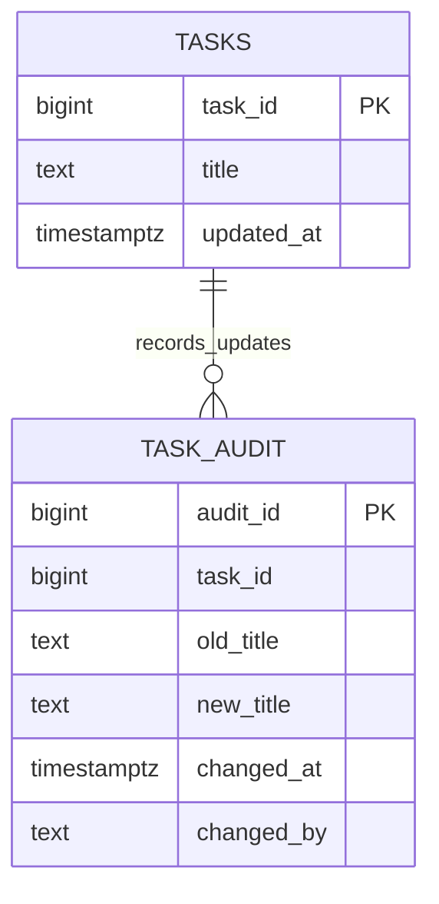

# 10. Triggers for updated_at and an audit trail

> **Draft: written but not yet run.** The code and the expected output in this lesson were prepared by reading the code and the official documentation. They have not been executed yet. If something does not behave as described, trust your tool's real output and report it.

## What you will be able to do
- Use a BEFORE row trigger to set updated_at on meaningful changes.
- Write an AFTER row trigger that records old/new values.
- Prove that no-op updates are skipped and audit rows roll back with their change.

## Recap
- Why are routines SECURITY INVOKER by default in these labs?
  <details><summary>Answer</summary>They should not silently elevate caller privileges.</details>
- Do two CURRENT_TIMESTAMP calls in one transaction necessarily differ?
  <details><summary>Answer</summary>No. CURRENT_TIMESTAMP is the transaction-start timestamp.</details>

## Why it matters
An updated_at convention breaks if one writer forgets it. A small trigger enforces it at every normal write path. Hidden business workflows in triggers, however, make data changes hard to reason about.

## What you will build
A task title-change timestamp, a narrow update-only audit table, a no-op test and a rollback proof.

## Before you start
- Finished [Databases 101](../../101-zero-to-hero/phase-3-designing/12-library-project.md): Docker PostgreSQL, psql/IDE connections, joins, transactions and basic indexes. No host PostgreSQL or psql install is needed.
- Docker in Linux-container mode with Compose, a text editor, and the same `postgres:17-alpine` image as 101. Docker/Compose versions above are the inherited authoring baseline, not a new runtime check. The tag pins major version/flavour, not a patch digest.
- Time: 50 minutes including reading, typing and exercise. Allow extra time if retyping files.
- Source pack (optional): every file is shown in full in this lesson, so you can follow without it. The finished code, the exercise starter and the solution are in the course repository https://github.com/Uee03/Code101 under `source/databases/201-hero-to-super-hero/phase-3-programmable-database/10-triggers-and-auditing/` (on that page choose **Code, Download ZIP**, or run `git clone https://github.com/Uee03/Code101.git`). Generated phase pack: `databases-201-phase-3-programmable-database.zip`.
- **One database lab at a time:** stop the previous 101/201 or capstone lab before using 127.0.0.1:5432. Do not stop unrelated services. These lessons are independent; do not carry a schema forward.
- All reset scripts/passwords are disposable local examples. Never aim them at work data. `learner` is the official image's initial administrative user, not an application login design.
- SQL, Docker, negative cases and IDE steps have not been run for this lesson. Result rows are derived by hand; variable tool output is described, not invented.

## Steps
### Step 1. Prepare the lesson workspace
1. In your home folder create `code101` with your file manager. Obtain the source folder from the repository link above, or extract the phase ZIP: Windows **right-click > Extract All**; macOS double-click; Linux use your archive manager's **Extract Here**. Move `databases-201-phase-3-programmable-database` into `code101`. Keep `10-triggers-and-auditing/code` and its sibling `exercise` together.
2. Without a pack, create the same `databases-201-phase-3-programmable-database/10-triggers-and-auditing/code` structure and sibling `exercise/starter` and `exercise/solution` folders using **New Folder**. You will create every file shown below. Leave the finished solution unopened until you try the exercise.
3. Open a terminal (Windows: type `powershell` in File Explorer's address bar in the code folder; macOS/Linux: open Terminal). Do not type a prompt's `>` or `$`. The text before the prompt shows your current directory. Recover to this exact folder if needed:

**Terminal (PowerShell; folder: this lesson `code/`)**
```powershell
Set-Location "$HOME\code101\databases-201-phase-3-programmable-database\10-triggers-and-auditing\code"
```

**Terminal (macOS/Linux; folder: this lesson `code/`)**
```bash
cd "$HOME/code101/databases-201-phase-3-programmable-database/10-triggers-and-auditing/code"
```

Expected result, not yet run: the prompt is in this lesson code folder; Set-Location/cd normally print no text. Using the repository directly is also fine: open its matching source code folder and use the same subsequent relative commands.

4. Open that folder in your editor. For each file caption choose **File > New File > Save As** at the shown path relative to the lesson root (`code/` is where your terminal is). If supplied, open and compare instead of creating duplicates. Create displayed subfolders first. Save as UTF-8 without BOM; use LF for shell files. On Windows enable **View > Show > File name extensions** so `.sql.txt` cannot hide. Save with Ctrl+S (Cmd+S on macOS); an editor-tab dot often means unsaved changes.

### Step 2. Save the complete Compose configuration
**File: `code/docker-compose.yml`**
```yaml
services:
  db:
    image: postgres:17-alpine
    environment:
      POSTGRES_DB: ${POSTGRES_DB}
      POSTGRES_USER: ${POSTGRES_USER}
      POSTGRES_PASSWORD: ${POSTGRES_PASSWORD}
      PGDATABASE: ${POSTGRES_DB}
      PGUSER: ${POSTGRES_USER}
    ports:
      - "127.0.0.1:5432:5432"
    volumes:
      - pg_data:/var/lib/postgresql/data
      - .:/scripts:ro
      - ../exercise:/exercises:ro
    healthcheck:
      test: ["CMD-SHELL", "pg_isready -U $$POSTGRES_USER -d $$POSTGRES_DB"]
      interval: 2s
      timeout: 3s
      retries: 30
      start_period: 5s
volumes:
  pg_data:
```

This file is genuinely identical to [201 lesson 01, Step 2](../phase-1-schema-design/01-data-modeling-and-3nf.md#step-2-save-the-complete-compose-configuration). Repeat that step with only these differences: workspace `10-triggers-and-auditing` instead of `01-data-modeling-and-3nf`, project `code101-db201-10` instead of `code101-db201-01`, and this lesson's SQL. **No YAML line changes.** Full configuration is repeated to keep this pack standalone.

| Configuration line(s) | Meaning and consequence of changing it |
|---|---|
| `services:`, `db:` | Define one service named db; commands below must use that name. |
| `image: postgres:17-alpine` | Use the unchanged official image. A different major version changes the data-directory compatibility contract. |
| `environment:` and POSTGRES_DB/USER/PASSWORD | Initialize the database/admin/password from .env only when the data volume is empty. |
| `PGDATABASE`, `PGUSER` | Set container-client defaults; commands also name user/database explicitly for clarity. |
| `ports:` with `127.0.0.1:5432:5432` | Publish only IPv4 loopback on host port 5432, not every host interface. Host tools use 127.0.0.1; another Compose service would use db. |
| `volumes:` and `pg_data:/var/lib/postgresql/data` | Keep data in this project's named volume. Removing the container alone does not erase it. |
| `.:/scripts:ro` | Mount this code folder read-only; saved host edits are visible to psql. It is not a writable backup location. |
| `../exercise:/exercises:ro` | Mount the sibling exercise folder read-only. Flattening the pack breaks the path. |
| `healthcheck:` and `test:` | Run pg_isready inside db. `$$` defers variable expansion to its shell, not Compose. Readiness is not a password/security test. |
| `interval: 2s`, `timeout: 3s` | Check every two seconds, allowing three seconds per probe. |
| `retries: 30`, `start_period: 5s` | Allow startup time before declaring failure; --wait uses health status. |
| Final `volumes:`, `pg_data:` | Declare the volume, scoped by the explicit project name. |

Indent with spaces. No Dockerfile/.dockerignore: nothing is built. No art is used (`assets: []`).

### Step 3. Create the local environment file
**File: `code/.env.example`**
```dotenv
# Disposable local practice only. Never reuse this password elsewhere.
POSTGRES_DB=code101
POSTGRES_USER=learner
POSTGRES_PASSWORD=learn_local_only
```

The comment marks local-only credentials. POSTGRES_DB names the initial database, POSTGRES_USER its administrator, and POSTGRES_PASSWORD its disposable password. Compose substitutes `${...}` in YAML using a file named exactly `.env`.

**Terminal (PowerShell; folder: this lesson `code/`)**
```powershell
Copy-Item .env.example .env
```

**Terminal (macOS/Linux; folder: this lesson `code/`)**
```bash
cp .env.example .env
```

Expected output, not yet run: a successful copy prints no text. The complete generated local file is:

**File: `code/.env`** (local copy, not shipped)
```dotenv
# Disposable local practice only. Never reuse this password elsewhere.
POSTGRES_DB=code101
POSTGRES_USER=learner
POSTGRES_PASSWORD=learn_local_only
```

**File: `code/.gitignore`**
```gitignore
.env
*.dump
```

These patterns exclude .env and dump archives from Git; they do not encrypt them or remove already tracked files. Editing .env later does not change an initialized database password. Reset only this disposable volume if reinitializing.

### Step 4. Model the feature, then save its files
A **trigger** runs a function automatically when a table event occurs. BEFORE row triggers may change NEW before the row is stored; AFTER row triggers see the resulting change. OLD is the prior row and NEW is the proposed/current row. FOR EACH ROW means once per affected row; statement triggers instead run once per statement.

`IS DISTINCT FROM` is NULL-safe inequality. The WHEN condition checks meaningful title changes, skipping both triggers when a statement assigns title to itself. This table has no other mutable business field; if you add one, update the meaningful-change predicate too.

**Diagram: audit storage**

The audit task_id intentionally has no foreign key: history must survive a later task deletion. The drawn relationship is logical, not an enforced FK.

Read/save all files before running. SQL ends statements with semicolons. Backslash commands are **psql client commands**, not server SQL: ON_ERROR_STOP stops at the first unexpected error; `\ir` includes relative to its containing script; unaligned format uses `|` between columns; footer off removes row-count footers; the null setting displays SQL NULL as `(null)`. Use psql for whole scripts; in an IDE select server SQL, not the backslash commands. The entry script arranges setup automatically. Never execute sample reset files on valuable data.

Defines the isolated example and seed. DROP SCHEMA app CASCADE removes the sample schema and its dependent objects. Use a disposable database.

**File: `code/setup.sql`**
```sql
DROP SCHEMA IF EXISTS app CASCADE;
CREATE SCHEMA app;
CREATE TABLE app.tasks (
    task_id bigint GENERATED ALWAYS AS IDENTITY,
    title text NOT NULL,
    updated_at timestamptz NOT NULL DEFAULT CURRENT_TIMESTAMP,
    CONSTRAINT pk_tasks PRIMARY KEY (task_id)
);
CREATE TABLE app.task_audit (
    audit_id bigint GENERATED ALWAYS AS IDENTITY,
    task_id bigint NOT NULL,
    old_title text NOT NULL,
    new_title text NOT NULL,
    changed_at timestamptz NOT NULL DEFAULT CURRENT_TIMESTAMP,
    changed_by text NOT NULL DEFAULT CURRENT_USER,
    CONSTRAINT pk_task_audit PRIMARY KEY (audit_id)
);
INSERT INTO app.tasks (title, updated_at) VALUES ('Pack', TIMESTAMPTZ '2000-01-01 00:00:00+00');
CREATE FUNCTION app.touch_task() RETURNS trigger
LANGUAGE plpgsql SECURITY INVOKER AS $$
BEGIN
    NEW.updated_at := CURRENT_TIMESTAMP;
    RETURN NEW;
END;
$$;
CREATE FUNCTION app.audit_task_title() RETURNS trigger
LANGUAGE plpgsql SECURITY INVOKER AS $$
BEGIN
    INSERT INTO app.task_audit (task_id, old_title, new_title)
    VALUES (OLD.task_id, OLD.title, NEW.title);
    RETURN NULL;
END;
$$;
CREATE TRIGGER tr_tasks_touch BEFORE UPDATE ON app.tasks
FOR EACH ROW WHEN (OLD.title IS DISTINCT FROM NEW.title)
EXECUTE FUNCTION app.touch_task();
CREATE TRIGGER tr_tasks_audit AFTER UPDATE ON app.tasks
FOR EACH ROW WHEN (OLD.title IS DISTINCT FROM NEW.title)
EXECUTE FUNCTION app.audit_task_title();
REVOKE EXECUTE ON ALL FUNCTIONS IN SCHEMA app FROM PUBLIC;
REVOKE ALL ON app.task_audit FROM PUBLIC;
```

The entry script includes setup or the migration driver, then performs the worked example.

**File: `code/lesson.sql`**
```sql
\set ON_ERROR_STOP on
\pset format unaligned
\pset footer off
\pset null '(null)'
\ir setup.sql
BEGIN;
UPDATE app.tasks SET title = 'Pack safely' WHERE task_id = 1;
SELECT title, updated_at = CURRENT_TIMESTAMP AS timestamp_is_transaction_time
FROM app.tasks WHERE task_id = 1;
SELECT old_title, new_title, changed_by FROM app.task_audit ORDER BY audit_id;
UPDATE app.tasks SET title = title WHERE task_id = 1;
SELECT COUNT(*) AS audit_rows_after_noop FROM app.task_audit;
ROLLBACK;
SELECT title FROM app.tasks WHERE task_id = 1;
SELECT COUNT(*) AS audit_rows_after_rollback FROM app.task_audit;
```

### Step 5. Start and inspect PostgreSQL
From this code folder use project `code101-db201-10` consistently. `-p` isolates names/volumes, not the shared host port. Keep Docker Desktop running. `up -d --wait` starts the service and waits for readiness; an initial image download takes extra time.

**Terminal (all OS; folder: this lesson `code/`)**
```powershell
docker compose -p code101-db201-10 up -d --wait
```

Expected output, not yet run: Compose creates the network, volume and db container, then reports healthy readiness. Progress order, IDs and timings vary; no startup transcript is claimed.

**Terminal (all OS; folder: this lesson `code/`)**
```powershell
docker compose -p code101-db201-10 ps --format "{{.Service}} {{.State}} {{.Health}}"
```

**Expected output, not yet run:**

```text
db running healthy
```

**Terminal (all OS; folder: this lesson `code/`)**
```powershell
docker compose -p code101-db201-10 logs --no-log-prefix --tail 10 db
```

Expected output, not yet run: timestamped PostgreSQL log lines indicating readiness to accept connections. Exact timestamps/process IDs are unpredictable. Read real logs if startup fails.

### Step 6. Connect using the existing 101 IDE pattern (optional)
The psql command below is sufficient. Repeat [101 lesson 02's IDE steps](../../101-zero-to-hero/phase-1-first-queries/02-connect-with-a-tool.md) with these fields; the differences are this lesson workspace and display name. No server install or Azure sign-in is needed for local access.

| Field | Value |
|---|---|
| Host / Server | `127.0.0.1` (IPv4 localhost) |
| Port | `5432` |
| Database | `code101` |
| User | `learner` |
| Password | `learn_local_only` (local only) |
| Authentication | Password / User & Password |
| SSL mode | Disable, only for this loopback lab |
| SSH tunnel | off |
| Display name | `Code101 DB201 10` |

- JetBrains: **Database / Database Explorer > + > Data Source > PostgreSQL**; enter General fields, **Download missing driver files** if offered, then **SSH/SSL** off for this local lab, **Test Connection > OK > New Query Console**. Run selected SQL with Ctrl+Enter (Cmd+Enter on macOS).
- VS Code: Microsoft's **PostgreSQL** extension (`ms-ossdata.vscode-pgsql`), **PostgreSQL > Connections > + / Add New Connection > Parameters**; enter fields, **Advanced** port/SSL, then **Test Connection > Save & Connect > New Query**. Run selected SQL with Ctrl+Shift+E (Cmd+Shift+E on macOS). UI labels may vary; 101 links the vendor directions.
- Visual Studio is not VS Code. Built-in SQL Server Object Explorer is not a PostgreSQL tool; Npgsql alone does not install a Server Explorer provider. Use the existing provider if available, or the terminal/IDE routes above.

Run only selected queries after setup; do not casually reapply destructive setup. A socket connection inside db does not prove a host-network password works. Require TLS for remote production connections; disabling SSL is only for local practice.

## Run it
**Predict first:** Predict the audit row count after assigning title = title, then after rolling back the whole transaction.


From this code folder run the entry file. `exec -T` runs the container client without a pseudo-terminal; `-X` ignores psql startup customization; `-q` suppresses routine tags; ON_ERROR_STOP fails fast; `-U`/`-d` name role/database; `-f` is the container file path. Quiet mode does not hide server errors/notices on stderr.

**Terminal (all OS; folder: this lesson `code/`)**
```powershell
docker compose -p code101-db201-10 exec -T db psql -X -q -v ON_ERROR_STOP=1 -U learner -d code101 -f /scripts/lesson.sql
```

**Expected output, not yet run:**

```text
title|timestamp_is_transaction_time
Pack safely|t
old_title|new_title|changed_by
Pack|Pack safely|learner
audit_rows_after_noop
1
title
Pack
audit_rows_after_rollback
0
```

The meaningful update records Pack -> Pack safely, with transaction timestamp equality t. The no-op produces no second audit row. ROLLBACK restores Pack and removes the audit row, leaving counts 1 then 0.

These are hand-derived unaligned result tables, not captured output. Missing-schema/dependency notices may appear on stderr; they are not data rows. An unexpected error means stop and inspect the first failing file/statement before continuing.

## How it works
The BEFORE function sets a field on NEW and returns NEW so the update proceeds. Do not issue another UPDATE on the same table inside this function: that can recurse. The AFTER function inserts one history row and returns NULL because its return value is ignored for AFTER triggers.

CURRENT_TIMESTAMP is transaction start time, not a guarantee of a distinct timestamp per row or statement. The test compares equality inside the same transaction instead of fabricating a clock value or sleeping. timestamptz represents an instant; display follows the session timezone, so raw time text is intentionally not asserted.

**Why this, not that:** prefer a CHECK or foreign key for declarative data rules; use a trigger only for the automatic cross-table side effect required here. Keep trigger work small and visible in schema reviews. This audit captures successful title UPDATEs, not inserts, deletes, failed attempts or all security events. It is not tamper-proof: the owner/superuser can change it, and rollback removes it with the original write. External security logging has different guarantees.

SECURITY INVOKER means a future runtime writer also needs appropriate audit-table INSERT and sequence privileges. Revoking PUBLIC privileges alone does not make an append-only audit system. A reviewed definer function owned by a separate protected role is an advanced alternative, not a casual workaround. CURRENT_USER here records the effective database role; with a shared pool it is not automatically the human end user.

## Try it
Keep db running after Run it. The starter resets the disposable schema, except lesson 03 which expects the already-applied migrations and rolls back its trial column.

1. **Guided:** Perform two meaningful changes in one transaction and return the two history transitions. Roll back after inspecting them.
2. Copy the single starter file into your code folder. This is a file copy, not a folder copy; setup includes use the absolute container /scripts path. Without a pack create the file from the complete starter listing. Edit only your working copy and save it.

**Terminal (PowerShell; folder: this lesson `code/`)**
```powershell
Copy-Item ..\exercise\starter\exercise.sql .\exercise.sql
```

**Terminal (macOS/Linux; folder: this lesson `code/`)**
```bash
cp ../exercise/starter/exercise.sql ./exercise.sql
```

Expected output, not yet run: no text after a successful copy.

**File: `exercise/starter/exercise.sql`** (copy to `code/exercise.sql`)
```sql
\set ON_ERROR_STOP on
\pset format unaligned
\pset footer off
\pset null '(null)'
\ir /scripts/setup.sql
BEGIN;
-- TODO: change title to Ready, then Dispatched for task 1.
-- TODO: select old_title, new_title ordered by audit_id.
ROLLBACK;
```

3. Fill the TODOs, save, then run your working file from this code folder.

**Terminal (all OS; folder: this lesson `code/`)**
```powershell
docker compose -p code101-db201-10 exec -T db psql -X -q -v ON_ERROR_STOP=1 -U learner -d code101 -f /scripts/exercise.sql
```

Target after completing the TODOs:

**Expected output, not yet run:**

```text
old_title|new_title
Pack|Ready
Ready|Dispatched
```

The target is for the completed program, not the untouched starter, which deliberately may return no rows or an uncorrected value.

4. **Change:** Insert a no-op update between the two changes. Predict why there are still two audit rows, not three.
5. **Stretch (optional):** Define a retention and access policy for audit data containing personal information; state which events need external logging.

<details><summary>Solution (open after trying)</summary>

**File: `exercise/solution/exercise.sql`**
```sql
\set ON_ERROR_STOP on
\pset format unaligned
\pset footer off
\pset null '(null)'
\ir /scripts/setup.sql
BEGIN;
UPDATE app.tasks SET title = 'Ready' WHERE task_id = 1;
UPDATE app.tasks SET title = 'Dispatched' WHERE task_id = 1;
SELECT old_title, new_title FROM app.task_audit ORDER BY audit_id;
ROLLBACK;
```

The solution implements the guided TODOs using the worked example's constructs. Compare its rows with the target above. To compare in your workspace, repeat the starter-copy step with only the source directory changed from starter to solution, then run the exact exercise command above:

**Terminal (PowerShell; folder: this lesson `code/`)**
```powershell
Copy-Item ..\exercise\solution\exercise.sql .\exercise.sql
```

**Terminal (macOS/Linux; folder: this lesson `code/`)**
```bash
cp ../exercise/solution/exercise.sql ./exercise.sql
```

</details>

### Stop and clean up before the next lab
Close IDE connections first. These commands apply only to this named disposable project.

**Terminal (all OS; folder: this lesson `code/`)**
```powershell
docker compose -p code101-db201-10 stop
docker compose -p code101-db201-10 ps -a --format "{{.Service}} {{.State}}"
```

Expected output, not yet run: variable stop progress, then:

```text
db exited
```

**Terminal (all OS; folder: this lesson `code/`)**
```powershell
docker compose -p code101-db201-10 down -v --remove-orphans
```

Expected output, not yet run: Compose removes this project container/network and saved volume; exact progress text varies. **-v destroys saved database data**, including the restored target in lesson 11. It does not erase other projects or the host dump file. Never use it on valuable data.

**Terminal (all OS; folder: this lesson `code/`)**
```powershell
docker compose -p code101-db201-10 ps -a --format "{{.Service}} {{.State}}"
```

Expected output, not yet run: no service rows; port 5432 is no longer held by this project.

## Check yourself
1. Why must the BEFORE function return NEW?
   <details><summary>Answer</summary>Its return value controls whether and what row is stored; NULL would skip this row.</details>
2. Predict the second audit transition in the exercise.
   <details><summary>Answer</summary>Ready -> Dispatched, because OLD is the immediately preceding stored value.</details>
3. Does this audit survive an outer rollback?
   <details><summary>Answer</summary>No. Trigger writes participate in the same transaction and roll back too.</details>

### Phase mixed review
Try without looking back; these connect this phase to earlier work.
- Will an ordinary view need a refresh after an update?
  <details><summary>Answer</summary>No; a materialized view stores rows and does need an explicit refresh.</details>
- Who should normally own a business procedure transaction?
  <details><summary>Answer</summary>The caller, so several operations can commit atomically.</details>
- Can an AFTER audit insert commit independently?
  <details><summary>Answer</summary>Not in this ordinary trigger. It is part of the triggering transaction.</details>

## Common mistakes
No new error transcript has been captured. These are symptoms; wording marked typical message is illustrative, not observed output.

| Symptom | Cause | Fix |
|---|---|---|
| Compose cannot find its configuration (typical message) | Terminal is in the wrong folder | Recover to code using Step 1; keep code/exercise siblings. |
| Old behavior persists | Unsaved file, hidden .sql.txt extension or wrong project | Save, check filename extensions and use the exact -p name in every command. |
| Startup cannot claim 5432 (typical message) | Another lab owns the host port | Stop the previous lab from its own code folder; never kill unrelated processes. |
| An update unexpectedly affects no row | A BEFORE trigger returned NULL | Return NEW for an ordinary accepted update. |
| A runtime writer cannot insert audit history (typical message) | Invoker rights require audit-table and sequence access too | Design grants deliberately; do not make the application a superuser or casually use SECURITY DEFINER. |
| An IDE rejects a backslash line (typical message) | psql meta-commands were sent as SQL | Use psql for whole scripts; select only server SQL in an IDE. |

## Best practice
Use triggers for small database-local invariants or side effects, and document their transactional behavior. Source: [PostgreSQL 17: trigger functions](https://www.postgresql.org/docs/17/plpgsql-trigger.html).

## Going further
Official PostgreSQL **17** references checked for this draft:
- [PostgreSQL 17: trigger functions](https://www.postgresql.org/docs/17/plpgsql-trigger.html)
- [CREATE TRIGGER](https://www.postgresql.org/docs/17/sql-createtrigger.html)
- [Current time semantics](https://www.postgresql.org/docs/17/functions-datetime.html#FUNCTIONS-DATETIME-CURRENT)

This returns in [lesson 11](../phase-4-operations-and-security/11-roles-rls-backup-and-pooling.md): every schema/query/routine decision also needs a permission and recovery story.

## Summary
- You worked through how to use a BEFORE row trigger to set updated_at on meaningful changes.
- You worked through how to write an AFTER row trigger that records old/new values.
- You worked through how to prove that no-op updates are skipped and audit rows roll back with their change.
- The code and derived output remain written but not run; the draft notice is intentional.

## Next lesson
[11. Roles, row-level security, backups and pooling](../phase-4-operations-and-security/11-roles-rls-backup-and-pooling.md): Separate administrative ownership from least-privilege runtime grants.
