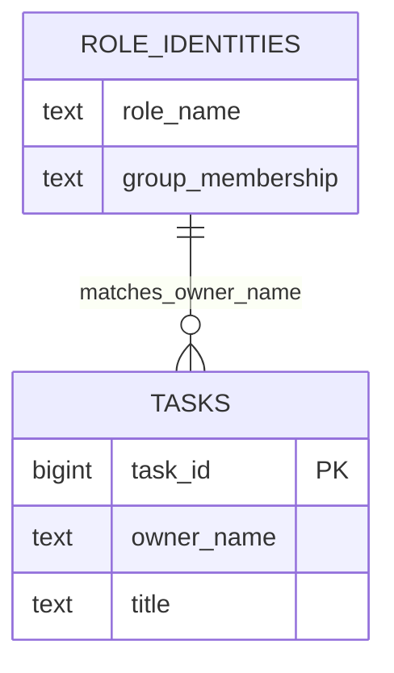

# 11. Roles, row-level security, backups and pooling

> **Draft: written but not yet run.** The code and the expected output in this lesson were prepared by reading the code and the official documentation. They have not been executed yet. If something does not behave as described, trust your tool's real output and report it.

## What you will be able to do
- Separate administrative ownership from least-privilege runtime grants.
- Test RLS reads and writes as non-owner roles.
- Back up and restore a database, checking both data and row access.
- Explain why a bounded connection pool must not leak session identity.

## Recap
- Will an audit trigger record an aborted write permanently?
  <details><summary>Answer</summary>No; ordinary trigger changes roll back with their transaction.</details>
- Why is testing as learner insufficient for security?
  <details><summary>Answer</summary>The official image creates learner as an administrative superuser, which bypasses ordinary permission and RLS restrictions.</details>

## Why it matters
A correct query is not enough if it can see another customer data or if no one can restore the database. Operations and permissions are part of the application contract. This lesson is a local rehearsal, not a production-hardening checklist disguised as a few commands.

## What you will build
A permission group and two non-login test identities, row-scoped task access, negative access checks, and a binary-safe backup/restore round trip into a separate database.

## Before you start
- Finished [Databases 101](../../101-zero-to-hero/phase-3-designing/12-library-project.md): Docker PostgreSQL, psql/IDE connections, joins, transactions and basic indexes. No host PostgreSQL or psql install is needed.
- Docker in Linux-container mode with Compose, a text editor, and the same `postgres:17-alpine` image as 101. Docker/Compose versions above are the inherited authoring baseline, not a new runtime check. The tag pins major version/flavour, not a patch digest.
- Time: 90 minutes including reading, typing and exercise. Two sittings are reasonable: save the feature files before Step 5, then return for the run and exercise.
- Source pack (optional): every file is shown in full in this lesson, so you can follow without it. The finished code, the exercise starter and the solution are in the course repository https://github.com/Uee03/Code101 under `source/databases/201-hero-to-super-hero/phase-4-operations-and-security/11-roles-rls-backup-and-pooling/` (on that page choose **Code, Download ZIP**, or run `git clone https://github.com/Uee03/Code101.git`). Generated phase pack: `databases-201-phase-4-operations-and-security.zip`.
- **One database lab at a time:** stop the previous 101/201 or capstone lab before using 127.0.0.1:5432. Do not stop unrelated services. These lessons are independent; do not carry a schema forward.
- All reset scripts/passwords are disposable local examples. Never aim them at work data. `learner` is the official image's initial administrative user, not an application login design.
- SQL, Docker, negative cases and IDE steps have not been run for this lesson. Result rows are derived by hand; variable tool output is described, not invented.

## Steps
### Step 1. Prepare the lesson workspace
1. In your home folder create `code101` with your file manager. Obtain the source folder from the repository link above, or extract the phase ZIP: Windows **right-click > Extract All**; macOS double-click; Linux use your archive manager's **Extract Here**. Move `databases-201-phase-4-operations-and-security` into `code101`. Keep `11-roles-rls-backup-and-pooling/code` and its sibling `exercise` together.
2. Without a pack, create the same `databases-201-phase-4-operations-and-security/11-roles-rls-backup-and-pooling/code` structure and sibling `exercise/starter` and `exercise/solution` folders using **New Folder**. You will create every file shown below. Leave the finished solution unopened until you try the exercise.
3. Open a terminal (Windows: type `powershell` in File Explorer's address bar in the code folder; macOS/Linux: open Terminal). Do not type a prompt's `>` or `$`. The text before the prompt shows your current directory. Recover to this exact folder if needed:

**Terminal (PowerShell; folder: this lesson `code/`)**
```powershell
Set-Location "$HOME\code101\databases-201-phase-4-operations-and-security\11-roles-rls-backup-and-pooling\code"
```

**Terminal (macOS/Linux; folder: this lesson `code/`)**
```bash
cd "$HOME/code101/databases-201-phase-4-operations-and-security/11-roles-rls-backup-and-pooling/code"
```

Expected result, not yet run: the prompt is in this lesson code folder; Set-Location/cd normally print no text. Using the repository directly is also fine: open its matching source code folder and use the same subsequent relative commands.

4. Open that folder in your editor. For each file caption choose **File > New File > Save As** at the shown path relative to the lesson root (`code/` is where your terminal is). If supplied, open and compare instead of creating duplicates. Create displayed subfolders first. Save as UTF-8 without BOM; use LF for shell files. On Windows enable **View > Show > File name extensions** so `.sql.txt` cannot hide. Save with Ctrl+S (Cmd+S on macOS); an editor-tab dot often means unsaved changes.

### Step 2. Save the complete Compose configuration
**File: `code/docker-compose.yml`**
```yaml
services:
  db:
    image: postgres:17-alpine
    environment:
      POSTGRES_DB: ${POSTGRES_DB}
      POSTGRES_USER: ${POSTGRES_USER}
      POSTGRES_PASSWORD: ${POSTGRES_PASSWORD}
      PGDATABASE: ${POSTGRES_DB}
      PGUSER: ${POSTGRES_USER}
    ports:
      - "127.0.0.1:5432:5432"
    volumes:
      - pg_data:/var/lib/postgresql/data
      - .:/scripts:ro
      - ../exercise:/exercises:ro
    healthcheck:
      test: ["CMD-SHELL", "pg_isready -U $$POSTGRES_USER -d $$POSTGRES_DB"]
      interval: 2s
      timeout: 3s
      retries: 30
      start_period: 5s
volumes:
  pg_data:
```

This file is genuinely identical to [201 lesson 01, Step 2](../phase-1-schema-design/01-data-modeling-and-3nf.md#step-2-save-the-complete-compose-configuration). Repeat that step with only these differences: workspace `11-roles-rls-backup-and-pooling` instead of `01-data-modeling-and-3nf`, project `code101-db201-11` instead of `code101-db201-01`, and this lesson's SQL. **No YAML line changes.** Full configuration is repeated to keep this pack standalone.

| Configuration line(s) | Meaning and consequence of changing it |
|---|---|
| `services:`, `db:` | Define one service named db; commands below must use that name. |
| `image: postgres:17-alpine` | Use the unchanged official image. A different major version changes the data-directory compatibility contract. |
| `environment:` and POSTGRES_DB/USER/PASSWORD | Initialize the database/admin/password from .env only when the data volume is empty. |
| `PGDATABASE`, `PGUSER` | Set container-client defaults; commands also name user/database explicitly for clarity. |
| `ports:` with `127.0.0.1:5432:5432` | Publish only IPv4 loopback on host port 5432, not every host interface. Host tools use 127.0.0.1; another Compose service would use db. |
| `volumes:` and `pg_data:/var/lib/postgresql/data` | Keep data in this project's named volume. Removing the container alone does not erase it. |
| `.:/scripts:ro` | Mount this code folder read-only; saved host edits are visible to psql. It is not a writable backup location. |
| `../exercise:/exercises:ro` | Mount the sibling exercise folder read-only. Flattening the pack breaks the path. |
| `healthcheck:` and `test:` | Run pg_isready inside db. `$$` defers variable expansion to its shell, not Compose. Readiness is not a password/security test. |
| `interval: 2s`, `timeout: 3s` | Check every two seconds, allowing three seconds per probe. |
| `retries: 30`, `start_period: 5s` | Allow startup time before declaring failure; --wait uses health status. |
| Final `volumes:`, `pg_data:` | Declare the volume, scoped by the explicit project name. |

Indent with spaces. No Dockerfile/.dockerignore: nothing is built. No art is used (`assets: []`).

### Step 3. Create the local environment file
**File: `code/.env.example`**
```dotenv
# Disposable local practice only. Never reuse this password elsewhere.
POSTGRES_DB=code101
POSTGRES_USER=learner
POSTGRES_PASSWORD=learn_local_only
```

The comment marks local-only credentials. POSTGRES_DB names the initial database, POSTGRES_USER its administrator, and POSTGRES_PASSWORD its disposable password. Compose substitutes `${...}` in YAML using a file named exactly `.env`.

**Terminal (PowerShell; folder: this lesson `code/`)**
```powershell
Copy-Item .env.example .env
```

**Terminal (macOS/Linux; folder: this lesson `code/`)**
```bash
cp .env.example .env
```

Expected output, not yet run: a successful copy prints no text. The complete generated local file is:

**File: `code/.env`** (local copy, not shipped)
```dotenv
# Disposable local practice only. Never reuse this password elsewhere.
POSTGRES_DB=code101
POSTGRES_USER=learner
POSTGRES_PASSWORD=learn_local_only
```

**File: `code/.gitignore`**
```gitignore
.env
*.dump
```

These patterns exclude .env and dump archives from Git; they do not encrypt them or remove already tracked files. Editing .env later does not change an initialized database password. Reset only this disposable volume if reinitializing.

### Step 4. Model the feature, then save its files
**Row-level security (RLS)** filters and checks rows in addition to ordinary SQL privileges. A **policy** supplies a Boolean expression: USING governs visible/existing rows; WITH CHECK governs proposed inserted/updated rows. A grant is still required: a policy never replaces GRANT.

The policy compares the effective database role CURRENT_USER to owner_name. The group supplies privileges; the individual role supplies row identity. The two test roles are NOLOGIN, so SET ROLE simulates them from the lab administrator. This tests policy behavior, not password authentication. A real login requires LOGIN plus separately provisioned credentials and TLS; do not make a runtime login a member of an administrator or other tenant roles.

The setup creates cluster-wide roles and is **first-run only**. Finish this lesson on a fresh disposable volume. Re-running lesson.sql after roles exist is deliberately not idempotent. To start over, use the destructive cleanup below, then up again. Do not drop/recreate shared roles on a real cluster.

**Diagram: permissions and row ownership**

This is a conceptual link, not a foreign key into the role catalog. RLS does not validate that every owner_name identifies a role.

Read/save all files before running. SQL ends statements with semicolons. Backslash commands are **psql client commands**, not server SQL: ON_ERROR_STOP stops at the first unexpected error; `\ir` includes relative to its containing script; unaligned format uses `|` between columns; footer off removes row-count footers; the null setting displays SQL NULL as `(null)`. Use psql for whole scripts; in an IDE select server SQL, not the backslash commands. The entry script arranges setup automatically. Never execute sample reset files on valuable data.

Defines the isolated example and seed. DROP SCHEMA app CASCADE removes the sample schema and its dependent objects. Use a disposable database.

**File: `code/setup.sql`**
```sql
DROP SCHEMA IF EXISTS app CASCADE;
CREATE SCHEMA app;
CREATE ROLE db201_writers NOLOGIN NOSUPERUSER NOCREATEDB NOCREATEROLE NOBYPASSRLS;
CREATE ROLE db201_ava NOLOGIN NOSUPERUSER NOCREATEDB NOCREATEROLE NOBYPASSRLS;
CREATE ROLE db201_ben NOLOGIN NOSUPERUSER NOCREATEDB NOCREATEROLE NOBYPASSRLS;
GRANT db201_writers TO db201_ava, db201_ben;
REVOKE ALL ON DATABASE code101 FROM PUBLIC;
GRANT CONNECT ON DATABASE code101 TO db201_ava, db201_ben;
REVOKE CREATE ON SCHEMA public FROM PUBLIC;
REVOKE ALL ON SCHEMA app FROM PUBLIC;
CREATE TABLE app.tasks (
    task_id bigint GENERATED ALWAYS AS IDENTITY,
    owner_name text NOT NULL,
    title text NOT NULL,
    CONSTRAINT pk_tasks PRIMARY KEY (task_id)
);
INSERT INTO app.tasks (owner_name, title) VALUES
    ('db201_ava', 'Pack'), ('db201_ava', 'Ship'), ('db201_ben', 'Restock');
CREATE INDEX ix_tasks_owner_name ON app.tasks (owner_name);
GRANT USAGE ON SCHEMA app TO db201_writers;
GRANT SELECT, INSERT ON app.tasks TO db201_writers;
GRANT UPDATE (title) ON app.tasks TO db201_writers;
GRANT USAGE ON SEQUENCE app.tasks_task_id_seq TO db201_writers;
ALTER TABLE app.tasks ENABLE ROW LEVEL SECURITY;
CREATE POLICY tasks_own_rows ON app.tasks TO db201_writers
    USING (owner_name = CURRENT_USER)
    WITH CHECK (owner_name = CURRENT_USER);
```

The entry script includes setup or the migration driver, then performs the worked example.

**File: `code/lesson.sql`**
```sql
\set ON_ERROR_STOP on
\pset format unaligned
\pset footer off
\pset null '(null)'
\ir setup.sql
SET ROLE db201_ava;
SELECT title, owner_name FROM app.tasks ORDER BY task_id;
SELECT COUNT(*) AS hidden_ben_rows FROM app.tasks WHERE owner_name = 'db201_ben';
UPDATE app.tasks SET title = 'stolen' WHERE owner_name = 'db201_ben';
DO $$
BEGIN
    BEGIN
        INSERT INTO app.tasks (owner_name, title) VALUES ('db201_ben', 'forbidden');
        RAISE EXCEPTION 'cross-owner insert unexpectedly allowed';
    EXCEPTION WHEN insufficient_privilege THEN
        NULL;
    END;
    BEGIN
        DELETE FROM app.tasks;
        RAISE EXCEPTION 'delete unexpectedly allowed';
    EXCEPTION WHEN insufficient_privilege THEN
        NULL;
    END;
END;
$$;
SELECT 'blocked' AS cross_owner_insert, 'blocked' AS delete_without_grant;
RESET ROLE;
SET ROLE db201_ben;
SELECT title, owner_name FROM app.tasks ORDER BY task_id;
RESET ROLE;
```

Reads the restored database without recreating roles or resetting data.

**File: `code/restore_check.sql`**
```sql
\set ON_ERROR_STOP on
\pset format unaligned
\pset footer off
\pset null '(null)'
SELECT COUNT(*) AS total_rows FROM app.tasks;
SET ROLE db201_ava;
SELECT title, owner_name FROM app.tasks ORDER BY task_id;
RESET ROLE;
```

### Step 5. Start and inspect PostgreSQL
From this code folder use project `code101-db201-11` consistently. `-p` isolates names/volumes, not the shared host port. Keep Docker Desktop running. `up -d --wait` starts the service and waits for readiness; an initial image download takes extra time.

**Terminal (all OS; folder: this lesson `code/`)**
```powershell
docker compose -p code101-db201-11 up -d --wait
```

Expected output, not yet run: Compose creates the network, volume and db container, then reports healthy readiness. Progress order, IDs and timings vary; no startup transcript is claimed.

**Terminal (all OS; folder: this lesson `code/`)**
```powershell
docker compose -p code101-db201-11 ps --format "{{.Service}} {{.State}} {{.Health}}"
```

**Expected output, not yet run:**

```text
db running healthy
```

**Terminal (all OS; folder: this lesson `code/`)**
```powershell
docker compose -p code101-db201-11 logs --no-log-prefix --tail 10 db
```

Expected output, not yet run: timestamped PostgreSQL log lines indicating readiness to accept connections. Exact timestamps/process IDs are unpredictable. Read real logs if startup fails.

### Step 6. Connect using the existing 101 IDE pattern (optional)
The psql command below is sufficient. Repeat [101 lesson 02's IDE steps](../../101-zero-to-hero/phase-1-first-queries/02-connect-with-a-tool.md) with these fields; the differences are this lesson workspace and display name. No server install or Azure sign-in is needed for local access.

| Field | Value |
|---|---|
| Host / Server | `127.0.0.1` (IPv4 localhost) |
| Port | `5432` |
| Database | `code101` |
| User | `learner` |
| Password | `learn_local_only` (local only) |
| Authentication | Password / User & Password |
| SSL mode | Disable, only for this loopback lab |
| SSH tunnel | off |
| Display name | `Code101 DB201 11` |

- JetBrains: **Database / Database Explorer > + > Data Source > PostgreSQL**; enter General fields, **Download missing driver files** if offered, then **SSH/SSL** off for this local lab, **Test Connection > OK > New Query Console**. Run selected SQL with Ctrl+Enter (Cmd+Enter on macOS).
- VS Code: Microsoft's **PostgreSQL** extension (`ms-ossdata.vscode-pgsql`), **PostgreSQL > Connections > + / Add New Connection > Parameters**; enter fields, **Advanced** port/SSL, then **Test Connection > Save & Connect > New Query**. Run selected SQL with Ctrl+Shift+E (Cmd+Shift+E on macOS). UI labels may vary; 101 links the vendor directions.
- Visual Studio is not VS Code. Built-in SQL Server Object Explorer is not a PostgreSQL tool; Npgsql alone does not install a Server Explorer provider. Use the existing provider if available, or the terminal/IDE routes above.

Run only selected queries after setup; do not casually reapply destructive setup. A socket connection inside db does not prove a host-network password works. Require TLS for remote production connections; disabling SSL is only for local practice.

## Run it
**Predict first:** Predict how many Ben rows Ava can select or update. Will a grant of INSERT let Ava create a row owned by Ben?


From this code folder run the entry file. `exec -T` runs the container client without a pseudo-terminal; `-X` ignores psql startup customization; `-q` suppresses routine tags; ON_ERROR_STOP fails fast; `-U`/`-d` name role/database; `-f` is the container file path. Quiet mode does not hide server errors/notices on stderr.

**Terminal (all OS; folder: this lesson `code/`)**
```powershell
docker compose -p code101-db201-11 exec -T db psql -X -q -v ON_ERROR_STOP=1 -U learner -d code101 -f /scripts/lesson.sql
```

**Expected output, not yet run:**

```text
title|owner_name
Pack|db201_ava
Ship|db201_ava
hidden_ben_rows
0
cross_owner_insert|delete_without_grant
blocked|blocked
title|owner_name
Restock|db201_ben
```

Ava sees Pack and Ship. The Ben filter matches zero visible rows, so the attempted update changes none. The wrong-owner insert fails WITH CHECK, and DELETE fails because no DELETE privilege was granted. Ben still sees Restock.

These are hand-derived unaligned result tables, not captured output. Missing-schema/dependency notices may appear on stderr; they are not data rows. An unexpected error means stop and inspect the first failing file/statement before continuing.

## How it works
The administrator owns schema and table. The writer group gets schema USAGE, table SELECT/INSERT and only title UPDATE; sequence USAGE allows generated IDs. There is deliberately no DELETE, ownership transfer, schema CREATE, superuser or BYPASSRLS grant. An UPDATE needs SELECT rights for the rows/columns it reads too. Revoking PUBLIC privileges avoids relying on broad defaults, but grants for future objects must still be reviewed: grants on existing tables do not automatically apply to newly created ones.

After ENABLE ROW LEVEL SECURITY, lack of an applicable policy means default deny. This ALL-command policy applies through group membership. The user must pass both ordinary privileges and the relevant row expression. Multiple permissive policies combine with OR; casually adding a wide policy can widen access. USING filters invisible rows quietly, whereas a failed WITH CHECK raises an error. The DO blocks catch only insufficient_privilege (SQLSTATE 42501); unexpected success raises a different uncaught sentinel.

**Why this, not that:** use owner-based policy tests under a non-owner, non-superuser role rather than adding an application WHERE and assuming it is security. Owners normally bypass RLS; FORCE ROW LEVEL SECURITY can subject an ordinary owner to it, but superusers and BYPASSRLS still bypass. Table-wide TRUNCATE is not row-filtered. RLS is not encryption, SQL-injection prevention or complete protection against every inference channel. Use parameterized queries from 101 and test real runtime connections before deployment.

A **connection pool** reuses a bounded set of database connections instead of opening one for every request. Budget the sum of pool maxima across application replicas, leaving room below max_connections for administration and maintenance. Raising max_connections indefinitely consumes resources; it is not a pooling strategy. Session pooling keeps a server connection assigned longer; transaction pooling can reassign it after each transaction, so session state must not be assumed to persist.

Our CURRENT_USER policy is tied to database-role identity. A pooled connection must never be returned carrying another request's SET ROLE or session settings. Use a pool that separates users or carefully scoped transactions and role/reset handling; do not use a shared administrative connection that clients can arbitrarily RESET ROLE on. The SET ROLE simulation here intentionally retains a powerful session_user and is not an authentication architecture. Tenant identity in a client-settable variable is not trustworthy merely because RLS reads it.

## Try it
Keep this first-run role setup running; do not reapply it. The exercise rolls back its changes.

1. **Guided:** Within a transaction as Ben, change only his visible Restock title to Restock safely, show the result and roll back. Do not rerun setup: roles already exist.
2. Copy the single starter file into your code folder. This is a file copy, not a folder copy; setup includes use the absolute container /scripts path. Without a pack create the file from the complete starter listing. Edit only your working copy and save it.

**Terminal (PowerShell; folder: this lesson `code/`)**
```powershell
Copy-Item ..\exercise\starter\exercise.sql .\exercise.sql
```

**Terminal (macOS/Linux; folder: this lesson `code/`)**
```bash
cp ../exercise/starter/exercise.sql ./exercise.sql
```

Expected output, not yet run: no text after a successful copy.

**File: `exercise/starter/exercise.sql`** (copy to `code/exercise.sql`)
```sql
\set ON_ERROR_STOP on
\pset format unaligned
\pset footer off
\pset null '(null)'
-- Prerequisite: Run it has created the roles and seed once.
BEGIN;
SET LOCAL ROLE db201_ben;
-- TODO: update Ben's visible task title to Restock safely.
-- TODO: return title, owner_name in task_id order.
ROLLBACK;
```

3. Fill the TODOs, save, then run your working file from this code folder.

**Terminal (all OS; folder: this lesson `code/`)**
```powershell
docker compose -p code101-db201-11 exec -T db psql -X -q -v ON_ERROR_STOP=1 -U learner -d code101 -f /scripts/exercise.sql
```

Target after completing the TODOs:

**Expected output, not yet run:**

```text
title|owner_name
Restock safely|db201_ben
```

The target is for the completed program, not the untouched starter, which deliberately may return no rows or an uncorrected value.

4. **Change:** In the same disposable transaction, filter for Ava tasks while acting as Ben. Predict zero visible rows. Compare a hidden-row update with an explicit forbidden insert.
5. **Stretch (optional):** Sketch a connection-pool identity lifecycle that never returns a connection with the previous request role active. Include failed requests and rollbacks.

<details><summary>Solution (open after trying)</summary>

**File: `exercise/solution/exercise.sql`**
```sql
\set ON_ERROR_STOP on
\pset format unaligned
\pset footer off
\pset null '(null)'
BEGIN;
SET LOCAL ROLE db201_ben;
UPDATE app.tasks SET title = 'Restock safely' WHERE title = 'Restock';
SELECT title, owner_name FROM app.tasks ORDER BY task_id;
ROLLBACK;
```

The solution implements the guided TODOs using the worked example's constructs. Compare its rows with the target above. To compare in your workspace, repeat the starter-copy step with only the source directory changed from starter to solution, then run the exact exercise command above:

**Terminal (PowerShell; folder: this lesson `code/`)**
```powershell
Copy-Item ..\exercise\solution\exercise.sql .\exercise.sql
```

**Terminal (macOS/Linux; folder: this lesson `code/`)**
```bash
cp ../exercise/solution/exercise.sql ./exercise.sql
```

</details>

**Break point:** finish the exercise first; return for the backup/restore sitting before cleanup.

### Back up, copy and restore into a different database
Do this after Run it and the exercise; the exercise rolls back, so the seed still has three rows. Keep this lesson running. Close IDE connections to any previous code101_restored database. All commands below run in this lesson code folder and are identical on PowerShell, macOS and Linux.

1. Create a custom-format archive **inside the container**. -Fc chooses an archive for pg_restore; -f writes directly, without PowerShell binary redirection.

**Terminal (all OS; folder: this lesson `code/`)**
```powershell
docker compose -p code101-db201-11 exec -T db pg_dump -U learner -d code101 -Fc -f /tmp/code101.dump
```
Expected output, not yet run: success is normally silent; warnings appear on stderr. Do not assume a zero-byte/missing archive is a backup.

2. Copy the archive out of the container, then copy that saved file back under a different name. The read-only /scripts mount is not a backup destination.

**Terminal (all OS; folder: this lesson `code/`)**
```powershell
docker compose -p code101-db201-11 cp db:/tmp/code101.dump ./code101.dump
docker compose -p code101-db201-11 cp ./code101.dump db:/tmp/roundtrip.dump
```
Expected output, not yet run: Compose copy progress, with machine-dependent file size. The host now has code101.dump. This round trip tests the saved file, not just the original container copy. Keep real backups encrypted and access-controlled; .gitignore is not security.

3. Create an empty, separately named target using template0. Restore only your own trusted dump. Restoring a dump can execute SQL chosen by its source owner. Do not use --clean against the source database.

**Terminal (all OS; folder: this lesson `code/`)**
```powershell
docker compose -p code101-db201-11 exec -T db createdb -U learner --template=template0 code101_restored
docker compose -p code101-db201-11 exec -T db pg_restore --exit-on-error --no-owner -U learner -d code101_restored /tmp/roundtrip.dump
```
Expected output, not yet run: normal success is silent; any error stops restoration. On a repeat drill, drop **only the disposable target** first with `docker compose -p code101-db201-11 exec -T db dropdb -U learner code101_restored`, then repeat these two commands. Never substitute code101 there.

4. Check total rows as the administrator and row filtering as Ava in the restored database. Use the script below without its setup: re-creating roles would be wrong.

**Terminal (all OS; folder: this lesson `code/`)**
```powershell
docker compose -p code101-db201-11 exec -T db psql -X -q -v ON_ERROR_STOP=1 -U learner -d code101_restored -f /scripts/restore_check.sql
```
Expected output, not yet run (derived from the unchanged seed and restored policy):

```text
total_rows
3
title|owner_name
Pack|db201_ava
Ship|db201_ava
```
`--no-owner` makes restored objects owned by the restoring role; it does not strip grants/policies. pg_dump covers one database, not cluster roles. This same-cluster drill succeeds because db201_writers/db201_ava/db201_ben still exist. A new cluster needs securely provisioned roles first (or a separately secured globals backup), plus a review of database CONNECT grants, owners and default privileges. Do not copy real role password hashes into a public pack.

This logical archive is not continuous point-in-time recovery. Production recovery needs defined recovery objectives, protected off-machine copies and regular isolated restore drills including application behavior, permissions and dependencies.

### Stop and clean up before the next lab
Close IDE connections first. These commands apply only to this named disposable project.

**Terminal (all OS; folder: this lesson `code/`)**
```powershell
docker compose -p code101-db201-11 stop
docker compose -p code101-db201-11 ps -a --format "{{.Service}} {{.State}}"
```

Expected output, not yet run: variable stop progress, then:

```text
db exited
```

**Terminal (all OS; folder: this lesson `code/`)**
```powershell
docker compose -p code101-db201-11 down -v --remove-orphans
```

Expected output, not yet run: Compose removes this project container/network and saved volume; exact progress text varies. **-v destroys saved database data**, including the restored target in lesson 11. It does not erase other projects or the host dump file. Never use it on valuable data.

**Terminal (all OS; folder: this lesson `code/`)**
```powershell
docker compose -p code101-db201-11 ps -a --format "{{.Service}} {{.State}}"
```

Expected output, not yet run: no service rows; port 5432 is no longer held by this project.

## Check yourself
1. Should the runtime role own the protected table?
   <details><summary>Answer</summary>Normally no. Separate ownership/migration administration from runtime privileges; owners commonly bypass RLS.</details>
2. Predict Ava cross-owner update and insert behavior.
   <details><summary>Answer</summary>The update sees zero Ben rows; an insert naming Ben fails WITH CHECK even though INSERT is granted.</details>
3. Why must roles exist before this dump is restored on another cluster?
   <details><summary>Answer</summary>pg_dump exports one database, not global role definitions. Grants and policy role references need those identities.</details>
4. What can go wrong when a pooled connection keeps SET ROLE?
   <details><summary>Answer</summary>A later request may inherit the previous identity and see or modify the wrong rows. Reset/transaction scope must be designed and tested.</details>

### Phase mixed review
Try without looking back; these connect this phase to earlier work.
- Which comes first: a policy or ordinary privileges?
  <details><summary>Answer</summary>Both are needed. A policy restricts rows but does not itself grant table/schema/sequence access.</details>
- Why is a successful dump not a proven backup?
  <details><summary>Answer</summary>Only a restore drill checks that the saved archive, identities and dependencies can reconstruct usable data.</details>
- Connect the earlier phases: what must a new protected table migration ship?
  <details><summary>Answer</summary>Its constraints/indexes, reviewed runtime grants, RLS enablement/policies where required, and backup/restore considerations.</details>

## Common mistakes
No new error transcript has been captured. These are symptoms; wording marked typical message is illustrative, not observed output.

| Symptom | Cause | Fix |
|---|---|---|
| Compose cannot find its configuration (typical message) | Terminal is in the wrong folder | Recover to code using Step 1; keep code/exercise siblings. |
| Old behavior persists | Unsaved file, hidden .sql.txt extension or wrong project | Save, check filename extensions and use the exact -p name in every command. |
| Startup cannot claim 5432 (typical message) | Another lab owns the host port | Stop the previous lab from its own code folder; never kill unrelated processes. |
| The administrator sees every row despite the policy | learner is a superuser/table owner | Test with SET ROLE to a non-owner here, and actual restricted login sessions before deployment. |
| A rerun reports a role already exists (typical message) | Role creation is first-run only and cluster-wide | Reset this disposable volume, not shared production roles. |
| Restore fails on a role reference (typical message) | The target cluster has no matching roles | Provision required identities and review grants before restoring; pg_dump alone does not include them. |
| An IDE rejects a backslash line (typical message) | psql meta-commands were sent as SQL | Use psql for whole scripts; select only server SQL in an IDE. |

## Best practice
Test both permitted and denied operations using the real privilege boundary, and treat restore drills as part of backup design. Source: [PostgreSQL 17: row security](https://www.postgresql.org/docs/17/ddl-rowsecurity.html).

## Going further
Official PostgreSQL **17** references checked for this draft:
- [PostgreSQL 17: row security](https://www.postgresql.org/docs/17/ddl-rowsecurity.html)
- [CREATE POLICY](https://www.postgresql.org/docs/17/sql-createpolicy.html)
- [CREATE ROLE](https://www.postgresql.org/docs/17/sql-createrole.html)
- [GRANT](https://www.postgresql.org/docs/17/sql-grant.html)
- [pg_dump](https://www.postgresql.org/docs/17/app-pgdump.html)
- [pg_restore](https://www.postgresql.org/docs/17/app-pgrestore.html)
- [Connection limits](https://www.postgresql.org/docs/17/runtime-config-connection.html)

## Summary
- You worked through how to separate administrative ownership from least-privilege runtime grants.
- You worked through how to test RLS reads and writes as non-owner roles.
- You worked through how to back up and restore a database, checking both data and row access.
- You worked through how to explain why a bounded connection pool must not leak session identity.
- The code and derived output remain written but not run; the draft notice is intentional.

## Next lesson
Level 201 is complete. Continue with the [Platform database chapter](../../../../capstones/platform/tutorials/phase-2-data/02-database-and-procedures.md), comparing its task/team contracts with your routine, migration and access choices. No unwritten lesson 12 is assumed.
