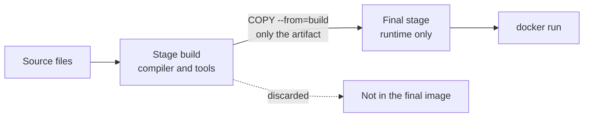

# 01. Multi-stage builds

> **Draft: written but not yet run.** The code and the expected output in this lesson were prepared by reading the code and the official documentation. They have not been executed yet. If something does not behave as described, trust your tool's real output and report it.

## What you will be able to do
By the end of this lesson you will be able to:
- Write a multi-stage `Dockerfile` that builds in one stage and ships only the result in another.
- Compare a single-stage and a multi-stage image of the same program and explain the difference.
- Build a single stage with `--target` and copy files between stages with `COPY --from`.
- Choose between `scratch`, a slim runtime image and a full toolchain image, and explain the trade-off.

## Recap
1. In Docker 101 lesson 03 you wrote `COPY requirements.txt .` before `COPY app.py .`. Why that order?
   <details><summary>Answer</summary>Each instruction is a cached layer. Dependencies change rarely, so they come first and stay cached when only the app file changes.</details>
2. What does `EXPOSE 8080` do, and what does it not do?
   <details><summary>Answer</summary>It documents the port the app listens on. It does not publish it; only `-p` or Compose `ports:` does that.</details>

## Why it matters
Think of a bakery. The kitchen has ovens, flour sacks and mixers; the shop window shows only the finished bread. Customers never need the oven. A single-stage image ships the whole kitchen: compilers, package managers and source code. Every extra tool is more to download, more to patch and more for an attacker to use. A **multi-stage build** keeps the kitchen in one stage and puts only the bread in the final image.

## What you will build
Two small web programs, each built twice:
- a **Go** server (a compiled language): single-stage image versus a multi-stage image that ends in `scratch` (an empty image);
- a **Node.js** server with a build step: a multi-stage image that ships only the built `dist` folder, runs as the non-root user `node`.



## Before you start
- **Prerequisites:** [Docker 101 lesson 03, your first Dockerfile](../../101-zero-to-hero/phase-1-containers/03-your-first-dockerfile.md) and [Docker 101 lesson 06, networks and Compose](../../101-zero-to-hero/phase-2-compose/06-networks-and-compose.md).
- Docker Engine/CLI 29.9.3 and Compose v5.7.0 as in Docker 101 (Windows 11 with Docker Desktop, or Linux/macOS). `docker info` must show a Server section. Ubuntu Engine users prefix Docker commands with `sudo`.
- Time: 30 minutes. First builds download base images, so allow extra time on a slow connection.
- Windows uses PowerShell 5.1 and `curl.exe`; macOS/Linux use `curl`. No Go or Node installation is needed on your computer: the compilers live inside the build stage.
- Source pack (optional): every file is shown in full in this lesson, so you can follow without it. The finished code, the exercise starter and the solution are in the course repository https://github.com/Uee03/Code101 under `source/docker/201-hero-to-super-hero/phase-1-better-images/01-multi-stage-builds/` (on that page choose **Code, Download ZIP**, or run `git clone https://github.com/Uee03/Code101.git`).
- Image tags used: `golang:1.25-alpine`, `node:24-alpine`, `scratch`. Version-family tags receive patch updates; check the tag exists on Docker Hub if a pull fails.

## Steps

### Step 1. Make the working folders
Windows PowerShell, from any folder:

**Commands: folder `any folder`**
```powershell
New-Item -ItemType Directory -Force "$HOME\code101\docker201\lesson01\go-app" | Out-Null
New-Item -ItemType Directory -Force "$HOME\code101\docker201\lesson01\node-app\src" | Out-Null
Set-Location "$HOME\code101\docker201\lesson01"
```
macOS/Linux, from any folder:

**Commands: folder `any folder`**
```bash
mkdir -p ~/code101/docker201/lesson01/go-app ~/code101/docker201/lesson01/node-app/src
cd ~/code101/docker201/lesson01
```
Expected result: your terminal is inside `lesson01`, which contains `go-app` and `node-app`. If you get lost, repeat the `Set-Location` or `cd` line. Create each file below in a plain-text editor (UTF-8, exact filename; on Windows enable **View > Show > File name extensions** to avoid a hidden `.txt`).

### Step 2. The Go program
**File: `go-app/main.go`**
```go
package main

import (
	"fmt"
	"log"
	"net/http"
)

func main() {
	http.HandleFunc("/", func(w http.ResponseWriter, r *http.Request) {
		fmt.Fprintln(w, "Hello from a multi-stage Go image")
	})
	log.Println("Go app listening on 8080")
	log.Fatal(http.ListenAndServe(":8080", nil))
}
```
The program registers one handler for every path and listens on port 8080 inside the container. `log.Fatal` ends the program if the server cannot start.

**File: `go-app/go.mod`**
```go
module code101/hello

go 1.25
```
`go.mod` names the module and the Go language version. This program uses only the standard library, so there is no `go.sum`.

### Step 3. The single-stage Dockerfile (the heavy way)
**File: `go-app/Dockerfile.single`**
```dockerfile
# syntax=docker/dockerfile:1
FROM golang:1.25-alpine
WORKDIR /src
COPY go.mod ./
RUN go mod download
COPY main.go ./
RUN CGO_ENABLED=0 go build -trimpath -ldflags="-s -w" -o /hello .
ENTRYPOINT ["/hello"]
```

| Line | Explanation |
|---|---|
| 1 | Pins the Dockerfile syntax frontend to the stable v1 channel, so documented features such as `COPY --from` behave the same on every machine. It must be the first line. |
| 2 | Starts from the Go toolchain image on Alpine Linux. This is the whole kitchen: compiler, linker and package tools. |
| 3 | Makes `/src` the working folder for the following instructions. |
| 4 | Copies only the module file first, so the next step stays cached while `main.go` changes. |
| 5 | Downloads dependencies (none here). With dependencies this layer is cached until `go.mod` or `go.sum` change. |
| 6 | Copies the program source. |
| 7 | Compiles. `CGO_ENABLED=0` builds a static binary that needs no C library; `-trimpath` removes build-machine paths; `-ldflags="-s -w"` strips the symbol table and debug data; `-o /hello` writes the binary. |
| 8 | Runs the binary. The image still contains the compiler and the source. |

### Step 4. The multi-stage Dockerfile (the light way)
**File: `go-app/Dockerfile`**
```dockerfile
# syntax=docker/dockerfile:1
FROM golang:1.25-alpine AS build
WORKDIR /src
COPY go.mod ./
RUN go mod download
COPY main.go ./
RUN CGO_ENABLED=0 go build -trimpath -ldflags="-s -w" -o /out/hello .

FROM scratch
COPY --from=build /out/hello /hello
USER 65532:65532
EXPOSE 8080
ENTRYPOINT ["/hello"]
```

| Line | Explanation |
|---|---|
| 1 | Syntax frontend, as above. |
| 2 | `AS build` names this stage `build`. Names make `COPY --from` and `--target` readable. |
| 3-6 | Same as the single-stage file: working folder, module file, dependency download, source. |
| 7 | Compiles, but writes the binary to `/out/hello`, a folder that exists only to hand over the artifact. |
| 8 | Blank line: a visual break between stages. |
| 9 | Starts a new stage from `scratch`, a reserved empty image with no shell, no package manager and no files. |
| 10 | Copies only `/out/hello` from the `build` stage. Nothing else from the build stage reaches the final image. |
| 11 | Runs as a numeric non-root user. `scratch` has no `/etc/passwd`, so a name would not resolve; use a number. Lesson 03 covers users in depth. |
| 12 | Documents the port. |
| 13 | Starts the binary. |

**File: `go-app/.dockerignore`**
```text
.git/
.env
.env.*
Dockerfile*
*.md
```

| Line | Explanation |
|---|---|
| 1 | Keeps the repository history out of the build context. |
| 2-3 | Keeps local settings and secret-bearing files out of the context (the build can never copy what it never receives). |
| 4 | Excludes Dockerfiles from the context. Docker still reads the Dockerfile you name; it just is not copyable into the image. |
| 5 | Excludes Markdown notes. |

### Step 5. The Node.js program
This app has a tiny **build step**: `build.js` copies the source into a `dist` folder and stamps the version from `package.json`. Real projects do the same with TypeScript, a bundler or a framework build; the Dockerfile shape is identical.

**File: `node-app/package.json`**
```json
{
  "name": "code101-node-demo",
  "version": "1.0.0",
  "private": true,
  "scripts": {
    "build": "node build.js",
    "start": "node dist/server.js"
  }
}
```
`scripts.build` is what `npm run build` runs. `private: true` stops an accidental `npm publish`. There are no dependencies, so there is no lock file here.

**File: `node-app/build.js`**
```javascript
const fs = require("node:fs");
const pkg = require("./package.json");

fs.mkdirSync("dist", { recursive: true });
const source = fs.readFileSync("src/server.js", "utf8");
fs.writeFileSync("dist/server.js", source.replace("__VERSION__", pkg.version));
console.log("built dist/server.js for version " + pkg.version);
```
**File: `node-app/src/server.js`**
```javascript
const http = require("node:http");

const server = http.createServer((req, res) => {
  res.writeHead(200, { "Content-Type": "application/json" });
  res.end(JSON.stringify({ message: "Hello from a multi-stage Node image", version: "__VERSION__" }) + "\n");
});

server.listen(8080, "0.0.0.0", () => console.log("Node app listening on 8080"));
```
The server must listen on `0.0.0.0` (all interfaces inside the container). If it listened on `127.0.0.1` only, a published port could not reach it, because that loopback address belongs to the container itself.

### Step 6. The Node.js multi-stage Dockerfile
**File: `node-app/Dockerfile`**
```dockerfile
# syntax=docker/dockerfile:1
FROM node:24-alpine AS build
WORKDIR /app
COPY package.json ./
COPY build.js ./
COPY src ./src
RUN npm run build

FROM node:24-alpine AS runtime
ENV NODE_ENV=production
WORKDIR /app
COPY --from=build /app/dist ./dist
USER node
EXPOSE 8080
CMD ["node", "dist/server.js"]
```

| Line | Explanation |
|---|---|
| 1 | Syntax frontend. |
| 2 | Build stage on Node 24 Alpine. |
| 3 | Working folder. |
| 4 | Copies the manifest first. In a real project add `COPY package-lock.json ./` and `RUN npm ci` right after it, so dependencies are cached until the lock file changes. |
| 5-6 | Copies the build script and the source. |
| 7 | Runs the `build` script, which creates `/app/dist`. |
| 9 | Fresh runtime stage from the same small base. Reusing the base keeps one set of pulled layers. |
| 10 | Tells Node libraries to use production behaviour. |
| 11 | Working folder of the runtime stage. |
| 12 | Copies only `dist`. The source, `build.js` and `package.json` stay behind. |
| 13 | Switches to the unprivileged `node` user that the official image already contains. |
| 14 | Documents the port. |
| 15 | Starts the app with the exec (JSON list) form, so signals reach Node directly. |

**File: `node-app/.dockerignore`**
```text
.git/
.env
.env.*
node_modules/
dist/
Dockerfile*
```
`node_modules/` and `dist/` are excluded because the image makes its own: copying a host `node_modules` built for Windows into a Linux image is a classic bug.

### Step 7. Predict, then build
**Predict before you run:** after building `go-app` twice (`Dockerfile.single` and `Dockerfile`), which image will be smaller, and roughly how many times smaller: 1.1x, 2x or much more? Write your guess down.

Build all three images. From `lesson01\go-app`:

**Commands: folder `lesson01/go-app`**
```powershell
docker build -f Dockerfile.single -t code101-go-single:201 .
docker build -t code101-go:201 .
```
From `lesson01\node-app`:

**Commands: folder `lesson01/node-app`**
```powershell
docker build -t code101-node:201 .
```
The commands are identical on macOS/Linux. Expected result: each build finishes and the last lines name the image (`naming to docker.io/library/code101-go:201`). In the Node build log you should see the line `built dist/server.js for version 1.0.0` from the build stage (expected output, not yet run). Progress lines, timings and layer ids vary.

## Run it
Compare sizes:

**Commands: folder `any folder`**
```powershell
docker image ls code101-go-single
docker image ls code101-go
docker image ls code101-node
```
Expected output: a table with `REPOSITORY`, `TAG`, `IMAGE ID`, `CREATED` and size columns for each repository. Sizes vary by platform and version, so compare your own numbers: the single-stage Go image carries the whole Go toolchain and should be many times larger than the `scratch` image, which holds little more than one static binary.

Run the Go image and request the page:

**Commands: folder `any folder`**
```powershell
docker run -d --rm --name code101-go -p 127.0.0.1:8080:8080 code101-go:201
curl.exe -fsS http://127.0.0.1:8080/
docker stop code101-go
```
Expected output:
```text
Hello from a multi-stage Go image
```
Run the Node image (port 8080 is free again after the stop above):

**Commands: folder `any folder`**
```powershell
docker run -d --rm --name code101-node -p 127.0.0.1:8080:8080 code101-node:201
curl.exe -fsS http://127.0.0.1:8080/
docker stop code101-node
```
Expected output:
```text
{"message":"Hello from a multi-stage Node image","version":"1.0.0"}
```
On macOS/Linux use `curl` instead of `curl.exe`. Stop each container before starting the other; both use host port 8080.

Look at the layers the build stage left behind, then build only that stage:

**Commands: folder `lesson01/node-app`**
```powershell
docker build --target build -t code101-node-build:201 .
docker image ls code101-node-build
```
`--target build` stops after the stage named `build`. The result contains `dist`, `src` and the build script; it is the image the final stage deliberately does not ship. Remove all course images when you finish:

**Commands: folder `any folder`**
```powershell
docker image rm code101-go-single:201 code101-go:201 code101-node:201 code101-node-build:201
```

## How it works
Each `FROM` starts a new stage with its own filesystem. Only the **last** stage becomes the image (unless you pick another with `--target`). `COPY --from=<stage>` reads files from an earlier stage's filesystem. Everything else in the earlier stages is discarded, though it stays in the build cache so repeated builds are fast.

**Misconception:** "multi-stage makes the build faster." Not by itself. BuildKit can skip stages the target does not need and run independent stages in parallel, but the main win is a smaller, safer **final** image.

Why `scratch` works for Go: with `CGO_ENABLED=0` the binary has no dependency on a C library or a shell. A dynamically linked program in `scratch` fails to start because its loader is missing.

| Why this, not that | Choose it when | Cost |
|---|---|---|
| `scratch` | A static binary (Go, Rust with a static target) and you want the smallest image and attack surface | No shell, no `curl`, no `ls`; debugging uses `docker cp`, logs or a debug sidecar |
| Distroless (`gcr.io/distroless/static`) | You want a nonroot user, CA certificates and timezone data without a shell | Another image to track; no shell either |
| Alpine / slim runtime | The program needs a shell, a C library or a few OS tools | Larger; more packages to patch |
| Single stage | A throwaway dev image | Ships the toolchain and source |

## Try it
Copy the finished `lesson01` folder to `practice` first (copy the whole `lesson01` folder and rename the copy `practice`), then open `practice\node-app`. The starter lives in the pack at `exercise/starter/node-app/Dockerfile`; every other file stays as in the Steps.

1. **Guided:** replace `practice/node-app/Dockerfile` with the starter and complete the four `TODO` comments so that it becomes a two-stage build with the stage names `build` and `runtime`, copying only `dist`, running as `node`. Build and run it like Step 7.
2. **Change:** add a third stage named `check`, based on the `build` stage, that runs Node's syntax check on `dist/server.js` (`node --check`). Build it alone with `--target check`. Predict first: is the `check` stage part of the final image?
3. **Stretch (no single answer):** change the Go runtime stage from `scratch` to `gcr.io/distroless/static` or `alpine`. List one thing you gain and one thing you give up.

**File: `exercise/starter/node-app/Dockerfile`**
```dockerfile
# syntax=docker/dockerfile:1
# TODO 1: name this first stage "build" by adding AS build to the FROM line
FROM node:24-alpine
WORKDIR /app
COPY package.json ./
COPY build.js ./
COPY src ./src
RUN npm run build

# TODO 2: start a second stage named "runtime" from the same small base image
# TODO 3: set ENV NODE_ENV=production and WORKDIR /app, then copy ONLY /app/dist from the build stage
# TODO 4: run as the non-root user "node" (the node image already contains it)
EXPOSE 8080
CMD ["node", "dist/server.js"]
```

<details><summary>Solution</summary>

**File: `exercise/solution/node-app/Dockerfile`**
```dockerfile
# syntax=docker/dockerfile:1
FROM node:24-alpine AS build
WORKDIR /app
COPY package.json ./
COPY build.js ./
COPY src ./src
RUN npm run build

FROM build AS check
RUN node --check dist/server.js

FROM node:24-alpine AS runtime
ENV NODE_ENV=production
WORKDIR /app
COPY --from=build /app/dist ./dist
USER node
EXPOSE 8080
CMD ["node", "dist/server.js"]
```
The `check` stage starts `FROM build`, so it sees `dist`. Nothing copies from `check`, and the last stage is `runtime`, so `docker build .` produces the runtime image and BuildKit skips `check`. `docker build --target check .` runs it and fails the build if `node --check` finds a syntax error. This is a cheap place to put tests, linters and scans without growing the shipped image.

Stretch answer (one possible): distroless `static` gains a CA certificate bundle and a ready nonroot user; you give up a small amount of control over the base image contents compared with `scratch`.

</details>

## Check yourself
1. Which stage becomes the final image? <details><summary>Answer</summary>The last one, unless `--target` selects another.</details>
2. What does `COPY --from=build /out/hello /hello` copy, and from where? <details><summary>Answer</summary>The file `/out/hello` from the filesystem of the stage named `build`, into `/hello` in the current stage.</details>
3. Predict: the Go multi-stage image runs `/hello` from `scratch`. What would break if you compiled without `CGO_ENABLED=0` on a glibc-based builder? <details><summary>Answer</summary>The binary could be dynamically linked and fail to start in `scratch`, because the loader and libraries are missing (a typical symptom is `exec /hello: no such file or directory`).</details>
4. Why is `node_modules/` in `.dockerignore`? <details><summary>Answer</summary>The image installs its own; copying a host copy can include binaries for the wrong operating system and slows the build context transfer.</details>

## Common mistakes
| Symptom or error text | Cause | Fix |
|---|---|---|
| `failed to compute cache key ... "/main.go": not found` (typical message) | A file is missing from the build context, or `.dockerignore` excludes it, or you ran `docker build` in the wrong folder | Run the command in the folder that holds the Dockerfile and the files it copies |
| `exec /hello: no such file or directory` (typical message) | The binary is dynamically linked but the image has no loader | Build with `CGO_ENABLED=0`, or use a base image with a C library |
| `Bind for 127.0.0.1:8080 failed: port is already allocated` | The previous container still runs | `docker ps`, then `docker stop` your own earlier container |
| `curl` prints nothing or resets the connection | The server listens on `127.0.0.1` inside the container | Listen on `0.0.0.0` (Node) or `:8080` (Go) |

## Best practice
Build in a toolchain stage and ship only the artifact in a minimal final stage, and name your stages. Source: Docker multi-stage builds https://docs.docker.com/build/building/multi-stage/

## Going further
- Best practices for Dockerfiles: https://docs.docker.com/build/building/best-practices/
- A real multi-service stack is built in the platform capstone: `capstones/platform`.

## Summary
- You wrote a multi-stage `Dockerfile` for a compiled Go app and a Node app with a build step.
- You compared single-stage and multi-stage image sizes with `docker image ls`.
- You used `COPY --from` and `--target` to move files between stages and to build one stage.
- You weighed `scratch`, distroless and Alpine runtime images.

## Next lesson
02. Build cache, BuildKit and .dockerignore tuning: make rebuilds fast by ordering layers, using cache mounts and keeping the build context small.
