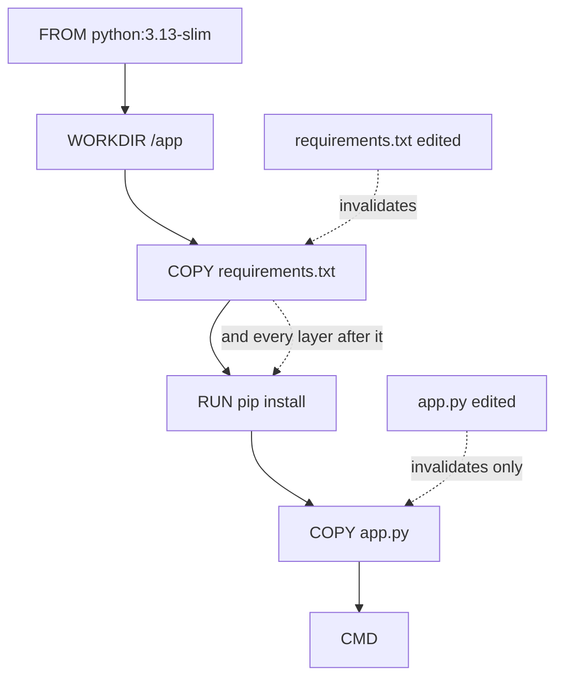

# 02. Build cache, BuildKit and .dockerignore tuning

> **Draft: written but not yet run.** The code and the expected output in this lesson were prepared by reading the code and the official documentation. They have not been executed yet. If something does not behave as described, trust your tool's real output and report it.

## What you will be able to do
By the end of this lesson you will be able to:
- Predict which Dockerfile layers a change will rebuild and which will be reused.
- Reorder a Dockerfile so that dependencies stay cached when only application code changes.
- Write a BuildKit cache mount for a package manager and explain what it does not do.
- Tune a `.dockerignore` file to shrink the build context, and find the context size in the build log.

## Recap
1. In lesson 01, why does the `build` stage not make the final image bigger?
   <details><summary>Answer</summary>Only the last stage becomes the image. Earlier stages contribute only what `COPY --from` copies out of them.</details>
2. From Docker 101: what is the **build context**?
   <details><summary>Answer</summary>The set of files sent to the builder, normally the folder you pass to `docker build`. `COPY` can only read from it.</details>

## Why it matters
A kitchen that preps vegetables once and reuses them for every dish is fast; a kitchen that re-chops everything whenever the menu changes a single sauce is slow. Docker's build cache is the prepped-vegetable shelf. A well-ordered Dockerfile rebuilds in seconds when you edit one line of code; a badly ordered one reinstalls every dependency every time. In CI, where machines start empty, this decides whether a build takes one minute or ten.

## What you will build
A small Python server with one pinned dependency, built with two Dockerfiles: `Dockerfile.bad` (copies everything first) and `Dockerfile` (dependencies first, plus a cache mount). You will edit `app.py`, rebuild both, and see which layers are reused. Then you will add a 50 MB file and watch `.dockerignore` keep it out of the build context.



## Before you start
- **Prerequisites:** [Docker 201 lesson 01, multi-stage builds](01-multi-stage-builds.md).
- Docker 29.9.3 with BuildKit (the default builder). `docker info` must show a Server section.
- Time: 30 minutes. Windows: PowerShell 5.1 and `curl.exe`. macOS/Linux: `curl`. Ubuntu Engine users prefix Docker commands with `sudo`.
- Source pack (optional): every file is shown in full in this lesson, so you can follow without it. The finished code, the exercise starter and the solution are in the course repository https://github.com/Uee03/Code101 under `source/docker/201-hero-to-super-hero/phase-1-better-images/02-build-cache-and-buildkit/` (on that page choose **Code, Download ZIP**, or run `git clone https://github.com/Uee03/Code101.git`).
- Image tag used: `python:3.13-slim` (as in Docker 101).

## Steps

### Step 1. Make the working folder
Windows PowerShell:

**Commands: folder `any folder`**
```powershell
New-Item -ItemType Directory -Force "$HOME\code101\docker201\lesson02" | Out-Null
Set-Location "$HOME\code101\docker201\lesson02"
```
macOS/Linux:

**Commands: folder `any folder`**
```bash
mkdir -p ~/code101/docker201/lesson02
cd ~/code101/docker201/lesson02
```
Expected result: the terminal is in `lesson02`. If lost, repeat the `Set-Location` or `cd` line. Create each file below in this folder.

### Step 2. The application and its dependency list
**File: `requirements.txt`**
```text
psycopg[binary]==3.2.9
```
One pinned dependency: the PostgreSQL driver you used in Docker 101. `==` pins the exact version, so the layer that installs it is reproducible.

**File: `app.py`**
```python
import json
from http.server import BaseHTTPRequestHandler, HTTPServer

import psycopg


class Handler(BaseHTTPRequestHandler):
    def do_GET(self):
        body = json.dumps({"message": "Hello from a cached build", "psycopg": psycopg.__version__}) + "\n"
        self.send_response(200)
        self.send_header("Content-Type", "application/json")
        self.end_headers()
        self.wfile.write(body.encode())


HTTPServer(("0.0.0.0", 8000), Handler).serve_forever()
```
The handler answers every GET with JSON that includes the installed driver version. It listens on all interfaces inside the container, port 8000.

### Step 3. The slow Dockerfile (to see the problem)
**File: `Dockerfile.bad`**
```dockerfile
FROM python:3.13-slim
WORKDIR /app
COPY . .
RUN pip install --no-cache-dir -r requirements.txt
CMD ["python", "-u", "app.py"]
```

| Line | Explanation |
|---|---|
| 1 | Base image. |
| 2 | Working folder. |
| 3 | Copies **everything** in the context. If any file changes (even `app.py`), this layer is new, and every layer after it is rebuilt. |
| 4 | Installs dependencies. Because it comes after `COPY . .`, it reinstalls on every code change. `--no-cache-dir` keeps the image small but discards pip's download cache. |
| 5 | Starts the app; `-u` makes log output unbuffered. |

### Step 4. The fast Dockerfile
**File: `Dockerfile`**
```dockerfile
# syntax=docker/dockerfile:1
FROM python:3.13-slim
WORKDIR /app
COPY requirements.txt ./
RUN --mount=type=cache,target=/root/.cache/pip pip install -r requirements.txt
COPY app.py ./
CMD ["python", "-u", "app.py"]
```

| Line | Explanation |
|---|---|
| 1 | Syntax frontend v1. Cache mounts are part of it; pinning it keeps the feature set stable. |
| 2 | Base image. |
| 3 | Working folder. |
| 4 | Copies **only** the dependency list. This layer changes only when `requirements.txt` changes. |
| 5 | Installs with a **cache mount**: a folder on the builder, mounted at `/root/.cache/pip` for this one `RUN` only. pip stores downloaded files there, so if the layer must re-run (for example you add a package), pip reuses earlier downloads. The mount is not part of the image. Do not add `--no-cache-dir` here, or you would disable what you just mounted. |
| 6 | Copies only the app. Editing `app.py` invalidates this layer and nothing before it. |
| 7 | Start command. |

**File: `.dockerignore`**
```text
.git/
.env
.env.*
__pycache__/
*.pyc
data/
Dockerfile*
```

| Line | Explanation |
|---|---|
| 1 | Repository history never enters the context. |
| 2-3 | Local settings and secrets never enter the context. |
| 4-5 | Python bytecode caches are regenerated; sending them only changes the context. |
| 6 | The `data/` folder (you create it in Step 7) holds large local files that the image never needs. |
| 7 | Dockerfiles do not need to be inside the image. Docker still reads the one you name with `-f`. |

### Step 5. Build both, then predict
Build the slow file and the fast file once. From `lesson02`:

**Commands: folder `lesson02`**
```powershell
docker build -f Dockerfile.bad -t code101-cache-bad:201 .
docker build -t code101-cache:201 .
```
Expected result: both builds finish and print `naming to docker.io/library/code101-cache-bad:201` and `naming to docker.io/library/code101-cache:201` (expected output, not yet run). The first build downloads the base image and the driver, so it is slow.

Now change `app.py`: in the JSON, change the message `Hello from a cached build` to `Hello again from a cached build`, and save.

**Predict before you run:** when you rebuild both images, which build will **reuse** the `pip install` layer (print `CACHED` for it), and which will run `pip` again? Write your answer down.

Rebuild with plain progress output so every step is printed:

**Commands: folder `lesson02`**
```powershell
docker build --progress=plain -f Dockerfile.bad -t code101-cache-bad:201 .
docker build --progress=plain -t code101-cache:201 .
```
What to look for in the plain output: each step has a header such as `#5 [3/5] COPY requirements.txt ./` and, when reused, the word `CACHED` on the lines that follow. Numbers and timings vary. In the **fast** build, the steps for `COPY requirements.txt` and `RUN ... pip install` should say `CACHED` and only `COPY app.py` runs again. In the **slow** build, `COPY . .` runs again and the `pip install` step runs again too, because it comes after a changed layer.

### Step 6. Run the image
**Commands: folder `any folder`**
```powershell
docker run -d --rm --name code101-cache -p 127.0.0.1:8080:8000 code101-cache:201
curl.exe -fsS http://127.0.0.1:8080/
docker stop code101-cache
```
Expected output (macOS/Linux: `curl` instead of `curl.exe`):
```text
{"message": "Hello from a cached build", "psycopg": "3.2.9"}
```
If you changed the message in Step 5, your text shows your new message instead. Stop the container before the next run; it uses host port 8080.

### Step 7. Watch .dockerignore shrink the context
Create a 50 MB file of zeros inside a `data` folder. Windows PowerShell, from `lesson02`:

**Commands: folder `lesson02`**
```powershell
New-Item -ItemType Directory -Force data | Out-Null
[IO.File]::WriteAllBytes("$PWD\data\junk.bin", (New-Object byte[] 52428800))
```
macOS/Linux, from `lesson02`:

**Commands: folder `lesson02`**
```bash
mkdir -p data
head -c 52428800 /dev/zero > data/junk.bin
```
Docker writes build progress to the error stream, so the commands below merge it into normal output. In Windows PowerShell 5.1 a plain `2>&1` on a native command prints `NativeCommandError` noise, so the commands run through `cmd /c`. First build with the ignore file in place and find the context line:

**Commands: folder `lesson02`**
```powershell
cmd /c "docker build --progress=plain -f Dockerfile.bad -t code101-cache-bad:201 . 2>&1" | Select-String "transferring context"
```
macOS/Linux: `docker build --progress=plain -f Dockerfile.bad -t code101-cache-bad:201 . 2>&1 | grep "transferring context"`.

Expected result: a line that starts with `transferring context` and ends with a small size (the 50 MB file is ignored). Now disable the ignore file by renaming it, build again, and compare:

**Commands: folder `lesson02`**
```powershell
Rename-Item .dockerignore .dockerignore.off
cmd /c "docker build --progress=plain -f Dockerfile.bad -t code101-cache-bad:201 . 2>&1" | Select-String "transferring context"
Rename-Item .dockerignore.off .dockerignore
```
macOS/Linux:

**Commands: folder `lesson02`**
```bash
mv .dockerignore .dockerignore.off
docker build --progress=plain -f Dockerfile.bad -t code101-cache-bad:201 . 2>&1 | grep "transferring context"
mv .dockerignore.off .dockerignore
```
Expected result: this time the transferred size is about 50 MB larger. Because `Dockerfile.bad` runs `COPY . .`, the junk file also ends up inside the image and changes that layer. Always restore the ignore file (last line).

## Run it
Inspect and clean the builder cache:

**Commands: folder `any folder`**
```powershell
docker buildx du
docker builder prune --filter until=24h
docker image rm code101-cache:201 code101-cache-bad:201
```
`docker buildx du` lists build-cache records and their sizes. `docker builder prune --filter until=24h` removes build cache not used in the last 24 hours and asks you to confirm; it never touches images or volumes. Remove `data/` when you finish with it.

## How it works
Every instruction produces a **layer**. For each instruction BuildKit asks: did its inputs change? The inputs are the instruction text, the base layer and, for `COPY`/`ADD`, the **content** of the copied files. If nothing changed, the stored layer is reused (`CACHED`). If one layer changes, every later layer is invalid, because each depends on the one before it. So: put things that change rarely first and things that change often last.

**Misconception:** "the cache notices that `app.py` changed and reruns only the relevant step." The cache is a chain, not a dependency graph. With `COPY . .` first, the chain is broken at line 3 for any edit.

A **cache mount** (`RUN --mount=type=cache`) is different from the layer cache: it gives one `RUN` a persistent scratch folder on the builder, for downloads. It speeds up a step that must re-run; it does not make the step skippable, and it is not stored in the image. It also lives on the builder only, so a fresh CI machine starts empty (lesson 09 shows how to export cache).

| Why this, not that | Use it when | Trade-off |
|---|---|---|
| Layer order (copy manifests first) | Always, it is free | Needs a little more typing |
| `--mount=type=cache` | Package managers that download a lot (pip, npm, apt, go modules) | Needs BuildKit; cache is local to the builder |
| `--no-cache-dir` in pip | You do not use a cache mount and want a slim layer | Every re-run downloads again |
| `docker build --no-cache` | You suspect a stale layer, or need fresh OS patches | Rebuilds everything; slow |

## Try it
Copy the pack folder `exercise/starter` (or create the two files below) into a folder named `practice` next to your `lesson02` folder, and copy `app.py` and `requirements.txt` from `lesson02` into `practice`. Do not copy `Dockerfile` or `.dockerignore`: the starter versions replace them.

1. **Guided:** in `practice/Dockerfile` finish `TODO 1` (copy only `requirements.txt`, install, then copy the rest) and `TODO 2` (use a cache mount). In `practice/.dockerignore` finish `TODO 3`. Create `practice/data/junk.bin` as in Step 7 and build with `--progress=plain`.
2. **Change:** after the first build, edit `app.py` and rebuild. Confirm the install step prints `CACHED`. Then add a second pinned line of your choice to `requirements.txt` and predict which layers rebuild.
3. **Stretch:** a Dockerfile runs `RUN apt-get update` on one line and `RUN apt-get install -y curl` on the next. Describe how the cache can leave you with an outdated package list, and how you would fix it.

**File: `exercise/starter/Dockerfile`**
```dockerfile
FROM python:3.13-slim
WORKDIR /app
# TODO 1: copy only requirements.txt here, then install, and only afterwards copy the rest
COPY . .
RUN pip install --no-cache-dir -r requirements.txt
# TODO 2: turn the pip install line into one that uses a BuildKit cache mount for /root/.cache/pip
CMD ["python", "-u", "app.py"]
```

**File: `exercise/starter/.dockerignore`**
```text
.git/
.env
.env.*
__pycache__/
*.pyc
Dockerfile*
# TODO 3: add the pattern that keeps the big data/ folder out of the build context
```

<details><summary>Solution</summary>

**File: `exercise/solution/Dockerfile`**
```dockerfile
# syntax=docker/dockerfile:1
FROM python:3.13-slim
WORKDIR /app
COPY requirements.txt ./
RUN --mount=type=cache,target=/root/.cache/pip pip install -r requirements.txt
COPY app.py ./
CMD ["python", "-u", "app.py"]
```

**File: `exercise/solution/.dockerignore`**
```text
.git/
.env
.env.*
__pycache__/
*.pyc
Dockerfile*
data/
```
`COPY requirements.txt` plus the install come first, `COPY app.py` last, so an edit to `app.py` reuses the install layer. For the stretch: `apt-get update` in its own layer can be cached for months, so a later `apt-get install` can use a stale package index. Fix it by putting both in one `RUN` (`RUN apt-get update && apt-get install -y curl && rm -rf /var/lib/apt/lists/*`) so they are always cached or rebuilt together.

</details>

## Check yourself
1. You edit one line in `app.py`. In `Dockerfile.bad`, which layers rebuild? <details><summary>Answer</summary>`COPY . .` and every layer after it, including `pip install`.</details>
2. What is a cache mount and where does it live? <details><summary>Answer</summary>A persistent scratch folder on the builder mounted into one `RUN`. It is not in the image.</details>
3. Predict: you add a package to `requirements.txt`. What reruns in `Dockerfile`? <details><summary>Answer</summary>`COPY requirements.txt`, the `pip install` (reusing downloaded packages from the cache mount) and `COPY app.py` after it.</details>
4. Where in the build log can you see how large the build context was? <details><summary>Answer</summary>In the `transferring context` line, using `--progress=plain`.</details>

## Common mistakes
| Symptom or error text | Cause | Fix |
|---|---|---|
| `failed to read dockerfile: open Dockerfile: no such file or directory` (typical message) | The terminal is not in the folder with the Dockerfile, or you used `-f` with a wrong name | `cd` into the folder, or pass the correct path to `-f` |
| The page shows your old message after editing `app.py` | You edited the file but did not rebuild, or a container from the old image is still running | Rebuild, `docker stop` the old container, run again |
| Install step is never `CACHED` | `COPY . .` comes before it, or `requirements.txt` changes every time | Copy only the dependency list first |
| The context transfer is huge | `.dockerignore` is missing, misnamed (`.dockerignore.txt`) or does not list the big folder | Name it exactly `.dockerignore` and add the folder |

## Best practice
Order Dockerfile instructions from least to most frequently changed, copy dependency manifests before source, and keep the build context small with `.dockerignore`. Source: Docker build cache https://docs.docker.com/build/cache/ and Dockerfile best practices https://docs.docker.com/build/building/best-practices/

## Going further
- Cache mounts reference: https://docs.docker.com/reference/dockerfile/#run---mounttypecache
- Build cache invalidation: https://docs.docker.com/build/cache/invalidation/
- Exporting cache to CI: lesson 09.

## Summary
- You predicted which layers a change rebuilds and checked it with `--progress=plain`.
- You reordered a Dockerfile so dependencies stay cached.
- You used a BuildKit cache mount and explained what it does not do.
- You tuned `.dockerignore` and measured the context in the build log.

## Next lesson
03. Non-root users, read-only filesystems, capabilities and hardening: run the image with the least privilege it needs.
