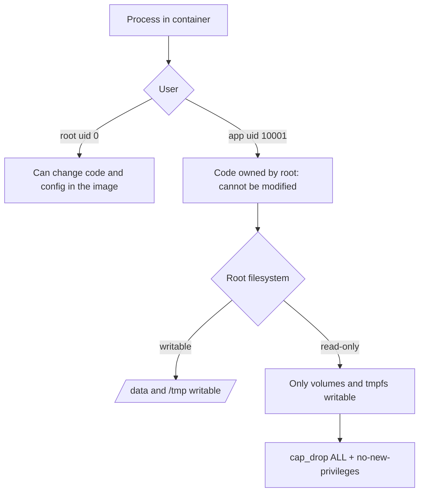

# 03. Non-root users, read-only filesystems, capabilities and hardening

> **Draft: written but not yet run.** The code and the expected output in this lesson were prepared by reading the code and the official documentation. They have not been executed yet. If something does not behave as described, trust your tool's real output and report it.

## What you will be able to do
By the end of this lesson you will be able to:
- Create a non-root user in an image and explain why the code should be owned by root and not writable by that user.
- Predict what a program can write under `--read-only`, `--tmpfs` and a named volume.
- Drop Linux capabilities and forbid privilege escalation in `docker run` and in Compose.
- Review a container for the hardening settings that matter and the ones that are dangerous to enable.

## Recap
1. In lesson 01 you ended the Go image with `USER 65532:65532`. Why a number and not a name?
   <details><summary>Answer</summary>`scratch` has no `/etc/passwd`, so a name cannot be looked up. Numeric ids always work.</details>
2. In Docker 101, what survives `docker compose down` and what does `down -v` delete?
   <details><summary>Answer</summary>Named volumes survive `down`; `down -v` deletes the project's named volumes and their data.</details>

## Why it matters
Picture a hotel. A guest key opens one room; a master key opens everything. A container that runs as `root` holds a master key *inside the container*. If the app has a bug and an attacker takes it over, the attacker inherits whatever the process may do. Hardening hands the app a guest key: a normal user, a filesystem it cannot rewrite, and only the kernel powers it truly needs. None of this fixes a bug, but it limits the damage when one is exploited.

## What you will build
A tiny Python program that reports who it runs as and where it can write. You will run the same image four ways, predict the answers, and then express the safe settings in a Compose file.



## Before you start
- **Prerequisites:** [Docker 201 lesson 01, multi-stage builds](01-multi-stage-builds.md) and [Docker 101 lesson 06, networks and Compose](../../101-zero-to-hero/phase-2-compose/06-networks-and-compose.md).
- Lessons 01 and 02 finished; Docker 29.9.3 running. Time: 30 minutes.
- Windows: PowerShell 5.1, `curl.exe`. macOS/Linux: `curl`. Ubuntu Engine: prefix Docker commands with `sudo`.
- Source pack (optional): every file is shown in full in this lesson, so you can follow without it. The finished code, the exercise starter and the solution are in the course repository https://github.com/Uee03/Code101 under `source/docker/201-hero-to-super-hero/phase-1-better-images/03-non-root-and-hardening/` (on that page choose **Code, Download ZIP**, or run `git clone https://github.com/Uee03/Code101.git`).
- Port 8080 on your computer must be free (stop earlier lesson containers).

## Steps

### Step 1. Make the working folder
**Commands: folder `any folder`**
```powershell
New-Item -ItemType Directory -Force "$HOME\code101\docker201\lesson03" | Out-Null
Set-Location "$HOME\code101\docker201\lesson03"
```
macOS/Linux:

**Commands: folder `any folder`**
```bash
mkdir -p ~/code101/docker201/lesson03
cd ~/code101/docker201/lesson03
```
Expected result: the terminal is in `lesson03`. If lost, repeat the `Set-Location` or `cd` line.

### Step 2. The program that reports its privileges
**File: `app.py`**
```python
import json
import os
import sys
from http.server import BaseHTTPRequestHandler, HTTPServer


def can_write(folder):
    path = os.path.join(folder, "probe.txt")
    try:
        with open(path, "w") as handle:
            handle.write("x")
        os.remove(path)
        return True
    except OSError:
        return False


def report():
    return {
        "uid": os.getuid(),
        "gid": os.getgid(),
        "write_app": can_write("/app"),
        "write_data": can_write("/data"),
        "write_tmp": can_write("/tmp"),
    }


class Handler(BaseHTTPRequestHandler):
    def do_GET(self):
        body = (json.dumps(report()) + "\n").encode()
        self.send_response(200)
        self.send_header("Content-Type", "application/json")
        self.end_headers()
        self.wfile.write(body)


if "--once" in sys.argv:
    print(json.dumps(report()))
else:
    HTTPServer(("0.0.0.0", 8000), Handler).serve_forever()
```
`can_write` tries to create and delete a file in a folder and answers `True` or `False`. `report` collects the user id, group id and three write tests: `/app` (the code), `/data` (a data folder) and `/tmp`. `--once` prints the report and exits, so you can test settings without a web server; otherwise the program serves the report on port 8000.

### Step 3. The Dockerfile with a non-root user
**File: `Dockerfile`**
```dockerfile
# syntax=docker/dockerfile:1
FROM python:3.13-slim
ENV PYTHONDONTWRITEBYTECODE=1
RUN groupadd --system --gid 10001 app \
    && useradd --system --uid 10001 --gid app --no-create-home --shell /usr/sbin/nologin app \
    && mkdir /data \
    && chown app:app /data
WORKDIR /app
COPY --chmod=0444 app.py ./
USER app
EXPOSE 8000
CMD ["python", "app.py"]
```

| Line | Explanation |
|---|---|
| 1 | Syntax frontend v1 (`--chmod` on `COPY` is part of it). |
| 2 | Debian-based slim Python image. |
| 3 | Stops Python from writing `.pyc` bytecode files next to the code. With a read-only filesystem it would try and silently skip; this makes the behaviour the same everywhere. |
| 4 | Creates a system group `app` with the fixed id 10001. A **fixed numeric id** makes volume ownership predictable across rebuilds. |
| 5 | Creates the system user `app` with id 10001 in that group, no home directory and a shell that refuses logins (`nologin`). |
| 6 | Creates `/data`, the one folder the app may write. |
| 7 | Gives `/data` to the app user. A new named volume mounted here inherits this ownership. |
| 8 | Working folder `/app`, created by Docker and owned by root. |
| 9 | Copies the code **owned by root** with mode `0444` (read-only for everyone). The app can read its code but never rewrite it. A compromised app cannot plant a backdoor in its own program file. |
| 10 | From here on, and when the container starts, run as `app` instead of root. |
| 11 | Documents the port. |
| 12 | Starts the app. |

**File: `.dockerignore`**
```text
.git/
.env
.env.*
__pycache__/
*.pyc
Dockerfile*
compose*.yaml
```
Keeps history, local settings, caches and the Docker/Compose files out of the build context.

### Step 4. Build and predict
**Commands: folder `lesson03`**
```powershell
docker build -t code101-hardened:201 .
```
Expected result: the build finishes with `naming to docker.io/library/code101-hardened:201` (not yet run).

**Predict before you run:** the next four commands run the same image. For each, write the JSON you expect.
1. Default settings.
2. `--read-only` (the root filesystem becomes read-only).
3. `--read-only --tmpfs /tmp`.
4. `--user 0:0` (run as root).

## Run it
**Commands: folder `any folder`**
```powershell
docker run --rm code101-hardened:201 python app.py --once
docker run --rm --read-only code101-hardened:201 python app.py --once
docker run --rm --read-only --tmpfs /tmp code101-hardened:201 python app.py --once
docker run --rm --user 0:0 code101-hardened:201 python app.py --once
```
Expected output (one line per command, derived by reading the program; not yet run):
```text
{"uid": 10001, "gid": 10001, "write_app": false, "write_data": true, "write_tmp": true}
{"uid": 10001, "gid": 10001, "write_app": false, "write_data": false, "write_tmp": false}
{"uid": 10001, "gid": 10001, "write_app": false, "write_data": false, "write_tmp": true}
{"uid": 0, "gid": 0, "write_app": true, "write_data": true, "write_tmp": true}
```
Read them like this: `/app` is never writable by the app user (root owns the code). `/data` and `/tmp` are writable normally, but `--read-only` freezes the whole image filesystem, including both. `--tmpfs /tmp` mounts a fresh in-memory folder, which stays writable. Running as root can rewrite the code, which is exactly what you do not want.

### Capabilities
**Linux capabilities** split root's powers into small pieces, for example `CHOWN` (change file owners) or `NET_RAW` (raw network packets). Docker gives a container a default subset. Show the difference with a power that root normally has:

**Commands: folder `any folder`**
```powershell
docker run --rm --user 0:0 code101-hardened:201 python -c "import os; os.chown('/tmp', 1, 1); print('chown ok')"
docker run --rm --user 0:0 --cap-drop ALL code101-hardened:201 python -c "import os; os.chown('/tmp', 1, 1); print('chown ok')"
```
Expected output of the first command:
```text
chown ok
```
The second command should end with a Python traceback whose last line is typically:
```text
PermissionError: [Errno 1] Operation not permitted: '/tmp'
```
Even as root, a process without the `CHOWN` capability cannot change owners. `--cap-drop ALL` removes every capability; add back only what a service proves it needs with `--cap-add`. Web servers on ports above 1024 need none.

### Compose with every setting
**File: `compose.yaml`**
```yaml
name: code101-hardened

services:
  web:
    build: .
    image: code101-hardened:201
    ports:
      - "127.0.0.1:8080:8000"
    read_only: true
    tmpfs:
      - /tmp
    cap_drop:
      - ALL
    security_opt:
      - no-new-privileges:true
    pids_limit: 100
    volumes:
      - app_data:/data

volumes:
  app_data:
```

| Line | Explanation |
|---|---|
| 1 | Fixed project name, so resource names are predictable (`code101-hardened-web-1`). |
| 3 | Services start here. |
| 4 | The single service. |
| 5 | Builds the Dockerfile in this folder. |
| 6 | Names the built image. |
| 7-8 | Publishes container port 8000 on **your computer's loopback only** (`127.0.0.1`), so other machines cannot reach it. |
| 9 | Read-only root filesystem (the Compose form of `--read-only`). |
| 10-11 | A writable in-memory `/tmp`. Data there disappears when the container stops. |
| 12-13 | Drops every Linux capability. |
| 14-15 | `no-new-privileges` stops a process from gaining more privileges through setuid binaries. |
| 16 | Limits the container to 100 processes, which blunts a fork bomb (a program that spawns processes without end). |
| 17-18 | Mounts a named volume at `/data`. A volume is not part of the read-only root filesystem, so it stays writable, and a new empty volume copies the image's `/data` ownership (user `app`). |
| 20-21 | Declares the volume. |

Start it, check it and stop it:

**Commands: folder `lesson03`**
```powershell
docker compose up -d --build
curl.exe -fsS http://127.0.0.1:8080/
docker inspect --format "{{.HostConfig.ReadonlyRootfs}} {{.HostConfig.CapDrop}} {{.HostConfig.SecurityOpt}}" code101-hardened-web-1
docker compose down -v --remove-orphans
docker image rm code101-hardened:201
```
Expected output (macOS/Linux: `curl`; not yet run):
```text
{"uid": 10001, "gid": 10001, "write_app": false, "write_data": true, "write_tmp": true}
true [ALL] [no-new-privileges:true]
```
`/data` is writable because it is a volume; `/tmp` because it is a tmpfs; `/app` is not writable because root owns the code.

## How it works
Hardening is **layers of least privilege**: who the process is (`USER`), what it can change (file ownership and `read_only`), what the kernel lets it do (capabilities, `no-new-privileges`) and how much it can consume (`pids_limit`, lesson 07 for memory and CPU). Each layer stops a different step of an attack.

**Misconception:** "a container is already isolated, so root inside is harmless." Root in a container is still uid 0 on the shared kernel; a kernel or runtime bug, or a mounted `docker.sock` or host folder, can turn it into host access. Running as non-root removes the easiest paths.

| Why this, not that | Choose it when | Trade-off |
|---|---|---|
| `USER app` in the Dockerfile | Always, as the default | You must make writable folders explicit |
| `user:` in Compose (e.g. `"10001:10001"`) | You cannot change the image | The numeric id must own the files it writes |
| `read_only: true` + tmpfs/volumes | Stateless services | Programs that write elsewhere fail until you add a mount |
| Rootless Docker / user namespaces | You also want daemon-level protection | Setup differences per OS; see the Docker docs |
| `privileged: true` | Almost never | Disables most isolation; do not use it for application containers |

Also avoid mounting `/var/run/docker.sock` into containers: whoever controls that socket controls the host's Docker.

## Try it
Copy `exercise/starter/compose.yaml` over your `compose.yaml` (or copy the lesson folder to `practice` and replace the file there).

1. **Guided:** complete `TODO 1` to `TODO 5` in the starter so it matches the finished file, then run it as in Run it.
2. **Change:** run `docker run --rm --read-only --user 0:0 code101-hardened:201 python app.py --once` and `docker run --rm --user 0:0 --cap-drop ALL code101-hardened:201 python app.py --once`. Predict each JSON first (three writes each), then explain the differences. Hint for the second: who owns `/app` and who owns `/data`?
3. **Stretch:** a service must listen on port 80 inside the container. Decide whether to add `NET_BIND_SERVICE` or change the listening port, and write down why you prefer one.

**File: `exercise/starter/compose.yaml`**
```yaml
name: code101-hardened

services:
  web:
    build: .
    image: code101-hardened:201
    ports:
      - "127.0.0.1:8080:8000"
    # TODO 1: make the root filesystem read-only
    # TODO 2: give the container a writable in-memory /tmp
    # TODO 3: drop every Linux capability
    # TODO 4: forbid gaining new privileges
    # TODO 5: mount the named volume app_data at /data so that /data stays writable

volumes:
  app_data:
```

<details><summary>Solution</summary>

**File: `exercise/solution/compose.yaml`**
```yaml
name: code101-hardened

services:
  web:
    build: .
    image: code101-hardened:201
    ports:
      - "127.0.0.1:8080:8000"
    read_only: true
    tmpfs:
      - /tmp
    cap_drop:
      - ALL
    security_opt:
      - no-new-privileges:true
    pids_limit: 100
    volumes:
      - app_data:/data

volumes:
  app_data:
```
Change rung: `--read-only --user 0:0` freezes the whole filesystem, so all three writes fail, even for root: `{"uid": 0, "gid": 0, "write_app": false, "write_data": false, "write_tmp": false}`. With `--user 0:0 --cap-drop ALL` the answer is `{"uid": 0, "gid": 0, "write_app": true, "write_data": false, "write_tmp": true}`. `/app` is owned by root, so its owner may write there without any capability. `/data` is owned by `app` with mode 755, and normally root bypasses that through the `DAC_OVERRIDE` capability (override file permission checks); once that capability is dropped, root is treated like any other user and loses write access. `/tmp` is world-writable. Stretch (one answer): prefer listening on a port above 1024 and publishing it as `80:8080`, because it needs no extra capability.

</details>

## Check yourself
1. Why is `app.py` owned by root with mode `0444`? <details><summary>Answer</summary>So the app user can read but not modify its code; an attacker who takes over the process cannot rewrite the program.</details>
2. Predict: `docker run --rm --read-only code101-hardened:201 python app.py --once`. What are `write_data` and `write_tmp`? <details><summary>Answer</summary>Both `false`: the whole root filesystem is read-only, including `/data` and `/tmp`, unless a volume or tmpfs is mounted there.</details>
3. Why is `/data` still writable in the Compose file although `read_only: true`? <details><summary>Answer</summary>It is a mounted named volume, which is separate from the read-only root filesystem.</details>
4. What does `cap_drop: [ALL]` remove, and how do you give a single power back? <details><summary>Answer</summary>All Linux capabilities. Add one back with `cap_add`.</details>

## Common mistakes
| Symptom or error text | Cause | Fix |
|---|---|---|
| `PermissionError: [Errno 13] Permission denied` writing a file (typical message) | The app user does not own the folder, or the filesystem is read-only | Create the folder in the image with `chown`, or mount a volume or tmpfs there |
| `Read-only file system` (typical message) | The app writes to a path that is neither a volume nor a tmpfs | Add `tmpfs:` or `volumes:` for that path, or fix where the app writes |
| A bind-mounted or existing volume folder is not writable | Its files belong to another uid than 10001 | Match the user id to the owner (`user:`), or fix ownership once with a one-off root container |
| `Bind for 127.0.0.1:8080 failed: port is already allocated` | Another container uses 8080 | Stop your earlier container first |
| `useradd` fails in Alpine images | Alpine has `adduser` and `addgroup`, not `useradd` | Use the tools of your base image |

## Best practice
Run containers as a non-root user, make the filesystem read-only where possible, drop all capabilities and add back only what is proven necessary. Source: Docker Dockerfile best practices (USER) https://docs.docker.com/build/building/best-practices/#user and Docker security https://docs.docker.com/engine/security/

## Going further
- Run containers with limited privileges: https://docs.docker.com/engine/containers/run/#runtime-privilege-and-linux-capabilities
- Compose `cap_drop`, `read_only`, `security_opt`: https://docs.docker.com/reference/compose-file/services/

## Summary
- You created a non-root user and a root-owned, read-only program file.
- You predicted and checked writes under `--read-only`, `--tmpfs` and a named volume.
- You dropped capabilities and set `no-new-privileges` in `docker run` and Compose.
- You listed the settings that are safe to enable and the one to avoid (`privileged`).

## Next lesson
04. Image scanning and supply-chain basics: find known vulnerabilities in your images and know where your base images come from.
