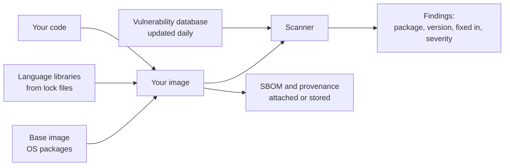

# 04. Image scanning and supply-chain basics

> **Draft: written but not yet run.** The code and the expected output in this lesson were prepared by reading the code and the official documentation. They have not been executed yet. If something does not behave as described, trust your tool's real output and report it.

## What you will be able to do
By the end of this lesson you will be able to:
- Scan an image with Docker Scout and with Trivy, and read a finding (package, installed version, fixed version, severity).
- Explain what a scan can and cannot tell you, and decide what to do with a finding.
- Add OCI labels, pin a base image by tag and by digest, and read an image's labels.
- Describe an SBOM and build provenance, and request them with `docker buildx build`.

## Recap
1. From lesson 03: which setting stops a process from gaining privileges through setuid programs?
   <details><summary>Answer</summary>`security_opt: ["no-new-privileges:true"]` in Compose, or `--security-opt no-new-privileges` with `docker run`.</details>
2. From lesson 01: why does a smaller final image help security, not only download time?
   <details><summary>Answer</summary>Fewer packages and tools mean fewer things to patch and fewer things an attacker can use.</details>

## Why it matters
When you buy food, you read the ingredient list and the recall notices. An image is also assembled from ingredients you did not make: a base image, operating-system packages, language libraries. The **supply chain** is everything that goes into your image before you write a line of your own code. When a flaw is found in one ingredient, scanners tell you which of your images contain it. This lesson gives you the habit and the vocabulary; it does not promise a clean report.

## What you will build
A small image with proper labels, scanned by two tools. No results are shown in this lesson, because they depend on today's vulnerability database and today's base image. Instead you learn what to look for.



## Before you start
- **Prerequisites:** [Docker 201 lesson 03, non-root users and hardening](03-non-root-and-hardening.md).
- Lesson 03 done; Docker 29.9.3 running. Time: 30 minutes.
- Docker Scout is part of Docker Desktop and available as a CLI plugin; some Scout features need you to be signed in to Docker (`docker login`). Check with `docker scout version`. If it is missing, install it from https://docs.docker.com/scout/ or use only the Trivy part.
- Trivy runs from its own container image (`aquasec/trivy`), so nothing to install. The first run downloads the vulnerability database, which needs internet.
- Windows: PowerShell 5.1. macOS/Linux: a POSIX shell. Ubuntu Engine users prefix Docker commands with `sudo`.
- Source pack (optional): every file is shown in full in this lesson, so you can follow without it. The finished code, the exercise starter and the solution are in the course repository https://github.com/Uee03/Code101 under `source/docker/201-hero-to-super-hero/phase-1-better-images/04-scanning-and-supply-chain/` (on that page choose **Code, Download ZIP**, or run `git clone https://github.com/Uee03/Code101.git`).

## Steps

### Step 1. Make the working folder
**Commands: folder `any folder`**
```powershell
New-Item -ItemType Directory -Force "$HOME\code101\docker201\lesson04" | Out-Null
Set-Location "$HOME\code101\docker201\lesson04"
```
macOS/Linux:

**Commands: folder `any folder`**
```bash
mkdir -p ~/code101/docker201/lesson04
cd ~/code101/docker201/lesson04
```
Expected result: the terminal is in `lesson04`. If lost, repeat the `Set-Location` or `cd` line.

### Step 2. The program and the Dockerfile
**File: `app.py`**
```python
print("Hello from an image that has been scanned", flush=True)
```
One line that prints and exits. `flush=True` writes the text immediately.

**File: `Dockerfile`**
```dockerfile
# syntax=docker/dockerfile:1
# To pin by digest, read the digest with: docker buildx imagetools inspect python:3.13-slim
# and then write: FROM python:3.13-slim@sha256:<the digest you read>
FROM python:3.13-slim
ARG VCS_REF=unknown
LABEL org.opencontainers.image.title="code101-supply" \
      org.opencontainers.image.description="Docker 201 supply-chain demo" \
      org.opencontainers.image.source="https://github.com/Uee03/Code101" \
      org.opencontainers.image.revision="${VCS_REF}"
WORKDIR /app
COPY --chmod=0444 app.py ./
USER 10001:10001
CMD ["python", "app.py"]
```

| Line | Explanation |
|---|---|
| 1 | Syntax frontend v1. |
| 2-3 | A comment that shows how to pin the base image by **digest**. A tag such as `3.13-slim` is a moving label: the maintainers re-point it to a patched build. A digest (`sha256:...`) names exactly one build forever. The placeholder is deliberately not filled in: read the real value from your own command, never copy one from a web page. |
| 4 | The base image by version-family tag. Never `latest`: you could not tell which version you built on. |
| 5 | A build argument with a default, to pass the Git commit id later. |
| 6-9 | OCI (Open Container Initiative) standard labels: title, description, source repository and revision. Scanners and registries use `source` and `revision` to link an image back to its code. The backslash continues the instruction on the next line. `${VCS_REF}` is replaced by the build argument. |
| 10 | Working folder. |
| 11 | Copies the code root-owned and read-only (lesson 03). |
| 12 | Runs as a numeric non-root user. The image has no entry for this id, which is fine for a program that needs no home folder. |
| 13 | Starts the program. |

**File: `.dockerignore`**
```text
.git/
.env
.env.*
Dockerfile*
scan.*
*.tar
```
Keeps history, settings, the scan scripts and any saved image tarball out of the build context.

### Step 3. Build, run and read the labels
**Commands: folder `lesson04`**
```powershell
docker build --build-arg VCS_REF=demo -t code101-supply:201 .
docker run --rm code101-supply:201
docker inspect --format "{{json .Config.Labels}}" code101-supply:201
```
Expected output (not yet run; build progress lines vary):
```text
Hello from an image that has been scanned
{"org.opencontainers.image.description":"Docker 201 supply-chain demo","org.opencontainers.image.revision":"demo","org.opencontainers.image.source":"https://github.com/Uee03/Code101","org.opencontainers.image.title":"code101-supply"}
```
`docker inspect --format` prints one field of the image metadata; `json` makes the label map one readable line. In your own project, pass the real commit id instead of `demo`, for example `--build-arg VCS_REF=$(git rev-parse HEAD)` in a macOS/Linux shell (in PowerShell: `--build-arg VCS_REF=$(git rev-parse HEAD)` works the same way).

### Step 4. Find the base image digest
**Commands: folder `any folder`**
```powershell
docker buildx imagetools inspect python:3.13-slim
```
Expected result: a few lines, including `Name:`, `MediaType:` and a line labelled `Digest:` that starts with `sha256:`. That digest identifies the multi-platform index (a list of one image per CPU type). Pinning `FROM python:3.13-slim@sha256:<digest>` makes the base fixed: reproducible, but it will not receive security patches until you update the digest. Teams usually pin by digest and let an update bot propose digest changes (lesson 09 shows Dependabot).

## Run it
### Docker Scout
**Commands: folder `lesson04`**
```powershell
docker scout quickview code101-supply:201
docker scout cves --only-severity critical,high code101-supply:201
```
`quickview` summarises the vulnerabilities in your image and its base image. `cves` lists them; `--only-severity critical,high` limits the list. Your output will differ from anyone else's, and from tomorrow's. What to look for: the **package** name and installed version, the **fixed version** (if one exists), the **severity** and the CVE id, and whether the package comes from the base image or from your layers.

### Trivy
**File: `scan.sh`** (macOS/Linux)
```bash
#!/usr/bin/env sh
set -eu

IMAGE="${1:-code101-supply:201}"
trap 'rm -f scan-image.tar' EXIT

echo "== Docker Scout: overview =="
docker scout quickview "$IMAGE"

echo "== Docker Scout: critical and high findings =="
docker scout cves --only-severity critical,high "$IMAGE"

echo "== Trivy: reads a saved tarball, so no Docker socket is mounted =="
docker save "$IMAGE" -o scan-image.tar
docker run --rm -v "$PWD:/work:ro" -v trivy-cache:/root/.cache/ aquasec/trivy:latest image --input /work/scan-image.tar --severity HIGH,CRITICAL --exit-code 1
```

| Line | Explanation |
|---|---|
| 1 | Run with a POSIX shell. |
| 2 | `-e` stops at the first failing command, `-u` makes an unset variable an error. |
| 4 | The image to scan: the first argument, or the lesson image by default. |
| 5 | Deletes the temporary tarball on exit, even after an error. |
| 7-8 | Scout overview. |
| 10-11 | Scout list of critical and high findings. |
| 13 | Prints a heading. The comment in the heading matters: Trivy reads a file, not the Docker socket. Mounting `docker.sock` into a scanner would give it control of your Docker daemon (lesson 03). |
| 14 | Saves the image as a tar file in the current folder. |
| 15 | Runs Trivy in a throwaway container. `-v "$PWD:/work:ro"` shares the current folder read-only; `-v trivy-cache:/root/.cache/` keeps the vulnerability database in a named volume so the next scan is faster; `--input` scans the tarball; `--severity HIGH,CRITICAL` reports only those levels; `--exit-code 1` makes the command fail (exit status 1) if any are found. `latest` is used here because a scanner should be current; in CI, pin a version and update it deliberately. |

**File: `scan.ps1`** (Windows)
```powershell
param([string]$Image = "code101-supply:201")

Write-Host "== Docker Scout: overview =="
docker scout quickview $Image

Write-Host "== Docker Scout: critical and high findings =="
docker scout cves --only-severity critical,high $Image

Write-Host "== Trivy: reads a saved tarball, so no Docker socket is mounted =="
docker save $Image -o scan-image.tar
try {
    docker run --rm -v "${PWD}:/work:ro" -v trivy-cache:/root/.cache/ aquasec/trivy:latest image --input /work/scan-image.tar --severity HIGH,CRITICAL --exit-code 1
    $trivyExit = $LASTEXITCODE
}
finally {
    Remove-Item scan-image.tar -ErrorAction SilentlyContinue
}
Write-Host "Trivy exit code: $trivyExit (0 = nothing at HIGH or CRITICAL, 1 = findings)"
exit $trivyExit
```
Same steps as `scan.sh`. `param(...)` is the optional image argument; `try ... finally` deletes the tarball whatever happens; `$LASTEXITCODE` is the exit status of the last native command; the last line returns it to the caller, so a CI job can fail on findings.

Run it from `lesson04` (Windows: `.\scan.ps1`; if the execution policy blocks it, run `powershell -ExecutionPolicy Bypass -File .\scan.ps1`, which affects only this one run):

**Commands: folder `lesson04`**
```powershell
.\scan.ps1
```
macOS/Linux:

**Commands: folder `lesson04`**
```bash
sh scan.sh
```
Expected result: Scout summaries, then Trivy printing a report of results for the operating system packages (and a note if it finds nothing at those severities). Whether the exit status is `0` or `1` depends on the base image's state today, so there is no fixed expected output here.

**File: `.trivyignore`**
```text
# Findings you accept on purpose go here, one CVE id per line, each with a comment.
# Format of a comment: why it is accepted, who decided, review-by date.
# Example line (commented out, not a real exception):
# CVE-0000-00000
```
Trivy reads `.trivyignore` from the folder it runs in. Treat every entry as a decision with an owner and an expiry date, not as a way to silence the scanner. (To use it, mount the folder and run Trivy from it, or pass `--ignorefile`; see the Trivy documentation.)

### SBOM and provenance
An **SBOM** (software bill of materials) is a list of the packages inside an image. **Provenance** is a record of how and from what source the image was built. Both can be attached to an image at build time:

**Commands: folder `lesson04`**
```powershell
docker buildx build --sbom=true --provenance=mode=max -t code101-supply:201-attested .
```
Attestations (the attached records) are stored alongside the image in a registry or in the containerd image store. If your engine answers that the selected builder or image store does not support them, either enable the containerd image store in Docker Desktop (**Settings > General**) or push the image to a registry in CI (lesson 09). Details: https://docs.docker.com/build/metadata/attestations/. Once the image is in a registry you can read the records with `docker buildx imagetools inspect <image> --format "{{ json .SBOM }}"`.

Clean up:

**Commands: folder `any folder`**
```powershell
docker image rm code101-supply:201
docker volume rm trivy-cache
```
If you built `code101-supply:201-attested`, remove it too. `docker volume rm trivy-cache` deletes only the scanner's database cache.

## How it works
A scanner reads the list of packages and libraries in each image layer and compares name and version with a database of known vulnerabilities (CVEs: Common Vulnerabilities and Exposures). It does not run your code.

**What a clean or dirty report means:**
- A finding means "a vulnerable version is present", not "your app is exploitable". The vulnerable code may never run.
- No findings means "nothing known today", not "secure".
- Findings change daily as the database grows, even when your image does not.

**Misconception:** "I must get zero findings." Instead, triage: is there a fixed version (update the base image and rebuild)? Is the package even needed (remove it, as in the lesson 01 multi-stage idea)? Is it unreachable or not applicable (document an exception with an owner and review date)?

| Why this, not that | Choose it when | Trade-off |
|---|---|---|
| Docker Scout | You use Docker Desktop or Hub and want base-image advice | Some features need a Docker account |
| Trivy | You want an open-source scanner that runs anywhere, including CI | You manage its database cache and version |
| Pin by tag (`3.13-slim`) | You want automatic patch updates on rebuild | Builds differ over time |
| Pin by digest | You want reproducible builds | You must update the digest to get patches |
| `latest` | Almost never | You cannot reproduce or reason about what you ran |

Supply-chain habits worth the effort: rebuild regularly with `docker build --pull` so base patches arrive; do not `curl ... | sh` inside a Dockerfile without verifying a checksum; commit lock files (lesson 02); keep secrets out of images (lesson 06); keep build recipes in source control.

## Try it
Copy `exercise/starter/Dockerfile` into a `practice` folder together with `app.py`.

1. **Guided:** fix the four `TODO` items so that the file matches the finished `Dockerfile` (apart from the digest comment).
2. **Change:** write the single Trivy command that fails only on `CRITICAL` findings, and the Scout command that lists only critical findings. Write them as comments at the top of a file named `ci-scan.txt`.
3. **Stretch (no single answer):** your team has 40 findings and a release tomorrow. Write down your triage rule: what must be fixed before release, what may be accepted with an expiry date, and who decides.

**File: `exercise/starter/Dockerfile`**
```dockerfile
FROM python:latest
# TODO 1: replace the floating tag above with the pinned version-family tag python:3.13-slim
# TODO 2: add an ARG VCS_REF and a LABEL block with title, description, source and revision (org.opencontainers.image.*)
RUN apt-get update && apt-get install -y curl git build-essential
# TODO 3: delete the line above; this program uses no extra packages
WORKDIR /app
COPY app.py ./
# TODO 4: run as the numeric user 10001:10001
CMD ["python", "app.py"]
```

<details><summary>Solution</summary>

**File: `exercise/solution/Dockerfile`**
```dockerfile
# syntax=docker/dockerfile:1
FROM python:3.13-slim
ARG VCS_REF=unknown
LABEL org.opencontainers.image.title="code101-supply" \
      org.opencontainers.image.description="Docker 201 supply-chain demo" \
      org.opencontainers.image.source="https://github.com/Uee03/Code101" \
      org.opencontainers.image.revision="${VCS_REF}"
WORKDIR /app
COPY --chmod=0444 app.py ./
USER 10001:10001
CMD ["python", "app.py"]
```
Change rung (one answer): `docker run --rm -v "$PWD:/work:ro" -v trivy-cache:/root/.cache/ aquasec/trivy:latest image --input /work/scan-image.tar --severity CRITICAL --exit-code 1` and `docker scout cves --only-severity critical code101-supply:201`. Stretch (one possible rule): fix every critical or high finding that has a fixed version and affects code your service runs; accept others only with a written reason, an owner and a review date within 30 days.

</details>

## Check yourself
1. Does a scan finding prove your application can be attacked? <details><summary>Answer</summary>No. It shows a vulnerable package version is present; whether the vulnerable code is reachable needs analysis.</details>
2. Why pin a base image by digest, and what is the cost? <details><summary>Answer</summary>A digest names exactly one build, so builds are reproducible. The cost is that you must update it yourself to receive patches.</details>
3. Why does `scan.sh` save a tarball instead of giving Trivy the Docker socket? <details><summary>Answer</summary>Access to `docker.sock` is control of the Docker daemon, so a scanner should not receive it when a file will do.</details>
4. Predict the output of `docker inspect --format "{{json .Config.Labels}}"` when you build with `--build-arg VCS_REF=abc123`. <details><summary>Answer</summary>The label map with `"org.opencontainers.image.revision":"abc123"`; the other three labels are unchanged.</details>

## Common mistakes
| Symptom or error text | Cause | Fix |
|---|---|---|
| `docker: 'docker scout' is not a docker command` (typical message) | The Scout plugin is not installed | Install it from the Docker docs, or skip to Trivy |
| Scout asks you to sign in or reports missing access | Some Scout features need a Docker account | Run `docker login`, or use Trivy |
| Trivy takes long the first time | It downloads its vulnerability database | Keep the `trivy-cache` volume so later runs are fast |
| `scan.ps1 cannot be loaded because running scripts is disabled` | PowerShell execution policy | Run `powershell -ExecutionPolicy Bypass -File .\scan.ps1` for this one run |
| `\\` or a Windows path in the `-v` option is rejected | The drive path was not quoted | Quote the whole `-v "${PWD}:/work:ro"` argument as in `scan.ps1` |
| Labels show `unknown` for the revision | You built without `--build-arg VCS_REF=...` | Pass the argument at build time |

## Best practice
Scan images in CI on every build and on a schedule, pin and update base images deliberately, and record accepted risks with an owner and an expiry date. Source: Docker Scout https://docs.docker.com/scout/ and Docker build attestations https://docs.docker.com/build/metadata/attestations/

## Going further
- Best practices for base images: https://docs.docker.com/build/building/best-practices/#pin-base-image-versions
- Trivy documentation: https://trivy.dev/docs/
- A scan step in CI: lesson 09. Deeper image security, signing and registries are covered in [Docker 301 lesson 02, image provenance, SBOM and signing](../../301-super-hero-to-legendary/phase-1-secure-supply-chain/02-image-provenance-sbom-and-signing.md) and [lesson 04, registries and promotion pipelines](../../301-super-hero-to-legendary/phase-2-registries-and-orchestration/04-registries-and-promotion-pipelines.md).

## Summary
- You scanned an image with Docker Scout and Trivy and learned to read a finding.
- You explained what a scan can and cannot prove.
- You added OCI labels and learned to pin a base image by tag and by digest.
- You described SBOMs and provenance and requested them with `docker buildx build`.

## Next lesson
05. Compose profiles, overrides and extension fields: one set of Compose files for development and production.
