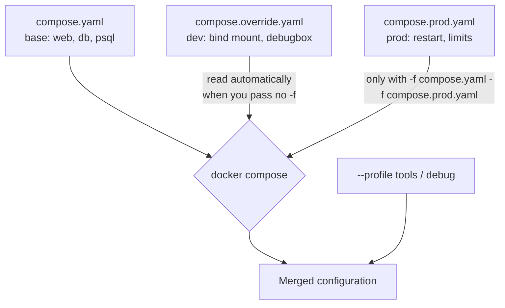

# 05. Compose profiles, overrides and extension fields

> **Draft: written but not yet run.** The code and the expected output in this lesson were prepared by reading the code and the official documentation. They have not been executed yet. If something does not behave as described, trust your tool's real output and report it.

## What you will be able to do
By the end of this lesson you will be able to:
- Keep optional services (tools, debug helpers) out of `docker compose up` with profiles, and start them on demand.
- Split a stack into a base file plus a development override and a production override, and predict the merged result.
- Remove repetition with extension fields (`x-...`) and YAML anchors.
- Use `docker compose config` to inspect what Compose will actually run.

## Recap
1. From Docker 101 lesson 07: what does `depends_on` with `condition: service_healthy` wait for?
   <details><summary>Answer</summary>It waits until the dependency's healthcheck reports healthy, not merely until its process started.</details>
2. From lesson 03: which Compose keys make a container's root filesystem read-only?
   <details><summary>Answer</summary>`read_only: true`, with `tmpfs:` or volumes for the folders that must stay writable.</details>

## Why it matters
A restaurant has one kitchen but several service modes: breakfast, dinner, a private event. Nobody builds three kitchens; they change the menu and the staffing. Your application also runs in several modes: on your laptop you want source files mounted and a database shell within reach; in production you want restarts, limits and nothing extra. One Compose file for everything becomes cluttered; three copies drift apart. Profiles, overrides and extension fields let you keep **one base** and describe only the differences.

## What you will build
A small stack (a Python web service and Postgres) with:
- an automatic **development override** (`compose.override.yaml`) that mounts your source file and adds a debug container behind a profile;
- a **production override** (`compose.prod.yaml`) with restart policies, a read-only filesystem and resource limits;
- a **tools profile** with a `psql` client that runs only when you ask for it;
- **extension fields** that share logging and shutdown settings between services.



## Before you start
- **Prerequisites:** [Docker 201 lesson 03, non-root users and hardening](../phase-1-better-images/03-non-root-and-hardening.md); Docker 101 lessons [06, networks and Compose](../../101-zero-to-hero/phase-2-compose/06-networks-and-compose.md) and [07, healthchecks and cleanup](../../101-zero-to-hero/phase-2-compose/07-healthchecks-and-cleanup.md).
- Lessons 01 to 04 done (lesson 03 hardening settings appear here). Docker 29.9.3 and Compose v5.7.0. Time: 35 minutes.
- Windows: PowerShell 5.1, `curl.exe`. macOS/Linux: `curl`. Ubuntu Engine: prefix Docker commands with `sudo`.
- Host port 8080 must be free.
- Source pack (optional): every file is shown in full in this lesson, so you can follow without it. The finished code, the exercise starter and the solution are in the course repository https://github.com/Uee03/Code101 under `source/docker/201-hero-to-super-hero/phase-2-compose-in-depth/05-profiles-overrides-extensions/` (on that page choose **Code, Download ZIP**, or run `git clone https://github.com/Uee03/Code101.git`).
- Image tags used: `python:3.13-slim`, `postgres:17-alpine`, `alpine:3.22`.

## Steps

### Step 1. Make the working folder
**Commands: folder `any folder`**
```powershell
New-Item -ItemType Directory -Force "$HOME\code101\docker201\lesson05" | Out-Null
Set-Location "$HOME\code101\docker201\lesson05"
```
macOS/Linux:

**Commands: folder `any folder`**
```bash
mkdir -p ~/code101/docker201/lesson05
cd ~/code101/docker201/lesson05
```
Expected result: the terminal is in `lesson05`. If lost, repeat the `Set-Location` or `cd` line. Create every file below in this folder with exactly these names (Windows: show file name extensions in File Explorer to avoid `.txt` suffixes).

### Step 2. The web program and its image
**File: `app.py`**
```python
import json
import os
from http.server import BaseHTTPRequestHandler, HTTPServer


class Handler(BaseHTTPRequestHandler):
    def do_GET(self):
        body = json.dumps({
            "environment": os.environ.get("APP_ENV", "unknown"),
            "message": os.environ.get("GREETING", ""),
        }) + "\n"
        self.send_response(200)
        self.send_header("Content-Type", "application/json")
        self.end_headers()
        self.wfile.write(body.encode())


HTTPServer(("0.0.0.0", 8000), Handler).serve_forever()
```
The page reports two environment variables, so you can see which configuration was applied.

**File: `Dockerfile`**
```dockerfile
# syntax=docker/dockerfile:1
FROM python:3.13-slim
ENV PYTHONDONTWRITEBYTECODE=1
WORKDIR /app
COPY --chmod=0444 app.py ./
USER 10001:10001
EXPOSE 8000
CMD ["python", "-u", "app.py"]
```
It follows lesson 03: no bytecode files, root-owned read-only code, numeric non-root user. `-u` makes logs unbuffered.

**File: `.dockerignore`**
```text
.git/
.env
.env.*
Dockerfile*
compose*.yaml
```
Keeps history, settings and Compose files out of the build context.

### Step 3. The settings file
**File: `.env.example`**
```dotenv
POSTGRES_USER=learner
POSTGRES_PASSWORD=local-demo-only
POSTGRES_DB=workshop
GREETING=Hello from profiles
```
These are public throwaway values for this lesson. Compose reads a file named `.env` in the project folder to fill `${...}` placeholders, so copy the example (never commit the copy; lesson 06 explains secrets properly). Windows: `Copy-Item .env.example .env`. macOS/Linux: `cp .env.example .env`.

### Step 4. The base file
**File: `compose.yaml`**
```yaml
name: code101-profiles

x-logging: &default-logging
  driver: json-file
  options:
    max-size: "10m"
    max-file: "3"

x-service-defaults: &service-defaults
  logging: *default-logging
  stop_grace_period: 10s

services:
  web:
    <<: *service-defaults
    build: .
    image: code101-profiles-web:201
    ports:
      - "127.0.0.1:8080:8000"
    environment:
      APP_ENV: ${APP_ENV:-base}
      GREETING: ${GREETING}
    depends_on:
      db:
        condition: service_healthy

  db:
    <<: *service-defaults
    image: postgres:17-alpine
    environment:
      POSTGRES_USER: ${POSTGRES_USER}
      POSTGRES_PASSWORD: ${POSTGRES_PASSWORD}
      POSTGRES_DB: ${POSTGRES_DB}
    volumes:
      - db_data:/var/lib/postgresql/data
    healthcheck:
      test: ["CMD-SHELL", "pg_isready -U $${POSTGRES_USER} -d $${POSTGRES_DB}"]
      interval: 5s
      timeout: 3s
      retries: 10

  psql:
    <<: *service-defaults
    image: postgres:17-alpine
    profiles: ["tools"]
    environment:
      PGPASSWORD: ${POSTGRES_PASSWORD}
    entrypoint: ["psql", "-h", "db", "-U", "${POSTGRES_USER}", "-d", "${POSTGRES_DB}"]
    depends_on:
      db:
        condition: service_healthy

volumes:
  db_data:
```

| Key or block | Explanation |
|---|---|
| `name:` | Fixed project name, so containers are named `code101-profiles-web-1` and so on. |
| `x-logging: &default-logging` | An **extension field**: a top-level key that starts with `x-` is ignored by Compose, so you can park reusable pieces there. `&default-logging` is a YAML **anchor**: it names this block so it can be reused. |
| `driver`, `options` | The JSON-file log driver with rotation: at most 3 files of 10 MB per container, so logs cannot fill the disk. Quotes keep `10m` a string. |
| `x-service-defaults: &service-defaults` | A second reusable block. It reuses the first with `*default-logging` (an **alias**: "insert the anchored block here") and gives containers 10 seconds to stop gracefully (`stop_grace_period`). |
| `services:` and `web:` | Services start here; the first is the web service. |
| `<<: *service-defaults` | The YAML **merge key**: copy all keys of the anchored block into this service. Keys written in the service win over merged ones. |
| `build`, `image` | Build the Dockerfile in this folder and name the image. |
| `ports` | Publish container port 8000 on host loopback port 8080. |
| `environment` (web) | Environment for the app. `${APP_ENV:-base}` means: use the variable `APP_ENV` if set, otherwise the text `base`. `${GREETING}` comes from `.env`. |
| `depends_on` (web) | Start web only after the `db` healthcheck passes. |
| `db:` | The database service, with the same shared defaults. |
| `image: postgres:17-alpine` | Official Postgres on Alpine, major version 17. |
| `environment` (db) | Initial user, password and database name (only used on an empty volume). |
| `volumes` (db) | Named volume for the data directory. |
| `healthcheck` | Run `pg_isready` every 5 s, time out after 3 s, give up after 10 failures. `$$` writes a literal `$` so that the container's shell, not Compose, expands the variable. |
| `psql:` | An interactive SQL client service. |
| `profiles: ["tools"]` | This service is **not started by default**. It starts only when the `tools` profile is enabled (`--profile tools`), or when you name it on the command line. |
| `PGPASSWORD` | The client reads its password from this variable. |
| `entrypoint` | The command that always runs; extra arguments you pass to `docker compose run` are appended to it. `-h db` reaches the database by service name. |
| `depends_on` (psql) | Wait for a healthy database. |
| `volumes:` at the end | Declares the named volume `db_data`. |

**Predict before you run:** with only this file, what does `docker compose up -d` start: web and db, or web, db and psql? Write your answer down.

### Step 5. The development override
**File: `compose.override.yaml`**
```yaml
services:
  web:
    environment:
      APP_ENV: development
    volumes:
      - ./app.py:/app/app.py:ro

  debugbox:
    image: alpine:3.22
    profiles: ["debug"]
    command: ["sleep", "infinity"]
```

| Line | Explanation |
|---|---|
| 1-2 | Only the parts that change for `web`; everything else comes from `compose.yaml`. |
| 3-4 | Sets `APP_ENV` to `development`. A mapping like `environment` is **merged key by key**; this value replaces the base value. |
| 5-6 | Bind-mounts your local `app.py` over the file in the image, read-only, so edits on your computer are visible in the container after a restart. On Linux the file must be readable by user 10001 (normally mode 644). |
| 8-11 | `debugbox`: a throwaway Alpine container for poking at the network, in the `debug` profile, kept alive by `sleep infinity`. It exists only in development. |

Compose reads `compose.yaml` **and** `compose.override.yaml` automatically when you do not pass `-f`. That is why the development setup needs no extra flags.

### Step 6. The production override
**File: `compose.prod.yaml`**
```yaml
services:
  web:
    environment:
      APP_ENV: production
    restart: unless-stopped
    read_only: true
    deploy:
      resources:
        limits:
          cpus: "0.50"
          memory: 128M

  db:
    restart: unless-stopped
```

| Line | Explanation |
|---|---|
| 3-4 | Sets `APP_ENV` to `production`. |
| 5 | Restart the container when it exits, unless you stopped it yourself. |
| 6 | Read-only root filesystem (lesson 03). The app writes nothing. |
| 7-11 | Resource limits: at most half a CPU and 128 MB of memory (lesson 07 explains limits). |
| 13-14 | The database restarts automatically too. |

This file is **not** read automatically. You select it explicitly with two `-f` options: `-f compose.yaml -f compose.prod.yaml`. Because the override file is then not listed, the development bind mount is not applied in production.

## Run it
Copy the settings first (Step 3). All commands run in `lesson05`.

**Commands: folder `lesson05`**
```powershell
docker compose config --profiles
```
Expected result: the profile names `debug` and `tools`, one per line (order may vary; not yet run).

Start the development stack:

**Commands: folder `lesson05`**
```powershell
docker compose up -d --build --wait
docker compose ps --format "{{.Service}} {{.State}}"
curl.exe -fsS http://127.0.0.1:8080/
```
Expected result: `web` and `db` appear as `running`; `psql` and `debugbox` do not appear, because their profiles are off. The page shows the development environment (macOS/Linux: `curl`):
```text
{"environment": "development", "message": "Hello from profiles"}
```
`--wait` makes `up` return once services are running (and healthy where a healthcheck exists).

Run the SQL client from the `tools` profile for one command:

**Commands: folder `lesson05`**
```powershell
docker compose --profile tools run --rm psql -tAc "SELECT current_database()"
```
Expected output:
```text
workshop
```
`run --rm` starts a one-off container and removes it afterwards. `-t` prints rows only, `-A` turns off alignment, `-c` runs one SQL statement. The text after the service name replaces nothing: it is appended to the `entrypoint`.

Start the debug box and call the web service from inside the network:

**Commands: folder `lesson05`**
```powershell
docker compose --profile debug up -d debugbox
docker compose exec debugbox wget -qO- http://web:8000/
```
Expected output:
```text
{"environment": "development", "message": "Hello from profiles"}
```
`web` is the service name; the Compose network provides DNS for it (Docker 101 lesson 06). `wget -qO-` is Alpine's small HTTP client: quiet, write the page to standard output.

Inspect and switch to the production configuration:

**Commands: folder `lesson05`**
```powershell
docker compose down --remove-orphans
docker compose -f compose.yaml -f compose.prod.yaml config
docker compose -f compose.yaml -f compose.prod.yaml up -d --build --wait
curl.exe -fsS http://127.0.0.1:8080/
```
`config` prints the final merged Compose file; read it to see `restart`, `read_only` and the resource limits next to the base settings, and note that the bind mount is absent. Expected page:
```text
{"environment": "production", "message": "Hello from profiles"}
```
Clean up:

**Commands: folder `lesson05`**
```powershell
docker compose -f compose.yaml -f compose.prod.yaml down -v --remove-orphans
docker image rm code101-profiles-web:201
```
`-v` deletes the project's named volume (the throwaway database). Never use it on data you want to keep.

## How it works
Compose builds one configuration from several sources, in this order: the base file, each further `-f` file in order, then interpolation of `${...}` from the environment and `.env`. Merging rules, simplified:

| Kind of key | Rule | Example |
|---|---|---|
| Single value (`image`, `restart`) | The later file wins | prod `restart` replaces nothing, it is new |
| Mapping (`environment`, `labels`) | Merged key by key; the later file wins per key | `APP_ENV` changes, `GREETING` is kept |
| List of ports (`ports`, `expose`) | Items are **added**, not replaced | A second file with another port publishes both |
| `command` and `entrypoint` | Replaced | An override can change how the container starts |
| `volumes` | Merged by the container path | Same target path: the later file wins |

To **replace** a list instead of extending it, use the `!override` tag on that key; to remove an inherited key, use `!reset`. The exercise uses `!override`.

**Profiles** only decide whether a service starts. They do not change configuration. A service with no `profiles` always starts; a service with `profiles` starts when one of them is enabled with `--profile`, the `COMPOSE_PROFILES` environment variable, or when you target the service by name.

**Extension fields and anchors** are a YAML feature, not a Compose feature, and they do not cross files: an anchor defined in `compose.yaml` cannot be used in `compose.prod.yaml`. Inside one file they remove copy-paste.

**Misconception:** "profiles are for production versus development." They are not. Environments differ by **configuration** (overrides); profiles select **which optional services run**.

| Why this, not that | Choose it when | Trade-off |
|---|---|---|
| Override files | The same services run everywhere with different settings | You must remember which `-f` list production uses |
| Profiles | Optional or tool services (SQL client, debug box, migration job) | A forgotten profile means a missing service |
| `include:` or `extends:` | You reuse a service definition across projects | More indirection; see the Compose docs |
| Separate full copies of the file | Never | They drift apart |

For a complete production-like stack with an API, database and identity service, see the platform capstone (`capstones/platform`).

## Try it
Copy `exercise/starter/compose.staging.yaml` into your `lesson05` folder.

1. **Guided:** complete the three `TODO` lines so the file sets `APP_ENV` to `staging`, adds a restart policy, and **replaces** the published port with `127.0.0.1:8081:8000`.
2. **Change:** run `docker compose -f compose.yaml -f compose.staging.yaml config` and look at the `ports` of `web`. Predict first: if you removed `!override`, how many ports would `web` publish? Then start the staging stack and open port 8081.
3. **Stretch (no single answer):** you now have base, dev, prod and staging. Decide how a teammate should know which `-f` list to use (a `Makefile`, a script, the `COMPOSE_FILE` variable, or documentation) and justify the choice.

**File: `exercise/starter/compose.staging.yaml`**
```yaml
services:
  web: {}
  # TODO 1: under web, add an environment mapping that sets APP_ENV to staging
  # TODO 2: under web, add a restart policy that restarts the container unless you stopped it
  # TODO 3: under web, replace (not extend) the published ports with 127.0.0.1:8081:8000 using the !override tag
```

<details><summary>Solution</summary>

**File: `exercise/solution/compose.staging.yaml`**
```yaml
services:
  web:
    environment:
      APP_ENV: staging
    restart: unless-stopped
    ports: !override
      - "127.0.0.1:8081:8000"
```
Start it with `docker compose -f compose.yaml -f compose.staging.yaml up -d --build --wait`, then `curl.exe -fsS http://127.0.0.1:8081/` should show `{"environment": "staging", "message": "Hello from profiles"}`. Without `!override`, `ports` lists are merged, so `web` would publish both 8080 and 8081. Stop it with `docker compose -f compose.yaml -f compose.staging.yaml down -v --remove-orphans`.

</details>

## Check yourself
1. Which override file does Compose read without any `-f` option? <details><summary>Answer</summary>`compose.override.yaml` (together with `compose.yaml`).</details>
2. Predict: `docker compose up -d` with the base file only. Does `psql` start? <details><summary>Answer</summary>No. It has `profiles: ["tools"]`, which is not enabled.</details>
3. Why can `compose.prod.yaml` not use the `*default-logging` alias? <details><summary>Answer</summary>YAML anchors work only inside the file that defines them.</details>
4. What does `$${POSTGRES_USER}` mean in the healthcheck? <details><summary>Answer</summary>`$$` is an escaped `$`: Compose passes `${POSTGRES_USER}` to the container, whose shell expands it from the container's environment.</details>

## Common mistakes
| Symptom or error text | Cause | Fix |
|---|---|---|
| `WARN ... The "GREETING" variable is not set. Defaulting to a blank string.` (typical message) | `.env` is missing or misnamed | Copy `.env.example` to `.env` in the same folder as `compose.yaml` |
| `found character that cannot start any token` (typical YAML parser message) | A tab character in a YAML file | Use two spaces per level, never tabs |
| `Bind for 127.0.0.1:8080 failed: port is already allocated` | Another container publishes 8080 | Stop your earlier containers (`docker ps`) |
| `psql` or `debugbox` "does not exist" in `ps` | Its profile is not enabled | Add `--profile tools` or `--profile debug` |
| Production still shows the dev bind mount | You ran `docker compose up` without `-f`, so the dev override was read | Use `-f compose.yaml -f compose.prod.yaml` |

## Best practice
Keep one base Compose file, describe each environment as a small override, use profiles for optional tools, and inspect the result with `docker compose config` before running it. Source: Docker Compose merge and override https://docs.docker.com/compose/how-tos/multiple-compose-files/ and profiles https://docs.docker.com/compose/how-tos/profiles/

## Going further
- Extension fields: https://docs.docker.com/reference/compose-file/extension/
- `include`, `extends` and `merge`: https://docs.docker.com/compose/how-tos/multiple-compose-files/
- A full stack example: `capstones/platform`.

## Summary
- You kept optional services behind profiles and started them on demand.
- You split a stack into a base plus development and production overrides and predicted the merge.
- You removed repetition with extension fields, anchors and the merge key.
- You inspected the merged configuration with `docker compose config`.

## Next lesson
06. Secrets and configs: pass passwords and configuration files into containers without baking them into images.
