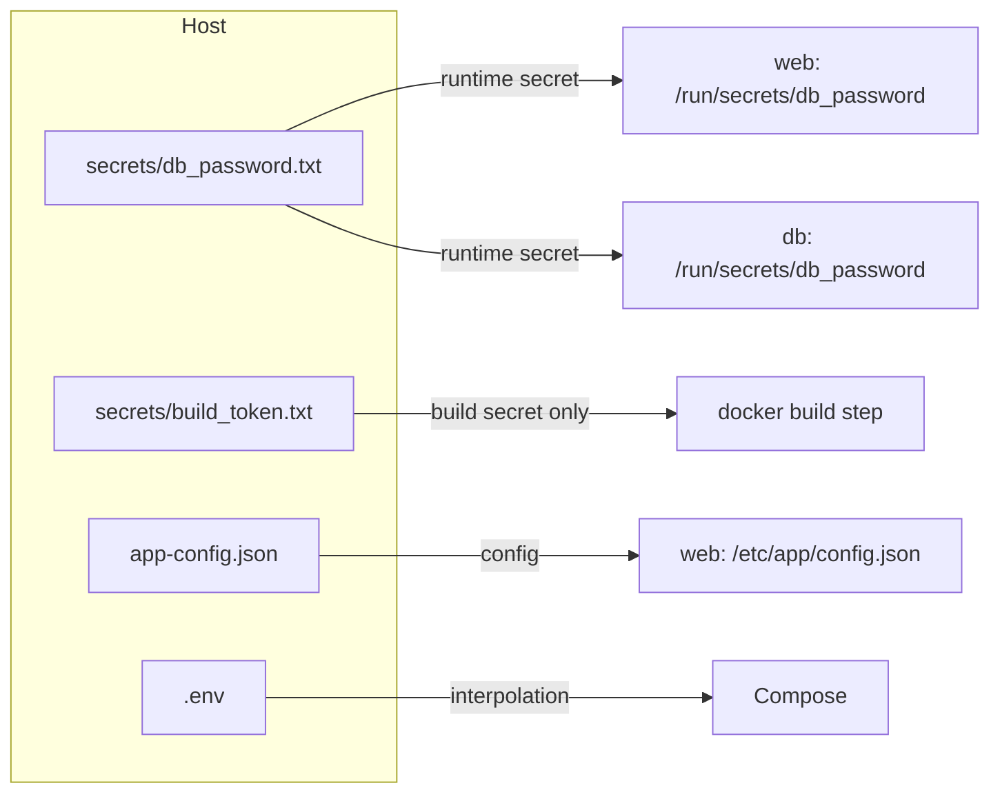

# 06. Secrets and configs

> **Draft: written but not yet run.** The code and the expected output in this lesson were prepared by reading the code and the official documentation. They have not been executed yet. If something does not behave as described, trust your tool's real output and report it.

## What you will be able to do
By the end of this lesson you will be able to:
- Choose between an environment variable, an `env_file`, a Compose **secret** and a Compose **config** for a given value.
- Pass a password to an app and to Postgres through files under `/run/secrets` instead of environment variables.
- Use a **build secret** so that a token needed during `docker build` never lands in an image layer.
- List the places where a secret can leak (image history, `docker inspect`, logs, `docker compose config`) and check them.

## Recap
1. From Docker 101 lesson 05: what is `.env.example` for, and why is `.env` not committed?
   <details><summary>Answer</summary>`.env.example` shows which settings exist, with safe values, and is committed. `.env` holds real local values and stays out of Git.</details>
2. From lesson 05: which tool lets you see the final merged Compose configuration?
   <details><summary>Answer</summary>`docker compose config`.</details>

## Why it matters
A house key under the doormat is convenient and everyone knows where it is. An environment variable is that doormat: it is easy, and it shows up in `docker inspect`, in crash reports, in child processes and in logs that print the environment. A secret mounted as a **file** is closer to a key kept in a lockbox: only the containers you grant it to can open it, and it is never part of the image. Images get copied to registries, laptops and CI caches; a password baked into one is a password you cannot take back.

## What you will build
A web service and Postgres that share a password through a **file secret**, a configuration file mounted with a Compose **config**, and a build step that uses a **build secret**. The web page reports the secret's *length* (never the value) and the configuration, so you can see both arrived.



## Before you start
- **Prerequisites:** [Docker 201 lesson 05, Compose profiles, overrides and extension fields](05-profiles-overrides-extensions.md) and [Docker 101 lesson 05, environment and secrets](../../101-zero-to-hero/phase-2-compose/05-environment-and-secrets.md).
- Lesson 05 done. Docker 29.9.3 and Compose v5.7.0. Time: 35 minutes.
- Windows: PowerShell 5.1, `curl.exe`. macOS/Linux: `curl`. Ubuntu Engine: prefix Docker commands with `sudo`. Host port 8080 free.
- Source pack (optional): every file is shown in full in this lesson, so you can follow without it. The finished code, the exercise starter and the solution are in the course repository https://github.com/Uee03/Code101 under `source/docker/201-hero-to-super-hero/phase-2-compose-in-depth/06-secrets-and-configs/` (on that page choose **Code, Download ZIP**, or run `git clone https://github.com/Uee03/Code101.git`).
- Every "secret" in this lesson is a public demonstration value. Never reuse them for anything real.

## Steps

### Step 1. Make the folders
**Commands: folder `any folder`**
```powershell
New-Item -ItemType Directory -Force "$HOME\code101\docker201\lesson06\secrets" | Out-Null
Set-Location "$HOME\code101\docker201\lesson06"
```
macOS/Linux:

**Commands: folder `any folder`**
```bash
mkdir -p ~/code101/docker201/lesson06/secrets
cd ~/code101/docker201/lesson06
```
Expected result: the terminal is in `lesson06`, which contains a `secrets` folder. If lost, repeat the `Set-Location` or `cd` line.

### Step 2. The application
**File: `app.py`**
```python
import json
import os
from http.server import BaseHTTPRequestHandler, HTTPServer


def read_secret(name):
    path = os.environ[name + "_FILE"]
    with open(path) as handle:
        return handle.read().strip()


def load_config():
    with open(os.environ["APP_CONFIG_FILE"]) as handle:
        return json.load(handle)


class Handler(BaseHTTPRequestHandler):
    def do_GET(self):
        password = read_secret("DB_PASSWORD")
        body = json.dumps({
            "greeting": os.environ["GREETING"],
            "config": load_config(),
            "secret_length": len(password),
        }) + "\n"
        self.send_response(200)
        self.send_header("Content-Type", "application/json")
        self.end_headers()
        self.wfile.write(body.encode())


HTTPServer(("0.0.0.0", 8000), Handler).serve_forever()
```
`read_secret("DB_PASSWORD")` follows the **`_FILE` convention**: the environment variable `DB_PASSWORD_FILE` holds the *path* of a file, and the program reads the value from it. The official Postgres image supports the same convention (`POSTGRES_PASSWORD_FILE`). `.strip()` removes the newline an editor adds at the end of the file. The response contains the secret's **length**, never the secret: a page, a log line or a stack trace must not echo it.

### Step 3. The configuration file
**File: `app-config.json`**
```json
{"feature_banner": "Welcome", "page_size": 20}
```
Non-secret settings that are more than one value belong in a file. Compose delivers them with a **config**.

### Step 4. The Dockerfile with a build secret
**File: `Dockerfile`**
```dockerfile
# syntax=docker/dockerfile:1
FROM python:3.13-slim
ENV PYTHONDONTWRITEBYTECODE=1
RUN --mount=type=secret,id=build_token test -s /run/secrets/build_token && echo "build token received, not stored in the image"
WORKDIR /app
COPY --chmod=0444 app.py ./
USER 10001:10001
EXPOSE 8000
CMD ["python", "-u", "app.py"]
```

| Line | Explanation |
|---|---|
| 1 | Syntax frontend v1; secret mounts are part of it. |
| 2 | Base image. |
| 3 | No bytecode files. |
| 4 | A **build secret**: for this one `RUN` only, BuildKit mounts the secret with id `build_token` as the file `/run/secrets/build_token`. `test -s` checks the file exists and is not empty, and the `echo` proves it. A real use is a private package registry token: `RUN --mount=type=secret,id=npm_token ...`. The mount is **not** written to the layer, unlike `ARG` or `ENV`. |
| 5 | Working folder. |
| 6 | Root-owned, read-only code (lesson 03). |
| 7 | Non-root user. |
| 8-9 | Port and start command. |

**File: `.dockerignore`**
```text
.git/
.env
.env.*
secrets/
Dockerfile*
compose*.yaml
app-config.json
```
`secrets/` is excluded so that even a careless `COPY . .` could never put a secret file into an image.

### Step 5. The Compose file
**File: `compose.yaml`**
```yaml
name: code101-secrets

services:
  web:
    build:
      context: .
      secrets:
        - build_token
    image: code101-secrets-web:201
    ports:
      - "127.0.0.1:8080:8000"
    environment:
      GREETING: ${GREETING}
      DB_PASSWORD_FILE: /run/secrets/db_password
      APP_CONFIG_FILE: /etc/app/config.json
    secrets:
      - db_password
    configs:
      - source: app_config
        target: /etc/app/config.json
    depends_on:
      db:
        condition: service_healthy

  db:
    image: postgres:17-alpine
    environment:
      POSTGRES_USER: ${POSTGRES_USER}
      POSTGRES_DB: ${POSTGRES_DB}
      POSTGRES_PASSWORD_FILE: /run/secrets/db_password
    secrets:
      - db_password
    volumes:
      - db_data:/var/lib/postgresql/data
    healthcheck:
      test: ["CMD-SHELL", "pg_isready -U $${POSTGRES_USER} -d $${POSTGRES_DB}"]
      interval: 5s
      timeout: 3s
      retries: 10

secrets:
  db_password:
    file: ./secrets/db_password.txt
  build_token:
    file: ./secrets/build_token.txt

configs:
  app_config:
    file: ./app-config.json

volumes:
  db_data:
```

| Key | Explanation |
|---|---|
| `build.context`, `build.secrets` | Build from this folder and make the secret `build_token` available to the build only. Its id must match `id=build_token` in the Dockerfile. |
| `environment` (web) | Plain, non-secret settings plus **paths**: the *location* of the password file and the config file. Paths are not secret. |
| `secrets: - db_password` (web) | Grants this service the secret. Compose mounts it at `/run/secrets/db_password`. Web gets only this one: `build_token` is not mounted at runtime. |
| `configs` (web) | Mounts the config `app_config` at `/etc/app/config.json` (`target`). Without `target`, a config appears at `/<name>` in the container root. |
| `POSTGRES_PASSWORD_FILE` | The Postgres image reads its initial password from that file. There is no `POSTGRES_PASSWORD` variable anywhere. |
| `secrets: - db_password` (db) | Grants the same secret to the database. |
| `healthcheck` | Same readiness check as lesson 05. |
| top-level `secrets:` | Declares each secret and its source file on the host. Paths are relative to the Compose file. |
| top-level `configs:` | Declares the config and its source file. |
| `volumes:` | The database's named volume. |

### Step 6. Settings, ignore rules and demo secrets
**File: `.env.example`**
```dotenv
POSTGRES_USER=learner
POSTGRES_DB=workshop
GREETING=Hello from secrets
```
There is no password in `.env` any more; it lives in a secret file.

**File: `.gitignore`**
```gitignore
.env
.env.*
!.env.example
secrets/*
!secrets/*.example
```
Ignore real settings and real secret files, but keep the `.example` templates. The `!` lines are exceptions to the earlier rules.

**File: `secrets/db_password.txt.example`**
```text
local-demo-only-change-me
```
**File: `secrets/build_token.txt.example`**
```text
demo-build-token-not-real
```
Create your working copies (the pack ships only `.example` files). Windows PowerShell, from `lesson06`:

**Commands: folder `lesson06`**
```powershell
Copy-Item .env.example .env
Copy-Item secrets\db_password.txt.example secrets\db_password.txt
Copy-Item secrets\build_token.txt.example secrets\build_token.txt
```
macOS/Linux, from `lesson06` (the last line makes the demo files readable by the container user; on Linux the mounted file keeps the host's permissions):

**Commands: folder `lesson06`**
```bash
cp .env.example .env
cp secrets/db_password.txt.example secrets/db_password.txt
cp secrets/build_token.txt.example secrets/build_token.txt
chmod 0444 secrets/db_password.txt secrets/build_token.txt
```
For a real secret you would pick tighter permissions and a matching owner; the demo value is public.

**Predict before you run:** the password is `local-demo-only-change-me`. What number will `secret_length` show on the page? (Count the characters; hyphens count.)

## Run it
**Commands: folder `lesson06`**
```powershell
docker compose --progress=plain build
docker compose up -d --wait
curl.exe -fsS http://127.0.0.1:8080/
```
In the build output, look for the line `build token received, not stored in the image`. Expected page (macOS/Linux: `curl`; not yet run):
```text
{"greeting": "Hello from secrets", "config": {"feature_banner": "Welcome", "page_size": 20}, "secret_length": 25}
```
Check what the web container can see:

**Commands: folder `lesson06`**
```powershell
docker compose exec web ls /run/secrets
docker compose exec web ls /etc/app
```
Expected output:
```text
db_password
config.json
```
The build secret is not there: it existed only during the build.

### Hunt for leaks
Where could the demo token or password be visible? Check each place.

**1. The image history** shows every instruction that created a layer. Search it for the token text:

**Commands: folder `lesson06`**
```powershell
docker history --no-trunc code101-secrets-web:201 | Select-String "demo-build-token"
```
macOS/Linux: `docker history --no-trunc code101-secrets-web:201 | grep -c "demo-build-token"`. Expected result: no matching line (Linux: the count `0`). The history shows the instruction that *used* the secret, not its content.

**2. The container's environment** (`docker inspect`):

**Commands: folder `lesson06`**
```powershell
docker inspect --format "{{.Config.Env}}" code101-secrets-web-1
```
Expected result: a list that contains `DB_PASSWORD_FILE=/run/secrets/db_password` (a path) and **not** the password text.

Compare with the common shortcut, an environment variable:

**Commands: folder `any folder`**
```powershell
docker run -d --rm --name code101-env-demo -e API_KEY=demo-value-123 alpine:3.22 sleep 60
docker inspect --format "{{.Config.Env}}" code101-env-demo
docker rm -f code101-env-demo
```
Expected result: the middle command prints a list that contains `API_KEY=demo-value-123` in plain text. Anyone who can run `docker inspect` can read it.

**3. `docker compose config`** prints the resolved configuration, including interpolated `.env` values. It shows the *path* of file secrets, not their contents, but never paste its output into a ticket without reading it first.

Clean up:

**Commands: folder `lesson06`**
```powershell
docker compose down -v --remove-orphans
docker image rm code101-secrets-web:201
```
`-v` deletes the throwaway database volume.

## How it works
| Mechanism | Use it for | Visible in `docker inspect`? | In the image? |
|---|---|---|---|
| `environment` / `env_file` | Non-secret settings | Yes | No |
| `ARG` / `ENV` in a Dockerfile | Build-time non-secret values | `ENV`: yes; `ARG`: in image history | Yes |
| Compose **secret** (file) | Passwords, tokens, keys the app reads at runtime | The path only | No |
| Build secret (`--mount=type=secret`) | A token needed only during the build | No | No (not in a layer) |
| Compose **config** | Config files that are not secret (JSON, nginx config) | Mount path only | No |

**Misconception:** "a `.env` file is a safe place for secrets." It is a plain text file next to your code. It keeps secrets out of the *image* (if you also use `.dockerignore`) and out of Git (if you use `.gitignore`), but it is not protected, not encrypted and it is interpolated into the Compose configuration that tools may print.

**Honest limits.** A Compose file secret is still a plain file on your host. Compose secrets stop *accidental* exposure (images, inspect output, logs); they do not replace a secret manager (a service that stores, encrypts, audits and rotates secrets) in production. For shared or production systems use your platform's secret store and inject values at deploy time.

**Rotating a secret.** Changing `secrets/db_password.txt` does not change the password inside an existing Postgres volume (the initial password is only used when the volume is empty). Rotate in the database first (`ALTER USER`), then update the file and recreate the web container with `docker compose up -d --force-recreate web`.

| Why this, not that | Choose it when | Trade-off |
|---|---|---|
| `*_FILE` secret | The program (or its image) supports reading a file | Needs a code change if the app only reads env vars |
| Environment variable | A value is not secret, or a quick local experiment | Leaks through inspect, logs and child processes |
| Build secret | Private registry or package tokens during build | Needs BuildKit; the token must still be rotated if leaked elsewhere |
| Secret manager | Shared and production systems | More infrastructure |

## Try it
Copy `exercise/starter/compose.yaml` over `compose.yaml` in a `practice` copy of the lesson folder (keep your `.env` and `secrets` files).

1. **Guided:** the starter stores the database password in plain text and has five `TODO` markers. Finish them so that both services use the `db_password` secret and the file matches the finished `compose.yaml`.
2. **Change:** edit `app-config.json` so `page_size` is `50`. Predict: does the page change without recreating the container? Then run `docker compose up -d --force-recreate web` and check.
3. **Stretch (no single answer):** your app needs an API key for a third-party service. Decide between a Compose secret and an environment variable for local development, and for production. Write one sentence for each choice.

**File: `exercise/starter/compose.yaml`**
```yaml
name: code101-secrets

services:
  web:
    build:
      context: .
      secrets:
        - build_token
    image: code101-secrets-web:201
    ports:
      - "127.0.0.1:8080:8000"
    environment:
      GREETING: ${GREETING}
      APP_CONFIG_FILE: /etc/app/config.json
      # TODO 1: add DB_PASSWORD_FILE with the value /run/secrets/db_password
    # TODO 2: under web, add a secrets list that grants only db_password
    configs:
      - source: app_config
        target: /etc/app/config.json
    depends_on:
      db:
        condition: service_healthy

  db:
    image: postgres:17-alpine
    environment:
      POSTGRES_USER: ${POSTGRES_USER}
      POSTGRES_DB: ${POSTGRES_DB}
      POSTGRES_PASSWORD: local-demo-only-change-me
      # TODO 3: delete the POSTGRES_PASSWORD line above and use POSTGRES_PASSWORD_FILE=/run/secrets/db_password
    # TODO 4: under db, add a secrets list that grants db_password
    volumes:
      - db_data:/var/lib/postgresql/data
    healthcheck:
      test: ["CMD-SHELL", "pg_isready -U $${POSTGRES_USER} -d $${POSTGRES_DB}"]
      interval: 5s
      timeout: 3s
      retries: 10

secrets:
  build_token:
    file: ./secrets/build_token.txt
  # TODO 5: declare db_password at top level, with the file ./secrets/db_password.txt

configs:
  app_config:
    file: ./app-config.json

volumes:
  db_data:
```

<details><summary>Solution</summary>

The solution file `exercise/solution/compose.yaml` is **identical to the finished `compose.yaml` in Step 5**: `DB_PASSWORD_FILE` and `secrets: - db_password` under `web`, `POSTGRES_PASSWORD_FILE` and `secrets: - db_password` under `db`, and `db_password` declared with `file: ./secrets/db_password.txt` in the top-level `secrets:`. Compare the two files line by line.

Change rung: the page does **not** change by itself, because the config was delivered when the container was created. After `docker compose up -d --force-recreate web` the new `page_size` of `50` appears (expected behaviour, not yet run). Stretch (one possible answer): locally a Compose secret file kept out of Git; in production the platform's secret store injecting the key as a file or a short-lived environment variable.

</details>

## Check yourself
1. Why does the page show the password length and not the password? <details><summary>Answer</summary>Anything a page returns can end up in logs, caches and screenshots; a program should never echo a secret.</details>
2. Predict: `docker inspect --format "{{.Config.Env}}"` on the web container. Does it contain the password? <details><summary>Answer</summary>No, only `DB_PASSWORD_FILE=/run/secrets/db_password`, a path.</details>
3. What is the difference between a secret and a config in Compose? <details><summary>Answer</summary>Both are mounted files. A secret is meant for sensitive values and is granted per service; a config is for non-sensitive configuration files.</details>
4. Why does a build secret not end up in the image? <details><summary>Answer</summary>`RUN --mount=type=secret` mounts it only for that instruction and does not write it to the layer, unlike `ARG` or `ENV`.</details>

## Common mistakes
| Symptom or error text | Cause | Fix |
|---|---|---|
| `PermissionError: [Errno 13] Permission denied: '/run/secrets/db_password'` (typical message, mainly on Linux) | The mounted file keeps the host's permissions and user 10001 cannot read it | Make the demo file readable (`chmod 0444`), or set a matching owner for real secrets |
| An error naming a missing file such as `secrets/db_password.txt` (message wording varies) | You did not copy the `.example` files, or you are in the wrong folder | Run the copy commands in Step 6 from `lesson06` |
| `secret_length` is one larger than the number of characters you typed | The app (or your edit of it) does not call `.strip()`, so the newline at the end of the file is counted | Keep `.strip()` when reading secret files |
| Postgres still accepts the old password after you edit the file | The password is only read when the volume is empty | Change it in the database (`ALTER USER`), or `down -v` for a throwaway database |
| The build fails at the `RUN --mount=type=secret` line | The secret id in the Dockerfile and in `build.secrets` differ, or the secret file is empty | Use the same id (`build_token`) in both places and put some text in the file |

## Best practice
Never put secrets in images, `ENV`, `ARG` or committed files; pass them as mounted files or from a secret manager, and grant each service only the secrets it needs. Source: Docker Compose secrets https://docs.docker.com/compose/how-tos/use-secrets/ and build secrets https://docs.docker.com/build/building/secrets/

## Going further
- Compose `secrets` and `configs` reference: https://docs.docker.com/reference/compose-file/secrets/ and https://docs.docker.com/reference/compose-file/configs/
- Identity, tokens and key handling in a real system: the platform capstone (`capstones/platform`).

## Summary
- You chose between environment variables, file secrets, build secrets and configs.
- You passed one password to an app and to Postgres through `/run/secrets` and the `_FILE` convention.
- You used a build secret that stays out of the image layers.
- You checked image history, `docker inspect` and `docker compose config` for leaks.

## Next lesson
07. Networking in depth and resource limits: user-defined networks, DNS, published versus exposed ports, loopback binding, and memory and CPU limits.
