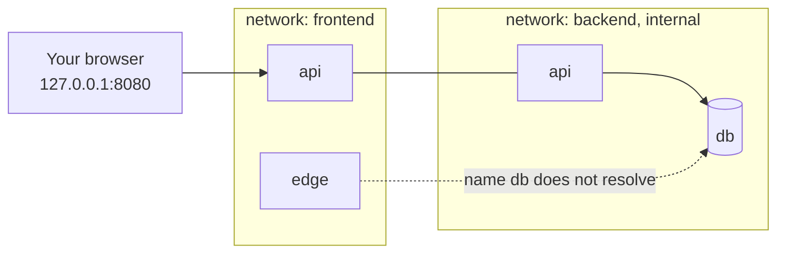

# 07. Networking in depth and resource limits

> **Draft: written but not yet run.** The code and the expected output in this lesson were prepared by reading the code and the official documentation. They have not been executed yet. If something does not behave as described, trust your tool's real output and report it.

## What you will be able to do
By the end of this lesson you will be able to:
- Design a Compose stack with two user-defined networks, one of them internal, and predict which service can resolve which name.
- Explain the difference between publishing a port (`ports`) and exposing it (`expose`/`EXPOSE`), and bind a published port to `127.0.0.1`.
- Set memory, CPU and process limits, and check them with `docker inspect`.
- Cap the memory of the WSL 2 virtual machine on Windows with a complete `.wslconfig` file.

## Recap
1. From Docker 101 lesson 06: why does the web service reach Postgres with the host name `db` and not `localhost`?
   <details><summary>Answer</summary>`db` is the service name resolved by Docker's DNS on the Compose network. `localhost` inside a container is the container itself.</details>
2. From lesson 05: how does Compose decide which files to read when you pass no `-f` option?
   <details><summary>Answer</summary>`compose.yaml` and `compose.override.yaml` in the project folder.</details>

## Why it matters
An office building has a public lobby, a staff corridor and a locked server room. Visitors reach the lobby; staff reach the corridor; only a few people may enter the server room, and it has no door to the street. Containers need the same layout: the web entrance is reachable from outside, the database is reachable only from the application, and nothing may eat the whole building's electricity. Networks give you the corridors; resource limits give you the fuse box.

## What you will build
Three containers on two networks: `api` (the application, on both networks and published on loopback), `edge` (a stand-in for any container that must **not** reach the database, on the front network only) and `db` (Postgres on an internal back network only). You will prove who can see whom, then add memory, CPU and process limits, trigger an out-of-memory kill on purpose, and finally cap the WSL 2 virtual machine on Windows.



## Before you start
- **Prerequisites:** [Docker 201 lesson 05, Compose profiles, overrides and extension fields](05-profiles-overrides-extensions.md) and [Docker 101 lesson 06, networks and Compose](../../101-zero-to-hero/phase-2-compose/06-networks-and-compose.md).
- Lessons 05 and 06 done. Docker 29.9.3 and Compose v5.7.0. Time: 40 minutes.
- Windows: PowerShell 5.1, `curl.exe`. macOS/Linux: `curl`. Ubuntu Engine: prefix Docker commands with `sudo`. Host port 8080 free.
- Source pack (optional): every file is shown in full in this lesson, so you can follow without it. The finished code, the exercise starter and the solution are in the course repository https://github.com/Uee03/Code101 under `source/docker/201-hero-to-super-hero/phase-2-compose-in-depth/07-networking-and-limits/` (on that page choose **Code, Download ZIP**, or run `git clone https://github.com/Uee03/Code101.git`).
- Image tags used: `python:3.13-slim`, `postgres:17-alpine`.

## Steps

### Step 1. Make the working folder
**Commands: folder `any folder`**
```powershell
New-Item -ItemType Directory -Force "$HOME\code101\docker201\lesson07" | Out-Null
Set-Location "$HOME\code101\docker201\lesson07"
```
macOS/Linux:

**Commands: folder `any folder`**
```bash
mkdir -p ~/code101/docker201/lesson07
cd ~/code101/docker201/lesson07
```
Expected result: the terminal is in `lesson07`. If lost, repeat the `Set-Location` or `cd` line.

### Step 2. The program
**File: `app.py`**
```python
import json
import socket
import sys
from http.server import BaseHTTPRequestHandler, HTTPServer


def resolves(name):
    try:
        socket.gethostbyname(name)
        return True
    except socket.gaierror:
        return False


class Handler(BaseHTTPRequestHandler):
    def do_GET(self):
        body = json.dumps({"service": "api", "db_resolves": resolves("db")}) + "\n"
        self.send_response(200)
        self.send_header("Content-Type", "application/json")
        self.end_headers()
        self.wfile.write(body.encode())


if len(sys.argv) == 3 and sys.argv[1] == "--check":
    name = sys.argv[2]
    print(name + (" resolves" if resolves(name) else " does not resolve"))
else:
    HTTPServer(("0.0.0.0", 8000), Handler).serve_forever()
```
`resolves` asks the system's name resolver (Docker's DNS inside a container) for an address and returns `True` or `False`. `socket.gaierror` is the exception raised when a name cannot be resolved. The program has two modes: with `--check <name>` it prints whether a name resolves and exits; without arguments it serves a web page on port 8000 that reports whether `db` resolves.

**File: `Dockerfile`**
```dockerfile
# syntax=docker/dockerfile:1
FROM python:3.13-slim
ENV PYTHONDONTWRITEBYTECODE=1
WORKDIR /app
COPY --chmod=0444 app.py ./
USER 10001:10001
EXPOSE 8000
CMD ["python", "-u", "app.py"]
```
Same hardened pattern as lesson 03. `EXPOSE 8000` documents the port; it does not publish it.

**File: `.dockerignore`**
```text
.git/
.env
.env.*
Dockerfile*
compose*.yaml
wslconfig*
```

**File: `.env.example`**
```dotenv
POSTGRES_USER=learner
POSTGRES_PASSWORD=local-demo-only
POSTGRES_DB=workshop
```
Public demo values. Copy to `.env` (Windows: `Copy-Item .env.example .env`; macOS/Linux: `cp .env.example .env`).

### Step 3. The Compose file
**File: `compose.yaml`**
```yaml
name: code101-net

services:
  api:
    build: .
    image: code101-net-api:201
    ports:
      - "127.0.0.1:8080:8000"
    networks:
      - frontend
      - backend
    deploy:
      resources:
        limits:
          cpus: "0.50"
          memory: 256M
    pids_limit: 100

  edge:
    build: .
    image: code101-net-edge:201
    command: ["sleep", "infinity"]
    networks:
      - frontend

  db:
    image: postgres:17-alpine
    environment:
      POSTGRES_USER: ${POSTGRES_USER}
      POSTGRES_PASSWORD: ${POSTGRES_PASSWORD}
      POSTGRES_DB: ${POSTGRES_DB}
    networks:
      - backend
    volumes:
      - db_data:/var/lib/postgresql/data
    deploy:
      resources:
        limits:
          memory: 256M

networks:
  frontend:
  backend:
    internal: true

volumes:
  db_data:
```

| Key | Explanation |
|---|---|
| `name` | Fixed project name: containers become `code101-net-api-1`, networks `code101-net_frontend` and `code101-net_backend`. |
| `api.build`, `api.image` | Build the Dockerfile here and name the image. |
| `api.ports` | **Publish** container port 8000 on host port 8080, **bound to `127.0.0.1`**: only programs on your own computer can connect. |
| `api.networks` | Attach `api` to both networks. A container can be on several; on each one it gets a DNS name (its service name). |
| `api.deploy.resources.limits` | At most half a CPU (`cpus: "0.50"`) and 256 MB of memory. |
| `api.pids_limit` | At most 100 processes or threads in this container. |
| `edge` | A second container built from the same program, kept alive with `sleep infinity`, on the front network only. It plays the part of "something that must not touch the database". |
| `db` | Postgres, **no `ports:` at all**, on the back network only, with a 256 MB memory limit. |
| `networks.frontend` | A user-defined bridge network with default settings. |
| `networks.backend.internal` | An **internal** network: containers on it can talk to each other but have no route to the outside world. |
| `volumes` | Named volume for the database. |

**Predict before you run:** (a) Can `api` resolve the name `db`? (b) Can `edge`? (c) Can a browser on your computer reach `http://127.0.0.1:5432` for Postgres? Write your three answers down.

## Run it
**Commands: folder `lesson07`**
```powershell
docker compose up -d --build
curl.exe -fsS http://127.0.0.1:8080/
docker compose exec api python app.py --check db
docker compose exec edge python app.py --check db
```
Expected output (macOS/Linux: `curl`; not yet run):
```text
{"service": "api", "db_resolves": true}
db resolves
db does not resolve
```
`api` shares the `backend` network with `db`, so Docker's DNS answers. `edge` shares **no** network with `db`, so DNS does not know the name: Docker's DNS only answers for containers on a network you also belong to.

Check the networks and the published port:

**Commands: folder `lesson07`**
```powershell
docker network ls --filter name=code101-net
docker network inspect code101-net_backend --format "{{.Internal}}"
docker compose port api 8000
```
Expected output (the table has `NETWORK ID`, `NAME`, `DRIVER` and `SCOPE` columns; ids vary):
```text
true
127.0.0.1:8080
```
The first command lists `code101-net_backend` and `code101-net_frontend` with driver `bridge`. `docker compose port api 8000` prints the host address that maps to container port 8000.

### Published versus exposed
| Setting | What it does | Reachable from |
|---|---|---|
| `EXPOSE 8000` in the Dockerfile, or `expose: ["8000"]` in Compose | Documents or opens the port **inside Docker networks** | Other containers on a shared network (no `expose` is needed for that to work) |
| `ports: ["8080:8000"]` | Publishes on **all** host interfaces | Your computer and, depending on firewalls, other devices on your network |
| `ports: ["127.0.0.1:8080:8000"]` | Publishes on loopback only | Only your own computer |
| no `ports:` (like `db`) | Not published | Only containers on a shared network |

If you changed the port line to `"8080:8000"`, `docker compose port api 8000` would typically print `0.0.0.0:8080`. On Linux, Docker manages firewall rules itself, and published ports can bypass simple host firewall tools, so binding to `127.0.0.1` is the safe default for development. Put a reverse proxy in front for anything that must be public.

### Resource limits
**Commands: folder `lesson07`**
```powershell
docker inspect --format "{{.HostConfig.Memory}} {{.HostConfig.NanoCpus}}" code101-net-api-1
docker stats --no-stream
```
Expected output of the first command:
```text
268435456 500000000
```
`268435456` bytes is 256 x 1024 x 1024 (256 MiB); `500000000` NanoCpus is half a CPU. `docker stats --no-stream` prints one snapshot of CPU and memory use per container; the memory column shows usage against the limit (the numbers vary).

Now trigger an **out-of-memory kill** on purpose with a throwaway container limited to 64 MB that tries to allocate 200 MB:

**Commands: folder `any folder`**
```powershell
docker run --name code101-oom --memory 64m python:3.13-slim python -c "data = b'x' * (200 * 1024 * 1024); print(len(data))"
docker inspect --format "{{.State.OOMKilled}} {{.State.ExitCode}}" code101-oom
docker rm code101-oom
```
Expected result: the first command prints nothing and ends abruptly; the second prints:
```text
true 137
```
`137` is 128 + 9: the process was ended by signal 9 (kill), which is what the kernel's out-of-memory killer sends. Without a limit, a leak in one container could use all the memory of the machine (or of the WSL virtual machine) and slow everything else down.

Clean up this lesson's stack:

**Commands: folder `lesson07`**
```powershell
docker compose down -v --remove-orphans
docker image rm code101-net-api:201 code101-net-edge:201
```

### The WSL 2 memory cap on Windows
On Windows with Docker Desktop's WSL 2 backend, **all** containers run inside one lightweight virtual machine that WSL manages. By default it may use up to half of your computer's memory. The per-container limits above work inside that machine; `.wslconfig` limits the machine itself. This step is optional and changes your computer's global WSL settings, so read it fully first.

**File: `wslconfig.example`** (to become `C:\Users\<you>\.wslconfig`)
```ini
[wsl2]
memory=8GB
processors=4
swap=2GB
```

| Line | Explanation |
|---|---|
| `[wsl2]` | The section for settings that apply to the WSL 2 virtual machine and all Linux distributions in it, including Docker Desktop's own. |
| `memory=8GB` | Upper limit of memory the virtual machine may use (a cap, not a reservation). The default is 50% of your Windows memory. Too small and builds are killed; too large and Windows itself gets starved. |
| `processors=4` | Number of logical processors the virtual machine may use. The default is all of them. |
| `swap=2GB` | Size of the swap file (disk used as slow memory). `0` disables swap. The default is 25% of memory, rounded up. |

Apply it (all WSL distributions restart, so save your work and stop containers first). `<you>` stands for your Windows account name; open File Explorer, type `%USERPROFILE%` in the address bar and press Enter to reach the folder.
1. If `.wslconfig` already exists there, copy it somewhere safe and **add** these keys instead of replacing the file.
2. Save the three-line content above as `.wslconfig` (name starts with a dot, no `.txt`).
3. Quit Docker Desktop from the tray menu (**Quit Docker Desktop**), then in PowerShell:

**Commands: folder `any folder`**
```powershell
wsl --shutdown
```
4. Start Docker Desktop, wait for **Engine running**, then check the memory the engine sees:

**Commands: folder `any folder`**
```powershell
docker info --format "{{.MemTotal}}"
```
Expected result: a number of bytes close to, but a little under, 8 GiB (8589934592 bytes). The exact number varies. To undo, remove the keys (or restore your backup), then run `wsl --shutdown` and restart Docker Desktop. macOS: use **Docker Desktop > Settings > Resources** instead. Linux Engine: containers use the host directly, so only per-container limits apply. Source: Microsoft WSL configuration https://learn.microsoft.com/en-us/windows/wsl/wsl-config.

## How it works
Docker creates a **bridge network** per Compose network: a virtual switch inside the host. The **default bridge** network has no name resolution; **user-defined** networks (what Compose always creates) add an embedded DNS server, which answers with the addresses of containers *on that network*. That is why service names work, and why they stop working across networks. An **internal** network additionally has no gateway, so its containers cannot reach the internet or be reached from outside.

Limits use the Linux kernel's **cgroups** (control groups): `memory` is a hard ceiling (exceed it and the kernel kills the process), `cpus` is a ceiling on CPU time (the process is slowed, never killed), `pids_limit` caps the number of processes.

**Misconception:** "`EXPOSE` opens the port to my browser." It only documents the port. Without `ports:` or `-p`, nothing is reachable from the host.

| Why this, not that | Choose it when | Trade-off |
|---|---|---|
| Two networks, one internal | A database, cache or queue must be unreachable from other front-end containers | More network lines to maintain |
| One default network | A tiny stack of trusted containers | Every service can reach every other |
| `127.0.0.1:` bind | Development and reverse-proxy backends | Not reachable from other machines (intended) |
| Plain `"8080:8000"` | You deliberately want LAN access | Reachable by others; bypasses simple host firewalls on Linux |
| Memory limit | Always for services you run unattended | Too low means OOM kills; measure first |

## Try it
Copy `exercise/starter/compose.yaml` over `compose.yaml` in a `practice` copy of the lesson folder (keep `.env`).

1. **Guided:** the starter publishes everything to all interfaces, puts the database on the default network and has no limits. Finish the five `TODO` items.
2. **Change:** add a Redis cache service (`redis:7-alpine`, no ports) reachable by `api` but not by `edge`, and predict `docker compose exec edge python app.py --check cache` before running it.
3. **Stretch (no single answer):** choose memory limits for a service that normally uses 120 MB and sometimes spikes to 300 MB. Write down the limit, and what you would measure before trusting it.

**File: `exercise/starter/compose.yaml`**
```yaml
name: code101-net

services:
  api:
    build: .
    image: code101-net-api:201
    ports:
      - "8080:8000"
    # TODO 1: bind the published port to loopback only (127.0.0.1)
    # TODO 2: attach api to two networks, frontend and backend
    # TODO 3: limit api to 0.50 CPUs and 256M of memory with deploy.resources.limits

  edge:
    build: .
    image: code101-net-edge:201
    command: ["sleep", "infinity"]
    networks:
      - frontend

  db:
    image: postgres:17-alpine
    environment:
      POSTGRES_USER: ${POSTGRES_USER}
      POSTGRES_PASSWORD: ${POSTGRES_PASSWORD}
      POSTGRES_DB: ${POSTGRES_DB}
    ports:
      - "5432:5432"
    # TODO 4: remove the ports lines of db (the database must not be published) and attach it only to backend
    volumes:
      - db_data:/var/lib/postgresql/data

networks:
  frontend:
  # TODO 5: declare backend as an internal network (internal: true)

volumes:
  db_data:
```

<details><summary>Solution</summary>

`exercise/solution/compose.yaml` is **identical to the finished `compose.yaml` in Step 3**: `"127.0.0.1:8080:8000"` on `api`; `networks: [frontend, backend]` plus the `deploy.resources.limits` block on `api`; no `ports:` and `networks: [backend]` on `db`; and `backend:` with `internal: true`. Compare your file line by line.

Change rung (one possible answer): add under `services`
```yaml
  cache:
    image: redis:7-alpine
    networks:
      - backend
```
`edge` is not on `backend`, so `docker compose exec edge python app.py --check cache` should print `cache does not resolve`, while the same command in `api` prints `cache resolves`. Stretch (one possible answer): a limit of 384M, after measuring peak use with `docker stats` under realistic load; the point of the limit is that a spike above it is a clear failure instead of a slow machine.

</details>

## Check yourself
1. Why can `api` resolve `db` but `edge` cannot? <details><summary>Answer</summary>Docker's DNS answers only for containers on a network the asker also belongs to; `edge` is only on `frontend`.</details>
2. Predict: what does `docker compose port api 8000` print with `"8080:8000"` instead of `"127.0.0.1:8080:8000"`? <details><summary>Answer</summary>Typically `0.0.0.0:8080` (all interfaces).</details>
3. What does exit code 137 with `OOMKilled` true tell you? <details><summary>Answer</summary>The container exceeded its memory limit and the kernel killed it with signal 9 (128 + 9).</details>
4. What does `memory=8GB` in `.wslconfig` limit? <details><summary>Answer</summary>The total memory of the WSL 2 virtual machine, which contains all Docker Desktop containers on Windows.</details>

## Common mistakes
| Symptom or error text | Cause | Fix |
|---|---|---|
| `Bind for 127.0.0.1:8080 failed: port is already allocated` | Another container publishes host port 8080 | Stop your earlier container, or change the left-hand port number |
| The page cannot be reached from your phone | The port is bound to `127.0.0.1` | That is the safe default; use a reverse proxy or change the binding on purpose |
| A container is killed and exits with code 137 | It exceeded its memory limit (or the WSL VM was out of memory) | Raise the limit after measuring with `docker stats`, or fix the leak |
| Builds end with `signal: killed` (typical message) | The WSL 2 virtual machine ran out of memory | Raise `memory=` in `.wslconfig`, then `wsl --shutdown` and restart Docker Desktop |
| `.wslconfig` has no effect | The file is named `.wslconfig.txt`, is in the wrong folder, or WSL was not shut down | Show file name extensions, place it in `%USERPROFILE%`, run `wsl --shutdown` |

## Best practice
Put each service only on the networks it needs, publish only what a user must reach and bind it to `127.0.0.1` by default, and give every unattended service a memory limit. Source: Docker networking overview https://docs.docker.com/engine/network/ and port publishing https://docs.docker.com/engine/network/port-publishing/

## Going further
- Compose networks reference: https://docs.docker.com/reference/compose-file/networks/
- Resource constraints: https://docs.docker.com/engine/containers/resource_constraints/
- A real multi-network stack with an identity provider: `capstones/platform`.

## Summary
- You designed a stack with a front network and an internal back network and checked DNS from both sides.
- You separated published ports from exposed ports and bound the published port to `127.0.0.1`.
- You set memory, CPU and process limits and provoked an out-of-memory kill.
- You wrote a complete `.wslconfig` that caps the WSL 2 virtual machine.

## Next lesson
08. Dev containers and bind-mount dev loops: develop inside a container with a complete `devcontainer.json`.
