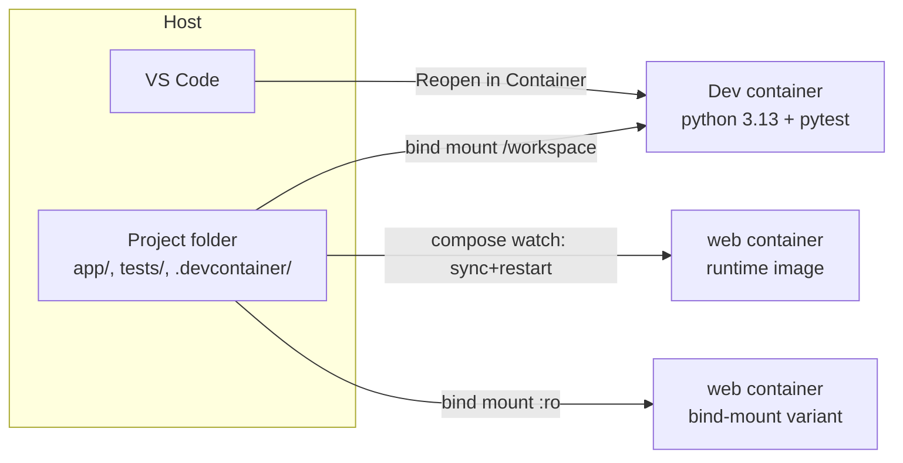

# 08. Dev containers and bind-mount dev loops

> **Draft: written but not yet run.** The code and the expected output in this lesson were prepared by reading the code and the official documentation. They have not been executed yet. If something does not behave as described, trust your tool's real output and report it.

## What you will be able to do
By the end of this lesson you will be able to:
- Write a complete `.devcontainer/devcontainer.json` and a dev-container `Dockerfile`, and explain every key.
- Open a project inside a container and run its tests there with the same tools as every teammate.
- Set up a fast edit-and-see loop with Compose `develop.watch`, and compare it with a bind mount.
- Name the Windows and WSL 2 pitfalls of bind mounts (file performance, line endings, permissions).

## Recap
1. From lesson 03: why is the application code in the runtime image owned by root and read-only?
   <details><summary>Answer</summary>So a compromised app cannot rewrite its own program. A *development* container is different: you want to edit the code.</details>
2. From Docker 101 lesson 04: what is the difference between a bind mount and a named volume?
   <details><summary>Answer</summary>A bind mount shows a host folder inside the container; a named volume is storage that Docker manages.</details>

## Why it matters
A workshop that hands every new carpenter the same labelled toolbox starts working in minutes; one that says "go and buy the right saw" does not. A **dev container** is that toolbox: the language runtime, test tools, editor extensions and settings are described in files in your repository, so a new teammate (or you, on a new laptop) opens the folder and gets an identical environment. It also keeps development tools out of your production image (lesson 01) and out of your host.

One sentence to remember: **Unity is never in Docker**; Unity projects are always developed locally in the Unity Editor.

## What you will build
A small Python web app with two tests, and three ways to work on it:
1. a **dev container** (VS Code Dev Containers) with Python 3.13 and `pytest`;
2. a Compose **`develop.watch`** loop that syncs your edits into the running container;
3. a plain **bind mount** loop for comparison.



## Before you start
- **Prerequisites:** Docker 201 lessons [03, non-root users and hardening](../phase-1-better-images/03-non-root-and-hardening.md) and [05, Compose profiles, overrides and extension fields](../phase-2-compose-in-depth/05-profiles-overrides-extensions.md).
- Lessons 01 to 07 done. Docker 29.9.3 and Compose v5.7.0 running. Time: 40 minutes (the first dev-container build downloads a large base image).
- **VS Code** with the **Dev Containers** extension (id `ms-vscode-remote.remote-containers`) is needed for Steps 7 and 8. Without VS Code, you can still do every other step; the Docker-only test command in Step 6 gives you the same environment.
- Windows: PowerShell 5.1, `curl.exe`. macOS/Linux: `curl`. Ubuntu Engine: prefix Docker commands with `sudo`. Host port 8080 free.
- Source pack (optional): every file is shown in full in this lesson, so you can follow without it. The finished code, the exercise starter and the solution are in the course repository https://github.com/Uee03/Code101 under `source/docker/201-hero-to-super-hero/phase-3-workflows/08-dev-containers/` (on that page choose **Code, Download ZIP**, or run `git clone https://github.com/Uee03/Code101.git`).
- Image tags used: `python:3.13-slim` and `mcr.microsoft.com/devcontainers/python:3.13-bookworm` (Microsoft's Python dev image with a non-root user named `vscode`).

## Steps

### Step 1. Make the folders
**Commands: folder `any folder`**
```powershell
New-Item -ItemType Directory -Force "$HOME\code101\docker201\lesson08\app" | Out-Null
New-Item -ItemType Directory -Force "$HOME\code101\docker201\lesson08\tests" | Out-Null
New-Item -ItemType Directory -Force "$HOME\code101\docker201\lesson08\.devcontainer" | Out-Null
Set-Location "$HOME\code101\docker201\lesson08"
```
macOS/Linux:

**Commands: folder `any folder`**
```bash
mkdir -p ~/code101/docker201/lesson08/app ~/code101/docker201/lesson08/tests ~/code101/docker201/lesson08/.devcontainer
cd ~/code101/docker201/lesson08
```
Expected result: the terminal is in `lesson08` with the folders `app`, `tests` and `.devcontainer`. If lost, repeat the `Set-Location` or `cd` line.

### Step 2. The application and its tests
**File: `app/main.py`**
```python
import json
from http.server import BaseHTTPRequestHandler, HTTPServer


def greeting(name):
    return "Hello, " + name + "!"


class Handler(BaseHTTPRequestHandler):
    def do_GET(self):
        body = json.dumps({"message": greeting("dev loop")}) + "\n"
        self.send_response(200)
        self.send_header("Content-Type", "application/json")
        self.end_headers()
        self.wfile.write(body.encode())


def main():
    HTTPServer(("0.0.0.0", 8000), Handler).serve_forever()


if __name__ == "__main__":
    main()
```
`greeting` is plain logic that tests can call without a server. The `if __name__ == "__main__"` guard starts the server only when the module is run, not when the tests import it.

**File: `tests/test_main.py`**
```python
from app.main import greeting


def test_greeting_includes_name():
    assert greeting("Ada") == "Hello, Ada!"


def test_greeting_is_an_exclamation():
    assert greeting("x").endswith("!")
```
**File: `pytest.ini`**
```ini
[pytest]
pythonpath = .
testpaths = tests
```
`pythonpath = .` puts the project root on Python's import path so `from app.main import greeting` works; `testpaths` tells pytest where tests live.

**File: `requirements.txt`**
```text
# The app uses only the Python standard library, so nothing is listed here yet.
```
**File: `requirements-dev.txt`**
```text
pytest==8.3.4
```
Runtime dependencies and development-only tools are kept in separate files, so the production image never contains `pytest`.

### Step 3. The runtime image and Compose files
**File: `Dockerfile`**
```dockerfile
# syntax=docker/dockerfile:1
FROM python:3.13-slim
ENV PYTHONDONTWRITEBYTECODE=1
WORKDIR /srv
COPY app ./app
USER 10001:10001
EXPOSE 8000
CMD ["python", "-u", "-m", "app.main"]
```
The production-style image from earlier lessons: only `app` is copied, a non-root user runs it, and `-m app.main` runs the module.

**File: `compose.yaml`**
```yaml
name: code101-devloop

services:
  web:
    build: .
    image: code101-devloop-web:201
    ports:
      - "127.0.0.1:8080:8000"
    develop:
      watch:
        - action: sync+restart
          path: ./app
          target: /srv/app
          ignore:
            - __pycache__/
        - action: rebuild
          path: ./requirements.txt
```

| Key | Explanation |
|---|---|
| `develop.watch` | Rules for `docker compose watch` or `docker compose up --watch`: Compose watches host paths and reacts. |
| `action: sync+restart` | When a file under `path` changes, copy it into the container at `target` **and restart** the container. Python reads its files at start-up, so a restart is needed to see changes. |
| `path: ./app` | The host folder to watch (relative to the Compose file). |
| `target: /srv/app` | Where the files go inside the container: the folder the Dockerfile copied `app` to. |
| `ignore` | Paths that do not trigger anything (bytecode caches). |
| `action: rebuild` | When `requirements.txt` changes, rebuild the image and recreate the container, because new dependencies live in the image. |

**File: `compose.bind.yaml`**
```yaml
services:
  web:
    volumes:
      - ./app:/srv/app:ro
```
An override for the bind-mount variant: your host `app` folder is mounted over the image's `/srv/app`, read-only. Used with `-f compose.yaml -f compose.bind.yaml`.

**File: `.dockerignore`**
```text
.git/
.env
.env.*
.devcontainer/
tests/
Dockerfile*
compose*.yaml
pytest.ini
__pycache__/
.pytest_cache/
```
Keeps tests, dev-container files and Compose files out of the runtime image's build context. Note that this root `.dockerignore` also applies to the dev-container build (its context is the project root): that is why `requirements-dev.txt` is **not** listed; the dev Dockerfile needs to copy it.

**File: `.gitignore`**
```gitignore
.env
.env.*
!.env.example
__pycache__/
.pytest_cache/
```

### Step 4. The dev container
**File: `.devcontainer/Dockerfile`**
```dockerfile
FROM mcr.microsoft.com/devcontainers/python:3.13-bookworm
COPY requirements-dev.txt /tmp/requirements-dev.txt
RUN pip install --no-cache-dir -r /tmp/requirements-dev.txt \
    && rm /tmp/requirements-dev.txt
```

| Line | Explanation |
|---|---|
| 1 | Microsoft's Python 3.13 development image on Debian 12 (bookworm). It already contains Git, common tools and a non-root user named `vscode`. |
| 2 | Copies the dev dependency list from the build context (the project root, see `context` below). |
| 3-4 | Installs `pytest` system-wide in the image, then deletes the list. The backslash continues the command. |

**File: `.devcontainer/devcontainer.json`**
```json
{
  "name": "code101-docker-201-devloop",
  "build": {
    "dockerfile": "Dockerfile",
    "context": ".."
  },
  "workspaceMount": "source=${localWorkspaceFolder},target=/workspace,type=bind",
  "workspaceFolder": "/workspace",
  "remoteUser": "vscode",
  "init": true,
  "containerEnv": {
    "PYTHONDONTWRITEBYTECODE": "1"
  },
  "forwardPorts": [8000],
  "portsAttributes": {
    "8000": {
      "label": "app",
      "onAutoForward": "notify"
    }
  },
  "postCreateCommand": "python --version && pytest --version",
  "customizations": {
    "vscode": {
      "extensions": ["ms-python.python"],
      "settings": {
        "python.defaultInterpreterPath": "/usr/local/bin/python",
        "python.testing.pytestEnabled": true
      }
    }
  }
}
```

| Key | Explanation |
|---|---|
| `name` | Label shown in the editor. |
| `build.dockerfile` | The Dockerfile to build, relative to this `devcontainer.json`. |
| `build.context` | The build context, also relative to this file: `..` is the project root, so `COPY requirements-dev.txt` finds the file there. |
| `workspaceMount` | How your project folder is mounted: a **bind mount** from `${localWorkspaceFolder}` (a variable the tool replaces with your project path) to `/workspace`. This is the default behaviour made explicit. |
| `workspaceFolder` | The folder the editor opens inside the container. It must match the `target` above. |
| `remoteUser` | Run the editor's processes as `vscode`, not as root. |
| `init` | Run a tiny init process as PID 1 so zombie processes are cleaned up and signals are handled. |
| `containerEnv` | Environment variables set in the container: no bytecode files in your project folder. |
| `forwardPorts` | Make container port 8000 available on your computer's loopback while you work. |
| `portsAttributes` | A label for port 8000 and a notification when it is forwarded. |
| `postCreateCommand` | Runs once after the container is created. Here it only prints versions (`Python 3.13.x` and `pytest 8.3.4`), proving the toolchain. Keep it fast and idempotent. |
| `customizations.vscode.extensions` | Extensions installed **in the container**, for every teammate. |
| `customizations.vscode.settings` | Editor settings applied in the container: the interpreter path, and pytest as the test framework. |

`devcontainer.json` accepts comments (JSON with comments) in VS Code; the pack's finished file is strict JSON, the starter uses comments for hints.

**Predict before you run:** after you reopen the folder in the container, what does `whoami` print in the terminal? Write it down.

### Step 5. Run the tests without VS Code (Docker only)
This builds the same dev image and runs the tests in it, so the result is the same as in the editor. From `lesson08`:

**Commands: folder `lesson08`**
```powershell
docker build -f .devcontainer/Dockerfile -t code101-devcontainer:201 .
docker run --rm -v "${PWD}:/workspace" -w /workspace code101-devcontainer:201 pytest -q
```
macOS/Linux: use `"$PWD:/workspace"` instead of `"${PWD}:/workspace"`. Expected output of the second command (the time varies; not yet run):
```text
..                                                                       [100%]
2 passed in 0.01s
```
`-v` bind-mounts your project at `/workspace`, `-w` sets the working folder, `pytest -q` runs quietly. The image runs as user `vscode`, so pytest may write a `.pytest_cache` folder into your project (ignored by `.gitignore`).

### Step 6. Open the folder in the dev container
1. Install the **Dev Containers** extension in VS Code and start Docker.
2. In VS Code choose **File > Open Folder** and select `lesson08`. If VS Code asks whether you trust the authors of the folder, choose **Yes, I trust the authors** for your own folder.
3. Open the Command Palette (**F1** or `Ctrl+Shift+P`; macOS `Cmd+Shift+P`) and run **Dev Containers: Reopen in Container**.
4. Wait for the first build; the bottom-left corner of the window then names the dev container.
5. Open a terminal in VS Code (**Terminal > New Terminal**) and run:

**Commands: folder `/workspace` (inside the dev container)**
```bash
whoami
pytest -q
python -m app.main
```
Expected output (not yet run): `vscode`, then the pytest result `2 passed`, then the server runs silently. Press `Ctrl+C` to stop it. While it runs, VS Code forwards port 8000, so `curl http://127.0.0.1:8000/` on your computer shows `{"message": "Hello, dev loop!"}`.

Other editors can use the open-source `devcontainer` command line tool with the same files (see the Dev Containers specification).

## Run it
### The watch loop
From `lesson08` on your computer (not inside the dev container), in **terminal 1**:

**Commands: folder `lesson08`**
```powershell
docker compose up --watch
```
Compose builds the image, starts the container and prints watch messages. In **terminal 2**:

**Commands: folder `lesson08`**
```powershell
curl.exe -fsS http://127.0.0.1:8080/
```
Expected output:
```text
{"message": "Hello, dev loop!"}
```
Now edit `app/main.py`: change `greeting("dev loop")` to `greeting("watch")` and save. Compose syncs the file into the container and restarts it. Run the `curl` command again after a few seconds:
```text
{"message": "Hello, watch!"}
```
Press `Ctrl+C` in terminal 1, then clean up:

**Commands: folder `lesson08`**
```powershell
docker compose down --remove-orphans
```

### The bind-mount loop
**Commands: folder `lesson08`**
```powershell
docker compose -f compose.yaml -f compose.bind.yaml up -d --build
curl.exe -fsS http://127.0.0.1:8080/
```
Edit `app/main.py` again (for example `greeting("bind mount")`) and save. The file inside the container has changed at once, but the running Python process still has the old code in memory:
```text
{"message": "Hello, watch!"}
```
(your text shows whatever message you saved before). Restart the container to load the new file:

**Commands: folder `lesson08`**
```powershell
docker compose -f compose.yaml -f compose.bind.yaml restart web
curl.exe -fsS http://127.0.0.1:8080/
```
Expected output: `{"message": "Hello, bind mount!"}` if you used that text. Clean up:

**Commands: folder `lesson08`**
```powershell
docker compose -f compose.yaml -f compose.bind.yaml down -v --remove-orphans
docker image rm code101-devloop-web:201 code101-devcontainer:201
```

## How it works
A **dev container** is an ordinary container, started by an editor, with your project mounted as a bind mount and the editor's server running inside it. All terminals, debuggers and test runners execute in the container; only the window you see is on the host.

| | Dev container | `compose watch` | Bind mount |
|---|---|---|---|
| Purpose | A complete, shared development environment | Fast feedback for the running service | Simplest live edit |
| Edit result visible | Immediately (you work in the container) | After sync and restart (`sync+restart`) | After a restart for Python; immediately for tools that reload |
| Host files in container | Whole project folder | Only the paths you list | The mounted folder |
| Typical problem | Slow first build | Rules must match the image layout | Host file permissions and speed |

**Misconception:** "a bind mount copies my files into the container." It does not copy; the container sees your host folder. Edits on either side appear on the other. That is also why a container running as root can write root-owned files into your project on Linux.

**Windows and WSL 2 pitfalls:**
- **Speed.** Reading thousands of files from a Windows folder (like `C:\Users\you\...`) through a bind mount is slower than from the Linux filesystem inside WSL. For large projects, keep the project inside your WSL distribution (for example `~/code/...` in Ubuntu) and open it from there with the editor's WSL integration.
- **Line endings.** Windows Git may convert line endings to CRLF; a shell script with CRLF fails in Linux (`/bin/sh^M: bad interpreter` is the typical message). Add a `.gitattributes` with `* text=auto eol=lf` for scripts, or set Git's `core.autocrlf` appropriately.
- **Permissions.** On Linux hosts, files written by a container as `root` become root-owned on your disk. The `vscode` user (uid 1000) matches the first user on most Linux machines; the Dev Containers tool also adjusts the user id to your host user on Linux by default.

| Why this, not that | Choose it when | Trade-off |
|---|---|---|
| Dev container | A team needs identical tools and settings | Needs an editor with support; first build is slow |
| `compose watch` | You develop a service that runs in its own container | Needs `develop.watch` rules per path |
| Bind mount | You want the simplest live edit | Permissions, speed, restart for compiled or non-reloading apps |
| Install tools on the host | A one-person throwaway project | "Works on my machine" drift |

## Try it
Copy the starter file to `lesson08/practice-devcontainer.json` (or use it in a copy of the project as `.devcontainer/devcontainer.json`).

1. **Guided:** complete the four `TODO` comments so the file matches the finished `devcontainer.json` (apart from the settings and `portsAttributes`).
2. **Change:** add a **Dev Container Feature**, a reusable install recipe, for the GitHub command line tool, using the feature id `ghcr.io/devcontainers/features/github-cli:1`. Predict: which `devcontainer.json` key holds features, and is it a list or an object?
3. **Stretch (no single answer):** your project also needs a Postgres database during development. Decide whether to describe the dev container with `dockerComposeFile` (the dev container joins your Compose project) or keep the database in a separate `docker compose up`, and write down one advantage of your choice.

**File: `exercise/starter/devcontainer.json`**
```jsonc
{
  "name": "code101-docker-201-devloop",
  "build": {
    "dockerfile": "Dockerfile",
    "context": ".."
  },
  // TODO 1: mount the project folder at /workspace (workspaceMount) and open it there (workspaceFolder)
  // TODO 2: run as the non-root user vscode (remoteUser)
  // TODO 3: forward port 8000 (forwardPorts)
  // TODO 4: install the VS Code extension ms-python.python inside the container (customizations.vscode.extensions)
  "init": true
}
```

<details><summary>Solution</summary>

**File: `exercise/solution/devcontainer.json`**
```json
{
  "name": "code101-docker-201-devloop",
  "build": {
    "dockerfile": "Dockerfile",
    "context": ".."
  },
  "workspaceMount": "source=${localWorkspaceFolder},target=/workspace,type=bind",
  "workspaceFolder": "/workspace",
  "remoteUser": "vscode",
  "init": true,
  "features": {
    "ghcr.io/devcontainers/features/github-cli:1": {}
  },
  "forwardPorts": [8000],
  "customizations": {
    "vscode": {
      "extensions": ["ms-python.python"]
    }
  }
}
```
`features` is an **object**: each key is a feature id and its value holds that feature's options (`{}` for defaults). Stretch (one possible answer): `dockerComposeFile` keeps the database definition in one place shared with the rest of the team's Compose files, at the cost of a more complex dev-container setup.

</details>

## Check yourself
1. Why is `requirements-dev.txt` separate from `requirements.txt`? <details><summary>Answer</summary>The runtime image should not contain test tools; the dev container installs them separately.</details>
2. Predict: with `sync+restart`, what happens when you save `app/main.py`? <details><summary>Answer</summary>Compose copies the file into the container at `/srv/app` and restarts the container, so the new code runs.</details>
3. Why does the bind-mount variant still show the old message right after you save? <details><summary>Answer</summary>The file changed, but the running Python process loaded the old code at start-up and must be restarted.</details>
4. Why does `build.context` say `..`? <details><summary>Answer</summary>Paths in `devcontainer.json` are relative to its own folder; `..` is the project root where `requirements-dev.txt` lives.</details>

## Common mistakes
| Symptom or error text | Cause | Fix |
|---|---|---|
| The command **Dev Containers: Reopen in Container** does not exist | The Dev Containers extension is not installed | Install `ms-vscode-remote.remote-containers` and reload VS Code |
| The dev-container build fails at `COPY requirements-dev.txt` (typical: file not found in build context) | The root `.dockerignore` lists the file, or `context` is wrong | Do not ignore files the dev Dockerfile copies; use `"context": ".."` |
| `Bind for 127.0.0.1:8080 failed: port is already allocated` | Another container publishes 8080 | Stop earlier lesson containers |
| Edits are not visible in the watch loop | Path or `target` do not match the image layout | Check that `./app` maps to `/srv/app` (the `WORKDIR` plus `COPY app ./app`) |
| `/bin/sh^M: bad interpreter` (typical message) | A script was checked out with Windows line endings | Add `.gitattributes` with `* text=auto eol=lf`, then re-checkout |
| Very slow file access on Windows | The project is on the Windows drive and mounted through WSL | Keep the project in the WSL filesystem |

## Best practice
Describe the development environment as code (`devcontainer.json` and its Dockerfile), keep development tools out of the runtime image, and run containers as a non-root user. Source: Dev Containers specification https://containers.dev/ and Docker Compose watch https://docs.docker.com/compose/how-tos/file-watch/

## Going further
- Dev Containers in VS Code: https://code.visualstudio.com/docs/devcontainers/containers
- Compose `develop` reference: https://docs.docker.com/reference/compose-file/develop/
- A multi-service development setup used in practice: the platform capstone (`capstones/platform`).

## Summary
- You wrote a complete `devcontainer.json` and dev Dockerfile and explained every key.
- You ran the tests in the same environment with and without the editor.
- You built a `compose watch` loop and compared it with a bind-mount loop.
- You listed the Windows and WSL 2 pitfalls: speed, line endings and permissions.

## Next lesson
09. CI builds with GitHub Actions and registries: build, test and publish your image automatically without ever pushing secrets.
