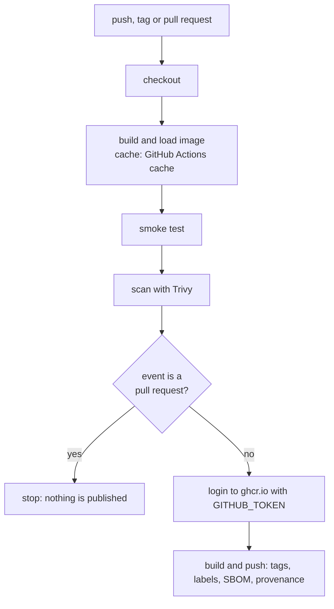

# 09. CI builds with GitHub Actions and registries

> **Draft: written but not yet run.** The code and the expected output in this lesson were prepared by reading the code and the official documentation. They have not been executed yet. If something does not behave as described, trust your tool's real output and report it.

## What you will be able to do
By the end of this lesson you will be able to:
- Write a GitHub Actions workflow that builds, tests, scans and publishes a Docker image.
- Explain why the workflow pushes only on `main` and tags, never on pull requests, and why it needs no stored password.
- Use the Actions cache (`type=gha`) so CI builds reuse layers.
- Give a workflow the least permissions it needs and keep secrets out of build arguments and logs.

## Recap
1. From lesson 02: why do CI machines benefit more from build caching than your laptop?
   <details><summary>Answer</summary>A fresh CI machine starts with an empty cache, so without exported cache every build repeats every step.</details>
2. From lesson 04: what does an image scan tell you, and what does it not?
   <details><summary>Answer</summary>It lists known vulnerable package versions present today. It does not prove they are exploitable, nor that nothing is wrong.</details>

## Why it matters
A restaurant that checks the temperature of every delivery at the door does not rely on a cook remembering to do it. Continuous integration (**CI**) is that door check for code: every change is built, tested and scanned by a machine in a clean environment, the same way every time. A **registry** is the warehouse where finished images are stored under names and tags. Your laptop is the worst build machine you own: it has local files, stale caches and your credentials. CI builds are reproducible, and they never need your personal password.

## What you will build
A repository with a Python image and a workflow that:
1. checks out the code and builds the image **into the runner**,
2. runs a smoke test and a vulnerability scan,
3. on `main` and version tags, logs in to **GitHub Container Registry** (`ghcr.io`) with the automatic `GITHUB_TOKEN`, and pushes the image with tags, labels, an SBOM and provenance,
4. on pull requests, builds and tests but **does not push**.

Dependabot also proposes updates to the workflow's actions and the Docker base image.



## Before you start
- **Prerequisites:** Docker 201 lessons [02, build cache and BuildKit](../phase-1-better-images/02-build-cache-and-buildkit.md), [04, image scanning and supply chain](../phase-1-better-images/04-scanning-and-supply-chain.md) and [06, secrets and configs](../phase-2-compose-in-depth/06-secrets-and-configs.md).
- Lessons 02, 04 and 06 done. Docker 29.9.3 running locally for Steps 1 to 3. Time: 40 minutes.
- For Steps 5 to 7 you need a **GitHub account** and **Git** installed. Create an empty repository on GitHub (private is fine; no README). Never use a repository that holds real company code for practice.
- No password or token has to be created by you for this lesson: the workflow uses the temporary token GitHub gives every run.
- Windows: PowerShell 5.1. macOS/Linux: a POSIX shell. Ubuntu Engine: prefix Docker commands with `sudo`.
- Source pack (optional): every file is shown in full in this lesson, so you can follow without it. The finished code, the exercise starter and the solution are in the course repository https://github.com/Uee03/Code101 under `source/docker/201-hero-to-super-hero/phase-3-workflows/09-ci-with-github-actions/` (on that page choose **Code, Download ZIP**, or run `git clone https://github.com/Uee03/Code101.git`).
- Action versions used: `actions/checkout@v7`, `docker/setup-buildx-action@v4`, `docker/build-push-action@v7`, `docker/login-action@v4`, `docker/metadata-action@v6` (checked against the official documentation when this lesson was written; major versions move, so check the action pages if a step reports a missing version).

## Steps

### Step 1. Make the working folder
**Commands: folder `any folder`**
```powershell
New-Item -ItemType Directory -Force "$HOME\code101\docker201\lesson09\.github\workflows" | Out-Null
Set-Location "$HOME\code101\docker201\lesson09"
```
macOS/Linux:

**Commands: folder `any folder`**
```bash
mkdir -p ~/code101/docker201/lesson09/.github/workflows
cd ~/code101/docker201/lesson09
```
Expected result: the terminal is in `lesson09`, which contains `.github/workflows`. If lost, repeat the `Set-Location` or `cd` line. GitHub only finds workflows in `.github/workflows/` at the **repository root**.

### Step 2. The program and the image
**File: `app.py`**
```python
import sys

if "--selftest" in sys.argv:
    print("selftest ok")
else:
    print("Hello from an image built in CI", flush=True)
```
With `--selftest` the program prints a fixed line, giving CI something to check without starting a server.

**File: `Dockerfile`**
```dockerfile
# syntax=docker/dockerfile:1
FROM python:3.13-slim
ENV PYTHONDONTWRITEBYTECODE=1
WORKDIR /app
COPY --chmod=0444 app.py ./
USER 10001:10001
CMD ["python", "app.py"]
```
The usual hardened pattern from lesson 03: root-owned read-only code and a numeric non-root user.

**File: `.dockerignore`**
```text
.git/
.github/
.env
.env.*
Dockerfile*
*.tar
```
Keeps history, workflow files, settings and saved image tarballs out of the build context.

**File: `.gitignore`**
```gitignore
.env
.env.*
!.env.example
secrets/
*.tar
```
Real settings, secret folders and tarballs must never be committed.

### Step 3. Check the image locally first
**Commands: folder `lesson09`**
```powershell
docker build -t code101-ci:test .
docker run --rm code101-ci:test python app.py --selftest
docker run --rm code101-ci:test
```
Expected output (not yet run):
```text
selftest ok
Hello from an image built in CI
```
Whatever CI does, you should be able to do locally; the workflow automates exactly these commands.

### Step 4. The workflow
**File: `.github/workflows/docker-image.yml`**
```yaml
name: docker-image

on:
  push:
    branches: ["main"]
    tags: ["v*.*.*"]
  pull_request:
    branches: ["main"]

permissions:
  contents: read

concurrency:
  group: docker-image-${{ github.ref }}
  cancel-in-progress: true

env:
  REGISTRY: ghcr.io

jobs:
  build:
    runs-on: ubuntu-latest
    permissions:
      contents: read
      packages: write
    steps:
      - name: Check out the repository
        uses: actions/checkout@v7

      - name: Compute the lower-case image name
        id: image
        run: echo "name=${REGISTRY}/${GITHUB_REPOSITORY,,}" >> "$GITHUB_OUTPUT"

      - name: Set up Docker Buildx
        uses: docker/setup-buildx-action@v4

      - name: Build for testing
        uses: docker/build-push-action@v7
        with:
          context: .
          load: true
          tags: code101-ci:test
          cache-from: type=gha
          cache-to: type=gha,mode=max

      - name: Smoke test the image
        run: docker run --rm code101-ci:test python app.py --selftest

      - name: Scan the image for critical findings that have a fix
        run: |
          docker save code101-ci:test -o image.tar
          docker run --rm -v "$PWD:/work:ro" aquasec/trivy:latest image --input /work/image.tar --severity CRITICAL --ignore-unfixed --exit-code 1

      - name: Log in to the registry
        if: github.event_name != 'pull_request'
        uses: docker/login-action@v4
        with:
          registry: ${{ env.REGISTRY }}
          username: ${{ github.actor }}
          password: ${{ secrets.GITHUB_TOKEN }}

      - name: Generate tags and labels
        id: meta
        uses: docker/metadata-action@v6
        with:
          images: ${{ steps.image.outputs.name }}
          tags: |
            type=ref,event=branch
            type=ref,event=pr
            type=semver,pattern={{version}}
            type=sha

      - name: Build and push
        uses: docker/build-push-action@v7
        with:
          context: .
          push: ${{ github.event_name != 'pull_request' }}
          tags: ${{ steps.meta.outputs.tags }}
          labels: ${{ steps.meta.outputs.labels }}
          cache-from: type=gha
          cache-to: type=gha,mode=max
          sbom: true
          provenance: mode=max
```

| Part | Explanation |
|---|---|
| `name` | The workflow's name in the **Actions** tab. |
| `on.push` | Run on pushes to `main` and on tags that look like `v1.2.3` (`v*.*.*`). |
| `on.pull_request` | Run on pull requests that target `main`: build and test before merging. |
| top-level `permissions` | The `GITHUB_TOKEN` gets only `contents: read` by default for every job: the **least privilege** rule. |
| `concurrency` | Runs for the same branch or tag queue up and an older run is cancelled when a newer commit arrives, saving minutes. |
| `env.REGISTRY` | A variable for the registry host, reused below. |
| `jobs.build.runs-on` | A GitHub-hosted Ubuntu machine, created fresh for the run and deleted afterwards. |
| job `permissions` | This job additionally gets `packages: write`, needed to push to `ghcr.io`. Writing is granted only here, not to the whole workflow. For pull requests from forks GitHub keeps the token read-only whatever you write. |
| `actions/checkout@v7` | Downloads your repository into the runner. |
| `Compute the lower-case image name` | Registry repository names must be lower case, but `github.repository` keeps the capital letters of your user or repository name. `${GITHUB_REPOSITORY,,}` is bash for "lower case"; the result is passed on as the step output `name`. |
| `docker/setup-buildx-action@v4` | Sets up BuildKit's `buildx` builder, which the cache and attestations need. |
| `Build for testing` | Builds the image and **loads** it into the runner's local image store as `code101-ci:test` so the next steps can run it. `cache-from`/`cache-to` with `type=gha` read and write the **GitHub Actions cache**; `mode=max` stores intermediate layers as well. |
| `Smoke test the image` | Runs the image's self test; a non-zero exit code fails the job. |
| `Scan the image...` | Saves the image to a tar file and runs Trivy on it (lesson 04) in a container. It fails the job only for CRITICAL findings that have a fix (`--ignore-unfixed`), a gate strict enough to matter and loose enough not to break on every unfixable issue. |
| `Log in to the registry` | Skipped on pull requests (`if:`). The password is the automatic `GITHUB_TOKEN`, which lives only for the run: **no long-lived password is stored anywhere**. |
| `docker/metadata-action@v6` | Builds the list of tags and OCI labels from the Git event: branch name, PR number, semantic version for tags like `v1.2.3` (as `1.2.3`) and the commit sha. |
| `Build and push` | Builds again (mostly from cache), and pushes only when the event is not a pull request. `sbom: true` and `provenance: mode=max` attach an SBOM and build provenance (lesson 04). Never pass secrets as build arguments: argument values can appear in provenance. |

**File: `.github/dependabot.yml`**
```yaml
version: 2
updates:
  - package-ecosystem: "github-actions"
    directory: "/"
    schedule:
      interval: "weekly"
  - package-ecosystem: "docker"
    directory: "/"
    schedule:
      interval: "weekly"
```
Dependabot checks weekly for newer versions of the actions used in `.github/workflows` and of the base image in the `Dockerfile`, and opens pull requests, which your workflow then builds and tests.

**Predict before you push:** you open a pull request that changes `app.py`. Which steps run, and does a new image appear in the registry? Write down your answer.

### Step 5. Put the project on GitHub
Replace `<owner>` and `<repo>` with your GitHub user name and the empty repository's name. From `lesson09`:

**Commands: folder `lesson09`**
```powershell
git init
git add .
git commit -m "Add image and workflow"
git branch -M main
git remote add origin https://github.com/<owner>/<repo>.git
git push -u origin main
```
The commands are the same on macOS/Linux. If Git says it does not know who you are, set your name and e-mail once with `git config --global user.name "Your Name"` and `git config --global user.email "you@example.com"`. Git asks you to sign in on the first push (a browser window or the Git credential manager); do not paste a password or token into a file or a command line.

## Run it
1. Open your repository on GitHub and choose the **Actions** tab. A run named **docker-image** appears for your push. Open it to see each step's log; the first run is slower because the cache is empty.
2. When it succeeds, your image is under **Packages** (on your profile or repository page) as `ghcr.io/<owner>/<repo>`, with the tags `main` and `sha-` followed by the short commit id (both in lower case). The package is **private** by default.
3. Create a pull request that changes the message in `app.py`. Expected result: the run builds, tests and scans, but the log shows the login step as skipped and **no new tag appears in Packages**.
4. Push a version tag to publish a release image:

**Commands: folder `lesson09`**
```powershell
git tag v0.1.0
git push origin v0.1.0
```
Expected result: a new run publishes the tag `0.1.0` (the `v` is removed by the semver pattern).
5. To pull your private image on your computer, sign in with a personal access token that has the `read:packages` permission. Read it from standard input, so the token never appears in your shell history as an argument:

**Commands: folder `any folder`**
```bash
echo "<token>" | docker login ghcr.io -u <owner> --password-stdin
docker pull ghcr.io/<owner-in-lowercase>/<repo-in-lowercase>:main
```
(`<token>` is a placeholder; create the token in your GitHub settings and do not save it in a file. On Windows PowerShell 5.1 use `"<token>" | docker login ghcr.io -u <owner> --password-stdin`.) Remove the local credentials afterwards with `docker logout ghcr.io`.

Clean up local test images:

**Commands: folder `any folder`**
```powershell
docker image rm code101-ci:test
```
On GitHub you can delete the practice package and repository when you finish.

## How it works
A **workflow** is a YAML file that GitHub runs on events. It contains **jobs**; each job runs on a fresh **runner** (a virtual machine) and consists of **steps**: shell commands (`run`) or reusable **actions** (`uses`). Actions are versioned by tag (`@v7`).

**Where the cache lives.** `type=gha` stores BuildKit layers in GitHub's cache service for your repository, so a later run on a fresh runner can download the layers instead of rebuilding them. Cache entries belong to branches: a pull request can read the cache of its base branch. For some events (for example `pull_request_target`) the cache is read-only; then keep `cache-from` and drop `cache-to`, or you may see `error writing layer blob: failed to reserve cache`. If you use very old tools you may see `This legacy service is shutting down`: update Buildx/BuildKit (the hosted runners are already current).

**Security rules this workflow follows:**
- **Least privilege**: `contents: read` globally, `packages: write` only in the one job that pushes.
- **No stored password**: the `GITHUB_TOKEN` is created per run and expires with it.
- **No push on pull requests**: code from a pull request (especially from a fork) must not publish images or read secrets.
- **No secrets as build arguments**: they would be visible in provenance and image history. Use build secrets (lesson 06).
- **Pin what you run**: tags such as `@v7` can move. The strictest practice is pinning each action to a full commit sha, which Dependabot can then update; look the sha up on the action's releases page yourself rather than copying one from a blog.
- Never use `pull_request_target` with a checkout of the pull request's code unless you understand the risk; the `checkout` action documentation warns about it.

**Misconception:** "CI builds are faster because the machines are faster." They are often slower; the value is **reproducibility** and a clean, shared record, and caching claws back the time.

| Why this, not that | Choose it when | Trade-off |
|---|---|---|
| `ghcr.io` with `GITHUB_TOKEN` | Your code is on GitHub | Tied to GitHub; package visibility needs attention |
| Docker Hub with an access token in a secret | You publish public images on Docker Hub | A long-lived token to protect and rotate |
| Cloud registries (ECR, ACR, Artifact Registry) | You deploy on that cloud | Cloud-specific login steps |
| `type=gha` cache | Small and medium projects on GitHub-hosted runners | Cache size limits and eviction by GitHub |
| `type=registry` cache | You want the cache next to the image or on self-hosted runners | More registry storage |
| Reusable `docker/github-builder` workflow | You want Docker's maintained pipeline for multi-platform builds | Less visible detail; learn the steps first |

## Try it
Copy the starter into a repository as `.github/workflows/docker-image-practice.yml` next to the finished project, or read it as a paper exercise.

1. **Guided:** the starter pushes on every event and has too many permissions. Finish `TODO 1` to `TODO 5` so that it matches the safe solution.
2. **Change:** add a second tag `latest` only for builds from `main`. Predict: which part of `docker/metadata-action` would you use (a `flavor` setting or an `enable` condition on a tag rule), and why is `latest` risky for deployments?
3. **Stretch (no single answer):** you must publish to Docker Hub as well. Describe where the access token is stored (repository secret, environment secret) and which people may change the workflow that uses it.

**File: `exercise/starter/docker-image-practice.yml`**
```yaml
name: docker-image-practice

on:
  push:
    branches: ["main"]
  pull_request:
    branches: ["main"]

# TODO 1: add a top-level permissions block that grants only contents: read

jobs:
  build:
    runs-on: ubuntu-latest
    # TODO 2: give this job contents: read and packages: write so it can push to ghcr.io
    steps:
      - uses: actions/checkout@v7
      - uses: docker/setup-buildx-action@v4
      # TODO 3: add a login step for ghcr.io (docker/login-action@v4, github.actor, secrets.GITHUB_TOKEN) that does NOT run on pull requests
      - uses: docker/build-push-action@v7
        with:
          context: .
          push: true
          # TODO 4: make push true only when the event is not a pull_request
          tags: ghcr.io/your-user-in-lowercase/practice:latest
          # TODO 5: replace the latest tag by a tag made from the commit id (github.sha)
```

<details><summary>Solution</summary>

**File: `exercise/solution/docker-image-practice.yml`**
```yaml
name: docker-image-practice

on:
  push:
    branches: ["main"]
  pull_request:
    branches: ["main"]

permissions:
  contents: read

jobs:
  build:
    runs-on: ubuntu-latest
    permissions:
      contents: read
      packages: write
    steps:
      - uses: actions/checkout@v7
      - uses: docker/setup-buildx-action@v4
      - name: Log in to ghcr.io
        if: github.event_name != 'pull_request'
        uses: docker/login-action@v4
        with:
          registry: ghcr.io
          username: ${{ github.actor }}
          password: ${{ secrets.GITHUB_TOKEN }}
      - uses: docker/build-push-action@v7
        with:
          context: .
          push: ${{ github.event_name != 'pull_request' }}
          tags: ghcr.io/your-user-in-lowercase/practice:${{ github.sha }}
```
Change rung (one possible answer): in `docker/metadata-action`, add the tag rule `type=raw,value=latest,enable={{is_default_branch}}`. `latest` is a moving label that does not tell you which build runs, so deployments should use an immutable tag (the commit sha or a version) or a digest. Stretch (one possible answer): store the token as an **environment secret** on a protected environment `release`, so only runs approved for that environment can read it, and restrict who may edit `.github/workflows`.

</details>

## Check yourself
1. Why does the workflow skip the login step on pull requests? <details><summary>Answer</summary>Pull requests must not publish images; the condition `github.event_name != 'pull_request'` also keeps fork code away from registry access.</details>
2. Predict: you push the tag `v1.4.0`. Which image tag does `type=semver,pattern={{version}}` produce? <details><summary>Answer</summary>`1.4.0`, without the `v`.</details>
3. Which two settings give the workflow least privilege? <details><summary>Answer</summary>Top-level `permissions: contents: read` and `packages: write` only on the job that pushes.</details>
4. Why is `latest` a poor deployment tag? <details><summary>Answer</summary>It moves, so you cannot tell which build is running or roll back reliably.</details>

## Common mistakes
| Symptom or error text | Cause | Fix |
|---|---|---|
| The workflow does not appear in the **Actions** tab | The file is not at `.github/workflows/` in the repository root, or it is not on the default branch | Move it and push to `main` |
| `invalid reference format: repository name ... must be lowercase` (typical message) | The registry path has capital letters | Use the lower-case step from the lesson |
| A `denied` or `permission_denied` error when pushing (wording varies) | The job lacks `packages: write`, or the package belongs to another repository | Add `packages: write` to the job and check the package's access settings |
| `error writing layer blob: failed to reserve cache` | The event only has read access to the cache | Remove `cache-to` for that event |
| YAML error in the workflow | Tab characters or wrong indentation | Use two spaces per level and never tabs |
| `Error: ... Resource not accessible by integration` (typical message) | The token lacks a needed permission | Add only that permission to the job |

## Best practice
Build in CI from a clean environment, test and scan before pushing, push only from trusted events, give each job the least permissions and use short-lived tokens instead of stored passwords. Source: Docker GitHub Actions documentation https://docs.docker.com/build/ci/github-actions/ and GitHub Actions security hardening https://docs.github.com/en/actions/security-for-github-actions/security-guides/security-hardening-for-github-actions

## Going further
- Registry cache and other backends: https://docs.docker.com/build/cache/backends/
- Attestations with GitHub Actions: https://docs.docker.com/build/ci/github-actions/attestations/
- Docker 301 covers registries, signing and promotion between environments.

## Summary
- You wrote a workflow that builds, tests, scans and publishes an image.
- You pushed only from trusted events and used the temporary `GITHUB_TOKEN`.
- You used the Actions cache, tags from metadata and attestations.
- You applied least privilege and kept secrets out of build arguments.

## Next lesson
10. Backups and upgrades: back up and restore a database volume, move Postgres to a new major version, and clean up disk space safely.
