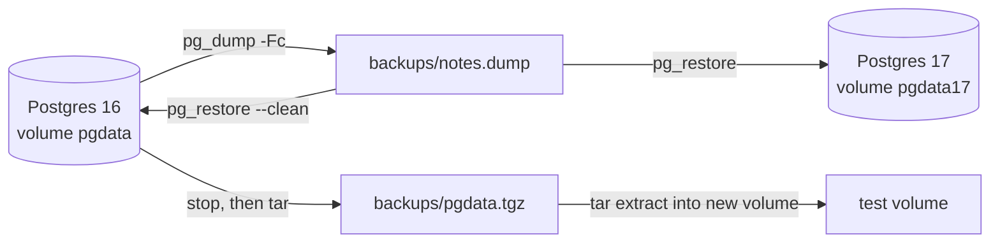

# 10. Backups, upgrades and cleanup

> **Draft: written but not yet run.** The code and the expected output in this lesson were prepared by reading the code and the official documentation. They have not been executed yet. If something does not behave as described, trust your tool's real output and report it.

## What you will be able to do
By the end of this lesson you will be able to:
- Back up a Postgres database in Compose with `pg_dump` and restore it after data loss.
- Back up and restore a Docker volume with a throwaway container and `tar`, and say when this is safe.
- Move a database from Postgres 16 to Postgres 17 with a dump and restore, and explain why you cannot just change the image tag.
- Read `docker system df` and clean up with scoped commands that do not touch data you need.

## Recap
1. From lesson 06: what must never be committed next to your Compose file, and which file type keeps the template?
   <details><summary>Answer</summary>Real `.env` files and secret files. The `.example` template is committed instead.</details>
2. From Docker 101 lesson 04: what does `docker compose down -v` delete?
   <details><summary>Answer</summary>The containers, networks and the named volumes declared in the project, including their data.</details>

## Why it matters
A backup you have never restored is a hope, not a backup. Containers are disposable, but the data in volumes is not: a mistaken `down -v`, a corrupted disk or a bad migration removes it in seconds. Upgrades are the other risk: databases store files in a version-specific format, so "just pull the new image" can leave you with a database that will not start. This lesson rehearses the three things every stateful stack needs: **back up**, **restore** (proved by a check), and **upgrade** by a path you tested.

## What you will build
A Postgres 16 database with three rows in a table, then:
1. a logical backup with `pg_dump`, a deliberate data loss, and a restore;
2. a file-level volume backup with `tar`, restored into a new volume;
3. an upgrade to Postgres 17 by restoring the dump into a fresh 17 database;
4. a disk-usage review with `docker system df`.



## Before you start
- **Prerequisites:** [Docker 201 lesson 06, secrets and configs](../phase-2-compose-in-depth/06-secrets-and-configs.md); Docker 101 lessons [04, data that survives](../../101-zero-to-hero/phase-1-containers/04-data-that-survives.md) and [07, healthchecks and cleanup](../../101-zero-to-hero/phase-2-compose/07-healthchecks-and-cleanup.md).
- Lessons 05 to 07 done. Docker 29.9.3 and Compose v5.7.0. Time: 40 minutes. Host ports are not used; Postgres is never published.
- Windows: PowerShell 5.1 (the commands use `${PWD}\backups`). macOS/Linux: a POSIX shell (use `"$PWD/backups"`). Ubuntu Engine: prefix Docker commands with `sudo`.
- Source pack (optional): every file is shown in full in this lesson, so you can follow without it. The finished code, the exercise starter and the solution are in the course repository https://github.com/Uee03/Code101 under `source/docker/201-hero-to-super-hero/phase-3-workflows/10-backups-and-upgrades/` (on that page choose **Code, Download ZIP**, or run `git clone https://github.com/Uee03/Code101.git`).
- Image tags used: `postgres:16-alpine`, `postgres:17-alpine`, `alpine:3.22`.

## Steps

### Step 1. Make the working folder
**Commands: folder `any folder`**
```powershell
New-Item -ItemType Directory -Force "$HOME\code101\docker201\lesson10\backups" | Out-Null
Set-Location "$HOME\code101\docker201\lesson10"
```
macOS/Linux:

**Commands: folder `any folder`**
```bash
mkdir -p ~/code101/docker201/lesson10/backups
cd ~/code101/docker201/lesson10
```
Expected result: the terminal is in `lesson10`, which contains an empty `backups` folder. If lost, repeat the `Set-Location` or `cd` line.

### Step 2. The files
**File: `seed.sql`**
```sql
CREATE TABLE notes (
    id SERIAL PRIMARY KEY,
    body TEXT NOT NULL
);

INSERT INTO notes (body) VALUES
    ('first note'),
    ('second note'),
    ('third note');
```
Creates a table and three rows. Postgres runs `.sql` files in `/docker-entrypoint-initdb.d/` **once**, when the data directory is empty (first start with a new volume).

**File: `.env.example`**
```dotenv
POSTGRES_USER=learner
POSTGRES_PASSWORD=local-demo-only
POSTGRES_DB=workshop
```
Public demo values. Copy to `.env` (Windows: `Copy-Item .env.example .env`; macOS/Linux: `cp .env.example .env`).

**File: `.gitignore`**
```gitignore
.env
.env.*
!.env.example
backups/
*.dump
*.tgz
```
Backups contain your data. They must never be committed, so the folder and the file types are ignored.

**File: `compose.yaml`**
```yaml
name: code101-backup

services:
  db:
    image: postgres:16-alpine
    environment:
      POSTGRES_USER: ${POSTGRES_USER}
      POSTGRES_PASSWORD: ${POSTGRES_PASSWORD}
      POSTGRES_DB: ${POSTGRES_DB}
    volumes:
      - pgdata:/var/lib/postgresql/data
      - ./seed.sql:/docker-entrypoint-initdb.d/seed.sql:ro
    healthcheck:
      test: ["CMD-SHELL", "pg_isready -U $${POSTGRES_USER} -d $${POSTGRES_DB}"]
      interval: 5s
      timeout: 3s
      retries: 10

volumes:
  pgdata:
```

| Key | Explanation |
|---|---|
| `name` | Project name; the volume becomes `code101-backup_pgdata`. |
| `image: postgres:16-alpine` | Postgres **major version 16**. Minor updates (16.x) are safe to take by pulling a newer image; a new major version needs the upgrade path in Step 8. |
| `environment` | Initial user, password and database (used only on an empty volume). |
| `pgdata:/var/lib/postgresql/data` | The named volume with the database files. |
| `./seed.sql:/docker-entrypoint-initdb.d/seed.sql:ro` | The seed script, read-only, run on first start. |
| `healthcheck` | Same readiness check as before. `$$` is an escaped `$` for the container's shell. |
| `volumes: pgdata` | Declares the volume. |

**File: `compose.pg17.yaml`**
```yaml
name: code101-backup17

services:
  db:
    image: postgres:17-alpine
    environment:
      POSTGRES_USER: ${POSTGRES_USER}
      POSTGRES_PASSWORD: ${POSTGRES_PASSWORD}
      POSTGRES_DB: ${POSTGRES_DB}
    volumes:
      - pgdata17:/var/lib/postgresql/data
    healthcheck:
      test: ["CMD-SHELL", "pg_isready -U $${POSTGRES_USER} -d $${POSTGRES_DB}"]
      interval: 5s
      timeout: 3s
      retries: 10

volumes:
  pgdata17:
```
A **separate project** (`code101-backup17`) with its own empty volume `pgdata17` and **no seed script**: the data will arrive by restore, and a seed would create the table twice. Keeping the old volume untouched means you can go back if anything fails.

### Step 3. Start Postgres 16 and look at the data
**Commands: folder `lesson10`**
```powershell
docker compose up -d --wait
docker compose exec db psql -U learner -d workshop -tAc "SELECT count(*) FROM notes"
```
Expected output (not yet run):
```text
3
```
`psql -U learner -d workshop` connects as the demo user to the demo database; `-tA -c` prints just the value. The names `learner` and `workshop` come from `.env.example`.

## Run it

### A. Logical backup and restore with pg_dump
A **logical backup** is a description of the data (a dump), not a copy of the files. It is consistent even while the database runs, it is portable across Postgres versions and it is the safest default. The script does three things: dump inside the container, copy the file out, remove the temporary file.

**File: `backup.sh`** (macOS/Linux)
```bash
#!/usr/bin/env sh
set -eu

STAMP="$(date +%Y%m%d-%H%M%S)"
FILE="backups/notes-${STAMP}.dump"

mkdir -p backups
docker compose exec -T db pg_dump -U learner -d workshop -Fc -f /tmp/notes.dump
docker compose cp db:/tmp/notes.dump "$FILE"
docker compose exec -T db rm -f /tmp/notes.dump
echo "wrote $FILE"
```

| Line | Explanation |
|---|---|
| 1-2 | Run with `sh`; stop at the first error (`-e`) and on unset variables (`-u`). |
| 4-5 | A time stamp makes each backup file name unique and sortable. |
| 7 | Makes sure the `backups` folder exists. |
| 8 | `pg_dump` in **custom format** (`-Fc`: compressed, restorable with `pg_restore`, supports selecting parts) writes `/tmp/notes.dump` **inside** the container (`-f`). `-T` turns off the terminal so scripts work. |
| 9 | `docker compose cp` copies the file from the container to your `backups` folder. |
| 10 | Deletes the temporary file in the container. |
| 11 | Prints the new file name. |

**File: `backup.ps1`** (Windows)
```powershell
$ErrorActionPreference = "Stop"

$stamp = Get-Date -Format "yyyyMMdd-HHmmss"
$file = "backups\notes-$stamp.dump"

New-Item -ItemType Directory -Force backups | Out-Null
docker compose exec -T db pg_dump -U learner -d workshop -Fc -f /tmp/notes.dump
if ($LASTEXITCODE -ne 0) { throw "pg_dump failed" }
docker compose cp db:/tmp/notes.dump $file
if ($LASTEXITCODE -ne 0) { throw "docker compose cp failed" }
docker compose exec -T db rm -f /tmp/notes.dump
Write-Host "wrote $file"
```
The same steps in PowerShell. `$LASTEXITCODE` is the exit status of the last Docker command, and the script stops with an error if it is not zero (PowerShell does not stop on a failing native command by itself). Why a file copy instead of `pg_dump > file`? In Windows PowerShell 5.1 the `>` operator re-encodes text and can corrupt binary dumps, so the dump is written inside the container and copied as a file.

Run the script (Windows: `.\backup.ps1`, or `powershell -ExecutionPolicy Bypass -File .\backup.ps1` if scripts are blocked; macOS/Linux: `sh backup.sh`):

**Commands: folder `lesson10`**
```powershell
.\backup.ps1
```
Expected output (the stamp varies):
```text
wrote backups\notes-<stamp>.dump
```
Check that the dump is readable by listing its contents (the **table of contents** of the archive):

**Commands: folder `lesson10`**
```powershell
docker compose cp backups\notes-<stamp>.dump db:/tmp/check.dump
docker compose exec db pg_restore --list /tmp/check.dump
```
Replace `<stamp>` with the real file name (macOS/Linux: `backups/notes-<stamp>.dump`). Expected result: a list of lines that describes the archive, including an entry for the table `notes`.

**Predict before you run:** you now delete all rows and restore the dump. What will `SELECT count(*)` print after the delete, and after the restore? Write down both numbers.

Simulate the accident and restore (use your own dump name; the commands copy it back into the container, as you would after a real loss):

**Commands: folder `lesson10`**
```powershell
docker compose exec db psql -U learner -d workshop -c "DELETE FROM notes"
docker compose exec db psql -U learner -d workshop -tAc "SELECT count(*) FROM notes"
docker compose cp backups\notes-<stamp>.dump db:/tmp/notes.dump
docker compose exec db pg_restore -U learner -d workshop --clean --if-exists --single-transaction /tmp/notes.dump
docker compose exec db psql -U learner -d workshop -tAc "SELECT count(*) FROM notes"
```
Expected output (not yet run):
```text
DELETE 3
0
3
```
`--clean --if-exists` drops existing objects (if they exist) before recreating them from the dump, and `--single-transaction` makes the restore all-or-nothing. The final `3` is the proof that the restore worked: **always finish a backup exercise with a check like this.**

### B. Volume backup with tar
A **volume backup** copies the database *files*. It is only safe when Postgres is **stopped**; copying files from a running database can produce a corrupt copy. It is exact but tied to the same Postgres major version and the same CPU architecture.

**Commands: folder `lesson10`**
```powershell
docker compose stop db
docker run --rm -v code101-backup_pgdata:/data:ro -v "${PWD}\backups:/backup" alpine:3.22 tar czf /backup/pgdata.tgz -C /data .
docker run --rm -v "${PWD}\backups:/backup:ro" alpine:3.22 tar tzf /backup/pgdata.tgz
```
macOS/Linux: replace `"${PWD}\backups:/backup"` with `"$PWD/backups:/backup"`. Expected result: the second command lists files in the archive; the list contains `./PG_VERSION`.

| Part | Explanation |
|---|---|
| `-v code101-backup_pgdata:/data:ro` | Mounts the database volume **read-only** at `/data` in a throwaway Alpine container. |
| `-v "${PWD}\backups:/backup"` | Mounts your `backups` folder at `/backup` so the archive lands on your computer. |
| `tar czf /backup/pgdata.tgz -C /data .` | Create (`c`) a gzip-compressed (`z`) file (`f`), working inside `/data` (`-C`), archiving everything in it (`.`). |
| `tar tzf` | List (`t`) the archive without extracting. |

Restore into a **new** volume (never over the original while testing) and prove the contents:

**Commands: folder `lesson10`**
```powershell
docker volume create code101-restore-test
docker run --rm -v code101-restore-test:/data -v "${PWD}\backups:/backup:ro" alpine:3.22 tar xzf /backup/pgdata.tgz -C /data
docker run --rm -v code101-restore-test:/data:ro alpine:3.22 cat /data/PG_VERSION
docker volume rm code101-restore-test
docker compose start db
```
Expected output of the `cat` command:
```text
16
```
`PG_VERSION` is the file in which Postgres records the major version that created the data directory. `tar x` as root keeps the original owners, which Postgres needs. `docker compose start db` brings the original database back.

### C. Upgrade from Postgres 16 to 17
**Predict first:** if you only edit `image: postgres:16-alpine` to `postgres:17-alpine` in `compose.yaml` and run `docker compose up -d`, will the database start with your three rows? Write your answer down.

It will **not** start. Postgres 17 refuses to open a data directory created by 16. The log typically ends with a message like `FATAL:  database files are incompatible with server` (typical message; the detail line names both versions). Minor versions (16.2 to 16.9) share a format; **major** versions do not. Never "fix" this by deleting the volume.

The safe path, using the dump from part A:

1. Take a fresh dump (part A) and keep the old volume untouched.
2. Start an empty Postgres 17 in its own project.
3. Restore into it.
4. Check the data and the version.
5. Switch the application to the new database; keep the old volume until you are sure.

**Commands: folder `lesson10`**
```powershell
docker compose -f compose.pg17.yaml up -d --wait
docker compose -f compose.pg17.yaml cp backups\notes-<stamp>.dump db:/tmp/notes.dump
docker compose -f compose.pg17.yaml exec db pg_restore -U learner -d workshop --no-owner /tmp/notes.dump
docker compose -f compose.pg17.yaml exec db psql -U learner -d workshop -tAc "SELECT count(*) FROM notes"
docker compose -f compose.pg17.yaml exec db psql -U learner -d workshop -tAc "SELECT current_setting('server_version_num')::int / 10000"
```
Expected output (not yet run):
```text
3
17
```
`--no-owner` skips restoring object ownership commands, so objects belong to the user running the restore. The last query divides the numeric version (for example `170005`) by 10000 to show the major version. Confirm the old one is still 16 with the same query against `compose.yaml` (the first project).

**Upgrade notes:**
- **Read the release notes** of the new major version; some extensions, settings and behaviours change.
- **Do not switch image families on the same data**: `alpine` and Debian-based images use different C libraries, and text sorting (collation) can differ, which can silently break indexes. Dump and restore when you change family, too.
- `pg_upgrade` upgrades the files in place and is faster for very large databases, but it needs the binaries of both versions at once; with containers that is an advanced procedure. For small and medium databases, dump and restore is simpler and testable.
- **Postgres 18 and later images** changed the data directory layout; check the image's documentation on Docker Hub for the right mount path before upgrading to 18.
- Rehearse on a copy first, measure the time (a dump of a large database takes long), and plan the downtime or a read-only window.

Clean up the two projects:

**Commands: folder `lesson10`**
```powershell
docker compose -f compose.pg17.yaml down -v --remove-orphans
docker compose down -v --remove-orphans
```

### D. Disk usage and cleanup
**Commands: folder `any folder`**
```powershell
docker system df
docker system df -v
```
Expected result: a table with the rows **Images**, **Containers**, **Local Volumes** and **Build Cache**, and the columns `TOTAL`, `ACTIVE`, `SIZE` and `RECLAIMABLE` (numbers vary). The `-v` form lists each image, container and volume with its size. **RECLAIMABLE** is what removing unused items would free.

Scoped cleanup, from the safest to the most dangerous:

| Command | Removes | Risk |
|---|---|---|
| `docker image prune` | **Dangling** images (untagged leftovers of rebuilds) | Low |
| `docker builder prune --filter until=24h` | Build cache not used for 24 hours | Low (next build is slower) |
| `docker container prune` | All **stopped** containers | Medium: removes stopped containers you may want to inspect |
| `docker image prune -a` | **All unused** images, including ones you will need to pull again | Medium |
| `docker volume ls --filter dangling=true` | Nothing: it only **lists** volumes no container uses | None; look before you delete |
| `docker volume rm <name>` | One named volume you chose | **Data loss** if you pick wrong |
| `docker volume prune --all` | **Every** unused volume, including named ones with data | **High**: do not use on machines with data you care about |
| `docker system prune -a --volumes` | Almost everything unused | **High**: never as a routine |

Run the safe listing and remove only what you can name:

**Commands: folder `any folder`**
```powershell
docker volume ls --filter dangling=true
docker image prune
docker builder prune --filter until=24h
```
Each prune command asks for confirmation and prints how much space it reclaimed.

**Docker Desktop on Windows:** the virtual disk file used by WSL 2 grows as you use it and does not always shrink when you free space inside Docker. If you need the space back on Windows, follow the Docker Desktop and WSL documentation to compact the virtual disk, after you have pruned and backed up what matters.

## How it works
**Logical versus file-level.** A dump records *what is in* the database (SQL and data) and can be loaded into another version. A volume copy records *the files* and works only for the same major version, only when the server is stopped (or when you use a filesystem snapshot that guarantees consistency). Use dumps by default; use file copies for fast whole-instance recovery when versions match.

**What a volume backup does not include.** Configuration that lives outside the volume: your Compose file, `.env` or secret files (lesson 06), images (rebuilt from source), and anything stored in other volumes. A recovery plan lists them all.

**A backup is only real when restored.** Schedule restore tests, check a row count or a known record, and measure how long a restore takes: that is your real recovery time.

**The 3-2-1 rule.** Keep three copies of important data, on two different kinds of storage, with one copy off-site. A dump in a folder next to the database on the same disk is only a first step. Protect backups like the data itself (they contain it): restrict access, encrypt copies that leave your machine, and never commit them.

**Misconception:** "the volume is safe because the container is gone and the data is still there." The volume survives container removal, but not `down -v`, a corrupted disk, a `volume rm` typed in the wrong terminal or a failed upgrade.

| Why this, not that | Choose it when | Trade-off |
|---|---|---|
| `pg_dump -Fc` | Default for small and medium databases and for major upgrades | Slower to restore for huge databases |
| Plain SQL dump (`pg_dump` default) | You want a human-readable file that `psql` can load | Larger; no selective restore |
| Volume `tar` | Same version, whole-instance copy, database stopped | Stop required; not portable across majors |
| Continuous archiving (WAL) | You need point-in-time recovery | More setup; beyond this track |
| `down -v` for "a clean slate" | Throwaway databases only | Deletes data without asking |

## Try it
Make a `practice` copy of the lesson folder and replace `backup.sh` (macOS/Linux) or `backup.ps1` (Windows) with the starter version.

1. **Guided:** finish the three `TODO` comments so the script keeps only the newest 3 dumps and prints how many remain.
2. **Change:** run the script five times. Predict how many files `backups` holds afterwards and which ones they are. Then restore the **newest** dump into the Postgres 17 project and check the count.
3. **Stretch (no single answer):** your database is 40 GB and the nightly dump takes three hours. Describe two changes you would consider (for example a replica to dump from, or file-level snapshots with WAL archiving) and the risk of each.

**File: `exercise/starter/backup.sh`**
```bash
#!/usr/bin/env sh
set -eu

STAMP="$(date +%Y%m%d-%H%M%S)"
FILE="backups/notes-${STAMP}.dump"

mkdir -p backups
docker compose exec -T db pg_dump -U learner -d workshop -Fc -f /tmp/notes.dump
docker compose cp db:/tmp/notes.dump "$FILE"
docker compose exec -T db rm -f /tmp/notes.dump
echo "wrote $FILE"
# TODO 1: list the dumps newest first with ls -1t backups/notes-*.dump
# TODO 2: delete every dump except the newest 3 (tail -n +4 prints the older ones)
# TODO 3: print how many dumps remain
```
**File: `exercise/starter/backup.ps1`**
```powershell
$ErrorActionPreference = "Stop"

$stamp = Get-Date -Format "yyyyMMdd-HHmmss"
$file = "backups\notes-$stamp.dump"

New-Item -ItemType Directory -Force backups | Out-Null
docker compose exec -T db pg_dump -U learner -d workshop -Fc -f /tmp/notes.dump
if ($LASTEXITCODE -ne 0) { throw "pg_dump failed" }
docker compose cp db:/tmp/notes.dump $file
if ($LASTEXITCODE -ne 0) { throw "docker compose cp failed" }
docker compose exec -T db rm -f /tmp/notes.dump
Write-Host "wrote $file"
# TODO 1: list the dumps with Get-ChildItem backups\notes-*.dump, newest first (Sort-Object LastWriteTime -Descending)
# TODO 2: skip the newest 3 (Select-Object -Skip 3) and delete the rest (Remove-Item)
# TODO 3: print how many dumps remain
```

<details><summary>Solution</summary>

**File: `exercise/solution/backup.sh`**
```bash
#!/usr/bin/env sh
set -eu

STAMP="$(date +%Y%m%d-%H%M%S)"
FILE="backups/notes-${STAMP}.dump"

mkdir -p backups
docker compose exec -T db pg_dump -U learner -d workshop -Fc -f /tmp/notes.dump
docker compose cp db:/tmp/notes.dump "$FILE"
docker compose exec -T db rm -f /tmp/notes.dump
echo "wrote $FILE"
ls -1t backups/notes-*.dump | tail -n +4 | while read -r old; do rm -f "$old"; done
echo "kept $(ls -1 backups/notes-*.dump | wc -l | tr -d ' ') dumps"
```
**File: `exercise/solution/backup.ps1`**
```powershell
$ErrorActionPreference = "Stop"

$stamp = Get-Date -Format "yyyyMMdd-HHmmss"
$file = "backups\notes-$stamp.dump"

New-Item -ItemType Directory -Force backups | Out-Null
docker compose exec -T db pg_dump -U learner -d workshop -Fc -f /tmp/notes.dump
if ($LASTEXITCODE -ne 0) { throw "pg_dump failed" }
docker compose cp db:/tmp/notes.dump $file
if ($LASTEXITCODE -ne 0) { throw "docker compose cp failed" }
docker compose exec -T db rm -f /tmp/notes.dump
Write-Host "wrote $file"
Get-ChildItem backups\notes-*.dump | Sort-Object LastWriteTime -Descending | Select-Object -Skip 3 | Remove-Item
Write-Host "kept $((Get-ChildItem backups\notes-*.dump).Count) dumps"
```
After five runs, `backups` holds the 3 newest dumps and the last line prints `kept 3 dumps`. The retention rule lives in the same script that creates backups, so the folder cannot grow without limit. Stretch (one possible answer): dump from a read replica to avoid load on the primary, and add WAL archiving with periodic base backups for point-in-time recovery; the risks are replication lag in the first and a more complex restore procedure in the second.

</details>

## Check yourself
1. Why does the upgrade use a **new** volume and project? <details><summary>Answer</summary>A new major version cannot open the old data directory, and the untouched old volume remains as a way back.</details>
2. Predict: you run `docker compose down -v` instead of `down`. What happens to `pgdata`? <details><summary>Answer</summary>It is deleted with all its data; only your dumps in `backups` remain.</details>
3. When is a `tar` copy of a database volume safe? <details><summary>Answer</summary>When the database is stopped (or a consistent snapshot is used) and you restore it into the same major version.</details>
4. Which command only **lists** volumes that nothing uses? <details><summary>Answer</summary>`docker volume ls --filter dangling=true`.</details>

## Common mistakes
| Symptom or error text | Cause | Fix |
|---|---|---|
| `FATAL:  database files are incompatible with server` (typical message) | A new Postgres major version was started on an old data directory | Start the old version, dump, then restore into a new empty volume |
| `pg_restore: error: ... already exists` (typical wording) | You restored into a database that already has the objects | Use `--clean --if-exists`, or restore into an empty database |
| The seed script did not run | The volume already existed; init scripts run only for an empty data directory | Remove the throwaway volume with `down -v` and start again |
| The `tar` archive restores but Postgres complains about permissions | The files lost their owner (extracted as another user) | Extract as root in a container, as in Step B |
| A binary dump is corrupt after `docker compose exec ... > file` in PowerShell 5.1 | The `>` operator re-encodes output | Write the file inside the container and use `docker compose cp` |
| `docker volume rm` says the volume is in use | A container (even a stopped one) still references it | `docker compose down` first, or remove that container |

## Best practice
Back up with `pg_dump` on a schedule, copy backups off the machine, test restores, take a fresh backup before any upgrade, and clean up with commands scoped to named resources. Source: PostgreSQL backup and restore https://www.postgresql.org/docs/current/backup.html and Docker pruning https://docs.docker.com/engine/manage-resources/pruning/

## Going further
- Docker volumes (including backup and restore): https://docs.docker.com/engine/storage/volumes/
- Official Postgres image documentation: https://hub.docker.com/_/postgres
- A full stack with a database that needs this care: the platform capstone (`capstones/platform`).

## Summary
- You backed up a Postgres database with `pg_dump`, restored it after data loss and proved it with a count.
- You backed up and restored a volume with `tar`, and said when that is safe.
- You upgraded from Postgres 16 to 17 by dump and restore into a new volume.
- You read `docker system df` and chose cleanup commands by risk.

## Next lesson
This is the last lesson of Docker 201. Continue with [Docker 301](../../301-super-hero-to-legendary/phase-1-secure-supply-chain/01-threat-model-for-containers.md) (orchestration concepts, registries, observability and hardening) or put these skills to work in the platform capstone (`capstones/platform`).
