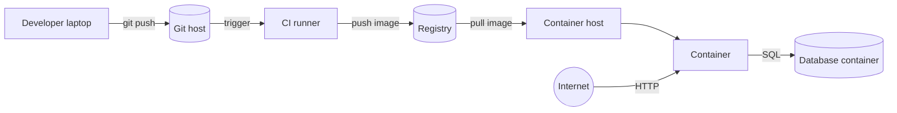

# 01. Threat model for containers and images

> **Draft: written but not yet run.** The code and the expected output in this lesson were prepared by reading the code and the official documentation. They have not been executed yet. If something does not behave as described, trust your tool's real output and report it.

## What you will be able to do
- Draw the trust boundaries of a containerised service and name what an attacker tries at each one.
- Explain why a container is a process-isolation boundary, not a security boundary equal to a virtual machine.
- Run a small line-based audit on a Compose file, predict its findings, and explain why such a lint is not a scanner.
- Write a threat-model table whose every row ends in a decision you can verify.

## Recap
- Does a container have its own kernel?
  <details><summary>Answer</summary>No. Containers share the host kernel (Docker 101 lesson 01); a kernel flaw can matter to every container on the host.</details>
- What does `-p 8080:80` do compared with `-p 127.0.0.1:8080:80`?
  <details><summary>Answer</summary>The first publishes the port on every host interface; the second only on loopback (Docker 101 lesson 02).</details>
- Why do projects commit `.env.example` but not `.env`?
  <details><summary>Answer</summary>`.env` holds real values and must stay out of version control (Docker 101 lesson 05).</details>

## Why it matters
At level 101 and 201 the question was "does it run?". At level 301 the question is "what happens when part of it is hostile?". A hostile part can be a request, a dependency, a base image, a CI credential or a teammate's laptop. Security work that starts with a list of tools (scanners, profiles, signing) and no model of the attacker produces checklists nobody can prioritise. A threat model is the cheap step that tells you which of the next eight lessons matters most for your system. Unity projects are never built or run in Docker in this course (local only), so nothing here applies to them.

## What you will build
A threat model for a small "orders API" system in one Markdown file, two Compose files (one deliberately unsafe, never run; one reviewed) and a short Python script that audits a Compose file for the risky settings you will meet in this phase. You will predict the audit's findings, then compare.

## Before you start
- **Prerequisites:** Docker 101, all lessons ([01, what is a container](../../101-zero-to-hero/phase-1-containers/01-what-is-a-container.md) to [08, two-service project](../../101-zero-to-hero/phase-2-compose/08-two-service-project.md)); Docker 201 lessons [01, multi-stage builds](../../201-hero-to-super-hero/phase-1-better-images/01-multi-stage-builds.md), [05, Compose profiles](../../201-hero-to-super-hero/phase-2-compose-in-depth/05-profiles-overrides-extensions.md), [06, secrets and configs](../../201-hero-to-super-hero/phase-2-compose-in-depth/06-secrets-and-configs.md) and [09, CI with GitHub Actions](../../201-hero-to-super-hero/phase-3-workflows/09-ci-with-github-actions.md).
- Finished Docker 101 and the Docker 201 lessons linked in Prerequisites above. Docker itself is not needed to run this lesson: nothing here starts a container.
- Python 3.13 (or the Docker route in Step 6 if you have no host Python).
- Time: 60 minutes (about 15 minutes of reading the model, 30 of typing and running, 15 for the exercise). It is one sitting.
- Source pack (optional): every file is shown in full in this lesson, so you can follow without it. The finished code, the exercise starter and the solution are in the
  course repository https://github.com/Uee03/Code101 under `source/docker/301-super-hero-to-legendary/phase-1-secure-supply-chain/01-threat-model-for-containers/` (on that page choose **Code, Download ZIP**, or run
  `git clone https://github.com/Uee03/Code101.git`).
- The files here contain demonstration values such as `hunter2`. They are public examples, never real credentials.

## The model first: where the boundaries are



Every arrow is a trust boundary: data or code crosses it, and the receiving side must decide whether to believe it.

| Boundary | What the attacker wants | Typical move | Where this course answers it |
|---|---|---|---|
| Internet to container | Code execution inside the container | Exploit a bug in your code or a library | Lesson 03 (what the process may do once compromised) |
| Container to host | The host, so every container on it | Kernel or container-runtime flaw, a mounted Docker socket, a privileged container | Lesson 03 |
| Build to registry | Run attacker code in production without touching production | Poisoned dependency, poisoned base image, stolen CI credential | Lessons 02 and 04 |
| Registry to host | Swap what you reviewed for something else | Move a tag to a different image | Lesson 04 |
| Operations | Stay unnoticed, then move sideways | Read secrets from environment, logs, cluster API | Lessons 05, 07 and 09 |

Two facts shape every decision below.

1. **A container is a set of Linux features (namespaces, cgroups, capabilities, seccomp) around a normal process.** It is not a virtual machine. Real runtime flaws have existed: for example CVE-2019-5736 (a container process could overwrite the host `runc` binary) and CVE-2024-21626 (a working-directory file descriptor leak in `runc`). Treat the exact details as a reason to patch the runtime promptly and to reduce what a compromised process can do, not as trivia. Read current advisories at the project's own security page before relying on any detail.
2. **Access to the Docker socket is root on the host.** Anything that can talk to `/var/run/docker.sock` can start a privileged container that mounts the host filesystem. That is why the audit script flags it.

## Steps

### Step 1. Make your lesson folder
A terminal is a window for typed commands (Docker 101 lesson 01). Windows: PowerShell. macOS/Linux: Terminal.

**Terminal (PowerShell)**
```powershell
New-Item -ItemType Directory -Force "$HOME\code101\docker301\lesson01\code" | Out-Null
Set-Location "$HOME\code101\docker301\lesson01\code"
```

**Terminal (macOS/Linux)**
```bash
mkdir -p ~/code101/docker301/lesson01/code
cd ~/code101/docker301/lesson01/code
```

Expected result: no output; the prompt is inside `code`. If you get lost, the `Set-Location` or `cd` line returns you here. Save every file below into this folder as UTF-8 text without a BOM. On Windows enable **View > Show > File name extensions** so a file cannot silently become `name.yml.txt`.

### Step 2. The deliberately unsafe Compose file
This file exists to be audited. **Never run it.** Starting it would give a container full host privileges and the Docker socket.

**File: `docker-compose.insecure.yml`**
```yaml
# TEACHING EXAMPLE: never run this file. Every setting here is a finding.
services:
  web:
    image: nginx:latest
    ports:
      - "8080:80"
    privileged: true
    volumes:
      - /var/run/docker.sock:/var/run/docker.sock
    environment:
      - DB_PASSWORD=hunter2
  db:
    image: postgres:17-alpine
    network_mode: host
    environment:
      POSTGRES_PASSWORD: hunter2
```

Line by line:
- Line 1 is a comment. Comments are ignored by Compose and by the audit script.
- `services:` starts the list of containers. `web:` is the first service name.
- `image: nginx:latest` uses the tag `latest`. A tag is a movable label (lesson 04): tomorrow's `latest` is a different image than today's, so you cannot say what you reviewed.
- `ports: - "8080:80"` publishes container port 80 on host port 8080 on **every** interface, including the office or cloud network. The safe form is `127.0.0.1:8080:80`, or no published port behind a reverse proxy.
- `privileged: true` removes most isolation: all capabilities, access to host devices, no seccomp filter. There are very few legitimate uses (for example some Docker-in-Docker build agents), and each should be an explicit, reviewed exception.
- `volumes: - /var/run/docker.sock:/var/run/docker.sock` hands the container control of the host's Docker engine, which is root-equivalent.
- `environment: - DB_PASSWORD=hunter2` writes a secret into a file that will be committed, and into `docker inspect` output.
- `db:` is the second service. `network_mode: host` makes it share the host network stack, so it is no longer isolated by a Docker network.
- `POSTGRES_PASSWORD: hunter2` is another secret in plain text (a weak one).

### Step 3. The reviewed Compose file
**File: `docker-compose.reviewed.yml`**
```yaml
name: code101-reviewed
services:
  web:
    image: nginxinc/nginx-unprivileged:1.31-alpine
    user: "101:101"
    read_only: true
    cap_drop:
      - ALL
    security_opt:
      - no-new-privileges:true
    ports:
      - "127.0.0.1:8080:8080"
    tmpfs:
      - /tmp
  db:
    image: postgres:17-alpine
    user: "70:70"
    read_only: true
    cap_drop:
      - ALL
    security_opt:
      - no-new-privileges:true
    environment:
      POSTGRES_PASSWORD_FILE: /run/secrets/db_password
    secrets:
      - db_password
    tmpfs:
      - /tmp
      - /run/postgresql
    volumes:
      - dbdata:/var/lib/postgresql/data
volumes:
  dbdata:
secrets:
  db_password:
    file: ./secrets/db_password.txt
```

Line by line:
- `name: code101-reviewed` sets the Compose project name so it cannot collide with other labs.
- `image: nginxinc/nginx-unprivileged:1.31-alpine` is a minor-version tag of an NGINX image built to run without root, listening on 8080 (not 80, which needs privileges). A minor tag still moves with patch releases; lesson 02 shows how to pin by digest.
- `user: "101:101"` runs the process as a numeric non-root user and group. If an attacker gets code execution, they are not root inside the container.
- `read_only: true` mounts the container's root filesystem read-only. Malware cannot drop a binary onto it; the cost is that every directory the program writes to must be declared (next lines).
- `cap_drop: - ALL` removes every Linux capability. Add back only a named one if the program fails without it.
- `security_opt: - no-new-privileges:true` stops the process and its children from gaining privileges through set-uid binaries.
- `ports: - "127.0.0.1:8080:8080"` publishes only on loopback.
- `tmpfs: - /tmp` provides a writable in-memory directory for the temporary files the read-only root forbids elsewhere. Data there disappears when the container stops.
- In `db`, `user: "70:70"` is the numeric id of the `postgres` user in the Alpine image. Starting Postgres as that user skips the image's start-as-root step that changes file ownership, which is also why dropping all capabilities is possible here.
- `POSTGRES_PASSWORD_FILE` makes the official image read the password from a file instead of an environment variable. The `secrets:` list mounts the secret `db_password` at `/run/secrets/db_password`.
- `tmpfs: /run/postgresql` gives Postgres a writable place for its socket despite the read-only root.
- `volumes: - dbdata:/var/lib/postgresql/data` keeps database files in a named volume (the one place that must stay writable).
- The top-level `volumes:` and `secrets:` blocks declare `dbdata` and the secret's source file `./secrets/db_password.txt`.

This file passes the audit below. **It has not been started in this lesson.** Passing a lint is evidence about text, not proof that Postgres starts under these restrictions; lesson 03 shows how to test hardening by running it.

**File: `.gitignore`**
```text
secrets/
```
One line: keep the `secrets` folder (which holds `db_password.txt`) out of Git.

### Step 4. The audit script
**File: `audit_compose.py`**
```python
"""Tiny line-based Compose audit: a teaching lint, not a YAML parser."""
import re
import sys

FORBIDDEN = [
    ("C1", r"^\s*privileged:\s*true", "privileged container disables most isolation"),
    ("C2", r"/var/run/docker\.sock", "Docker socket mounted: root-equivalent control of the host engine"),
    ("C3", r"""^\s*network_mode:\s*["']?host""", "host network mode removes network isolation"),
    ("C4", r"""^\s*pid:\s*["']?host""", "host PID namespace shares the host process list"),
    ("C5", r"^\s*image:\s*([^:@\s]+|\S+:latest)\s*$", "image has no tag or uses latest (mutable)"),
    ("C6", r"""^\s*-\s*["']?(0\.0\.0\.0:)?\d+:\d+["']?\s*$""", "port published on every interface"),
    ("C7", r"^\s*-?\s*[A-Z_]*(PASSWORD|SECRET|TOKEN)\s*[=:]\s*[^\s$]\S*", "secret value written in the file"),
    ("C8", r"seccomp[=:]\s*unconfined", "seccomp filtering switched off"),
    ("C9", r"^\s*cap_add:", "extra Linux capabilities added: justify each one"),
]

REQUIRED = [
    ("R1", r"^\s*user:\s*\S+", "no user: key, so the process may run as root"),
    ("R2", r"^\s*read_only:\s*true", "no read_only: true, so the root filesystem is writable"),
    ("R3", r"^\s*cap_drop:", "no cap_drop, so default capabilities are kept"),
    ("R4", r"no-new-privileges:\s*true", "no no-new-privileges option"),
]


def audit(path):
    with open(path, encoding="utf-8") as handle:
        lines = handle.read().splitlines()
    findings = []
    for number, line in enumerate(lines, start=1):
        if line.lstrip().startswith("#"):
            continue
        for rule_id, pattern, message in FORBIDDEN:
            if re.search(pattern, line):
                findings.append(f"{path}:{number}: [{rule_id}] {message}")
    text = "\n".join(line for line in lines if not line.lstrip().startswith("#"))
    for rule_id, pattern, message in REQUIRED:
        if not re.search(pattern, text, re.MULTILINE):
            findings.append(f"{path}: [{rule_id}] {message}")
    return findings


def main():
    if len(sys.argv) != 2:
        print("usage: python audit_compose.py <compose-file>")
        return 2
    findings = audit(sys.argv[1])
    for finding in findings:
        print(finding)
    if findings:
        print(f"{len(findings)} finding(s)")
        return 1
    print(f"{sys.argv[1]}: no findings")
    return 0


if __name__ == "__main__":
    sys.exit(main())
```

How it works:
- `FORBIDDEN` is a list of rules `(id, regular expression, message)`. A **regular expression** is a text pattern; `^` means "start of the line", `\s*` means "any spaces". Each forbidden pattern is tested against every line, so a hit reports a line number.
- `C5` flags `image:` lines with no tag at all (`[^:@\s]+` followed by the end of line) or ending in `:latest`. `C6` matches list items that are just `number:number`, with an optional `0.0.0.0:` prefix. `127.0.0.1:8080:8080` does not match because after `127` the pattern expects a colon and finds a dot. `C7` matches upper-case variable names that **end** in PASSWORD, SECRET or TOKEN followed by `=` or `:` and a value that does not start with `$` (so `${PASSWORD}` references pass). `POSTGRES_PASSWORD_FILE:` does not match because `_FILE` follows the word.
- `REQUIRED` rules must match **somewhere** in the file; each missing one is reported without a line number.
- `audit()` skips comment lines, reports forbidden hits in line order, then missing required settings.
- `main()` prints each finding and a count, and returns exit code 1 when there are findings (so CI could fail on it) or 0 when there are none.

**What this script cannot do (read this before trusting any lint):** it does not parse YAML, so `read_only: true` on one service satisfies R2 for the whole file; it does not understand variable substitution, YAML anchors or multiple files; it knows nothing about vulnerabilities inside images. Real tools (Docker Scout, Trivy, Checkov, Docker Bench for Security) parse structure and consult vulnerability data. The script is here so you can see exactly what such a rule looks like, not to replace them.

### Step 5. Write the threat model
**File: `threat-model.md`**
```markdown
# Threat model: orders-api (example)

Scope: the orders-api container, its Postgres container, the CI job that builds the image and the registry that stores it.

## Assets
- Customer order data in Postgres.
- The database password and the registry push credential.
- The integrity of the image that runs in production.

## Actors
- External attacker who can send HTTP requests to the API.
- Attacker who controls one dependency (a package or a base image).
- Insider or stolen laptop with access to CI or the registry.

## Trust boundaries
1. Internet to the API port.
2. Container to host kernel.
3. Build system to registry.
4. Registry to runtime host.

## Threats and decisions
| ID | Boundary | Threat | Decision | Lesson |
|----|----------|--------|----------|--------|
| T1 | 1 | Remote code execution in the API | Run as non-root, read-only root, no capabilities | 03 |
| T2 | 2 | Container escape through a kernel or runtime flaw | Default seccomp, patched engine, rootless or user namespaces | 03 |
| T3 | 3 | Poisoned dependency or base image | Pin by digest, SBOM, scan, policy | 02 |
| T4 | 3 | Stolen CI credential pushes a malicious image | Short-lived credentials, sign images, verify before deploy | 02 |
| T5 | 4 | Tag moved to a different image after review | Deploy by digest, promote instead of rebuild | 04 |
| T6 | 1 | Secret leaked through environment or logs | Mount secrets as files, never log values | 03 |

## Out of scope for this version
- Physical access to hosts.
- Denial of service through resource exhaustion (see lesson 08).

## Review
Revisit this file when the architecture changes and after every incident.
```

How to read it: a good threat-model row has a boundary, a concrete attacker move, and a **decision that someone can verify** ("run as non-root" can be checked; "be careful" cannot). The **STRIDE** mnemonic (Spoofing, Tampering, Repudiation, Information disclosure, Denial of service, Elevation of privilege) is a common way to brainstorm rows. Scoping matters: the "Out of scope" section is an honest list of what this model does not cover, so nobody mistakes it for a full risk assessment.

### Step 6. Predict, then run the audit
**Predict first.** Look at `docker-compose.insecure.yml` and write down how many findings you expect and which line numbers. The script has nine forbidden rules and four required ones.

Windows PowerShell, in the `code` folder:

**Terminal (PowerShell; folder: `code`)**
```powershell
python audit_compose.py docker-compose.insecure.yml
```

macOS/Linux (use `python3` if `python` is not found):

**Terminal (macOS/Linux; folder: `code`)**
```bash
python3 audit_compose.py docker-compose.insecure.yml
```

No host Python? Run it in a throwaway container (the folder is mounted read-only; Docker 101 lesson 04 explains bind mounts). PowerShell:

**Terminal (PowerShell; folder: `code`)**
```powershell
docker run --rm -v "${PWD}:/work:ro" -w /work python:3.13-slim python audit_compose.py docker-compose.insecure.yml
```

macOS/Linux: replace `${PWD}` with `"$PWD"` in the same command.

Expected output (derived by reading the script; not yet run):
```text
docker-compose.insecure.yml:4: [C5] image has no tag or uses latest (mutable)
docker-compose.insecure.yml:6: [C6] port published on every interface
docker-compose.insecure.yml:7: [C1] privileged container disables most isolation
docker-compose.insecure.yml:9: [C2] Docker socket mounted: root-equivalent control of the host engine
docker-compose.insecure.yml:11: [C7] secret value written in the file
docker-compose.insecure.yml:14: [C3] host network mode removes network isolation
docker-compose.insecure.yml:16: [C7] secret value written in the file
docker-compose.insecure.yml: [R1] no user: key, so the process may run as root
docker-compose.insecure.yml: [R2] no read_only: true, so the root filesystem is writable
docker-compose.insecure.yml: [R3] no cap_drop, so default capabilities are kept
docker-compose.insecure.yml: [R4] no no-new-privileges option
11 finding(s)
```
The exit code is 1 (in PowerShell check `$LASTEXITCODE`; in bash `echo $?`).

Now the reviewed file:

**Terminal (PowerShell; folder: `code`)**
```powershell
python audit_compose.py docker-compose.reviewed.yml
```
Expected output (not yet run):
```text
docker-compose.reviewed.yml: no findings
```
Exit code 0. Notice what this does **not** say: it does not say the stack is secure. It says none of nine known-bad patterns appear and four known-good settings exist somewhere.

## How it works
The lesson combined three layers. The **model** (diagram and table) tells you which boundary to defend. The **decisions** (the right-hand column of `threat-model.md`) turn a worry into a setting. The **lint** makes one class of decisions checkable on every commit. The misconception to correct: "we scan images, so we are secure". Scanning covers known vulnerabilities in packages. It does not cover a privileged container, a mounted Docker socket, a stolen CI token or a moved tag, which are configuration and process failures.

## Decision record (ADR-01): non-root and deny-by-default
- **Context:** orders-api accepts internet requests; a remote-code-execution bug in a dependency is plausible during the service's life.
- **Decision:** every service runs as a numeric non-root user with a read-only root filesystem, no added capabilities, `no-new-privileges`, and ports published to loopback or an ingress only. Exceptions are recorded in the compose file as a comment with an owner and an expiry date.
- **Consequences:** images must be built to run unprivileged (writable paths declared), some third-party images need a different variant or a documented exception, and debugging with a root shell requires a deliberate separate debug container.
- **Revisit when:** a service needs a capability or host device, or the platform changes (for example a move to Kubernetes, lesson 05, where the same decisions become `securityContext` fields).

## When not to use this
- Do not threat-model every throwaway prototype. A one-hour experiment on a laptop needs the basics (no published ports on all interfaces, no real secrets), not a document.
- Do not treat the audit script as a gate for compliance. Use maintained tools; keep a script like this only for team-specific rules (for example "our registry only").
- Do not read the table as complete. It is a starting point; it has no row for your data-protection laws, your insiders or your cloud account.

## Failure modes
- **False confidence from a green lint.** The audit passes a file that sets `read_only: true` on one service only. Mitigation: parse YAML properly or use a maintained policy engine, and test the running container (lesson 03).
- **Exceptions that never expire.** A "temporary" privileged container stays for years. Mitigation: owner and expiry date in the comment, reviewed monthly.
- **Model drift.** The architecture changes and `threat-model.md` does not. Mitigation: review it in the same pull request as architectural changes.

## Production checklist
- [ ] A threat model exists, with an owner and a review date.
- [ ] Every row has a decision that can be verified.
- [ ] No service is `privileged`, mounts the Docker socket, or uses the host network without a recorded exception.
- [ ] No secret value appears in a committed file.
- [ ] Published ports are loopback-only or sit behind an ingress with authentication.

## Try it
Copy `exercise/starter/docker-compose.yml` from the source pack (or type the file below) into your `code` folder as `exercise-compose.yml`.

**File: `exercise-compose.yml` (starter)**
```yaml
services:
  api:
    image: python:latest
    ports:
      - "9000:9000"
    environment:
      API_TOKEN: abc123
    user: "10001:10001"
    cap_drop:
      - ALL
```

1. **Guided:** predict the number of findings (and their line numbers) before you run `python audit_compose.py exercise-compose.yml`. Then run it. Which findings did you miss, and why?
2. **Change:** edit the file until the audit reports `no findings`, without removing the service and without adding an image tag you have not thought about (choose a minor-version tag). The goal: the API gets its token from a mounted secret file, and its root filesystem is read-only with a writable `/tmp` in memory.
3. **Stretch (no single answer):** add three rows to `threat-model.md` for this API: one about the token, one about the base image, one about the registry. For each, write a decision that a reviewer could verify. Then explain in two sentences which of your three decisions this audit script can and cannot check.

<details><summary>Solution</summary>

The starter prints five findings (expected output, not yet run): line 3 (C5), line 5 (C6), line 7 (C7), and R2 and R4 (no read-only root, no `no-new-privileges`).
```text
exercise-compose.yml:3: [C5] image has no tag or uses latest (mutable)
exercise-compose.yml:5: [C6] port published on every interface
exercise-compose.yml:7: [C7] secret value written in the file
exercise-compose.yml: [R2] no read_only: true, so the root filesystem is writable
exercise-compose.yml: [R4] no no-new-privileges option
5 finding(s)
```
A fixed file, which the audit reports as `exercise-compose.yml: no findings`:

**File: `exercise/solution/docker-compose.yml`**
```yaml
services:
  api:
    image: python:3.13-slim
    ports:
      - "127.0.0.1:9000:9000"
    environment:
      API_TOKEN_FILE: /run/secrets/api_token
    secrets:
      - api_token
    user: "10001:10001"
    read_only: true
    cap_drop:
      - ALL
    security_opt:
      - no-new-privileges:true
    tmpfs:
      - /tmp
secrets:
  api_token:
    file: ./secrets/api_token.txt
```
Explanation: the minor tag replaces `latest`; the port is loopback-only; the token comes from a file under `/run/secrets` (the application must read `API_TOKEN_FILE`, which is a convention of some images and not automatic: your own code has to support it); `read_only` plus `tmpfs: /tmp` keeps a writable scratch space; `no-new-privileges` closes R4. Example rows for the stretch: "T7 | 3 | Base image tag moved | Pin by digest in CI (lesson 02)" is checkable by a policy script; "T8 | 1 | Token read from a compromised container | Mount as file, rotate on schedule" is only partly checkable (the lint sees the file mount, not the rotation).

</details>

## Check yourself
1. Name the boundary and the decision that address "an attacker moves the `1.4.0` tag to a malicious image". <details><summary>Answer</summary>Registry to host (boundary 4). Decision: deploy by digest and promote the same image instead of rebuilding (lesson 04).</details>
2. Predict: you add `cap_add: [NET_ADMIN]` to the reviewed file. What does the audit print? <details><summary>Answer</summary>A C9 finding on that line (the file has `cap_add:`), so the audit exits 1. R3 stays satisfied because `cap_drop:` is still present.</details>
3. Why can a passing audit still describe an insecure system? <details><summary>Answer</summary>It matches text patterns only: it cannot see vulnerabilities in packages, the real runtime flags, per-service differences, or process failures such as a stolen credential.</details>
4. Why is mounting the Docker socket "root on the host"? <details><summary>Answer</summary>Whoever controls the engine can start a privileged container that mounts the host filesystem.</details>

## Common mistakes
| Symptom or error text | Cause | Fix |
|---|---|---|
| `python: command not found` (typical message on macOS/Linux) | Only `python3` is installed | Use `python3`, or the Docker route in Step 6 |
| `FileNotFoundError` naming a Compose file (typical Python message) | Terminal is not in the `code` folder | Run the `Set-Location` or `cd` line from Step 1 |
| `usage: python audit_compose.py <compose-file>` | No file name was given | Add the file name after the script name |
| Zero findings on a file you know is bad | The rule is line-based: a value written across several lines or with an unusual layout slips through | Treat the lint as a floor, not a ceiling; read the file |
| The file saved as `docker-compose.insecure.yml.txt` | Hidden extension on Windows | Enable File name extensions in Explorer and rename |

## Best practice
Write down the attacker, the boundary and a verifiable decision before choosing tools; remove privileges by default and add back only what a named requirement needs. Source: OWASP Docker Security Cheat Sheet https://cheatsheetseries.owasp.org/cheatsheets/Docker_Security_Cheat_Sheet.html

## Going further
- Docker Engine security overview: https://docs.docker.com/engine/security/
- Protecting the Docker daemon socket: https://docs.docker.com/engine/security/protect-access/
- OWASP Threat Modeling Cheat Sheet: https://cheatsheetseries.owasp.org/cheatsheets/Threat_Modeling_Cheat_Sheet.html
- Kubernetes security concepts (used from lesson 05): https://kubernetes.io/docs/concepts/security/

## Summary
- You drew the trust boundaries of a containerised system and mapped attacker moves to them.
- You explained why containers share a kernel and why the Docker socket equals host root.
- You read a line-based audit, predicted its findings and listed what it cannot see.
- You wrote a threat model whose rows each end in a verifiable decision.

## Next lesson
02. Image provenance, SBOM and signing: how to know that the image you run is the image you built, and what is inside it.
