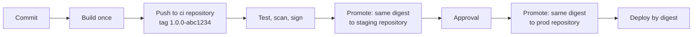

# 04. Registries and promotion pipelines - tags, digests, retention and private registries

> **Draft: written but not yet run.** The code and the expected output in this lesson were prepared by reading the code and the official documentation. They have not been executed yet. If something does not behave as described, trust your tool's real output and report it.

## What you will be able to do
- Run a private registry locally, push an image to it and read its tags and digest through the registry API.
- Promote an image between repositories by digest, without rebuilding, and show that the digest did not change.
- Write and run a retention plan that never deletes an image that is deployed or is a rollback target.
- Choose a registry for a team and list what a self-run registry does not give you.

## Recap
- Why does the base-image policy of lesson 02 require a digest? <details><summary>Answer</summary>A tag can move; only a digest names exactly one image.</details>
- Which hardening settings from lesson 03 apply to a service whose image comes from a registry you do not control? <details><summary>Answer</summary>All of them: non-root, read-only root, dropped capabilities and `no-new-privileges` limit what an image does whatever its origin.</details>
- What is a Compose named volume for? (Docker 101 lesson 04) <details><summary>Answer</summary>Data that must survive container removal; here it will hold the registry's images.</details>

## Why it matters
The registry is where "what we built" becomes "what we will run". Three production problems live there. **Identity**: if you deploy a tag, you cannot say which bytes you ran. **Promotion**: if each environment builds its own image, production runs something nobody tested. **Retention**: registries grow without bound until storage fills or someone deletes the image that production needs to roll back to. This lesson gives you a working registry and one rule for each problem.

## What you will build
A private registry in Compose (`registry:3.1.2`, bound to loopback port 5050), two tiny image versions, a promotion from a `team/hello` repository to a `prod/hello` repository by digest, and a retention planner that prints what it would delete from a sample inventory. The planner is a dry run: it deletes nothing.

## Before you start
- **Prerequisites:** Docker 301 lessons [01, threat model for containers](../phase-1-secure-supply-chain/01-threat-model-for-containers.md) to [03, runtime hardening](../phase-1-secure-supply-chain/03-runtime-hardening.md); [Docker 201 lesson 09, CI with GitHub Actions](../../201-hero-to-super-hero/phase-3-workflows/09-ci-with-github-actions.md); [Docker 101 lesson 07, healthchecks and cleanup](../../101-zero-to-hero/phase-2-compose/07-healthchecks-and-cleanup.md).
- Docker running, `curl` (Windows: `curl.exe`) and Python 3.13 (or the container route from lesson 01).
- Time: 90 minutes. Two sittings are fine: stop after Step 7.
- Source pack (optional): every file is shown in full in this lesson, so you can follow without it. The finished code, the exercise starter and the solution are in the
  course repository https://github.com/Uee03/Code101 under `source/docker/301-super-hero-to-legendary/phase-2-registries-and-orchestration/04-registries-and-promotion-pipelines/` (on that page choose **Code, Download ZIP**, or run
  `git clone https://github.com/Uee03/Code101.git`).
- Port 5050 is used (not 5000, which some macOS versions already use). It is published on loopback only. The registry has **no authentication and no TLS**: that is acceptable for `localhost` on a learning machine and never for anything else. Docker treats `localhost` registries as allowed over plain HTTP by default.
- The image `registry:3.1.2` and the tag `3.1.2` were found on Docker Hub on 2026-11-23 (a lookup, not a pull). In this image the registry reads its configuration from `/etc/distribution/config.yml`, taken from the project's Dockerfile.

## Concepts first

### Tags, digests and what a registry stores
A registry stores **blobs** (layers and configuration, each named by its digest) and **manifests** (small JSON files that list blobs). A tag is a name stored by the registry that points at a manifest digest. Pushing `team/hello:1.0.0` twice with different content **moves** the tag; the old manifest remains but is untagged. The HTTP API that clients use is standardised in the OCI Distribution Specification (https://github.com/opencontainers/distribution-spec/blob/main/spec.md), so any compliant registry answers the same URLs you will use below.

### The pipeline rule: build once, promote by digest

Promotion **copies a reference, not content**: the manifest and layers are the same, so the digest is the same, so every test result, scan, SBOM and signature collected earlier still applies. Rebuilding for production gives different bytes (timestamps, newly fetched packages) and quietly discards that evidence.

### Tag policy
- **Immutable tags** carry version and commit, for example `1.0.0-abc1234`: never pushed twice.
- **Moving tags** (`stable`, `1.0`) are conveniences for humans and for pull-through, **never** what a deploy manifest references.
- **`latest`** means nothing. Do not rely on it.
- A deployment records the **digest**; the tag is documentation.

### Choosing a registry
| Option | You get | You must still handle |
|---|---|---|
| Docker Hub (hosted) | Zero operations, public ecosystem | Pull limits and plan limits (check current terms), private-repo policy, access tokens |
| A cloud provider's registry (for example ECR, GAR, ACR, GHCR) | Integration with that cloud's identity and storage, often scanning and tag immutability | Lock-in, cross-region replication, cost of storage and egress |
| Harbor (self-hosted) | RBAC, scanning integration, replication, immutability rules, a UI | Running a database, storage, upgrades and backups |
| `registry:3` (this lesson) | Small, standards-compliant, easy to run | No UI, no fine-grained RBAC, no tag immutability, you design auth, TLS, GC and backups |

Check each product's current documentation for exact features; they change. The decision is operations versus features: a self-run registry is a production service with its own availability, backups and patching.

## Steps

### Step 1. Make the lesson folder
**Terminal (PowerShell)**
```powershell
New-Item -ItemType Directory -Force "$HOME\code101\docker301\lesson04\code" | Out-Null
Set-Location "$HOME\code101\docker301\lesson04\code"
```

**Terminal (macOS/Linux)**
```bash
mkdir -p ~/code101/docker301/lesson04/code
cd ~/code101/docker301/lesson04/code
```
Expected result: no output; you are inside `code`. All commands below run here.

### Step 2. The registry configuration
**File: `registry-config.yml`**
```yaml
version: 0.1
log:
  level: info
storage:
  filesystem:
    rootdirectory: /var/lib/registry
  delete:
    enabled: true
  cache:
    blobdescriptor: inmemory
http:
  addr: :5000
  headers:
    X-Content-Type-Options: [nosniff]
```
Line by line:
- `version: 0.1` is the configuration file format version used by the project.
- `log.level: info` sets log verbosity. `debug` is noisy and can show more than you want in production logs.
- `storage.filesystem.rootdirectory: /var/lib/registry` stores blobs and manifests on the container's filesystem path that the Compose volume covers. Real deployments often use an object-storage driver (S3-compatible, Azure, GCS) so that storage scales and survives host loss.
- `storage.delete.enabled: true` allows deleting manifests through the API. It is **off by default**; turn it on only if you will run retention. With it off, nothing can be deleted by API and disks only grow.
- `storage.cache.blobdescriptor: inmemory` caches blob lookups in memory: faster responses, lost on restart (which is fine).
- `http.addr: :5000` listens on port 5000 inside the container (the host maps 5050 to it).
- `http.headers.X-Content-Type-Options: [nosniff]` adds a security header to every response (the list syntax is YAML for "a list with one value").

**What a production configuration adds** (fragment, **not applied here**; names follow the distribution project's documentation, so check the current reference before using them):
```yaml
http:
  tls:
    certificate: /certs/registry.crt
    key: /certs/registry.key
auth:
  htpasswd:
    realm: registry
    path: /auth/htpasswd
```
`http.tls` turns on HTTPS with your certificate and key; `auth.htpasswd` requires a user name and password from an `htpasswd` file (bcrypt hashes). For many users, prefer token authentication delegated to an identity provider, or a registry product with RBAC. Without TLS, credentials and images cross the network readable by anyone on the path.

### Step 3. The Compose file
**File: `docker-compose.yml`**
```yaml
name: code101-registry
services:
  registry:
    image: registry:3.1.2
    ports:
      - "127.0.0.1:5050:5000"
    volumes:
      - ./registry-config.yml:/etc/distribution/config.yml:ro
      - registry-data:/var/lib/registry
    security_opt:
      - no-new-privileges:true
    restart: unless-stopped
volumes:
  registry-data:
```
- `name: code101-registry` is the project name; it prefixes the volume (`code101-registry_registry-data`).
- `image: registry:3.1.2` pins a patch version. For production pin by digest (lesson 02).
- `ports: "127.0.0.1:5050:5000"`: host loopback 5050 to container 5000. Remove `127.0.0.1:` and the registry is reachable by anyone on your network, with no authentication.
- `volumes`: the first line mounts the configuration read-only at the path the image reads (`:ro` means the registry cannot change it). The second line is a named volume for stored images; **without it every image vanishes when the container is recreated**.
- `security_opt: no-new-privileges:true`: lesson 03. Further hardening of this container (read-only root, dropped capabilities) is not applied here because it has not been tested against this image; apply it as the exercise in a staging copy.
- `restart: unless-stopped` restarts the registry after a crash or a reboot unless you stopped it by hand.
- Top-level `volumes: registry-data:` declares the named volume.

### Step 4. The sample image
**File: `Dockerfile`**
```dockerfile
FROM alpine:3.22
ARG VERSION=dev
LABEL org.opencontainers.image.version="${VERSION}"
RUN echo "${VERSION}" > /version.txt
USER 65534:65534
CMD ["cat", "/version.txt"]
```
- `FROM alpine:3.22` is a tiny base image.
- `ARG VERSION=dev` declares a build argument with a default; `LABEL ... "${VERSION}"` records it as the standard OCI `version` annotation.
- `RUN echo ... > /version.txt` writes the version into the image so the container can print it.
- `USER 65534:65534` runs as `nobody:nogroup` (numeric ids, non-root).
- `CMD ["cat", "/version.txt"]` prints the file and exits.

**File: `.dockerignore`**
```text
.git
*.md
*.json
```
Keeps Git data and the Markdown and JSON files of this lesson out of the build context.

### Step 5. Start the registry and check it
**Terminal (any OS; folder: `code`)**
```bash
docker compose up -d
```
Expected output (not yet run; the pull lines and sizes vary):
```text
 Container code101-registry-registry-1  Started
```
Now ask the registry API whether it is alive. The `/v2/` URL is the standard "is this a registry?" check.

**Terminal (PowerShell; folder: `code`)**
```powershell
curl.exe -s http://127.0.0.1:5050/v2/
```
macOS/Linux: `curl -s http://127.0.0.1:5050/v2/`. Expected output (not yet run):
```text
{}
```
If you get `connection refused`, wait a few seconds and retry, then run `docker compose logs registry`.

### Step 6. Build, push and read the registry
**Terminal (any OS; folder: `code`)**
```bash
docker build -t localhost:5050/team/hello:1.0.0 --build-arg VERSION=1.0.0 .
docker push localhost:5050/team/hello:1.0.0
```
The image name starts with the registry address (`localhost:5050`), then the repository path `team/hello`, then the tag. Pushing sends only blobs the registry does not already have.

**Terminal (PowerShell; folder: `code`)**
```powershell
curl.exe -s http://127.0.0.1:5050/v2/_catalog
curl.exe -s http://127.0.0.1:5050/v2/team/hello/tags/list
```
macOS/Linux: the same with `curl`. Expected output (not yet run):
```text
{"repositories":["team/hello"]}
{"name":"team/hello","tags":["1.0.0"]}
```
Now the digest. A client asks for the manifest and the registry answers with the digest in a header. We send a HEAD request (`-I`: headers only) and accept every manifest format, because the registry returns whichever format the image was pushed in.

**Terminal (PowerShell; folder: `code`)**
```powershell
(curl.exe -sI -H "Accept: application/vnd.oci.image.index.v1+json, application/vnd.oci.image.manifest.v1+json, application/vnd.docker.distribution.manifest.list.v2+json, application/vnd.docker.distribution.manifest.v2+json" http://127.0.0.1:5050/v2/team/hello/manifests/1.0.0 | Select-String -Pattern "Docker-Content-Digest").Line
```
**Terminal (macOS/Linux; folder: `code`)**
```bash
curl -sI -H "Accept: application/vnd.oci.image.index.v1+json, application/vnd.oci.image.manifest.v1+json, application/vnd.docker.distribution.manifest.list.v2+json, application/vnd.docker.distribution.manifest.v2+json" http://127.0.0.1:5050/v2/team/hello/manifests/1.0.0 | grep -i docker-content-digest
```
Expected output shape (the digest value is not predictable, so it is a placeholder): `Docker-Content-Digest: sha256:<64 hexadecimal characters>`. Copy the `sha256:...` value; the next steps call it `<D>`.

### Step 7. Promote by digest
Pull by digest (this proves the registry serves exactly that content), retag into the `prod` repository and push. No build happens.

**Terminal (any OS; folder: `code`)**
```bash
docker pull localhost:5050/team/hello@<D>
docker tag localhost:5050/team/hello@<D> localhost:5050/prod/hello:1.0.0
docker push localhost:5050/prod/hello:1.0.0
```
Replace `<D>` with the full `sha256:...` value. The push is quick: the registry already holds every blob, so only a new name for the manifest is recorded. Now compare the digests of the two names:

**Terminal (PowerShell; folder: `code`)**
```powershell
(curl.exe -sI -H "Accept: application/vnd.oci.image.index.v1+json, application/vnd.oci.image.manifest.v1+json, application/vnd.docker.distribution.manifest.list.v2+json, application/vnd.docker.distribution.manifest.v2+json" http://127.0.0.1:5050/v2/prod/hello/manifests/1.0.0 | Select-String -Pattern "Docker-Content-Digest").Line
```
macOS/Linux: use the `curl ... | grep -i docker-content-digest` form from Step 6 with the `prod/hello` URL. Expected result (not yet run): the **same** digest as in Step 6. That is promotion: a new name, identical content. Finally run it by digest, which is how a deployment should refer to it:

**Terminal (any OS; folder: `code`)**
```bash
docker run --rm localhost:5050/prod/hello@<D>
```
Expected output (derived from the Dockerfile; not yet run):
```text
1.0.0
```
A real pipeline replaces the manual copying with a registry-side copy such as `docker buildx imagetools create` (see the Docker documentation) and records the digest in the deployment repository (a file such as `deploy/prod.digest`), so rolling back is reverting one commit.

### Step 8. Push a second version and watch the tags
**Terminal (any OS; folder: `code`)**
```bash
docker build -t localhost:5050/team/hello:1.1.0 --build-arg VERSION=1.1.0 .
docker push localhost:5050/team/hello:1.1.0
```
**Terminal (PowerShell; folder: `code`)**
```powershell
curl.exe -s http://127.0.0.1:5050/v2/team/hello/tags/list
```
Expected output (not yet run; the registry lists tags in sorted order):
```text
{"name":"team/hello","tags":["1.0.0","1.1.0"]}
```

### Step 9. The retention planner (a dry run)
Registries do not know which images are deployed. Your retention rule must be told. The sample inventory below says which images are deployed where; the planner never deletes anything.

**File: `inventory.json`**
```json
{
  "repository": "team/hello",
  "keep_latest": 2,
  "images": [
    {"tag": "1.0.0", "pushed": "2026-01-10", "environments": []},
    {"tag": "1.1.0", "pushed": "2026-02-14", "environments": ["prod"]},
    {"tag": "1.2.0", "pushed": "2026-03-20", "environments": []},
    {"tag": "1.3.0", "pushed": "2026-04-25", "environments": []},
    {"tag": "1.4.0", "pushed": "2026-05-30", "environments": ["staging"]},
    {"tag": "1.5.0", "pushed": "2026-06-18", "environments": []}
  ]
}
```
`keep_latest` is how many of the newest images to keep; each image lists the environments where it currently runs. The dates are sample values.

**File: `retention_plan.py`**
```python
"""Print a dry-run retention plan: keep deployed images and the newest N, delete the rest."""
import json
import sys


def plan(inventory):
    images = inventory["images"]
    by_age = sorted(images, key=lambda item: item["pushed"], reverse=True)
    newest = {item["tag"] for item in by_age[: inventory["keep_latest"]]}
    results = []
    for item in sorted(images, key=lambda item: item["pushed"]):
        if item["environments"]:
            results.append(("KEEP", item, "deployed to " + ", ".join(item["environments"])))
        elif item["tag"] in newest:
            results.append(("KEEP", item, f"one of the newest {inventory['keep_latest']}"))
        else:
            results.append(("DELETE", item, "not deployed and not among the newest"))
    return results


def main():
    if len(sys.argv) != 2:
        print("usage: python retention_plan.py <inventory.json>")
        return 2
    with open(sys.argv[1], encoding="utf-8") as handle:
        inventory = json.load(handle)
    results = plan(inventory)
    print(f"Repository {inventory['repository']}: keep the newest {inventory['keep_latest']} plus anything deployed")
    for verdict, item, reason in results:
        print(f"{verdict:<6} {item['tag']:<6} {item['pushed']}  {reason}")
    deletes = sum(1 for verdict, _, _ in results if verdict == "DELETE")
    print(f"Dry run: {deletes} to delete, {len(results) - deletes} to keep. Nothing was changed.")
    return 0


if __name__ == "__main__":
    sys.exit(main())
```
How it works:
- `plan` sorts images by `pushed` date (ISO dates sort correctly as text), takes the newest `keep_latest` tags, then walks the images oldest to newest. The order of the `if` matters: **deployed images are checked first**, so they are never deleted whatever their age.
- `main` prints a header, one line per image (`{verdict:<6}` pads the verdict to six characters so the columns align) and a summary.

**Predict first:** which tags will be deleted? Then run:

**Terminal (PowerShell; folder: `code`)**
```powershell
python retention_plan.py inventory.json
```
macOS/Linux: `python3 retention_plan.py inventory.json`. Expected output (derived by reading the script; not yet run):
```text
Repository team/hello: keep the newest 2 plus anything deployed
DELETE 1.0.0  2026-01-10  not deployed and not among the newest
KEEP   1.1.0  2026-02-14  deployed to prod
DELETE 1.2.0  2026-03-20  not deployed and not among the newest
DELETE 1.3.0  2026-04-25  not deployed and not among the newest
KEEP   1.4.0  2026-05-30  deployed to staging
KEEP   1.5.0  2026-06-18  one of the newest 2
Dry run: 3 to delete, 3 to keep. Nothing was changed.
```
Notice `1.1.0` is old but kept because production runs it. The planner has a weakness you should name: it keeps only what the inventory says is deployed. If the inventory is stale or incomplete, it deletes a running image. Build the inventory from the source of truth (the deployment repository and the cluster), not from memory.

### Step 10. Deleting for real and garbage collection (optional, lab registry only)
Deleting in a registry is **two steps**: remove the manifest (blobs become unreferenced), then run **garbage collection** to free the blobs. Deleting works by digest, not by tag, and removes every tag that points at that manifest. These commands change only your lab registry; do not run them against a shared one.

**Terminal (PowerShell; folder: `code`)**
```powershell
curl.exe -s -o NUL -w "%{http_code}" -X DELETE http://127.0.0.1:5050/v2/team/hello/manifests/<D>
```
macOS/Linux: replace `-o NUL` with `-o /dev/null`. Expected output (typical): `202`. Then a dry run of garbage collection, which reports what it would remove and removes nothing:

**Terminal (any OS; folder: `code`)**
```bash
docker compose exec registry registry garbage-collect --dry-run /etc/distribution/config.yml
```
The output lists blobs and manifests (names and counts depend on your pushes). The project's documentation warns that garbage collection must not run while images are being pushed: a blob uploaded during the run can be deleted before its manifest is written. In production run it in a maintenance window, in read-only mode, or choose a registry that handles this for you.

### Step 11. Clean up
**Terminal (any OS; folder: `code`)**
```bash
docker compose down -v
docker image rm localhost:5050/team/hello:1.0.0 localhost:5050/team/hello:1.1.0 localhost:5050/prod/hello:1.0.0
```
`down -v` removes the container and the `registry-data` volume, which **deletes every image you pushed to this lab registry**. The `image rm` line removes the local copies; it prints `Untagged:` lines (and `Deleted:` lines for layers no other tag uses).

## How it works
The registry is a content-addressed store with a naming layer on top. A digest is the identity; a tag is a mutable pointer; a repository is a namespace with permissions. Promotion works because pushing a manifest that already exists under another name costs nothing and changes nothing about its content. Retention is the hard part, because "unused" is knowledge that lives outside the registry: in your deployment repository and in your clusters.

The misconception to correct: "`docker push` makes a copy for the environment". It records a name for a manifest. Also: "deleting a tag frees space". It does not; only manifest deletion plus garbage collection does.

## Decision record (ADR-04): build once, promote by digest, deploy by digest
- **Context:** the team currently rebuilds per environment from the same branch and deploys `:latest` to staging.
- **Decision:** CI builds once and pushes `1.x.y-<shortsha>` to a `ci` repository. After tests, scan and signature, a promotion job copies the same digest to `staging`, then to `prod` after approval. Deployment manifests contain digests; a deployment repository records which digest runs where.
- **Consequences:** every environment runs the bytes that were tested; rollback is a Git revert of a digest; retention needs the deployment repository as its source of truth; the registry must have separate permissions per repository (only the pipeline may push to `prod`).
- **Alternatives rejected:** rebuilding per environment (different bytes); retagging inside one repository (cannot separate who may promote); Git tags as the only record (cannot prove which bytes ran).
- **Revisit when:** you adopt a registry feature that makes tags immutable and replicates between environments; the process stays, the mechanics change.

## When not to use this
- A single developer with one service on one machine does not need promotion between repositories; a tagged image and a note of the digest is enough.
- Do not self-host a registry for production unless someone owns its availability, patching, storage growth, backups and garbage collection. A hosted or cloud registry is usually the better trade.
- Do not use the retention planner as an automatic deleter. Treat its output as a review aid until the inventory is generated from real sources and you have tested a restore.

## Failure modes
- **Moved tag:** a CI job re-pushes `1.0.0` after a rebuild; caches and rollbacks silently change. Mitigation: immutable tags enforced by the registry or by pipeline permissions.
- **Deleting the rollback target:** retention removes the previous production image just before you need it. Mitigation: mark rollback targets in the inventory (see the exercise).
- **Garbage collection corrupting pushes:** GC during a push. Mitigation: maintenance window or read-only mode.
- **Registry outage during scale-up:** new nodes cannot pull. Mitigation: pull-through cache or mirror near the cluster, pre-pulled critical images.
- **Public registry limits:** pulls fail when anonymous or free-tier limits are reached. Mitigation: authenticated pulls, a mirror, and base images copied to your own registry (lesson 02's policy).
- **Unbounded growth:** no retention at all. Measure storage per repository and its growth per week.
- **Plain HTTP and no auth outside localhost:** anyone on the network can push. Treat any such registry as compromised.
- **No backup:** images can be rebuilt, but signatures, attestations and old versions may not be reproducible. Back up the storage, or replicate.

## Measurements to take
- Registry storage in total and per repository, per week.
- Number of images deleted per run and the number of times a deleted image was requested afterwards (target: zero).
- Time from "push to ci" to "available in prod" (the pipeline latency).
- Pull time for your largest image from a fresh node (to decide whether a mirror is worth it).

## Production checklist
- [ ] TLS and authentication on every registry that is not localhost.
- [ ] Separate repositories (or projects) per environment, with only the pipeline allowed to push to `prod`.
- [ ] Immutable version tags; deployments reference digests.
- [ ] Retention rules keep deployed images and rollback targets; the inventory comes from the deployment repository and clusters.
- [ ] Garbage collection is scheduled and safe with respect to pushes.
- [ ] The registry's storage is backed up or replicated; a restore has been tested.
- [ ] Pull-through cache or mirror for base images; credentials for pulls are scoped and rotated.

## Try it
Use a new folder `exercise` and copy the starter inventory.

**File: `exercise/inventory.json` (starter)**
```json
{
  "repository": "team/orders",
  "keep_latest": 1,
  "images": [
    {"tag": "2.0.0", "pushed": "2026-03-01", "environments": []},
    {"tag": "2.1.0", "pushed": "2026-04-01", "environments": ["prod"]},
    {"tag": "2.2.0", "pushed": "2026-05-01", "environments": []},
    {"tag": "2.3.0", "pushed": "2026-06-01", "environments": []}
  ]
}
```
1. **Guided:** predict the plan for this inventory (which are deleted?), then run `python retention_plan.py exercise/inventory.json` using the script from `code`.
2. **Change:** the team says `2.2.0` is the **previous** production version and must stay available for rollback. Record that in the inventory using the environment name `prod-previous` (only the JSON changes) and predict the new summary line.
3. **Stretch (no single answer):** how many rollback targets should a service keep, and what does that depend on (database migrations that cannot be reversed, release frequency, storage cost)? Write three sentences and one measurement you would use to check it.

<details><summary>Solution</summary>

The starter prints (expected output, not yet run):
```text
Repository team/orders: keep the newest 1 plus anything deployed
DELETE 2.0.0  2026-03-01  not deployed and not among the newest
KEEP   2.1.0  2026-04-01  deployed to prod
DELETE 2.2.0  2026-05-01  not deployed and not among the newest
KEEP   2.3.0  2026-06-01  one of the newest 1
Dry run: 2 to delete, 2 to keep. Nothing was changed.
```
**File: `exercise/solution/inventory.json`**
```json
{
  "repository": "team/orders",
  "keep_latest": 1,
  "images": [
    {"tag": "2.0.0", "pushed": "2026-03-01", "environments": []},
    {"tag": "2.1.0", "pushed": "2026-04-01", "environments": ["prod"]},
    {"tag": "2.2.0", "pushed": "2026-05-01", "environments": ["prod-previous"]},
    {"tag": "2.3.0", "pushed": "2026-06-01", "environments": []}
  ]
}
```
The new summary line is `Dry run: 1 to delete, 3 to keep. Nothing was changed.` and `2.2.0` prints `KEEP   2.2.0  2026-05-01  deployed to prod-previous`. (A rollback target counts as "deployed" for retention purposes even if no environment runs it right now.) For the stretch, a common answer is "at least two previous production versions, and every version after the last irreversible database migration", measured by how often rollbacks actually reach back more than one version.

</details>

## Check yourself
1. Two tags point at the same digest. You delete one tag. Is the image gone? <details><summary>Answer</summary>No. The manifest and blobs remain, and the other tag still resolves. Only deleting the manifest by digest (then garbage collection) removes the content.</details>
2. Predict: you promote `team/hello@<D>` to `prod/hello:1.0.0`. What is the digest of `prod/hello:1.0.0`? <details><summary>Answer</summary>The same <code>&lt;D&gt;</code>; promotion adds a name for the same manifest.</details>
3. Why does the retention script check "deployed" before "newest"? <details><summary>Answer</summary>So that an old image that is still running is never marked for deletion.</details>
4. Find the risk: the registry compose file publishes `"5050:5000"` without `127.0.0.1`. <details><summary>Answer</summary>The registry (no authentication, no TLS) is reachable from the whole network; anyone can push or pull.</details>
5. Why can a self-run registry not replace tag immutability with configuration alone? <details><summary>Answer</summary>The `registry:3` configuration in this lesson has no tag-immutability setting: you enforce it by pipeline permissions or by using a registry product that provides it.</details>

## Common mistakes
| Symptom or error text | Cause | Fix |
|---|---|---|
| `connection refused` on port 5050 (typical wording) | Registry still starting, or not started | Wait, then `docker compose logs registry` |
| `http: server gave HTTP response to HTTPS client` (typical wording) | Pushing to a non-localhost name over plain HTTP | Use a localhost name for the lab, or configure TLS; do not weaken the engine setting for a shared host |
| `port is already allocated` (typical wording) | Another process uses 5050 | Stop it, or change the left side of `ports` consistently and every image name |
| Pushed image not in the catalog | You tagged `team/hello:1.0.0` without the `localhost:5050/` prefix, so `push` went to Docker Hub or failed | Always include the registry address in the tag |
| `Docker-Content-Digest` line is missing | The `Accept` header did not include the manifest type pushed | Use the full four-type `Accept` header shown in Step 6 |
| Deleting by tag fails (typical: `405` or `unsupported`) | The API deletes by digest, and delete must be enabled | Use the digest from Step 6; check `storage.delete.enabled` |
| Disk still full after deleting | Manifests deleted but no garbage collection | Run `registry garbage-collect` safely (Step 10) |

## Best practice
Build an image once, identify it by digest, promote that digest between environments, and deploy by digest. Source: Docker Build best practices (pin and rebuild guidance) https://docs.docker.com/build/building/best-practices/ and the OCI Distribution Specification https://github.com/opencontainers/distribution-spec/blob/main/spec.md

## Going further
- Distribution registry documentation (upstream project, not a Tier 1 source): https://distribution.github.io/distribution/
- Docker Hub documentation: https://docs.docker.com/docker-hub/
- `docker buildx imagetools create` (registry-side copy and retag): https://docs.docker.com/reference/cli/docker/buildx/imagetools/create/
- Kubernetes image pull secrets, used in lesson 05: https://kubernetes.io/docs/tasks/configure-pod-container/pull-image-private-registry/

## Summary
- You ran a private registry and read its tags and digests through the API.
- You promoted an image by digest and showed the digest did not change.
- You planned retention that protects deployed images and recorded the decision as an ADR.
- You listed what a self-run registry does not provide and when not to run one.

## Next lesson
05. From Compose to Kubernetes: the mental model (pods, deployments, services, config, probes) with every manifest in full.
