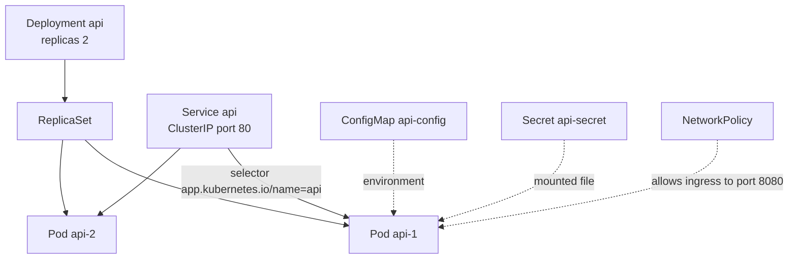

# 05. From Compose to Kubernetes - the mental model with every manifest in full

> **Draft: written but not yet run.** The code and the expected output in this lesson were prepared by reading the code and the official documentation. They have not been executed yet. If something does not behave as described, trust your tool's real output and report it.

## What you will be able to do
- Map each Compose concept (service, ports, environment, healthcheck, volumes, restart) to its Kubernetes object and say what is new.
- Read and write a Namespace, ConfigMap, Secret, Deployment, Service and NetworkPolicy, and explain every field in them.
- Explain the three probes (startup, readiness, liveness) and predict what each one does when it fails.
- Decide when Kubernetes is the wrong tool.

## Recap
- Which controls from lesson 03 appear again here as `securityContext` fields? <details><summary>Answer</summary>Non-root user (`runAsNonRoot`), no privilege escalation (`allowPrivilegeEscalation: false`), dropped capabilities, read-only root filesystem and the seccomp profile.</details>
- In lesson 04, what do deployments reference to say exactly which image runs? <details><summary>Answer</summary>The digest. This lab uses a tag only because the image is loaded into a local cluster, not pulled from a registry; a production manifest would contain `image: registry/team/api@sha256:...`.</details>
- What does a Compose `healthcheck` decide? (Docker 101 lesson 07) <details><summary>Answer</summary>Whether a container is healthy, which `depends_on: condition: service_healthy` can wait for.</details>

## Why it matters
Compose describes one machine. Kubernetes describes a desired state for a cluster of machines and runs controllers that continuously make reality match it: replace failed instances, roll out new versions gradually, spread load. That power costs concepts, operations and attack surface. At level 301 the useful skill is not typing manifests but knowing which problem each object solves, what it will do when something fails, and whether you need a cluster at all.

## What you will build
The "api" service in two forms: a Compose file (the "before") and six Kubernetes manifests (the "after") that run two replicas of the same image in a local `kind` cluster, with configuration from a ConfigMap, a token from a Secret mounted as a file, three probes, resource requests, a restricted security context and a NetworkPolicy. You will see readiness gate traffic, then break it on purpose.

## Before you start
- **Prerequisites:** Docker 301 lessons [01, threat model for containers](../phase-1-secure-supply-chain/01-threat-model-for-containers.md) to [04, registries and promotion pipelines](04-registries-and-promotion-pipelines.md); Docker 201 lessons [05, Compose profiles](../../201-hero-to-super-hero/phase-2-compose-in-depth/05-profiles-overrides-extensions.md) and [06, secrets and configs](../../201-hero-to-super-hero/phase-2-compose-in-depth/06-secrets-and-configs.md); [Docker 101 lesson 07, healthchecks and cleanup](../../101-zero-to-hero/phase-2-compose/07-healthchecks-and-cleanup.md).
- Docker running; `kubectl` and `kind` installed (Step 2). Python is not needed on the host.
- Time: 100 minutes. Two sittings: stop after Step 8 (everything applied and answering).
- Source pack (optional): every file is shown in full in this lesson, so you can follow without it. The finished code, the exercise starter and the solution are in the
  course repository https://github.com/Uee03/Code101 under `source/docker/301-super-hero-to-legendary/phase-2-registries-and-orchestration/05-from-compose-to-kubernetes/` (on that page choose **Code, Download ZIP**, or run
  `git clone https://github.com/Uee03/Code101.git`).
- `kind` runs a Kubernetes cluster **inside Docker containers** on your machine. It is a learning and CI tool, not a production platform. Docker Desktop's built-in Kubernetes is an alternative; this lesson uses `kind` because its cluster is created and destroyed by one command each. Check that no cluster named `code101` already exists and that you are not pointing `kubectl` at a real cluster: every `kubectl` command below states the context.
- Port 8091 on loopback is used for port-forwarding. Stop other labs that use it.
- The secret value `demo-not-a-secret` is a public demonstration value.

## The mental model

- A **Pod** is the smallest unit: one or more containers that share a network address and volumes. Pods are disposable; their names and addresses change.
- A **Deployment** declares "run N identical pods from this template" and owns a **ReplicaSet** that keeps N alive. Changing the template creates a new ReplicaSet and shifts pods over gradually (a rolling update).
- A **Service** gives a stable name and virtual address to a changing set of pods, chosen by **label selector**. Only pods that are **Ready** receive traffic.
- A **ConfigMap** holds non-secret configuration; a **Secret** holds sensitive values (base64-encoded, **not encrypted** by default: anyone who can read the Secret object can decode it).
- A **Namespace** is a scope for names, quotas and access rules.
- **Controllers** run a loop: observe actual state, compare with desired state, act. This is why you declare ("2 replicas") instead of commanding ("start two").

| Compose | Kubernetes | What is new or different |
|---|---|---|
| `service` | Deployment + Service | Two objects: one runs pods, one names them |
| `image`, `build` | `image` (no build) | The cluster only pulls images; build in CI and push to a registry (lesson 04) |
| `ports: "127.0.0.1:8091:8080"` | Service `port` and `targetPort`, then Ingress/Gateway or `port-forward` | Exposure to outside is a separate, explicit decision |
| `environment`, `env_file` | ConfigMap, `envFrom` | Config changes do **not** restart running pods |
| `secrets:` (files) | Secret, mounted as volume | Same idea; the cluster stores the Secret object |
| `healthcheck` | startup, readiness and liveness probes | Probes drive routing and restarts; Compose only reports health |
| `depends_on` | nothing equivalent | Pods start in any order; code must retry, readiness protects callers |
| `restart: unless-stopped` | Deployment controller + `restartPolicy: Always` | The controller replaces pods, even on another node |
| `deploy.resources`, `mem_limit` | `resources.requests` and `limits` | `requests` drive scheduling; `limits` cap use (lesson 08) |
| `networks` | Service DNS + NetworkPolicy | All pods can talk by default; policies restrict it |
| `profiles`, several files | namespaces, Kustomize overlays, Helm values | Lesson 06 |
| `docker compose up` | `kubectl apply -f` | You submit desired state; controllers converge |

## Steps

### Step 1. Make the lesson folder
**Terminal (PowerShell)**
```powershell
New-Item -ItemType Directory -Force "$HOME\code101\docker301\lesson05\code\k8s" | Out-Null
Set-Location "$HOME\code101\docker301\lesson05\code"
```

**Terminal (macOS/Linux)**
```bash
mkdir -p ~/code101/docker301/lesson05/code/k8s
cd ~/code101/docker301/lesson05/code
```
Expected result: no output; you are inside `code`. All commands run here unless stated.

### Step 2. Install the tools
**kubectl** is the command-line client for Kubernetes; **kind** creates a local cluster in Docker.
- Windows (PowerShell): `winget install Kubernetes.kubectl` and `winget install Kubernetes.kind` (if winget cannot find them, run `winget search kind` and use the id it lists). Close the terminal and open a new one afterwards so the new commands are found.
- macOS: `brew install kubectl kind`.
- Linux: follow https://kubernetes.io/docs/tasks/tools/ for kubectl and https://kind.sigs.k8s.io/docs/user/quick-start/ for kind (the kind documentation is the upstream project, not a Tier 1 source).

Check:

**Terminal (any OS)**
```bash
kubectl version --client
kind version
```
Expected result (not yet run): a client version line for each tool. The numbers depend on the day you install; nothing else is claimed.

### Step 3. The application
The same small service as Docker 101 style, with three things Kubernetes needs: a liveness endpoint, a readiness endpoint that is false during a warm-up, and graceful shutdown on `SIGTERM`.

**File: `app.py`**
```python
import json
import os
import signal
import socket
import threading
import time
from http.server import BaseHTTPRequestHandler, ThreadingHTTPServer

START = time.monotonic()
WARMUP_SECONDS = float(os.environ.get("WARMUP_SECONDS", "5"))
GREETING = os.environ.get("GREETING", "hello")
VERSION = os.environ.get("APP_VERSION", "dev")
TOKEN_FILE = os.environ.get("API_TOKEN_FILE", "")
TOKEN_CONFIGURED = os.path.isfile(TOKEN_FILE) if TOKEN_FILE else False


class Handler(BaseHTTPRequestHandler):
    def send_json(self, status, payload):
        body = json.dumps(payload).encode("utf-8")
        self.send_response(status)
        self.send_header("Content-Type", "application/json")
        self.send_header("Content-Length", str(len(body)))
        self.end_headers()
        self.wfile.write(body)

    def do_GET(self):
        if self.path == "/healthz":
            self.send_json(200, {"status": "alive"})
        elif self.path == "/readyz":
            ready = time.monotonic() - START >= WARMUP_SECONDS
            self.send_json(200 if ready else 503, {"ready": ready})
        elif self.path == "/":
            self.send_json(200, {
                "greeting": GREETING,
                "version": VERSION,
                "hostname": socket.gethostname(),
                "token_configured": TOKEN_CONFIGURED,
            })
        else:
            self.send_json(404, {"error": "not found"})


def main():
    server = ThreadingHTTPServer(("0.0.0.0", 8080), Handler)

    def stop(signum, frame):
        threading.Thread(target=server.shutdown, daemon=True).start()

    signal.signal(signal.SIGTERM, stop)
    signal.signal(signal.SIGINT, stop)
    print("listening on 8080", flush=True)
    server.serve_forever()
    print("stopped cleanly", flush=True)


if __name__ == "__main__":
    main()
```
How it works:
- Right after the imports, the constants read configuration from environment variables with defaults. `START` is a monotonic clock reading taken at start-up; `WARMUP_SECONDS` is how long the service pretends to warm up (a cache, a connection pool). `TOKEN_FILE` is the **path** of a secret file; the program records only whether it exists and never prints the token.
- `send_json` writes a JSON response with a status code, `Content-Type` and `Content-Length`.
- `GET /healthz` always answers 200: "the process is alive". `GET /readyz` answers 503 until `WARMUP_SECONDS` have passed, then 200: "I can serve requests". `GET /` returns the greeting, version, the pod's host name and whether the token file exists. Other paths return 404.
- `main` creates a multi-threaded server. `stop` runs when the process receives `SIGTERM` (what Kubernetes sends first when it stops a pod) or `SIGINT`; it asks the server to shut down from another thread (calling `shutdown` from the thread that runs `serve_forever` would deadlock). After `serve_forever` returns, the program prints a line and exits with code 0.
- Why this matters: without a `SIGTERM` handler, a Python program running as process 1 in a container ignores the signal, and the platform waits for the grace period and then kills it (a slow, rough rollout).

**File: `Dockerfile`**
```dockerfile
FROM python:3.13-slim
ARG APP_VERSION=1.0.0
ENV APP_VERSION=${APP_VERSION} PYTHONUNBUFFERED=1
RUN useradd --system --uid 10001 --no-create-home --shell /usr/sbin/nologin app
WORKDIR /app
COPY app.py .
USER 10001:10001
EXPOSE 8080
CMD ["python", "app.py"]
```
- `ARG APP_VERSION=1.0.0` and `ENV APP_VERSION=${APP_VERSION}`: the build argument becomes an environment variable the program reports. `PYTHONUNBUFFERED=1` makes Python flush output at once so logs appear immediately.
- `USER 10001:10001`: a **numeric** user. Kubernetes' `runAsNonRoot: true` can only verify a numeric user; a name such as `app` is refused because the cluster cannot prove it is not root.
- The other lines are as in lesson 03.

**File: `.dockerignore`**
```text
.git
*.md
*.yaml
*.yml
k8s
secrets
__pycache__
```
Keeps manifests, Compose files and the `secrets` folder out of the image (a secret must never be baked into an image).

**File: `.gitignore`**
```text
secrets/
```

### Step 4. The "before": Compose
**File: `docker-compose.yml`**
```yaml
name: code101-api-compose
services:
  api:
    build:
      context: .
      args:
        APP_VERSION: 1.0.0
    image: code101/api:1.0.0
    environment:
      GREETING: hello from compose
      WARMUP_SECONDS: "5"
      API_TOKEN_FILE: /run/secrets/api_token
    secrets:
      - api_token
    ports:
      - "127.0.0.1:8091:8080"
    read_only: true
    cap_drop:
      - ALL
    security_opt:
      - no-new-privileges:true
    healthcheck:
      test: ["CMD", "python", "-c", "import urllib.request; urllib.request.urlopen('http://127.0.0.1:8080/readyz')"]
      interval: 5s
      timeout: 3s
      retries: 3
      start_period: 10s
    restart: unless-stopped
secrets:
  api_token:
    file: ./secrets/api_token.txt
```
- `build: context: .` plus `args: APP_VERSION: 1.0.0` builds the Dockerfile and sets the build argument; `image:` names the result.
- `environment` sets the greeting, warm-up and the secret file's path. `secrets: - api_token` mounts the secret at `/run/secrets/api_token`; the bottom `secrets:` block says it comes from `./secrets/api_token.txt`.
- `ports` publishes on loopback. `read_only`, `cap_drop`, `security_opt`: lesson 03.
- `healthcheck` calls `/readyz` every 5 seconds; `start_period: 10s` ignores failures while the service warms up.
- `restart: unless-stopped` restarts it after a crash.

Optional: run it to see the baseline. Create the demo secret file (in an editor: new file `secrets/api_token.txt` containing the single line `demo-not-a-secret`), then:

**Terminal (PowerShell; folder: `code`)**
```powershell
docker compose up -d --build
curl.exe -s http://127.0.0.1:8091/
```
macOS/Linux: `curl` instead of `curl.exe`. Expected output of the `curl` command once the service is up (the `hostname` value is the container id, not predictable; not yet run):
```text
{"greeting": "hello from compose", "version": "1.0.0", "hostname": "<container id>", "token_configured": true}
```
Then stop it: `docker compose down`. Compose now has nothing left running; the Kubernetes version below uses the same image and the same port-forward port.

### Step 5. Build the image and create the cluster
**Terminal (any OS; folder: `code`)**
```bash
docker build -t code101/api:1.0.0 .
kind create cluster --name code101
kind load docker-image code101/api:1.0.0 --name code101
kubectl config current-context
```
- The build is as in earlier lessons (several lines of output; not shown).
- `kind create cluster` starts a node container and writes a context into your kubectl configuration; it takes a minute or two and prints progress lines ending with a hint that you can now use your cluster with `kubectl cluster-info --context kind-code101`.
- `kind load docker-image` copies the image from your Docker into the cluster node (a registry is not used here).
- The last command prints the active context. Expected output (not yet run):
```text
kind-code101
```
If it prints a different name, **stop**: you are pointed at another cluster. Run `kubectl config use-context kind-code101`. Every command below also passes `--context kind-code101` where it matters.

### Step 6. The manifests
Kubernetes manifests are YAML files. Every object has `apiVersion` (which API group and version defines it), `kind` (the type), `metadata` (name, namespace, labels) and a `spec` (the desired state). Create these six files in the `k8s` folder. The numeric prefixes make `kubectl apply -f k8s/` process them in order, so the namespace exists before objects that live in it.

**File: `k8s/00-namespace.yaml`**
```yaml
apiVersion: v1
kind: Namespace
metadata:
  name: code101
  labels:
    pod-security.kubernetes.io/enforce: restricted
```
- `apiVersion: v1`, `kind: Namespace`: a core object.
- `name: code101`: the namespace every other file refers to.
- The label `pod-security.kubernetes.io/enforce: restricted` turns on the built-in **Pod Security Admission** controller for this namespace at the `restricted` level. The cluster will **refuse** pods that run as root, allow privilege escalation, keep capabilities or lack a seccomp profile. This is lesson 03's baseline enforced by the platform instead of by reviewers.

**File: `k8s/01-configmap.yaml`**
```yaml
apiVersion: v1
kind: ConfigMap
metadata:
  name: api-config
  namespace: code101
data:
  GREETING: "hello from kubernetes"
  WARMUP_SECONDS: "5"
  API_TOKEN_FILE: "/etc/api-secret/API_TOKEN"
```
- `data` is a map of strings; every value must be a string, so the number is quoted (`"5"`).
- The pod will receive these as environment variables (next file but one). `API_TOKEN_FILE` tells the program where the Secret will be mounted.

**File: `k8s/02-secret.example.yaml`**
```yaml
apiVersion: v1
kind: Secret
metadata:
  name: api-secret
  namespace: code101
type: Opaque
stringData:
  API_TOKEN: demo-not-a-secret
```
- `type: Opaque` is the generic secret type.
- `stringData` lets you write plain text; the API server stores it base64-encoded under `data`. **Base64 is encoding, not encryption.** Anyone with permission to read the Secret can decode it, and by default it is stored unencrypted in the cluster's database (encryption at rest is a cluster setting).
- **A real Secret manifest must never be committed.** This file is named `.example` and holds a public demo value. Real values come from a secrets manager (an external-secrets controller, sealed secrets or your platform's integration), or are created out of band with `kubectl create secret`.

**File: `k8s/03-deployment.yaml`**
```yaml
apiVersion: apps/v1
kind: Deployment
metadata:
  name: api
  namespace: code101
  labels:
    app.kubernetes.io/name: api
spec:
  replicas: 2
  selector:
    matchLabels:
      app.kubernetes.io/name: api
  template:
    metadata:
      labels:
        app.kubernetes.io/name: api
    spec:
      automountServiceAccountToken: false
      securityContext:
        runAsNonRoot: true
        runAsUser: 10001
        runAsGroup: 10001
        fsGroup: 10001
        seccompProfile:
          type: RuntimeDefault
      containers:
        - name: api
          image: code101/api:1.0.0
          imagePullPolicy: IfNotPresent
          ports:
            - name: http
              containerPort: 8080
          envFrom:
            - configMapRef:
                name: api-config
          volumeMounts:
            - name: api-secret
              mountPath: /etc/api-secret
              readOnly: true
          startupProbe:
            httpGet:
              path: /healthz
              port: http
            periodSeconds: 2
            failureThreshold: 15
          readinessProbe:
            httpGet:
              path: /readyz
              port: http
            periodSeconds: 5
            failureThreshold: 2
          livenessProbe:
            httpGet:
              path: /healthz
              port: http
            periodSeconds: 10
            failureThreshold: 3
          resources:
            requests:
              cpu: 50m
              memory: 64Mi
            limits:
              memory: 128Mi
          securityContext:
            allowPrivilegeEscalation: false
            readOnlyRootFilesystem: true
            capabilities:
              drop:
                - ALL
      volumes:
        - name: api-secret
          secret:
            secretName: api-secret
            defaultMode: 0440
```
Line by line:
- `apiVersion: apps/v1`, `kind: Deployment`: the object that manages replicated pods.
- `metadata.labels`: labels on the Deployment itself (used by tools and queries). `app.kubernetes.io/name` is the recommended standard label key.
- `spec.replicas: 2`: run two pods. One replica means every restart or node drain is an outage.
- `spec.selector.matchLabels`: how the Deployment finds the pods it owns. It **must match** the labels in the pod template, and it cannot be changed after creation. A mismatch is rejected when you apply.
- `template`: the pod blueprint. `template.metadata.labels` are the labels each pod gets; the Service selects on them.
- `automountServiceAccountToken: false`: by default every pod receives a credential for the Kubernetes API. This app never calls the API, so withhold it: a compromised pod then cannot use it.
- Pod-level `securityContext`: `runAsNonRoot: true` makes the kubelet refuse to start a container as root; `runAsUser` and `runAsGroup` set the numeric ids (the same 10001 as the image); `fsGroup: 10001` makes mounted volumes group-owned by that group so the process can read the secret file mode `0440`; `seccompProfile: type: RuntimeDefault` applies the container runtime's default seccomp profile (lesson 03). Without this the `restricted` namespace refuses the pod.
- `containers`: one container named `api`. `image: code101/api:1.0.0` is the lab tag; production uses `repo@sha256:...`. `imagePullPolicy: IfNotPresent` uses the image already on the node (needed because `kind load` put it there; with the default policy for a `:latest` tag, Kubernetes would try to pull).
- `ports`: names port 8080 `http`, so probes and the Service refer to the name, not a number. A port entry is documentation; it opens nothing.
- `envFrom: configMapRef`: every key of `api-config` becomes an environment variable. Changing the ConfigMap later does **not** change running pods.
- `volumeMounts`: mounts the volume `api-secret` read-only at `/etc/api-secret`; the key `API_TOKEN` appears as the file `/etc/api-secret/API_TOKEN`, matching `API_TOKEN_FILE`.
- `startupProbe`: until it succeeds, the other probes do not run. It calls `/healthz` every 2 seconds and allows up to 15 failures, so the container has about 30 seconds to start before Kubernetes gives up and restarts it. This protects slow starters from the liveness probe killing them.
- `readinessProbe`: calls `/readyz` every 5 seconds; after 2 consecutive failures the pod is marked **not Ready** and removed from the Service's endpoints. It is **not** restarted. This is what turns a warm-up or an overload into "send traffic elsewhere".
- `livenessProbe`: calls `/healthz` every 10 seconds; after 3 consecutive failures the container is **restarted**. Keep it cheap and independent of dependencies: if it checks the database and the database is down, every pod restarts at once and you turn a partial outage into a total one.
- `resources.requests`: `cpu: 50m` is 50 millicores (5 percent of a core) and `memory: 64Mi` is 64 mebibytes. The scheduler uses requests to place the pod on a node with room. `limits.memory: 128Mi`: exceeding it gets the container killed (`OOMKilled`). No CPU limit is set on purpose; lesson 08 discusses the trade-off.
- Container `securityContext`: `allowPrivilegeEscalation: false` (the `no-new-privileges` flag), `readOnlyRootFilesystem: true`, `capabilities: drop: [ALL]`: lesson 03 again.
- `volumes`: defines the volume `api-secret` from the Secret `api-secret`. `defaultMode: 0440` sets file permissions (owner and group may read; octal in YAML).

**File: `k8s/04-service.yaml`**
```yaml
apiVersion: v1
kind: Service
metadata:
  name: api
  namespace: code101
  labels:
    app.kubernetes.io/name: api
spec:
  type: ClusterIP
  selector:
    app.kubernetes.io/name: api
  ports:
    - name: http
      port: 80
      targetPort: http
```
- `type: ClusterIP` (the default) gives the Service a virtual address reachable **only inside the cluster**. Other types: `NodePort` and `LoadBalancer` expose it outside; an Ingress or Gateway routes external HTTP to Services.
- `selector`: the Service forwards to **Ready** pods with this label. If the selector matches nothing (a typo), the Service exists but has no endpoints and every request fails.
- `port: 80` is the Service's port; `targetPort: http` is the container's named port (8080). Inside the cluster other pods call `http://api.code101.svc/` (name, namespace, `svc`).

**File: `k8s/05-networkpolicy.yaml`**
```yaml
apiVersion: networking.k8s.io/v1
kind: NetworkPolicy
metadata:
  name: api-ingress-same-namespace
  namespace: code101
spec:
  podSelector:
    matchLabels:
      app.kubernetes.io/name: api
  policyTypes:
    - Ingress
  ingress:
    - from:
        - podSelector: {}
      ports:
        - protocol: TCP
          port: 8080
```
- By default **every pod can talk to every other pod**, in every namespace. A NetworkPolicy changes that for the pods it selects.
- `podSelector` chooses the pods the policy protects (the api pods). `policyTypes: [Ingress]` says the policy governs incoming traffic; once a pod is selected by an Ingress policy, **only** traffic that some policy allows may reach it.
- The rule allows traffic `from` any pod in the **same namespace** (`podSelector: {}` means "all pods here") to TCP port 8080 only.
- **Important caveat:** a NetworkPolicy is only enforced if the cluster's network plugin implements it. Whether your `kind` cluster enforces it depends on its network plugin version; check before you rely on it, and test with a pod from another namespace. This lesson does not test enforcement. `kubectl port-forward` traffic is not a pod-to-pod connection and is not what the policy is designed to restrict.

### Step 7. Apply and watch
**Terminal (any OS; folder: `code`)**
```bash
kubectl --context kind-code101 apply -f k8s/
```
Expected output (not yet run; the order follows the file names):
```text
namespace/code101 created
configmap/api-config created
secret/api-secret created
deployment.apps/api created
service/api created
networkpolicy.networking.k8s.io/api-ingress-same-namespace created
```
**Predict first:** immediately after this, how many of the 2 pods are Ready, and what changes after about 10 seconds? Then watch:

**Terminal (any OS)**
```bash
kubectl --context kind-code101 -n code101 get pods --watch
```
Expected output shape (not yet run; pod names contain generated suffixes; press Ctrl+C to stop watching):
```text
NAME                   READY   STATUS    RESTARTS   AGE
api-<hash>-<suffix>    0/1     Running   0          3s
api-<hash>-<suffix>    0/1     Running   0          3s
api-<hash>-<suffix>    1/1     Running   0          9s
api-<hash>-<suffix>    1/1     Running   0          9s
```
The pods are `Running` (the container started) but `0/1` Ready until `/readyz` returns 200 after the 5-second warm-up and the next readiness check. `Running` and `Ready` are different questions. If a pod stays `0/1` far longer, run `kubectl --context kind-code101 -n code101 describe pod <name>` and read the **Events** at the end.

Wait for the whole rollout:

**Terminal (any OS)**
```bash
kubectl --context kind-code101 -n code101 rollout status deployment/api
```
Expected final line (not yet run):
```text
deployment "api" successfully rolled out
```

### Step 8. Reach the service
`port-forward` tunnels a local port to a Service through the API server. It is a debugging tool, not an ingress. Keep this command running in one terminal:

**Terminal 1 (any OS)**
```bash
kubectl --context kind-code101 -n code101 port-forward svc/api 8091:80
```
Expected output (not yet run):
```text
Forwarding from 127.0.0.1:8091 -> 8080
Forwarding from [::1]:8091 -> 8080
```
In a second terminal:

**Terminal 2 (PowerShell)**
```powershell
curl.exe -s http://127.0.0.1:8091/
```
macOS/Linux: `curl -s http://127.0.0.1:8091/`. Expected output (the `hostname` is the pod name, which is generated; not yet run):
```text
{"greeting": "hello from kubernetes", "version": "1.0.0", "hostname": "api-<hash>-<suffix>", "token_configured": true}
```
`token_configured: true` proves the Secret was mounted as a file at the path the ConfigMap named. Stop the port-forward with Ctrl+C when you are done.

### Step 9. Break readiness on purpose
Make the service "slow to warm up" and roll the pods:

1. Edit `k8s/01-configmap.yaml` and change `WARMUP_SECONDS: "5"` to `WARMUP_SECONDS: "600"`. Save.
2. **Terminal (any OS; folder: `code`)**
```bash
kubectl --context kind-code101 apply -f k8s/01-configmap.yaml
kubectl --context kind-code101 -n code101 get pods
```
**Predict:** do the running pods change? (They do not: environment variables were read at start; the ConfigMap edit alone changes nothing.)

3. Roll the pods so they read the new value:
```bash
kubectl --context kind-code101 -n code101 rollout restart deployment/api
kubectl --context kind-code101 -n code101 get pods --watch
```
Expected behaviour (not yet run): a **new** pod appears and stays `0/1` because `/readyz` returns 503 for ten minutes. The two **old** pods keep running and keep receiving traffic: the default rolling update allows one extra pod (`maxSurge` 25 percent, rounded up to 1) and zero unavailable pods (`maxUnavailable` 25 percent, rounded down to 0 for two replicas), so the rollout waits for the new pod to become Ready before removing an old one. `rollout status` will keep waiting. A bad release stalls instead of causing an outage: this is the platform doing its job, and the reason readiness probes must be honest.

4. Undo:
```bash
kubectl --context kind-code101 -n code101 rollout undo deployment/api
```
Expected output (not yet run): `deployment.apps/api rolled back`. The stuck new pod is removed and the two old pods (which never stopped) remain. **Now restore `WARMUP_SECONDS: "5"` in the file and apply it again immediately.** The undo reverts the Deployment's pod template, but **not the ConfigMap**: any pod created from now on (a restart, a node drain, a scale-up) reads the ConfigMap as it is *now*. If you left `600` there, the next pod would never become Ready. A rollback of the workload does not roll back its configuration unless the configuration is versioned together with it; lesson 06 shows how Kustomize does that.

### Step 10. Clean up
**Terminal (any OS)**
```bash
kind delete cluster --name code101
docker image rm code101/api:1.0.0
```
`kind delete cluster` removes the node container and the kubectl context. Expected output (not yet run): a `Deleting cluster "code101" ...` line and a `Deleted nodes` line. The image removal prints `Untagged:` and `Deleted:` lines.

## How it works
Follow one request and one failure. A request to the Service goes to one of the **Ready** pods chosen by the cluster's proxy rules. A pod is Ready only when its readiness probe passes; a container that fails liveness checks is restarted by the kubelet on that node; a pod that disappears (node loss) is replaced by the ReplicaSet controller, possibly on another node. A rollout creates a new ReplicaSet and moves pods across, honouring `maxSurge` and `maxUnavailable` and waiting on readiness. Every one of these actions is a controller comparing desired state with actual state.

Two misconceptions to correct. First, "the Service routes to the pod if it is Running": it routes only to Ready pods. Second, "Kubernetes restarts unhealthy apps": it restarts containers that fail **liveness**; failing **readiness** only removes traffic. Choosing which probe gets which check is a design decision with outage consequences.

## Decision record (ADR-05): adopt Kubernetes for the orders platform, or not
- **Context:** the platform runs 12 services on three Compose hosts; deployments are manual; one host failure causes an outage.
- **Decision (example):** move to a managed Kubernetes service with Pod Security `restricted` namespaces, NetworkPolicies, resource requests on every pod and deployment by digest. Keep Compose for local development and CI.
- **Consequences:** a platform team (or a managed provider) must own upgrades, node pools, ingress, observability and policy; developers need to learn probes, requests and rollouts; cost shifts from "three hosts" to "a cluster plus operations".
- **Alternatives rejected:** Compose on more hosts with a script (no self-healing, manual routing); a single large host (a single point of failure); a managed container service from a cloud provider (viable and simpler; rejected here only because of portability requirements, which is a weaker reason than it sounds: re-evaluate yearly).
- **Revisit when:** the service count or deploy frequency drops, or when the operations burden exceeds the outage cost it removed.

## When not to use Kubernetes
- A handful of services on one or two hosts, a small team and tolerable downtime: Compose (or a managed container platform) is simpler to run, secure and debug. Kubernetes' value grows with the number of services, teams and nodes; its cost is mostly fixed.
- Stateful systems you cannot yet back up and restore: running a database in a cluster adds failure modes (volumes, rescheduling) before it adds value. Use a managed database or practise the restore drill first (lesson 09).
- Workloads that need no scaling or self-healing and are updated rarely.
- Teams without anyone responsible for cluster upgrades and policy: an unmaintained cluster is a larger attack surface than an unmaintained Compose host.

## Failure modes
- **Liveness checks a dependency:** a database blip restarts every pod, extending the outage. Keep liveness local.
- **No startup probe on a slow starter:** the liveness probe kills the container during start-up in a restart loop (`CrashLoopBackOff`).
- **Readiness too eager:** reports ready before caches are warm, causing errors on first requests; **too strict**: a downstream outage makes every pod unready and the whole service disappears.
- **Selector mismatch:** the Service has no endpoints; requests fail with connection errors.
- **ConfigMap edit without restart:** running pods keep old values; the next unrelated restart changes behaviour unexpectedly (Kustomize's hashed ConfigMaps, lesson 06, fix this). The reverse also bites: `rollout undo` does not roll the ConfigMap back.
- **Single replica, no budget:** a node drain evicts the only pod. Use at least two replicas and a PodDisruptionBudget (lesson 09).
- **Requests missing:** the scheduler overcommits a node; pods are evicted under pressure (lesson 08).
- **`kind` is not production:** one node, local storage, no real load balancer. Do not copy its settings.
- **Secrets in Git:** a committed Secret manifest is a leaked secret even though it is "just base64".

## Production checklist
- [ ] Pod Security `restricted` (or equivalent policy engine) enforced in application namespaces.
- [ ] Every pod has resource requests; memory limits set from measurements.
- [ ] Startup, readiness and liveness probes defined and reviewed: liveness does not check dependencies.
- [ ] At least two replicas for services that must stay up; a PodDisruptionBudget exists.
- [ ] Images referenced by digest from a trusted registry; pull secrets scoped per namespace.
- [ ] Secrets come from a secrets manager or sealed form, never from Git; encryption at rest enabled; RBAC limits who can read Secrets.
- [ ] `automountServiceAccountToken: false` unless the pod calls the API.
- [ ] NetworkPolicies exist and have been tested with a pod that should be denied.
- [ ] Someone owns cluster upgrades and the upgrade rehearsal (lesson 09).

## Try it
Use a `try` folder. The cluster from Step 5 must exist (recreate it if you deleted it in Step 10, including `kind load`), and the namespace and ConfigMap from `k8s/` must be applied. Delete the existing Deployment first: `kubectl --context kind-code101 -n code101 delete deployment api`.

**File: `exercise/deployment.yaml` (starter)**
```yaml
apiVersion: apps/v1
kind: Deployment
metadata:
  name: api
  namespace: code101
spec:
  replicas: 1
  selector:
    matchLabels:
      app.kubernetes.io/name: api
  template:
    metadata:
      labels:
        app.kubernetes.io/name: api
    spec:
      containers:
        - name: api
          image: code101/api:1.0.0
          ports:
            - name: http
              containerPort: 8080
```
1. **Guided:** apply the starter. **Predict:** will pods start in a namespace that enforces `restricted`? Run `kubectl --context kind-code101 -n code101 get pods` and `kubectl --context kind-code101 -n code101 get events` and read why. Then add a pod-level `securityContext`, a container-level `securityContext`, a readiness probe on `/readyz`, a liveness probe on `/healthz` and resource requests and a memory limit until the pod starts and becomes Ready.
2. **Change:** edit `GREETING` in the ConfigMap, apply it, and make the pod show the new greeting using the port-forward from Step 8. Predict what you must do besides applying the ConfigMap.
3. **Stretch (no single answer):** write a five-line decision note for one of your own projects: Compose, a managed container platform or Kubernetes? Name the one fact that would change your answer.

<details><summary>Solution</summary>

The starter is refused by Pod Security Admission: the Deployment object is created, but its ReplicaSet cannot create pods, so `get pods` shows none and the events contain a message of the form `violates PodSecurity "restricted:latest"` followed by the failing fields (typical wording; the details list every violated rule).

**File: `exercise/solution/deployment.yaml`**
```yaml
apiVersion: apps/v1
kind: Deployment
metadata:
  name: api
  namespace: code101
spec:
  replicas: 1
  selector:
    matchLabels:
      app.kubernetes.io/name: api
  template:
    metadata:
      labels:
        app.kubernetes.io/name: api
    spec:
      automountServiceAccountToken: false
      securityContext:
        runAsNonRoot: true
        seccompProfile:
          type: RuntimeDefault
      containers:
        - name: api
          image: code101/api:1.0.0
          ports:
            - name: http
              containerPort: 8080
          readinessProbe:
            httpGet:
              path: /readyz
              port: http
            periodSeconds: 5
          livenessProbe:
            httpGet:
              path: /healthz
              port: http
            periodSeconds: 10
          resources:
            requests:
              cpu: 50m
              memory: 64Mi
            limits:
              memory: 128Mi
          securityContext:
            allowPrivilegeEscalation: false
            readOnlyRootFilesystem: true
            capabilities:
              drop:
                - ALL
```
This solution omits the ConfigMap and Secret wiring on purpose: it starts with the defaults in `app.py` (greeting `hello`, warm-up 5 seconds, no token). `runAsNonRoot` works because the image's `USER` is numeric. For step 2: applying the ConfigMap is not enough; running pods keep the environment they started with. The pod must be recreated, with `kubectl --context kind-code101 -n code101 rollout restart deployment/api`; and for the greeting to change at all, the Deployment must read the ConfigMap, which means adding the `envFrom` block from `k8s/03-deployment.yaml`.

</details>

## Check yourself
1. A pod shows `Running` and `0/1`. Does the Service send it traffic? <details><summary>Answer</summary>No. It is not Ready; the readiness probe is failing or has not yet passed.</details>
2. Predict: you change the liveness probe path to a path that returns 404. What happens? <details><summary>Answer</summary>After three consecutive failures the kubelet restarts the container, repeatedly (<code>CrashLoopBackOff</code> style), even though the app is fine. Readiness is unaffected, but pods keep restarting.</details>
3. Why is `stringData` in a Secret not "secure"? <details><summary>Answer</summary>The value is stored base64-encoded, which anyone with read access can decode, and it sits in the repository if you commit the file.</details>
4. What happens if the Deployment's `selector` does not match the pod template labels? <details><summary>Answer</summary>The API server rejects the Deployment when you apply it, because the selector must match the template's labels.</details>
5. Name two situations where Compose is the better choice. <details><summary>Answer</summary>A few services on one or two hosts with a small team and tolerable downtime; stateful systems you cannot yet back up and restore; teams with nobody to own the cluster.</details>

## Common mistakes
| Symptom or error text | Cause | Fix |
|---|---|---|
| `ErrImagePull` or `ImagePullBackOff` in `get pods` | The image was not loaded into the kind node and cannot be pulled | `kind load docker-image code101/api:1.0.0 --name code101` |
| `The connection to the server localhost:8080 was refused` (typical wording) | `kubectl` has no cluster configured or the cluster was deleted | Recreate the cluster; `kubectl config current-context` |
| `namespaces "code101" not found` (typical wording) | Applied a namespaced file before the namespace | Apply `k8s/00-namespace.yaml` first, or `kubectl apply -f k8s/` |
| Pods Running, `0/1` Ready for a long time | Readiness failing (warm-up, or a changed `WARMUP_SECONDS`) | `describe pod`, read Events and probe settings |
| `CreateContainerConfigError` | A referenced Secret or ConfigMap is missing | Apply the `api-secret` and `api-config` objects |
| No pods created, events mention `violates PodSecurity "restricted:latest"` (typical wording) | The pod spec breaks the namespace's policy | Add the security context fields (Try it) |
| `unable to listen on port 8091` (typical wording) | Another process uses the port | Stop it (for example the Compose lab) |
| Config edit has no effect | Running pods keep old environment | `rollout restart deployment/api` |

## Best practice
Declare desired state in version control, enforce a restricted pod security level, give every workload probes and resource requests, and keep Secret values out of manifests that are committed. Source: Kubernetes documentation, Pod Security Standards https://kubernetes.io/docs/concepts/security/pod-security-standards/ and Configure Liveness, Readiness and Startup Probes https://kubernetes.io/docs/tasks/configure-pod-container/configure-liveness-readiness-startup-probes/

## Going further
- Kubernetes concepts: https://kubernetes.io/docs/concepts/
- Secrets good practices: https://kubernetes.io/docs/concepts/security/secrets-good-practices/
- Network policies: https://kubernetes.io/docs/concepts/services-networking/network-policies/
- Kubernetes migration guidance for Compose users (the `kompose` tool is a conversion aid, not a design tool): https://kubernetes.io/docs/tasks/configure-pod-container/translate-compose-kubernetes/

## Summary
- You mapped Compose concepts to Kubernetes objects and named what is new.
- You wrote and explained six manifests, including probes, resource requests and a restricted security context.
- You observed readiness gating traffic and a stalled rollout protecting the running version.
- You recorded when Kubernetes is the wrong tool.

## Next lesson
06. Helm, Kustomize and rollout strategies: packaging and environment variants of these manifests, and rolling, blue/green and canary releases with their trade-offs.
