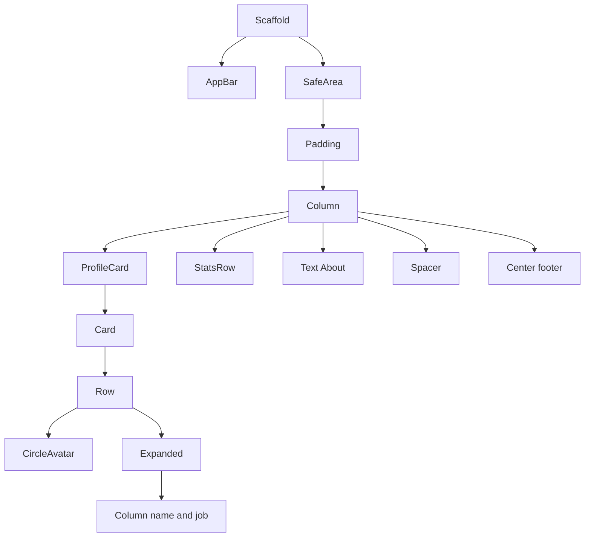

# 04. Widgets and layout

> **Draft: written but not yet run.** The code and the expected output in this lesson were prepared by reading the code and the official documentation. They have not been executed yet. If something does not behave as described, trust your tool's real output and report it.

## What you will be able to do
- Describe a screen as a tree of widgets.
- Lay widgets out with `Column`, `Row`, `Padding`, `SizedBox`, `Expanded` and `Card`.
- Split a screen into small widgets of your own.
- Explain the rule "constraints go down, sizes go up".

## Recap
1. What does `final` mean? <details><summary>Answer</summary>The variable is set once and not reassigned.</details>
2. In `Task(this.title, {this.done = false})`, which parameter is named? <details><summary>Answer</summary>`done`.</details>
3. What does `r` do in the terminal running `flutter run`? <details><summary>Answer</summary>Hot reload.</details>

## Why it matters
A screen is like a set of nested boxes: a page holds a card, the card holds a row, the row holds a picture and some text. Flutter calls every box a **widget**. Once you can read and build these nested boxes you can build any screen, because there is nothing else on a Flutter screen.

## What you will build
A profile screen: a card with an avatar, a name and a job title; a row of three statistic boxes; a short "About" text; and a footer pushed to the bottom.

## Before you start
- Lessons 01 to 03 done; the emulator or phone works (`flutter devices`).
- Time: 75-90 minutes. Five ideas: widget tree, `Column`/`Row`, spacing widgets, `Expanded`, small custom widgets.
- Source pack (optional): every file is shown in full in this lesson, so you can follow without it. The finished code, the exercise starter and the solution are in the
  course repository https://github.com/Uee03/Code101 under `source/flutter/101-zero-to-hero/phase-1-first-app/04-widgets-and-layout/` (on that page choose **Code, Download ZIP**, or run
  `git clone https://github.com/Uee03/Code101.git`).

## Steps
### Step 1. Create the project
**File: `terminal (Windows PowerShell)`**
```powershell
Set-Location "$HOME\code101\flutter101"
flutter create --platforms=android layout_lab
Set-Location layout_lab
Remove-Item -Recurse -Force test
```

**File: `terminal (macOS or Linux)`**
```bash
cd ~/code101/flutter101
flutter create --platforms=android layout_lab
cd layout_lab
rm -rf test
```
The prompt must end with `layout_lab`. If you are somewhere else, run the first line again.

### Step 2. Replace `pubspec.yaml`
Same shape as lesson 01; only the name is different.

**File: `pubspec.yaml`**
```yaml
name: layout_lab
description: Widgets and layout practice for Code101.
publish_to: none
version: 1.0.0+1

environment:
  sdk: ^3.14.0

dependencies:
  flutter:
    sdk: flutter
  material_ui: 1.11.1

dev_dependencies:
  flutter_lints: 6.0.0

flutter:
  uses-material-design: true
```

Run `flutter pub get` and wait for `Got dependencies!`.

### Step 3. Write `lib/main.dart`
Replace the whole file.

**File: `lib/main.dart`**
```dart
import 'package:material_ui/material_ui.dart';

void main() {
  runApp(const LayoutLabApp());
}

class LayoutLabApp extends StatelessWidget {
  const LayoutLabApp({super.key});

  @override
  Widget build(BuildContext context) {
    return MaterialApp(
      title: 'Layout lab',
      theme: ThemeData(
        colorScheme: ColorScheme.fromSeed(seedColor: Colors.indigo),
      ),
      home: const ProfileScreen(),
    );
  }
}

class ProfileScreen extends StatelessWidget {
  const ProfileScreen({super.key});

  @override
  Widget build(BuildContext context) {
    return Scaffold(
      appBar: AppBar(title: const Text('Layout lab')),
      body: const SafeArea(
        child: Padding(
          padding: EdgeInsets.all(16),
          child: Column(
            crossAxisAlignment: CrossAxisAlignment.start,
            children: [
              ProfileCard(),
              SizedBox(height: 16),
              StatsRow(),
              SizedBox(height: 16),
              Text('About', style: TextStyle(fontSize: 20, fontWeight: FontWeight.bold)),
              SizedBox(height: 8),
              Text('Maria builds small apps and likes tea, maps and long walks.'),
              Spacer(),
              Center(child: Text('Made with Flutter')),
            ],
          ),
        ),
      ),
    );
  }
}

class ProfileCard extends StatelessWidget {
  const ProfileCard({super.key});

  @override
  Widget build(BuildContext context) {
    return Card(
      child: Padding(
        padding: const EdgeInsets.all(16),
        child: Row(
          children: [
            const CircleAvatar(radius: 28, child: Text('MR')),
            const SizedBox(width: 16),
            Expanded(
              child: Column(
                crossAxisAlignment: CrossAxisAlignment.start,
                children: [
                  Text('Maria Rossi', style: Theme.of(context).textTheme.titleLarge),
                  const Text('Mobile developer'),
                ],
              ),
            ),
          ],
        ),
      ),
    );
  }
}

class StatsRow extends StatelessWidget {
  const StatsRow({super.key});

  @override
  Widget build(BuildContext context) {
    return const Row(
      mainAxisAlignment: MainAxisAlignment.spaceEvenly,
      children: [
        StatBox(label: 'Apps', value: '12'),
        StatBox(label: 'Followers', value: '340'),
        StatBox(label: 'Years', value: '4'),
      ],
    );
  }
}

class StatBox extends StatelessWidget {
  const StatBox({super.key, required this.label, required this.value});

  final String label;
  final String value;

  @override
  Widget build(BuildContext context) {
    return Container(
      width: 96,
      padding: const EdgeInsets.symmetric(vertical: 12),
      decoration: BoxDecoration(
        color: Theme.of(context).colorScheme.primaryContainer,
        borderRadius: BorderRadius.circular(12),
      ),
      child: Column(
        children: [
          Text(value, style: Theme.of(context).textTheme.headlineSmall),
          Text(label),
        ],
      ),
    );
  }
}
```

## Run it
**File: `terminal (folder layout_lab)`**
```text
flutter run
```
Expected result (described from the code, not yet seen): an indigo-tinted screen. At the top a card with a round avatar showing `MR`, the name "Maria Rossi" in larger type and "Mobile developer" below. Under it three rounded boxes labelled Apps (12), Followers (340) and Years (4), spread evenly across the width. Then a bold "About", one sentence, and at the very bottom the centred text "Made with Flutter".

## How it works
**The widget tree.** Every widget has one parent and may have children. This is the tree of `ProfileScreen`:



**Layout widgets.**
- `Column` stacks children top to bottom, `Row` places them left to right. Each has a **main axis** (the direction it lays out in) and a **cross axis** (the other one). `mainAxisAlignment` places children along the main axis (`spaceEvenly` spreads the free space equally); `crossAxisAlignment` aligns them across it (`start` is left in a column).
- `Padding` adds empty space inside; `SizedBox(height: 16)` is an empty box of that size used as a gap; `Spacer` is an empty box that grows to take all free space.
- `Card` is a raised rounded panel. `Container` is a box with optional size, padding, colour and rounded corners (`decoration`).
- `Expanded` makes a child of a `Row` or `Column` take the space left over. Without it, the long text in `ProfileCard` could push past the screen edge and Flutter would paint a yellow and black overflow stripe.
- `SafeArea` keeps content away from the notch and the system bars.

**Constraints go down, sizes go up.** A parent tells each child the smallest and largest size it may be (its **constraints**). The child picks a size within them and reports it. Then the parent places the child. When a layout looks wrong, ask: what did the parent allow?

**Small widgets.** Instead of one giant `build`, we made `ProfileCard`, `StatsRow` and `StatBox`. Each is a class that extends `StatelessWidget`. `StatBox` receives data through its constructor: `required this.label` means the caller must supply it. A short `build` is easy to read and Flutter can rebuild parts independently.

**`const`.** `const Text('Years')` is created once and reused. Add `const` wherever the analyzer (the checker in your editor) suggests it.

**Theme.** `Theme.of(context).textTheme.titleLarge` asks the surrounding theme for a ready-made text style, and `colorScheme.primaryContainer` for a colour from the scheme made from the seed colour. `context` is the widget's position in the tree, which is how it finds the theme above it. Lesson 08 returns to themes.

Common misconception: "I should set pixel positions." In Flutter you describe rows, columns and spacing; the layout system computes the positions for every screen size.

## Try it
Create a new project `try04` the same way as in Step 1, use the lesson `pubspec.yaml` but change `name:` to `try04`, and replace `lib/main.dart` with the starter:

**File: `exercise/starter/lib/main.dart`**
```dart
import 'package:material_ui/material_ui.dart';

void main() {
  runApp(const RecipeApp());
}

class RecipeApp extends StatelessWidget {
  const RecipeApp({super.key});

  @override
  Widget build(BuildContext context) {
    return MaterialApp(
      title: 'Recipe card',
      theme: ThemeData(
        colorScheme: ColorScheme.fromSeed(seedColor: Colors.deepOrange),
      ),
      home: Scaffold(
        appBar: AppBar(title: const Text('Recipe card')),
        body: const Padding(
          padding: EdgeInsets.all(16),
          child: Column(
            crossAxisAlignment: CrossAxisAlignment.start,
            children: [
              // TODO 1: add a Text with the dish name 'Pancakes' and a large bold style
              // TODO 2: add a SizedBox with height 8
              // TODO 3: add a Row with two Text widgets: 'Time: 20 min' and 'Serves: 4',
              //         spread apart with MainAxisAlignment.spaceBetween
            ],
          ),
        ),
      ),
    );
  }
}
```

1. **Guided:** complete the three TODOs: a bold dish title, a gap, and a row with time and servings pushed to opposite edges.
2. **Change:** add a `Card` with one sentence of instructions below the row.
3. **Stretch (optional):** turn the dish title and row into your own `RecipeHeader` widget class.

<details><summary>Solution</summary>

**File: `exercise/solution/lib/main.dart`**
```dart
import 'package:material_ui/material_ui.dart';

void main() {
  runApp(const RecipeApp());
}

class RecipeApp extends StatelessWidget {
  const RecipeApp({super.key});

  @override
  Widget build(BuildContext context) {
    return MaterialApp(
      title: 'Recipe card',
      theme: ThemeData(
        colorScheme: ColorScheme.fromSeed(seedColor: Colors.deepOrange),
      ),
      home: Scaffold(
        appBar: AppBar(title: const Text('Recipe card')),
        body: const Padding(
          padding: EdgeInsets.all(16),
          child: Column(
            crossAxisAlignment: CrossAxisAlignment.start,
            children: [
              Text(
                'Pancakes',
                style: TextStyle(fontSize: 28, fontWeight: FontWeight.bold),
              ),
              SizedBox(height: 8),
              Row(
                mainAxisAlignment: MainAxisAlignment.spaceBetween,
                children: [
                  Text('Time: 20 min'),
                  Text('Serves: 4'),
                ],
              ),
              SizedBox(height: 16),
              Card(
                child: Padding(
                  padding: EdgeInsets.all(12),
                  child: Text('Mix flour, milk and eggs. Fry until golden.'),
                ),
              ),
            ],
          ),
        ),
      ),
    );
  }
}
```

`MainAxisAlignment.spaceBetween` puts the first child at the start and the last at the end.

</details>

## Check yourself
1. How many children does a `Padding` have? <details><summary>Answer</summary>One, called `child`. `Column` and `Row` have a list called `children`.</details>
2. Which widget gives free space to a child in a `Row`? <details><summary>Answer</summary>`Expanded`.</details>
3. A row of long text overflows with a striped warning. What do you try first? <details><summary>Answer</summary>Wrap the text in `Expanded` so it wraps instead of pushing outwards.</details>
4. Why split `StatBox` into its own class? <details><summary>Answer</summary>It is reused three times and keeps `build` methods short and readable.</details>

## Common mistakes
| Symptom or error text | Cause | Fix |
|---|---|---|
| Yellow and black stripes and `A RenderFlex overflowed by ... pixels` (typical message) | A `Row` or `Column` child is larger than the space | Wrap the child in `Expanded`, shorten it, or use a scrolling list (lesson 06) |
| `The named parameter 'child' isn't defined.` (typical message) | `Column` uses `children`, not `child` | Use `children: [ ... ]` for `Column` and `Row` |
| `Invalid constant value.` (typical message) | `const` placed on a widget that uses `Theme.of(context)` | Remove `const` from that widget and from its parents |
| Red screen `Another exception was thrown ...` | Error inside `build` | Read the first line of the error in the terminal; it names the widget |
| `Spacer` has no effect | Its parent is not a `Row`/`Column` with free space | Put it directly inside a `Column` or `Row` that fills the screen |

## Best practice
Keep `build` methods small: split a widget when it grows past one screen of code, and mark widgets `const` when possible. Source: [Flutter performance best practices](https://docs.flutter.dev/perf/best-practices)

## Going further
- [Layouts in Flutter](https://docs.flutter.dev/ui/layout) and [Understanding constraints](https://docs.flutter.dev/ui/layout/constraints).

## Summary
- You read a screen as a tree of widgets and built one with `Column`, `Row`, `Card` and `Container`.
- You controlled space with `Padding`, `SizedBox`, `Spacer` and `Expanded`.
- You split the screen into your own small widgets and explained the constraints rule.

## Next lesson
05. State and setState: making the screen change when the user taps.
