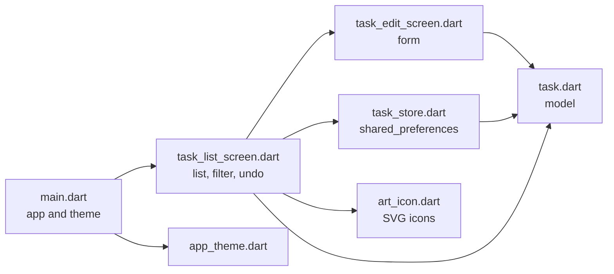

# 12. Project: a task list app

> **Draft: written but not yet run.** The code and the expected output in this lesson were prepared by reading the code and the official documentation. They have not been executed yet. If something does not behave as described, trust your tool's real output and report it.

## What you will be able to do
- Plan an app as a handful of small files, each with one job.
- Combine lists, forms, navigation, theming, SVG icons, local storage and accessibility in one app.
- Write a pure Dart function for sorting and plug it into the app.
- Say what to learn next.

## Recap
1. Which widget shows only the rows on screen? <details><summary>Answer</summary>`ListView.builder`.</details>
2. How do you hand a value back from a screen? <details><summary>Answer</summary>`Navigator.pop(context, value)`.</details>
3. Why does `_load` end with a `mounted` check? <details><summary>Answer</summary>The State may be gone after the `await`.</details>
4. Where do colours come from in a themed app? <details><summary>Answer</summary>`Theme.of(context).colorScheme`.</details>

## Why it matters
Building one complete small app proves that the pieces fit together and shows you where you still need practice. This is the app you can show someone: it keeps your tasks after the phone restarts, works in light and dark mode, and can be used with a screen reader and big fonts.

## What you will build
**Task list**: add, edit, delete and tick off tasks with a title, optional notes and a priority; filter by All, Open or Done; undo a delete; data kept on the phone.



## Before you start
- Lessons 05 to 11 finished.
- Time: 100-130 minutes, **two sittings**. Break after Step 6 (everything typed and running), do Step 7 and the exercise in the second sitting.
- Source pack (optional): every file is shown in full in this lesson, so you can follow without it. The finished code, the exercise starter and the solution are in the
  course repository https://github.com/Uee03/Code101 under `source/flutter/101-zero-to-hero/phase-3-data-and-polish/12-project-task-list/` (on that page choose **Code, Download ZIP**, or run
  `git clone https://github.com/Uee03/Code101.git`).
- This is a **new** project, not a continuation. Its theme and icon widget are the ones from lesson 08; they are repeated here in full so the project stands alone.

## Steps
### Step 1. Create the project
**File: `terminal (Windows PowerShell)`**
```powershell
Set-Location "$HOME\code101\flutter101"
flutter create --platforms=android task_list
Set-Location task_list
Remove-Item -Recurse -Force test
```

**File: `terminal (macOS or Linux)`**
```bash
cd ~/code101/flutter101
flutter create --platforms=android task_list
cd task_list
rm -rf test
```

### Step 2. `pubspec.yaml`
Replace the file, then run `flutter pub get`. It lists the packages and the four icons.

**File: `pubspec.yaml`**
```yaml
name: task_list
description: A small task list app, the project of Flutter 101.
publish_to: none
version: 1.0.0+1

environment:
  sdk: ^3.14.0

dependencies:
  flutter:
    sdk: flutter
  material_ui: 1.11.1
  flutter_svg: 2.5.0
  shared_preferences: 2.5.6

dev_dependencies:
  flutter_lints: 6.0.0

flutter:
  uses-material-design: true
  assets:
    - assets/icons/plus.svg
    - assets/icons/trash.svg
    - assets/icons/list.svg
    - assets/icons/check-circle.svg
```

### Step 3. The icons
Create the folders `assets/icons`. Put `plus.svg`, `trash.svg` and `list.svg` there exactly as in lesson 08 (copy them from that lesson, or from the source pack). The new fourth icon:

**File: `assets/icons/check-circle.svg`**
```xml
<svg xmlns="http://www.w3.org/2000/svg" viewBox="0 0 24 24" width="24" height="24" fill="none" stroke="currentColor" stroke-width="2" stroke-linecap="round" stroke-linejoin="round" role="img" aria-label="Check Circle">
  <path d="M22 11.08V12a10 10 0 1 1-5.93-9.14"/><polyline points="22 4 12 14.01 9 11.01"/>
</svg>
```

### Step 4. Theme and icon widget
These two files are the same as in lesson 08.

**File: `lib/app_theme.dart`**
```dart
import 'package:material_ui/material_ui.dart';

abstract final class AppTheme {
  static const Color seed = Color(0xFF2E7D32);

  static ThemeData light() => _build(Brightness.light);

  static ThemeData dark() => _build(Brightness.dark);

  static ThemeData _build(Brightness brightness) {
    final scheme = ColorScheme.fromSeed(
      seedColor: seed,
      brightness: brightness,
    );
    final base = ThemeData(colorScheme: scheme);
    return base.copyWith(
      textTheme: base.textTheme.copyWith(
        titleLarge: base.textTheme.titleLarge?.copyWith(
          fontWeight: FontWeight.w600,
        ),
      ),
    );
  }
}
```

**File: `lib/art_icon.dart`**
```dart
import 'package:flutter_svg/flutter_svg.dart';
import 'package:material_ui/material_ui.dart';

class ArtIcon extends StatelessWidget {
  const ArtIcon(
    this.name, {
    super.key,
    this.size = 24,
    this.color,
    this.semanticLabel,
  });

  final String name;
  final double size;
  final Color? color;
  final String? semanticLabel;

  @override
  Widget build(BuildContext context) {
    final tint = color ??
        IconTheme.of(context).color ??
        Theme.of(context).colorScheme.onSurface;
    return SvgPicture.asset(
      'assets/icons/$name.svg',
      width: size,
      height: size,
      colorFilter: ColorFilter.mode(tint, BlendMode.srcIn),
      semanticsLabel: semanticLabel,
      excludeFromSemantics: semanticLabel == null,
    );
  }
}
```

### Step 5. The model and the store
`Task` has an id, a title, notes, a priority and a done flag. It is immutable; `copyWith` makes changed copies; `toJson` and `fromJson` convert it for storage.

**File: `lib/task.dart`**
```dart
enum Priority { low, normal, high }

class Task {
  const Task({
    required this.id,
    required this.title,
    this.notes = '',
    this.priority = Priority.normal,
    this.done = false,
  });

  factory Task.fromJson(Map<String, dynamic> json) {
    final priorityName = json['priority'] as String? ?? 'normal';
    return Task(
      id: json['id'] as int,
      title: json['title'] as String,
      notes: json['notes'] as String? ?? '',
      priority: Priority.values.firstWhere(
        (value) => value.name == priorityName,
        orElse: () => Priority.normal,
      ),
      done: json['done'] as bool? ?? false,
    );
  }

  final int id;
  final String title;
  final String notes;
  final Priority priority;
  final bool done;

  Map<String, Object?> toJson() {
    return {
      'id': id,
      'title': title,
      'notes': notes,
      'priority': priority.name,
      'done': done,
    };
  }

  Task copyWith({
    String? title,
    String? notes,
    Priority? priority,
    bool? done,
  }) {
    return Task(
      id: id,
      title: title ?? this.title,
      notes: notes ?? this.notes,
      priority: priority ?? this.priority,
      done: done ?? this.done,
    );
  }
}
```

`TaskStore` saves the whole list as one JSON text, as in lesson 10.

**File: `lib/task_store.dart`**
```dart
import 'dart:convert';

import 'package:shared_preferences/shared_preferences.dart';

import 'task.dart';

class TaskStore {
  TaskStore({SharedPreferencesAsync? preferences})
      : _preferences = preferences ?? SharedPreferencesAsync();

  static const _key = 'tasks_v1';

  final SharedPreferencesAsync _preferences;

  Future<List<Task>> load() async {
    final raw = await _preferences.getString(_key);
    if (raw == null) {
      return [];
    }
    try {
      final data = jsonDecode(raw) as List<dynamic>;
      return [
        for (final entry in data) Task.fromJson(entry as Map<String, dynamic>),
      ];
    } on FormatException {
      return [];
    } on TypeError {
      return [];
    }
  }

  Future<void> save(List<Task> tasks) async {
    final raw = jsonEncode([for (final task in tasks) task.toJson()]);
    await _preferences.setString(_key, raw);
  }
}
```

### Step 6. The screens and the entry point
The edit screen is a form that returns a `Task` (lessons 06 and 07).

**File: `lib/task_edit_screen.dart`**
```dart
import 'package:material_ui/material_ui.dart';

import 'task.dart';

class TaskEditScreen extends StatefulWidget {
  const TaskEditScreen({super.key, this.task, required this.nextId});

  final Task? task;
  final int nextId;

  @override
  State<TaskEditScreen> createState() => _TaskEditScreenState();
}

class _TaskEditScreenState extends State<TaskEditScreen> {
  final _formKey = GlobalKey<FormState>();
  late final TextEditingController _titleController;
  late final TextEditingController _notesController;
  late Priority _priority;

  @override
  void initState() {
    super.initState();
    _titleController = TextEditingController(text: widget.task?.title ?? '');
    _notesController = TextEditingController(text: widget.task?.notes ?? '');
    _priority = widget.task?.priority ?? Priority.normal;
  }

  @override
  void dispose() {
    _titleController.dispose();
    _notesController.dispose();
    super.dispose();
  }

  String? _validateTitle(String? value) {
    final text = value?.trim() ?? '';
    if (text.isEmpty) {
      return 'Give the task a title';
    }
    return null;
  }

  void _save() {
    if (!_formKey.currentState!.validate()) {
      return;
    }
    Navigator.of(context).pop(
      Task(
        id: widget.task?.id ?? widget.nextId,
        title: _titleController.text.trim(),
        notes: _notesController.text.trim(),
        priority: _priority,
        done: widget.task?.done ?? false,
      ),
    );
  }

  @override
  Widget build(BuildContext context) {
    return Scaffold(
      appBar: AppBar(
        title: Text(widget.task == null ? 'New task' : 'Edit task'),
      ),
      body: SafeArea(
        child: Center(
          child: ConstrainedBox(
            constraints: const BoxConstraints(maxWidth: 560),
            child: SingleChildScrollView(
              padding: const EdgeInsets.all(16),
              child: Form(
                key: _formKey,
                child: Column(
                  crossAxisAlignment: CrossAxisAlignment.stretch,
                  children: [
                    TextFormField(
                      controller: _titleController,
                      decoration: const InputDecoration(
                        labelText: 'Title',
                        border: OutlineInputBorder(),
                      ),
                      maxLength: 60,
                      textInputAction: TextInputAction.next,
                      validator: _validateTitle,
                    ),
                    const SizedBox(height: 12),
                    TextFormField(
                      controller: _notesController,
                      decoration: const InputDecoration(
                        labelText: 'Notes (optional)',
                        border: OutlineInputBorder(),
                      ),
                      maxLines: 3,
                      maxLength: 200,
                    ),
                    const SizedBox(height: 12),
                    Text(
                      'Priority',
                      style: Theme.of(context).textTheme.titleMedium,
                    ),
                    const SizedBox(height: 8),
                    SegmentedButton<Priority>(
                      segments: const [
                        ButtonSegment(value: Priority.low, label: Text('Low')),
                        ButtonSegment(
                          value: Priority.normal,
                          label: Text('Normal'),
                        ),
                        ButtonSegment(
                          value: Priority.high,
                          label: Text('High'),
                        ),
                      ],
                      selected: {_priority},
                      onSelectionChanged: (selection) {
                        setState(() {
                          _priority = selection.first;
                        });
                      },
                    ),
                    const SizedBox(height: 24),
                    FilledButton(
                      onPressed: _save,
                      child: const Text('Save'),
                    ),
                  ],
                ),
              ),
            ),
          ),
        ),
      ),
    );
  }
}
```

The list screen owns the list, loads and saves it, filters it and opens the editor.

**File: `lib/task_list_screen.dart`**
```dart
import 'dart:async';
import 'dart:math';

import 'package:material_ui/material_ui.dart';

import 'art_icon.dart';
import 'task.dart';
import 'task_edit_screen.dart';
import 'task_store.dart';

enum TaskFilter { all, open, done }

class TaskListScreen extends StatefulWidget {
  const TaskListScreen({super.key});

  @override
  State<TaskListScreen> createState() => _TaskListScreenState();
}

class _TaskListScreenState extends State<TaskListScreen> {
  final _store = TaskStore();
  final List<Task> _tasks = [];
  TaskFilter _filter = TaskFilter.all;
  int _nextId = 1;
  bool _loaded = false;

  @override
  void initState() {
    super.initState();
    _load();
  }

  Future<void> _load() async {
    final saved = await _store.load();
    if (!mounted) {
      return;
    }
    setState(() {
      _tasks.addAll(saved);
      for (final task in saved) {
        if (task.id >= _nextId) {
          _nextId = task.id + 1;
        }
      }
      _loaded = true;
    });
  }

  void _save() {
    unawaited(_store.save(List.of(_tasks)));
  }

  List<Task> get _visible {
    switch (_filter) {
      case TaskFilter.all:
        return _tasks;
      case TaskFilter.open:
        return [
          for (final task in _tasks)
            if (!task.done) task,
        ];
      case TaskFilter.done:
        return [
          for (final task in _tasks)
            if (task.done) task,
        ];
    }
  }

  Future<void> _openEditor({Task? task}) async {
    final result = await Navigator.of(context).push<Task>(
      MaterialPageRoute(
        builder: (context) => TaskEditScreen(task: task, nextId: _nextId),
      ),
    );
    if (result == null || !mounted) {
      return;
    }
    setState(() {
      final index = _tasks.indexWhere((item) => item.id == result.id);
      if (index == -1) {
        _tasks.add(result);
        _nextId = result.id + 1;
      } else {
        _tasks[index] = result;
      }
    });
    _save();
  }

  void _setDone(Task task, bool done) {
    final index = _tasks.indexWhere((item) => item.id == task.id);
    if (index == -1) {
      return;
    }
    setState(() {
      _tasks[index] = task.copyWith(done: done);
    });
    _save();
  }

  void _delete(Task task) {
    final index = _tasks.indexWhere((item) => item.id == task.id);
    if (index == -1) {
      return;
    }
    setState(() {
      _tasks.removeAt(index);
    });
    _save();
    final messenger = ScaffoldMessenger.of(context);
    messenger.clearSnackBars();
    messenger.showSnackBar(
      SnackBar(
        content: Text('Deleted "${task.title}"'),
        action: SnackBarAction(
          label: 'Undo',
          onPressed: () {
            setState(() {
              _tasks.insert(min(index, _tasks.length), task);
            });
            _save();
          },
        ),
      ),
    );
  }

  String _priorityLabel(Priority priority) {
    switch (priority) {
      case Priority.low:
        return 'Low';
      case Priority.normal:
        return 'Normal';
      case Priority.high:
        return 'High';
    }
  }

  Widget _buildEmpty(ColorScheme colors) {
    final allDone = _filter == TaskFilter.open && _tasks.isNotEmpty;
    return Center(
      child: Column(
        mainAxisSize: MainAxisSize.min,
        children: [
          ArtIcon(
            allDone ? 'check-circle' : 'list',
            size: 48,
            color: colors.outline,
          ),
          const SizedBox(height: 8),
          Text(allDone ? 'Everything is done.' : 'No tasks here yet.'),
        ],
      ),
    );
  }

  Widget _buildTile(Task task, ColorScheme colors) {
    final subtitle = task.notes.isEmpty
        ? 'Priority: ${_priorityLabel(task.priority)}'
        : 'Priority: ${_priorityLabel(task.priority)} - ${task.notes}';
    return ListTile(
      leading: Checkbox(
        value: task.done,
        semanticLabel: 'Done: ${task.title}',
        onChanged: (value) => _setDone(task, value ?? false),
      ),
      title: Text(
        task.title,
        style: TextStyle(
          decoration:
              task.done ? TextDecoration.lineThrough : TextDecoration.none,
        ),
      ),
      subtitle: Text(subtitle, maxLines: 2, overflow: TextOverflow.ellipsis),
      trailing: IconButton(
        tooltip: 'Delete ${task.title}',
        onPressed: () => _delete(task),
        icon: ArtIcon('trash', color: colors.onSurfaceVariant),
      ),
      onTap: () => _openEditor(task: task),
    );
  }

  @override
  Widget build(BuildContext context) {
    final colors = Theme.of(context).colorScheme;
    final openCount = _tasks.where((task) => !task.done).length;
    final visible = _visible;
    return Scaffold(
      appBar: AppBar(
        title: Text('Tasks ($openCount open)'),
        backgroundColor: colors.primaryContainer,
        foregroundColor: colors.onPrimaryContainer,
      ),
      floatingActionButton: FloatingActionButton.extended(
        onPressed: () => _openEditor(),
        icon: const ArtIcon('plus'),
        label: const Text('New task'),
      ),
      body: SafeArea(
        child: !_loaded
            ? const Center(
                child: CircularProgressIndicator(
                  semanticsLabel: 'Loading your tasks',
                ),
              )
            : Center(
                child: ConstrainedBox(
                  constraints: const BoxConstraints(maxWidth: 720),
                  child: Column(
                    children: [
                      Padding(
                        padding: const EdgeInsets.all(16),
                        child: SegmentedButton<TaskFilter>(
                          segments: const [
                            ButtonSegment(
                              value: TaskFilter.all,
                              label: Text('All'),
                            ),
                            ButtonSegment(
                              value: TaskFilter.open,
                              label: Text('Open'),
                            ),
                            ButtonSegment(
                              value: TaskFilter.done,
                              label: Text('Done'),
                            ),
                          ],
                          selected: {_filter},
                          onSelectionChanged: (selection) {
                            setState(() {
                              _filter = selection.first;
                            });
                          },
                        ),
                      ),
                      Expanded(
                        child: visible.isEmpty
                            ? _buildEmpty(colors)
                            : ListView.builder(
                                padding: const EdgeInsets.only(bottom: 88),
                                itemCount: visible.length,
                                itemBuilder: (context, index) {
                                  return _buildTile(visible[index], colors);
                                },
                              ),
                      ),
                    ],
                  ),
                ),
              ),
      ),
    );
  }
}
```

Finally `lib/main.dart` ties theme and screen together.

**File: `lib/main.dart`**
```dart
import 'package:material_ui/material_ui.dart';

import 'app_theme.dart';
import 'task_list_screen.dart';

void main() {
  runApp(const TaskApp());
}

class TaskApp extends StatelessWidget {
  const TaskApp({super.key});

  @override
  Widget build(BuildContext context) {
    return MaterialApp(
      title: 'Task list',
      theme: AppTheme.light(),
      darkTheme: AppTheme.dark(),
      themeMode: ThemeMode.system,
      home: const TaskListScreen(),
    );
  }
}
```

*Good place for the break between sittings.*

## Run it
**File: `terminal (folder task_list)`**
```text
flutter run
```
Expected behaviour (described from the code, not yet seen): the title says "Tasks (0 open)", the segmented button shows All, Open and Done, the body shows a list icon and "No tasks here yet.", and an extended button "New task" with a plus floats at the bottom right. Tap it, leave the title empty and press **Save**: the message "Give the task a title" appears. Type a title, choose **High**, press **Save**: the list shows the task with "Priority: High" and the title says "Tasks (1 open)". Tick the box: the title is struck through and the title bar says "Tasks (0 open)". The **Open** filter then shows "Everything is done." Delete a task with the trash button: a bar offers **Undo**. Close the app completely and open it again: your tasks are still there.

## How it works
**One job per file.** The model knows nothing about screens; the store knows nothing about widgets; the list screen owns the data and decides what happens; the edit screen collects input and returns a value. This is the same idea as the data/view split used in level 201 (MVVM, repositories).

**Data flow.** The list screen holds `_tasks`. It passes a task to the editor (constructor), receives a new or changed task (result of `pop`) and replaces or adds it. Every change ends with `_save()`.

**Filtering without a second list.** `_visible` computes the filtered view from `_tasks` each time `build` runs. There is only one source of truth; the view cannot drift out of sync.

**Undo.** `_delete` removes the task and shows a `SnackBar` with an **Undo** action holding the removed task and its position. `min(index, _tasks.length)` keeps the position valid if the list changed meanwhile.

**Accessibility choices (lesson 11).** The checkbox has a label naming the task, the delete button has a tooltip, priority is written as text, the content is limited to 720 pixels wide so it stays readable on tablets, and the list has bottom padding so the floating button never hides the last row.

**`SegmentedButton`** shows one choice out of several; `selected` is a set (`{_filter}`) because the same widget can allow several choices.

Common misconception: "A project needs many clever pieces." This app has no new idea; it only arranges the ones you already know.

## Try it
Add sorting. Copy the starter file into the `lib` folder of your project.

**File: `exercise/starter/lib/task_sorting.dart`**
```dart
import 'task.dart';

// Exercise 12: sort the visible tasks.
// Copy this file into lib/ of your task_list project, next to task.dart.
List<Task> sortTasks(List<Task> tasks) {
  // TODO 1: return a new list (do not change the argument) where
  //         open tasks come before done tasks, and inside each group
  //         High comes before Normal before Low (use priority.index), then by title.
  //         Hint: List.of(tasks) copies a list and sort takes a compare function.
  return List.of(tasks);
}
```

1. **Guided:** implement `sortTasks` so open tasks come first, then higher priority, then alphabetical by title. Then, in `task_list_screen.dart`, change `_visible` to return `sortTasks(...)` of the filtered list (add `import 'task_sorting.dart';`). A High task added last must jump to the top of the open tasks.
2. **Change:** add a menu action "Clear done" that removes all done tasks after a confirmation dialog (`showDialog` with `AlertDialog`).
3. **Stretch (optional):** add an optional due date to `Task`, with a date picker (`showDatePicker`), stored in JSON. What does `fromJson` do for tasks saved before the field existed?

<details><summary>Solution</summary>

**File: `exercise/solution/lib/task_sorting.dart`**
```dart
import 'task.dart';

// Exercise 12: sort the visible tasks.
// Copy this file into lib/ of your task_list project, next to task.dart.
List<Task> sortTasks(List<Task> tasks) {
  final sorted = List.of(tasks);
  sorted.sort((a, b) {
    if (a.done != b.done) {
      return a.done ? 1 : -1;
    }
    final byPriority = b.priority.index.compareTo(a.priority.index);
    if (byPriority != 0) {
      return byPriority;
    }
    return a.title.toLowerCase().compareTo(b.title.toLowerCase());
  });
  return sorted;
}
```

The compare function returns a negative number when `a` should come first, positive when `b` should, and 0 when they tie. `b.priority.index.compareTo(a.priority.index)` sorts High (index 2) before Low (index 0).

</details>

## Check yourself
1. Why is the filtered list not stored in its own variable? <details><summary>Answer</summary>One source of truth avoids the two lists disagreeing.</details>
2. What does the editor return when the user taps Back? <details><summary>Answer</summary>`null`, so nothing changes.</details>
3. A user complains the last task is hidden by the button. Which line fixes it? <details><summary>Answer</summary>The bottom padding of the `ListView.builder`.</details>
4. What would you change to store tasks in a database later? <details><summary>Answer</summary>Only `TaskStore`; the screens just call `load` and `save`.</details>

## Common mistakes
| Symptom or error text | Cause | Fix |
|---|---|---|
| `Unable to load asset: "assets/icons/check-circle.svg".` (typical message) | Icon file missing or not listed | Create the file and check `pubspec.yaml` indentation |
| `Target of URI doesn't exist: 'package:shared_preferences/shared_preferences.dart'.` (typical message) | `flutter pub get` not run | Run it in the project folder |
| Tasks vanish after restart | `_save()` not called after a change | Call it after every list change |
| `The method 'sortTasks' isn't defined` (typical message) | Exercise file not copied or import missing | Copy to `lib/` and add the import |
| Undo puts the task in the wrong place | Using `add` instead of `insert` | Insert at the saved index as shown |

## Best practice
Build in thin slices: get "add and show" working first, then persistence, then polish. Commit or copy the project after each working slice. Source: [Flutter: Architecture recommendations](https://docs.flutter.dev/app-architecture/recommendations)

## Going further
- Level 201 rebuilds the same ideas with a feature-first structure, Riverpod, a generated API client, secure sign-in and an offline database.

## Summary
- You planned and built a complete small app from one-job files.
- You combined forms, lists, navigation, theming, icons, storage and accessibility.
- You added a sorting function and plugged it in.

## Next lesson
You have finished Flutter 101. Continue with **Flutter 201, lesson 01: feature-first structure and MVVM with repositories**.
