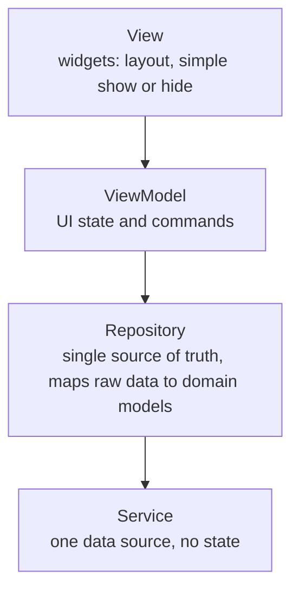

# 01. Feature-first structure and MVVM with repositories

> **Draft: written but not yet run.** The code and the expected output in this lesson were prepared by reading the code and the official documentation. They have not been executed yet. If something does not behave as described, trust your tool's real output and report it.

## What you will be able to do
- Explain the layers of the official Flutter architecture guide (view, view model, repository, service) and the one-way dependency rule between them.
- Organise a Flutter app feature-first and say what goes in each folder.
- Write a repository that maps a service's raw data to immutable domain models and returns a `Result`.
- Build a view model with `ChangeNotifier` and a view that rebuilds with `ListenableBuilder`.

## Recap
1. In the 101 task list, which file owned the list and which only converted it to JSON? <details><summary>Answer</summary>`task_list_screen.dart` owned the list; `task_store.dart` only saved and loaded it.</details>
2. What did `copyWith` give us on an immutable model? <details><summary>Answer</summary>A changed copy without mutating the original.</details>
3. What does `mounted` protect against after an `await`? <details><summary>Answer</summary>Using a State that is no longer in the tree.</details>

## Why it matters
In 101 the screen did everything: it held data, loaded it, saved it and drew it. That is fine for 300 lines. At 3,000 lines nobody can change a rule without breaking a screen, and nothing can be replaced (a real server for a fake one, a database for a file). Architecture is deciding, before the code grows, *where each kind of code lives* and *who may call whom*. This lesson uses the structure recommended in the official Flutter [app architecture guide](https://docs.flutter.dev/app-architecture/guide), and it is the structure of the Tasks and Teams capstone.

## What you will build
A small "Tasks" app with a fake in-memory data source: list tasks, add one, mark one complete, with loading and error states. The visible app is simple on purpose; the folders and the dependency rule are the lesson. Lessons 02 to 08 replace the pieces one by one (state tool, router, real API, sign-in, database) without rewriting the screens.

## Before you start
- Flutter 101 finished (or equivalent: widgets, `setState`, forms, navigation, async). Android toolchain working (`flutter doctor`, an emulator or phone).
- Audience: you have 1 to 2 years of experience. Reading this you should be asking "why this and not that"; the boxes below answer.
- Time: 70-90 minutes. The app code is about 450 lines in eleven files; reading and typing is most of the time.
- Source pack (optional): every file is shown in full in this lesson, so you can follow without it. The finished code, the exercise starter and the solution are in the
  course repository https://github.com/Uee03/Code101 under `source/flutter/201-hero-to-super-hero/phase-1-architecture-and-state/01-feature-first-and-mvvm/` (on that page choose **Code, Download ZIP**, or run
  `git clone https://github.com/Uee03/Code101.git`).
- Capstone link: this is the structure of [mobile-flutter chapter 03, Screens and state](../../../../capstones/mobile-flutter/tutorials/phase-3-screens/03-screens.md) (section 4 and 8 of its [TDD](../../../../capstones/mobile-flutter/TDD.md)).
- `pubspec.lock` is not in the source pack: `flutter pub get` creates it.

## Steps
### Step 1. Create the project
The capstone's Android namespace is `com.code101.tasks`, so we create the project with organisation `com.code101` and project name `tasks`. The folder is called `tasks_app`.

**File: `terminal (Windows PowerShell)`**
```powershell
New-Item -ItemType Directory -Force "$HOME\code101\flutter201"
Set-Location "$HOME\code101\flutter201"
flutter create --org com.code101 --project-name tasks --platforms=android tasks_app
Set-Location tasks_app
Remove-Item -Recurse -Force test
```

**File: `terminal (macOS or Linux)`**
```bash
mkdir -p ~/code101/flutter201
cd ~/code101/flutter201
flutter create --org com.code101 --project-name tasks --platforms=android tasks_app
cd tasks_app
rm -rf test
```
The prompt ends with `tasks_app`. We delete `test/` because the generated sample test refers to the sample app; this course teaches no tests.

### Step 2. The folder plan
Create these folders under `lib` (the files come next). The rule: **organise by feature, not by technical type** ("feature-first"), and keep shared data code in `data/`.



```text
lib/
  main.dart
  app/                      the app widget (later: theme, router, providers)
  core/                     shared helpers: result.dart
  data/
    models/                 immutable domain models: task.dart
    repositories/           task_repository.dart
    services/               fake_task_service.dart, task_dto.dart
  features/
    tasks/
      view/                 tasks_screen.dart, task_composer.dart
      view_model/           tasks_view_model.dart
```

The dependency rule: a view knows its view model; a view model knows repositories; a repository knows services; **never the other way**, and repositories never call each other. A feature never imports another feature's `view`.

### Step 3. `pubspec.yaml`
Replace the file, then run `flutter pub get`. Nothing new yet: only `material_ui`. `uses-material-design: false` because this course draws its own icons; the app uses no icon font.

**File: `pubspec.yaml`**
```yaml
name: tasks
description: Tasks and Teams phone client built step by step in Flutter 201.
publish_to: none
version: 1.0.0+1

environment:
  sdk: ^3.14.0

dependencies:
  flutter:
    sdk: flutter
  material_ui: 1.11.1

dev_dependencies:
  flutter_lints: 6.0.0

flutter:
  uses-material-design: false
```

### Step 4. The Result type
Instead of letting exceptions fly up through the layers, a repository returns a `Result`: either `Ok(value)` or `Err(error)`. `sealed` means the compiler knows every subtype, so a `switch` on it must handle both, or it will not compile. Create `lib/core/result.dart`.

**File: `lib/core/result.dart`**
```dart
sealed class Result<T> {
  const Result();
}

final class Ok<T> extends Result<T> {
  const Ok(this.value);

  final T value;
}

final class Err<T> extends Result<T> {
  const Err(this.error);

  final Object error;
}
```

### Step 5. The domain model
The **domain model** is the shape the app wants to work with. It is immutable, uses enums instead of strings, and knows nothing about JSON or HTTP. The `wire` strings are what the platform contract uses (`in_progress`), kept in one place. Create `lib/data/models/task.dart`.

**File: `lib/data/models/task.dart`**
```dart
enum TaskStatus {
  todo('todo', 'To do'),
  inProgress('in_progress', 'In progress'),
  blocked('blocked', 'Blocked'),
  done('done', 'Done'),
  cancelled('cancelled', 'Cancelled');

  const TaskStatus(this.wire, this.label);

  final String wire;
  final String label;

  static TaskStatus fromWire(String wire) {
    return values.firstWhere(
      (status) => status.wire == wire,
      orElse: () => TaskStatus.todo,
    );
  }
}

enum TaskPriority {
  low,
  medium,
  high,
  urgent;

  static TaskPriority fromWire(String wire) {
    return values.firstWhere(
      (priority) => priority.name == wire,
      orElse: () => TaskPriority.medium,
    );
  }
}

class Task {
  const Task({
    required this.id,
    required this.projectId,
    required this.title,
    this.description = '',
    this.status = TaskStatus.todo,
    this.priority = TaskPriority.medium,
    this.dueDate,
    this.version = 1,
    required this.createdAt,
  });

  final String id;
  final String projectId;
  final String title;
  final String description;
  final TaskStatus status;
  final TaskPriority priority;
  final String? dueDate;
  final int version;
  final DateTime createdAt;

  bool get isDone => status == TaskStatus.done;

  Task copyWith({
    String? title,
    String? description,
    TaskStatus? status,
    TaskPriority? priority,
    int? version,
  }) {
    return Task(
      id: id,
      projectId: projectId,
      title: title ?? this.title,
      description: description ?? this.description,
      status: status ?? this.status,
      priority: priority ?? this.priority,
      dueDate: dueDate,
      version: version ?? this.version,
      createdAt: createdAt,
    );
  }
}
```

### Step 6. The service and its raw data
A **service** wraps one data source and has no state of its own that the app depends on. Here it is an in-memory fake that waits 300 ms like a network would. Its raw data type, a **DTO** (data transfer object), mirrors what comes over the wire: plain strings. Create `lib/data/services/task_dto.dart`:

**File: `lib/data/services/task_dto.dart`**
```dart
class TaskDto {
  const TaskDto({
    required this.id,
    required this.projectId,
    required this.title,
    required this.description,
    required this.status,
    required this.priority,
    required this.dueDate,
    required this.version,
    required this.createdAt,
  });

  final String id;
  final String projectId;
  final String title;
  final String description;
  final String status;
  final String priority;
  final String? dueDate;
  final int version;
  final DateTime createdAt;
}
```

and `lib/data/services/fake_task_service.dart`:

**File: `lib/data/services/fake_task_service.dart`**
```dart
import 'task_dto.dart';

const demoProjectId = 'demo-project';

class FakeTaskService {
  final List<TaskDto> _tasks = [
    TaskDto(
      id: 't1',
      projectId: demoProjectId,
      title: 'Read the Flutter architecture guide',
      description: 'Views, view models, repositories and services.',
      status: 'todo',
      priority: 'high',
      dueDate: null,
      version: 1,
      createdAt: DateTime.utc(2026, 11, 1),
    ),
    TaskDto(
      id: 't2',
      projectId: demoProjectId,
      title: 'Sketch the screens',
      description: '',
      status: 'in_progress',
      priority: 'medium',
      dueDate: '2026-12-01',
      version: 2,
      createdAt: DateTime.utc(2026, 11, 2),
    ),
    TaskDto(
      id: 't3',
      projectId: demoProjectId,
      title: 'Set up the project folders',
      description: '',
      status: 'done',
      priority: 'low',
      dueDate: null,
      version: 3,
      createdAt: DateTime.utc(2026, 11, 3),
    ),
  ];
  int _nextId = 4;

  Future<void> _pause() {
    return Future<void>.delayed(const Duration(milliseconds: 300));
  }

  Future<List<TaskDto>> listTasks(String projectId) async {
    await _pause();
    return [
      for (final task in _tasks)
        if (task.projectId == projectId) task,
    ];
  }

  Future<TaskDto> getTask(String id) async {
    await _pause();
    final found = _tasks.where((task) => task.id == id);
    if (found.isEmpty) {
      throw Exception('Task $id was not found.');
    }
    return found.first;
  }

  Future<TaskDto> createTask(
    String projectId, {
    required String title,
    required String description,
  }) async {
    await _pause();
    final task = TaskDto(
      id: 't${_nextId++}',
      projectId: projectId,
      title: title,
      description: description,
      status: 'todo',
      priority: 'medium',
      dueDate: null,
      version: 1,
      createdAt: DateTime.now().toUtc(),
    );
    _tasks.insert(0, task);
    return task;
  }

  Future<TaskDto> completeTask(String id) async {
    await _pause();
    final index = _tasks.indexWhere((task) => task.id == id);
    if (index == -1) {
      throw Exception('Task $id was not found.');
    }
    final old = _tasks[index];
    final done = TaskDto(
      id: old.id,
      projectId: old.projectId,
      title: old.title,
      description: old.description,
      status: 'done',
      priority: old.priority,
      dueDate: old.dueDate,
      version: old.version + 1,
      createdAt: old.createdAt,
    );
    _tasks[index] = done;
    return done;
  }
}
```

### Step 7. The repository
The **repository** is the single source of truth for tasks. It calls the service, turns DTOs into domain models (`_toTask`), and catches exceptions into `Err`. Everything above it sees `Task` and `Result`, never a DTO. Create `lib/data/repositories/task_repository.dart`.

**File: `lib/data/repositories/task_repository.dart`**
```dart
import '../../core/result.dart';
import '../models/task.dart';
import '../services/fake_task_service.dart';
import '../services/task_dto.dart';

class TaskRepository {
  TaskRepository(this._service);

  final FakeTaskService _service;

  Future<Result<List<Task>>> loadTasks(String projectId) async {
    try {
      final dtos = await _service.listTasks(projectId);
      return Ok([for (final dto in dtos) _toTask(dto)]);
    } on Exception catch (error) {
      return Err(error);
    }
  }

  Future<Result<Task>> getTask(String id) async {
    try {
      return Ok(_toTask(await _service.getTask(id)));
    } on Exception catch (error) {
      return Err(error);
    }
  }

  Future<Result<Task>> createTask(
    String projectId, {
    required String title,
    String description = '',
  }) async {
    try {
      final dto = await _service.createTask(
        projectId,
        title: title,
        description: description,
      );
      return Ok(_toTask(dto));
    } on Exception catch (error) {
      return Err(error);
    }
  }

  Future<Result<Task>> completeTask(Task task) async {
    try {
      return Ok(_toTask(await _service.completeTask(task.id)));
    } on Exception catch (error) {
      return Err(error);
    }
  }

  Task _toTask(TaskDto dto) {
    return Task(
      id: dto.id,
      projectId: dto.projectId,
      title: dto.title,
      description: dto.description,
      status: TaskStatus.fromWire(dto.status),
      priority: TaskPriority.fromWire(dto.priority),
      dueDate: dto.dueDate,
      version: dto.version,
      createdAt: dto.createdAt,
    );
  }
}
```

### Step 8. The view model
A **view model** holds what the screen needs (a list, a loading flag, an error text) and offers **commands** (`load`, `add`, `complete`) the view calls. It extends `ChangeNotifier`: after changing state it calls `notifyListeners()` and the view rebuilds. The `switch` over `Result` uses Dart 3 pattern matching. Create `lib/features/tasks/view_model/tasks_view_model.dart`.

**File: `lib/features/tasks/view_model/tasks_view_model.dart`**
```dart
import 'package:flutter/foundation.dart';

import '../../../core/result.dart';
import '../../../data/models/task.dart';
import '../../../data/repositories/task_repository.dart';

class TasksViewModel extends ChangeNotifier {
  TasksViewModel({
    required TaskRepository repository,
    required this.projectId,
  }) : _repository = repository;

  final TaskRepository _repository;
  final String projectId;

  List<Task> _tasks = const [];
  bool _loading = false;
  String? _error;

  List<Task> get tasks => _tasks;
  bool get loading => _loading;
  String? get error => _error;

  Future<void> load() async {
    _loading = true;
    _error = null;
    notifyListeners();
    final result = await _repository.loadTasks(projectId);
    switch (result) {
      case Ok(value: final loaded):
        _tasks = loaded;
      case Err(error: final failure):
        _error = failure.toString();
    }
    _loading = false;
    notifyListeners();
  }

  /// Returns null on success, or a message for the view to show.
  Future<String?> add(String title) async {
    final result = await _repository.createTask(projectId, title: title);
    switch (result) {
      case Ok(value: final created):
        _tasks = [created, ..._tasks];
        notifyListeners();
        return null;
      case Err(error: final failure):
        return failure.toString();
    }
  }

  Future<String?> complete(Task task) async {
    final result = await _repository.completeTask(task);
    switch (result) {
      case Ok(value: final updated):
        _tasks = [
          for (final item in _tasks)
            if (item.id == updated.id) updated else item,
        ];
        notifyListeners();
        return null;
      case Err(error: final failure):
        return failure.toString();
    }
  }
}
```

### Step 9. The views
The view contains no data logic: it asks the view model, shows what it says, and forwards user actions. Create `lib/features/tasks/view/task_composer.dart` (the add form) and `lib/features/tasks/view/tasks_screen.dart`.

**File: `lib/features/tasks/view/task_composer.dart`**
```dart
import 'package:material_ui/material_ui.dart';

class TaskComposer extends StatefulWidget {
  const TaskComposer({super.key, required this.onSubmit});

  final Future<void> Function(String title) onSubmit;

  @override
  State<TaskComposer> createState() => _TaskComposerState();
}

class _TaskComposerState extends State<TaskComposer> {
  final _controller = TextEditingController();
  String? _error;

  @override
  void dispose() {
    _controller.dispose();
    super.dispose();
  }

  Future<void> _submit() async {
    final title = _controller.text.trim();
    if (title.isEmpty) {
      setState(() {
        _error = 'Enter a title';
      });
      return;
    }
    setState(() {
      _error = null;
    });
    await widget.onSubmit(title);
    if (!mounted) {
      return;
    }
    _controller.clear();
  }

  @override
  Widget build(BuildContext context) {
    return Padding(
      padding: const EdgeInsets.all(16),
      child: Row(
        crossAxisAlignment: CrossAxisAlignment.start,
        children: [
          Expanded(
            child: TextField(
              controller: _controller,
              decoration: InputDecoration(
                labelText: 'New task',
                border: const OutlineInputBorder(),
                errorText: _error,
              ),
              textInputAction: TextInputAction.done,
              onSubmitted: (_) => _submit(),
            ),
          ),
          const SizedBox(width: 8),
          FilledButton(onPressed: _submit, child: const Text('Add')),
        ],
      ),
    );
  }
}
```

**File: `lib/features/tasks/view/tasks_screen.dart`**
```dart
import 'package:material_ui/material_ui.dart';

import '../../../data/models/task.dart';
import '../view_model/tasks_view_model.dart';
import 'task_composer.dart';

class TasksScreen extends StatefulWidget {
  const TasksScreen({super.key, required this.viewModel});

  final TasksViewModel viewModel;

  @override
  State<TasksScreen> createState() => _TasksScreenState();
}

class _TasksScreenState extends State<TasksScreen> {
  @override
  void initState() {
    super.initState();
    widget.viewModel.load();
  }

  void _showMessage(String? message) {
    if (message == null || !mounted) {
      return;
    }
    ScaffoldMessenger.of(context).showSnackBar(
      SnackBar(content: Text(message)),
    );
  }

  Future<void> _add(String title) async {
    _showMessage(await widget.viewModel.add(title));
  }

  Future<void> _complete(Task task) async {
    _showMessage(await widget.viewModel.complete(task));
  }

  @override
  Widget build(BuildContext context) {
    return Scaffold(
      appBar: AppBar(title: const Text('Tasks')),
      body: Column(
        children: [
          TaskComposer(onSubmit: _add),
          Expanded(
            child: ListenableBuilder(
              listenable: widget.viewModel,
              builder: (context, _) => _buildBody(widget.viewModel),
            ),
          ),
        ],
      ),
    );
  }

  Widget _buildBody(TasksViewModel viewModel) {
    if (viewModel.loading && viewModel.tasks.isEmpty) {
      return const Center(child: CircularProgressIndicator());
    }
    if (viewModel.error != null) {
      return Center(
        child: Column(
          mainAxisSize: MainAxisSize.min,
          children: [
            Text(viewModel.error!),
            const SizedBox(height: 12),
            FilledButton(
              onPressed: viewModel.load,
              child: const Text('Try again'),
            ),
          ],
        ),
      );
    }
    if (viewModel.tasks.isEmpty) {
      return const Center(child: Text('No tasks yet.'));
    }
    return ListView.builder(
      itemCount: viewModel.tasks.length,
      itemBuilder: (context, index) {
        final task = viewModel.tasks[index];
        return ListTile(
          title: Text(task.title),
          subtitle: Text(task.status.label),
          trailing: task.isDone
              ? null
              : TextButton(
                  onPressed: () => _complete(task),
                  child: const Text('Complete'),
                ),
        );
      },
    );
  }
}
```

### Step 10. The app and the entry point
`TasksApp` wires the objects together by hand: service into repository into view model into screen. Doing this by hand is called **constructor injection**; lesson 02 replaces the hand-wiring by Riverpod. Create `lib/app/app.dart` and replace `lib/main.dart`.

**File: `lib/app/app.dart`**
```dart
import 'package:material_ui/material_ui.dart';

import '../data/repositories/task_repository.dart';
import '../data/services/fake_task_service.dart';
import '../features/tasks/view/tasks_screen.dart';
import '../features/tasks/view_model/tasks_view_model.dart';

class TasksApp extends StatefulWidget {
  const TasksApp({super.key});

  @override
  State<TasksApp> createState() => _TasksAppState();
}

class _TasksAppState extends State<TasksApp> {
  late final TasksViewModel _viewModel;

  @override
  void initState() {
    super.initState();
    final repository = TaskRepository(FakeTaskService());
    _viewModel = TasksViewModel(
      repository: repository,
      projectId: demoProjectId,
    );
  }

  @override
  void dispose() {
    _viewModel.dispose();
    super.dispose();
  }

  @override
  Widget build(BuildContext context) {
    return MaterialApp(
      title: 'Tasks and Teams',
      theme: ThemeData(
        colorScheme: ColorScheme.fromSeed(seedColor: const Color(0xff17467c)),
        materialTapTargetSize: MaterialTapTargetSize.padded,
      ),
      home: TasksScreen(viewModel: _viewModel),
    );
  }
}
```

**File: `lib/main.dart`**
```dart
import 'package:material_ui/material_ui.dart';

import 'app/app.dart';

void main() {
  runApp(const TasksApp());
}
```

## Run it
**File: `terminal (folder tasks_app)`**
```text
flutter run
```
Expected behaviour (described from the code, not yet seen): a short spinner (300 ms), then three tasks: "Read the Flutter architecture guide" (To do, with a **Complete** button), "Sketch the screens" (In progress, **Complete**) and "Set up the project folders" (Done, no button). Type "Buy milk" and press **Add**: after a short pause it appears at the top as "To do". Press **Complete** on it: its status text becomes "Done" and the button disappears. An empty title shows "Enter a title" under the field and nothing is added.

## How it works
**Why layers.** Each layer has one reason to change. The view changes when the design changes; the view model when the screen's behaviour changes; the repository when the way data is fetched or cached changes; the service when the server or file format changes. In lesson 04 we replace `FakeTaskService` by a generated API client: `TaskRepository` changes (it maps the new DTOs), the view model and the views do not. In lesson 07 the repository starts reading from a local database: again, nothing above it changes.

**One-way data flow.** State flows down (repository, view model, view). Events flow up (tap, command, repository call). The view never edits the list: it calls `viewModel.complete(task)` and rebuilds when the view model says so.

**Immutable models.** `Task` has only final fields, so a screen can never change a task behind the repository's back. `copyWith` creates changed copies.

**DTO versus model.** A DTO mirrors an external format and changes when the server does. A model mirrors what the app means. The mapping function is the only place that knows both. If the server renames `in_progress` the app changes in one function.

**Result versus exceptions.** `Result` makes failure part of the function's type: a caller cannot forget it, because the `switch` will not compile without an `Err` branch. Exceptions are kept for truly unexpected errors.

**ChangeNotifier and ListenableBuilder.** `ChangeNotifier` is Flutter's built-in observable object. `ListenableBuilder(listenable: ..., builder: ...)` rebuilds its subtree when the object notifies. This is exactly what the official architecture guide uses for view models. It has two costs we will remove: you must create and dispose the objects yourself (`TasksApp` does it), and sharing a view model between screens needs passing it down by hand.

### Why this, not that
| Choice | Alternative | Why we chose it |
|---|---|---|
| MVVM with repositories | MVC, or "logic in the widget" | The Flutter team's guide recommends it; views stay thin; view models are plain Dart and easy to swap or fake. |
| Feature-first folders (`features/tasks/...`) | Layer-first (`views/`, `models/`, ...) | Everything for one feature is in one place, features can be added or removed as units, and the folder tree matches the screens list. Shared data stays in `data/` because several features use it. |
| No domain (use case) layer | Use cases between view model and repository | Add one only when logic merges several repositories or is reused by several view models. Nothing here does, and extra layers cost boilerplate. |
| `Result` | Throwing exceptions | Failure is visible in the type; `sealed` makes the compiler check every branch. |
| `ChangeNotifier` now, Riverpod next | Riverpod from the start | You see the problem Riverpod solves (object lifetime and wiring) before you adopt the tool. |

Common misconception: "MVVM needs a package." It needs a convention: where code lives and who may call whom. The package only helps with wiring.

## Try it
Make a folder `try01`, put the starter's `main.dart` there, and run `dart run main.dart` (plain Dart, no Flutter needed). It is the same layering in miniature.

**File: `exercise/starter/main.dart`**
```dart
// Exercise 01: layers without Flutter. Run with: dart run main.dart

sealed class Result<T> {
  const Result();
}

final class Ok<T> extends Result<T> {
  const Ok(this.value);

  final T value;
}

final class Err<T> extends Result<T> {
  const Err(this.error);

  final Object error;
}

class Task {
  const Task({required this.id, required this.title, required this.done});

  final String id;
  final String title;
  final bool done;
}

class FakeService {
  FakeService({this.fail = false});

  final bool fail;

  Future<List<Map<String, Object?>>> fetch() async {
    if (fail) {
      throw Exception('service unavailable');
    }
    return [
      {'id': 'a', 'title': 'Write notes', 'done': true},
      {'id': 'b', 'title': 'Call Sam', 'done': false},
      {'id': 'c', 'title': 'Plan trip', 'done': false},
    ];
  }
}

class TaskRepository {
  TaskRepository(this._service);

  final FakeService _service;

  Future<Result<List<Task>>> load() async {
    // TODO 1: call _service.fetch(), turn each map into a Task and return Ok(list).
    //         When the service throws an Exception, return Err(error) instead.
    return const Ok([]);
  }
}

class SummaryViewModel {
  SummaryViewModel(this._repository);

  final TaskRepository _repository;
  String text = 'not loaded';

  Future<void> load() async {
    final result = await _repository.load();
    // TODO 2: switch on result. For Ok set text to '<open> open of <total>'
    //         (open means not done). For Err set text to 'Error: <error>'.
    text = '$result';
  }
}

Future<void> main() async {
  final good = SummaryViewModel(TaskRepository(FakeService()));
  await good.load();
  print(good.text);
  final bad = SummaryViewModel(TaskRepository(FakeService(fail: true)));
  await bad.load();
  print(bad.text);
}
```

1. **Guided:** complete TODO 1 (the repository maps rows to `Task` and returns `Err` for an `Exception`) and TODO 2 (the view model turns a `Result` into text). Expected output:
```text
2 open of 3
Error: Exception: service unavailable
```
2. **Change:** add a `Future<Result<Task>> byId(String id)` method to the repository that returns `Err(Exception('not found'))` for an unknown id.
3. **Stretch (optional):** which layer would own "tasks older than 30 days are archived"? Write down your choice and one reason, then check the guide's section on the domain layer.

<details><summary>Solution</summary>

**File: `exercise/solution/main.dart`**
```dart
// Exercise 01: layers without Flutter. Run with: dart run main.dart

sealed class Result<T> {
  const Result();
}

final class Ok<T> extends Result<T> {
  const Ok(this.value);

  final T value;
}

final class Err<T> extends Result<T> {
  const Err(this.error);

  final Object error;
}

class Task {
  const Task({required this.id, required this.title, required this.done});

  final String id;
  final String title;
  final bool done;
}

class FakeService {
  FakeService({this.fail = false});

  final bool fail;

  Future<List<Map<String, Object?>>> fetch() async {
    if (fail) {
      throw Exception('service unavailable');
    }
    return [
      {'id': 'a', 'title': 'Write notes', 'done': true},
      {'id': 'b', 'title': 'Call Sam', 'done': false},
      {'id': 'c', 'title': 'Plan trip', 'done': false},
    ];
  }
}

class TaskRepository {
  TaskRepository(this._service);

  final FakeService _service;

  Future<Result<List<Task>>> load() async {
    try {
      final rows = await _service.fetch();
      return Ok([
        for (final row in rows)
          Task(
            id: row['id'] as String,
            title: row['title'] as String,
            done: row['done'] as bool,
          ),
      ]);
    } on Exception catch (error) {
      return Err(error);
    }
  }
}

class SummaryViewModel {
  SummaryViewModel(this._repository);

  final TaskRepository _repository;
  String text = 'not loaded';

  Future<void> load() async {
    final result = await _repository.load();
    switch (result) {
      case Ok(value: final tasks):
        final open = tasks.where((task) => !task.done).length;
        text = '$open open of ${tasks.length}';
      case Err(error: final failure):
        text = 'Error: $failure';
    }
  }
}

Future<void> main() async {
  final good = SummaryViewModel(TaskRepository(FakeService()));
  await good.load();
  print(good.text);
  final bad = SummaryViewModel(TaskRepository(FakeService(fail: true)));
  await bad.load();
  print(bad.text);
}
```

The repository catches the exception and returns `Err`; the view model never sees an exception.

</details>

## Check yourself
1. Which layer may import which? Draw the arrows. <details><summary>Answer</summary>View to view model to repository to service. Never upward, and repositories do not import each other.</details>
2. Why does the repository return `Task`, not `TaskDto`? <details><summary>Answer</summary>So no code above the repository depends on the server's format; only the mapping function changes when the format does.</details>
3. What does `sealed` give a `switch` on `Result`? <details><summary>Answer</summary>Exhaustiveness: the code does not compile if the `Err` branch is missing.</details>
4. Predict: what happens to the screen if `load` throws an uncaught exception inside the view model? <details><summary>Answer</summary>`_loading` stays true and the spinner never goes away; that is why the repository catches and returns `Err`.</details>

## Common mistakes
| Symptom or error text | Cause | Fix |
|---|---|---|
| `The type 'Result<List<Task>>' is not exhaustively matched by the switch cases.` (typical message) | A `switch` on `Result` misses `Ok` or `Err` | Add the missing case |
| `A ChangeNotifier was used after being disposed.` (typical message) | Using the view model after `TasksApp` disposed it | Dispose only in the owning State's `dispose` |
| `setState() or markNeedsBuild() called during build.` (typical message) | `notifyListeners()` called inside `build` | Call commands from `initState` or event handlers |
| `Target of URI doesn't exist` (typical message) | A relative import path with the wrong number of `../` | Count folder levels from the importing file |
| Nothing happens on **Add** | The title is empty or the future threw | Read the snackbar message and the terminal |

## Best practice
Keep views free of data logic, give every data type one repository, and let dependencies point only downward. Source: [Guide to app architecture](https://docs.flutter.dev/app-architecture/guide) and [Architecture recommendations](https://docs.flutter.dev/app-architecture/recommendations)

## Going further
- Read the [case study](https://docs.flutter.dev/app-architecture/case-study) of the Compass app for the same structure at larger scale.
- Capstone chapter 03 shows the ten screens of the full app on this structure.

## Summary
- You separated view, view model, repository and service and followed the one-way dependency rule.
- You organised the code feature-first and kept shared data code in `data/`.
- You wrote a repository that maps DTOs to immutable models and returns `Result`.
- You built a `ChangeNotifier` view model and a view that rebuilds from it.

## Next lesson
02. State with Riverpod: remove the hand-written wiring and the manual `dispose` with one tool for state and dependency injection.
