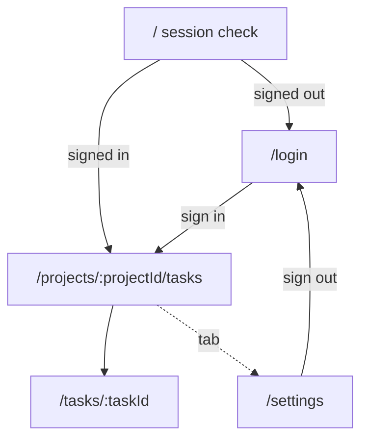

# 03. Navigation with go_router

> **Draft: written but not yet run.** The code and the expected output in this lesson were prepared by reading the code and the official documentation. They have not been executed yet. If something does not behave as described, trust your tool's real output and report it.

## What you will be able to do
- Declare an app's routes as a table with path parameters, and move with `go` and `push`.
- Add a bottom navigation bar whose tabs keep their own state (`StatefulShellRoute`).
- Guard routes with `redirect` driven by a Riverpod provider, and return to the intended page after sign-in.
- Explain the difference between `go` and `push`, and why an in-app "return to" target must be validated.

## Recap
1. Why does `ref.watch` belong in `build` and `ref.read` in `onPressed`? <details><summary>Answer</summary>Watching subscribes to changes; reading takes the value once at the moment of the event.</details>
2. What does `tasks.when(loading, error, data)` force you to do? <details><summary>Answer</summary>Render all three states.</details>
3. In 101 how did a screen return a value? <details><summary>Answer</summary>`Navigator.pop(context, value)`.</details>

## Why it matters
`Navigator.push` from 101 is an imperative stack: fine for two screens. A real app has a sign-in wall, tabs that remember where you were, links that open a specific task from outside the app, and screens that must be reachable by name. A **router** is a table of locations plus rules (the redirects) that decide, for every location, what to show. `go_router` is maintained by the Flutter team and is the capstone's router.

## What you will build
The Tasks app grows a shell: a splash screen that checks the session, a login screen, a two-tab shell (Tasks and Settings) and a task detail screen. A demo sign-in toggles the guard; real sign-in replaces it in lesson 06. Opening any protected location while signed out sends you to login and returns you there afterwards.



## Before you start
- Lesson 02 finished: continue in `tasks_app`.
- Time: 75-95 minutes.
- Source pack (optional): every file is shown in full in this lesson, so you can follow without it. The finished code, the exercise starter and the solution are in the
  course repository https://github.com/Uee03/Code101 under `source/flutter/201-hero-to-super-hero/phase-1-architecture-and-state/03-navigation-with-go-router/` (on that page choose **Code, Download ZIP**, or run
  `git clone https://github.com/Uee03/Code101.git`).
- Unchanged from lesson 02 and not repeated: `lib/main.dart`, `lib/core/result.dart`, `lib/data/models/task.dart`, `lib/data/services/task_dto.dart`, `lib/data/services/fake_task_service.dart`, `lib/data/repositories/task_repository.dart`, `lib/features/tasks/view_model/tasks_view_model.dart`, `lib/features/tasks/view/task_composer.dart`.
- Two icons from the CC0 art library (`ui/list`, `ui/settings`) are needed: copy `list.svg` and `settings.svg` from the course repository folder `assets/art/icons/ui/` (or from this lesson's source pack) into `assets/icons/`, plus `LICENSE-ICONS-CC0.txt` into `assets/`. They are not shown again; they are the same files as in Flutter 101 lesson 08 (`list`) and the standard settings gear.
- Capstone link: [mobile-flutter chapter 02](../../../../capstones/mobile-flutter/tutorials/phase-2-auth/02-auth.md) uses this router with real sign-in and an Android deep link.

## Steps
### Step 1. `pubspec.yaml`
Replace the file: adds `go_router` and `flutter_svg` and lists the two icons. Run `flutter pub get`.

**File: `pubspec.yaml`**
```yaml
name: tasks
description: Tasks and Teams phone client built step by step in Flutter 201.
publish_to: none
version: 1.0.0+1

environment:
  sdk: ^3.14.0

dependencies:
  flutter:
    sdk: flutter
  material_ui: 1.11.1
  flutter_riverpod: 3.5.0
  go_router: 18.1.4
  flutter_svg: 2.5.0

dev_dependencies:
  flutter_lints: 6.0.0

flutter:
  uses-material-design: false
  assets:
    - assets/icons/list.svg
    - assets/icons/settings.svg
```

### Step 2. The icon widget
The same `ArtIcon` as in Flutter 101 lesson 08, now in `lib/core/widgets/art_icon.dart`. It draws a bundled SVG tinted with the current icon colour.

**File: `lib/core/widgets/art_icon.dart`**
```dart
import 'package:flutter_svg/flutter_svg.dart';
import 'package:material_ui/material_ui.dart';

class ArtIcon extends StatelessWidget {
  const ArtIcon(
    this.name, {
    super.key,
    this.size = 24,
    this.color,
    this.semanticLabel,
  });

  final String name;
  final double size;
  final Color? color;
  final String? semanticLabel;

  @override
  Widget build(BuildContext context) {
    final tint = color ??
        IconTheme.of(context).color ??
        Theme.of(context).colorScheme.onSurface;
    return SvgPicture.asset(
      'assets/icons/$name.svg',
      width: size,
      height: size,
      colorFilter: ColorFilter.mode(tint, BlendMode.srcIn),
      semanticsLabel: semanticLabel,
      excludeFromSemantics: semanticLabel == null,
    );
  }
}
```

### Step 3. A demo sign-in state and the default project
First `lib/app/providers.dart` gets one more provider: which project to open after sign-in (the router must not know about the fake service).

**File: `lib/app/providers.dart`**
```dart
import 'package:flutter_riverpod/flutter_riverpod.dart';

import '../data/repositories/task_repository.dart';
import '../data/services/fake_task_service.dart';

final taskServiceProvider = Provider<FakeTaskService>(
  (ref) => FakeTaskService(),
);

final taskRepositoryProvider = Provider<TaskRepository>(
  (ref) => TaskRepository(ref.watch(taskServiceProvider)),
);

/// The project shown after sign-in. Lesson 04 reads it from build configuration.
final defaultProjectIdProvider = Provider<String>((ref) => demoProjectId);
```

The router needs to know whether the user is signed in. `AuthStatus.unknown` is the "session check" moment at start; the controller resolves it after 600 ms (lesson 06 reads real stored tokens instead). Create `lib/features/login/view_model/auth_controller.dart`.

**File: `lib/features/login/view_model/auth_controller.dart`**
```dart
import 'dart:async';

import 'package:flutter_riverpod/flutter_riverpod.dart';

enum AuthStatus { unknown, signedOut, signedIn }

final authControllerProvider = NotifierProvider<AuthController, AuthStatus>(
  AuthController.new,
);

/// Demo version: lesson 06 replaces it with real OIDC sign-in.
class AuthController extends Notifier<AuthStatus> {
  @override
  AuthStatus build() {
    unawaited(_restore());
    return AuthStatus.unknown;
  }

  Future<void> _restore() async {
    await Future<void>.delayed(const Duration(milliseconds: 600));
    if (!ref.mounted) {
      return;
    }
    state = AuthStatus.signedOut;
  }

  void signInDemo() {
    state = AuthStatus.signedIn;
  }

  void signOut() {
    state = AuthStatus.signedOut;
  }
}
```

### Step 4. The login and session screens
`lib/features/login/view/login_screen.dart` and `lib/features/login/view/session_check_screen.dart`:

**File: `lib/features/login/view/login_screen.dart`**
```dart
import 'package:flutter_riverpod/flutter_riverpod.dart';
import 'package:material_ui/material_ui.dart';

import '../view_model/auth_controller.dart';

class LoginScreen extends ConsumerWidget {
  const LoginScreen({super.key});

  @override
  Widget build(BuildContext context, WidgetRef ref) {
    return Scaffold(
      body: SafeArea(
        child: Center(
          child: Padding(
            padding: const EdgeInsets.all(24),
            child: Column(
              mainAxisSize: MainAxisSize.min,
              children: [
                Text(
                  'Tasks and Teams',
                  style: Theme.of(context).textTheme.headlineMedium,
                ),
                const SizedBox(height: 8),
                const Text('Sign in to see your tasks.'),
                const SizedBox(height: 24),
                FilledButton(
                  onPressed: () =>
                      ref.read(authControllerProvider.notifier).signInDemo(),
                  child: const Text('Sign in (demo)'),
                ),
              ],
            ),
          ),
        ),
      ),
    );
  }
}
```

**File: `lib/features/login/view/session_check_screen.dart`**
```dart
import 'package:material_ui/material_ui.dart';

class SessionCheckScreen extends StatelessWidget {
  const SessionCheckScreen({super.key});

  @override
  Widget build(BuildContext context) {
    return const Scaffold(
      body: Center(
        child: CircularProgressIndicator(semanticsLabel: 'Checking your session'),
      ),
    );
  }
}
```

### Step 5. Settings and task detail
`lib/features/settings/view/settings_screen.dart` has the sign-out button.

**File: `lib/features/settings/view/settings_screen.dart`**
```dart
import 'package:flutter_riverpod/flutter_riverpod.dart';
import 'package:material_ui/material_ui.dart';

import '../../login/view_model/auth_controller.dart';

class SettingsScreen extends ConsumerWidget {
  const SettingsScreen({super.key});

  @override
  Widget build(BuildContext context, WidgetRef ref) {
    return Scaffold(
      appBar: AppBar(title: const Text('Settings')),
      body: ListView(
        children: [
          const ListTile(
            title: Text('Account'),
            subtitle: Text('Signed in (demo)'),
          ),
          Padding(
            padding: const EdgeInsets.all(16),
            child: Align(
              alignment: Alignment.centerLeft,
              child: OutlinedButton(
                onPressed: () =>
                    ref.read(authControllerProvider.notifier).signOut(),
                child: const Text('Sign out'),
              ),
            ),
          ),
        ],
      ),
    );
  }
}
```

The detail screen reads one task through a `FutureProvider.family`. Create `lib/features/task_detail/view_model/task_detail_view_model.dart` and `lib/features/task_detail/view/task_detail_screen.dart`.

**File: `lib/features/task_detail/view_model/task_detail_view_model.dart`**
```dart
import 'package:flutter_riverpod/flutter_riverpod.dart';

import '../../../app/providers.dart';
import '../../../core/result.dart';
import '../../../data/models/task.dart';

final taskDetailProvider = FutureProvider.family<Task, String>((
  ref,
  taskId,
) async {
  final result = await ref.watch(taskRepositoryProvider).getTask(taskId);
  switch (result) {
    case Ok(value: final task):
      return task;
    case Err(error: final failure):
      throw failure;
  }
});
```

**File: `lib/features/task_detail/view/task_detail_screen.dart`**
```dart
import 'package:flutter_riverpod/flutter_riverpod.dart';
import 'package:material_ui/material_ui.dart';

import '../view_model/task_detail_view_model.dart';

class TaskDetailScreen extends ConsumerWidget {
  const TaskDetailScreen({super.key, required this.taskId});

  final String taskId;

  @override
  Widget build(BuildContext context, WidgetRef ref) {
    final task = ref.watch(taskDetailProvider(taskId));
    return Scaffold(
      appBar: AppBar(title: const Text('Task')),
      body: task.when(
        loading: () => const Center(child: CircularProgressIndicator()),
        error: (error, stackTrace) => Center(child: Text(error.toString())),
        data: (item) => ListView(
          padding: const EdgeInsets.all(16),
          children: [
            Text(item.title, style: Theme.of(context).textTheme.headlineSmall),
            const SizedBox(height: 8),
            Text('Status: ${item.status.label}'),
            Text('Priority: ${item.priority.name}'),
            Text('Due: ${item.dueDate ?? 'no due date'}'),
            Text('Version: ${item.version}'),
            const SizedBox(height: 16),
            Text(item.description.isEmpty ? 'No description.' : item.description),
          ],
        ),
      ),
    );
  }
}
```

### Step 6. Make the list rows open the detail
Replace `lib/features/tasks/view/tasks_screen.dart`. Compared with lesson 02: `go_router` import and `onTap: () => context.push(...)`.

**File: `lib/features/tasks/view/tasks_screen.dart`**
```dart
import 'package:flutter_riverpod/flutter_riverpod.dart';
import 'package:go_router/go_router.dart';
import 'package:material_ui/material_ui.dart';

import '../view_model/tasks_view_model.dart';
import 'task_composer.dart';

class TasksScreen extends ConsumerWidget {
  const TasksScreen({super.key, required this.projectId});

  final String projectId;

  /// Waits for a view model command and shows its failure message, if any.
  Future<void> _run(BuildContext context, Future<String?> command) async {
    final message = await command;
    if (message == null || !context.mounted) {
      return;
    }
    ScaffoldMessenger.of(context).showSnackBar(
      SnackBar(content: Text(message)),
    );
  }

  @override
  Widget build(BuildContext context, WidgetRef ref) {
    final provider = tasksViewModelProvider(projectId);
    final tasks = ref.watch(provider);
    final viewModel = ref.read(provider.notifier);

    return Scaffold(
      appBar: AppBar(title: const Text('Tasks')),
      body: Column(
        children: [
          TaskComposer(
            onSubmit: (title) => _run(context, viewModel.add(title)),
          ),
          Expanded(
            child: tasks.when(
              loading: () => const Center(child: CircularProgressIndicator()),
              error: (error, stackTrace) => Center(
                child: Column(
                  mainAxisSize: MainAxisSize.min,
                  children: [
                    Text(error.toString()),
                    const SizedBox(height: 12),
                    FilledButton(
                      onPressed: () => ref.invalidate(provider),
                      child: const Text('Try again'),
                    ),
                  ],
                ),
              ),
              data: (items) {
                if (items.isEmpty) {
                  return const Center(child: Text('No tasks yet.'));
                }
                return ListView.builder(
                  itemCount: items.length,
                  itemBuilder: (context, index) {
                    final task = items[index];
                    return ListTile(
                      title: Text(task.title),
                      subtitle: Text(task.status.label),
                      onTap: () => context.push(
                        '/tasks/${Uri.encodeComponent(task.id)}',
                      ),
                      trailing: task.isDone
                          ? null
                          : TextButton(
                              onPressed: () =>
                                  _run(context, viewModel.complete(task)),
                              child: const Text('Complete'),
                            ),
                    );
                  },
                );
              },
            ),
          ),
        ],
      ),
    );
  }
}
```

### Step 7. The shell with the bottom bar
`StatefulNavigationShell` is the widget go_router gives you: it holds the current tab's page. `NavigationBar` shows the tabs; `goBranch` switches. Create `lib/app/app_shell.dart`.

**File: `lib/app/app_shell.dart`**
```dart
import 'package:go_router/go_router.dart';
import 'package:material_ui/material_ui.dart';

import '../core/widgets/art_icon.dart';

class AppShell extends StatelessWidget {
  const AppShell({super.key, required this.shell});

  final StatefulNavigationShell shell;

  @override
  Widget build(BuildContext context) {
    return Scaffold(
      body: shell,
      bottomNavigationBar: NavigationBar(
        selectedIndex: shell.currentIndex,
        onDestinationSelected: (index) {
          shell.goBranch(index, initialLocation: index == shell.currentIndex);
        },
        destinations: const [
          NavigationDestination(icon: ArtIcon('list'), label: 'Tasks'),
          NavigationDestination(icon: ArtIcon('settings'), label: 'Settings'),
        ],
      ),
    );
  }
}
```

### Step 8. The router
This is the heart of the lesson. Create `lib/app/router.dart`.

**File: `lib/app/router.dart`**
```dart
import 'package:flutter_riverpod/flutter_riverpod.dart';
import 'package:go_router/go_router.dart';
import 'package:material_ui/material_ui.dart';

import '../features/login/view/login_screen.dart';
import '../features/login/view/session_check_screen.dart';
import '../features/login/view_model/auth_controller.dart';
import '../features/settings/view/settings_screen.dart';
import '../features/task_detail/view/task_detail_screen.dart';
import '../features/tasks/view/tasks_screen.dart';
import 'app_shell.dart';
import 'providers.dart';

String tasksLocation(String projectId) {
  return '/projects/${Uri.encodeComponent(projectId)}/tasks';
}

/// Only allow paths inside this app as a "return to" target.
String? _safeTarget(String? from) {
  if (from == null || !from.startsWith('/') || from.startsWith('//')) {
    return null;
  }
  if (from == '/' || from.startsWith('/login')) {
    return null;
  }
  return from;
}

final routerProvider = Provider<GoRouter>((ref) {
  final refresh = ValueNotifier<int>(0);
  ref.onDispose(refresh.dispose);
  ref.listen(authControllerProvider, (previous, next) => refresh.value++);

  String? redirect(BuildContext context, GoRouterState state) {
    final status = ref.read(authControllerProvider);
    final path = state.uri.path;
    final intended = state.uri.queryParameters['from'];
    switch (status) {
      case AuthStatus.unknown:
        if (path == '/') {
          return null;
        }
        return Uri(path: '/', queryParameters: {'from': state.uri.toString()})
            .toString();
      case AuthStatus.signedOut:
        if (path == '/login') {
          return null;
        }
        final target = _safeTarget(intended ?? state.uri.toString());
        return Uri(
          path: '/login',
          queryParameters: {if (target != null) 'from': target},
        ).toString();
      case AuthStatus.signedIn:
        if (path == '/' || path == '/login') {
          return _safeTarget(intended) ??
              tasksLocation(ref.read(defaultProjectIdProvider));
        }
        return null;
    }
  }

  final router = GoRouter(
    initialLocation: '/',
    refreshListenable: refresh,
    redirect: redirect,
    routes: [
      GoRoute(
        path: '/',
        builder: (context, state) => const SessionCheckScreen(),
      ),
      GoRoute(
        path: '/login',
        builder: (context, state) => const LoginScreen(),
      ),
      StatefulShellRoute.indexedStack(
        builder: (context, state, shell) => AppShell(shell: shell),
        branches: [
          StatefulShellBranch(
            routes: [
              GoRoute(
                path: '/projects/:projectId/tasks',
                builder: (context, state) => TasksScreen(
                  projectId: state.pathParameters['projectId']!,
                ),
              ),
            ],
          ),
          StatefulShellBranch(
            routes: [
              GoRoute(
                path: '/settings',
                builder: (context, state) => const SettingsScreen(),
              ),
            ],
          ),
        ],
      ),
      GoRoute(
        path: '/tasks/:taskId',
        builder: (context, state) => TaskDetailScreen(
          taskId: state.pathParameters['taskId']!,
        ),
      ),
    ],
  );
  ref.onDispose(router.dispose);
  return router;
});
```

### Step 9. Use the router in the app
Replace `lib/app/app.dart`: `MaterialApp.router` takes the `GoRouter` as `routerConfig`.

**File: `lib/app/app.dart`**
```dart
import 'package:flutter_riverpod/flutter_riverpod.dart';
import 'package:material_ui/material_ui.dart';

import 'router.dart';

class TasksApp extends ConsumerWidget {
  const TasksApp({super.key});

  @override
  Widget build(BuildContext context, WidgetRef ref) {
    return MaterialApp.router(
      title: 'Tasks and Teams',
      routerConfig: ref.watch(routerProvider),
      theme: ThemeData(
        colorScheme: ColorScheme.fromSeed(seedColor: const Color(0xff17467c)),
        materialTapTargetSize: MaterialTapTargetSize.padded,
      ),
    );
  }
}
```

## Run it
**File: `terminal (folder tasks_app)`**
```text
flutter run
```
Expected behaviour (described from the code, not yet seen): a spinner for about 0.6 s, then the login screen with **Sign in (demo)**. Tapping it opens the Tasks tab (the three demo tasks) with a bottom bar showing Tasks and Settings. Tapping a task opens a full-screen detail page (the bar disappears) and the Back arrow returns. In Settings, **Sign out** returns you to login. Hot restart (`R`) while on a task detail: you pass the splash, land on login (signed out again), and after signing in the router sends you to the default Tasks tab.

## How it works
**Routes are a table.** Each `GoRoute` maps a `path` to a `builder`. `:projectId` and `:taskId` are **path parameters**, read with `state.pathParameters`. A route list is easy to read and to check against the screens list of the TDD.

**`go` versus `push`.** `context.go('/settings')` replaces the navigation stack with what that location means (like typing an address). `context.push('/tasks/t1')` adds a page on top of the current stack and `context.pop()` removes it. We use `push` for the detail so Back returns to the list, and `goBranch` for tabs.

**`StatefulShellRoute.indexedStack`.** Each `StatefulShellBranch` has its own navigator, kept alive in an `IndexedStack`: the Tasks tab keeps its scroll position while you visit Settings. The detail route is declared *outside* the shell, so it covers the bottom bar.

**The guard.** `redirect` runs for every navigation. It reads the auth status and returns a new location or `null` ("stay"). Three cases: while `unknown` everything goes to the splash `/` (remembering where you wanted to go in `from`); when signed out, everything goes to `/login?from=<where you wanted to go>`; when signed in, the splash and login go to the intended place or the default.

**Re-running the guard.** A redirect only runs on navigation. When the auth state changes without navigation (sign-out in Settings), the router would not know. `refreshListenable` is a `Listenable` the router listens to; we bump a `ValueNotifier` from `ref.listen`, and go_router re-evaluates the redirect and moves you.

**Open redirects.** The `from` value comes from a URL, which could be crafted. `_safeTarget` accepts only a path that starts with a single `/` and is not login or the splash, so a link like `//evil.example` or `https://evil.example` is ignored. Even for an in-app router, validating "return to" targets is cheap and removes a class of bugs.

**Deep links.** The same table serves links from outside the app. On Android a link needs an `<intent-filter>` in `AndroidManifest.xml`; the capstone adds one and tests it (manual acceptance, M-09).

### Why this, not that
| Choice | Alternative | Why |
|---|---|---|
| `go_router` | `Navigator.push` by hand | Declarative table, redirects, deep links and tabs out of the box. |
| `go_router` | `auto_route` | go_router is maintained by the Flutter team and needs no code generation. |
| Guard in the router (`redirect`) | `if (!signedIn)` inside every screen | One rule in one place; screens stay unaware of authentication. |
| Detail outside the shell | Detail inside the tab | A detail page is full screen on a phone; a deep link opens it without a tab bar. |

Common misconception: "Redirect is only for the first screen." It runs on every navigation and on `refreshListenable` notifications, which is why one rule protects the whole app.

## Try it
Make a Flutter project `try03` (add `go_router: 18.1.4` to its `pubspec.yaml`) and replace `lib/main.dart` with the starter:

**File: `exercise/starter/lib/main.dart`**
```dart
import 'package:go_router/go_router.dart';
import 'package:material_ui/material_ui.dart';

const notes = ['Buy milk', 'Call Sam', 'Plan trip'];

final router = GoRouter(
  routes: [
    GoRoute(path: '/', builder: (context, state) => const NoteListScreen()),
    GoRoute(path: '/secret', builder: (context, state) => const SecretScreen()),
    // TODO 1: add a GoRoute with the path '/note/:index' that builds
    //         NoteScreen(index: ...) using int.parse(state.pathParameters['index']!)
  ],
  // TODO 3: add a redirect that sends the location '/secret' to '/'
  //         (compare state.uri.path; return null for every other location)
);

void main() {
  runApp(const NotesApp());
}

class NotesApp extends StatelessWidget {
  const NotesApp({super.key});

  @override
  Widget build(BuildContext context) {
    return MaterialApp.router(
      title: 'Router notes',
      routerConfig: router,
      theme: ThemeData(
        colorScheme: ColorScheme.fromSeed(seedColor: Colors.deepPurple),
      ),
    );
  }
}

class NoteListScreen extends StatelessWidget {
  const NoteListScreen({super.key});

  @override
  Widget build(BuildContext context) {
    return Scaffold(
      appBar: AppBar(title: const Text('Notes')),
      body: ListView(
        children: [
          for (var index = 0; index < notes.length; index++)
            ListTile(
              title: Text(notes[index]),
              // TODO 2: open '/note/$index' with context.push
              onTap: () {},
            ),
          ListTile(
            title: const Text('Open the secret page'),
            onTap: () => context.go('/secret'),
          ),
        ],
      ),
    );
  }
}

class NoteScreen extends StatelessWidget {
  const NoteScreen({super.key, required this.index});

  final int index;

  @override
  Widget build(BuildContext context) {
    return Scaffold(
      appBar: AppBar(title: Text('Note ${index + 1}')),
      body: Center(child: Text(notes[index])),
    );
  }
}

class SecretScreen extends StatelessWidget {
  const SecretScreen({super.key});

  @override
  Widget build(BuildContext context) {
    return const Scaffold(body: Center(child: Text('You should not see this.')));
  }
}
```

1. **Guided:** complete the three TODOs: the parameterised route, the `push` from a list tile, and a redirect that turns `/secret` into `/`. Tapping "Open the secret page" must land on the list again.
2. **Change:** make the redirect compare against a Dart `Set<String>` of blocked paths instead of one literal.
3. **Stretch (optional):** add a `/note/:index` guard that sends an out-of-range index to `/`. Where does the check belong, in the route builder or in `redirect`? Argue your choice.

<details><summary>Solution</summary>

**File: `exercise/solution/lib/main.dart`**
```dart
import 'package:go_router/go_router.dart';
import 'package:material_ui/material_ui.dart';

const notes = ['Buy milk', 'Call Sam', 'Plan trip'];

final router = GoRouter(
  routes: [
    GoRoute(path: '/', builder: (context, state) => const NoteListScreen()),
    GoRoute(path: '/secret', builder: (context, state) => const SecretScreen()),
    GoRoute(
      path: '/note/:index',
      builder: (context, state) => NoteScreen(
        index: int.parse(state.pathParameters['index']!),
      ),
    ),
  ],
  redirect: (context, state) {
    if (state.uri.path == '/secret') {
      return '/';
    }
    return null;
  },
);

void main() {
  runApp(const NotesApp());
}

class NotesApp extends StatelessWidget {
  const NotesApp({super.key});

  @override
  Widget build(BuildContext context) {
    return MaterialApp.router(
      title: 'Router notes',
      routerConfig: router,
      theme: ThemeData(
        colorScheme: ColorScheme.fromSeed(seedColor: Colors.deepPurple),
      ),
    );
  }
}

class NoteListScreen extends StatelessWidget {
  const NoteListScreen({super.key});

  @override
  Widget build(BuildContext context) {
    return Scaffold(
      appBar: AppBar(title: const Text('Notes')),
      body: ListView(
        children: [
          for (var index = 0; index < notes.length; index++)
            ListTile(
              title: Text(notes[index]),
              onTap: () => context.push('/note/$index'),
            ),
          ListTile(
            title: const Text('Open the secret page'),
            onTap: () => context.go('/secret'),
          ),
        ],
      ),
    );
  }
}

class NoteScreen extends StatelessWidget {
  const NoteScreen({super.key, required this.index});

  final int index;

  @override
  Widget build(BuildContext context) {
    return Scaffold(
      appBar: AppBar(title: Text('Note ${index + 1}')),
      body: Center(child: Text(notes[index])),
    );
  }
}

class SecretScreen extends StatelessWidget {
  const SecretScreen({super.key});

  @override
  Widget build(BuildContext context) {
    return const Scaffold(body: Center(child: Text('You should not see this.')));
  }
}
```

`state.pathParameters['index']!` is the text after `/note/`; `int.parse` turns it into the number.

</details>

## Check yourself
1. Which call keeps the Back button working, `go` or `push`? <details><summary>Answer</summary>`push` adds a page to the stack so `pop` returns; `go` replaces the stack.</details>
2. Why does the router listen to `authControllerProvider`? <details><summary>Answer</summary>So that changes in sign-in state re-run the redirect even without a navigation event.</details>
3. What does `_safeTarget` protect against? <details><summary>Answer</summary>A crafted `from` value that sends the user to an unexpected place.</details>
4. Predict: you are signed out and open `/tasks/t1`. Where do you land and where after sign-in? <details><summary>Answer</summary>`/login?from=%2Ftasks%2Ft1`, then `/tasks/t1`.</details>

## Common mistakes
| Symptom or error text | Cause | Fix |
|---|---|---|
| `Exception: no routes for location: /x` or an error page (typical wording) | Location not in the route table | Add the route or fix the path |
| Redirect loop (`redirect loop detected`, typical message) | Two rules send to each other | Return `null` when already on the target path |
| Bottom bar visible on the detail page | Detail route declared inside the shell | Declare it as a top-level `GoRoute` |
| Sign out does nothing | `refreshListenable` not wired | Bump the notifier from `ref.listen` as in the router |
| `context.pop()` leaves a black screen | Nothing below to pop to (the page was opened with `go`) | Use `push`, or `go` to an explicit parent |

## Best practice
Keep all routing rules in one file and validate any location that came from outside the app. Source: [go_router](https://pub.dev/packages/go_router/versions/18.1.4) and [Flutter: Navigation and routing](https://docs.flutter.dev/ui/navigation)

## Going further
- Android App Links (HTTPS links verified by a file on your server) are a production-grade way to open the app from links; the capstone uses a custom scheme and says so honestly.
- [Deep linking](https://docs.flutter.dev/ui/navigation/deep-linking).

## Summary
- You wrote a route table with path parameters and used `go`, `push`, and a stateful shell.
- You guarded the app with a redirect fed by a provider, with a safe "return to" target.
- You kept the earlier layers (repository, service, model) untouched.

## Next lesson
04. A generated API client: replace the fake service with the platform's real API, generated from its OpenAPI file.
