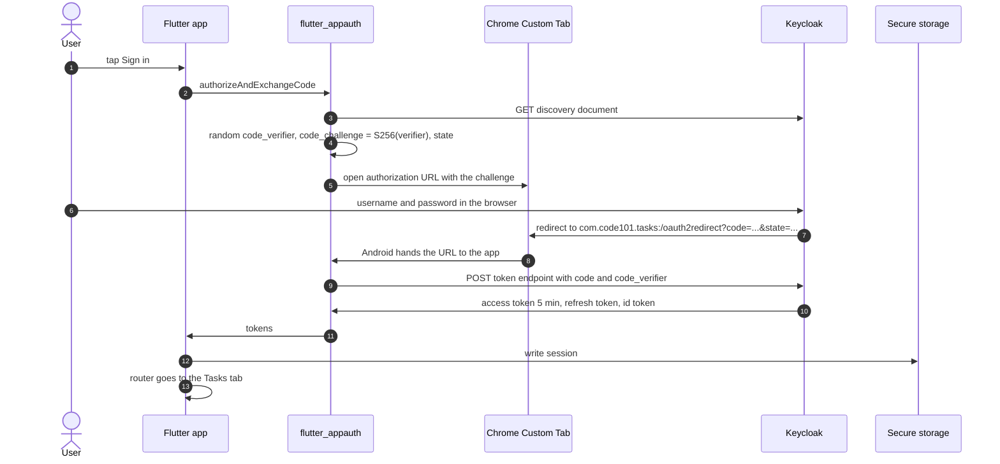

# 06. OIDC PKCE login with flutter_appauth and secure storage

> **Draft: written but not yet run.** The code and the expected output in this lesson were prepared by reading the code and the official documentation. They have not been executed yet. If something does not behave as described, trust your tool's real output and report it.

## What you will be able to do
- Explain the OIDC authorization code flow with PKCE and why a phone app uses the system browser and no client secret.
- Sign in against Keycloak (realm `tasksteams`, client `tasks-mobile`) with `flutter_appauth`, and configure the Android redirect.
- Store the session only in Keystore-backed secure storage and keep tokens out of logs.
- Refresh the access token once for all callers, persist the rotated refresh token before using it, and retry a 401 exactly once.
- Distinguish "the server is unreachable" from "the session was rejected", and sign out at the identity provider.

## Recap
1. Which problem kind does a 401 map to, and what message do we show? <details><summary>Answer</summary>`unauthorized`: "Your session ended. Please sign in again."</details>
2. Why did we write `AuthController` as a notifier in lesson 03? <details><summary>Answer</summary>The router's guard reads its status, so signing in or out moves the app.</details>
3. Where do interceptor errors become `ApiProblem`? <details><summary>Answer</summary>In `ProblemInterceptor`, after the auth interceptor had its chance to retry.</details>

## Why it matters
A password typed into an app is a password the app can steal, log or leak, and every app would need its own copy of login, reset and two-factor code. OpenID Connect (OIDC, an identity layer on top of OAuth 2.0) moves login to a separate server (Keycloak here). The app opens the **system browser**, the user signs in there, and the app receives short-lived tokens. Mobile apps are *public clients*: they cannot keep a secret, so the flow uses **PKCE** (Proof Key for Code Exchange, RFC 7636) to stop a stolen authorization code from being useful. This is the pattern recommended for native apps by [RFC 8252](https://www.rfc-editor.org/rfc/rfc8252.html).

## What you will build
Real sign-in replaces the demo button: **Sign in** opens a browser tab at Keycloak, the user signs in, the app returns to the Tasks tab with real data, tokens survive an app restart, expiring tokens are refreshed silently, and **Sign out** also ends the Keycloak session.



## Before you start
- Lesson 05 finished: continue in `tasks_app`.
- Time: 90-110 minutes. Build once, then testing the browser flow.
- You need the platform running (Keycloak on port 8180, the realm `tasksteams`) and one backend on port 8000, as in lesson 04. See [mobile-flutter chapter 05, "Start a disposable backend session"](../../../../capstones/mobile-flutter/tutorials/phase-5-ship/05-build-run-ship.md) for the exact commands, and use the cleanup commands there when you are done.
- The emulator needs a system browser: choose a **Google APIs** image (with Chrome). On a USB phone any installed browser works.
- Test accounts of the realm are fake development users: `carol` with the password `carol-local-fake` (a member of the Mobile Team). You type the password **in the browser only**.
- Source pack (optional): every file is shown in full in this lesson, so you can follow without it. The finished code, the exercise starter and the solution are in the
  course repository https://github.com/Uee03/Code101 under `source/flutter/201-hero-to-super-hero/phase-2-network-and-auth/06-oidc-pkce-login/` (on that page choose **Code, Download ZIP**, or run
  `git clone https://github.com/Uee03/Code101.git`).
- Unchanged from lesson 05 and not repeated: the contract and generator files, the debug and main Android manifests, `lib/main.dart`, `lib/core/url_policy.dart`, `lib/core/result.dart`, `lib/core/api_problem.dart`, `lib/core/problem_messages.dart`, `lib/core/widgets/art_icon.dart`, `lib/data/models/task.dart`, `lib/data/services/api_service.dart`, `lib/data/services/problem_interceptor.dart`, `lib/data/repositories/task_repository.dart`, `lib/app/app.dart`, `lib/app/app_shell.dart`, `lib/app/router.dart`, the session check screen, the settings view model, the task detail and tasks features, and the icons.
- Capstone link: this is [mobile-flutter chapter 02: Auth (PKCE) and secure storage](../../../../capstones/mobile-flutter/tutorials/phase-2-auth/02-auth.md). The capstone adds a file lock so a background isolate cannot refresh at the same time (lesson 08 mentions why).

## Steps
### Step 1. Know the realm
The platform ships a Keycloak realm named `tasksteams`. The mobile client in it is `tasks-mobile`: a **public** client (no secret), authorization code flow with PKCE method S256, direct password grants off, exactly one redirect URI `com.code101.tasks:/oauth2redirect` and one post-logout URI `com.code101.tasks:/logout`. The issuer is `http://localhost:8180/realms/tasksteams` (the platform fixes it to `localhost`, so every token and discovery document says `localhost`). Access tokens live 5 minutes; refresh tokens rotate (each refresh returns a new one and the old one stops working). Source: platform TDD.

### Step 2. `pubspec.yaml`
Replace the file: it adds `flutter_appauth` (wraps the AppAuth library for Android: Custom Tabs, PKCE, discovery, token exchange) and `flutter_secure_storage` (stores values encrypted with a key held in the Android Keystore). Run `flutter pub get`.

**File: `pubspec.yaml`**
```yaml
name: tasks
description: Tasks and Teams phone client built step by step in Flutter 201.
publish_to: none
version: 1.0.0+1

environment:
  sdk: ^3.14.0

dependencies:
  flutter:
    sdk: flutter
  material_ui: 1.11.1
  flutter_riverpod: 3.5.0
  go_router: 18.1.4
  flutter_svg: 2.5.0
  dio: 5.11.1
  json_annotation: 4.12.0
  uuid: 4.6.0
  flutter_appauth: 13.0.0
  flutter_secure_storage: 11.2.0

dev_dependencies:
  flutter_lints: 6.0.0
  swagger_parser: 2.3.0
  json_serializable: 6.15.2
  build_runner: 2.17.1

flutter:
  uses-material-design: false
  assets:
    - assets/icons/list.svg
    - assets/icons/settings.svg
```

### Step 3. Configuration
`config/dev.json` gets the OIDC values (public, no secrets) and `lib/core/config.dart` becomes the only place that names them and lists the scopes. **Scopes** are the permissions the app asks for: identity (`openid profile email`), a refresh token (`offline_access`, lets the session outlive the single sign-on idle time), and the API scopes. There is no admin scope and no client secret.

**File: `config/dev.json`**
```json
{
  "API_BASE_URL": "http://10.0.2.2:8000",
  "DEV_PROJECT_ID": "9a000000-0000-4000-8000-000000000003",
  "OIDC_ISSUER": "http://localhost:8180/realms/tasksteams",
  "OIDC_CLIENT_ID": "tasks-mobile",
  "OIDC_REDIRECT_URI": "com.code101.tasks:/oauth2redirect",
  "OIDC_LOGOUT_URI": "com.code101.tasks:/logout"
}
```

**File: `lib/core/config.dart`**
```dart
abstract final class Config {
  static const apiBase = String.fromEnvironment('API_BASE_URL');
  static const devProjectId = String.fromEnvironment('DEV_PROJECT_ID');

  static const issuer = String.fromEnvironment('OIDC_ISSUER');
  static const clientId = String.fromEnvironment('OIDC_CLIENT_ID');
  static const redirect = String.fromEnvironment('OIDC_REDIRECT_URI');
  static const logout = String.fromEnvironment('OIDC_LOGOUT_URI');

  // The only place that lists the scopes. No admin scope, no client secret.
  static const scopes = [
    'openid',
    'profile',
    'email',
    'offline_access',
    'tasks:read',
    'tasks:write',
  ];
}
```

### Step 4. Android: the redirect scheme
`flutter_appauth` registers an activity that receives the redirect. It reads the scheme from a **manifest placeholder**, which you set in `android/app/build.gradle.kts` (this file replaces the generated one). The scheme must be lower case. `applicationId` is the app's identity on the phone: `com.code101.tasks.flutter`, different from the Kotlin twin's id, because both capstone apps claim the same OAuth scheme and Android must be able to tell the apps apart. Install only one of them at a time.

**File: `android/app/build.gradle.kts`**
```kotlin
plugins {
    id("com.android.application")
    id("dev.flutter.flutter-gradle-plugin")
}

android {
    namespace = "com.code101.tasks"
    compileSdk = flutter.compileSdkVersion
    ndkVersion = flutter.ndkVersion

    compileOptions {
        sourceCompatibility = JavaVersion.VERSION_17
        targetCompatibility = JavaVersion.VERSION_17
    }

    defaultConfig {
        applicationId = "com.code101.tasks.flutter"
        minSdk = 26
        targetSdk = flutter.targetSdkVersion
        versionCode = flutter.versionCode
        versionName = flutter.versionName
        // The scheme must be lower case. AppAuth's receiver activity uses it.
        manifestPlaceholders += mapOf("appAuthRedirectScheme" to "com.code101.tasks")
    }

    buildTypes {
        release {
            signingConfig = signingConfigs.getByName("debug")
        }
    }
}

kotlin {
    compilerOptions {
        jvmTarget = org.jetbrains.kotlin.gradle.dsl.JvmTarget.JVM_17
    }
}

flutter {
    source = "../.."
}
```

The main `AndroidManifest.xml` needs no change: the plugin's own manifest adds the receiver activity and the placeholder fills in the scheme. Check the merged result later in `build/app/outputs/` or with Android Studio's **Merged Manifest** view.

### Step 5. Errors of the auth layer
Three plain exception classes separate the cases the rest of the app must treat differently. Create `lib/core/auth_errors.dart`.

**File: `lib/core/auth_errors.dart`**
```dart
/// The session is over: there is no usable token and no way to get one.
class AuthExpired implements Exception {
  const AuthExpired();
}

/// The identity provider refused the refresh token (for example invalid_grant).
class AuthRejected implements Exception {
  const AuthRejected();
}

/// The identity provider could not be reached; the session may still be fine.
class AuthUnavailable implements Exception {
  const AuthUnavailable();
}
```

### Step 6. The session model and the token store
`Session` holds the three tokens and the expiry; `toString` never prints tokens. `TokenStore` is the **only** file that imports `flutter_secure_storage`.

**File: `lib/data/models/session.dart`**
```dart
class Session {
  const Session({
    required this.accessToken,
    required this.refreshToken,
    required this.idToken,
    required this.expiresAt,
  });

  factory Session.fromJson(Map<String, dynamic> json) {
    return Session(
      accessToken: json['accessToken'] as String,
      refreshToken: json['refreshToken'] as String,
      idToken: json['idToken'] as String,
      expiresAt: DateTime.parse(json['expiresAt'] as String),
    );
  }

  final String accessToken;
  final String refreshToken;
  final String idToken;
  final DateTime expiresAt;

  /// True in the last 60 seconds before expiry, so we refresh before the server says 401.
  bool get expiresSoon {
    return DateTime.now().isAfter(expiresAt.subtract(const Duration(seconds: 60)));
  }

  Map<String, Object?> toJson() {
    return {
      'accessToken': accessToken,
      'refreshToken': refreshToken,
      'idToken': idToken,
      'expiresAt': expiresAt.toUtc().toIso8601String(),
    };
  }

  /// Never print tokens: this keeps them out of logs and error texts.
  @override
  String toString() => 'Session(expiresAt: $expiresAt)';
}
```

**File: `lib/data/services/token_store.dart`**
```dart
import 'dart:convert';

import 'package:flutter_secure_storage/flutter_secure_storage.dart';

import '../models/session.dart';

/// The only class that imports the secure storage package.
class TokenStore {
  const TokenStore();

  static const _key = 'session.v1';
  final _storage = const FlutterSecureStorage();

  Future<Session?> read() async {
    final value = await _storage.read(key: _key);
    if (value == null) {
      return null;
    }
    try {
      return Session.fromJson(jsonDecode(value) as Map<String, dynamic>);
    } on FormatException {
      await clear();
      return null;
    } on TypeError {
      await clear();
      return null;
    }
  }

  Future<void> write(Session session) {
    return _storage.write(key: _key, value: jsonEncode(session.toJson()));
  }

  Future<void> clear() => _storage.delete(key: _key);
}
```

### Step 7. The auth service
`AuthService` is the only file that imports `flutter_appauth`. `signIn` uses `authorizeAndExchangeCode` (the whole PKCE flow in one call); a user who closes the browser gets `null`, not an error. `refresh` separates a **rejection** (`invalid_grant`, ...: the session is truly over) from an **unavailable** provider (network trouble: the session may be fine). `allowInsecureConnections` is true only in debug builds because the local issuer uses plain HTTP.

**File: `lib/data/services/auth_service.dart`**
```dart
import 'package:flutter/foundation.dart';
import 'package:flutter_appauth/flutter_appauth.dart';

import '../../core/auth_errors.dart';
import '../../core/config.dart';
import '../../core/url_policy.dart';
import '../models/session.dart';

/// Wraps AppAuth: system browser, authorization code flow with PKCE (S256).
class AuthService {
  AuthService() {
    UrlPolicy.validate(Config.issuer, debug: kDebugMode);
  }

  final _appAuth = const FlutterAppAuth();

  static const _rejections = [
    'invalid_grant',
    'invalid_client',
    'unauthorized_client',
    'invalid_scope',
  ];

  /// Returns null when the user closes the browser without signing in.
  Future<Session?> signIn() async {
    try {
      final result = await _appAuth.authorizeAndExchangeCode(
        AuthorizationTokenRequest(
          Config.clientId,
          Config.redirect,
          issuer: Config.issuer,
          scopes: Config.scopes,
          allowInsecureConnections: kDebugMode,
        ),
      );
      return _toSession(result);
    } on FlutterAppAuthUserCancelledException {
      return null;
    }
  }

  Future<Session> refresh(Session old) async {
    try {
      final result = await _appAuth.token(
        TokenRequest(
          Config.clientId,
          Config.redirect,
          issuer: Config.issuer,
          refreshToken: old.refreshToken,
          scopes: Config.scopes,
          allowInsecureConnections: kDebugMode,
        ),
      );
      return _toSession(result, old);
    } on FlutterAppAuthPlatformException catch (error) {
      if (_rejections.contains(error.platformErrorDetails.error)) {
        throw const AuthRejected();
      }
      throw const AuthUnavailable();
    }
  }

  /// Ends the session at the identity provider in the browser.
  Future<void> signOut(Session session) async {
    await _appAuth.endSession(
      EndSessionRequest(
        issuer: Config.issuer,
        idTokenHint: session.idToken,
        postLogoutRedirectUrl: Config.logout,
        allowInsecureConnections: kDebugMode,
      ),
    );
  }

  Session _toSession(TokenResponse result, [Session? old]) {
    final access = result.accessToken;
    final refresh = result.refreshToken ?? old?.refreshToken;
    final id = result.idToken ?? old?.idToken;
    final expires = result.accessTokenExpirationDateTime;
    if (access == null || refresh == null || id == null || expires == null) {
      throw StateError('The identity provider sent an incomplete answer.');
    }
    return Session(
      accessToken: access,
      refreshToken: refresh,
      idToken: id,
      expiresAt: expires,
    );
  }
}
```

### Step 8. The auth repository: one shared refresh
`accessToken` returns a token that is valid now. If it expires within 60 seconds, or the API just rejected it, it refreshes. `_refreshing ??= ...` means ten parallel requests share **one** refresh call, which matters because rotation invalidates the old refresh token: two parallel refreshes would make the second fail. After a successful refresh the new session is written to storage **before** it is used.

**File: `lib/data/repositories/auth_repository.dart`**
```dart
import '../../core/auth_errors.dart';
import '../models/session.dart';
import '../services/auth_service.dart';
import '../services/token_store.dart';

class AuthRepository {
  AuthRepository(this._service, this._store);

  final AuthService _service;
  final TokenStore _store;

  Session? _session;
  Future<Session>? _refreshing;

  Future<bool> restore() async {
    _session = await _store.read();
    return _session != null;
  }

  /// Returns false when the user cancelled in the browser.
  Future<bool> signIn() async {
    final session = await _service.signIn();
    if (session == null) {
      return false;
    }
    await _store.write(session);
    _session = session;
    return true;
  }

  Future<void> signOut() async {
    final session = _session;
    try {
      if (session != null) {
        await _service.signOut(session);
      }
    } on Exception {
      // The browser step failed or was cancelled. We still forget the tokens below.
    } finally {
      _session = null;
      await _store.clear();
    }
  }

  /// A token that is valid now. All callers share one refresh.
  /// [rejected] is a token the API just refused with 401.
  Future<String> accessToken({String? rejected}) async {
    final session = _session;
    if (session == null) {
      throw const AuthExpired();
    }
    final refused = rejected != null && rejected == session.accessToken;
    if (!session.expiresSoon && !refused) {
      return session.accessToken;
    }
    final refreshed = await (_refreshing ??=
        _refresh(session).whenComplete(() => _refreshing = null));
    return refreshed.accessToken;
  }

  Future<Session> _refresh(Session old) async {
    try {
      final fresh = await _service.refresh(old);
      // Rotation: the old refresh token is now useless, so save the new one first.
      await _store.write(fresh);
      _session = fresh;
      return fresh;
    } on AuthRejected {
      _session = null;
      await _store.clear();
      throw const AuthExpired();
    }
  }
}
```

### Step 9. The interceptor
It adds `Authorization: Bearer <token>` to every request except `/health`. On a 401 it asks for a new token (telling the repository which token was refused), repeats the request **once** (`extra['retried']`), and if the session is over it calls `onExpired`, which signs the user out so the router shows the login. It rejects with ready-made `ApiProblem` values so the existing messages apply.

**File: `lib/data/services/auth_interceptor.dart`**
```dart
import 'package:dio/dio.dart';

import '../../core/api_problem.dart';
import '../../core/auth_errors.dart';
import '../repositories/auth_repository.dart';

/// Adds the bearer token, and after a 401 refreshes once and repeats the call.
class AuthInterceptor extends Interceptor {
  AuthInterceptor(this._auth, this._dio, {required this.onExpired});

  final AuthRepository _auth;
  final Dio _dio;
  final void Function() onExpired;

  static const _expired = ApiProblem(
    type: 'https://code101.example/problems/unauthorized',
    title: 'Session ended',
    status: 401,
  );
  static const _offline = ApiProblem(
    type: 'network',
    title: 'No connection',
    status: 0,
  );

  @override
  Future<void> onRequest(
    RequestOptions options,
    RequestInterceptorHandler handler,
  ) async {
    if (options.path == '/health') {
      handler.next(options);
      return;
    }
    try {
      final token = await _auth.accessToken();
      options.headers['Authorization'] = 'Bearer $token';
      handler.next(options);
    } on AuthUnavailable {
      handler.reject(DioException(requestOptions: options, error: _offline));
    } on AuthExpired {
      onExpired();
      handler.reject(DioException(requestOptions: options, error: _expired));
    }
  }

  @override
  Future<void> onError(
    DioException err,
    ErrorInterceptorHandler handler,
  ) async {
    final request = err.requestOptions;
    final header = request.headers['Authorization'];
    final alreadyRetried = request.extra['retried'] == true;
    if (err.response?.statusCode != 401 || alreadyRetried || header is! String) {
      handler.next(err);
      return;
    }
    try {
      final token = await _auth.accessToken(rejected: header.substring(7));
      request.headers['Authorization'] = 'Bearer $token';
      request.extra['retried'] = true;
      handler.resolve(await _dio.fetch<dynamic>(request));
    } on AuthExpired {
      onExpired();
      handler.next(err.copyWith(error: _expired));
    } on AuthUnavailable {
      handler.next(err.copyWith(error: _offline));
    } on DioException catch (retryError) {
      handler.next(retryError);
    }
  }
}
```

### Step 10. Providers and the auth controller
`dioProvider` now has two interceptors in a deliberate order: authentication first, then the error parser. `AuthController` now reads the stored session at start (screen S1), signs in and out through the repository, and exposes `expire`.

**File: `lib/app/providers.dart`**
```dart
import 'package:dio/dio.dart';
import 'package:flutter/foundation.dart';
import 'package:flutter_riverpod/flutter_riverpod.dart';

import '../core/config.dart';
import '../core/url_policy.dart';
import '../data/repositories/auth_repository.dart';
import '../data/repositories/task_repository.dart';
import '../data/services/api_service.dart';
import '../data/services/auth_interceptor.dart';
import '../data/services/auth_service.dart';
import '../data/services/problem_interceptor.dart';
import '../data/services/token_store.dart';
import '../features/login/view_model/auth_controller.dart';

final tokenStoreProvider = Provider<TokenStore>((ref) => const TokenStore());

final authServiceProvider = Provider<AuthService>((ref) => AuthService());

final authRepositoryProvider = Provider<AuthRepository>(
  (ref) => AuthRepository(
    ref.watch(authServiceProvider),
    ref.watch(tokenStoreProvider),
  ),
);

final dioProvider = Provider<Dio>((ref) {
  final base = UrlPolicy.validate(Config.apiBase, debug: kDebugMode);
  final dio = Dio(
    BaseOptions(
      baseUrl: base.toString().replaceFirst(RegExp(r'/$'), ''),
      connectTimeout: const Duration(seconds: 15),
      receiveTimeout: const Duration(seconds: 20),
      followRedirects: false,
    ),
  );
  // Order matters: authentication first, then the error parser.
  dio.interceptors.add(
    AuthInterceptor(
      ref.watch(authRepositoryProvider),
      dio,
      onExpired: () => ref.read(authControllerProvider.notifier).expire(),
    ),
  );
  dio.interceptors.add(ProblemInterceptor());
  ref.onDispose(dio.close);
  return dio;
});

final apiServiceProvider = Provider<ApiService>(
  (ref) => ApiService(ref.watch(dioProvider)),
);

final taskRepositoryProvider = Provider<TaskRepository>(
  (ref) => TaskRepository(ref.watch(apiServiceProvider)),
);

/// The project shown after sign-in while there is no project picker (lesson 10 adds one).
final defaultProjectIdProvider = Provider<String>((ref) => Config.devProjectId);
```

**File: `lib/features/login/view_model/auth_controller.dart`**
```dart
import 'dart:async';

import 'package:flutter_riverpod/flutter_riverpod.dart';

import '../../../app/providers.dart';

enum AuthStatus { unknown, signedOut, signedIn }

final authControllerProvider = NotifierProvider<AuthController, AuthStatus>(
  AuthController.new,
);

class AuthController extends Notifier<AuthStatus> {
  @override
  AuthStatus build() {
    unawaited(_restore());
    return AuthStatus.unknown;
  }

  /// Screen S1: read the stored session, then decide where to go.
  Future<void> _restore() async {
    final found = await ref.read(authRepositoryProvider).restore();
    if (!ref.mounted) {
      return;
    }
    state = found ? AuthStatus.signedIn : AuthStatus.signedOut;
  }

  /// Opens the system browser. Cancelling is not an error: nothing changes.
  Future<void> signIn() async {
    final signedIn = await ref.read(authRepositoryProvider).signIn();
    if (!ref.mounted) {
      return;
    }
    if (signedIn) {
      state = AuthStatus.signedIn;
    }
  }

  Future<void> signOut() async {
    await ref.read(authRepositoryProvider).signOut();
    if (!ref.mounted) {
      return;
    }
    state = AuthStatus.signedOut;
  }

  /// Called by the HTTP layer when the session can no longer be refreshed.
  void expire() {
    state = AuthStatus.signedOut;
  }
}
```

### Step 11. Login screen and settings
`LoginViewModel` models "idle, busy, failed" for the button; the screen shows progress or an error message and never a password field.

**File: `lib/features/login/view_model/login_view_model.dart`**
```dart
import 'package:flutter_riverpod/flutter_riverpod.dart';

import 'auth_controller.dart';

final loginViewModelProvider = AsyncNotifierProvider<LoginViewModel, void>(
  LoginViewModel.new,
);

/// State of the sign-in button: idle, busy, or failed.
class LoginViewModel extends AsyncNotifier<void> {
  @override
  Future<void> build() async {}

  Future<void> signIn() async {
    state = const AsyncLoading();
    final result = await AsyncValue.guard(
      () => ref.read(authControllerProvider.notifier).signIn(),
    );
    if (!ref.mounted) {
      return;
    }
    state = result;
  }
}
```

**File: `lib/features/login/view/login_screen.dart`**
```dart
import 'package:flutter_riverpod/flutter_riverpod.dart';
import 'package:material_ui/material_ui.dart';

import '../view_model/login_view_model.dart';

class LoginScreen extends ConsumerWidget {
  const LoginScreen({super.key});

  @override
  Widget build(BuildContext context, WidgetRef ref) {
    final login = ref.watch(loginViewModelProvider);
    return Scaffold(
      body: SafeArea(
        child: Center(
          child: Padding(
            padding: const EdgeInsets.all(24),
            child: Column(
              mainAxisSize: MainAxisSize.min,
              children: [
                Text(
                  'Tasks and Teams',
                  style: Theme.of(context).textTheme.headlineMedium,
                ),
                const SizedBox(height: 8),
                const Text(
                  'You sign in in your browser. The app never sees your password.',
                  textAlign: TextAlign.center,
                ),
                const SizedBox(height: 24),
                if (login.isLoading)
                  const CircularProgressIndicator(semanticsLabel: 'Signing in')
                else
                  FilledButton(
                    onPressed: () =>
                        ref.read(loginViewModelProvider.notifier).signIn(),
                    child: const Text('Sign in'),
                  ),
                if (login.hasError) ...[
                  const SizedBox(height: 16),
                  Text(
                    'Sign-in did not work. Check your connection and try again.',
                    style: TextStyle(color: Theme.of(context).colorScheme.error),
                    textAlign: TextAlign.center,
                  ),
                ],
              ],
            ),
          ),
        ),
      ),
    );
  }
}
```

**File: `lib/features/settings/view/settings_screen.dart`**
```dart
import 'package:flutter_riverpod/flutter_riverpod.dart';
import 'package:material_ui/material_ui.dart';

import '../../../core/problem_messages.dart';
import '../../login/view_model/auth_controller.dart';
import '../view_model/settings_view_model.dart';

class SettingsScreen extends ConsumerWidget {
  const SettingsScreen({super.key});

  @override
  Widget build(BuildContext context, WidgetRef ref) {
    final connection = ref.watch(connectionTestProvider);
    return Scaffold(
      appBar: AppBar(title: const Text('Settings')),
      body: ListView(
        children: [
          const ListTile(
            title: Text('Account'),
            subtitle: Text('Signed in'),
          ),
          ListTile(
            title: const Text('Connection'),
            subtitle: Text(
              connection.when(
                loading: () => 'Testing...',
                error: (error, stackTrace) => describeError(error),
                data: (text) => text,
              ),
            ),
            trailing: TextButton(
              onPressed: () => ref.invalidate(connectionTestProvider),
              child: const Text('Test'),
            ),
          ),
          Padding(
            padding: const EdgeInsets.all(16),
            child: Align(
              alignment: Alignment.centerLeft,
              child: OutlinedButton(
                onPressed: () =>
                    ref.read(authControllerProvider.notifier).signOut(),
                child: const Text('Sign out'),
              ),
            ),
          ),
        ],
      ),
    );
  }
}
```

## Run it
Start the platform and a backend (see "Before you start"). Start the emulator, then forward Keycloak into it. `adb reverse` makes `localhost:8180` inside the phone reach `localhost:8180` on your computer, which is required because the realm's issuer is fixed to `localhost`:

**File: `terminal (any folder)`**
```text
adb reverse tcp:8180 tcp:8180
```
Run the app:

**File: `terminal (folder tasks_app)`**
```text
flutter run --dart-define-from-file=config/dev.json
```
For a USB phone also run `adb reverse tcp:8000 tcp:8000` and change `API_BASE_URL` to `http://localhost:8000` in a copy of the config file.

Expected behaviour (described from the code and the contract, not yet seen):
1. A brief spinner, then the login page with **Sign in**.
2. Tap it: a browser tab opens on the Keycloak login for realm `tasksteams`. Sign in as `carol`. The tab closes and the **Tasks** tab shows the tasks of the Mobile App project from the platform seed.
3. Close the app completely and open it again: no login (the session came from secure storage).
4. Wait over 5 minutes with the app open, then pull to refresh or press **Try again**: the call still succeeds, because the interceptor refreshed the token.
5. **Settings > Sign out**: the browser briefly shows the logout, the app returns to the login page, and tokens are deleted.
6. Cancel the browser tab during sign-in: you return to the login page without an error message.

When you are done: `adb reverse --remove-all`, stop the app (`q`), and run the platform's cleanup commands.

## How it works
**Authorization code with PKCE.** The app creates a random secret `code_verifier` and sends only its SHA-256 hash, the `code_challenge`, in the authorization URL. Keycloak remembers the challenge. When the app exchanges the one-time `code` for tokens it must present the original verifier; Keycloak hashes it and compares. An app that stole the redirect (another app registered for the same scheme) has the code but not the verifier. `state` ties the answer to the request. `flutter_appauth` does all of this.

**System browser, not a WebView.** The browser holds the user's single sign-on session, shows the real address bar and keeps credentials away from your app. Embedded web views are explicitly discouraged for OAuth by RFC 8252.

**No client secret.** An APK can be unpacked; any secret inside it is public. `tasks-mobile` is registered as a public client; PKCE is what protects the flow. Direct password grants are off.

**Storage.** `flutter_secure_storage` encrypts values with a key kept in the Android Keystore, so a copy of the app's files is useless without the device. `android:allowBackup="false"` (lesson 04) stops cloud backup restoring ciphertext without its key. Tokens are stored nowhere else: not in preferences, not in the database, not in logs. `Session.toString()` hides them on purpose.

**Rotation and single flight.** With rotation a refresh token can be used once. Sequence: refresh, **write the new session first**, then use the new access token. If the app were killed between receiving and saving, the old token (already burned) would be all that was stored and the user would have to sign in again; that is why the write comes first. The shared `_refreshing` future makes parallel callers wait for the same refresh.

**Unreachable is not rejected.** If the provider cannot be reached (airplane mode), the session is probably fine: we keep it and report "No connection". Only a rejection (`invalid_grant`) clears the session and goes to login. This matters in lesson 08: an offline user must keep their data and their queued writes.

**Retry once.** A 401 after we sent a token usually means it just expired. One refresh and one repeat fix that; a second 401 means a real problem, so the error is passed on instead of looping.

**Sign out.** `endSession` ends the Keycloak session in the browser using the `id_token_hint`. Even if that step fails or is cancelled we still delete local tokens: the user asked to leave.

### Why this, not that
| Choice | Alternative | Why |
|---|---|---|
| System browser with PKCE | Embedded WebView, or a username and password form | Credentials never touch the app; SSO works; RFC 8252. |
| `flutter_appauth` | Manual PKCE with `url_launcher` | It wraps AppAuth (discovery, Custom Tabs, state, nonce). A manual flow is a stretch goal because it is easy to get one security detail wrong. |
| `flutter_secure_storage` | `shared_preferences` or own crypto | Keystore-backed encryption; preferences are plain text. Jetpack's `EncryptedSharedPreferences` is deprecated. |
| One shared refresh future | Refresh in each caller | Rotation makes parallel refreshes fail. |
| Refresh before expiry (60 s) and after a 401 | Only after a 401 | Saves a failed request in the common case, and 401 handling covers clock skew. |

Common misconception: "A token in memory is as safe as a token in secure storage." In memory it disappears when the process dies, which is why the *refresh* token must be stored; but it must be stored encrypted.

## Try it
The exercise isolates the single-flight idea in plain Dart: three callers ask for a token at the same moment but only one refresh may run.

**File: `exercise/starter/main.dart`**
```dart
// Exercise 06: one refresh for many callers. Run with: dart run main.dart

class TokenSource {
  int refreshCalls = 0;
  Future<String>? _inFlight;

  Future<String> token() {
    // TODO: when a refresh is already running, return that same Future.
    //       Otherwise start _refresh(), remember it in _inFlight and set _inFlight
    //       back to null when it finishes (use whenComplete).
    return _refresh();
  }

  Future<String> _refresh() async {
    refreshCalls++;
    await Future<void>.delayed(const Duration(milliseconds: 100));
    return 'new-$refreshCalls';
  }
}

Future<void> main() async {
  final source = TokenSource();
  final results = await Future.wait([
    source.token(),
    source.token(),
    source.token(),
  ]);
  print(results);
  print('refresh calls: ${source.refreshCalls}');
  print(await source.token());
  print('refresh calls: ${source.refreshCalls}');
}
```

1. **Guided:** complete the TODO in `token()`. Expected output:
```text
[new-1, new-1, new-1]
refresh calls: 1
new-2
refresh calls: 2
```
Before the change the starter prints `[new-1, new-2, new-3]` and `refresh calls: 3`: three refreshes, which rotation would not survive.
2. **Change:** make `_refresh` throw an `Exception` on the first call. What do all three callers receive? Does the next call to `token()` start a fresh refresh?
3. **Stretch (optional):** where in `AuthRepository` does the same idea live? Point to the line, and explain why `whenComplete` must clear `_refreshing` also on failure.

<details><summary>Solution</summary>

**File: `exercise/solution/main.dart`**
```dart
// Exercise 06: one refresh for many callers. Run with: dart run main.dart

class TokenSource {
  int refreshCalls = 0;
  Future<String>? _inFlight;

  Future<String> token() {
    final running = _inFlight;
    if (running != null) {
      return running;
    }
    final started = _refresh().whenComplete(() {
      _inFlight = null;
    });
    _inFlight = started;
    return started;
  }

  Future<String> _refresh() async {
    refreshCalls++;
    await Future<void>.delayed(const Duration(milliseconds: 100));
    return 'new-$refreshCalls';
  }
}

Future<void> main() async {
  final source = TokenSource();
  final results = await Future.wait([
    source.token(),
    source.token(),
    source.token(),
  ]);
  print(results);
  print('refresh calls: ${source.refreshCalls}');
  print(await source.token());
  print('refresh calls: ${source.refreshCalls}');
}
```

`whenComplete` runs after success or failure, so the next call starts a new refresh; callers that arrived while it ran share the first result.

</details>

## Check yourself
1. What stops a stolen authorization code from being used? <details><summary>Answer</summary>PKCE: the token exchange needs the secret `code_verifier` that only the original app has.</details>
2. Why is there no client secret in the app? <details><summary>Answer</summary>An app can be unpacked, so it could not stay secret; the client is public and uses PKCE.</details>
3. Why write the new session to storage before using the new access token? <details><summary>Answer</summary>The old refresh token is already invalid; if the app died before saving, nothing usable would remain.</details>
4. Predict: the device is offline when the access token expires. Does the user go to the login page? <details><summary>Answer</summary>No: `AuthUnavailable` means "no connection", the session is kept and cached screens keep working.</details>

## Common mistakes
| Symptom or error text | Cause | Fix |
|---|---|---|
| Browser shows an error page after login or never returns | Redirect scheme or URI mismatch | Scheme `com.code101.tasks` in the placeholder, redirect `com.code101.tasks:/oauth2redirect` in `dev.json`, lower case |
| `Failed host lookup` or discovery error for `localhost:8180` | `adb reverse tcp:8180 tcp:8180` missing (emulator's `localhost` is itself) | Run the reverse command after each emulator start |
| An app chooser appears after sign-in | Both mobile twins installed | Uninstall one: both claim the same scheme |
| `invalid_grant` immediately after sign-in (typical message) | Token reused after rotation, or clock far off | Sign in again; refresh through the repository only |
| 401 forever on the Tasks tab | Token not attached (public path list wrong) or wrong audience | Check the interceptor and that `tasks:read` is in the scopes |
| Sign-in works in debug, `The app is not configured` in release | Defines missing, or `http` issuer in release | Release needs HTTPS (the capstone's build chapter) |

## Best practice
Authenticate in the system browser with PKCE, store tokens only in hardware-backed secure storage, never log them, and make refresh single-flight. Source: [RFC 8252: OAuth 2.0 for Native Apps](https://www.rfc-editor.org/rfc/rfc8252.html), [flutter_appauth 13.0.0](https://pub.dev/packages/flutter_appauth/versions/13.0.0) and [flutter_secure_storage 11.2.0](https://pub.dev/packages/flutter_secure_storage/versions/11.2.0)

## Going further
- Read the capstone chapter for the cross-isolate file lock and the full sign-out options.
- OWASP Mobile Application Security Verification Standard (MASVS), areas STORAGE, NETWORK and AUTH are the checklist for this lesson (mapped in the capstone TDD, section 7).

## Summary
- You signed in with authorization code and PKCE in the system browser against Keycloak.
- You stored the session only in secure storage and kept tokens out of logs.
- You made refresh single-flight, persisted rotated tokens first, retried a 401 once, and told "unreachable" from "rejected".
- You signed out at the identity provider and cleared local tokens.

## Next lesson
07. A local database with drift: the cache that will let the app work offline.
