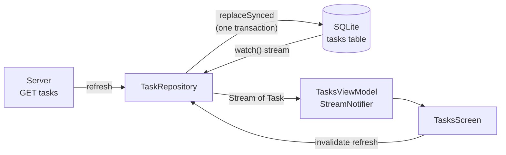

# 07. A local database

> **Draft: written but not yet run.** The code and the expected output in this lesson were prepared by reading the code and the official documentation. They have not been executed yet. If something does not behave as described, trust your tool's real output and report it.

## What you will be able to do
- Explain why screens should read a local database and let the network only update it.
- Define tables and a database class with drift, and generate the code with `build_runner`.
- Turn a database query into a `Stream` that feeds a Riverpod `StreamNotifier`, so a screen redraws itself when a row changes.
- Keep "what the server owns" and "what waits to sync" apart in one table, and delete local data on request.
- Decide between drift and the alternatives for a Flutter app.

## Recap
1. Which class is the only one that imports `flutter_appauth`? <details><summary>Answer</summary>`AuthService`. Every other class asks the `AuthRepository`.</details>
2. What does the 401 handling in `AuthInterceptor` do when the refresh fails because the phone has no network? <details><summary>Answer</summary>It rejects with a `network` problem (status 0), keeps the session and does not sign the user out.</details>
3. Which layers may import `data/generated/`? <details><summary>Answer</summary>Only the service layer (`ApiService`) and the repositories that map the DTOs. Views and view models never do.</details>

## Why it matters
Until now every screen waited for the network: open the list, see a spinner, hope. In a train tunnel the list is empty although the app loaded it a minute ago. A **local database** keeps the last answer on the phone. The screen reads from the database; the network only *writes into* it. The screen is then always fast, it works offline, and a change of the data (from a refresh today, from the sync engine in lesson 08) reaches the screen through one path. This is the **offline-first** pattern of the [Flutter architecture guide](https://docs.flutter.dev/app-architecture/design-patterns/offline-first): the database is the single source of truth for the UI.

## What you will build
The task list and the task detail now read from a SQLite database (through drift). A refresh asks the server for page 1 and stores it; the list redraws by itself. If the refresh fails, the saved tasks stay on screen with a "Could not refresh" line. Settings gets a **Delete offline data** button.



## Before you start
- Lesson 06 finished: continue in `tasks_app`. The app signs in, so the platform and one backend must run for the refresh (see lesson 06, "Before you start"). The screens also work without them: they show the saved tasks.
- Time: 100-120 minutes. The first `build_runner` run for drift takes a while.
- Source pack (optional): every file is shown in full in this lesson, so you can follow without it. The finished code, the exercise starter and the solution are in the
  course repository https://github.com/Uee03/Code101 under `source/flutter/201-hero-to-super-hero/phase-3-offline-and-quality/07-local-database/` (on that page choose **Code, Download ZIP**, or run
  `git clone https://github.com/Uee03/Code101.git`).
- Unchanged from lesson 06 and not repeated: the contract and generator files, the Android files, `lib/main.dart`, `lib/app/app.dart`, `lib/app/app_shell.dart`, `lib/app/router.dart`, everything under `lib/core/`, the session model, the auth repository and services, `lib/data/services/api_service.dart`, the login feature, `lib/features/tasks/view/task_composer.dart`, `config/dev.json` and the icons.
- Capstone link: this is the first half of [mobile-flutter chapter 04: Offline cache, sync and errors](../../../../capstones/mobile-flutter/tutorials/phase-4-offline/04-offline.md). The capstone keeps whole JSON payloads in a few generic tables; here you build typed columns, which is easier to learn and to query.

## Steps
### Step 1. Choose the database
The capstone design (section 4, decisions) names **drift**. The reasons, and what was left out:

| Option | What it is | Verdict here |
|---|---|---|
| **drift** | Typed SQL on SQLite. Tables are Dart classes; queries return `Stream`s; transactions; numbered migrations | Chosen: streams feed the view models, and one transaction can change a task *and* its queue row (lesson 08) |
| sqflite | Thin wrapper: you write SQL strings and map maps by hand | No streams, no compile-time checks |
| Isar, Hive | Object databases | A different model: no SQL joins and no numbered table migrations like the ones used here. Check a package's release history before you choose it |
| shared_preferences | Key and value (lesson 101/10) | Fine for a few settings, not for lists you query and order |

### Step 2. `pubspec.yaml`
Replace the file. `drift` is the runtime, `drift_flutter` opens the database file in the right folder on Android, `drift_dev` (a dev dependency) is the code generator that `build_runner` runs. Then run `flutter pub get`.

**File: `pubspec.yaml`**
```yaml
name: tasks
description: Tasks and Teams phone client built step by step in Flutter 201.
publish_to: none
version: 1.0.0+1

environment:
  sdk: ^3.14.0

dependencies:
  flutter:
    sdk: flutter
  material_ui: 1.11.1
  flutter_riverpod: 3.5.0
  go_router: 18.1.4
  flutter_svg: 2.5.0
  dio: 5.11.1
  json_annotation: 4.12.0
  uuid: 4.6.0
  flutter_appauth: 13.0.0
  flutter_secure_storage: 11.2.0
  drift: 2.35.4
  drift_flutter: 0.3.1

dev_dependencies:
  flutter_lints: 6.0.0
  swagger_parser: 2.3.0
  json_serializable: 6.15.2
  build_runner: 2.17.1
  drift_dev: 2.35.3

flutter:
  uses-material-design: false
  assets:
    - assets/icons/list.svg
    - assets/icons/settings.svg
```

### Step 3. The table
A drift table is a Dart class. Each getter is one column; the last `()` call finishes the column definition. `@DataClassName('TaskRow')` names the generated row class (otherwise drift would singularise `Tasks` to `Task`, which is already our domain model). `@TableIndex` makes lookups by project and date fast, which is exactly how the list is read.

`syncState` is a text column holding `synced`, `pending`, `conflict` or `failed`. Today every row is `synced`; lesson 08 uses the others. A column that exists from day one costs nothing, a column added later needs a migration.

**File: `lib/data/local/tables.dart`**
```dart
import 'package:drift/drift.dart';

@DataClassName('TaskRow')
@TableIndex(name: 'tasks_by_project', columns: {#projectId, #createdAt})
class Tasks extends Table {
  TextColumn get id => text()();
  TextColumn get projectId => text()();
  TextColumn get title => text()();
  TextColumn get description => text().withDefault(const Constant(''))();
  TextColumn get status => text()();
  TextColumn get priority => text()();
  TextColumn get dueDate => text().nullable()();
  IntColumn get version => integer().withDefault(const Constant(1))();
  DateTimeColumn get createdAt => dateTime()();
  TextColumn get syncState => text().withDefault(const Constant('synced'))();

  @override
  Set<Column> get primaryKey => {id};
}
```

### Step 4. The database class and code generation
`@DriftDatabase(tables: [Tasks])` tells the generator which tables belong to the database. `part 'database.g.dart'` is the file the generator writes; `_$AppDatabase` is the class it creates (it holds the table accessors `tasks`, the `select`, `into` and `transaction` helpers). `driftDatabase(name: 'tasksteams')` opens (or creates) the file `tasksteams.sqlite` in the app's documents folder. The optional `executor` parameter lets a test hand in an in-memory database later.

`schemaVersion` is the version of the layout. It is **1** now; every change of the layout later raises it and adds a numbered step (lesson 08 does this once).

**File: `lib/data/local/database.dart`**
```dart
import 'package:drift/drift.dart';
import 'package:drift_flutter/drift_flutter.dart';

import 'tables.dart';

part 'database.g.dart';

@DriftDatabase(tables: [Tasks])
class AppDatabase extends _$AppDatabase {
  AppDatabase([QueryExecutor? executor])
      : super(executor ?? driftDatabase(name: 'tasksteams'));

  @override
  int get schemaVersion => 1;

  /// Deletes every row of every table, in one transaction.
  Future<void> clearAll() {
    return transaction(() async {
      for (final table in allTables) {
        await delete(table).go();
      }
    });
  }
}
```

Generate the code (run it again every time a table changes):

**File: `terminal (folder tasks_app)`**
```text
dart run build_runner build --delete-conflicting-outputs
```
Expected result (typical, timings differ): the command ends with a message that it succeeded and lists the outputs; `lib/data/local/database.g.dart` exists. Until then the editor shows errors on `_$AppDatabase` and `part`; that is expected. The `.g.dart` file is generated: never edit it, and the source pack does not ship it.

### Step 5. A sync state for the domain model
`SyncState` is the Dart side of that text column. `Task` gets a `syncState` field (default `synced`), so a screen can say "waiting to sync" in lesson 08.

**File: `lib/data/models/sync_state.dart`**
```dart
/// Where a locally stored item stands compared with the server.
enum SyncState {
  synced,
  pending,
  conflict,
  failed;

  static SyncState fromName(String name) {
    return values.firstWhere(
      (state) => state.name == name,
      orElse: () => SyncState.synced,
    );
  }
}
```

**File: `lib/data/models/task.dart`**
```dart
import 'sync_state.dart';

enum TaskStatus {
  todo('todo', 'To do'),
  inProgress('in_progress', 'In progress'),
  blocked('blocked', 'Blocked'),
  done('done', 'Done'),
  cancelled('cancelled', 'Cancelled');

  const TaskStatus(this.wire, this.label);

  final String wire;
  final String label;

  static TaskStatus fromWire(String wire) {
    return values.firstWhere(
      (status) => status.wire == wire,
      orElse: () => TaskStatus.todo,
    );
  }
}

enum TaskPriority {
  low,
  medium,
  high,
  urgent;

  static TaskPriority fromWire(String wire) {
    return values.firstWhere(
      (priority) => priority.name == wire,
      orElse: () => TaskPriority.medium,
    );
  }
}

class Task {
  const Task({
    required this.id,
    required this.projectId,
    required this.title,
    this.description = '',
    this.status = TaskStatus.todo,
    this.priority = TaskPriority.medium,
    this.dueDate,
    this.version = 1,
    required this.createdAt,
    this.syncState = SyncState.synced,
  });

  final String id;
  final String projectId;
  final String title;
  final String description;
  final TaskStatus status;
  final TaskPriority priority;
  final String? dueDate;
  final int version;
  final DateTime createdAt;
  final SyncState syncState;

  bool get isDone => status == TaskStatus.done;

  Task copyWith({
    String? title,
    String? description,
    TaskStatus? status,
    TaskPriority? priority,
    int? version,
    SyncState? syncState,
  }) {
    return Task(
      id: id,
      projectId: projectId,
      title: title ?? this.title,
      description: description ?? this.description,
      status: status ?? this.status,
      priority: priority ?? this.priority,
      dueDate: dueDate,
      version: version ?? this.version,
      createdAt: createdAt,
      syncState: syncState ?? this.syncState,
    );
  }
}
```

### Step 6. The local service
`TaskLocalService` is the only file that runs queries on the `tasks` table, like `ApiService` is the only one that talks HTTP. It returns drift's `TaskRow`, never a domain `Task`: converting is the repository's job.

- `watchProject` returns a **stream**: it emits the current rows at once and again every time something in the table changes. Ordering is newest first with the id as a tie-break, so the order is stable.
- `replaceSynced` implements the refresh rule of the design: inside **one transaction** it remembers which rows wait to sync, deletes the project's synced rows, and inserts the fresh page *except* rows that wait. A refresh can never destroy work the user has not sent yet. Today no row waits, so the rule is dormant, but writing it now means lesson 08 does not have to touch this method.

**File: `lib/data/services/task_local_service.dart`**
```dart
import 'package:drift/drift.dart';

import '../local/database.dart';
import '../models/sync_state.dart';

/// The only file that runs queries on the tasks table. It returns drift rows.
class TaskLocalService {
  TaskLocalService(this._db);

  final AppDatabase _db;

  Stream<List<TaskRow>> watchProject(String projectId) {
    final query = _db.select(_db.tasks)
      ..where((t) => t.projectId.equals(projectId))
      ..orderBy([
        (t) => OrderingTerm.desc(t.createdAt),
        (t) => OrderingTerm.desc(t.id),
      ]);
    return query.watch();
  }

  Stream<TaskRow?> watchOne(String id) {
    final query = _db.select(_db.tasks)..where((t) => t.id.equals(id));
    return query.watchSingleOrNull();
  }

  Future<void> upsert(TasksCompanion row) {
    return _db.into(_db.tasks).insertOnConflictUpdate(row);
  }

  /// Pull-to-refresh rule: the server owns the synced rows, so replace them.
  /// A row that waits to sync is never touched.
  Future<void> replaceSynced(String projectId, List<TasksCompanion> rows) {
    final synced = SyncState.synced.name;
    return _db.transaction(() async {
      final waiting = await (_db.select(_db.tasks)
            ..where((t) => t.syncState.equals(synced).not()))
          .map((row) => row.id)
          .get();
      await (_db.delete(_db.tasks)
            ..where(
              (t) => t.projectId.equals(projectId) & t.syncState.equals(synced),
            ))
          .go();
      await _db.batch((batch) {
        batch.insertAllOnConflictUpdate(_db.tasks, [
          for (final row in rows)
            if (!waiting.contains(row.id.value)) row,
        ]);
      });
    });
  }

  Future<void> clearAll() => _db.clearAll();
}
```

### Step 7. The repository
The repository now has two directions. **Reading** is `watchTasks` and `watchTask`: streams from the database, mapped to domain `Task` objects. **Refreshing** is `refreshTasks` and `refreshTask`: they call the API and store the result; they return a `Result` and never throw. Creating and completing a task are still *write-through* (the server answers first, then the cache learns): the screens work, but offline they fail. Lesson 08 fixes that.

**File: `lib/data/repositories/task_repository.dart`**
```dart
import 'package:dio/dio.dart' show DioException;
import 'package:drift/drift.dart' show Value;
import 'package:uuid/uuid.dart';

import '../../core/api_problem.dart';
import '../../core/result.dart';
import '../generated/tasks_api.dart' as dto;
import '../local/database.dart';
import '../models/sync_state.dart';
import '../models/task.dart';
import '../services/api_service.dart';
import '../services/task_local_service.dart';

/// Screens read the local database. The network only updates it.
class TaskRepository {
  TaskRepository(this._api, this._local);

  final ApiService _api;
  final TaskLocalService _local;

  Stream<List<Task>> watchTasks(String projectId) {
    return _local
        .watchProject(projectId)
        .map((rows) => [for (final row in rows) _fromRow(row)]);
  }

  Stream<Task?> watchTask(String id) {
    return _local.watchOne(id).map((row) => row == null ? null : _fromRow(row));
  }

  /// Fetches page 1 and stores it. The list on screen changes by itself.
  Future<Result<void>> refreshTasks(String projectId) async {
    try {
      final page = await _api.listTasks(projectId);
      await _local.replaceSynced(projectId, [
        for (final item in page.items) _toCompanion(item),
      ]);
      return const Ok(null);
    } on DioException catch (error) {
      return Err(ApiProblem.of(error));
    }
  }

  Future<Result<void>> refreshTask(String id) async {
    try {
      await _local.upsert(_toCompanion(await _api.getTask(id)));
      return const Ok(null);
    } on DioException catch (error) {
      return Err(ApiProblem.of(error));
    }
  }

  /// Still write-through: the server answers first, then the cache learns.
  /// Lesson 08 replaces this with a local write plus a queued request.
  Future<Result<void>> createTask(
    String projectId, {
    required String title,
    String description = '',
  }) async {
    try {
      final created = await _api.createTask(
        projectId,
        title: title,
        description: description,
        idempotencyKey: const Uuid().v4(),
      );
      await _local.upsert(_toCompanion(created));
      return const Ok(null);
    } on DioException catch (error) {
      return Err(ApiProblem.of(error));
    }
  }

  Future<Result<void>> completeTask(Task task) async {
    try {
      final done = await _api.completeTask(task.id, task.version);
      await _local.upsert(_toCompanion(done));
      return const Ok(null);
    } on DioException catch (error) {
      return Err(ApiProblem.of(error));
    }
  }

  Future<void> clearLocal() => _local.clearAll();

  Task _fromRow(TaskRow row) {
    return Task(
      id: row.id,
      projectId: row.projectId,
      title: row.title,
      description: row.description,
      status: TaskStatus.fromWire(row.status),
      priority: TaskPriority.fromWire(row.priority),
      dueDate: row.dueDate,
      version: row.version,
      createdAt: row.createdAt,
      syncState: SyncState.fromName(row.syncState),
    );
  }

  TasksCompanion _toCompanion(dto.Task$Response item) {
    return TasksCompanion.insert(
      id: item.id,
      projectId: item.projectId,
      title: item.title,
      status: item.status.value,
      priority: item.priority.value,
      createdAt: item.createdAt,
      description: Value(item.description),
      dueDate: Value(item.dueDate),
      version: Value(item.version),
      syncState: Value(SyncState.synced.name),
    );
  }
}
```

### Step 8. Providers
Three new providers: the database (created once, closed when the container is disposed), the local service, and the repository, which now takes both services.

**File: `lib/app/providers.dart`**
```dart
import 'package:dio/dio.dart';
import 'package:flutter/foundation.dart';
import 'package:flutter_riverpod/flutter_riverpod.dart';

import '../core/config.dart';
import '../core/url_policy.dart';
import '../data/local/database.dart';
import '../data/repositories/auth_repository.dart';
import '../data/repositories/task_repository.dart';
import '../data/services/api_service.dart';
import '../data/services/auth_interceptor.dart';
import '../data/services/auth_service.dart';
import '../data/services/problem_interceptor.dart';
import '../data/services/task_local_service.dart';
import '../data/services/token_store.dart';
import '../features/login/view_model/auth_controller.dart';

final tokenStoreProvider = Provider<TokenStore>((ref) => const TokenStore());

final authServiceProvider = Provider<AuthService>((ref) => AuthService());

final authRepositoryProvider = Provider<AuthRepository>(
  (ref) => AuthRepository(
    ref.watch(authServiceProvider),
    ref.watch(tokenStoreProvider),
  ),
);

final dioProvider = Provider<Dio>((ref) {
  final base = UrlPolicy.validate(Config.apiBase, debug: kDebugMode);
  final dio = Dio(
    BaseOptions(
      baseUrl: base.toString().replaceFirst(RegExp(r'/$'), ''),
      connectTimeout: const Duration(seconds: 15),
      receiveTimeout: const Duration(seconds: 20),
      followRedirects: false,
    ),
  );
  // Order matters: authentication first, then the error parser.
  dio.interceptors.add(
    AuthInterceptor(
      ref.watch(authRepositoryProvider),
      dio,
      onExpired: () => ref.read(authControllerProvider.notifier).expire(),
    ),
  );
  dio.interceptors.add(ProblemInterceptor());
  ref.onDispose(dio.close);
  return dio;
});

final apiServiceProvider = Provider<ApiService>(
  (ref) => ApiService(ref.watch(dioProvider)),
);

/// One database for the whole app, closed when the container is disposed.
final appDatabaseProvider = Provider<AppDatabase>((ref) {
  final database = AppDatabase();
  ref.onDispose(database.close);
  return database;
});

final taskLocalServiceProvider = Provider<TaskLocalService>(
  (ref) => TaskLocalService(ref.watch(appDatabaseProvider)),
);

final taskRepositoryProvider = Provider<TaskRepository>(
  (ref) => TaskRepository(
    ref.watch(apiServiceProvider),
    ref.watch(taskLocalServiceProvider),
  ),
);

/// The project shown after sign-in while there is no project picker (lesson 10 adds one).
final defaultProjectIdProvider = Provider<String>((ref) => Config.devProjectId);
```

### Step 9. The view model
`TasksViewModel` is now a `StreamNotifier`: `build` returns the repository's stream, and Riverpod turns every emitted list into new state. There is no `state = ...` anywhere, because the database is the state.

Refreshing is a separate `FutureProvider`, `tasksRefreshProvider`. It has only three states (loading, done, failed), and the screen reads it separately from the list: the list is never replaced by a spinner while a refresh runs. `autoDispose` means the refresh runs again every time the screen is opened.

**File: `lib/features/tasks/view_model/tasks_view_model.dart`**
```dart
import 'package:flutter_riverpod/flutter_riverpod.dart';

import '../../../app/providers.dart';
import '../../../core/result.dart';
import '../../../data/models/task.dart';

/// The list comes from the local database and updates whenever a row changes.
final tasksViewModelProvider =
    StreamNotifierProvider.family<TasksViewModel, List<Task>, String>(
  TasksViewModel.new,
);

/// Asks the server for page 1 and stores it. Its state is only "loading, done or failed".
final tasksRefreshProvider = FutureProvider.autoDispose.family<void, String>((
  ref,
  projectId,
) async {
  final result = await ref.watch(taskRepositoryProvider).refreshTasks(projectId);
  if (result case Err(error: final failure)) {
    throw failure;
  }
});

class TasksViewModel extends StreamNotifier<List<Task>> {
  TasksViewModel(this.projectId);

  final String projectId;

  @override
  Stream<List<Task>> build() {
    return ref.watch(taskRepositoryProvider).watchTasks(projectId);
  }

  /// Returns null on success, or the failure for the view to describe.
  Future<Object?> add(String title) async {
    final result = await ref
        .read(taskRepositoryProvider)
        .createTask(projectId, title: title);
    switch (result) {
      case Ok():
        return null;
      case Err(error: final failure):
        return failure;
    }
  }

  Future<Object?> complete(Task task) async {
    final result = await ref.read(taskRepositoryProvider).completeTask(task);
    switch (result) {
      case Ok():
        return null;
      case Err(error: final failure):
        return failure;
    }
  }
}
```

### Step 10. The tasks screen
The screen watches both providers. A thin progress bar shows a running refresh; a failed refresh shows one line with **Try again** and leaves the saved list alone. The list branch is as before.

**File: `lib/features/tasks/view/tasks_screen.dart`**
```dart
import 'package:flutter_riverpod/flutter_riverpod.dart';
import 'package:go_router/go_router.dart';
import 'package:material_ui/material_ui.dart';

import '../../../core/problem_messages.dart';
import '../view_model/tasks_view_model.dart';
import 'task_composer.dart';

class TasksScreen extends ConsumerWidget {
  const TasksScreen({super.key, required this.projectId});

  final String projectId;

  /// Waits for a view model command and shows its failure message, if any.
  Future<void> _run(BuildContext context, Future<Object?> command) async {
    final failure = await command;
    if (failure == null || !context.mounted) {
      return;
    }
    ScaffoldMessenger.of(context).showSnackBar(
      SnackBar(content: Text(describeError(failure))),
    );
  }

  @override
  Widget build(BuildContext context, WidgetRef ref) {
    final provider = tasksViewModelProvider(projectId);
    final refreshProvider = tasksRefreshProvider(projectId);
    final tasks = ref.watch(provider);
    final refresh = ref.watch(refreshProvider);
    final viewModel = ref.read(provider.notifier);

    return Scaffold(
      appBar: AppBar(title: const Text('Tasks')),
      body: Column(
        children: [
          TaskComposer(
            onSubmit: (title) async {
              final failure = await viewModel.add(title);
              if (failure == null) {
                return null;
              }
              return fieldMessage(failure, '/title') ?? describeError(failure);
            },
          ),
          if (refresh.isLoading) const LinearProgressIndicator(),
          if (refresh.hasError && !refresh.isLoading)
            Padding(
              padding: const EdgeInsets.symmetric(horizontal: 16),
              child: Row(
                children: [
                  Expanded(
                    child: Text(
                      'Could not refresh. ${describeError(refresh.error!)}',
                    ),
                  ),
                  TextButton(
                    onPressed: () => ref.invalidate(refreshProvider),
                    child: const Text('Try again'),
                  ),
                ],
              ),
            ),
          Expanded(
            child: tasks.when(
              loading: () => const Center(child: CircularProgressIndicator()),
              error: (error, stackTrace) => const Center(
                child: Padding(
                  padding: EdgeInsets.all(24),
                  child: Text(
                    'The saved tasks could not be read.',
                    textAlign: TextAlign.center,
                  ),
                ),
              ),
              data: (items) {
                if (items.isEmpty) {
                  return Center(
                    child: Text(
                      refresh.isLoading ? 'Loading tasks...' : 'No tasks yet.',
                    ),
                  );
                }
                return ListView.builder(
                  itemCount: items.length,
                  itemBuilder: (context, index) {
                    final task = items[index];
                    return ListTile(
                      title: Text(task.title),
                      subtitle: Text(task.status.label),
                      onTap: () => context.push(
                        '/tasks/${Uri.encodeComponent(task.id)}',
                      ),
                      trailing: task.isDone
                          ? null
                          : TextButton(
                              onPressed: () =>
                                  _run(context, viewModel.complete(task)),
                              child: const Text('Complete'),
                            ),
                    );
                  },
                );
              },
            ),
          ),
        ],
      ),
    );
  }
}
```

### Step 11. The detail screen
The task opens from the cache at once. `taskDetailProvider` watches one row; `taskDetailRefreshProvider` fetches the newest copy in the background. Only when the row is missing (a link to a task never seen on this phone) does the screen wait for the refresh result.

**File: `lib/features/task_detail/view_model/task_detail_view_model.dart`**
```dart
import 'package:flutter_riverpod/flutter_riverpod.dart';

import '../../../app/providers.dart';
import '../../../core/result.dart';
import '../../../data/models/task.dart';

/// The task comes from the local database, so a task opened from the list shows at once.
final taskDetailProvider = StreamProvider.autoDispose.family<Task?, String>((
  ref,
  taskId,
) {
  return ref.watch(taskRepositoryProvider).watchTask(taskId);
});

/// Fetches the newest copy from the server and stores it. Failing is not fatal.
final taskDetailRefreshProvider = FutureProvider.autoDispose.family<void, String>((
  ref,
  taskId,
) async {
  final result = await ref.watch(taskRepositoryProvider).refreshTask(taskId);
  if (result case Err(error: final failure)) {
    throw failure;
  }
});
```

**File: `lib/features/task_detail/view/task_detail_screen.dart`**
```dart
import 'package:flutter_riverpod/flutter_riverpod.dart';
import 'package:material_ui/material_ui.dart';

import '../../../core/problem_messages.dart';
import '../../../data/models/task.dart';
import '../view_model/task_detail_view_model.dart';

class TaskDetailScreen extends ConsumerWidget {
  const TaskDetailScreen({super.key, required this.taskId});

  final String taskId;

  @override
  Widget build(BuildContext context, WidgetRef ref) {
    final task = ref.watch(taskDetailProvider(taskId));
    final refresh = ref.watch(taskDetailRefreshProvider(taskId));
    return Scaffold(
      appBar: AppBar(title: const Text('Task')),
      body: task.when(
        loading: () => const Center(child: CircularProgressIndicator()),
        error: (error, stackTrace) =>
            const _Message('The saved task could not be read.'),
        data: (item) {
          if (item != null) {
            return _TaskBody(
              item: item,
              refreshNote: refresh.hasError && !refresh.isLoading
                  ? 'Showing the saved copy. ${describeError(refresh.error!)}'
                  : null,
            );
          }
          return refresh.when(
            loading: () => const Center(child: CircularProgressIndicator()),
            error: (error, stackTrace) => _Message(describeError(error)),
            data: (_) => const _Message('That task is not available.'),
          );
        },
      ),
    );
  }
}

class _TaskBody extends StatelessWidget {
  const _TaskBody({required this.item, this.refreshNote});

  final Task item;
  final String? refreshNote;

  @override
  Widget build(BuildContext context) {
    return ListView(
      padding: const EdgeInsets.all(16),
      children: [
        if (refreshNote != null) ...[
          Text(refreshNote!),
          const SizedBox(height: 12),
        ],
        Text(item.title, style: Theme.of(context).textTheme.headlineSmall),
        const SizedBox(height: 8),
        Text('Status: ${item.status.label}'),
        Text('Priority: ${item.priority.name}'),
        Text('Due: ${item.dueDate ?? 'no due date'}'),
        Text('Version: ${item.version}'),
        const SizedBox(height: 16),
        Text(item.description.isEmpty ? 'No description.' : item.description),
      ],
    );
  }
}

class _Message extends StatelessWidget {
  const _Message(this.text);

  final String text;

  @override
  Widget build(BuildContext context) {
    return Center(
      child: Padding(
        padding: const EdgeInsets.all(24),
        child: Text(text, textAlign: TextAlign.center),
      ),
    );
  }
}
```

### Step 12. Delete offline data
A cache holds the user's data on the phone, so the user must be able to remove it. `deleteOfflineData` calls the repository, which calls `AppDatabase.clearAll` (one transaction, every table).

**File: `lib/features/settings/view_model/settings_view_model.dart`**
```dart
import 'package:flutter_riverpod/flutter_riverpod.dart';

import '../../../app/providers.dart';

/// Calls the unauthenticated /health operation, so it works before sign-in exists.
final connectionTestProvider = FutureProvider.autoDispose<String>((ref) async {
  final health = await ref.watch(apiServiceProvider).health();
  final database = health.database?.value ?? 'not reported';
  return 'API ${health.status.value}, database $database';
});

final settingsViewModelProvider = Provider<SettingsViewModel>(
  SettingsViewModel.new,
);

class SettingsViewModel {
  SettingsViewModel(this._ref);

  final Ref _ref;

  /// Removes every task stored on this phone. The server keeps its copy.
  Future<void> deleteOfflineData() {
    return _ref.read(taskRepositoryProvider).clearLocal();
  }
}
```

**File: `lib/features/settings/view/settings_screen.dart`**
```dart
import 'package:flutter_riverpod/flutter_riverpod.dart';
import 'package:material_ui/material_ui.dart';

import '../../../core/problem_messages.dart';
import '../../login/view_model/auth_controller.dart';
import '../view_model/settings_view_model.dart';

class SettingsScreen extends ConsumerWidget {
  const SettingsScreen({super.key});

  @override
  Widget build(BuildContext context, WidgetRef ref) {
    final connection = ref.watch(connectionTestProvider);
    return Scaffold(
      appBar: AppBar(title: const Text('Settings')),
      body: ListView(
        children: [
          const ListTile(
            title: Text('Account'),
            subtitle: Text('Signed in'),
          ),
          ListTile(
            title: const Text('Connection'),
            subtitle: Text(
              connection.when(
                loading: () => 'Testing...',
                error: (error, stackTrace) => describeError(error),
                data: (text) => text,
              ),
            ),
            trailing: TextButton(
              onPressed: () => ref.invalidate(connectionTestProvider),
              child: const Text('Test'),
            ),
          ),
          ListTile(
            title: const Text('Offline data'),
            subtitle: const Text('Tasks saved on this phone'),
            trailing: TextButton(
              onPressed: () async {
                await ref.read(settingsViewModelProvider).deleteOfflineData();
                if (!context.mounted) {
                  return;
                }
                ScaffoldMessenger.of(context).showSnackBar(
                  const SnackBar(content: Text('Offline data deleted.')),
                );
              },
              child: const Text('Delete'),
            ),
          ),
          Padding(
            padding: const EdgeInsets.all(16),
            child: Align(
              alignment: Alignment.centerLeft,
              child: OutlinedButton(
                onPressed: () =>
                    ref.read(authControllerProvider.notifier).signOut(),
                child: const Text('Sign out'),
              ),
            ),
          ),
        ],
      ),
    );
  }
}
```

## Run it
Generate the code (Step 4), then run:

**File: `terminal (folder tasks_app)`**
```text
flutter run --dart-define-from-file=config/dev.json
```
Expected behaviour (described from the code, not yet seen):
1. Sign in as `carol`. The Tasks tab shows a thin progress bar for a moment, then the tasks of the project.
2. Close the app completely, switch the phone to airplane mode, open the app again. The login page does not appear (the session is stored), the Tasks tab shows the **saved** tasks and the line "Could not refresh. No connection. Check your network and try again." with **Try again**.
3. Tap a task: its details appear at once from the database.
4. Turn the network on and tap **Try again**: the line disappears.
5. Settings > **Delete** next to Offline data: a message says the data was deleted. Open the Tasks tab again while offline: the list is empty and says "No tasks yet."

In Android Studio, **App Inspection > Database Inspector** can open the running app's `tasksteams` database and show the `tasks` table (the exact menu names may differ between Studio versions).

## How it works
**One path for data.** The screen never sees the network. The refresh writes rows; the stream emits; the view model state changes; the screen redraws. That is why a failed refresh costs nothing: nothing changed, so nothing redraws.

**Streams from SQL.** drift watches which tables a query reads. When any statement writes to one of them, drift runs the query again and emits the new result. You get "live queries" without writing change notifications.

**Transactions.** `replaceSynced` reads, deletes and inserts in one transaction: either all of it happens or none. A crash in the middle never leaves a half-empty list. Lesson 08 relies on the same tool to keep a task and its queue row consistent.

**Why the sync state is in the table now.** The refresh rule "replace what the server owns, keep what waits" needs the column to exist. Designing the rule first and the data after is how bugs like "my offline task vanished after pull-to-refresh" are born.

**Not a source of truth for secrets.** The tokens stay in secure storage (lesson 06). The database holds task data only; it is not encrypted, but it is in the app's private folder, and backup is disabled (`allowBackup="false"`).

### Why this, not that
| Choice | Alternative | Why |
|---|---|---|
| Typed drift tables | One table with a JSON text column per entity | Typed columns can be indexed, sorted and filtered in SQL; a JSON blob needs parsing in Dart for every query. |
| Stream from the database | The repository keeps a list in memory and notifies | The database is already the truth after an app restart; a second copy in memory can drift apart. |
| Refresh as a separate provider | One `AsyncNotifier` doing load and refresh | The list must stay on screen while a refresh runs or fails. |
| `replaceSynced` in a transaction | Delete everything, insert page 1 | It never deletes rows that wait to sync. |
| `AppDatabase` provider outside the widgets | A global singleton | Riverpod disposes it, and a test can override it with an in-memory database. |

Common misconception: "A cache needs invalidation logic." Here the rule is tiny: every open of a screen refreshes it, and a refresh replaces what the server owns. More refined rules (ETags, time to live) are optimisations, not a requirement.

## Try it
The exercise has no database; it rehearses the two ideas of this lesson in plain Dart: a cache that **tells its listeners** (a stream), and the **replace-synced rule**. Make a folder `try07`, save the starter as `main.dart` and run `dart run main.dart`.

**File: `exercise/starter/main.dart`**
```dart
// Exercise 07: a cache that tells its listeners. Run with: dart run main.dart
import 'dart:async';

class Item {
  const Item(this.id, this.title, {this.synced = true});

  final String id;
  final String title;

  /// false means the item was created here and has not reached the server yet.
  final bool synced;
}

class MemoryCache {
  final Map<String, Item> _rows = {};
  final StreamController<void> _changes = StreamController<void>.broadcast();

  /// Emits the current titles at once and again after every change.
  Stream<List<String>> watch() {
    return Stream<List<String>>.multi((controller) {
      controller.add(_titles());
      final subscription = _changes.stream.listen(
        (_) => controller.add(_titles()),
      );
      controller.onCancel = subscription.cancel;
    });
  }

  void addPending(Item item) {
    _rows[item.id] = item;
    _changes.add(null);
  }

  void replaceSynced(List<Item> fromServer) {
    // TODO: the server owns only the synced items.
    //       1. Remember the ids of the items that are NOT synced.
    //       2. Remove the synced items (removeWhere).
    //       3. Add every server item whose id is not in the remembered set.
    _rows.clear();
    for (final item in fromServer) {
      _rows[item.id] = item;
    }
    _changes.add(null);
  }

  List<String> _titles() => [for (final item in _rows.values) item.title];
}

Future<void> tick() => Future<void>.delayed(Duration.zero);

Future<void> main() async {
  final cache = MemoryCache();
  cache.watch().listen((titles) => print('screen: $titles'));
  await tick();
  cache.replaceSynced(const [Item('1', 'Write report'), Item('2', 'Book room')]);
  await tick();
  cache.addPending(const Item('local-1', 'Buy cable', synced: false));
  await tick();
  cache.replaceSynced(const [Item('1', 'Write report'), Item('3', 'Call Sam')]);
  await tick();
}
```

1. **Guided:** complete `replaceSynced` following the TODO. Expected output:
```text
screen: []
screen: [Write report, Book room]
screen: [Write report, Book room, Buy cable]
screen: [Buy cable, Write report, Call Sam]
```
Before the change the last line is `screen: [Write report, Call Sam]`: the item that waited to sync disappeared.
2. **Change:** the server sends an item with the id `local-1`. What should happen to the waiting item? Change `main` to try it, and decide whether "the server wins" or "the waiting item wins". (In the app, the waiting item wins until it is sent.)
3. **Stretch (optional):** find the three lines of `TaskLocalService.replaceSynced` that do the same three steps as your solution, and say which one makes it safe to call twice.

<details><summary>Solution</summary>

**File: `exercise/solution/main.dart`**
```dart
// Exercise 07: a cache that tells its listeners. Run with: dart run main.dart
import 'dart:async';

class Item {
  const Item(this.id, this.title, {this.synced = true});

  final String id;
  final String title;

  /// false means the item was created here and has not reached the server yet.
  final bool synced;
}

class MemoryCache {
  final Map<String, Item> _rows = {};
  final StreamController<void> _changes = StreamController<void>.broadcast();

  /// Emits the current titles at once and again after every change.
  Stream<List<String>> watch() {
    return Stream<List<String>>.multi((controller) {
      controller.add(_titles());
      final subscription = _changes.stream.listen(
        (_) => controller.add(_titles()),
      );
      controller.onCancel = subscription.cancel;
    });
  }

  void addPending(Item item) {
    _rows[item.id] = item;
    _changes.add(null);
  }

  void replaceSynced(List<Item> fromServer) {
    final waiting = {
      for (final item in _rows.values)
        if (!item.synced) item.id,
    };
    _rows.removeWhere((id, item) => item.synced);
    for (final item in fromServer) {
      if (!waiting.contains(item.id)) {
        _rows[item.id] = item;
      }
    }
    _changes.add(null);
  }

  List<String> _titles() => [for (final item in _rows.values) item.title];
}

Future<void> tick() => Future<void>.delayed(Duration.zero);

Future<void> main() async {
  final cache = MemoryCache();
  cache.watch().listen((titles) => print('screen: $titles'));
  await tick();
  cache.replaceSynced(const [Item('1', 'Write report'), Item('2', 'Book room')]);
  await tick();
  cache.addPending(const Item('local-1', 'Buy cable', synced: false));
  await tick();
  cache.replaceSynced(const [Item('1', 'Write report'), Item('3', 'Call Sam')]);
  await tick();
}
```

The set of waiting ids is read before the synced rows are removed. Then only server items whose id is not waiting are added, so a waiting item is never overwritten.

</details>

## Check yourself
1. Why does `TasksViewModel` not set `state` after a refresh? <details><summary>Answer</summary>Its state is the database stream. The refresh writes rows; the stream emits the new list by itself.</details>
2. What happens to the list if the refresh fails? <details><summary>Answer</summary>Nothing changes in the list; the refresh provider holds the error and the screen shows one "Could not refresh" line.</details>
3. Why is `replaceSynced` one transaction? <details><summary>Answer</summary>So a crash cannot leave the table half deleted; readers see the old or the new state, never a mix.</details>
4. Predict: you add a column to the `Tasks` table and run the app on a phone that has the old database. What must you do? <details><summary>Answer</summary>Raise `schemaVersion` and add a numbered step in `onUpgrade` (lesson 08 shows one). Without it drift cannot open the old layout correctly.</details>

## Common mistakes
| Symptom or error text | Cause | Fix |
|---|---|---|
| Editor errors on `_$AppDatabase` or `part 'database.g.dart'` | Code not generated yet | Run `dart run build_runner build --delete-conflicting-outputs` |
| A conflict message about existing outputs (typical) | Old generated files from another build | Use `--delete-conflicting-outputs` |
| After changing a table the app crashes or shows old columns | Layout changed without a migration | Raise `schemaVersion`, add an `onUpgrade` step (or uninstall the app during development) |
| The list shows a spinner forever offline | The view model waits for the network | The list reads the stream only; the refresh is a separate provider |
| A task from a screen vanishes after a refresh | A refresh replaced a row that waited to sync | Keep rows whose `syncState` is not `synced`, as `replaceSynced` does |
| `Task` and `Task$Response` or drift `Task` are confused | The generated row class has the same name as the domain model | `@DataClassName('TaskRow')` gives the row its own name |

## Best practice
Read screens from a local database, update the database from the network, and change many rows in one transaction. Source: [Flutter architecture: offline-first](https://docs.flutter.dev/app-architecture/design-patterns/offline-first), [drift setup](https://drift.simonbinder.eu/setup/), [drift_flutter 0.3.1](https://pub.dev/packages/drift_flutter/versions/0.3.1) and [drift 2.35.4](https://pub.dev/packages/drift/versions/2.35.4)

## Going further
- Read the drift page on [streams](https://drift.simonbinder.eu/dart_api/streams/) to see how table updates trigger re-runs.
- Pagination: this lesson caches page 1 only; the capstone appends later pages. Think about what `replaceSynced` would need to know.
- Pull-to-refresh with `RefreshIndicator` calls `ref.invalidate(tasksRefreshProvider(projectId))`; the capstone adds it.

## Summary
- You made the local database the single source of truth for the task screens.
- You defined a drift table, generated the database code and turned a query into a stream for a `StreamNotifier`.
- You separated "the list" from "the refresh", so failures never empty the screen.
- You wrote the refresh rule that protects unsent rows, and you can delete the offline data.

## Next lesson
08. Offline cache and a sync queue: write while offline, keep the writes in an outbox and send them later with retries.
