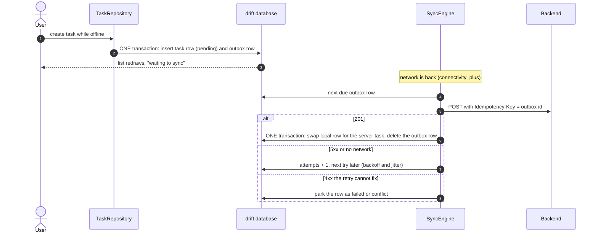
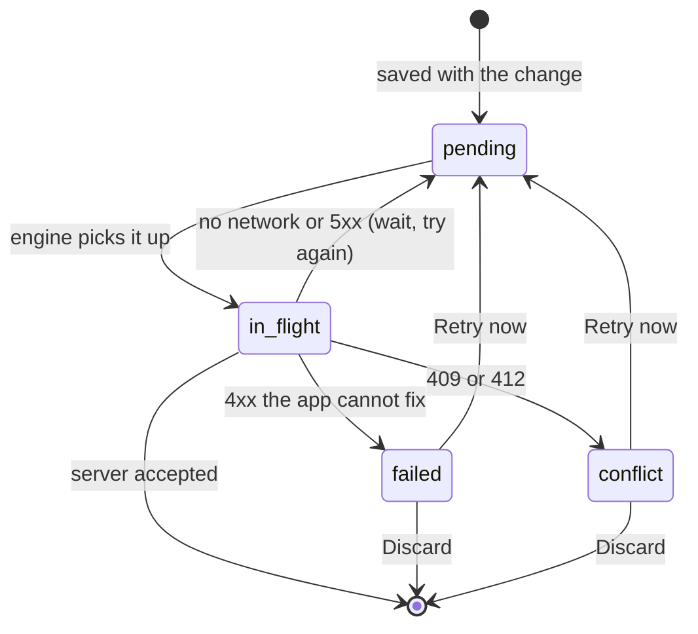

# 08. Offline cache and a sync queue

> **Draft: written but not yet run.** The code and the expected output in this lesson were prepared by reading the code and the official documentation. They have not been executed yet. If something does not behave as described, trust your tool's real output and report it.

## What you will be able to do
- Explain the **outbox pattern**: a write is saved on the phone together with a queue row, in one transaction, and sent later.
- Use an `Idempotency-Key` so a retry can never create a task twice.
- Write a sync engine that sends the queue in order, retries with exponential backoff and jitter, and parks problems that retrying cannot fix.
- Add a numbered drift migration (`schemaVersion` 2).
- Show the state to the user: an offline banner and a sync queue screen.

## Recap
1. Why is `replaceSynced` one transaction? <details><summary>Answer</summary>A crash cannot leave the table half deleted; readers see the old or the new state.</details>
2. Which provider decides what a screen does while a refresh fails? <details><summary>Answer</summary>`tasksRefreshProvider`. The list comes from the database stream and is not touched by a failed refresh.</details>
3. What does `syncState` hold today, and what is it for? <details><summary>Answer</summary>`synced` for every row. It is how the refresh rule tells "the server owns this" from "this waits to be sent".</details>

## Why it matters
Reading offline (lesson 07) is half of the job. People also *write* when the connection is bad: they create a task in a lift and expect it to be there. If the app simply shows an error, the person types it again later, or forgets. An **outbox** makes the write safe: the app accepts it at once, stores it durably, and delivers it when it can. The hard parts are not the happy path. They are: what if the app is killed in the middle of sending, what if the server answered but the answer was lost, what if two writes about one task must keep their order, and what if the server says no.

## What you will build
Creating and completing a task now work offline. The task appears at once, marked "waiting to sync". A **sync engine** sends the queue when the person is signed in and the network is back, with growing waits between failed attempts. A banner above the bottom bar says how many changes are not on the server yet, and **Settings > Sync queue** lists them with **Retry now** and **Discard**.



The life of one queue row:



## Before you start
- Lesson 07 finished: continue in `tasks_app`.
- Time: 120-150 minutes.
- To see the engine work you need the platform and a backend (lesson 06) and an emulator on which you can switch airplane mode on and off (the quick settings of the emulator, or its extended controls).
- Source pack (optional): every file is shown in full in this lesson, so you can follow without it. The finished code, the exercise starter and the solution are in the
  course repository https://github.com/Uee03/Code101 under `source/flutter/201-hero-to-super-hero/phase-3-offline-and-quality/08-offline-cache-and-sync-queue/` (on that page choose **Code, Download ZIP**, or run
  `git clone https://github.com/Uee03/Code101.git`).
- Unchanged from lesson 07 and not repeated: the contract and generator files, the Android files, `lib/main.dart`, everything under `lib/core/` except the new banner, the session model, `sync_state.dart`, `task.dart`, the auth repository and services, `lib/data/services/api_service.dart`, the login feature, the task composer, the task detail feature, `config/dev.json` and the icons.
- Capstone link: this is the second half of [mobile-flutter chapter 04: Offline cache, sync and errors](../../../../capstones/mobile-flutter/tutorials/phase-4-offline/04-offline.md). The capstone adds a lease so a background isolate and the app never drain at once, and a WorkManager task for syncing when the app is closed; this lesson drains only while the app runs.

## Steps
### Step 1. The design, in one table
The capstone design (section 5) fixes the queue columns. Read the table before the code.

| Column | Meaning |
|---|---|
| `seq` | Order of writing. It is the primary key (SQLite allows `AUTOINCREMENT` only on the primary key; the capstone sketch lists `id` as key, but the effect is the same) |
| `id` | Unique text, sent as the `Idempotency-Key` of a create |
| `kind` | `create_task` or `complete_task` today; lesson 10 adds `update_task` |
| `entityId` | The task the write is about (a local id until the server answers a create) |
| `payload` | JSON with what the request needs |
| `baseVersion` | The task version the user saw (becomes `If-Match`) |
| `state` | `pending`, `in_flight`, `failed`, `conflict` |
| `attempts`, `nextAttemptAt` | Retry count and the earliest time of the next try (milliseconds since 1970) |
| `lastProblemType` | The kind of the last problem, for the queue screen |

Rules: (1) a user write changes the task row and inserts the queue row in **one** transaction; (2) writes about one task are sent in order; (3) a retry of a create carries the same key, so the server answers with the first result instead of creating a second task; (4) network trouble and 5xx are **retried**, other 4xx are **parked** for the user.

### Step 2. `pubspec.yaml`
One new package: `connectivity_plus` tells the app when the network changes. Its Android part adds the permission it needs (`ACCESS_NETWORK_STATE`) to the merged manifest by itself. Run `flutter pub get`.

**File: `pubspec.yaml`**
```yaml
name: tasks
description: Tasks and Teams phone client built step by step in Flutter 201.
publish_to: none
version: 1.0.0+1

environment:
  sdk: ^3.14.0

dependencies:
  flutter:
    sdk: flutter
  material_ui: 1.11.1
  flutter_riverpod: 3.5.0
  go_router: 18.1.4
  flutter_svg: 2.5.0
  dio: 5.11.1
  json_annotation: 4.12.0
  uuid: 4.6.0
  flutter_appauth: 13.0.0
  flutter_secure_storage: 11.2.0
  drift: 2.35.4
  drift_flutter: 0.3.1
  connectivity_plus: 7.3.2

dev_dependencies:
  flutter_lints: 6.0.0
  swagger_parser: 2.3.0
  json_serializable: 6.15.2
  build_runner: 2.17.1
  drift_dev: 2.35.3

flutter:
  uses-material-design: false
  assets:
    - assets/icons/list.svg
    - assets/icons/settings.svg
```

### Step 3. The queue table and migration 2
Add the `Outbox` table below the `Tasks` table. The database now has `schemaVersion` **2** and a migration: a phone that still has version 1 (lesson 07) runs only the steps after it. `onCreate` builds a fresh database with all tables; `onUpgrade` runs step by step, and each `if (from < N)` block is written once and never changed after it shipped.

**File: `lib/data/local/tables.dart`**
```dart
import 'package:drift/drift.dart';

@DataClassName('TaskRow')
@TableIndex(name: 'tasks_by_project', columns: {#projectId, #createdAt})
class Tasks extends Table {
  TextColumn get id => text()();
  TextColumn get projectId => text()();
  TextColumn get title => text()();
  TextColumn get description => text().withDefault(const Constant(''))();
  TextColumn get status => text()();
  TextColumn get priority => text()();
  TextColumn get dueDate => text().nullable()();
  IntColumn get version => integer().withDefault(const Constant(1))();
  DateTimeColumn get createdAt => dateTime()();
  TextColumn get syncState => text().withDefault(const Constant('synced'))();

  @override
  Set<Column> get primaryKey => {id};
}

/// One row per write the server has not accepted yet.
@DataClassName('OutboxRow')
@TableIndex(name: 'outbox_by_state', columns: {#state, #nextAttemptAt})
@TableIndex(name: 'outbox_by_entity', columns: {#entityId, #seq})
class Outbox extends Table {
  // SQLite allows AUTOINCREMENT only on the primary key, so seq is the key
  // and id (the Idempotency-Key) is unique.
  IntColumn get seq => integer().autoIncrement()();
  TextColumn get id => text().unique()();
  TextColumn get kind => text()();
  TextColumn get entityId => text()();
  TextColumn get payload => text()();
  IntColumn get baseVersion => integer().nullable()();
  TextColumn get state => text().withDefault(const Constant('pending'))();
  IntColumn get attempts => integer().withDefault(const Constant(0))();
  IntColumn get nextAttemptAt => integer().withDefault(const Constant(0))();
  TextColumn get lastProblemType => text().nullable()();
  IntColumn get createdAt => integer()();
}
```

**File: `lib/data/local/database.dart`**
```dart
import 'package:drift/drift.dart';
import 'package:drift_flutter/drift_flutter.dart';

import 'tables.dart';

part 'database.g.dart';

@DriftDatabase(tables: [Tasks, Outbox])
class AppDatabase extends _$AppDatabase {
  AppDatabase([QueryExecutor? executor])
      : super(executor ?? driftDatabase(name: 'tasksteams'));

  @override
  int get schemaVersion => 2;

  /// Numbered steps: a phone that has version 1 runs only the steps after it.
  /// Never edit a step that has shipped; add a new one.
  @override
  MigrationStrategy get migration {
    return MigrationStrategy(
      onCreate: (migrator) => migrator.createAll(),
      onUpgrade: (migrator, from, to) async {
        if (from < 2) {
          await migrator.createTable(outbox);
          await migrator.createIndex(outboxByState);
          await migrator.createIndex(outboxByEntity);
        }
      },
    );
  }

  /// Deletes every row of every table, in one transaction.
  Future<void> clearAll() {
    return transaction(() async {
      for (final table in allTables) {
        await delete(table).go();
      }
    });
  }
}
```

Run the generator again: `dart run build_runner build --delete-conflicting-outputs`.

### Step 4. Names for kinds and states, and a mapper
`OutboxKind` and `OutboxState` give the stored text a Dart name, so `switch` statements are checked for completeness. `TaskMapper` moves the row-to-model and DTO-to-row conversions out of the repository, because the sync engine needs the same conversions.

**File: `lib/data/models/outbox_types.dart`**
```dart
/// The writes the app can queue. [wire] is the text stored in the outbox table.
enum OutboxKind {
  createTask('create_task', 'Create task'),
  completeTask('complete_task', 'Complete task');

  const OutboxKind(this.wire, this.label);

  final String wire;
  final String label;

  static OutboxKind fromWire(String wire) {
    return values.firstWhere((kind) => kind.wire == wire);
  }
}

enum OutboxState {
  pending('pending'),
  inFlight('in_flight'),
  failed('failed'),
  conflict('conflict');

  const OutboxState(this.wire);

  final String wire;

  static OutboxState fromWire(String wire) {
    return values.firstWhere(
      (state) => state.wire == wire,
      orElse: () => OutboxState.pending,
    );
  }
}
```

**File: `lib/data/models/task_mapper.dart`**
```dart
import 'package:drift/drift.dart' show Value;

import '../generated/tasks_api.dart' as dto;
import '../local/database.dart';
import 'sync_state.dart';
import 'task.dart';

/// Converts between the three shapes of a task: generated DTO, database row, domain model.
abstract final class TaskMapper {
  static Task fromRow(TaskRow row) {
    return Task(
      id: row.id,
      projectId: row.projectId,
      title: row.title,
      description: row.description,
      status: TaskStatus.fromWire(row.status),
      priority: TaskPriority.fromWire(row.priority),
      dueDate: row.dueDate,
      version: row.version,
      createdAt: row.createdAt,
      syncState: SyncState.fromName(row.syncState),
    );
  }

  /// [status] replaces the server status while a queued change still applies on top of it.
  static TasksCompanion toCompanion(
    dto.Task$Response item, {
    SyncState syncState = SyncState.synced,
    TaskStatus? status,
  }) {
    return TasksCompanion.insert(
      id: item.id,
      projectId: item.projectId,
      title: item.title,
      status: status?.wire ?? item.status.value,
      priority: item.priority.value,
      createdAt: item.createdAt,
      description: Value(item.description),
      dueDate: Value(item.dueDate),
      version: Value(item.version),
      syncState: Value(syncState.name),
    );
  }
}
```

### Step 5. More local queries for tasks
New small methods: find one row, set a status, set a sync state, delete one row. Nothing else changes.

**File: `lib/data/services/task_local_service.dart`**
```dart
import 'package:drift/drift.dart';

import '../local/database.dart';
import '../models/sync_state.dart';
import '../models/task.dart';

/// The only file that runs queries on the tasks table. It returns drift rows.
class TaskLocalService {
  TaskLocalService(this._db);

  final AppDatabase _db;

  Stream<List<TaskRow>> watchProject(String projectId) {
    final query = _db.select(_db.tasks)
      ..where((t) => t.projectId.equals(projectId))
      ..orderBy([
        (t) => OrderingTerm.desc(t.createdAt),
        (t) => OrderingTerm.desc(t.id),
      ]);
    return query.watch();
  }

  Stream<TaskRow?> watchOne(String id) {
    final query = _db.select(_db.tasks)..where((t) => t.id.equals(id));
    return query.watchSingleOrNull();
  }

  Future<TaskRow?> find(String id) {
    final query = _db.select(_db.tasks)..where((t) => t.id.equals(id));
    return query.getSingleOrNull();
  }

  Future<void> upsert(TasksCompanion row) {
    return _db.into(_db.tasks).insertOnConflictUpdate(row);
  }

  Future<void> setStatus(String id, TaskStatus status, SyncState syncState) {
    final query = _db.update(_db.tasks)..where((t) => t.id.equals(id));
    return query.write(
      TasksCompanion(
        status: Value(status.wire),
        syncState: Value(syncState.name),
      ),
    );
  }

  Future<void> setSyncState(String id, SyncState syncState) {
    final query = _db.update(_db.tasks)..where((t) => t.id.equals(id));
    return query.write(TasksCompanion(syncState: Value(syncState.name)));
  }

  Future<void> delete(String id) {
    return (_db.delete(_db.tasks)..where((t) => t.id.equals(id))).go();
  }

  /// Pull-to-refresh rule: the server owns the synced rows, so replace them.
  /// A row that waits to sync is never touched.
  Future<void> replaceSynced(String projectId, List<TasksCompanion> rows) {
    final synced = SyncState.synced.name;
    return _db.transaction(() async {
      final waiting = await (_db.select(_db.tasks)
            ..where((t) => t.syncState.equals(synced).not()))
          .map((row) => row.id)
          .get();
      await (_db.delete(_db.tasks)
            ..where(
              (t) => t.projectId.equals(projectId) & t.syncState.equals(synced),
            ))
          .go();
      await _db.batch((batch) {
        batch.insertAllOnConflictUpdate(_db.tasks, [
          for (final row in rows)
            if (!waiting.contains(row.id.value)) row,
        ]);
      });
    });
  }

  Future<void> clearAll() => _db.clearAll();
}
```

### Step 6. The outbox DAO
A **DAO** (data access object) holds the queries of one table. Read these three carefully:

- `nextDue` returns the oldest row that is `pending` and due. A row that cannot go (waiting for its retry time, in flight, failed, in conflict) **blocks every later row of the same task**. That is rule 2: writes about one task arrive in order, even when an earlier one failed.
- `earliestRetryAfter` finds the next retry time in the future, so the engine can sleep until then.
- `resetInFlight` rescues rows that a crash left in the middle of sending.

**File: `lib/data/sync/outbox_dao.dart`**
```dart
import 'package:drift/drift.dart';

import '../local/database.dart';
import '../models/outbox_types.dart';

/// A queued write plus the title of the task it is about, for the queue screen.
class QueueEntry {
  const QueueEntry(this.row, this.taskTitle);

  final OutboxRow row;
  final String? taskTitle;
}

/// Every query on the outbox table. The sync engine and the repository use it.
class OutboxDao {
  OutboxDao(this._db);

  final AppDatabase _db;

  Future<void> insert(OutboxCompanion row) {
    return _db.into(_db.outbox).insert(row);
  }

  /// How many writes the server has not accepted yet, whatever their state.
  Stream<int> watchCount() {
    final count = _db.outbox.seq.count();
    final query = _db.selectOnly(_db.outbox)..addColumns([count]);
    return query.map((row) => row.read(count) ?? 0).watchSingle();
  }

  Stream<List<QueueEntry>> watchEntries() {
    final query = _db.select(_db.outbox).join([
      leftOuterJoin(_db.tasks, _db.tasks.id.equalsExp(_db.outbox.entityId)),
    ])
      ..orderBy([OrderingTerm.asc(_db.outbox.seq)]);
    return query.watch().map(
          (rows) => [
            for (final row in rows)
              QueueEntry(
                row.readTable(_db.outbox),
                row.readTableOrNull(_db.tasks)?.title,
              ),
          ],
        );
  }

  Future<List<OutboxRow>> forEntity(String entityId) {
    final query = _db.select(_db.outbox)
      ..where((o) => o.entityId.equals(entityId))
      ..orderBy([(o) => OrderingTerm.asc(o.seq)]);
    return query.get();
  }

  /// The oldest row that may be sent now. A row that cannot go yet (waiting for its retry
  /// time, in flight, failed, in conflict) blocks every later row of the same task,
  /// so the writes of one task always arrive in the order they were made.
  Future<OutboxRow?> nextDue(int nowMs) async {
    final query = _db.select(_db.outbox)
      ..orderBy([(o) => OrderingTerm.asc(o.seq)]);
    final blocked = <String>{};
    for (final row in await query.get()) {
      final ready = row.state == OutboxState.pending.wire &&
          row.nextAttemptAt <= nowMs;
      if (ready && !blocked.contains(row.entityId)) {
        return row;
      }
      blocked.add(row.entityId);
    }
    return null;
  }

  /// The soonest retry time that lies in the future, or null when nothing waits.
  Future<int?> earliestRetryAfter(int nowMs) async {
    final soonest = _db.outbox.nextAttemptAt.min();
    final query = _db.selectOnly(_db.outbox)
      ..addColumns([soonest])
      ..where(
        _db.outbox.state.equals(OutboxState.pending.wire) &
            _db.outbox.nextAttemptAt.isBiggerThanValue(nowMs),
      );
    return query.map((row) => row.read(soonest)).getSingle();
  }

  Future<void> markInFlight(int seq) {
    return _write(seq, OutboxCompanion(state: Value(OutboxState.inFlight.wire)));
  }

  /// Back to pending with a later retry time. [problemType] is the last problem kind.
  Future<void> scheduleRetry(
    int seq, {
    required int attempts,
    required int nextAttemptAt,
    required String problemType,
  }) {
    return _write(
      seq,
      OutboxCompanion(
        state: Value(OutboxState.pending.wire),
        attempts: Value(attempts),
        nextAttemptAt: Value(nextAttemptAt),
        lastProblemType: Value(problemType),
      ),
    );
  }

  /// Stops retrying: the row waits for the person to retry or discard it.
  Future<void> park(int seq, OutboxState state, String problemType) {
    return _write(
      seq,
      OutboxCompanion(
        state: Value(state.wire),
        lastProblemType: Value(problemType),
      ),
    );
  }

  /// "Retry now": pending again, no waiting, attempts counted from zero.
  Future<void> reset(int seq) {
    return _write(
      seq,
      OutboxCompanion(
        state: Value(OutboxState.pending.wire),
        attempts: const Value(0),
        nextAttemptAt: const Value(0),
        lastProblemType: const Value(null),
      ),
    );
  }

  /// After a crash a row can be stuck "in flight". Sending it again is safe because
  /// a create carries the same Idempotency-Key.
  Future<void> resetInFlight() {
    final query = _db.update(_db.outbox)
      ..where((o) => o.state.equals(OutboxState.inFlight.wire));
    return query.write(
      OutboxCompanion(state: Value(OutboxState.pending.wire)),
    );
  }

  Future<void> setBaseVersion(String entityId, int version) {
    final query = _db.update(_db.outbox)
      ..where((o) => o.entityId.equals(entityId));
    return query.write(OutboxCompanion(baseVersion: Value(version)));
  }

  /// A created task gets its server id: later writes about it must use the new id.
  Future<void> moveEntity(String fromId, String toId) {
    final query = _db.update(_db.outbox)
      ..where((o) => o.entityId.equals(fromId));
    return query.write(OutboxCompanion(entityId: Value(toId)));
  }

  Future<void> delete(int seq) {
    return (_db.delete(_db.outbox)..where((o) => o.seq.equals(seq))).go();
  }

  Future<void> _write(int seq, OutboxCompanion values) {
    final query = _db.update(_db.outbox)..where((o) => o.seq.equals(seq));
    return query.write(values);
  }
}
```

### Step 7. Backoff with jitter
When a send fails because of the network or a 5xx, hammering the server makes things worse. **Exponential backoff** doubles the wait each time (2 s, 4 s, 8 s ... up to 5 minutes). **Jitter** spreads the phones out: after an outage a thousand phones would otherwise all retry at the same second. "Equal jitter" waits between half the ceiling and the full ceiling. If the server sent `Retry-After`, its wait wins when it is longer. The function is pure, so you can rehearse it in the exercise.

**File: `lib/data/sync/backoff.dart`**
```dart
import 'dart:math';

/// How long to wait before the next try.
///
/// The ceiling doubles with every attempt (2 s, 4 s, 8 s ...) up to five minutes.
/// "Equal jitter" then picks a time between half the ceiling and the ceiling, so many
/// phones that failed together do not all come back in the same second.
/// [jitter] is a number from 0 to 1 (the caller passes a random one).
/// A server that sent Retry-After is obeyed when its wait is longer.
Duration backoffDelay(
  int attempt,
  double jitter, {
  Duration? retryAfter,
}) {
  const base = Duration(seconds: 2);
  const cap = Duration(minutes: 5);
  final steps = min(max(attempt - 1, 0), 20);
  final doubled = base * (1 << steps);
  final ceiling = doubled > cap ? cap : doubled;
  final half = ceiling ~/ 2;
  final computed = half + half * jitter;
  if (retryAfter != null && retryAfter > computed) {
    return retryAfter;
  }
  return computed;
}
```

### Step 8. The connectivity service
It reports whether the phone has *a* network. That is not the same as a reachable server: the engine still treats every failed request as "try later". So the service is a trigger ("something changed, try now"), never a guarantee.

**File: `lib/data/services/connectivity_service.dart`**
```dart
import 'package:connectivity_plus/connectivity_plus.dart';

/// Says whether the phone has a network. A network is not the same as a reachable server:
/// the sync engine still treats every failed request as "try again later".
class ConnectivityService {
  final Connectivity _connectivity = Connectivity();

  Future<bool> isOnline() async {
    return _hasNetwork(await _connectivity.checkConnectivity());
  }

  Stream<bool> get changes {
    return _connectivity.onConnectivityChanged.map(_hasNetwork);
  }

  static bool _hasNetwork(List<ConnectivityResult> results) {
    return !results.contains(ConnectivityResult.none);
  }
}
```

### Step 9. The repository: writing locally
`createTask` and `completeTask` no longer call the API. Each runs **one drift transaction** that changes the task row (`pending`) and inserts the queue row. The new task gets a local id (a random UUID); the queue row gets another UUID, which the server will receive as the `Idempotency-Key`. `completeTask` stores the previous status in its payload, so **Discard** can put it back, and the `baseVersion` the user saw.

`refreshTask` now refuses to overwrite a row that waits to sync. `retryQueued` and `discardQueued` serve the queue screen; discarding removes this write **and every later write about the same task**, because the later ones only make sense on top of this one.

**File: `lib/data/repositories/task_repository.dart`**
```dart
import 'dart:convert';

import 'package:dio/dio.dart' show DioException;
import 'package:drift/drift.dart' show Value;
import 'package:uuid/uuid.dart';

import '../../core/api_problem.dart';
import '../../core/result.dart';
import '../local/database.dart';
import '../models/outbox_types.dart';
import '../models/sync_state.dart';
import '../models/task.dart';
import '../models/task_mapper.dart';
import '../services/api_service.dart';
import '../services/task_local_service.dart';
import '../sync/outbox_dao.dart';

/// Screens read the local database. A write changes the database and the queue in one
/// transaction; the sync engine delivers it later.
class TaskRepository {
  TaskRepository(this._api, this._local, this._outbox, this._db);

  final ApiService _api;
  final TaskLocalService _local;
  final OutboxDao _outbox;
  final AppDatabase _db;

  Stream<List<Task>> watchTasks(String projectId) {
    return _local
        .watchProject(projectId)
        .map((rows) => [for (final row in rows) TaskMapper.fromRow(row)]);
  }

  Stream<Task?> watchTask(String id) {
    return _local
        .watchOne(id)
        .map((row) => row == null ? null : TaskMapper.fromRow(row));
  }

  /// Fetches page 1 and stores it. The list on screen changes by itself.
  Future<Result<void>> refreshTasks(String projectId) async {
    try {
      final page = await _api.listTasks(projectId);
      await _local.replaceSynced(projectId, [
        for (final item in page.items) TaskMapper.toCompanion(item),
      ]);
      return const Ok(null);
    } on DioException catch (error) {
      return Err(ApiProblem.of(error));
    }
  }

  Future<Result<void>> refreshTask(String id) async {
    try {
      final existing = await _local.find(id);
      if (existing != null && existing.syncState != SyncState.synced.name) {
        // The phone holds a newer change than the server: do not overwrite it.
        return const Ok(null);
      }
      await _local.upsert(TaskMapper.toCompanion(await _api.getTask(id)));
      return const Ok(null);
    } on DioException catch (error) {
      return Err(ApiProblem.of(error));
    }
  }

  /// Works offline. The task gets a local id; the queue row id doubles as the Idempotency-Key.
  Future<Result<void>> createTask(
    String projectId, {
    required String title,
    String description = '',
  }) async {
    final now = DateTime.now();
    try {
      await _db.transaction(() async {
        final localId = const Uuid().v4();
        await _local.upsert(
          TasksCompanion.insert(
            id: localId,
            projectId: projectId,
            title: title,
            status: TaskStatus.todo.wire,
            priority: TaskPriority.medium.name,
            createdAt: now,
            description: Value(description),
            syncState: Value(SyncState.pending.name),
          ),
        );
        await _outbox.insert(
          OutboxCompanion.insert(
            id: const Uuid().v4(),
            kind: OutboxKind.createTask.wire,
            entityId: localId,
            payload: jsonEncode({
              'projectId': projectId,
              'title': title,
              'description': description,
            }),
            createdAt: now.millisecondsSinceEpoch,
          ),
        );
      });
      return const Ok(null);
    } on Exception catch (error) {
      return Err(error);
    }
  }

  Future<Result<void>> completeTask(Task task) async {
    try {
      await _db.transaction(() async {
        await _local.setStatus(task.id, TaskStatus.done, SyncState.pending);
        await _outbox.insert(
          OutboxCompanion.insert(
            id: const Uuid().v4(),
            kind: OutboxKind.completeTask.wire,
            entityId: task.id,
            payload: jsonEncode({'previousStatus': task.status.wire}),
            baseVersion: Value(task.version),
            createdAt: DateTime.now().millisecondsSinceEpoch,
          ),
        );
      });
      return const Ok(null);
    } on Exception catch (error) {
      return Err(error);
    }
  }

  /// "Retry now" on the queue screen.
  Future<void> retryQueued(OutboxRow row) {
    return _db.transaction(() async {
      await _outbox.reset(row.seq);
      await _local.setSyncState(row.entityId, SyncState.pending);
    });
  }

  /// Throws away this queued write and every later one about the same task,
  /// because the later ones only make sense on top of this one.
  Future<void> discardQueued(OutboxRow row) {
    return _db.transaction(() async {
      final chain = await _outbox.forEntity(row.entityId);
      for (final item in chain.where((queued) => queued.seq >= row.seq)) {
        await _outbox.delete(item.seq);
      }
      if (row.kind == OutboxKind.createTask.wire) {
        await _local.delete(row.entityId);
        return;
      }
      final payload = jsonDecode(row.payload) as Map<String, Object?>;
      final previous = TaskStatus.fromWire(
        payload['previousStatus'] as String? ?? TaskStatus.todo.wire,
      );
      await _local.setStatus(row.entityId, previous, SyncState.synced);
    });
  }

  Future<void> clearLocal() => _local.clearAll();
}
```

### Step 10. The sync engine
Read it top to bottom.

- `drain` loops: take the next due row, send it, repeat. A second call while it runs only sets `_again`, so there is never more than one drain at a time, and the engine does not miss a row saved during a drain.
- `_send` marks the row `in_flight` first. If the app dies now, `start` resets it to `pending` next time, and the create goes out again with the **same key**.
- `_accept` runs in one transaction: for a create it deletes the local-id row, moves later queue rows to the server id, deletes the queue row, and stores the server's task. If another write about the task is still queued (for example a completion), the task stays `pending` and shows the completed status, so the screen does not flicker back.
- `_handleFailure` is the decision table of rule 4. A **401** means the session ended: keep the row, try again later; signing in starts the engine again. **Retryable** problems (no network, 5xx, 408, 425, 429) increase `attempts`, compute the wait with `backoffDelay` and stop the loop. Everything else is **parked**: 409 and 412 as `conflict`, other 4xx as `failed`, and the task row gets the same state so its list line says so.
- `_scheduleNext` sets a timer for the soonest future retry time.

**File: `lib/data/sync/sync_engine.dart`**
```dart
import 'dart:async';
import 'dart:convert';
import 'dart:math';

import 'package:dio/dio.dart' show DioException;

import '../../core/api_problem.dart';
import '../generated/tasks_api.dart' as dto;
import '../local/database.dart';
import '../models/outbox_types.dart';
import '../models/sync_state.dart';
import '../models/task.dart';
import '../models/task_mapper.dart';
import '../services/api_service.dart';
import '../services/task_local_service.dart';
import 'backoff.dart';
import 'outbox_dao.dart';

/// Sends the queued writes to the server, oldest first, one task at a time.
/// It sits above the repositories: they write the queue, this class empties it.
class SyncEngine {
  SyncEngine({
    required AppDatabase db,
    required OutboxDao outbox,
    required TaskLocalService tasks,
    required ApiService api,
    required bool Function() canSync,
    Random? random,
  })  : _db = db,
        _outbox = outbox,
        _tasks = tasks,
        _api = api,
        _canSync = canSync,
        _random = random ?? Random();

  final AppDatabase _db;
  final OutboxDao _outbox;
  final TaskLocalService _tasks;
  final ApiService _api;
  final bool Function() _canSync;
  final Random _random;

  bool _running = false;
  bool _again = false;
  bool _recovered = false;
  Timer? _timer;

  /// Call once the person is signed in. The first call also rescues rows that a crash left in flight.
  Future<void> start() async {
    if (!_recovered) {
      _recovered = true;
      await _outbox.resetInFlight();
    }
    await drain();
  }

  /// Sends everything that is due. A call made while a drain runs only asks for another round.
  Future<void> drain() async {
    if (_running) {
      _again = true;
      return;
    }
    _running = true;
    try {
      do {
        _again = false;
        await _drainOnce();
      } while (_again);
    } finally {
      _running = false;
    }
    await _scheduleNext();
  }

  void dispose() {
    _timer?.cancel();
  }

  Future<void> _drainOnce() async {
    if (!_canSync()) {
      return;
    }
    while (true) {
      final row = await _outbox.nextDue(_nowMs());
      if (row == null) {
        return;
      }
      final keepGoing = await _send(row);
      if (!keepGoing) {
        return;
      }
    }
  }

  /// Returns false when sending should stop for now (no network, server trouble, signed out).
  Future<bool> _send(OutboxRow row) async {
    await _outbox.markInFlight(row.seq);
    try {
      final server = await _call(row);
      await _accept(row, server);
      return true;
    } on DioException catch (error) {
      return _handleFailure(row, ApiProblem.of(error));
    }
  }

  Future<dto.Task$Response> _call(OutboxRow row) {
    final payload = jsonDecode(row.payload) as Map<String, Object?>;
    switch (OutboxKind.fromWire(row.kind)) {
      case OutboxKind.createTask:
        return _api.createTask(
          payload['projectId'] as String,
          title: payload['title'] as String,
          description: payload['description'] as String,
          idempotencyKey: row.id,
        );
      case OutboxKind.completeTask:
        return _api.completeTask(row.entityId, row.baseVersion ?? 1);
    }
  }

  /// One transaction: the server copy goes in, the queue row goes out.
  Future<void> _accept(OutboxRow row, dto.Task$Response server) {
    return _db.transaction(() async {
      if (row.entityId != server.id) {
        // A create got its real id: forget the local id, point later writes at the new one.
        await _tasks.delete(row.entityId);
        await _outbox.moveEntity(row.entityId, server.id);
      }
      await _outbox.delete(row.seq);
      await _outbox.setBaseVersion(server.id, server.version);
      final later = await _outbox.forEntity(server.id);
      final completing = later.any(
        (item) => item.kind == OutboxKind.completeTask.wire,
      );
      await _tasks.upsert(
        TaskMapper.toCompanion(
          server,
          syncState: later.isEmpty ? SyncState.synced : SyncState.pending,
          status: completing ? TaskStatus.done : null,
        ),
      );
    });
  }

  Future<bool> _handleFailure(OutboxRow row, ApiProblem problem) async {
    final now = _nowMs();
    if (problem.status == 401) {
      // The session ended. The write stays; signing in starts the engine again.
      await _outbox.scheduleRetry(
        row.seq,
        attempts: row.attempts,
        nextAttemptAt: now + 30000,
        problemType: problem.kind,
      );
      return false;
    }
    if (problem.retryable) {
      final attempts = row.attempts + 1;
      final wait = backoffDelay(
        attempts,
        _random.nextDouble(),
        retryAfter: problem.retryAfter,
      );
      await _outbox.scheduleRetry(
        row.seq,
        attempts: attempts,
        nextAttemptAt: now + wait.inMilliseconds,
        problemType: problem.kind,
      );
      return false;
    }
    final conflict = problem.status == 412 || problem.status == 409;
    await _db.transaction(() async {
      await _outbox.park(
        row.seq,
        conflict ? OutboxState.conflict : OutboxState.failed,
        problem.kind,
      );
      await _tasks.setSyncState(
        row.entityId,
        conflict ? SyncState.conflict : SyncState.failed,
      );
    });
    return true;
  }

  /// Wakes the engine when the soonest backoff time arrives.
  Future<void> _scheduleNext() async {
    _timer?.cancel();
    final next = await _outbox.earliestRetryAfter(_nowMs());
    if (next == null) {
      return;
    }
    final wait = max(next - _nowMs(), 0) + 50;
    _timer = Timer(Duration(milliseconds: wait), () => unawaited(drain()));
  }

  int _nowMs() => DateTime.now().millisecondsSinceEpoch;
}
```

### Step 11. Providers, the runner and the app widget
New providers: the outbox DAO, the connectivity service, `onlineProvider` (current value, then changes), `pendingCountProvider` (rows in the queue), the engine and `syncRunnerProvider`. The runner is a provider with no value: it only holds two `ref.listen` calls, **start the engine when the person is signed in** and **drain when the network returns**. `TasksApp` watches it once, so it lives as long as the app. The engine's `canSync` checks the sign-in state, so nothing is sent before the person is signed in.

**File: `lib/app/providers.dart`**
```dart
import 'dart:async';

import 'package:dio/dio.dart';
import 'package:flutter/foundation.dart';
import 'package:flutter_riverpod/flutter_riverpod.dart';

import '../core/config.dart';
import '../core/url_policy.dart';
import '../data/local/database.dart';
import '../data/repositories/auth_repository.dart';
import '../data/repositories/task_repository.dart';
import '../data/services/api_service.dart';
import '../data/services/auth_interceptor.dart';
import '../data/services/auth_service.dart';
import '../data/services/connectivity_service.dart';
import '../data/services/problem_interceptor.dart';
import '../data/services/task_local_service.dart';
import '../data/services/token_store.dart';
import '../data/sync/outbox_dao.dart';
import '../data/sync/sync_engine.dart';
import '../features/login/view_model/auth_controller.dart';

final tokenStoreProvider = Provider<TokenStore>((ref) => const TokenStore());

final authServiceProvider = Provider<AuthService>((ref) => AuthService());

final authRepositoryProvider = Provider<AuthRepository>(
  (ref) => AuthRepository(
    ref.watch(authServiceProvider),
    ref.watch(tokenStoreProvider),
  ),
);

final dioProvider = Provider<Dio>((ref) {
  final base = UrlPolicy.validate(Config.apiBase, debug: kDebugMode);
  final dio = Dio(
    BaseOptions(
      baseUrl: base.toString().replaceFirst(RegExp(r'/$'), ''),
      connectTimeout: const Duration(seconds: 15),
      receiveTimeout: const Duration(seconds: 20),
      followRedirects: false,
    ),
  );
  // Order matters: authentication first, then the error parser.
  dio.interceptors.add(
    AuthInterceptor(
      ref.watch(authRepositoryProvider),
      dio,
      onExpired: () => ref.read(authControllerProvider.notifier).expire(),
    ),
  );
  dio.interceptors.add(ProblemInterceptor());
  ref.onDispose(dio.close);
  return dio;
});

final apiServiceProvider = Provider<ApiService>(
  (ref) => ApiService(ref.watch(dioProvider)),
);

/// One database for the whole app, closed when the container is disposed.
final appDatabaseProvider = Provider<AppDatabase>((ref) {
  final database = AppDatabase();
  ref.onDispose(database.close);
  return database;
});

final taskLocalServiceProvider = Provider<TaskLocalService>(
  (ref) => TaskLocalService(ref.watch(appDatabaseProvider)),
);

final outboxDaoProvider = Provider<OutboxDao>(
  (ref) => OutboxDao(ref.watch(appDatabaseProvider)),
);

final taskRepositoryProvider = Provider<TaskRepository>(
  (ref) => TaskRepository(
    ref.watch(apiServiceProvider),
    ref.watch(taskLocalServiceProvider),
    ref.watch(outboxDaoProvider),
    ref.watch(appDatabaseProvider),
  ),
);

final connectivityServiceProvider = Provider<ConnectivityService>(
  (ref) => ConnectivityService(),
);

/// true while the phone has a network: the current value first, then every change.
final onlineProvider = StreamProvider<bool>((ref) async* {
  final service = ref.watch(connectivityServiceProvider);
  yield await service.isOnline();
  yield* service.changes;
});

/// How many writes the server has not accepted yet.
final pendingCountProvider = StreamProvider<int>(
  (ref) => ref.watch(outboxDaoProvider).watchCount(),
);

final syncEngineProvider = Provider<SyncEngine>((ref) {
  final engine = SyncEngine(
    db: ref.watch(appDatabaseProvider),
    outbox: ref.watch(outboxDaoProvider),
    tasks: ref.watch(taskLocalServiceProvider),
    api: ref.watch(apiServiceProvider),
    canSync: () => ref.read(authControllerProvider) == AuthStatus.signedIn,
  );
  ref.onDispose(engine.dispose);
  return engine;
});

/// Starts the engine after sign-in and again whenever the network comes back.
/// The app widget watches this provider once, so it lives as long as the app.
final syncRunnerProvider = Provider<void>((ref) {
  final engine = ref.watch(syncEngineProvider);
  ref.listen<AuthStatus>(authControllerProvider, (previous, next) {
    if (next == AuthStatus.signedIn) {
      unawaited(engine.start());
    }
  }, fireImmediately: true);
  ref.listen<AsyncValue<bool>>(onlineProvider, (previous, next) {
    if (next.value == true) {
      unawaited(engine.drain());
    }
  });
});

/// The project shown after sign-in while there is no project picker (lesson 10 adds one).
final defaultProjectIdProvider = Provider<String>((ref) => Config.devProjectId);
```

**File: `lib/app/app.dart`**
```dart
import 'package:flutter_riverpod/flutter_riverpod.dart';
import 'package:material_ui/material_ui.dart';

import 'providers.dart';
import 'router.dart';

class TasksApp extends ConsumerWidget {
  const TasksApp({super.key});

  @override
  Widget build(BuildContext context, WidgetRef ref) {
    // Keeps the sync engine alive and wired to sign-in and the network.
    ref.watch(syncRunnerProvider);
    return MaterialApp.router(
      title: 'Tasks and Teams',
      routerConfig: ref.watch(routerProvider),
      theme: ThemeData(
        colorScheme: ColorScheme.fromSeed(seedColor: const Color(0xff17467c)),
        materialTapTargetSize: MaterialTapTargetSize.padded,
      ),
    );
  }
}
```

### Step 12. The tasks view model and screen
After a successful local write the view model asks the engine to drain (`unawaited`: it does not wait for the network). The screen shows the sync state in words: "waiting to sync", "not sent", "changed elsewhere". A status is never shown by colour alone.

**File: `lib/features/tasks/view_model/tasks_view_model.dart`**
```dart
import 'dart:async';

import 'package:flutter_riverpod/flutter_riverpod.dart';

import '../../../app/providers.dart';
import '../../../core/result.dart';
import '../../../data/models/task.dart';

/// The list comes from the local database and updates whenever a row changes.
final tasksViewModelProvider =
    StreamNotifierProvider.family<TasksViewModel, List<Task>, String>(
  TasksViewModel.new,
);

/// Asks the server for page 1 and stores it. Its state is only "loading, done or failed".
final tasksRefreshProvider = FutureProvider.autoDispose.family<void, String>((
  ref,
  projectId,
) async {
  final result = await ref.watch(taskRepositoryProvider).refreshTasks(projectId);
  if (result case Err(error: final failure)) {
    throw failure;
  }
});

class TasksViewModel extends StreamNotifier<List<Task>> {
  TasksViewModel(this.projectId);

  final String projectId;

  @override
  Stream<List<Task>> build() {
    return ref.watch(taskRepositoryProvider).watchTasks(projectId);
  }

  /// Saves the task on the phone and asks the sync engine to send it.
  /// Returns null on success, or the failure for the view to describe.
  Future<Object?> add(String title) async {
    final result = await ref
        .read(taskRepositoryProvider)
        .createTask(projectId, title: title);
    if (!ref.mounted) {
      return null;
    }
    switch (result) {
      case Ok():
        unawaited(ref.read(syncEngineProvider).drain());
        return null;
      case Err(error: final failure):
        return failure;
    }
  }

  Future<Object?> complete(Task task) async {
    final result = await ref.read(taskRepositoryProvider).completeTask(task);
    if (!ref.mounted) {
      return null;
    }
    switch (result) {
      case Ok():
        unawaited(ref.read(syncEngineProvider).drain());
        return null;
      case Err(error: final failure):
        return failure;
    }
  }
}
```

**File: `lib/features/tasks/view/tasks_screen.dart`**
```dart
import 'package:flutter_riverpod/flutter_riverpod.dart';
import 'package:go_router/go_router.dart';
import 'package:material_ui/material_ui.dart';

import '../../../core/problem_messages.dart';
import '../../../data/models/sync_state.dart';
import '../../../data/models/task.dart';
import '../view_model/tasks_view_model.dart';
import 'task_composer.dart';

class TasksScreen extends ConsumerWidget {
  const TasksScreen({super.key, required this.projectId});

  final String projectId;

  /// Waits for a view model command and shows its failure message, if any.
  Future<void> _run(BuildContext context, Future<Object?> command) async {
    final failure = await command;
    if (failure == null || !context.mounted) {
      return;
    }
    ScaffoldMessenger.of(context).showSnackBar(
      SnackBar(content: Text(describeError(failure))),
    );
  }

  /// Status is always written out; the sync state is added as words, never only as a colour.
  static String _subtitle(Task task) {
    switch (task.syncState) {
      case SyncState.synced:
        return task.status.label;
      case SyncState.pending:
        return '${task.status.label}, waiting to sync';
      case SyncState.conflict:
        return '${task.status.label}, changed elsewhere (see the queue)';
      case SyncState.failed:
        return '${task.status.label}, not sent (see the queue)';
    }
  }

  @override
  Widget build(BuildContext context, WidgetRef ref) {
    final provider = tasksViewModelProvider(projectId);
    final refreshProvider = tasksRefreshProvider(projectId);
    final tasks = ref.watch(provider);
    final refresh = ref.watch(refreshProvider);
    final viewModel = ref.read(provider.notifier);

    return Scaffold(
      appBar: AppBar(title: const Text('Tasks')),
      body: Column(
        children: [
          TaskComposer(
            onSubmit: (title) async {
              final failure = await viewModel.add(title);
              if (failure == null) {
                return null;
              }
              return fieldMessage(failure, '/title') ?? describeError(failure);
            },
          ),
          if (refresh.isLoading) const LinearProgressIndicator(),
          if (refresh.hasError && !refresh.isLoading)
            Padding(
              padding: const EdgeInsets.symmetric(horizontal: 16),
              child: Row(
                children: [
                  Expanded(
                    child: Text(
                      'Could not refresh. ${describeError(refresh.error!)}',
                    ),
                  ),
                  TextButton(
                    onPressed: () => ref.invalidate(refreshProvider),
                    child: const Text('Try again'),
                  ),
                ],
              ),
            ),
          Expanded(
            child: tasks.when(
              loading: () => const Center(child: CircularProgressIndicator()),
              error: (error, stackTrace) => const Center(
                child: Padding(
                  padding: EdgeInsets.all(24),
                  child: Text(
                    'The saved tasks could not be read.',
                    textAlign: TextAlign.center,
                  ),
                ),
              ),
              data: (items) {
                if (items.isEmpty) {
                  return Center(
                    child: Text(
                      refresh.isLoading ? 'Loading tasks...' : 'No tasks yet.',
                    ),
                  );
                }
                return ListView.builder(
                  itemCount: items.length,
                  itemBuilder: (context, index) {
                    final task = items[index];
                    return ListTile(
                      title: Text(task.title),
                      subtitle: Text(_subtitle(task)),
                      onTap: () => context.push(
                        '/tasks/${Uri.encodeComponent(task.id)}',
                      ),
                      trailing: task.isDone
                          ? null
                          : TextButton(
                              onPressed: () =>
                                  _run(context, viewModel.complete(task)),
                              child: const Text('Complete'),
                            ),
                    );
                  },
                );
              },
            ),
          ),
        ],
      ),
    );
  }
}
```

### Step 13. The offline banner
`OfflineBanner` shows only when the phone is offline or the queue is not empty. `Semantics(liveRegion: true)` makes a screen reader announce the new text when it changes. It sits **above the bottom bar** and not at the top, because the top of each screen already belongs to its own app bar and the status bar inset.

**File: `lib/core/widgets/offline_banner.dart`**
```dart
import 'package:flutter_riverpod/flutter_riverpod.dart';
import 'package:go_router/go_router.dart';
import 'package:material_ui/material_ui.dart';

import '../../app/providers.dart';

/// Shows when the phone is offline or writes are still waiting. Hidden otherwise.
class OfflineBanner extends ConsumerWidget {
  const OfflineBanner({super.key});

  static String _changes(int count) {
    return count == 1 ? '1 change' : '$count changes';
  }

  @override
  Widget build(BuildContext context, WidgetRef ref) {
    final online = ref.watch(onlineProvider).value ?? true;
    final pending = ref.watch(pendingCountProvider).value ?? 0;
    if (online && pending == 0) {
      return const SizedBox.shrink();
    }
    final String text;
    if (!online && pending == 0) {
      text = 'You are offline. Saved tasks are shown.';
    } else if (!online) {
      text = 'You are offline. ${_changes(pending)} not on the server yet.';
    } else {
      text = '${_changes(pending)} not on the server yet.';
    }
    final scheme = Theme.of(context).colorScheme;
    // liveRegion: a screen reader announces the new text when it changes.
    return Semantics(
      liveRegion: true,
      container: true,
      child: Material(
        color: scheme.secondaryContainer,
        child: Padding(
          padding: const EdgeInsets.symmetric(horizontal: 16, vertical: 4),
          child: Row(
            children: [
              Expanded(
                child: Text(
                  text,
                  style: TextStyle(color: scheme.onSecondaryContainer),
                ),
              ),
              if (online && pending > 0)
                TextButton(
                  onPressed: () => ref.read(syncEngineProvider).drain(),
                  child: const Text('Sync now'),
                ),
              TextButton(
                onPressed: () => context.push('/settings/sync'),
                child: const Text('Queue'),
              ),
            ],
          ),
        ),
      ),
    );
  }
}
```

**File: `lib/app/app_shell.dart`**
```dart
import 'package:go_router/go_router.dart';
import 'package:material_ui/material_ui.dart';

import '../core/widgets/art_icon.dart';
import '../core/widgets/offline_banner.dart';

class AppShell extends StatelessWidget {
  const AppShell({super.key, required this.shell});

  final StatefulNavigationShell shell;

  @override
  Widget build(BuildContext context) {
    return Scaffold(
      body: shell,
      // The banner sits above the bar: the status bar area belongs to each screen's app bar.
      bottomNavigationBar: Column(
        mainAxisSize: MainAxisSize.min,
        children: [
          const OfflineBanner(),
          NavigationBar(
            selectedIndex: shell.currentIndex,
            onDestinationSelected: (index) {
              shell.goBranch(
                index,
                initialLocation: index == shell.currentIndex,
              );
            },
            destinations: const [
              NavigationDestination(icon: ArtIcon('list'), label: 'Tasks'),
              NavigationDestination(
                icon: ArtIcon('settings'),
                label: 'Settings',
              ),
            ],
          ),
        ],
      ),
    );
  }
}
```

### Step 14. The sync queue screen and its route
The view model turns each queue row into a line of text (`QueueLine`). The screen lists them with **Retry now** and **Discard**. The router gets one new route, `/settings/sync`, below `/settings`.

**File: `lib/features/sync/view_model/sync_view_model.dart`**
```dart
import 'package:flutter_riverpod/flutter_riverpod.dart';

import '../../../app/providers.dart';
import '../../../core/api_problem.dart';
import '../../../core/problem_messages.dart';
import '../../../data/local/database.dart';
import '../../../data/models/outbox_types.dart';
import '../../../data/sync/outbox_dao.dart';

/// What the queue screen shows for one queued write.
class QueueLine {
  const QueueLine({
    required this.row,
    required this.title,
    required this.kind,
    required this.status,
  });

  final OutboxRow row;
  final String title;
  final String kind;
  final String status;
}

final syncQueueProvider = StreamProvider.autoDispose<List<QueueLine>>((ref) {
  return ref.watch(outboxDaoProvider).watchEntries().map(
        (entries) => [for (final entry in entries) _toLine(entry)],
      );
});

QueueLine _toLine(QueueEntry entry) {
  final row = entry.row;
  return QueueLine(
    row: row,
    title: entry.taskTitle ?? 'A task that is no longer on this phone',
    kind: OutboxKind.fromWire(row.kind).label,
    status: _status(row),
  );
}

String _status(OutboxRow row) {
  switch (OutboxState.fromWire(row.state)) {
    case OutboxState.pending:
      if (row.attempts == 0) {
        return 'Waiting to be sent.';
      }
      return 'Waiting to try again (attempt ${row.attempts + 1}). '
          '${_problem(row)}';
    case OutboxState.inFlight:
      return 'Sending now.';
    case OutboxState.failed:
      return 'The server refused it. ${_problem(row)}';
    case OutboxState.conflict:
      return 'Someone changed this task first. ${_problem(row)}';
  }
}

/// Only the problem kind is stored, so the message is built from it again.
String _problem(OutboxRow row) {
  final kind = row.lastProblemType;
  if (kind == null) {
    return '';
  }
  return problemMessage(
    ApiProblem(type: kind, title: 'The request failed.', status: 0),
  );
}

final syncViewModelProvider = Provider<SyncViewModel>(SyncViewModel.new);

class SyncViewModel {
  SyncViewModel(this._ref);

  final Ref _ref;

  Future<void> retry(OutboxRow row) async {
    await _ref.read(taskRepositoryProvider).retryQueued(row);
    await _ref.read(syncEngineProvider).drain();
  }

  Future<void> discard(OutboxRow row) {
    return _ref.read(taskRepositoryProvider).discardQueued(row);
  }

  Future<void> syncNow() => _ref.read(syncEngineProvider).drain();
}
```

**File: `lib/features/sync/view/sync_screen.dart`**
```dart
import 'package:flutter_riverpod/flutter_riverpod.dart';
import 'package:material_ui/material_ui.dart';

import '../view_model/sync_view_model.dart';

class SyncScreen extends ConsumerWidget {
  const SyncScreen({super.key});

  @override
  Widget build(BuildContext context, WidgetRef ref) {
    final lines = ref.watch(syncQueueProvider);
    final viewModel = ref.read(syncViewModelProvider);
    return Scaffold(
      appBar: AppBar(title: const Text('Sync queue')),
      body: lines.when(
        loading: () => const Center(child: CircularProgressIndicator()),
        error: (error, stackTrace) => const Center(
          child: Text('The queue could not be read.'),
        ),
        data: (items) {
          if (items.isEmpty) {
            return const Center(
              child: Padding(
                padding: EdgeInsets.all(24),
                child: Text(
                  'Nothing is waiting. Every change is on the server.',
                  textAlign: TextAlign.center,
                ),
              ),
            );
          }
          return ListView.builder(
            padding: const EdgeInsets.all(16),
            itemCount: items.length,
            itemBuilder: (context, index) {
              final line = items[index];
              return Card(
                child: Padding(
                  padding: const EdgeInsets.all(16),
                  child: Column(
                    crossAxisAlignment: CrossAxisAlignment.start,
                    children: [
                      Text(
                        line.title,
                        style: Theme.of(context).textTheme.titleMedium,
                      ),
                      Text(line.kind),
                      const SizedBox(height: 4),
                      Text(line.status),
                      OverflowBar(
                        children: [
                          TextButton(
                            onPressed: () => viewModel.retry(line.row),
                            child: const Text('Retry now'),
                          ),
                          TextButton(
                            onPressed: () => viewModel.discard(line.row),
                            child: const Text('Discard'),
                          ),
                        ],
                      ),
                    ],
                  ),
                ),
              );
            },
          );
        },
      ),
    );
  }
}
```

**File: `lib/app/router.dart`**
```dart
import 'package:flutter_riverpod/flutter_riverpod.dart';
import 'package:go_router/go_router.dart';
import 'package:material_ui/material_ui.dart';

import '../features/login/view/login_screen.dart';
import '../features/login/view/session_check_screen.dart';
import '../features/login/view_model/auth_controller.dart';
import '../features/settings/view/settings_screen.dart';
import '../features/sync/view/sync_screen.dart';
import '../features/task_detail/view/task_detail_screen.dart';
import '../features/tasks/view/tasks_screen.dart';
import 'app_shell.dart';
import 'providers.dart';

String tasksLocation(String projectId) {
  return '/projects/${Uri.encodeComponent(projectId)}/tasks';
}

/// Only allow paths inside this app as a "return to" target.
String? _safeTarget(String? from) {
  if (from == null || !from.startsWith('/') || from.startsWith('//')) {
    return null;
  }
  if (from == '/' || from.startsWith('/login')) {
    return null;
  }
  return from;
}

final routerProvider = Provider<GoRouter>((ref) {
  final refresh = ValueNotifier<int>(0);
  ref.onDispose(refresh.dispose);
  ref.listen(authControllerProvider, (previous, next) => refresh.value++);

  String? redirect(BuildContext context, GoRouterState state) {
    final status = ref.read(authControllerProvider);
    final path = state.uri.path;
    final intended = state.uri.queryParameters['from'];
    switch (status) {
      case AuthStatus.unknown:
        if (path == '/') {
          return null;
        }
        return Uri(path: '/', queryParameters: {'from': state.uri.toString()})
            .toString();
      case AuthStatus.signedOut:
        if (path == '/login') {
          return null;
        }
        final target = _safeTarget(intended ?? state.uri.toString());
        return Uri(
          path: '/login',
          queryParameters: {if (target != null) 'from': target},
        ).toString();
      case AuthStatus.signedIn:
        if (path == '/' || path == '/login') {
          return _safeTarget(intended) ??
              tasksLocation(ref.read(defaultProjectIdProvider));
        }
        return null;
    }
  }

  final router = GoRouter(
    initialLocation: '/',
    refreshListenable: refresh,
    redirect: redirect,
    routes: [
      GoRoute(
        path: '/',
        builder: (context, state) => const SessionCheckScreen(),
      ),
      GoRoute(
        path: '/login',
        builder: (context, state) => const LoginScreen(),
      ),
      StatefulShellRoute.indexedStack(
        builder: (context, state, shell) => AppShell(shell: shell),
        branches: [
          StatefulShellBranch(
            routes: [
              GoRoute(
                path: '/projects/:projectId/tasks',
                builder: (context, state) => TasksScreen(
                  projectId: state.pathParameters['projectId']!,
                ),
              ),
            ],
          ),
          StatefulShellBranch(
            routes: [
              GoRoute(
                path: '/settings',
                builder: (context, state) => const SettingsScreen(),
                routes: [
                  GoRoute(
                    path: 'sync',
                    builder: (context, state) => const SyncScreen(),
                  ),
                ],
              ),
            ],
          ),
        ],
      ),
      GoRoute(
        path: '/tasks/:taskId',
        builder: (context, state) => TaskDetailScreen(
          taskId: state.pathParameters['taskId']!,
        ),
      ),
    ],
  );
  ref.onDispose(router.dispose);
  return router;
});
```

### Step 15. Settings
A row opens the queue. **Delete offline data** now asks first when changes are still waiting, because deleting the cache deletes the queue too.

**File: `lib/features/settings/view_model/settings_view_model.dart`**
```dart
import 'package:flutter_riverpod/flutter_riverpod.dart';

import '../../../app/providers.dart';

/// Calls the unauthenticated /health operation, so it works before sign-in exists.
final connectionTestProvider = FutureProvider.autoDispose<String>((ref) async {
  final health = await ref.watch(apiServiceProvider).health();
  final database = health.database?.value ?? 'not reported';
  return 'API ${health.status.value}, database $database';
});

final settingsViewModelProvider = Provider<SettingsViewModel>(
  SettingsViewModel.new,
);

class SettingsViewModel {
  SettingsViewModel(this._ref);

  final Ref _ref;

  /// Removes every task and every queued write stored on this phone.
  /// The server keeps its copy; a queued write that never arrived is lost.
  Future<void> deleteOfflineData() {
    return _ref.read(taskRepositoryProvider).clearLocal();
  }
}
```

**File: `lib/features/settings/view/settings_screen.dart`**
```dart
import 'package:flutter_riverpod/flutter_riverpod.dart';
import 'package:go_router/go_router.dart';
import 'package:material_ui/material_ui.dart';

import '../../../app/providers.dart';
import '../../../core/problem_messages.dart';
import '../../login/view_model/auth_controller.dart';
import '../view_model/settings_view_model.dart';

class SettingsScreen extends ConsumerWidget {
  const SettingsScreen({super.key});

  Future<void> _deleteOfflineData(BuildContext context, WidgetRef ref) async {
    final pending = ref.read(pendingCountProvider).value ?? 0;
    if (pending > 0) {
      final confirmed = await showDialog<bool>(
        context: context,
        builder: (dialogContext) => AlertDialog(
          title: const Text('Delete offline data?'),
          content: Text(
            '$pending changes are not on the server yet. '
            'Deleting the offline data deletes them too.',
          ),
          actions: [
            TextButton(
              onPressed: () => Navigator.of(dialogContext).pop(false),
              child: const Text('Keep'),
            ),
            TextButton(
              onPressed: () => Navigator.of(dialogContext).pop(true),
              child: const Text('Delete'),
            ),
          ],
        ),
      );
      if (confirmed != true || !context.mounted) {
        return;
      }
    }
    await ref.read(settingsViewModelProvider).deleteOfflineData();
    if (!context.mounted) {
      return;
    }
    ScaffoldMessenger.of(context).showSnackBar(
      const SnackBar(content: Text('Offline data deleted.')),
    );
  }

  @override
  Widget build(BuildContext context, WidgetRef ref) {
    final connection = ref.watch(connectionTestProvider);
    final pending = ref.watch(pendingCountProvider).value ?? 0;
    return Scaffold(
      appBar: AppBar(title: const Text('Settings')),
      body: ListView(
        children: [
          const ListTile(
            title: Text('Account'),
            subtitle: Text('Signed in'),
          ),
          ListTile(
            title: const Text('Connection'),
            subtitle: Text(
              connection.when(
                loading: () => 'Testing...',
                error: (error, stackTrace) => describeError(error),
                data: (text) => text,
              ),
            ),
            trailing: TextButton(
              onPressed: () => ref.invalidate(connectionTestProvider),
              child: const Text('Test'),
            ),
          ),
          ListTile(
            title: const Text('Sync queue'),
            subtitle: Text(
              pending == 0 ? 'Nothing is waiting' : '$pending not sent yet',
            ),
            onTap: () => context.push('/settings/sync'),
          ),
          ListTile(
            title: const Text('Offline data'),
            subtitle: const Text('Tasks saved on this phone'),
            trailing: TextButton(
              onPressed: () => _deleteOfflineData(context, ref),
              child: const Text('Delete'),
            ),
          ),
          Padding(
            padding: const EdgeInsets.all(16),
            child: Align(
              alignment: Alignment.centerLeft,
              child: OutlinedButton(
                onPressed: () =>
                    ref.read(authControllerProvider.notifier).signOut(),
                child: const Text('Sign out'),
              ),
            ),
          ),
        ],
      ),
    );
  }
}
```

## Run it
Generate the code (Step 3), then run with `flutter run --dart-define-from-file=config/dev.json` and `adb reverse tcp:8180 tcp:8180` as in lesson 06.

Expected behaviour (described from the code, not yet seen):
1. Signed in and online: type a title in **New task** and tap **Add**. The task appears at once (it may say "waiting to sync" for a moment) and then plain "To do".
2. Switch the emulator to airplane mode. The banner says "You are offline. Saved tasks are shown."
3. Add a task titled `Offline one`. It appears at once with "To do, waiting to sync". The banner changes to "You are offline. 1 change not on the server yet." with **Queue**.
4. Tap **Complete** on that task. The status becomes Done, still "waiting to sync"; the banner counts 2 changes.
5. Open **Queue**: two lines, "Create task" and "Complete task" for `Offline one`, both "Waiting to be sent." (or "Waiting to try again" if a send was attempted).
6. Force-stop the app and open it again: the task and the banner are still there (the queue is in the database).
7. Switch airplane mode off. Within a moment the banner disappears, the task says only "Done", and the server has **one** `Offline one` task.
8. Tap **Sync now** (visible while changes wait and the phone is online) or **Retry now** on the queue screen to force a try.

To test failures: stop the backend, add a task and watch **Waiting to try again (attempt 2)** appear with growing waits; start the backend again and wait for the retry or tap **Retry now**.

## How it works
**Atomic write.** The task row and the queue row are in one transaction. There is no moment in which the screen shows a task that no queue row will ever send, or a queue row for a task the screen does not show.

**Idempotency.** A retry after a timeout cannot tell whether the first request reached the server. With the same `Idempotency-Key` the server answers the second request with the result of the first (and a replay header the app treats as success). The key is the queue row id, so it survives an app restart. Without it, "retry on timeout" creates duplicates.

**Order per task, parallelism across tasks.** A completion must not overtake the create it depends on. Rows of different tasks do not wait for each other, except that the loop stops on network trouble.

**Two ids.** A new task has a local id until the server answers. After a create is accepted the local row is replaced and later queue rows get the server id. A detail screen that was open on the *local* id will then say "That task is not available"; the capstone avoids that with an alias table. A limitation, not a bug.

**Unreachable is not rejected** (as in lesson 06). No network or a 5xx keeps the row and retries. A 401 keeps the row and waits for sign-in. Only answers that say "your request is wrong or conflicts" park the row.

**A lost answer.** If a *complete* request reaches the server but the answer is lost, the retry sends the old `If-Match` version and gets 412 (the task is already at a newer version). The row lands in `conflict`; **Discard** reloads the server copy, which already shows Done. A create is safe because of the key.

**What this lesson does not do.** It does not sync when the app is closed (WorkManager, capstone chapter 04), does not edit tasks offline (lesson 10) and has no per-field conflict sheet (capstone chapter 04).

### Why this, not that
| Choice | Alternative | Why |
|---|---|---|
| Outbox table in the same database | Keep a list of pending calls in memory or in `shared_preferences` | Memory is lost when the process dies; preferences cannot join a transaction with the task row. |
| Queue row id as `Idempotency-Key` | A new random key on every send | A retry must reuse the key; a stored id does that for free. |
| Back off with jitter | A fixed retry every 30 seconds | Fixed intervals make every phone retry together after an outage. |
| Park 4xx as failed or conflict | Retry everything forever | A refused request never succeeds by itself; the user must decide. |
| Engine above the repositories | Repository sends its own writes | One place knows the order, the backoff and the stop rules. |

Common misconception: "Online status means the server is reachable." `connectivity_plus` reports a network interface. Captive portals, a down server and a bad route all look "online". Only a real request tells the truth, so every failure goes through the same retry path.

## Try it
The exercise is the backoff function in plain Dart. Make a folder `try08`, save the starter as `main.dart` and run `dart run main.dart`.

**File: `exercise/starter/main.dart`**
```dart
// Exercise 08: waiting time between retries. Run with: dart run main.dart

const base = Duration(seconds: 2);
const cap = Duration(minutes: 5);

/// [attempt] is 1 for the first retry. [jitter] is a number from 0 to 1.
Duration delay(int attempt, double jitter, {Duration? retryAfter}) {
  // TODO 1: the ceiling doubles with every attempt: base, 2 x base, 4 x base ...
  //         and never goes above cap.
  // TODO 2: "equal jitter": wait half the ceiling plus jitter x the other half.
  // TODO 3: when retryAfter is longer than the computed wait, return retryAfter.
  return base * (1 << (attempt - 1));
}

void main() {
  for (var attempt = 1; attempt <= 9; attempt++) {
    final shortest = delay(attempt, 0).inSeconds;
    final longest = delay(attempt, 1).inSeconds;
    print('attempt $attempt: ${shortest}s to ${longest}s');
  }
  final server = delay(2, 0, retryAfter: const Duration(seconds: 120));
  print('Retry-After 120s at attempt 2: ${server.inSeconds}s');
  final capped = delay(9, 1, retryAfter: const Duration(seconds: 60));
  print('Retry-After 60s at attempt 9: ${capped.inSeconds}s');
}
```

1. **Guided:** complete the three TODOs. Expected output:
```text
attempt 1: 1s to 2s
attempt 2: 2s to 4s
attempt 3: 4s to 8s
attempt 4: 8s to 16s
attempt 5: 16s to 32s
attempt 6: 32s to 64s
attempt 7: 64s to 128s
attempt 8: 128s to 256s
attempt 9: 150s to 300s
Retry-After 120s at attempt 2: 120s
Retry-After 60s at attempt 9: 300s
```
Before the change the starter prints `attempt 1: 2s to 2s` up to `attempt 9: 512s to 512s`: no cap, no jitter, and the server's wish ignored.
2. **Change:** make the cap 60 seconds. At which attempt does the ceiling stop growing? Is five minutes a good cap for a phone that is used a few times a day?
3. **Stretch (optional):** `backoffDelay` in the app takes a jitter number from the caller. Why is that better than calling `Random()` inside the function?

<details><summary>Solution</summary>

**File: `exercise/solution/main.dart`**
```dart
// Exercise 08: waiting time between retries. Run with: dart run main.dart

const base = Duration(seconds: 2);
const cap = Duration(minutes: 5);

/// [attempt] is 1 for the first retry. [jitter] is a number from 0 to 1.
Duration delay(int attempt, double jitter, {Duration? retryAfter}) {
  final doubled = base * (1 << (attempt - 1));
  final ceiling = doubled > cap ? cap : doubled;
  final half = ceiling ~/ 2;
  final computed = half + half * jitter;
  if (retryAfter != null && retryAfter > computed) {
    return retryAfter;
  }
  return computed;
}

void main() {
  for (var attempt = 1; attempt <= 9; attempt++) {
    final shortest = delay(attempt, 0).inSeconds;
    final longest = delay(attempt, 1).inSeconds;
    print('attempt $attempt: ${shortest}s to ${longest}s');
  }
  final server = delay(2, 0, retryAfter: const Duration(seconds: 120));
  print('Retry-After 120s at attempt 2: ${server.inSeconds}s');
  final capped = delay(9, 1, retryAfter: const Duration(seconds: 60));
  print('Retry-After 60s at attempt 9: ${capped.inSeconds}s');
}
```

A pure function with the random number as a parameter gives the same answer for the same input, so you can check the minimum and maximum of every attempt without waiting or guessing.

</details>

## Check yourself
1. Why must the task row and the queue row be written in one transaction? <details><summary>Answer</summary>Otherwise a crash between them leaves a task nobody will send, or a queued write the screen does not show.</details>
2. What does the engine do with a 503 from the server? A 422? <details><summary>Answer</summary>503 is retryable: attempts +1, wait with backoff and jitter, stop the loop. 422 is parked as `failed` for the user.</details>
3. Predict: the app is killed while a create is in flight and the server had already created the task. What happens next start? <details><summary>Answer</summary>`start` resets the row to `pending`; the engine sends the same key again; the server replays the first result; the engine stores it. One task.</details>
4. Why does a failed row block later rows of the same task but not of other tasks? <details><summary>Answer</summary>Later writes of that task depend on the earlier one; other tasks are independent.</details>

## Common mistakes
| Symptom or error text | Cause | Fix |
|---|---|---|
| Editor errors on `OutboxCompanion`, `OutboxRow` or `outboxByState` | Code not regenerated after adding the table | `dart run build_runner build --delete-conflicting-outputs` |
| The app crashes on start after the update (typical: no such table `outbox`) | `schemaVersion` still 1, or the step is missing | Raise `schemaVersion` to 2 and keep the `from < 2` block |
| A task is created twice on the server | The key changed between tries | Use the queue row id for every send of that row |
| Nothing is sent after sign-in | The runner provider is not watched | `TasksApp` must `ref.watch(syncRunnerProvider)` |
| Rows stay "Waiting to try again" with an old time | The engine only wakes on events | `_scheduleNext` sets a timer; check that `drain` finishes (no exception thrown inside it) |
| The task disappears after Delete offline data | Intended: the queue is deleted with the cache | The confirm dialog warns when changes wait |
| `Waiting to try again (attempt 2)` shows no problem text | The last problem kind is stored, not its message | The view model rebuilds the message from the kind |

## Best practice
Write locally and enqueue in one transaction, deliver with an idempotency key, retry only what can succeed with backoff and jitter, and show the user what is still waiting. Source: [Flutter architecture: offline-first](https://docs.flutter.dev/app-architecture/design-patterns/offline-first), [IETF draft: The Idempotency-Key HTTP Header Field](https://datatracker.ietf.org/doc/draft-ietf-httpapi-idempotency-key-header/), [AWS Architecture Blog: Exponential Backoff and Jitter](https://aws.amazon.com/blogs/architecture/exponential-backoff-and-jitter/), [connectivity_plus 7.3.2](https://pub.dev/packages/connectivity_plus/versions/7.3.2) and [drift migrations](https://drift.simonbinder.eu/migrations/)

## Going further
- drift can generate tests for your migrations (`dart run drift_dev make-migrations`); read the migrations guide before your first real release.
- Think about what a "Sync now" button should do while a drain is running (answer: ask for another round, as `drain` does).
- Read the capstone chapter for the lease, WorkManager and the per-field conflict sheet.

## Summary
- You saved writes and queue rows in one transaction and sent them later through a sync engine.
- You made retries safe with an idempotency key and gave them exponential backoff with jitter.
- You added a numbered migration, an offline banner and a queue screen with **Retry now** and **Discard**.
- You parked what retrying cannot fix instead of looping on it.

## Next lesson
09. Accessibility and performance basics: make the screens usable with TalkBack and large text, and keep lists cheap to draw.
