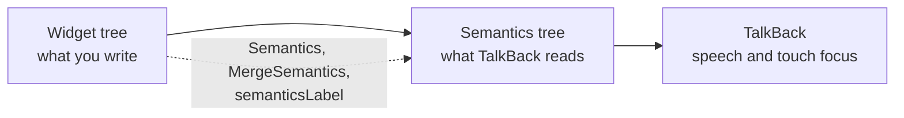

# 09. Accessibility and performance basics

> **Draft: written but not yet run.** The code and the expected output in this lesson were prepared by reading the code and the official documentation. They have not been executed yet. If something does not behave as described, trust your tool's real output and report it.

## What you will be able to do
- Describe how a screen reader (TalkBack on Android) sees a Flutter screen, and shape that view with `Semantics`, `MergeSemantics` and labels.
- Meet the basic targets: touch targets of at least 48 x 48 dp, readable at 200 percent font size, contrast of at least 4.5 : 1, status never shown by colour alone.
- Draw the app at 200 percent text on purpose during development.
- Keep lists cheap: `ListView.builder`, small widgets, keys, `const`, and `select` so only the part that changed rebuilds.
- Say how to measure performance (profile mode, DevTools) instead of guessing.

## Recap
1. Which widget decides that a task whose create is queued says "waiting to sync"? <details><summary>Answer</summary>The tile reads `task.syncState`, which the repository sets to `pending` in the same transaction as the queue row.</details>
2. What does the engine do with a 412? <details><summary>Answer</summary>It parks the row as `conflict` and marks the task `conflict`; the user decides on the queue screen.</details>
3. Why is the banner above the bottom bar? <details><summary>Answer</summary>The top of each screen belongs to its own app bar and the status bar inset.</details>

## Why it matters
Roughly everyone meets the limits of a touch screen at some time: bright sun, one hand, a cracked screen, tired eyes, a shaky bus. For some people the limit is permanent: they use a screen reader, magnification, a very large font or switch access. An app that works for them also works better for everyone else. Accessibility is not a layer added at the end; it is mostly the right choice of widgets and labels. **Performance** is the same kind of quality: a list that drops frames feels broken. Both have cheap, early habits, and both need *measuring*, not guessing.

## What you will build
No new feature. You improve the screens of lesson 08: the task list gets one-item-per-row semantics and labelled buttons, the banner and the "could not refresh" line announce themselves, the detail screen reads as headings and label-value pairs, and a debug switch draws the whole app at 200 percent text. The task list is split into small widgets so a refresh no longer rebuilds it.



## Before you start
- Lesson 08 finished: continue in `tasks_app`.
- Time: 90-110 minutes.
- To hear the result you need TalkBack on a phone or on an emulator image that includes it (Settings > Accessibility > TalkBack). Without it you can still check sizes and the 200 percent text; `showSemanticsDebugger: true` on the `MaterialApp` (temporarily) draws the semantics tree on screen.
- Source pack (optional): every file is shown in full in this lesson, so you can follow without it. The finished code, the exercise starter and the solution are in the
  course repository https://github.com/Uee03/Code101 under `source/flutter/201-hero-to-super-hero/phase-3-offline-and-quality/09-accessibility-and-performance/` (on that page choose **Code, Download ZIP**, or run
  `git clone https://github.com/Uee03/Code101.git`).
- Unchanged from lesson 08 and not repeated: `pubspec.yaml`, the contract and generator files, the Android files, `lib/main.dart`, the router, the app shell, the providers, the data layer (database, tables, repositories, services, sync engine), the login feature, the task composer, the sync queue view model, the task detail and tasks view models, the settings view model, `config/dev.json` and the icons.
- Capstone link: this is the first half of the accessibility requirement M-22 of [mobile-flutter chapter 03: Screens and state](../../../../capstones/mobile-flutter/tutorials/phase-3-screens/03-screens.md); chapter 04 finishes it with the Accessibility Scanner pass.

## Steps
### Step 1. See the app as TalkBack sees it
Flutter builds a second tree next to the widget tree: the **semantics tree**. Each node can carry a label, a role ("button", "heading"), a state ("selected") and actions ("tap"). TalkBack walks this tree, not the pixels. Most Material widgets create good nodes by themselves: a `TextButton` is a button with its text as label, a `TextField` has its label and error text. You step in when the default is not enough:

| Tool | Use it when |
|---|---|
| `Text('Complete', semanticsLabel: 'Complete ${task.title}')` | The visible text is short but the spoken text must say which item |
| `Semantics(header: true, child: ...)` | The text is a heading; users can jump heading to heading |
| `Semantics(liveRegion: true, child: ...)` | The text changes by itself and must be announced (an error line, a banner) |
| `MergeSemantics(child: ...)` | Several widgets are one thing (a label and its value) and should be one stop |
| `ExcludeSemantics` / `excludeFromSemantics` | A widget is decoration (the icons in lesson 03 are excluded unless they have a label) |

### Step 2. A switch for 200 percent text
Android lets people raise the font size in the system settings (up to 200 percent on recent versions). Testing that on every change is slow, so add a debug aid: `--dart-define=TEXT_SCALE=2` makes the app draw all text twice as large. It is ignored outside debug builds. First the constant, then the app widget.

**File: `lib/core/config.dart`**
```dart
abstract final class Config {
  static const apiBase = String.fromEnvironment('API_BASE_URL');
  static const devProjectId = String.fromEnvironment('DEV_PROJECT_ID');

  static const issuer = String.fromEnvironment('OIDC_ISSUER');
  static const clientId = String.fromEnvironment('OIDC_CLIENT_ID');
  static const redirect = String.fromEnvironment('OIDC_REDIRECT_URI');
  static const logout = String.fromEnvironment('OIDC_LOGOUT_URI');

  // The only place that lists the scopes. No admin scope, no client secret.
  static const scopes = [
    'openid',
    'profile',
    'email',
    'offline_access',
    'tasks:read',
    'tasks:write',
  ];

  /// Debug aid: `--dart-define=TEXT_SCALE=2` draws the whole app with 200 percent text.
  /// It is ignored in profile and release builds.
  static const textScale = double.fromEnvironment(
    'TEXT_SCALE',
    defaultValue: 1,
  );
}
```

**File: `lib/app/app.dart`**
```dart
import 'package:flutter/foundation.dart';
import 'package:flutter_riverpod/flutter_riverpod.dart';
import 'package:material_ui/material_ui.dart';

import '../core/config.dart';
import 'providers.dart';
import 'router.dart';

class TasksApp extends ConsumerWidget {
  const TasksApp({super.key});

  @override
  Widget build(BuildContext context, WidgetRef ref) {
    // Keeps the sync engine alive and wired to sign-in and the network.
    ref.watch(syncRunnerProvider);
    return MaterialApp.router(
      title: 'Tasks and Teams',
      routerConfig: ref.watch(routerProvider),
      theme: ThemeData(
        colorScheme: ColorScheme.fromSeed(seedColor: const Color(0xff17467c)),
        materialTapTargetSize: MaterialTapTargetSize.padded,
      ),
      builder: (context, child) {
        final scale = Config.textScale;
        if (!kDebugMode || scale == 1 || child == null) {
          return child ?? const SizedBox.shrink();
        }
        return MediaQuery(
          data: MediaQuery.of(context).copyWith(
            textScaler: TextScaler.linear(scale),
          ),
          child: child,
        );
      },
    );
  }
}
```

Run with both defines when you want it: `flutter run --dart-define-from-file=config/dev.json --dart-define=TEXT_SCALE=2`.

### Step 3. A task row as its own widget
`TaskTile` replaces the inline `ListTile` of the list. Four decisions, each tied to a guideline:

- **One focus stop for reading.** The `ListTile` (title and status) is one item for TalkBack; tapping it opens the task.
- **The button gets its own line.** In lesson 08 the **Complete** button sat in the tile's `trailing`. At 200 percent text that squeezes the title. A button below the tile has all the width it needs.
- **A button that says what it completes.** Without `semanticsLabel`, TalkBack says "Complete, button" for every row. The label says "Complete Write report".
- **A 48 x 48 minimum** (`minimumSize`). Material buttons already pad their tap area (`materialTapTargetSize.padded` in the theme); the explicit size also covers the *visible* area.

Status is words ("To do, waiting to sync"), never only a colour or an icon.

**File: `lib/features/tasks/view/task_tile.dart`**
```dart
import 'package:material_ui/material_ui.dart';

import '../../../data/models/sync_state.dart';
import '../../../data/models/task.dart';

/// One row of the task list. It is a separate widget so the list builder can keep and reuse it.
class TaskTile extends StatelessWidget {
  const TaskTile({
    super.key,
    required this.task,
    required this.onOpen,
    required this.onComplete,
  });

  final Task task;
  final VoidCallback onOpen;
  final VoidCallback onComplete;

  /// Status is always words. The sync state is added as words too, never only a colour.
  String get _subtitle {
    switch (task.syncState) {
      case SyncState.synced:
        return task.status.label;
      case SyncState.pending:
        return '${task.status.label}, waiting to sync';
      case SyncState.conflict:
        return '${task.status.label}, changed elsewhere (see the queue)';
      case SyncState.failed:
        return '${task.status.label}, not sent (see the queue)';
    }
  }

  @override
  Widget build(BuildContext context) {
    return Column(
      crossAxisAlignment: CrossAxisAlignment.start,
      children: [
        ListTile(
          title: Text(task.title),
          subtitle: Text(_subtitle),
          onTap: onOpen,
        ),
        if (!task.isDone)
          Padding(
            padding: const EdgeInsets.only(left: 8),
            child: TextButton(
              style: TextButton.styleFrom(minimumSize: const Size(48, 48)),
              onPressed: onComplete,
              // Without the label a screen reader says "Complete" for every row.
              child: Text('Complete', semanticsLabel: 'Complete ${task.title}'),
            ),
          ),
        const Divider(height: 1),
      ],
    );
  }
}
```

### Step 4. A status widget that watches only what it draws
`RefreshStatus` shows the progress bar and the "could not refresh" line. It watches `tasksRefreshProvider` with **`select`**: `ref.watch(provider.select((state) => state.isLoading))` rebuilds the widget only when that one boolean changes, not for every change of the provider. The tasks screen no longer watches the refresh at all, so the list is not rebuilt when a refresh starts or ends. The error line is a live region, so TalkBack announces it when it appears. `EmptyTasksMessage` does the same for the empty text.

**File: `lib/features/tasks/view/refresh_status.dart`**
```dart
import 'package:flutter_riverpod/flutter_riverpod.dart';
import 'package:material_ui/material_ui.dart';

import '../../../core/problem_messages.dart';
import '../view_model/tasks_view_model.dart';

/// The progress bar and the "could not refresh" line. Both watch only the one value they
/// draw (`select`), so the task list does not rebuild when the refresh starts or ends.
class RefreshStatus extends ConsumerWidget {
  const RefreshStatus({super.key, required this.projectId});

  final String projectId;

  @override
  Widget build(BuildContext context, WidgetRef ref) {
    final provider = tasksRefreshProvider(projectId);
    final loading = ref.watch(provider.select((state) => state.isLoading));
    final error = ref.watch(
      provider.select((state) => state.isLoading ? null : state.error),
    );
    return Column(
      mainAxisSize: MainAxisSize.min,
      children: [
        if (loading)
          const LinearProgressIndicator(semanticsLabel: 'Refreshing tasks'),
        if (error != null)
          Padding(
            padding: const EdgeInsets.symmetric(horizontal: 16),
            child: Wrap(
              crossAxisAlignment: WrapCrossAlignment.center,
              children: [
                // A live region: a screen reader announces the failure when it appears.
                Semantics(
                  liveRegion: true,
                  child: Text('Could not refresh. ${describeError(error)}'),
                ),
                TextButton(
                  onPressed: () => ref.invalidate(provider),
                  child: const Text('Try again'),
                ),
              ],
            ),
          ),
      ],
    );
  }
}

/// The text shown when the list is empty. It says "loading" only while a refresh runs.
class EmptyTasksMessage extends ConsumerWidget {
  const EmptyTasksMessage({super.key, required this.projectId});

  final String projectId;

  @override
  Widget build(BuildContext context, WidgetRef ref) {
    final loading = ref.watch(
      tasksRefreshProvider(projectId).select((state) => state.isLoading),
    );
    return Center(child: Text(loading ? 'Loading tasks...' : 'No tasks yet.'));
  }
}
```

### Step 5. The tasks screen
Compare with lesson 08: it uses the two small widgets, builds `TaskTile`s with a `ValueKey(task.id)`, and gives `ListView.builder` a `findChildIndexCallback`. Keys matter when the list reorders or an item is replaced (lesson 08 swaps a local id for a server id): Flutter can then keep the matching row instead of rebuilding by position.

**File: `lib/features/tasks/view/tasks_screen.dart`**
```dart
import 'package:flutter_riverpod/flutter_riverpod.dart';
import 'package:go_router/go_router.dart';
import 'package:material_ui/material_ui.dart';

import '../../../core/problem_messages.dart';
import '../view_model/tasks_view_model.dart';
import 'refresh_status.dart';
import 'task_composer.dart';
import 'task_tile.dart';

class TasksScreen extends ConsumerWidget {
  const TasksScreen({super.key, required this.projectId});

  final String projectId;

  /// Waits for a view model command and shows its failure message, if any.
  Future<void> _run(BuildContext context, Future<Object?> command) async {
    final failure = await command;
    if (failure == null || !context.mounted) {
      return;
    }
    ScaffoldMessenger.of(context).showSnackBar(
      SnackBar(content: Text(describeError(failure))),
    );
  }

  @override
  Widget build(BuildContext context, WidgetRef ref) {
    final provider = tasksViewModelProvider(projectId);
    final tasks = ref.watch(provider);
    final viewModel = ref.read(provider.notifier);

    return Scaffold(
      appBar: AppBar(title: const Text('Tasks')),
      body: Column(
        children: [
          TaskComposer(
            onSubmit: (title) async {
              final failure = await viewModel.add(title);
              if (failure == null) {
                return null;
              }
              return fieldMessage(failure, '/title') ?? describeError(failure);
            },
          ),
          RefreshStatus(projectId: projectId),
          Expanded(
            child: tasks.when(
              loading: () => const Center(child: CircularProgressIndicator()),
              error: (error, stackTrace) => const Center(
                child: Padding(
                  padding: EdgeInsets.all(24),
                  child: Text(
                    'The saved tasks could not be read.',
                    textAlign: TextAlign.center,
                  ),
                ),
              ),
              data: (items) {
                if (items.isEmpty) {
                  return EmptyTasksMessage(projectId: projectId);
                }
                return ListView.builder(
                  itemCount: items.length,
                  // A task keeps its widget (and its state) when the list reorders.
                  findChildIndexCallback: (key) {
                    if (key is! ValueKey<String>) {
                      return null;
                    }
                    final index = items.indexWhere((t) => t.id == key.value);
                    return index == -1 ? null : index;
                  },
                  itemBuilder: (context, index) {
                    final task = items[index];
                    return TaskTile(
                      key: ValueKey(task.id),
                      task: task,
                      onOpen: () => context.push(
                        '/tasks/${Uri.encodeComponent(task.id)}',
                      ),
                      onComplete: () =>
                          _run(context, viewModel.complete(task)),
                    );
                  },
                );
              },
            ),
          ),
        ],
      ),
    );
  }
}
```

### Step 6. The banner
Two changes. `Wrap` instead of `Row`: at 200 percent the buttons move to the next line instead of overflowing. And only the **message** is a live region; with the whole banner as live region a screen reader would also read the buttons on every change.

**File: `lib/core/widgets/offline_banner.dart`**
```dart
import 'package:flutter_riverpod/flutter_riverpod.dart';
import 'package:go_router/go_router.dart';
import 'package:material_ui/material_ui.dart';

import '../../../app/providers.dart';

/// Shows when the phone is offline or writes are still waiting. Hidden otherwise.
class OfflineBanner extends ConsumerWidget {
  const OfflineBanner({super.key});

  static String _changes(int count) {
    return count == 1 ? '1 change' : '$count changes';
  }

  @override
  Widget build(BuildContext context, WidgetRef ref) {
    final online = ref.watch(onlineProvider).value ?? true;
    final pending = ref.watch(pendingCountProvider).value ?? 0;
    if (online && pending == 0) {
      return const SizedBox.shrink();
    }
    final String text;
    if (!online && pending == 0) {
      text = 'You are offline. Saved tasks are shown.';
    } else if (!online) {
      text = 'You are offline. ${_changes(pending)} not on the server yet.';
    } else {
      text = '${_changes(pending)} not on the server yet.';
    }
    final scheme = Theme.of(context).colorScheme;
    return Material(
      color: scheme.secondaryContainer,
      child: Padding(
        padding: const EdgeInsets.symmetric(horizontal: 16, vertical: 4),
        // Wrap instead of Row: at 200 percent text the buttons move to the next line.
        child: Wrap(
          crossAxisAlignment: WrapCrossAlignment.center,
          children: [
            // Only the message is a live region. The buttons are not read out on every change.
            Semantics(
              liveRegion: true,
              child: Text(
                text,
                style: TextStyle(color: scheme.onSecondaryContainer),
              ),
            ),
            if (online && pending > 0)
              TextButton(
                onPressed: () => ref.read(syncEngineProvider).drain(),
                child: const Text('Sync now'),
              ),
            TextButton(
              onPressed: () => context.push('/settings/sync'),
              child: const Text('Queue', semanticsLabel: 'Open the sync queue'),
            ),
          ],
        ),
      ),
    );
  }
}
```

### Step 7. The detail screen
The title is a heading. Each pair "label and value" is a `MergeSemantics`, so TalkBack says "Status, To do" in one step instead of two. The new `Sync` row says in words whether the task is on the server.

**File: `lib/features/task_detail/view/task_detail_screen.dart`**
```dart
import 'package:flutter_riverpod/flutter_riverpod.dart';
import 'package:material_ui/material_ui.dart';

import '../../../core/problem_messages.dart';
import '../../../data/models/sync_state.dart';
import '../../../data/models/task.dart';
import '../view_model/task_detail_view_model.dart';

class TaskDetailScreen extends ConsumerWidget {
  const TaskDetailScreen({super.key, required this.taskId});

  final String taskId;

  @override
  Widget build(BuildContext context, WidgetRef ref) {
    final task = ref.watch(taskDetailProvider(taskId));
    final refresh = ref.watch(taskDetailRefreshProvider(taskId));
    return Scaffold(
      appBar: AppBar(title: const Text('Task')),
      body: task.when(
        loading: () => const Center(child: CircularProgressIndicator()),
        error: (error, stackTrace) =>
            const _Message('The saved task could not be read.'),
        data: (item) {
          if (item != null) {
            return _TaskBody(
              item: item,
              refreshNote: refresh.hasError && !refresh.isLoading
                  ? 'Showing the saved copy. ${describeError(refresh.error!)}'
                  : null,
            );
          }
          return refresh.when(
            loading: () => const Center(child: CircularProgressIndicator()),
            error: (error, stackTrace) => _Message(describeError(error)),
            data: (_) => const _Message('That task is not available.'),
          );
        },
      ),
    );
  }
}

class _TaskBody extends StatelessWidget {
  const _TaskBody({required this.item, this.refreshNote});

  final Task item;
  final String? refreshNote;

  String get _syncText {
    switch (item.syncState) {
      case SyncState.synced:
        return 'On the server';
      case SyncState.pending:
        return 'Waiting to sync';
      case SyncState.conflict:
        return 'Changed elsewhere, see the sync queue';
      case SyncState.failed:
        return 'Not sent, see the sync queue';
    }
  }

  @override
  Widget build(BuildContext context) {
    return ListView(
      padding: const EdgeInsets.all(16),
      children: [
        if (refreshNote != null) ...[
          Semantics(liveRegion: true, child: Text(refreshNote!)),
          const SizedBox(height: 12),
        ],
        // header: a screen reader user can jump from heading to heading.
        Semantics(
          header: true,
          child: Text(
            item.title,
            style: Theme.of(context).textTheme.headlineSmall,
          ),
        ),
        const SizedBox(height: 8),
        _Field('Status', item.status.label),
        _Field('Priority', item.priority.name),
        _Field('Due', item.dueDate ?? 'no due date'),
        _Field('Sync', _syncText),
        _Field('Version', '${item.version}'),
        const SizedBox(height: 16),
        _Field(
          'Description',
          item.description.isEmpty ? 'No description.' : item.description,
        ),
      ],
    );
  }
}

/// A label and a value. MergeSemantics makes a screen reader say them as one item.
class _Field extends StatelessWidget {
  const _Field(this.label, this.value);

  final String label;
  final String value;

  @override
  Widget build(BuildContext context) {
    final styles = Theme.of(context).textTheme;
    return MergeSemantics(
      child: Padding(
        padding: const EdgeInsets.symmetric(vertical: 4),
        child: Column(
          crossAxisAlignment: CrossAxisAlignment.start,
          children: [
            Text(label, style: styles.labelMedium),
            Text(value, style: styles.bodyLarge),
          ],
        ),
      ),
    );
  }
}

class _Message extends StatelessWidget {
  const _Message(this.text);

  final String text;

  @override
  Widget build(BuildContext context) {
    return Center(
      child: Padding(
        padding: const EdgeInsets.all(24),
        child: Text(text, textAlign: TextAlign.center),
      ),
    );
  }
}
```

### Step 8. Settings and the queue
Buttons that sit next to a row get labels that say what they do (`Test connection`, `Delete offline data`), and **Sign out** gets the 48 dp minimum. On the queue screen each card is one spoken item (`MergeSemantics`) and the two buttons say which task they act on.

**File: `lib/features/settings/view/settings_screen.dart`**
```dart
import 'package:flutter_riverpod/flutter_riverpod.dart';
import 'package:go_router/go_router.dart';
import 'package:material_ui/material_ui.dart';

import '../../../app/providers.dart';
import '../../../core/problem_messages.dart';
import '../../login/view_model/auth_controller.dart';
import '../view_model/settings_view_model.dart';

class SettingsScreen extends ConsumerWidget {
  const SettingsScreen({super.key});

  Future<void> _deleteOfflineData(BuildContext context, WidgetRef ref) async {
    final pending = ref.read(pendingCountProvider).value ?? 0;
    if (pending > 0) {
      final confirmed = await showDialog<bool>(
        context: context,
        builder: (dialogContext) => AlertDialog(
          title: const Text('Delete offline data?'),
          content: Text(
            '$pending changes are not on the server yet. '
            'Deleting the offline data deletes them too.',
          ),
          actions: [
            TextButton(
              onPressed: () => Navigator.of(dialogContext).pop(false),
              child: const Text('Keep'),
            ),
            TextButton(
              onPressed: () => Navigator.of(dialogContext).pop(true),
              child: const Text('Delete'),
            ),
          ],
        ),
      );
      if (confirmed != true || !context.mounted) {
        return;
      }
    }
    await ref.read(settingsViewModelProvider).deleteOfflineData();
    if (!context.mounted) {
      return;
    }
    ScaffoldMessenger.of(context).showSnackBar(
      const SnackBar(content: Text('Offline data deleted.')),
    );
  }

  @override
  Widget build(BuildContext context, WidgetRef ref) {
    final connection = ref.watch(connectionTestProvider);
    final pending = ref.watch(pendingCountProvider).value ?? 0;
    return Scaffold(
      appBar: AppBar(title: const Text('Settings')),
      body: ListView(
        children: [
          const ListTile(
            title: Text('Account'),
            subtitle: Text('Signed in'),
          ),
          ListTile(
            title: const Text('Connection'),
            subtitle: Text(
              connection.when(
                loading: () => 'Testing...',
                error: (error, stackTrace) => describeError(error),
                data: (text) => text,
              ),
            ),
            trailing: TextButton(
              onPressed: () => ref.invalidate(connectionTestProvider),
              child: const Text('Test', semanticsLabel: 'Test connection'),
            ),
          ),
          ListTile(
            title: const Text('Sync queue'),
            subtitle: Text(
              pending == 0 ? 'Nothing is waiting' : '$pending not sent yet',
            ),
            onTap: () => context.push('/settings/sync'),
          ),
          ListTile(
            title: const Text('Offline data'),
            subtitle: const Text('Tasks saved on this phone'),
            trailing: TextButton(
              onPressed: () => _deleteOfflineData(context, ref),
              child: const Text(
                'Delete',
                semanticsLabel: 'Delete offline data',
              ),
            ),
          ),
          Padding(
            padding: const EdgeInsets.all(16),
            child: Align(
              alignment: Alignment.centerLeft,
              child: OutlinedButton(
                style: OutlinedButton.styleFrom(
                  minimumSize: const Size(48, 48),
                ),
                onPressed: () =>
                    ref.read(authControllerProvider.notifier).signOut(),
                child: const Text('Sign out'),
              ),
            ),
          ),
        ],
      ),
    );
  }
}
```

**File: `lib/features/sync/view/sync_screen.dart`**
```dart
import 'package:flutter_riverpod/flutter_riverpod.dart';
import 'package:material_ui/material_ui.dart';

import '../view_model/sync_view_model.dart';

class SyncScreen extends ConsumerWidget {
  const SyncScreen({super.key});

  @override
  Widget build(BuildContext context, WidgetRef ref) {
    final lines = ref.watch(syncQueueProvider);
    final viewModel = ref.read(syncViewModelProvider);
    return Scaffold(
      appBar: AppBar(title: const Text('Sync queue')),
      body: lines.when(
        loading: () => const Center(child: CircularProgressIndicator()),
        error: (error, stackTrace) => const Center(
          child: Text('The queue could not be read.'),
        ),
        data: (items) {
          if (items.isEmpty) {
            return const Center(
              child: Padding(
                padding: EdgeInsets.all(24),
                child: Text(
                  'Nothing is waiting. Every change is on the server.',
                  textAlign: TextAlign.center,
                ),
              ),
            );
          }
          return ListView.builder(
            padding: const EdgeInsets.all(16),
            itemCount: items.length,
            itemBuilder: (context, index) {
              final line = items[index];
              return Card(
                child: Padding(
                  padding: const EdgeInsets.all(16),
                  child: Column(
                    crossAxisAlignment: CrossAxisAlignment.start,
                    children: [
                      // One spoken item per card: title, kind and status together.
                      MergeSemantics(
                        child: Column(
                          crossAxisAlignment: CrossAxisAlignment.start,
                          children: [
                            Text(
                              line.title,
                              style: Theme.of(context).textTheme.titleMedium,
                            ),
                            Text(line.kind),
                            Text(line.status),
                          ],
                        ),
                      ),
                      OverflowBar(
                        children: [
                          TextButton(
                            onPressed: () => viewModel.retry(line.row),
                            child: Text(
                              'Retry now',
                              semanticsLabel: 'Retry sending ${line.title}',
                            ),
                          ),
                          TextButton(
                            onPressed: () => viewModel.discard(line.row),
                            child: Text(
                              'Discard',
                              semanticsLabel: 'Discard change to ${line.title}',
                            ),
                          ),
                        ],
                      ),
                    ],
                  ),
                ),
              );
            },
          );
        },
      ),
    );
  }
}
```

### Step 9. Contrast and colour
Nothing to type. The theme comes from `ColorScheme.fromSeed`, whose pairs (for example `secondaryContainer` and `onSecondaryContainer`) are designed to be readable together; the banner uses such a pair. Whenever you pick colours by hand, **measure**: WCAG 2.x asks for a contrast ratio of at least 4.5 : 1 for normal text. The exercise computes the ratio, so you know what a checker does. Never use colour as the only signal: "failed" is written out in the list line, not only red.

### Step 10. Measure performance
Debug mode is slow on purpose (extra checks, no ahead-of-time compilation), so **never judge speed in debug**. The routine:

1. Run in profile mode on a real phone: `flutter run --profile --dart-define-from-file=config/dev.json`.
2. Open DevTools (the link `flutter run` prints). In the **Performance** view record while you scroll the list and watch the frame chart: a frame that exceeds the frame budget (about 16 ms at 60 Hz, less at 120 Hz) is *jank*. Look at whether the slow part is the UI thread (your build code) or the raster thread (painting).
3. In the **Inspector**, "Track widget rebuilds" shows which widgets rebuild when you refresh. After Step 4 the list should not light up when the progress bar appears.
4. Write down what you measured before and after a change. Do not keep an "optimisation" you cannot show.

## Run it
Run `flutter run --dart-define-from-file=config/dev.json --dart-define=TEXT_SCALE=2`.

Expected behaviour (described from the code, not yet seen):
1. All text is about twice as large. The task rows stack title, status and the **Complete** button vertically; nothing is cut off or overflows (a yellow-black striped bar would mean an overflow).
2. Go offline: the banner text wraps and the buttons sit below it.
3. Run again without `TEXT_SCALE`, enable TalkBack and swipe through the Tasks tab: each task is announced with title and status ("Write report, To do"), then "Complete Write report, button". The error line, when it appears, is announced by itself.
4. Open a task: the title is announced as a heading; "Status, To do" is one stop.
5. In Android's **Accessibility Scanner** (a separate app from Google; optional) the screens should show no small-target or missing-label hints. Treat its output as hints, not proof.

## How it works
**The semantics tree is built from the widget tree.** `Semantics` adds or changes a node, `MergeSemantics` fuses the nodes of its subtree into one, `ExcludeSemantics` removes them. A node's label is read aloud; its role and actions are spoken as "button, double tap to activate".

**Touch targets.** The Android guidance is 48 x 48 dp (about 9 mm), with space between targets. Flutter's `MaterialTapTargetSize.padded` gives a small control a 48 dp *hit area*; `minimumSize` also makes the *visible* control that big.

**Text scaling.** A layout that assumes a text height breaks when the text doubles. Prefer `Column`, `Wrap`, `OverflowBar` and flexible widths over fixed heights, and never set a fixed height on a widget that contains text.

**What `select` does.** `ref.watch(provider)` rebuilds the widget on every new value. `ref.watch(provider.select(f))` rebuilds only when `f(value)` changes (compared with `==`). Two booleans from one `AsyncValue` become two small widgets that rebuild rarely.

**What `ListView.builder` does.** It builds only the rows near the visible area, as you scroll. A plain `ListView(children: [...])` builds every child at once. Keys let the builder find a row again after the list changed.

**`const` and widget size.** A `const` widget instance is created once and Flutter can skip it during a rebuild. Small, focused widgets (`TaskTile`, `RefreshStatus`) limit what a rebuild touches. This is a habit, not a number: measure before you do more.

### Why this, not that
| Choice | Alternative | Why |
|---|---|---|
| `semanticsLabel` on the visible text | A separate hidden `Semantics` wrapper | One place to read; the label stays next to the text it explains. |
| Button on its own line | `trailing` of the `ListTile` | The title keeps its width at 200 percent text. |
| `Wrap` in the banner | `Row` with `Expanded` | Controls move to a new line instead of shrinking the message to nothing. |
| Live region on the message only | Live region on the whole banner | The buttons are not re-announced on every change. |
| `select` | Splitting by hand with `setState` | The provider already knows what changed; compare one value. |
| Profile mode and DevTools | Guessing from the debug build | Debug timings are not the real ones. |

Common misconception: "Accessibility is about blind users, so it is a niche." Large text, one-handed use, voice control and bright sunlight all use the same features; the 48 dp target and the clear labels help everyone.

## Try it
The exercise computes the WCAG contrast ratio and a target-size check in plain Dart. Make a folder `try09`, save the starter as `main.dart` and run `dart run main.dart`.

**File: `exercise/starter/main.dart`**
```dart
// Exercise 09: is this text readable? Run with: dart run main.dart
import 'dart:math';

/// A colour as red, green and blue, each from 0 to 255.
class Rgb {
  const Rgb(this.red, this.green, this.blue);

  final int red;
  final int green;
  final int blue;
}

/// WCAG 2.x: one channel from the stored sRGB value to linear light.
double linear(int channel) {
  final c = channel / 255;
  // TODO 1: when c <= 0.04045 return c / 12.92.
  //         Otherwise return ((c + 0.055) / 1.055) raised to the power 2.4.
  //         (pow comes from dart:math and returns a num: call .toDouble()).
  return c;
}

double luminance(Rgb colour) {
  return 0.2126 * linear(colour.red) +
      0.7152 * linear(colour.green) +
      0.0722 * linear(colour.blue);
}

double contrast(Rgb first, Rgb second) {
  // TODO 2: (lighter luminance + 0.05) / (darker luminance + 0.05).
  return 1;
}

/// Text needs a ratio of at least 4.5 : 1 (WCAG 2.x level AA, normal size).
bool textIsReadable(Rgb text, Rgb background) {
  return contrast(text, background) >= 4.5;
}

/// A touch target should be at least 48 x 48 dp.
bool targetIsBigEnough(double widthDp, double heightDp) {
  return widthDp >= 48 && heightDp >= 48;
}

void report(String label, Rgb text, Rgb background) {
  final ratio = contrast(text, background).toStringAsFixed(2);
  final verdict = textIsReadable(text, background) ? 'pass' : 'fail';
  print('$label: $ratio $verdict');
}

void main() {
  const white = Rgb(255, 255, 255);
  report('black on white', const Rgb(0, 0, 0), white);
  report('grey 767676 on white', const Rgb(0x76, 0x76, 0x76), white);
  report('grey 777777 on white', const Rgb(0x77, 0x77, 0x77), white);
  report('white on white', white, white);
  print('target 48 x 48: ${targetIsBigEnough(48, 48) ? 'ok' : 'too small'}');
  print('target 40 x 48: ${targetIsBigEnough(40, 48) ? 'ok' : 'too small'}');
}
```

1. **Guided:** complete the two TODOs. Expected output:
```text
black on white: 21.00 pass
grey 767676 on white: 4.54 pass
grey 777777 on white: 4.48 fail
white on white: 1.00 fail
target 48 x 48: ok
target 40 x 48: too small
```
Before the change every contrast line shows `1.00 fail`.
2. **Change:** add a line for the banner colours of your theme (take two colours from a colour picker or from `ColorScheme.fromSeed` printed with `toString`). Does the pair pass?
3. **Stretch (optional):** WCAG asks only 3 : 1 for *large* text (18 pt, or 14 pt bold). Add a `largeText` parameter to `textIsReadable`. Why is a lower bar acceptable for large text?

<details><summary>Solution</summary>

**File: `exercise/solution/main.dart`**
```dart
// Exercise 09: is this text readable? Run with: dart run main.dart
import 'dart:math';

/// A colour as red, green and blue, each from 0 to 255.
class Rgb {
  const Rgb(this.red, this.green, this.blue);

  final int red;
  final int green;
  final int blue;
}

/// WCAG 2.x: one channel from the stored sRGB value to linear light.
double linear(int channel) {
  final c = channel / 255;
  if (c <= 0.04045) {
    return c / 12.92;
  }
  return pow((c + 0.055) / 1.055, 2.4).toDouble();
}

double luminance(Rgb colour) {
  return 0.2126 * linear(colour.red) +
      0.7152 * linear(colour.green) +
      0.0722 * linear(colour.blue);
}

double contrast(Rgb first, Rgb second) {
  final a = luminance(first);
  final b = luminance(second);
  final lighter = max(a, b);
  final darker = min(a, b);
  return (lighter + 0.05) / (darker + 0.05);
}

/// Text needs a ratio of at least 4.5 : 1 (WCAG 2.x level AA, normal size).
bool textIsReadable(Rgb text, Rgb background) {
  return contrast(text, background) >= 4.5;
}

/// A touch target should be at least 48 x 48 dp.
bool targetIsBigEnough(double widthDp, double heightDp) {
  return widthDp >= 48 && heightDp >= 48;
}

void report(String label, Rgb text, Rgb background) {
  final ratio = contrast(text, background).toStringAsFixed(2);
  final verdict = textIsReadable(text, background) ? 'pass' : 'fail';
  print('$label: $ratio $verdict');
}

void main() {
  const white = Rgb(255, 255, 255);
  report('black on white', const Rgb(0, 0, 0), white);
  report('grey 767676 on white', const Rgb(0x76, 0x76, 0x76), white);
  report('grey 777777 on white', const Rgb(0x77, 0x77, 0x77), white);
  report('white on white', white, white);
  print('target 48 x 48: ${targetIsBigEnough(48, 48) ? 'ok' : 'too small'}');
  print('target 40 x 48: ${targetIsBigEnough(40, 48) ? 'ok' : 'too small'}');
}
```

The formula comes from the WCAG definitions of relative luminance and contrast ratio. `#767676` is the lightest grey that reaches 4.5 : 1 on white; one step lighter fails.

</details>

## Check yourself
1. Why give the **Complete** button a `semanticsLabel`? <details><summary>Answer</summary>Every row would otherwise say just "Complete, button"; the label says which task it completes.</details>
2. A fixed `SizedBox(height: 56)` around a `Text` works at normal size. What happens at 200 percent? <details><summary>Answer</summary>The text needs more height than the box gives; it overflows or is cut off. Let the text decide the height.</details>
3. What rebuilds when a refresh starts, after Step 4? <details><summary>Answer</summary>Only `RefreshStatus` (its `loading` value changed) and, if the list is empty, `EmptyTasksMessage`. The list does not.</details>
4. Predict: you build the app in debug mode and the list scrolls with small stutters. Is that proof of a performance problem? <details><summary>Answer</summary>No. Debug builds are slower by design. Measure in profile mode on a real phone.</details>

## Common mistakes
| Symptom or error text | Cause | Fix |
|---|---|---|
| A yellow and black striped bar and "RIGHT OVERFLOWED BY ... PIXELS" (typical) | A `Row` or fixed size cannot hold text at 200 percent | Use `Wrap`, `Expanded`, `OverflowBar` or let the text wrap |
| TalkBack reads every button as just "Complete" | No label that names the item | `semanticsLabel` with the item's name |
| TalkBack reads a label and its value as two separate stops | Two `Text` widgets in a `Column` | Wrap the pair in `MergeSemantics` |
| The banner is read again and again | The live region wraps a changing subtree with buttons | Make only the message a live region |
| `TEXT_SCALE` has no effect | Release or profile build, or the define is missing | It works only in debug, with `--dart-define=TEXT_SCALE=2` |
| The list rebuilds when the progress bar appears | The screen watches the whole refresh provider | Watch one value with `select` in a small widget |
| A speed-up "measured" in debug mode | Debug mode distorts timings | Profile mode on a device |

## Best practice
Choose standard widgets, label what they cannot say themselves, size targets at 48 dp, test at 200 percent text with a screen reader, and measure performance in profile mode before and after every change. Source: [Flutter accessibility](https://docs.flutter.dev/ui/accessibility), [Android accessibility principles](https://developer.android.com/guide/topics/ui/accessibility/principles), [WCAG 2.2 contrast (minimum)](https://www.w3.org/WAI/WCAG22/Understanding/contrast-minimum.html), [Flutter performance best practices](https://docs.flutter.dev/perf/best-practices) and [DevTools performance](https://docs.flutter.dev/tools/devtools/performance)

## Going further
- Read the Flutter page on [Semantics](https://api.flutter.dev/flutter/widgets/Semantics-class.html) and look at the other properties (`button`, `selected`, `hint`, `sortKey`).
- Reading order: TalkBack follows the widget order. `Semantics(sortKey: ...)` with `OrdinalSortKey` changes it when layout and reading order differ.
- Localisation of the labels (`lib/l10n/app_en.arb`) belongs to the capstone (M-23).

## Summary
- You shaped what a screen reader reads: labels, headings, merged pairs, live regions.
- You made the targets 48 dp, the layouts survive large text, and status readable without colour.
- You added a debug switch for 200 percent text.
- You split the list into small widgets with keys and used `select`, and you know how to measure in profile mode.

## Next lesson
10. Project: a task app against the platform contract. Teams, projects, a task form with `If-Match`, and the way on to the capstone.
