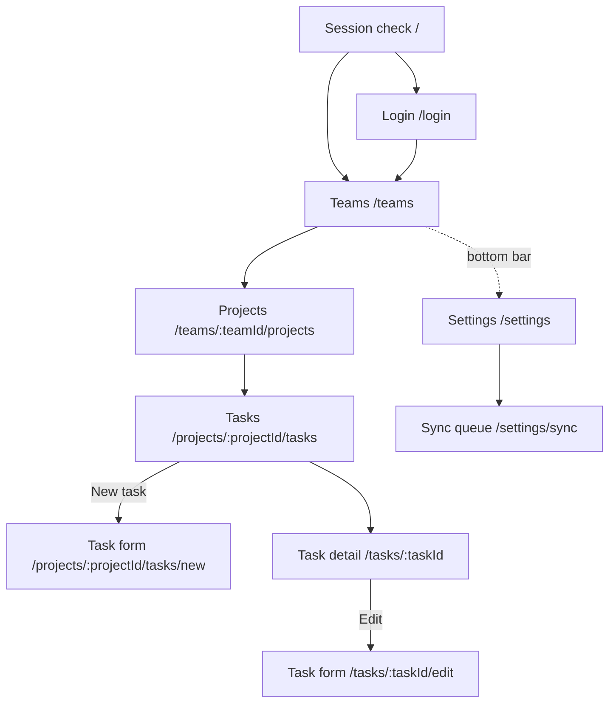

# 10. Project: a task app against the platform contract

> **Draft: written but not yet run.** The code and the expected output in this lesson were prepared by reading the code and the official documentation. They have not been executed yet. If something does not behave as described, trust your tool's real output and report it.

## What you will be able to do
- Build a complete, small app on the platform contract: **teams, projects, tasks, a task form**, all reading from the local database and writing through the queue.
- Send a **JSON Merge Patch** with `If-Match`, and say why one request is hand-written next to a generated client.
- Merge a new edit into a queued write that has not been sent, and resolve a version conflict (**Keep mine** or **Take theirs**).
- Add a third numbered database migration.
- Name the parts that the capstone adds on top of this app.

## Recap
1. Why does a failed row block later rows about the same task? <details><summary>Answer</summary>Later writes depend on the earlier one; sending them first would break the order.</details>
2. Which value does `Idempotency-Key` carry? <details><summary>Answer</summary>The id of the queue row of the create. A retry reuses it, so the server cannot create a second task.</details>
3. Why is `Semantics(liveRegion: true)` on the banner message only? <details><summary>Answer</summary>So the buttons are not read out again every time the message changes.</details>

## Why it matters
Lessons 01 to 09 each added one idea. A real app needs them to work **together**, and the seams are where bugs live: an edit that arrives while the create of the same task is still queued, a version that moved on while the form was open, a double tap on **Save**. This project joins the pieces against the contract that every backend of the course implements, so the same app talks to the ASP.NET, Python and Go backends alike.

## What you will build
The finished 201 app, with these screens (the route keys equal the capstone's):



| Requirement | Capstone id | Where in this lesson |
|---|---|---|
| Teams and projects list from the cache and refresh | M-10 | Steps 8 and 11 |
| Task list with status in words | M-11 (first page only) | Step 12 |
| Create and edit validate against the OpenAPI limits; one `Idempotency-Key` per form | M-13 | Step 13 |
| Edit sends `If-Match` and a merge patch with only the changed fields; `null` clears the due date | M-13 | Steps 5, 6 and 13 |
| Screens render from the local database; writes go through a durable queue | M-18, M-19 | Steps 7 and 8 |
| Offline banner and queue screen | M-20 | Lesson 08 |
| A version conflict can be resolved | M-17 (simplified) | Step 14 |
| 48 dp targets, large text, status not by colour | M-22 (first half) | Lesson 09 |

## Before you start
- Lesson 09 finished: continue in `tasks_app`.
- Time: 150-180 minutes. It is the longest lesson; take a break after Step 9.
- Source pack (optional): every file that changes is shown in full in this lesson, so you can follow without it. The finished code, the exercise starter and the solution are in the
  course repository https://github.com/Uee03/Code101 under `source/flutter/201-hero-to-super-hero/phase-3-offline-and-quality/10-project-task-app/` (on that page choose **Code, Download ZIP**, or run
  `git clone https://github.com/Uee03/Code101.git`).
- Delete `lib/features/tasks/view/task_composer.dart` and `lib/features/tasks/view/refresh_status.dart`: the composer is replaced by a form, and the refresh widget moves to `lib/core/widgets/` so teams and projects can use it too.
- Unchanged from lesson 09 and not repeated: `pubspec.yaml`, the contract and generator files, the Android files, `lib/main.dart`, `lib/app/app.dart`, `lib/core/api_problem.dart`, `auth_errors.dart`, `problem_messages.dart`, `result.dart`, `url_policy.dart`, `art_icon.dart`, the offline banner, the session model, `sync_state.dart`, `task.dart`, the auth repository and services, the interceptors, the connectivity service, `backoff.dart`, the login feature, the settings feature, the task tile, the task detail view model and the icons.
- Capstone link: this lesson is the 201 version of [mobile-flutter chapter 03: Screens and state](../../../../capstones/mobile-flutter/tutorials/phase-3-screens/03-screens.md) and chapter 04. The capstone continues with the full app (see "Where to go next").

## Steps
### Step 1. Read the contract before you code
The operations this lesson uses, all from the platform `openapi.yaml` (generated by `swagger_parser`, so the names are `listTeams`, `listProjects`, `listTasks`, `createTask`, `updateTask`, `completeTask`):

| Screen | Operation | What the app sends | Success | Failures it handles |
|---|---|---|---|---|
| Teams | `listTeams` (`limit` 25) | bearer token | 200 | 401, 429 |
| Projects | `listProjects` | bearer token | 200 | 404 (not a member) |
| Tasks | `listTasks` | bearer token | 200 | 400, 404 |
| Task form (create) | `createTask` | `Idempotency-Key` | 201 (also a replay) | 409, 422 |
| Task form (edit) | `updateTask` | `If-Match: "<version>"`, `application/merge-patch+json` | 200 | 412 conflict, 422, 428 (a bug of ours: never send without) |

### Step 2. Order of work
Follow this order, because each step compiles on the one before: configuration and schema (3 and 4), models (5), services (6), the queue (7), repositories (8), providers (9), the shared widget (10), screens (11 to 14), router (15).

### Step 3. Configuration
The project picker replaces the fixed project: remove `DEV_PROJECT_ID` from the config and from the defines file.

**File: `config/dev.json`**
```json
{
  "API_BASE_URL": "http://10.0.2.2:8000",
  "OIDC_ISSUER": "http://localhost:8180/realms/tasksteams",
  "OIDC_CLIENT_ID": "tasks-mobile",
  "OIDC_REDIRECT_URI": "com.code101.tasks:/oauth2redirect",
  "OIDC_LOGOUT_URI": "com.code101.tasks:/logout"
}
```

**File: `lib/core/config.dart`**
```dart
abstract final class Config {
  static const apiBase = String.fromEnvironment('API_BASE_URL');

  static const issuer = String.fromEnvironment('OIDC_ISSUER');
  static const clientId = String.fromEnvironment('OIDC_CLIENT_ID');
  static const redirect = String.fromEnvironment('OIDC_REDIRECT_URI');
  static const logout = String.fromEnvironment('OIDC_LOGOUT_URI');

  // The only place that lists the scopes. No admin scope, no client secret.
  static const scopes = [
    'openid',
    'profile',
    'email',
    'offline_access',
    'tasks:read',
    'tasks:write',
  ];

  /// Debug aid: `--dart-define=TEXT_SCALE=2` draws the whole app with 200 percent text.
  /// It is ignored in profile and release builds.
  static const textScale = double.fromEnvironment(
    'TEXT_SCALE',
    defaultValue: 1,
  );
}
```

### Step 4. Database version 3: teams and projects
Two new tables, and a third numbered migration step. `Projects` has a column named `key` (the short code like `MOB`); drift quotes it. Run the generator after this step.

**File: `lib/data/local/tables.dart`**
```dart
import 'package:drift/drift.dart';

@DataClassName('TeamRow')
class Teams extends Table {
  TextColumn get id => text()();
  TextColumn get name => text()();
  TextColumn get description => text().withDefault(const Constant(''))();
  IntColumn get memberCount => integer().withDefault(const Constant(0))();
  IntColumn get version => integer().withDefault(const Constant(1))();

  @override
  Set<Column> get primaryKey => {id};
}

@DataClassName('ProjectRow')
@TableIndex(name: 'projects_by_team', columns: {#teamId})
class Projects extends Table {
  TextColumn get id => text()();
  TextColumn get teamId => text()();
  TextColumn get key => text()();
  TextColumn get name => text()();
  TextColumn get description => text().withDefault(const Constant(''))();
  BoolColumn get archived => boolean().withDefault(const Constant(false))();
  IntColumn get version => integer().withDefault(const Constant(1))();

  @override
  Set<Column> get primaryKey => {id};
}

@DataClassName('TaskRow')
@TableIndex(name: 'tasks_by_project', columns: {#projectId, #createdAt})
class Tasks extends Table {
  TextColumn get id => text()();
  TextColumn get projectId => text()();
  TextColumn get title => text()();
  TextColumn get description => text().withDefault(const Constant(''))();
  TextColumn get status => text()();
  TextColumn get priority => text()();
  TextColumn get dueDate => text().nullable()();
  IntColumn get version => integer().withDefault(const Constant(1))();
  DateTimeColumn get createdAt => dateTime()();
  TextColumn get syncState => text().withDefault(const Constant('synced'))();

  @override
  Set<Column> get primaryKey => {id};
}

/// One row per write the server has not accepted yet.
@DataClassName('OutboxRow')
@TableIndex(name: 'outbox_by_state', columns: {#state, #nextAttemptAt})
@TableIndex(name: 'outbox_by_entity', columns: {#entityId, #seq})
class Outbox extends Table {
  // SQLite allows AUTOINCREMENT only on the primary key, so seq is the key
  // and id (the Idempotency-Key) is unique.
  IntColumn get seq => integer().autoIncrement()();
  TextColumn get id => text().unique()();
  TextColumn get kind => text()();
  TextColumn get entityId => text()();
  TextColumn get payload => text()();
  IntColumn get baseVersion => integer().nullable()();
  TextColumn get state => text().withDefault(const Constant('pending'))();
  IntColumn get attempts => integer().withDefault(const Constant(0))();
  IntColumn get nextAttemptAt => integer().withDefault(const Constant(0))();
  TextColumn get lastProblemType => text().nullable()();
  IntColumn get createdAt => integer()();
}
```

**File: `lib/data/local/database.dart`**
```dart
import 'package:drift/drift.dart';
import 'package:drift_flutter/drift_flutter.dart';

import 'tables.dart';

part 'database.g.dart';

@DriftDatabase(tables: [Teams, Projects, Tasks, Outbox])
class AppDatabase extends _$AppDatabase {
  AppDatabase([QueryExecutor? executor])
      : super(executor ?? driftDatabase(name: 'tasksteams'));

  @override
  int get schemaVersion => 3;

  /// Numbered steps: a phone that has version 1 runs only the steps after it.
  /// Never edit a step that has shipped; add a new one.
  @override
  MigrationStrategy get migration {
    return MigrationStrategy(
      onCreate: (migrator) => migrator.createAll(),
      onUpgrade: (migrator, from, to) async {
        if (from < 2) {
          await migrator.createTable(outbox);
          await migrator.createIndex(outboxByState);
          await migrator.createIndex(outboxByEntity);
        }
        if (from < 3) {
          await migrator.createTable(teams);
          await migrator.createTable(projects);
          await migrator.createIndex(projectsByTeam);
        }
      },
    );
  }

  /// Deletes every row of every table, in one transaction.
  Future<void> clearAll() {
    return transaction(() async {
      for (final table in allTables) {
        await delete(table).go();
      }
    });
  }
}
```

### Step 5. Models
`Team` and `Project` are plain domain classes. `TaskDraft` is what the form edits; `patchFrom(original)` builds the **merge patch**: only the fields that differ, and a key with the value `null` (not a missing key) when the due date was cleared. `taskFields` reads the old values of the patched fields; they go into the queue row so **Discard** can put them back. `OutboxKind` gets a third kind, `update_task`. `TaskMapper` loses the `status` parameter that lesson 08 needed and this lesson replaces with a better rule (Step 7).

**File: `lib/data/models/team.dart`**
```dart
class Team {
  const Team({
    required this.id,
    required this.name,
    this.description = '',
    this.memberCount = 0,
  });

  final String id;
  final String name;
  final String description;
  final int memberCount;
}
```

**File: `lib/data/models/project.dart`**
```dart
class Project {
  const Project({
    required this.id,
    required this.teamId,
    required this.key,
    required this.name,
    this.description = '',
    this.archived = false,
  });

  final String id;
  final String teamId;

  /// The short uppercase code, for example MOB.
  final String key;
  final String name;
  final String description;
  final bool archived;
}
```

**File: `lib/data/models/task_draft.dart`**
```dart
import 'task.dart';

/// What the person typed in the task form.
class TaskDraft {
  const TaskDraft({
    required this.title,
    this.description = '',
    this.priority = TaskPriority.medium,
    this.dueDate,
  });

  factory TaskDraft.fromTask(Task task) {
    return TaskDraft(
      title: task.title,
      description: task.description,
      priority: task.priority,
      dueDate: task.dueDate,
    );
  }

  final String title;
  final String description;
  final TaskPriority priority;

  /// A date as yyyy-MM-dd, or null for "no due date".
  final String? dueDate;

  /// A JSON Merge Patch (RFC 7396): only the fields that differ from [original].
  /// A key with the value null means "clear this field"; a missing key means "leave it".
  Map<String, Object?> patchFrom(Task original) {
    return {
      if (title != original.title) 'title': title,
      if (description != original.description) 'description': description,
      if (priority != original.priority) 'priority': priority.name,
      if (dueDate != original.dueDate) 'dueDate': dueDate,
    };
  }
}

/// The current value of the named fields of [task], used to undo a discarded edit.
Map<String, Object?> taskFields(Task task, Iterable<String> keys) {
  final all = <String, Object?>{
    'title': task.title,
    'description': task.description,
    'priority': task.priority.name,
    'dueDate': task.dueDate,
  };
  return {for (final key in keys) key: all[key]};
}
```

**File: `lib/data/models/outbox_types.dart`**
```dart
/// The writes the app can queue. [wire] is the text stored in the outbox table.
enum OutboxKind {
  createTask('create_task', 'Create task'),
  updateTask('update_task', 'Edit task'),
  completeTask('complete_task', 'Complete task');

  const OutboxKind(this.wire, this.label);

  final String wire;
  final String label;

  static OutboxKind fromWire(String wire) {
    return values.firstWhere((kind) => kind.wire == wire);
  }
}

enum OutboxState {
  pending('pending'),
  inFlight('in_flight'),
  failed('failed'),
  conflict('conflict');

  const OutboxState(this.wire);

  final String wire;

  static OutboxState fromWire(String wire) {
    return values.firstWhere(
      (state) => state.wire == wire,
      orElse: () => OutboxState.pending,
    );
  }
}
```

**File: `lib/data/models/task_mapper.dart`**
```dart
import 'package:drift/drift.dart' show Value;

import '../generated/tasks_api.dart' as dto;
import '../local/database.dart';
import 'sync_state.dart';
import 'task.dart';

/// Converts between the three shapes of a task: generated DTO, database row, domain model.
abstract final class TaskMapper {
  static Task fromRow(TaskRow row) {
    return Task(
      id: row.id,
      projectId: row.projectId,
      title: row.title,
      description: row.description,
      status: TaskStatus.fromWire(row.status),
      priority: TaskPriority.fromWire(row.priority),
      dueDate: row.dueDate,
      version: row.version,
      createdAt: row.createdAt,
      syncState: SyncState.fromName(row.syncState),
    );
  }

  static TasksCompanion toCompanion(
    dto.Task$Response item, {
    SyncState syncState = SyncState.synced,
  }) {
    return TasksCompanion.insert(
      id: item.id,
      projectId: item.projectId,
      title: item.title,
      status: item.status.value,
      priority: item.priority.value,
      createdAt: item.createdAt,
      description: Value(item.description),
      dueDate: Value(item.dueDate),
      version: Value(item.version),
      syncState: Value(syncState.name),
    );
  }
}
```

### Step 6. Services
`CatalogLocalService` holds the queries for teams and projects ("replace on refresh", as in the design). `TaskLocalService` gains `applyPatch`: it writes only the fields named in a merge patch. `ApiService` gets `listTeams`, `listProjects`, a `createTask` that takes the whole body, and `updateTask`.

`updateTask` is **hand-written** next to the generated client. The generated `TaskUpdate` class has nullable fields, so it cannot tell "leave the due date alone" (key absent) from "clear the due date" (key present with `null`). A merge patch needs exactly that difference, so this one request builds the JSON map itself and sets the `If-Match` header. It stays inside `ApiService`, the one file that knows how requests look.

**File: `lib/data/services/catalog_local_service.dart`**
```dart
import 'package:drift/drift.dart';

import '../local/database.dart';

/// Queries on the teams and projects tables. The server replaces them on every refresh.
class CatalogLocalService {
  CatalogLocalService(this._db);

  final AppDatabase _db;

  Stream<List<TeamRow>> watchTeams() {
    final query = _db.select(_db.teams)
      ..orderBy([(t) => OrderingTerm.asc(t.name)]);
    return query.watch();
  }

  Future<void> replaceTeams(List<TeamsCompanion> rows) {
    return _db.transaction(() async {
      await _db.delete(_db.teams).go();
      await _db.batch((batch) => batch.insertAll(_db.teams, rows));
    });
  }

  Stream<List<ProjectRow>> watchProjects(String teamId) {
    final query = _db.select(_db.projects)
      ..where((p) => p.teamId.equals(teamId))
      ..orderBy([(p) => OrderingTerm.asc(p.name)]);
    return query.watch();
  }

  Future<void> replaceProjects(String teamId, List<ProjectsCompanion> rows) {
    return _db.transaction(() async {
      await (_db.delete(_db.projects)..where((p) => p.teamId.equals(teamId)))
          .go();
      await _db.batch((batch) => batch.insertAll(_db.projects, rows));
    });
  }
}
```

**File: `lib/data/services/task_local_service.dart`**
```dart
import 'package:drift/drift.dart';

import '../local/database.dart';
import '../models/sync_state.dart';
import '../models/task.dart';

/// The only file that runs queries on the tasks table. It returns drift rows.
class TaskLocalService {
  TaskLocalService(this._db);

  final AppDatabase _db;

  Stream<List<TaskRow>> watchProject(String projectId) {
    final query = _db.select(_db.tasks)
      ..where((t) => t.projectId.equals(projectId))
      ..orderBy([
        (t) => OrderingTerm.desc(t.createdAt),
        (t) => OrderingTerm.desc(t.id),
      ]);
    return query.watch();
  }

  Stream<TaskRow?> watchOne(String id) {
    final query = _db.select(_db.tasks)..where((t) => t.id.equals(id));
    return query.watchSingleOrNull();
  }

  Future<TaskRow?> find(String id) {
    final query = _db.select(_db.tasks)..where((t) => t.id.equals(id));
    return query.getSingleOrNull();
  }

  Future<void> upsert(TasksCompanion row) {
    return _db.into(_db.tasks).insertOnConflictUpdate(row);
  }

  Future<void> setStatus(String id, TaskStatus status, SyncState syncState) {
    final query = _db.update(_db.tasks)..where((t) => t.id.equals(id));
    return query.write(
      TasksCompanion(
        status: Value(status.wire),
        syncState: Value(syncState.name),
      ),
    );
  }

  /// Writes the fields named in a merge patch. A key that is missing stays as it is;
  /// a key with the value null clears the due date.
  Future<void> applyPatch(
    String id,
    Map<String, Object?> patch,
    SyncState syncState,
  ) {
    final query = _db.update(_db.tasks)..where((t) => t.id.equals(id));
    return query.write(
      TasksCompanion(
        title: patch.containsKey('title')
            ? Value(patch['title']! as String)
            : const Value.absent(),
        description: patch.containsKey('description')
            ? Value(patch['description']! as String)
            : const Value.absent(),
        priority: patch.containsKey('priority')
            ? Value(patch['priority']! as String)
            : const Value.absent(),
        dueDate: patch.containsKey('dueDate')
            ? Value(patch['dueDate'] as String?)
            : const Value.absent(),
        syncState: Value(syncState.name),
      ),
    );
  }

  Future<void> setSyncState(String id, SyncState syncState) {
    final query = _db.update(_db.tasks)..where((t) => t.id.equals(id));
    return query.write(TasksCompanion(syncState: Value(syncState.name)));
  }

  Future<void> delete(String id) {
    return (_db.delete(_db.tasks)..where((t) => t.id.equals(id))).go();
  }

  /// Pull-to-refresh rule: the server owns the synced rows, so replace them.
  /// A row that waits to sync is never touched.
  Future<void> replaceSynced(String projectId, List<TasksCompanion> rows) {
    final synced = SyncState.synced.name;
    return _db.transaction(() async {
      final waiting = await (_db.select(_db.tasks)
            ..where((t) => t.syncState.equals(synced).not()))
          .map((row) => row.id)
          .get();
      await (_db.delete(_db.tasks)
            ..where(
              (t) => t.projectId.equals(projectId) & t.syncState.equals(synced),
            ))
          .go();
      await _db.batch((batch) {
        batch.insertAllOnConflictUpdate(_db.tasks, [
          for (final row in rows)
            if (!waiting.contains(row.id.value)) row,
        ]);
      });
    });
  }

  Future<void> clearAll() => _db.clearAll();
}
```

**File: `lib/data/services/api_service.dart`**
```dart
import 'package:dio/dio.dart';

import '../generated/tasks_api.dart' as dto;

/// The only file that knows the generated client. It returns generated DTOs.
class ApiService {
  ApiService(this._dio) : _api = dto.TasksApi(_dio);

  final Dio _dio;
  final dto.TasksApi _api;

  Future<dto.Health> health() => _api.platform.getHealth();

  Future<dto.TeamPage$Response> listTeams() {
    return _api.teams.listTeams(limit: 25);
  }

  Future<dto.ProjectPage$Response> listProjects(String teamId) {
    return _api.projects.listProjects(teamId: teamId, limit: 25);
  }

  Future<dto.TaskPage$Response> listTasks(String projectId, {String? cursor}) {
    return _api.tasks.listTasks(
      projectId: projectId,
      limit: 25,
      cursor: cursor,
      sort: dto.ListTasksSort.createdAt,
    );
  }

  Future<dto.Task$Response> getTask(String taskId) {
    return _api.tasks.getTask(taskId: taskId);
  }

  /// [body] holds title, description, priority and dueDate (never projectId).
  Future<dto.Task$Response> createTask(
    String projectId, {
    required Map<String, Object?> body,
    required String idempotencyKey,
  }) {
    return _api.tasks.createTask(
      projectId: projectId,
      idempotencyKey: idempotencyKey,
      body: dto.TaskCreate.fromJson(body),
    );
  }

  /// A JSON Merge Patch. The generated TaskUpdate class cannot tell "absent" from
  /// "null", and null is how a client clears the due date, so this one request is hand-written.
  /// [version] is the version the person edited; the server answers 412 if it moved on.
  Future<dto.Task$Response> updateTask(
    String taskId,
    int version,
    Map<String, Object?> patch,
  ) async {
    final response = await _dio.patch<Map<String, dynamic>>(
      '/v1/tasks/${Uri.encodeComponent(taskId)}',
      data: patch,
      options: Options(
        contentType: 'application/merge-patch+json',
        headers: {'If-Match': '"$version"'},
      ),
    );
    return dto.Task$Response.fromJson(response.data!);
  }

  Future<dto.Task$Response> completeTask(String taskId, int version) {
    return _api.tasks.completeTask(taskId: taskId, ifMatch: '"$version"');
  }

  void close() => _dio.close();
}
```

### Step 7. The queue DAO and the engine
The DAO gets three small methods: `pendingOfKind` (find a queued write that has not been picked up), `replacePayload`, and `setRowBaseVersion` (used by "Keep mine"). `insert` now ignores a second insert with the same id, which is what makes a double tap on **Save** harmless.

The engine learns `update_task` (it calls the hand-written request with the stored patch and `baseVersion`). `_accept` also changes: after a write succeeds, every write that is *still queued* for the task is drawn on top of the server copy again (`_overlay`), so a queued edit or completion does not flicker back to the older server values.

**File: `lib/data/sync/outbox_dao.dart`**
```dart
import 'package:drift/drift.dart';

import '../local/database.dart';
import '../models/outbox_types.dart';

/// A queued write plus the title of the task it is about, for the queue screen.
class QueueEntry {
  const QueueEntry(this.row, this.taskTitle);

  final OutboxRow row;
  final String? taskTitle;
}

/// Every query on the outbox table. The sync engine and the repository use it.
class OutboxDao {
  OutboxDao(this._db);

  final AppDatabase _db;

  /// A second insert with the same id (a double tap on Save) is ignored.
  Future<void> insert(OutboxCompanion row) {
    return _db.into(_db.outbox).insert(row, mode: InsertMode.insertOrIgnore);
  }

  /// How many writes the server has not accepted yet, whatever their state.
  Stream<int> watchCount() {
    final count = _db.outbox.seq.count();
    final query = _db.selectOnly(_db.outbox)..addColumns([count]);
    return query.map((row) => row.read(count) ?? 0).watchSingle();
  }

  Stream<List<QueueEntry>> watchEntries() {
    final query = _db.select(_db.outbox).join([
      leftOuterJoin(_db.tasks, _db.tasks.id.equalsExp(_db.outbox.entityId)),
    ])
      ..orderBy([OrderingTerm.asc(_db.outbox.seq)]);
    return query.watch().map(
          (rows) => [
            for (final row in rows)
              QueueEntry(
                row.readTable(_db.outbox),
                row.readTableOrNull(_db.tasks)?.title,
              ),
          ],
        );
  }

  Future<List<OutboxRow>> forEntity(String entityId) {
    final query = _db.select(_db.outbox)
      ..where((o) => o.entityId.equals(entityId))
      ..orderBy([(o) => OrderingTerm.asc(o.seq)]);
    return query.get();
  }

  /// The newest row of one kind about one task that has not been picked up yet.
  /// An edit is merged into it instead of becoming a second row.
  Future<OutboxRow?> pendingOfKind(String entityId, OutboxKind kind) {
    final query = _db.select(_db.outbox)
      ..where(
        (o) =>
            o.entityId.equals(entityId) &
            o.kind.equals(kind.wire) &
            o.state.equals(OutboxState.pending.wire),
      )
      ..orderBy([(o) => OrderingTerm.desc(o.seq)])
      ..limit(1);
    return query.getSingleOrNull();
  }

  /// The oldest row that may be sent now. A row that cannot go yet (waiting for its retry
  /// time, in flight, failed, in conflict) blocks every later row of the same task,
  /// so the writes of one task always arrive in the order they were made.
  Future<OutboxRow?> nextDue(int nowMs) async {
    final query = _db.select(_db.outbox)
      ..orderBy([(o) => OrderingTerm.asc(o.seq)]);
    final blocked = <String>{};
    for (final row in await query.get()) {
      final ready = row.state == OutboxState.pending.wire &&
          row.nextAttemptAt <= nowMs;
      if (ready && !blocked.contains(row.entityId)) {
        return row;
      }
      blocked.add(row.entityId);
    }
    return null;
  }

  /// The soonest retry time that lies in the future, or null when nothing waits.
  Future<int?> earliestRetryAfter(int nowMs) async {
    final soonest = _db.outbox.nextAttemptAt.min();
    final query = _db.selectOnly(_db.outbox)
      ..addColumns([soonest])
      ..where(
        _db.outbox.state.equals(OutboxState.pending.wire) &
            _db.outbox.nextAttemptAt.isBiggerThanValue(nowMs),
      );
    return query.map((row) => row.read(soonest)).getSingle();
  }

  Future<void> markInFlight(int seq) {
    return _write(seq, OutboxCompanion(state: Value(OutboxState.inFlight.wire)));
  }

  /// Back to pending with a later retry time. [problemType] is the last problem kind.
  Future<void> scheduleRetry(
    int seq, {
    required int attempts,
    required int nextAttemptAt,
    required String problemType,
  }) {
    return _write(
      seq,
      OutboxCompanion(
        state: Value(OutboxState.pending.wire),
        attempts: Value(attempts),
        nextAttemptAt: Value(nextAttemptAt),
        lastProblemType: Value(problemType),
      ),
    );
  }

  /// Stops retrying: the row waits for the person to retry or discard it.
  Future<void> park(int seq, OutboxState state, String problemType) {
    return _write(
      seq,
      OutboxCompanion(
        state: Value(state.wire),
        lastProblemType: Value(problemType),
      ),
    );
  }

  /// "Retry now": pending again, no waiting, attempts counted from zero.
  Future<void> reset(int seq) {
    return _write(
      seq,
      OutboxCompanion(
        state: Value(OutboxState.pending.wire),
        attempts: const Value(0),
        nextAttemptAt: const Value(0),
        lastProblemType: const Value(null),
      ),
    );
  }

  /// After a crash a row can be stuck "in flight". Sending it again is safe because
  /// a create carries the same Idempotency-Key.
  Future<void> resetInFlight() {
    final query = _db.update(_db.outbox)
      ..where((o) => o.state.equals(OutboxState.inFlight.wire));
    return query.write(
      OutboxCompanion(state: Value(OutboxState.pending.wire)),
    );
  }

  Future<void> replacePayload(int seq, String payload) {
    return _write(seq, OutboxCompanion(payload: Value(payload)));
  }

  /// One row will be sent against a newer server version (after "Keep mine").
  Future<void> setRowBaseVersion(int seq, int version) {
    return _write(seq, OutboxCompanion(baseVersion: Value(version)));
  }

  /// Every queued write about a task now starts from this server version.
  Future<void> setBaseVersion(String entityId, int version) {
    final query = _db.update(_db.outbox)
      ..where((o) => o.entityId.equals(entityId));
    return query.write(OutboxCompanion(baseVersion: Value(version)));
  }

  /// A created task gets its server id: later writes about it must use the new id.
  Future<void> moveEntity(String fromId, String toId) {
    final query = _db.update(_db.outbox)
      ..where((o) => o.entityId.equals(fromId));
    return query.write(OutboxCompanion(entityId: Value(toId)));
  }

  Future<void> delete(int seq) {
    return (_db.delete(_db.outbox)..where((o) => o.seq.equals(seq))).go();
  }

  Future<void> _write(int seq, OutboxCompanion values) {
    final query = _db.update(_db.outbox)..where((o) => o.seq.equals(seq));
    return query.write(values);
  }
}
```

**File: `lib/data/sync/sync_engine.dart`**
```dart
import 'dart:async';
import 'dart:convert';
import 'dart:math';

import 'package:dio/dio.dart' show DioException;

import '../../core/api_problem.dart';
import '../generated/tasks_api.dart' as dto;
import '../local/database.dart';
import '../models/outbox_types.dart';
import '../models/sync_state.dart';
import '../models/task.dart';
import '../models/task_mapper.dart';
import '../services/api_service.dart';
import '../services/task_local_service.dart';
import 'backoff.dart';
import 'outbox_dao.dart';

/// Sends the queued writes to the server, oldest first, one task at a time.
/// It sits above the repositories: they write the queue, this class empties it.
class SyncEngine {
  SyncEngine({
    required AppDatabase db,
    required OutboxDao outbox,
    required TaskLocalService tasks,
    required ApiService api,
    required bool Function() canSync,
    Random? random,
  })  : _db = db,
        _outbox = outbox,
        _tasks = tasks,
        _api = api,
        _canSync = canSync,
        _random = random ?? Random();

  final AppDatabase _db;
  final OutboxDao _outbox;
  final TaskLocalService _tasks;
  final ApiService _api;
  final bool Function() _canSync;
  final Random _random;

  bool _running = false;
  bool _again = false;
  bool _recovered = false;
  Timer? _timer;

  /// Call once the person is signed in. The first call also rescues rows that a crash left in flight.
  Future<void> start() async {
    if (!_recovered) {
      _recovered = true;
      await _outbox.resetInFlight();
    }
    await drain();
  }

  /// Sends everything that is due. A call made while a drain runs only asks for another round.
  Future<void> drain() async {
    if (_running) {
      _again = true;
      return;
    }
    _running = true;
    try {
      do {
        _again = false;
        await _drainOnce();
      } while (_again);
    } finally {
      _running = false;
    }
    await _scheduleNext();
  }

  void dispose() {
    _timer?.cancel();
  }

  Future<void> _drainOnce() async {
    if (!_canSync()) {
      return;
    }
    while (true) {
      final row = await _outbox.nextDue(_nowMs());
      if (row == null) {
        return;
      }
      final keepGoing = await _send(row);
      if (!keepGoing) {
        return;
      }
    }
  }

  /// Returns false when sending should stop for now (no network, server trouble, signed out).
  Future<bool> _send(OutboxRow row) async {
    await _outbox.markInFlight(row.seq);
    try {
      final server = await _call(row);
      await _accept(row, server);
      return true;
    } on DioException catch (error) {
      return _handleFailure(row, ApiProblem.of(error));
    }
  }

  Future<dto.Task$Response> _call(OutboxRow row) {
    final payload = _decode(row.payload);
    switch (OutboxKind.fromWire(row.kind)) {
      case OutboxKind.createTask:
        final body = {...payload}..remove('projectId');
        return _api.createTask(
          payload['projectId']! as String,
          body: body,
          idempotencyKey: row.id,
        );
      case OutboxKind.updateTask:
        return _api.updateTask(
          row.entityId,
          row.baseVersion ?? 1,
          Map<String, Object?>.from(payload['patch']! as Map),
        );
      case OutboxKind.completeTask:
        return _api.completeTask(row.entityId, row.baseVersion ?? 1);
    }
  }

  /// One transaction: the server copy goes in, the queue row goes out, and the writes
  /// that are still queued for the same task are drawn on top again.
  Future<void> _accept(OutboxRow row, dto.Task$Response server) {
    return _db.transaction(() async {
      if (row.entityId != server.id) {
        // A create got its real id: forget the local id, point later writes at the new one.
        await _tasks.delete(row.entityId);
        await _outbox.moveEntity(row.entityId, server.id);
      }
      await _outbox.delete(row.seq);
      await _outbox.setBaseVersion(server.id, server.version);
      final later = await _outbox.forEntity(server.id);
      await _tasks.upsert(
        TaskMapper.toCompanion(
          server,
          syncState: later.isEmpty ? SyncState.synced : SyncState.pending,
        ),
      );
      for (final item in later) {
        await _overlay(server.id, item);
      }
    });
  }

  Future<void> _overlay(String taskId, OutboxRow item) async {
    switch (OutboxKind.fromWire(item.kind)) {
      case OutboxKind.createTask:
        break;
      case OutboxKind.updateTask:
        final patch = Map<String, Object?>.from(
          _decode(item.payload)['patch']! as Map,
        );
        await _tasks.applyPatch(taskId, patch, SyncState.pending);
      case OutboxKind.completeTask:
        await _tasks.setStatus(taskId, TaskStatus.done, SyncState.pending);
    }
  }

  Future<bool> _handleFailure(OutboxRow row, ApiProblem problem) async {
    final now = _nowMs();
    if (problem.status == 401) {
      // The session ended. The write stays; signing in starts the engine again.
      await _outbox.scheduleRetry(
        row.seq,
        attempts: row.attempts,
        nextAttemptAt: now + 30000,
        problemType: problem.kind,
      );
      return false;
    }
    if (problem.retryable) {
      final attempts = row.attempts + 1;
      final wait = backoffDelay(
        attempts,
        _random.nextDouble(),
        retryAfter: problem.retryAfter,
      );
      await _outbox.scheduleRetry(
        row.seq,
        attempts: attempts,
        nextAttemptAt: now + wait.inMilliseconds,
        problemType: problem.kind,
      );
      return false;
    }
    final conflict = problem.status == 412 || problem.status == 409;
    await _db.transaction(() async {
      await _outbox.park(
        row.seq,
        conflict ? OutboxState.conflict : OutboxState.failed,
        problem.kind,
      );
      await _tasks.setSyncState(
        row.entityId,
        conflict ? SyncState.conflict : SyncState.failed,
      );
    });
    return true;
  }

  /// Wakes the engine when the soonest backoff time arrives.
  Future<void> _scheduleNext() async {
    _timer?.cancel();
    final next = await _outbox.earliestRetryAfter(_nowMs());
    if (next == null) {
      return;
    }
    final wait = max(next - _nowMs(), 0) + 50;
    _timer = Timer(Duration(milliseconds: wait), () => unawaited(drain()));
  }

  Map<String, Object?> _decode(String json) {
    return Map<String, Object?>.from(jsonDecode(json) as Map);
  }

  int _nowMs() => DateTime.now().millisecondsSinceEpoch;
}
```

### Step 8. The repositories
`TaskRepository` now has the whole write path:

- `createTask(projectId, draft, requestId:)`: `requestId` is made **when the form opens**. It is used as the local task id *and* as the queue row id (the `Idempotency-Key`). A second tap on **Save** inserts the same ids again; the task is upserted and the queue insert is ignored: one task.
- `updateTask(original, edited)`: builds the merge patch, applies it locally (`pending`) and queues it. **Rule 2** of the design (`_queueEdit`): an edit joins a create that has not been sent (its payload changes), else an update that has not been sent (the patches merge, the oldest "before" values win), else it becomes a new `update_task` row with the version the form opened with.
- `retryQueued` on a conflict first reads the server copy and takes its version as the new `baseVersion`: **Keep mine** means "send my change on top of the version that won". `discardQueued` is **Take theirs**: it drops this write and every later one, restores the old values, and reloads the server copy.

`TeamRepository` and `ProjectRepository` are the small cache-first versions of the same pattern.

**File: `lib/data/repositories/task_repository.dart`**
```dart
import 'dart:convert';

import 'package:dio/dio.dart' show DioException;
import 'package:drift/drift.dart' show Value;
import 'package:uuid/uuid.dart';

import '../../core/api_problem.dart';
import '../../core/result.dart';
import '../local/database.dart';
import '../models/outbox_types.dart';
import '../models/sync_state.dart';
import '../models/task.dart';
import '../models/task_draft.dart';
import '../models/task_mapper.dart';
import '../services/api_service.dart';
import '../services/task_local_service.dart';
import '../sync/outbox_dao.dart';

/// Screens read the local database. A write changes the database and the queue in one
/// transaction; the sync engine delivers it later.
class TaskRepository {
  TaskRepository(this._api, this._local, this._outbox, this._db);

  final ApiService _api;
  final TaskLocalService _local;
  final OutboxDao _outbox;
  final AppDatabase _db;

  Stream<List<Task>> watchTasks(String projectId) {
    return _local
        .watchProject(projectId)
        .map((rows) => [for (final row in rows) TaskMapper.fromRow(row)]);
  }

  Stream<Task?> watchTask(String id) {
    return _local
        .watchOne(id)
        .map((row) => row == null ? null : TaskMapper.fromRow(row));
  }

  /// Fetches page 1 and stores it. The list on screen changes by itself.
  Future<Result<void>> refreshTasks(String projectId) async {
    try {
      final page = await _api.listTasks(projectId);
      await _local.replaceSynced(projectId, [
        for (final item in page.items) TaskMapper.toCompanion(item),
      ]);
      return const Ok(null);
    } on DioException catch (error) {
      return Err(ApiProblem.of(error));
    }
  }

  Future<Result<void>> refreshTask(String id) async {
    try {
      final existing = await _local.find(id);
      if (existing != null && existing.syncState != SyncState.synced.name) {
        // The phone holds a newer change than the server: do not overwrite it.
        return const Ok(null);
      }
      await _local.upsert(TaskMapper.toCompanion(await _api.getTask(id)));
      return const Ok(null);
    } on DioException catch (error) {
      return Err(ApiProblem.of(error));
    }
  }

  /// Works offline. [requestId] is made when the form opens and is used twice: as the local
  /// task id and as the queue row id, which the server receives as the Idempotency-Key.
  /// Saving twice with the same [requestId] changes nothing the second time.
  Future<Result<void>> createTask(
    String projectId,
    TaskDraft draft, {
    required String requestId,
  }) async {
    final now = DateTime.now();
    try {
      await _db.transaction(() async {
        await _local.upsert(
          TasksCompanion.insert(
            id: requestId,
            projectId: projectId,
            title: draft.title,
            status: TaskStatus.todo.wire,
            priority: draft.priority.name,
            createdAt: now,
            description: Value(draft.description),
            dueDate: Value(draft.dueDate),
            syncState: Value(SyncState.pending.name),
          ),
        );
        await _outbox.insert(
          OutboxCompanion.insert(
            id: requestId,
            kind: OutboxKind.createTask.wire,
            entityId: requestId,
            payload: jsonEncode({
              'projectId': projectId,
              'title': draft.title,
              'description': draft.description,
              'priority': draft.priority.name,
              'dueDate': draft.dueDate,
            }),
            createdAt: now.millisecondsSinceEpoch,
          ),
        );
      });
      return const Ok(null);
    } on Exception catch (error) {
      return Err(error);
    }
  }

  /// Edits [original] (the task as it was when the form opened). The queued request will
  /// send If-Match with original.version and a merge patch with only the changed fields.
  Future<Result<void>> updateTask(Task original, TaskDraft edited) async {
    final patch = edited.patchFrom(original);
    if (patch.isEmpty) {
      return const Ok(null);
    }
    try {
      await _db.transaction(() async {
        await _local.applyPatch(original.id, patch, SyncState.pending);
        await _queueEdit(original, patch);
      });
      return const Ok(null);
    } on Exception catch (error) {
      return Err(error);
    }
  }

  /// Rule 2 of the design: an edit joins a write that has not been picked up yet.
  Future<void> _queueEdit(Task original, Map<String, Object?> patch) async {
    final create = await _outbox.pendingOfKind(
      original.id,
      OutboxKind.createTask,
    );
    if (create != null) {
      final payload = _decode(create.payload)..addAll(patch);
      await _outbox.replacePayload(create.seq, jsonEncode(payload));
      return;
    }
    final update = await _outbox.pendingOfKind(
      original.id,
      OutboxKind.updateTask,
    );
    if (update != null) {
      final payload = _decode(update.payload);
      final merged = {
        ...Map<String, Object?>.from(payload['patch']! as Map),
        ...patch,
      };
      // The oldest value of each field wins in "before", so a discard goes back to the start.
      final before = {
        ...taskFields(original, patch.keys),
        ...Map<String, Object?>.from(payload['before']! as Map),
      };
      await _outbox.replacePayload(
        update.seq,
        jsonEncode({'patch': merged, 'before': before}),
      );
      return;
    }
    await _outbox.insert(
      OutboxCompanion.insert(
        id: const Uuid().v4(),
        kind: OutboxKind.updateTask.wire,
        entityId: original.id,
        payload: jsonEncode({
          'patch': patch,
          'before': taskFields(original, patch.keys),
        }),
        baseVersion: Value(original.version),
        createdAt: DateTime.now().millisecondsSinceEpoch,
      ),
    );
  }

  Future<Result<void>> completeTask(Task task) async {
    try {
      await _db.transaction(() async {
        await _local.setStatus(task.id, TaskStatus.done, SyncState.pending);
        await _outbox.insert(
          OutboxCompanion.insert(
            id: const Uuid().v4(),
            kind: OutboxKind.completeTask.wire,
            entityId: task.id,
            payload: jsonEncode({'previousStatus': task.status.wire}),
            baseVersion: Value(task.version),
            createdAt: DateTime.now().millisecondsSinceEpoch,
          ),
        );
      });
      return const Ok(null);
    } on Exception catch (error) {
      return Err(error);
    }
  }

  /// "Retry now" and "Keep mine" on the queue screen. After a conflict the server copy
  /// is read first, so the retry is sent on top of the version that won.
  Future<Result<void>> retryQueued(OutboxRow row) async {
    try {
      int? serverVersion;
      if (row.state == OutboxState.conflict.wire &&
          row.kind != OutboxKind.createTask.wire) {
        serverVersion = (await _api.getTask(row.entityId)).version;
      }
      await _db.transaction(() async {
        if (serverVersion != null) {
          await _outbox.setRowBaseVersion(row.seq, serverVersion);
        }
        await _outbox.reset(row.seq);
        await _local.setSyncState(row.entityId, SyncState.pending);
      });
      return const Ok(null);
    } on DioException catch (error) {
      return Err(ApiProblem.of(error));
    }
  }

  /// "Discard" and "Take theirs": throws away this queued write and every later one about
  /// the same task (they only make sense on top of it), then puts the old values back.
  Future<void> discardQueued(OutboxRow row) async {
    await _db.transaction(() async {
      final chain = await _outbox.forEntity(row.entityId);
      for (final item in chain.where((queued) => queued.seq >= row.seq)) {
        await _outbox.delete(item.seq);
      }
      await _restore(row);
    });
    if (row.kind != OutboxKind.createTask.wire) {
      await refreshTask(row.entityId);
    }
  }

  Future<void> _restore(OutboxRow row) async {
    final payload = _decode(row.payload);
    switch (OutboxKind.fromWire(row.kind)) {
      case OutboxKind.createTask:
        await _local.delete(row.entityId);
      case OutboxKind.updateTask:
        final before = Map<String, Object?>.from(payload['before']! as Map);
        await _local.applyPatch(row.entityId, before, SyncState.synced);
      case OutboxKind.completeTask:
        final previous = TaskStatus.fromWire(
          payload['previousStatus'] as String? ?? TaskStatus.todo.wire,
        );
        await _local.setStatus(row.entityId, previous, SyncState.synced);
    }
  }

  Map<String, Object?> _decode(String json) {
    return Map<String, Object?>.from(jsonDecode(json) as Map);
  }

  Future<void> clearLocal() => _local.clearAll();
}
```

**File: `lib/data/repositories/team_repository.dart`**
```dart
import 'package:dio/dio.dart' show DioException;
import 'package:drift/drift.dart' show Value;

import '../../core/api_problem.dart';
import '../../core/result.dart';
import '../local/database.dart';
import '../models/team.dart';
import '../services/api_service.dart';
import '../services/catalog_local_service.dart';

class TeamRepository {
  TeamRepository(this._api, this._local);

  final ApiService _api;
  final CatalogLocalService _local;

  Stream<List<Team>> watchTeams() {
    return _local.watchTeams().map(
          (rows) => [
            for (final row in rows)
              Team(
                id: row.id,
                name: row.name,
                description: row.description,
                memberCount: row.memberCount,
              ),
          ],
        );
  }

  Future<Result<void>> refresh() async {
    try {
      final page = await _api.listTeams();
      await _local.replaceTeams([
        for (final item in page.items)
          TeamsCompanion.insert(
            id: item.id,
            name: item.name,
            description: Value(item.description),
            memberCount: Value(item.memberCount),
            version: Value(item.version),
          ),
      ]);
      return const Ok(null);
    } on DioException catch (error) {
      return Err(ApiProblem.of(error));
    }
  }
}
```

**File: `lib/data/repositories/project_repository.dart`**
```dart
import 'package:dio/dio.dart' show DioException;
import 'package:drift/drift.dart' show Value;

import '../../core/api_problem.dart';
import '../../core/result.dart';
import '../local/database.dart';
import '../models/project.dart';
import '../services/api_service.dart';
import '../services/catalog_local_service.dart';

class ProjectRepository {
  ProjectRepository(this._api, this._local);

  final ApiService _api;
  final CatalogLocalService _local;

  Stream<List<Project>> watchProjects(String teamId) {
    return _local.watchProjects(teamId).map(
          (rows) => [
            for (final row in rows)
              Project(
                id: row.id,
                teamId: row.teamId,
                key: row.key,
                name: row.name,
                description: row.description,
                archived: row.archived,
              ),
          ],
        );
  }

  Future<Result<void>> refresh(String teamId) async {
    try {
      final page = await _api.listProjects(teamId);
      await _local.replaceProjects(teamId, [
        for (final item in page.items)
          ProjectsCompanion.insert(
            id: item.id,
            teamId: item.teamId,
            key: item.key,
            name: item.name,
            description: Value(item.description),
            archived: Value(item.archived),
            version: Value(item.version),
          ),
      ]);
      return const Ok(null);
    } on DioException catch (error) {
      return Err(ApiProblem.of(error));
    }
  }
}
```

### Step 9. Providers
Providers for the catalog service and the two repositories. `defaultProjectIdProvider` is gone.

**File: `lib/app/providers.dart`**
```dart
import 'dart:async';

import 'package:dio/dio.dart';
import 'package:flutter/foundation.dart';
import 'package:flutter_riverpod/flutter_riverpod.dart';

import '../core/config.dart';
import '../core/url_policy.dart';
import '../data/local/database.dart';
import '../data/repositories/auth_repository.dart';
import '../data/repositories/project_repository.dart';
import '../data/repositories/task_repository.dart';
import '../data/repositories/team_repository.dart';
import '../data/services/api_service.dart';
import '../data/services/auth_interceptor.dart';
import '../data/services/auth_service.dart';
import '../data/services/catalog_local_service.dart';
import '../data/services/connectivity_service.dart';
import '../data/services/problem_interceptor.dart';
import '../data/services/task_local_service.dart';
import '../data/services/token_store.dart';
import '../data/sync/outbox_dao.dart';
import '../data/sync/sync_engine.dart';
import '../features/login/view_model/auth_controller.dart';

final tokenStoreProvider = Provider<TokenStore>((ref) => const TokenStore());

final authServiceProvider = Provider<AuthService>((ref) => AuthService());

final authRepositoryProvider = Provider<AuthRepository>(
  (ref) => AuthRepository(
    ref.watch(authServiceProvider),
    ref.watch(tokenStoreProvider),
  ),
);

final dioProvider = Provider<Dio>((ref) {
  final base = UrlPolicy.validate(Config.apiBase, debug: kDebugMode);
  final dio = Dio(
    BaseOptions(
      baseUrl: base.toString().replaceFirst(RegExp(r'/$'), ''),
      connectTimeout: const Duration(seconds: 15),
      receiveTimeout: const Duration(seconds: 20),
      followRedirects: false,
    ),
  );
  // Order matters: authentication first, then the error parser.
  dio.interceptors.add(
    AuthInterceptor(
      ref.watch(authRepositoryProvider),
      dio,
      onExpired: () => ref.read(authControllerProvider.notifier).expire(),
    ),
  );
  dio.interceptors.add(ProblemInterceptor());
  ref.onDispose(dio.close);
  return dio;
});

final apiServiceProvider = Provider<ApiService>(
  (ref) => ApiService(ref.watch(dioProvider)),
);

/// One database for the whole app, closed when the container is disposed.
final appDatabaseProvider = Provider<AppDatabase>((ref) {
  final database = AppDatabase();
  ref.onDispose(database.close);
  return database;
});

final taskLocalServiceProvider = Provider<TaskLocalService>(
  (ref) => TaskLocalService(ref.watch(appDatabaseProvider)),
);

final catalogLocalServiceProvider = Provider<CatalogLocalService>(
  (ref) => CatalogLocalService(ref.watch(appDatabaseProvider)),
);

final outboxDaoProvider = Provider<OutboxDao>(
  (ref) => OutboxDao(ref.watch(appDatabaseProvider)),
);

final taskRepositoryProvider = Provider<TaskRepository>(
  (ref) => TaskRepository(
    ref.watch(apiServiceProvider),
    ref.watch(taskLocalServiceProvider),
    ref.watch(outboxDaoProvider),
    ref.watch(appDatabaseProvider),
  ),
);

final teamRepositoryProvider = Provider<TeamRepository>(
  (ref) => TeamRepository(
    ref.watch(apiServiceProvider),
    ref.watch(catalogLocalServiceProvider),
  ),
);

final projectRepositoryProvider = Provider<ProjectRepository>(
  (ref) => ProjectRepository(
    ref.watch(apiServiceProvider),
    ref.watch(catalogLocalServiceProvider),
  ),
);

final connectivityServiceProvider = Provider<ConnectivityService>(
  (ref) => ConnectivityService(),
);

/// true while the phone has a network: the current value first, then every change.
final onlineProvider = StreamProvider<bool>((ref) async* {
  final service = ref.watch(connectivityServiceProvider);
  yield await service.isOnline();
  yield* service.changes;
});

/// How many writes the server has not accepted yet.
final pendingCountProvider = StreamProvider<int>(
  (ref) => ref.watch(outboxDaoProvider).watchCount(),
);

final syncEngineProvider = Provider<SyncEngine>((ref) {
  final engine = SyncEngine(
    db: ref.watch(appDatabaseProvider),
    outbox: ref.watch(outboxDaoProvider),
    tasks: ref.watch(taskLocalServiceProvider),
    api: ref.watch(apiServiceProvider),
    canSync: () => ref.read(authControllerProvider) == AuthStatus.signedIn,
  );
  ref.onDispose(engine.dispose);
  return engine;
});

/// Starts the engine after sign-in and again whenever the network comes back.
/// The app widget watches this provider once, so it lives as long as the app.
final syncRunnerProvider = Provider<void>((ref) {
  final engine = ref.watch(syncEngineProvider);
  ref.listen<AuthStatus>(authControllerProvider, (previous, next) {
    if (next == AuthStatus.signedIn) {
      unawaited(engine.start());
    }
  }, fireImmediately: true);
  ref.listen<AsyncValue<bool>>(onlineProvider, (previous, next) {
    if (next.value == true) {
      unawaited(engine.drain());
    }
  });
});
```

### Step 10. One refresh widget for every list
The progress bar, the failure line and the empty text of lesson 09 become generic: they take any refresh provider.

**File: `lib/core/widgets/refresh_status.dart`**
```dart
import 'package:flutter_riverpod/flutter_riverpod.dart';
import 'package:material_ui/material_ui.dart';

import '../problem_messages.dart';

/// The progress bar and the "could not refresh" line for any refresh provider.
/// Both watch only the one value they draw (`select`), so the list below does not rebuild
/// when a refresh starts or ends.
class RefreshStatus extends ConsumerWidget {
  const RefreshStatus({super.key, required this.refresh, required this.onRetry});

  final ProviderListenable<AsyncValue<void>> refresh;
  final VoidCallback onRetry;

  @override
  Widget build(BuildContext context, WidgetRef ref) {
    final loading = ref.watch(refresh.select((state) => state.isLoading));
    final error = ref.watch(
      refresh.select((state) => state.isLoading ? null : state.error),
    );
    return Column(
      mainAxisSize: MainAxisSize.min,
      children: [
        if (loading)
          const LinearProgressIndicator(semanticsLabel: 'Refreshing'),
        if (error != null)
          Padding(
            padding: const EdgeInsets.symmetric(horizontal: 16),
            child: Wrap(
              crossAxisAlignment: WrapCrossAlignment.center,
              children: [
                // A live region: a screen reader announces the failure when it appears.
                Semantics(
                  liveRegion: true,
                  child: Text('Could not refresh. ${describeError(error)}'),
                ),
                TextButton(onPressed: onRetry, child: const Text('Try again')),
              ],
            ),
          ),
      ],
    );
  }
}

/// The text shown when a list is empty. It says "loading" only while a refresh runs.
class EmptyMessage extends ConsumerWidget {
  const EmptyMessage({super.key, required this.refresh, required this.text});

  final ProviderListenable<AsyncValue<void>> refresh;
  final String text;

  @override
  Widget build(BuildContext context, WidgetRef ref) {
    final loading = ref.watch(refresh.select((state) => state.isLoading));
    return Center(child: Text(loading ? 'Loading...' : text));
  }
}
```

### Step 11. Teams and projects
The same three-part pattern for each: a stream from the cache, a refresh provider, a screen with `RefreshStatus`.

**File: `lib/features/teams/view_model/teams_view_model.dart`**
```dart
import 'package:flutter_riverpod/flutter_riverpod.dart';

import '../../../app/providers.dart';
import '../../../core/result.dart';
import '../../../data/models/team.dart';

final teamsProvider = StreamProvider.autoDispose<List<Team>>(
  (ref) => ref.watch(teamRepositoryProvider).watchTeams(),
);

final teamsRefreshProvider = FutureProvider.autoDispose<void>((ref) async {
  final result = await ref.watch(teamRepositoryProvider).refresh();
  if (result case Err(error: final failure)) {
    throw failure;
  }
});
```

**File: `lib/features/teams/view/teams_screen.dart`**
```dart
import 'package:flutter_riverpod/flutter_riverpod.dart';
import 'package:go_router/go_router.dart';
import 'package:material_ui/material_ui.dart';

import '../../../core/widgets/refresh_status.dart';
import '../view_model/teams_view_model.dart';

class TeamsScreen extends ConsumerWidget {
  const TeamsScreen({super.key});

  @override
  Widget build(BuildContext context, WidgetRef ref) {
    final teams = ref.watch(teamsProvider);
    return Scaffold(
      appBar: AppBar(title: const Text('Teams')),
      body: Column(
        children: [
          RefreshStatus(
            refresh: teamsRefreshProvider,
            onRetry: () => ref.invalidate(teamsRefreshProvider),
          ),
          Expanded(
            child: teams.when(
              loading: () => const Center(child: CircularProgressIndicator()),
              error: (error, stackTrace) => const Center(
                child: Text('The saved teams could not be read.'),
              ),
              data: (items) {
                if (items.isEmpty) {
                  return EmptyMessage(
                    refresh: teamsRefreshProvider,
                    text: 'You are not in a team yet.',
                  );
                }
                return ListView.builder(
                  itemCount: items.length,
                  itemBuilder: (context, index) {
                    final team = items[index];
                    final members = team.memberCount == 1
                        ? '1 member'
                        : '${team.memberCount} members';
                    return ListTile(
                      title: Text(team.name),
                      subtitle: Text(
                        team.description.isEmpty
                            ? members
                            : '$members. ${team.description}',
                      ),
                      onTap: () => context.push(
                        '/teams/${Uri.encodeComponent(team.id)}/projects',
                      ),
                    );
                  },
                );
              },
            ),
          ),
        ],
      ),
    );
  }
}
```

**File: `lib/features/projects/view_model/projects_view_model.dart`**
```dart
import 'package:flutter_riverpod/flutter_riverpod.dart';

import '../../../app/providers.dart';
import '../../../core/result.dart';
import '../../../data/models/project.dart';

final projectsProvider =
    StreamProvider.autoDispose.family<List<Project>, String>(
  (ref, teamId) => ref.watch(projectRepositoryProvider).watchProjects(teamId),
);

final projectsRefreshProvider = FutureProvider.autoDispose.family<void, String>((
  ref,
  teamId,
) async {
  final result = await ref.watch(projectRepositoryProvider).refresh(teamId);
  if (result case Err(error: final failure)) {
    throw failure;
  }
});
```

**File: `lib/features/projects/view/projects_screen.dart`**
```dart
import 'package:flutter_riverpod/flutter_riverpod.dart';
import 'package:go_router/go_router.dart';
import 'package:material_ui/material_ui.dart';

import '../../../core/widgets/refresh_status.dart';
import '../view_model/projects_view_model.dart';

class ProjectsScreen extends ConsumerWidget {
  const ProjectsScreen({super.key, required this.teamId});

  final String teamId;

  @override
  Widget build(BuildContext context, WidgetRef ref) {
    final projects = ref.watch(projectsProvider(teamId));
    final refresh = projectsRefreshProvider(teamId);
    return Scaffold(
      appBar: AppBar(title: const Text('Projects')),
      body: Column(
        children: [
          RefreshStatus(
            refresh: refresh,
            onRetry: () => ref.invalidate(refresh),
          ),
          Expanded(
            child: projects.when(
              loading: () => const Center(child: CircularProgressIndicator()),
              error: (error, stackTrace) => const Center(
                child: Text('The saved projects could not be read.'),
              ),
              data: (items) {
                if (items.isEmpty) {
                  return EmptyMessage(
                    refresh: refresh,
                    text: 'This team has no projects yet.',
                  );
                }
                return ListView.builder(
                  itemCount: items.length,
                  itemBuilder: (context, index) {
                    final project = items[index];
                    return ListTile(
                      title: Text('${project.key}: ${project.name}'),
                      subtitle: Text(
                        project.description.isEmpty
                            ? 'No description'
                            : project.description,
                      ),
                      onTap: () => context.push(
                        '/projects/${Uri.encodeComponent(project.id)}/tasks',
                      ),
                    );
                  },
                );
              },
            ),
          ),
        ],
      ),
    );
  }
}
```

### Step 12. Tasks and task detail
The task list loses the composer and gets a **New task** button that opens the form; the view model keeps only `complete`. The detail screen gets an **Edit** action in the app bar.

**File: `lib/features/tasks/view_model/tasks_view_model.dart`**
```dart
import 'dart:async';

import 'package:flutter_riverpod/flutter_riverpod.dart';

import '../../../app/providers.dart';
import '../../../core/result.dart';
import '../../../data/models/task.dart';

/// The list comes from the local database and updates whenever a row changes.
final tasksViewModelProvider =
    StreamNotifierProvider.family<TasksViewModel, List<Task>, String>(
  TasksViewModel.new,
);

/// Asks the server for page 1 and stores it. Its state is only "loading, done or failed".
final tasksRefreshProvider = FutureProvider.autoDispose.family<void, String>((
  ref,
  projectId,
) async {
  final result = await ref.watch(taskRepositoryProvider).refreshTasks(projectId);
  if (result case Err(error: final failure)) {
    throw failure;
  }
});

class TasksViewModel extends StreamNotifier<List<Task>> {
  TasksViewModel(this.projectId);

  final String projectId;

  @override
  Stream<List<Task>> build() {
    return ref.watch(taskRepositoryProvider).watchTasks(projectId);
  }

  /// Saves the change on the phone and asks the sync engine to send it.
  /// Returns null on success, or the failure for the view to describe.
  Future<Object?> complete(Task task) async {
    final result = await ref.read(taskRepositoryProvider).completeTask(task);
    if (!ref.mounted) {
      return null;
    }
    switch (result) {
      case Ok():
        unawaited(ref.read(syncEngineProvider).drain());
        return null;
      case Err(error: final failure):
        return failure;
    }
  }
}
```

**File: `lib/features/tasks/view/tasks_screen.dart`**
```dart
import 'package:flutter_riverpod/flutter_riverpod.dart';
import 'package:go_router/go_router.dart';
import 'package:material_ui/material_ui.dart';

import '../../../core/problem_messages.dart';
import '../../../core/widgets/refresh_status.dart';
import '../view_model/tasks_view_model.dart';
import 'task_tile.dart';

class TasksScreen extends ConsumerWidget {
  const TasksScreen({super.key, required this.projectId});

  final String projectId;

  /// Waits for a view model command and shows its failure message, if any.
  Future<void> _run(BuildContext context, Future<Object?> command) async {
    final failure = await command;
    if (failure == null || !context.mounted) {
      return;
    }
    ScaffoldMessenger.of(context).showSnackBar(
      SnackBar(content: Text(describeError(failure))),
    );
  }

  @override
  Widget build(BuildContext context, WidgetRef ref) {
    final provider = tasksViewModelProvider(projectId);
    final refresh = tasksRefreshProvider(projectId);
    final tasks = ref.watch(provider);
    final viewModel = ref.read(provider.notifier);

    return Scaffold(
      appBar: AppBar(title: const Text('Tasks')),
      floatingActionButton: FloatingActionButton.extended(
        onPressed: () => context.push(
          '/projects/${Uri.encodeComponent(projectId)}/tasks/new',
        ),
        label: const Text('New task'),
      ),
      body: Column(
        children: [
          RefreshStatus(
            refresh: refresh,
            onRetry: () => ref.invalidate(refresh),
          ),
          Expanded(
            child: tasks.when(
              loading: () => const Center(child: CircularProgressIndicator()),
              error: (error, stackTrace) => const Center(
                child: Padding(
                  padding: EdgeInsets.all(24),
                  child: Text(
                    'The saved tasks could not be read.',
                    textAlign: TextAlign.center,
                  ),
                ),
              ),
              data: (items) {
                if (items.isEmpty) {
                  return EmptyMessage(refresh: refresh, text: 'No tasks yet.');
                }
                return ListView.builder(
                  // Room below the last task so the button never covers it.
                  padding: const EdgeInsets.only(bottom: 88),
                  itemCount: items.length,
                  // A task keeps its widget (and its state) when the list reorders.
                  findChildIndexCallback: (key) {
                    if (key is! ValueKey<String>) {
                      return null;
                    }
                    final index = items.indexWhere((t) => t.id == key.value);
                    return index == -1 ? null : index;
                  },
                  itemBuilder: (context, index) {
                    final task = items[index];
                    return TaskTile(
                      key: ValueKey(task.id),
                      task: task,
                      onOpen: () => context.push(
                        '/tasks/${Uri.encodeComponent(task.id)}',
                      ),
                      onComplete: () =>
                          _run(context, viewModel.complete(task)),
                    );
                  },
                );
              },
            ),
          ),
        ],
      ),
    );
  }
}
```

**File: `lib/features/task_detail/view/task_detail_screen.dart`**
```dart
import 'package:flutter_riverpod/flutter_riverpod.dart';
import 'package:go_router/go_router.dart';
import 'package:material_ui/material_ui.dart';

import '../../../core/problem_messages.dart';
import '../../../data/models/sync_state.dart';
import '../../../data/models/task.dart';
import '../view_model/task_detail_view_model.dart';

class TaskDetailScreen extends ConsumerWidget {
  const TaskDetailScreen({super.key, required this.taskId});

  final String taskId;

  @override
  Widget build(BuildContext context, WidgetRef ref) {
    final task = ref.watch(taskDetailProvider(taskId));
    final refresh = ref.watch(taskDetailRefreshProvider(taskId));
    return Scaffold(
      appBar: AppBar(
        title: const Text('Task'),
        actions: [
          if (task.value != null)
            TextButton(
              onPressed: () => context.push(
                '/tasks/${Uri.encodeComponent(taskId)}/edit',
              ),
              child: const Text('Edit'),
            ),
        ],
      ),
      body: task.when(
        loading: () => const Center(child: CircularProgressIndicator()),
        error: (error, stackTrace) =>
            const _Message('The saved task could not be read.'),
        data: (item) {
          if (item != null) {
            return _TaskBody(
              item: item,
              refreshNote: refresh.hasError && !refresh.isLoading
                  ? 'Showing the saved copy. ${describeError(refresh.error!)}'
                  : null,
            );
          }
          return refresh.when(
            loading: () => const Center(child: CircularProgressIndicator()),
            error: (error, stackTrace) => _Message(describeError(error)),
            data: (_) => const _Message('That task is not available.'),
          );
        },
      ),
    );
  }
}

class _TaskBody extends StatelessWidget {
  const _TaskBody({required this.item, this.refreshNote});

  final Task item;
  final String? refreshNote;

  String get _syncText {
    switch (item.syncState) {
      case SyncState.synced:
        return 'On the server';
      case SyncState.pending:
        return 'Waiting to sync';
      case SyncState.conflict:
        return 'Changed elsewhere, see the sync queue';
      case SyncState.failed:
        return 'Not sent, see the sync queue';
    }
  }

  @override
  Widget build(BuildContext context) {
    return ListView(
      padding: const EdgeInsets.all(16),
      children: [
        if (refreshNote != null) ...[
          Semantics(liveRegion: true, child: Text(refreshNote!)),
          const SizedBox(height: 12),
        ],
        // header: a screen reader user can jump from heading to heading.
        Semantics(
          header: true,
          child: Text(
            item.title,
            style: Theme.of(context).textTheme.headlineSmall,
          ),
        ),
        const SizedBox(height: 8),
        _Field('Status', item.status.label),
        _Field('Priority', item.priority.name),
        _Field('Due', item.dueDate ?? 'no due date'),
        _Field('Sync', _syncText),
        _Field('Version', '${item.version}'),
        const SizedBox(height: 16),
        _Field(
          'Description',
          item.description.isEmpty ? 'No description.' : item.description,
        ),
      ],
    );
  }
}

/// A label and a value. MergeSemantics makes a screen reader say them as one item.
class _Field extends StatelessWidget {
  const _Field(this.label, this.value);

  final String label;
  final String value;

  @override
  Widget build(BuildContext context) {
    final styles = Theme.of(context).textTheme;
    return MergeSemantics(
      child: Padding(
        padding: const EdgeInsets.symmetric(vertical: 4),
        child: Column(
          crossAxisAlignment: CrossAxisAlignment.start,
          children: [
            Text(label, style: styles.labelMedium),
            Text(value, style: styles.bodyLarge),
          ],
        ),
      ),
    );
  }
}

class _Message extends StatelessWidget {
  const _Message(this.text);

  final String text;

  @override
  Widget build(BuildContext context) {
    return Center(
      child: Padding(
        padding: const EdgeInsets.all(24),
        child: Text(text, textAlign: TextAlign.center),
      ),
    );
  }
}
```

### Step 13. The task form
Three files. `task_validation.dart` holds the limits of the contract (title 1 to 200 characters, description up to 10 000, due date a real `yyyy-MM-dd` date), so most 422 answers never happen. The view model calls the repository and then asks the engine to drain. The screen is one form for both jobs; read the comments in `_TaskFormState`:

- `_original` and `_requestId` are taken **once**, in `initState`. If the task changes in the database while the person types (a sync finishing), the version in `If-Match` stays the one the person edited from: that is what makes a conflict detectable.
- Priority is a row of `ChoiceChip`s (they wrap on large text and announce "selected").
- **Save** is disabled while saving, and `requestId` protects against a double tap anyway.

**File: `lib/features/task_form/view_model/task_validation.dart`**
```dart
const titleMaxLength = 200;
const descriptionMaxLength = 10000;

/// The same limits as the OpenAPI contract, so most mistakes are caught before queueing.
String? validateTitle(String? value) {
  final text = (value ?? '').trim();
  if (text.isEmpty) {
    return 'Enter a title';
  }
  if (text.length > titleMaxLength) {
    return 'Use at most $titleMaxLength characters';
  }
  return null;
}

String? validateDescription(String? value) {
  if ((value ?? '').length > descriptionMaxLength) {
    return 'Use at most $descriptionMaxLength characters';
  }
  return null;
}

/// An empty text means "no due date". Otherwise a real calendar date as yyyy-MM-dd.
String? validateDueDate(String? value) {
  final text = (value ?? '').trim();
  if (text.isEmpty) {
    return null;
  }
  final match = RegExp(r'^(\d{4})-(\d{2})-(\d{2})$').firstMatch(text);
  if (match == null) {
    return 'Write the date like 2026-12-31';
  }
  final year = int.parse(match[1]!);
  final month = int.parse(match[2]!);
  final day = int.parse(match[3]!);
  final date = DateTime.utc(year, month, day);
  if (date.year != year || date.month != month || date.day != day) {
    return 'That date does not exist';
  }
  return null;
}
```

**File: `lib/features/task_form/view_model/task_form_view_model.dart`**
```dart
import 'dart:async';

import 'package:flutter_riverpod/flutter_riverpod.dart';

import '../../../app/providers.dart';
import '../../../core/result.dart';
import '../../../data/models/task.dart';
import '../../../data/models/task_draft.dart';

final taskFormViewModelProvider = Provider<TaskFormViewModel>(
  TaskFormViewModel.new,
);

class TaskFormViewModel {
  TaskFormViewModel(this._ref);

  final Ref _ref;

  /// Returns null when the task was saved on the phone, or the failure to describe.
  Future<Object?> create(
    String projectId,
    TaskDraft draft, {
    required String requestId,
  }) async {
    final result = await _ref
        .read(taskRepositoryProvider)
        .createTask(projectId, draft, requestId: requestId);
    return _finish(result);
  }

  /// [original] is the task as it was when the form opened: its version goes into If-Match.
  Future<Object?> update(Task original, TaskDraft draft) async {
    final result = await _ref
        .read(taskRepositoryProvider)
        .updateTask(original, draft);
    return _finish(result);
  }

  Object? _finish(Result<void> result) {
    switch (result) {
      case Ok():
        unawaited(_ref.read(syncEngineProvider).drain());
        return null;
      case Err(error: final failure):
        return failure;
    }
  }
}
```

**File: `lib/features/task_form/view/task_form_screen.dart`**
```dart
import 'package:flutter_riverpod/flutter_riverpod.dart';
import 'package:go_router/go_router.dart';
import 'package:material_ui/material_ui.dart';
import 'package:uuid/uuid.dart';

import '../../../core/problem_messages.dart';
import '../../../data/models/task.dart';
import '../../../data/models/task_draft.dart';
import '../../task_detail/view_model/task_detail_view_model.dart';
import '../view_model/task_form_view_model.dart';
import '../view_model/task_validation.dart';

/// One screen for both jobs: pass [projectId] to create a task, or [taskId] to edit one.
class TaskFormScreen extends ConsumerWidget {
  const TaskFormScreen({super.key, this.projectId, this.taskId})
      : assert(
          (projectId == null) != (taskId == null),
          'Pass either projectId or taskId',
        );

  final String? projectId;
  final String? taskId;

  @override
  Widget build(BuildContext context, WidgetRef ref) {
    final id = taskId;
    if (id == null) {
      return _TaskForm(projectId: projectId!);
    }
    final task = ref.watch(taskDetailProvider(id));
    return task.when(
      loading: () => const _Frame(
        title: 'Edit task',
        child: Center(child: CircularProgressIndicator()),
      ),
      error: (error, stackTrace) => const _Frame(
        title: 'Edit task',
        child: Center(child: Text('The saved task could not be read.')),
      ),
      data: (item) {
        if (item == null) {
          return const _Frame(
            title: 'Edit task',
            child: Center(child: Text('That task is not available.')),
          );
        }
        return _TaskForm(projectId: item.projectId, original: item);
      },
    );
  }
}

class _Frame extends StatelessWidget {
  const _Frame({required this.title, required this.child});

  final String title;
  final Widget child;

  @override
  Widget build(BuildContext context) {
    return Scaffold(appBar: AppBar(title: Text(title)), body: child);
  }
}

class _TaskForm extends ConsumerStatefulWidget {
  const _TaskForm({required this.projectId, this.original});

  final String projectId;
  final Task? original;

  @override
  ConsumerState<_TaskForm> createState() => _TaskFormState();
}

class _TaskFormState extends ConsumerState<_TaskForm> {
  final _formKey = GlobalKey<FormState>();
  late final TextEditingController _title;
  late final TextEditingController _description;
  late final TextEditingController _dueDate;
  late TaskPriority _priority;

  // Taken once, when the form opens. A task that changes on the server or in the
  // database while the person types does not move the version we send in If-Match.
  late final Task? _original;
  late final String _requestId;
  bool _busy = false;
  String? _failure;

  @override
  void initState() {
    super.initState();
    final original = widget.original;
    _original = original;
    final start = original == null ? null : TaskDraft.fromTask(original);
    _title = TextEditingController(text: start?.title ?? '');
    _description = TextEditingController(text: start?.description ?? '');
    _dueDate = TextEditingController(text: start?.dueDate ?? '');
    _priority = start?.priority ?? TaskPriority.medium;
    _requestId = const Uuid().v4();
  }

  @override
  void dispose() {
    _title.dispose();
    _description.dispose();
    _dueDate.dispose();
    super.dispose();
  }

  Future<void> _save() async {
    if (!_formKey.currentState!.validate()) {
      return;
    }
    final due = _dueDate.text.trim();
    final draft = TaskDraft(
      title: _title.text.trim(),
      description: _description.text,
      priority: _priority,
      dueDate: due.isEmpty ? null : due,
    );
    setState(() {
      _busy = true;
      _failure = null;
    });
    final viewModel = ref.read(taskFormViewModelProvider);
    final original = _original;
    final failure = original == null
        ? await viewModel.create(
            widget.projectId,
            draft,
            requestId: _requestId,
          )
        : await viewModel.update(original, draft);
    if (!mounted) {
      return;
    }
    if (failure == null) {
      context.pop();
      return;
    }
    setState(() {
      _busy = false;
      _failure = describeError(failure);
    });
  }

  static String _label(TaskPriority priority) {
    final name = priority.name;
    return '${name[0].toUpperCase()}${name.substring(1)}';
  }

  @override
  Widget build(BuildContext context) {
    final original = _original;
    return _Frame(
      title: original == null ? 'New task' : 'Edit task',
      child: Form(
        key: _formKey,
        child: ListView(
          padding: const EdgeInsets.all(16),
          children: [
            if (original != null) ...[
              Text(
                'You are editing version ${original.version}. If someone else '
                'saves first, the sync queue asks what to do.',
              ),
              const SizedBox(height: 16),
            ],
            TextFormField(
              controller: _title,
              decoration: const InputDecoration(
                labelText: 'Title',
                border: OutlineInputBorder(),
              ),
              textInputAction: TextInputAction.next,
              validator: validateTitle,
            ),
            const SizedBox(height: 16),
            TextFormField(
              controller: _description,
              decoration: const InputDecoration(
                labelText: 'Description',
                border: OutlineInputBorder(),
              ),
              minLines: 3,
              maxLines: 8,
              validator: validateDescription,
            ),
            const SizedBox(height: 16),
            TextFormField(
              controller: _dueDate,
              decoration: const InputDecoration(
                labelText: 'Due date (yyyy-MM-dd, empty for none)',
                border: OutlineInputBorder(),
              ),
              keyboardType: TextInputType.datetime,
              validator: validateDueDate,
            ),
            const SizedBox(height: 16),
            Semantics(
              header: true,
              child: Text(
                'Priority',
                style: Theme.of(context).textTheme.titleSmall,
              ),
            ),
            Wrap(
              spacing: 8,
              children: [
                for (final priority in TaskPriority.values)
                  ChoiceChip(
                    label: Text(_label(priority)),
                    selected: priority == _priority,
                    onSelected: (_) => setState(() => _priority = priority),
                  ),
              ],
            ),
            if (_failure != null) ...[
              const SizedBox(height: 16),
              Semantics(liveRegion: true, child: Text(_failure!)),
            ],
            const SizedBox(height: 24),
            FilledButton(
              style: FilledButton.styleFrom(minimumSize: const Size(48, 48)),
              onPressed: _busy ? null : _save,
              child: Text(_busy ? 'Saving...' : 'Save'),
            ),
          ],
        ),
      ),
    );
  }
}
```

### Step 14. Resolving a conflict on the queue screen
A row in `conflict` now offers **Keep mine** and **Take theirs**. The view model returns the failure of a retry (for example "No connection" while it reads the server copy) so the screen can show it.

**File: `lib/features/sync/view_model/sync_view_model.dart`**
```dart
import 'package:flutter_riverpod/flutter_riverpod.dart';

import '../../../app/providers.dart';
import '../../../core/api_problem.dart';
import '../../../core/problem_messages.dart';
import '../../../core/result.dart';
import '../../../data/local/database.dart';
import '../../../data/models/outbox_types.dart';
import '../../../data/sync/outbox_dao.dart';

/// What the queue screen shows for one queued write.
class QueueLine {
  const QueueLine({
    required this.row,
    required this.title,
    required this.kind,
    required this.status,
    required this.isConflict,
  });

  final OutboxRow row;
  final String title;
  final String kind;
  final String status;

  /// A conflict gets the buttons "Keep mine" and "Take theirs" instead of "Retry" and "Discard".
  final bool isConflict;
}

final syncQueueProvider = StreamProvider.autoDispose<List<QueueLine>>((ref) {
  return ref.watch(outboxDaoProvider).watchEntries().map(
        (entries) => [for (final entry in entries) _toLine(entry)],
      );
});

QueueLine _toLine(QueueEntry entry) {
  final row = entry.row;
  return QueueLine(
    row: row,
    title: entry.taskTitle ?? 'A task that is no longer on this phone',
    kind: OutboxKind.fromWire(row.kind).label,
    status: _status(row),
    isConflict: row.state == OutboxState.conflict.wire,
  );
}

String _status(OutboxRow row) {
  switch (OutboxState.fromWire(row.state)) {
    case OutboxState.pending:
      if (row.attempts == 0) {
        return 'Waiting to be sent.';
      }
      return 'Waiting to try again (attempt ${row.attempts + 1}). '
          '${_problem(row)}';
    case OutboxState.inFlight:
      return 'Sending now.';
    case OutboxState.failed:
      return 'The server refused it. ${_problem(row)}';
    case OutboxState.conflict:
      return 'Someone changed this task first. Keep your change, or take '
          'the version on the server.';
  }
}

/// Only the problem kind is stored, so the message is built from it again.
String _problem(OutboxRow row) {
  final kind = row.lastProblemType;
  if (kind == null) {
    return '';
  }
  return problemMessage(
    ApiProblem(type: kind, title: 'The request failed.', status: 0),
  );
}

final syncViewModelProvider = Provider<SyncViewModel>(SyncViewModel.new);

class SyncViewModel {
  SyncViewModel(this._ref);

  final Ref _ref;

  /// "Retry now" and "Keep mine". Returns null on success, or the failure to describe.
  Future<Object?> retry(OutboxRow row) async {
    final result = await _ref.read(taskRepositoryProvider).retryQueued(row);
    switch (result) {
      case Ok():
        await _ref.read(syncEngineProvider).drain();
        return null;
      case Err(error: final failure):
        return failure;
    }
  }

  /// "Discard" and "Take theirs".
  Future<void> discard(OutboxRow row) {
    return _ref.read(taskRepositoryProvider).discardQueued(row);
  }
}
```

**File: `lib/features/sync/view/sync_screen.dart`**
```dart
import 'package:flutter_riverpod/flutter_riverpod.dart';
import 'package:material_ui/material_ui.dart';

import '../../../core/problem_messages.dart';
import '../view_model/sync_view_model.dart';

class SyncScreen extends ConsumerWidget {
  const SyncScreen({super.key});

  Future<void> _retry(
    BuildContext context,
    SyncViewModel viewModel,
    QueueLine line,
  ) async {
    final failure = await viewModel.retry(line.row);
    if (failure == null || !context.mounted) {
      return;
    }
    ScaffoldMessenger.of(context).showSnackBar(
      SnackBar(content: Text(describeError(failure))),
    );
  }

  @override
  Widget build(BuildContext context, WidgetRef ref) {
    final lines = ref.watch(syncQueueProvider);
    final viewModel = ref.read(syncViewModelProvider);
    return Scaffold(
      appBar: AppBar(title: const Text('Sync queue')),
      body: lines.when(
        loading: () => const Center(child: CircularProgressIndicator()),
        error: (error, stackTrace) => const Center(
          child: Text('The queue could not be read.'),
        ),
        data: (items) {
          if (items.isEmpty) {
            return const Center(
              child: Padding(
                padding: EdgeInsets.all(24),
                child: Text(
                  'Nothing is waiting. Every change is on the server.',
                  textAlign: TextAlign.center,
                ),
              ),
            );
          }
          return ListView.builder(
            padding: const EdgeInsets.all(16),
            itemCount: items.length,
            itemBuilder: (context, index) {
              final line = items[index];
              return Card(
                child: Padding(
                  padding: const EdgeInsets.all(16),
                  child: Column(
                    crossAxisAlignment: CrossAxisAlignment.start,
                    children: [
                      // One spoken item per card: title, kind and status together.
                      MergeSemantics(
                        child: Column(
                          crossAxisAlignment: CrossAxisAlignment.start,
                          children: [
                            Text(
                              line.title,
                              style: Theme.of(context).textTheme.titleMedium,
                            ),
                            Text(line.kind),
                            Text(line.status),
                          ],
                        ),
                      ),
                      OverflowBar(
                        children: [
                          TextButton(
                            onPressed: () => _retry(context, viewModel, line),
                            child: Text(
                              line.isConflict ? 'Keep mine' : 'Retry now',
                              semanticsLabel: line.isConflict
                                  ? 'Keep my change to ${line.title}'
                                  : 'Retry sending ${line.title}',
                            ),
                          ),
                          TextButton(
                            onPressed: () => viewModel.discard(line.row),
                            child: Text(
                              line.isConflict ? 'Take theirs' : 'Discard',
                              semanticsLabel: line.isConflict
                                  ? 'Take the server version of ${line.title}'
                                  : 'Discard change to ${line.title}',
                            ),
                          ),
                        ],
                      ),
                    ],
                  ),
                ),
              );
            },
          );
        },
      ),
    );
  }
}
```

### Step 15. Routes and bottom bar
`/teams` is the home. The projects list is a child route of it; the task list is its own route inside the same tab; the two form routes are full screens above the shell, without the bottom bar. The bottom bar says **Teams** and **Settings**.

**File: `lib/app/router.dart`**
```dart
import 'package:flutter_riverpod/flutter_riverpod.dart';
import 'package:go_router/go_router.dart';
import 'package:material_ui/material_ui.dart';

import '../features/login/view/login_screen.dart';
import '../features/login/view/session_check_screen.dart';
import '../features/login/view_model/auth_controller.dart';
import '../features/projects/view/projects_screen.dart';
import '../features/settings/view/settings_screen.dart';
import '../features/sync/view/sync_screen.dart';
import '../features/task_detail/view/task_detail_screen.dart';
import '../features/task_form/view/task_form_screen.dart';
import '../features/tasks/view/tasks_screen.dart';
import '../features/teams/view/teams_screen.dart';
import 'app_shell.dart';

/// Only allow paths inside this app as a "return to" target.
String? _safeTarget(String? from) {
  if (from == null || !from.startsWith('/') || from.startsWith('//')) {
    return null;
  }
  if (from == '/' || from.startsWith('/login')) {
    return null;
  }
  return from;
}

final routerProvider = Provider<GoRouter>((ref) {
  final refresh = ValueNotifier<int>(0);
  ref.onDispose(refresh.dispose);
  ref.listen(authControllerProvider, (previous, next) => refresh.value++);

  String? redirect(BuildContext context, GoRouterState state) {
    final status = ref.read(authControllerProvider);
    final path = state.uri.path;
    final intended = state.uri.queryParameters['from'];
    switch (status) {
      case AuthStatus.unknown:
        if (path == '/') {
          return null;
        }
        return Uri(path: '/', queryParameters: {'from': state.uri.toString()})
            .toString();
      case AuthStatus.signedOut:
        if (path == '/login') {
          return null;
        }
        final target = _safeTarget(intended ?? state.uri.toString());
        return Uri(
          path: '/login',
          queryParameters: {if (target != null) 'from': target},
        ).toString();
      case AuthStatus.signedIn:
        if (path == '/' || path == '/login') {
          return _safeTarget(intended) ?? '/teams';
        }
        return null;
    }
  }

  final router = GoRouter(
    initialLocation: '/',
    refreshListenable: refresh,
    redirect: redirect,
    routes: [
      GoRoute(
        path: '/',
        builder: (context, state) => const SessionCheckScreen(),
      ),
      GoRoute(
        path: '/login',
        builder: (context, state) => const LoginScreen(),
      ),
      StatefulShellRoute.indexedStack(
        builder: (context, state, shell) => AppShell(shell: shell),
        branches: [
          StatefulShellBranch(
            routes: [
              GoRoute(
                path: '/teams',
                builder: (context, state) => const TeamsScreen(),
                routes: [
                  GoRoute(
                    path: ':teamId/projects',
                    builder: (context, state) => ProjectsScreen(
                      teamId: state.pathParameters['teamId']!,
                    ),
                  ),
                ],
              ),
              GoRoute(
                path: '/projects/:projectId/tasks',
                builder: (context, state) => TasksScreen(
                  projectId: state.pathParameters['projectId']!,
                ),
              ),
            ],
          ),
          StatefulShellBranch(
            routes: [
              GoRoute(
                path: '/settings',
                builder: (context, state) => const SettingsScreen(),
                routes: [
                  GoRoute(
                    path: 'sync',
                    builder: (context, state) => const SyncScreen(),
                  ),
                ],
              ),
            ],
          ),
        ],
      ),
      GoRoute(
        path: '/projects/:projectId/tasks/new',
        builder: (context, state) => TaskFormScreen(
          projectId: state.pathParameters['projectId']!,
        ),
      ),
      GoRoute(
        path: '/tasks/:taskId',
        builder: (context, state) => TaskDetailScreen(
          taskId: state.pathParameters['taskId']!,
        ),
        routes: [
          GoRoute(
            path: 'edit',
            builder: (context, state) => TaskFormScreen(
              taskId: state.pathParameters['taskId']!,
            ),
          ),
        ],
      ),
    ],
  );
  ref.onDispose(router.dispose);
  return router;
});
```

**File: `lib/app/app_shell.dart`**
```dart
import 'package:go_router/go_router.dart';
import 'package:material_ui/material_ui.dart';

import '../core/widgets/art_icon.dart';
import '../core/widgets/offline_banner.dart';

class AppShell extends StatelessWidget {
  const AppShell({super.key, required this.shell});

  final StatefulNavigationShell shell;

  @override
  Widget build(BuildContext context) {
    return Scaffold(
      body: shell,
      // The banner sits above the bar: the status bar area belongs to each screen's app bar.
      bottomNavigationBar: Column(
        mainAxisSize: MainAxisSize.min,
        children: [
          const OfflineBanner(),
          NavigationBar(
            selectedIndex: shell.currentIndex,
            onDestinationSelected: (index) {
              shell.goBranch(
                index,
                initialLocation: index == shell.currentIndex,
              );
            },
            destinations: const [
              NavigationDestination(icon: ArtIcon('list'), label: 'Teams'),
              NavigationDestination(
                icon: ArtIcon('settings'),
                label: 'Settings',
              ),
            ],
          ),
        ],
      ),
    );
  }
}
```

## Run it
Delete `task_composer.dart` and the old `lib/features/tasks/view/refresh_status.dart`, then:

**File: `terminal (folder tasks_app)`**
```text
dart run build_runner build --delete-conflicting-outputs
flutter run --dart-define-from-file=config/dev.json
```
(plus `adb reverse tcp:8180 tcp:8180` and a running platform and backend, as in lesson 06.)

Acceptance checklist (described from the code, not yet seen):
1. Sign in as `carol`: **Teams** shows Mobile Team (alice also sees Platform Team). Tap it: **Projects**. Tap a project: **Tasks**.
2. **New task**: an empty title shows "Enter a title" under the field and nothing is saved. Fill title `Check the queue`, priority High, due date `2026-12-31`, **Save**. The form closes and the task is on the list.
3. Airplane mode on. Open the task, **Edit**, change the title, **Save**. The detail shows the new title and "Waiting to sync"; the banner counts one change.
4. Edit the same task again (priority). The queue screen still shows **one** "Edit task" row: the second edit joined the first.
5. Clear the due date field and save. Go online: the request carries `"dueDate": null` and the server's task has no due date.
6. Force a conflict: change the same task from another client (a second emulator, or an API call as `alice`/`carol` with a token) while the phone is offline, then edit it on the phone and go online. The row lands in the queue as "Someone changed this task first" with **Keep mine** and **Take theirs**. **Keep mine** sends your fields on top of the new version; **Take theirs** removes your change and shows the server's task.
7. Double-tap **Save** on a new task: one task.

## How it works
**JSON Merge Patch (RFC 7396).** The body is a partial copy of the resource. A present key replaces the value, a key with `null` removes it, an absent key leaves it. That is why `dueDate: null` is meaningful, and why a typed model with nullable fields (which cannot tell the two apart) cannot build the body.

**`If-Match` and optimistic concurrency.** Every task has a `version`; the server's `ETag` is that number in quotes. `If-Match: "3"` says "apply this only if the task is still at version 3". If someone saved in the meantime, the server answers **412** and nothing is overwritten. The client must send the version the user *saw*, not the latest one it knows; otherwise the check protects nothing. A missing header is answered with **428**, so the app never omits it.

**Why queue an edit instead of sending it directly.** The user's change must survive a dead connection or a killed app, and it must keep its order relative to the create of the same task. Sending directly would need a second code path for "when it fails"; the queue is that path.

**Merging edits (rule 2).** Two edits to a task that the server has not yet seen are, to the server, one change. Merging keeps the queue short and avoids sending a patch that depends on a version the first patch would have bumped. An edit never merges into a row that is already `in_flight`, because that request may already be on its way.

**Conflict resolution, simplified.** The capstone shows a sheet with "mine" and "theirs" for each changed field. Here the choice is for the whole change: **Keep mine** rebases it on the server's version, **Take theirs** drops it.

**Layers.** `view -> view_model -> repository -> service or local`. Only `ApiService` imports the generated client; only the local services run SQL; the engine sits above the repositories.

**What is not in this app** (and where the capstone adds it): the ten icons and the l10n file (chapter 03), a backend selector (chapter 03), pagination beyond page 1 and pull-to-refresh (chapter 03), comments (chapter 03), a lease and WorkManager for background sync (chapter 04), per-field conflict sheet (chapter 04), release signing and the run guide (chapter 05).

### Why this, not that
| Choice | Alternative | Why |
|---|---|---|
| One form widget for create and edit | Two screens | The fields, validation and chips are identical; only the save call differs. |
| `requestId` taken at form open | New id at each Save | A double tap or a retry must reuse the key. |
| Merge patch with changed fields only | Send the whole task (PUT) | A whole-task write overwrites a colleague's change to a field you did not touch. |
| Original task captured once | Re-read the task at Save | The version must be the one the user edited. |
| Hand-written PATCH inside `ApiService` | Edit the generated code | Generated files are overwritten by the next generation. |

Common misconception: "A conflict is a bug." A conflict is the system doing its job: two people changed the same thing, and the server refused to guess. What the app owes the user is a clear choice.

## Try it
The exercise rehearses rule 2 in plain Dart: where does an edit go, given a queue? Make a folder `try10`, save the starter as `main.dart` and run `dart run main.dart`.

**File: `exercise/starter/main.dart`**
```dart
// Exercise 10: where does an edit go? Run with: dart run main.dart
//
// The queue holds entries that were not sent yet. When the person edits a task,
// the edit joins an unsent entry about the same task instead of making a new one.

class Entry {
  Entry(this.kind, this.taskId, this.body, {this.sending = false});

  final String kind; // 'create' or 'update'
  final String taskId;
  final Map<String, Object?> body;

  /// true when the request is already on its way: it can no longer change.
  final bool sending;

  @override
  String toString() {
    return '$kind $taskId $body${sending ? ' (sending)' : ''}';
  }
}

final List<Entry> queue = [
  Entry('create', 'a', {
    'title': 'Draft',
    'priority': 'medium',
    'dueDate': '2026-12-01',
  }),
  Entry('update', 'c', {'title': 'Sent'}, sending: true),
];

void queueEdit(String taskId, Map<String, Object?> patch) {
  // TODO 1: find the unsent 'create' entry for taskId. When there is one, add the patch
  //         to its body (addAll: a later value wins, a null stays null) and return.
  // TODO 2: otherwise find an unsent 'update' entry for taskId and merge into it the same way.
  // TODO 3: otherwise (nothing unsent, or the entry is sending) add a new 'update' entry.
  queue.add(Entry('update', taskId, patch));
}

void main() {
  queueEdit('a', {'title': 'Draft v2'});
  queueEdit('a', {'dueDate': null});
  queueEdit('b', {'priority': 'high'});
  queueEdit('b', {'priority': 'low', 'title': 'Renamed'});
  queueEdit('b', {'dueDate': null});
  queueEdit('c', {'priority': 'urgent'});
  queue.forEach(print);
}
```

1. **Guided:** complete `queueEdit`. Expected output:
```text
create a {title: Draft v2, priority: medium, dueDate: null}
update c {title: Sent} (sending)
update b {priority: low, title: Renamed, dueDate: null}
update c {priority: urgent}
```
Before the change the queue has eight lines: every edit became a new entry.
2. **Change:** add a third kind, `'complete'`. Should an edit merge into a queued completion? Explain why (what would the merged body mean?).
3. **Stretch (optional):** in `TaskRepository._queueEdit`, find the lines that correspond to your three cases and point out where the `before` values are merged.

<details><summary>Solution</summary>

**File: `exercise/solution/main.dart`**
```dart
// Exercise 10: where does an edit go? Run with: dart run main.dart
//
// The queue holds entries that were not sent yet. When the person edits a task,
// the edit joins an unsent entry about the same task instead of making a new one.

class Entry {
  Entry(this.kind, this.taskId, this.body, {this.sending = false});

  final String kind; // 'create' or 'update'
  final String taskId;
  final Map<String, Object?> body;

  /// true when the request is already on its way: it can no longer change.
  final bool sending;

  @override
  String toString() {
    return '$kind $taskId $body${sending ? ' (sending)' : ''}';
  }
}

final List<Entry> queue = [
  Entry('create', 'a', {
    'title': 'Draft',
    'priority': 'medium',
    'dueDate': '2026-12-01',
  }),
  Entry('update', 'c', {'title': 'Sent'}, sending: true),
];

Entry? unsent(String taskId, String kind) {
  for (final entry in queue) {
    if (entry.taskId == taskId && entry.kind == kind && !entry.sending) {
      return entry;
    }
  }
  return null;
}

void queueEdit(String taskId, Map<String, Object?> patch) {
  final target = unsent(taskId, 'create') ?? unsent(taskId, 'update');
  if (target != null) {
    target.body.addAll(patch);
    return;
  }
  queue.add(Entry('update', taskId, patch));
}

void main() {
  queueEdit('a', {'title': 'Draft v2'});
  queueEdit('a', {'dueDate': null});
  queueEdit('b', {'priority': 'high'});
  queueEdit('b', {'priority': 'low', 'title': 'Renamed'});
  queueEdit('b', {'dueDate': null});
  queueEdit('c', {'priority': 'urgent'});
  queue.forEach(print);
}
```

The `sending` entry `c` is skipped, so the new edit becomes a separate entry after it. Merging into it would change a request that is already on its way.

</details>

## Check yourself
1. What is the difference between `{"dueDate": null}` and `{}` in a merge patch? <details><summary>Answer</summary>The first clears the due date; the second changes nothing.</details>
2. Why does the form keep `_original` instead of reading the task again at Save? <details><summary>Answer</summary>The version in `If-Match` must be the one the person edited. A newer copy would hide a conflict.</details>
3. Two edits queue offline for one task, then a third after the first was sent and is `in_flight`. How many queue rows? <details><summary>Answer</summary>Two: the first (in flight) and a new one for the third edit. The second edit had merged into the first before it was picked up.</details>
4. Predict: **Keep mine** on a conflict, and the server copy cannot be read (no network). What happens? <details><summary>Answer</summary>`retryQueued` returns an error, the screen shows its message and the row stays in conflict.</details>

## Common mistakes
| Symptom or error text | Cause | Fix |
|---|---|---|
| 428 from the server (typical title: precondition required) | `If-Match` missing | `ApiService.updateTask` always sets it; do not bypass it |
| 415 or 400 on the PATCH (typical) | Wrong content type | The request uses `application/merge-patch+json` |
| The due date is not cleared | The patch has no `dueDate` key | `patchFrom` includes the key when the value changed, even to `null` |
| Two tasks after a double tap | A new id on each tap | `requestId` is created once in `initState` |
| Editor errors on `TeamsCompanion`, `ProjectsCompanion` | Generator not run after Step 4 | `dart run build_runner build --delete-conflicting-outputs` |
| The app crashes after the update (typical: no such table `teams`) | `schemaVersion` still 2 | Version 3 and the `from < 3` block |
| `/teams/<id>/projects` shows a blank screen | Route declared but the id was not encoded | Use `Uri.encodeComponent(id)` when building the path |
| The queue shows "Someone changed this task first" for a create | A 409 from the server (for example the same key with a different body) | **Discard** and create the task again |

## Best practice
Use conditional requests for every update, send only what changed, queue writes durably and merge what the server has not seen, and let the user choose when two changes meet. Source: [RFC 7396: JSON Merge Patch](https://www.rfc-editor.org/rfc/rfc7396), [RFC 9110: If-Match](https://www.rfc-editor.org/rfc/rfc9110#name-if-match), [RFC 9110: 412 Precondition Failed](https://www.rfc-editor.org/rfc/rfc9110#name-412-precondition-failed), [RFC 6585: 428 Precondition Required](https://www.rfc-editor.org/rfc/rfc6585#section-3) and the platform contract in [capstones/platform](../../../../capstones/platform/TDD.md)

## Going further
- Add the archived toggle to the projects screen (`listProjects` has an `archived` parameter) and think about what the cache must remember.
- Add the pull-to-refresh and the next page of tasks (`page.nextCursor`); decide what `replaceSynced` does with page 2.
- Draw the conflict sheet with a "mine" and a "theirs" column per changed field; the data is in the queue row (`before`, `patch`) and the server copy.

## Where to go next
The capstone is the full app, written as five chapters with the same layers. You now know all of its ideas; the chapters add the missing parts.

| Capstone chapter | What it adds to your 201 app |
|---|---|
| [01 Setup and generated client](../../../../capstones/mobile-flutter/tutorials/phase-1-setup/01-setup.md) | Project setup, `--dart-define-from-file`, cleartext only in debug, the ten icons |
| [02 Auth (PKCE) and secure storage](../../../../capstones/mobile-flutter/tutorials/phase-2-auth/02-auth.md) | The same sign-in as lesson 06, hardened (single flight across isolates) |
| [03 Screens and state](../../../../capstones/mobile-flutter/tutorials/phase-3-screens/03-screens.md) | Comments, filters, paging, backend selector, localisation |
| [04 Offline cache, sync and errors](../../../../capstones/mobile-flutter/tutorials/phase-4-offline/04-offline.md) | Lease, background sync, per-field conflict sheet, problem mapping for every type |
| [05 Build, run and ship](../../../../capstones/mobile-flutter/tutorials/phase-5-ship/05-build-run-ship.md) | Debug APK, release bundle, signing without committing keys, the run guide and cleanup |

Read chapter 05's "Start a disposable backend session" before you run anything, and use its cleanup commands when you are done.

## Summary
- You joined teams, projects, tasks and a form into one offline-first app on the platform contract.
- You sent merge patches with `If-Match`, hand-written in one place, and made a double tap and a retry harmless.
- You merged edits into unsent writes and let the user resolve a conflict.
- You added a third migration and know which parts of the capstone to read next.

## Next lesson
There is no lesson 11. Continue with the capstone, [mobile-flutter](../../../../capstones/mobile-flutter/TDD.md): read its TDD for the full requirements, then work through chapters 01 to 05.
