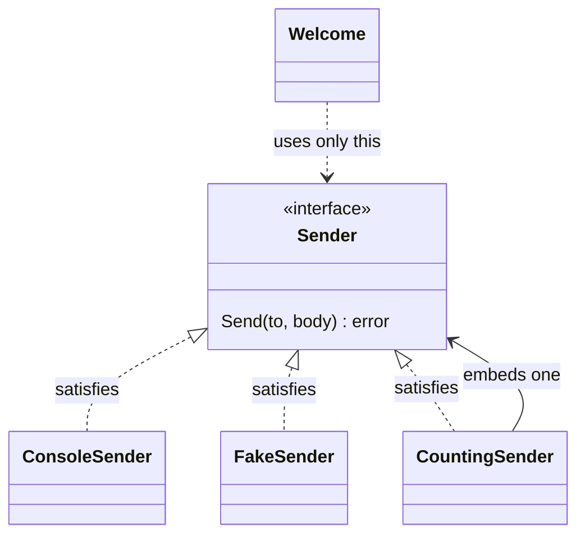

# 01. Interfaces, embedding and small interfaces

> **Draft: written but not yet run.** The code and the expected output in this lesson were prepared by reading the code and the official documentation. They have not been executed yet. If something does not behave as described, trust your tool's real output and report it.

## What you will be able to do
By the end of this lesson you will be able to:
- design a small interface at the place that uses it, and explain why it should have one or two methods;
- add behaviour to an existing type by embedding it, and tell when a method is promoted and when it is overridden;
- use a type assertion to ask a value for an optional ability, and predict the typed-nil trap before it bites;
- write a fake that satisfies an interface so code can be tested without the real thing.

## Recap
Answer from Go 101, then open the answer.
1. In lesson 11, how did `Receipt` satisfy `Reporter` without saying so?
   <details><summary>Answer</summary>It had a method with the same name, inputs and results. Go checks the method set; there is no `implements` keyword.</details>
2. In lesson 10, what is the difference between a value receiver and a pointer receiver?
   <details><summary>Answer</summary>A value receiver works on a copy. A pointer receiver works on the original, so it can change it.</details>
3. In lesson 09, what does `%w` do in `fmt.Errorf`?
   <details><summary>Answer</summary>It wraps the error: the new error adds context and still lets `errors.Is` and `errors.As` find the original.</details>

## Why it matters
In Go an interface is the seam between two parts of a program. A seam in the right place lets you swap an email sender for a fake in a test, or wrap a writer to count bytes, without touching the code that uses it. A seam in the wrong place (a big interface next to the type that implements it) makes every change ripple. The Go proverb is "the bigger the interface, the weaker the abstraction". The standard library is built on one-method interfaces: `io.Reader`, `io.Writer`, `fmt.Stringer`, `error`, `http.Handler`. Every later lesson in this level (HTTP handlers, stores, middleware, tests) leans on this one.

## What you will build
A small notification program. A `Sender` interface with one method, three implementations (console, in-memory fake, and a counting wrapper built with embedding), a `Welcome` function that only knows the interface, and a test file. Then an exercise with `io.Writer`.



## Before you start
- Finish Go 101 (this lesson reuses lessons 09 to 11). Go 1.22.0 or newer; see the [level 201 guide](../README.md#how-every-201-lesson-works) for the folder, `go mod init` and exercise conventions used in every lesson.
- Time: 40 minutes.
- Source pack (optional): every file is shown in full in this lesson, so you can follow without it. The finished code, the exercise starter and the solution are in the
  course repository https://github.com/Uee03/Code101 under `source/go/201-hero-to-super-hero/phase-1-core-skills/01-interfaces-and-embedding/` (on that page choose **Code, Download ZIP**, or run
  `git clone https://github.com/Uee03/Code101.git`).
- No external packages. This lesson has no art.

## Steps

### Step 1. Create the folder and the module
Folder and module follow the [working-folder steps](../README.md#working-folder) with the name `lesson01`. In a terminal:

PowerShell (Windows):
```powershell
New-Item -ItemType Directory -Force -Path "$HOME/code101/go201/lesson01" | Out-Null
Set-Location "$HOME/code101/go201/lesson01"
go mod init example.com/code101/go201/lesson01
```
macOS and Linux:
```bash
mkdir -p "$HOME/code101/go201/lesson01"
cd "$HOME/code101/go201/lesson01"
go mod init example.com/code101/go201/lesson01
```
Expected output (from `go mod init`):
```text
go: creating new go.mod: module example.com/code101/go201/lesson01
```
Leave the generated `go` line alone; the supplied pack uses `go 1.22.0`, which is the minimum this level needs. If you use the supplied source, skip this step: `go.mod` is already there.

### Step 2. Write the interface and its implementations
Create `sender.go` in `lesson01` and paste the whole file. Read the comments; the code after the file explains each part.

**File: `sender.go`**
```go
package main

import (
	"fmt"
	"io"
)

// Sender is declared here, next to its user: the consumer states what it needs.
type Sender interface {
	Send(to, body string) error
}

// ConsoleSender writes each message to any io.Writer.
type ConsoleSender struct {
	Out io.Writer
}

func (c ConsoleSender) Send(to, body string) error {
	_, err := fmt.Fprintf(c.Out, "to=%s body=%q\n", to, body)
	return err
}

// FakeSender records messages in memory; tests and demos use it instead of a real channel.
type FakeSender struct {
	Sent []string
}

func (f *FakeSender) Send(to, body string) error {
	f.Sent = append(f.Sent, to+": "+body)
	return nil
}

func (f *FakeSender) String() string {
	return fmt.Sprintf("fake(%d sent)", len(f.Sent))
}

// CountingSender embeds a Sender, so it already has a Send method.
// Declaring its own Send overrides the promoted one and adds counting.
type CountingSender struct {
	Sender
	Count int
}

func (c *CountingSender) Send(to, body string) error {
	c.Count++
	return c.Sender.Send(to, body)
}

// Compile-time checks: the build fails if a type stops satisfying Sender.
var (
	_ Sender = ConsoleSender{}
	_ Sender = (*FakeSender)(nil)
	_ Sender = (*CountingSender)(nil)
)

// Welcome accepts the interface, so it works with every Sender above.
func Welcome(s Sender, names []string) error {
	for _, name := range names {
		if err := s.Send(name, "welcome, "+name); err != nil {
			return fmt.Errorf("welcome %s: %w", name, err)
		}
	}
	return nil
}

// describe asks for an optional ability with a type assertion.
func describe(s Sender) string {
	if st, ok := s.(fmt.Stringer); ok {
		return st.String()
	}
	return "anonymous sender"
}

// lookup shows the typed-nil trap: the interface value holds a type, so it is not nil.
func lookup(found bool) Sender {
	var f *FakeSender
	if found {
		f = &FakeSender{}
	}
	return f
}
```

What to notice, in the order they appear:
1. **`Sender` has one method.** A small interface is easy to satisfy, easy to fake and easy to understand. It is declared in the file that uses it, not next to `ConsoleSender`: the consumer decides what it needs.
2. **`ConsoleSender` has a value receiver**, so both `ConsoleSender{}` and `&ConsoleSender{}` satisfy `Sender`. `FakeSender` and `CountingSender` have pointer receivers (they change their own fields), so only `*FakeSender` and `*CountingSender` satisfy it.
3. **Embedding.** `CountingSender` lists `Sender` as a field with no name. Every method of `Sender` is *promoted*: `counted.Send(...)` would work even if we wrote nothing. We declare our own `Send`, which *overrides* the promoted one, counts, and calls the embedded value explicitly with `c.Sender.Send`.
4. **The `var _ Sender = ...` block** costs nothing at run time. It makes the compiler check, in this file, that each type still satisfies `Sender`. Without it, a rename of `Send` would be reported far away, where the value is used.
5. **`describe`** shows a type assertion with the comma-ok form: `s.(fmt.Stringer)` asks "does the value inside this interface also have a `String() string` method?" This is how `net/http` discovers optional abilities such as `http.Flusher`.
6. **`lookup`** is a trap that we will predict in a moment.

### Step 3. Write main
Create `main.go` next to it.

**File: `main.go`**
```go
package main

import (
	"fmt"
	"os"
	"strings"
)

func main() {
	console := ConsoleSender{Out: os.Stdout}
	counted := &CountingSender{Sender: console}
	if err := Welcome(counted, []string{"ada", "linus"}); err != nil {
		fmt.Println("error:", err)
		return
	}
	fmt.Println("sent:", counted.Count)

	fake := &FakeSender{}
	_ = Welcome(fake, []string{"grace"})
	fmt.Println(strings.Join(fake.Sent, ";"))

	fmt.Println(describe(console))
	fmt.Println(describe(fake))
	fmt.Println(describe(counted))

	fmt.Println(lookup(false) == nil)
}
```

### Step 4. Predict before you run
Do not run anything yet. On paper, write the eight lines you expect. Two questions to settle first:
- `describe(counted)` wraps a console sender; `describe(fake)` is a `*FakeSender`, which has `String`. What do you expect for each, and for `console`?
- `lookup(false)` returns a `*FakeSender` that is `nil`. Is `lookup(false) == nil` true or false?

## Run it
In `lesson01`, on every OS:

```text
go run .
```
Expected output (derived by reading the code, not yet run):
```text
to=ada body="welcome, ada"
to=linus body="welcome, linus"
sent: 2
grace: welcome, grace
anonymous sender
fake(1 sent)
anonymous sender
false
```
Compare with your prediction. The usual surprises are the third `describe` line (`anonymous sender` for the wrapper) and the final `false`. Both are explained next.

## How it works
1. `Welcome(counted, ...)` calls `counted.Send` twice. `counted` is a `*CountingSender`, so Go runs *its* `Send`: it adds one to `Count`, then calls the embedded `console.Send`, which prints a line. Hence two printed lines and `sent: 2`.
2. `Welcome(fake, ...)` stores `grace: welcome, grace` in `fake.Sent`. Nothing is printed by `Welcome`; main prints the joined slice.
3. `describe(console)`: `ConsoleSender` has no `String` method, so the assertion fails and the fallback text is returned.
4. `describe(fake)`: `*FakeSender` has `String`, so we get `fake(1 sent)`.
5. `describe(counted)`: this is the surprise. `CountingSender` embeds the *interface* `Sender`, and the interface only promises `Send`. Even if the wrapped value had a `String` method, the wrapper's method set contains only what the embedded *type* declares. Embedding an interface forwards only that interface.
6. **The typed-nil trap.** An interface value is a pair: (dynamic type, dynamic value). `lookup(false)` returns the pair (`*FakeSender`, `nil`). An interface equals `nil` only when *both* parts are empty, so the comparison is `false`. The fix is to return a plain `nil` when nothing is found:

```go
if !found {
	return nil
}
```
This is a rule, not a trick: when a function returns an interface, return the untyped `nil` for "nothing", never a nil pointer variable.

**Misconception to drop:** embedding is not inheritance. There is no "is-a" relationship and no `super`. `CountingSender` is a struct that *contains* a `Sender` and forwards to it by hand when it wants to. This is composition with a shortcut for method names.

## Why this, not that
| Choice | Use it when | Cost |
|---|---|---|
| Small interface at the consumer | Two or more behaviours must be swapped (real and fake), or you want a test seam | One extra type name |
| Large interface next to the implementation (Java style) | Rarely in Go | Every implementer and every fake must implement everything; changes ripple |
| Return a concrete struct, accept an interface | Normal case: "accept interfaces, return structs" | Callers see the concrete type; fine, they can still put it behind their own interface |
| Embed a type | You want to add or change one method and forward the rest | Promoted methods can surprise (see `describe(counted)`) |
| Named field (`sender Sender`) instead of embedding | You do not want the wrapped methods to become part of your public method set | You forward explicitly |

## Test it
`sender_test.go` shows the payoff of the small interface: the tests need no real channel.

**File: `sender_test.go`**
```go
package main

import (
	"bytes"
	"errors"
	"testing"
)

func TestWelcomeSendsToEveryone(t *testing.T) {
	fake := &FakeSender{}
	if err := Welcome(fake, []string{"ada", "linus"}); err != nil {
		t.Fatalf("Welcome returned %v", err)
	}
	if len(fake.Sent) != 2 {
		t.Fatalf("sent %d messages, want 2", len(fake.Sent))
	}
}

func TestCountingSenderForwardsAndCounts(t *testing.T) {
	fake := &FakeSender{}
	counted := &CountingSender{Sender: fake}
	_ = Welcome(counted, []string{"ada"})
	if counted.Count != 1 || len(fake.Sent) != 1 {
		t.Fatalf("count=%d forwarded=%d, want 1 and 1", counted.Count, len(fake.Sent))
	}
}

type brokenSender struct{ err error }

func (b brokenSender) Send(string, string) error { return b.err }

func TestWelcomeWrapsTheSenderError(t *testing.T) {
	boom := errors.New("boom")
	err := Welcome(brokenSender{err: boom}, []string{"ada"})
	if !errors.Is(err, boom) {
		t.Fatalf("error %v does not wrap boom", err)
	}
}

func TestConsoleSenderFormat(t *testing.T) {
	var buf bytes.Buffer
	_ = ConsoleSender{Out: &buf}.Send("ada", "hi")
	want := "to=ada body=\"hi\"\n"
	if buf.String() != want {
		t.Fatalf("got %q, want %q", buf.String(), want)
	}
}
```

Run, in `lesson01`:
```text
go test ./...
```
The last line should read `ok` followed by the module path and a time. `brokenSender` is a fake written *inside the test file* in five lines: only possible because `Sender` is small.

## Try it
The exercise is a separate small program: see [exercise folders](../README.md#exercise-folders). Copy `exercise/starter` to a new folder `try01` beside `lesson01` (or create the three files below there), then open only `try01` in your editor.

1. **Guided.** `io.Writer` is the most famous small interface (`Write([]byte) (int, error)`). Make `UpperWriter` a working writer so that `fmt.Fprintln(upper, "hello, interfaces")` prints `HELLO, INTERFACES`. Remember the contract: `Write` reports how many bytes of its *input* it consumed.
2. **Change.** `CountingWriter` embeds an `io.Writer`. Make it count the bytes written through it, so the last line of the program prints `bytes written: 16`.
3. **Stretch (no single answer).** Make `CountingWriter` wrap an `UpperWriter` instead of `os.Stdout`. What does the counter measure now, and does it matter that `UpperWriter` and `CountingWriter` are the same kind of thing? Decide whether you would add a third wrapper that also implements `io.Closer`, and what the rule for a wrapper's `Close` should be.

**File: `go.mod (starter)`**
```text
module example.com/code101/go201/try01

go 1.22.0
```
**File: `main.go (starter)`**
```go
package main

import (
	"fmt"
	"os"
)

func main() {
	upper := UpperWriter{W: os.Stdout}
	fmt.Fprintln(upper, "hello, interfaces")

	counter := &CountingWriter{Writer: os.Stdout}
	fmt.Fprintln(counter, "count me")
	fmt.Fprintln(counter, "and me")
	fmt.Println("bytes written:", counter.Bytes)
}
```
**File: `writers.go (starter)`**
```go
package main

import "io"

// UpperWriter must write everything it receives to W in upper case.
type UpperWriter struct {
	W io.Writer
}

// TODO 1: make this Write method do its job: upper-case the bytes, write them to W,
// and report how many bytes of p were consumed (the io.Writer contract).
func (u UpperWriter) Write(p []byte) (int, error) {
	return 0, nil
}

// CountingWriter must keep in Bytes the total number of bytes written through it.
type CountingWriter struct {
	io.Writer
	Bytes int
}

// TODO 2: declare a Write method on *CountingWriter that forwards to the embedded Writer
// and adds the number of bytes actually written to Bytes. Expected last line of output: bytes written: 16
```

Run in `try01`:
```text
go run .
```
Expected output after both steps are done:
```text
HELLO, INTERFACES
count me
and me
bytes written: 16
```
The unfinished starter compiles and runs. Before your changes it prints only the two counted lines and `bytes written: 0`: the `UpperWriter` stub writes nothing, and the promoted `Write` of the embedded writer does not count.

<details><summary>Solution</summary>

Only `writers.go` changes. `main.go` is identical to the starter.

**File: `writers.go (solution)`**
```go
package main

import (
	"bytes"
	"io"
)

// UpperWriter writes everything it receives to W in upper case.
type UpperWriter struct {
	W io.Writer
}

func (u UpperWriter) Write(p []byte) (int, error) {
	if _, err := u.W.Write(bytes.ToUpper(p)); err != nil {
		return 0, err
	}
	return len(p), nil
}

// CountingWriter keeps in Bytes the total number of bytes written through it.
type CountingWriter struct {
	io.Writer
	Bytes int
}

func (c *CountingWriter) Write(p []byte) (int, error) {
	n, err := c.Writer.Write(p)
	c.Bytes += n
	return n, err
}
```

Why `return len(p), nil` in `UpperWriter`: the contract says `n` counts bytes of `p`, and upper-casing could in theory change the length of non-ASCII text. Why `c.Writer.Write` in `CountingWriter`: the embedded field is named `Writer`, after its type; writing just `c.Write(p)` would call our own method again and recurse forever.

Stretch notes: with `CountingWriter{Writer: UpperWriter{...}}` the counter sees the bytes *before* upper-casing (it sits in front). They are the same count here, but in a pipeline each wrapper measures what it is given. A wrapper that implements `Close` should close what it wraps, exactly once, and return the first error; anything else leaks.

</details>

## Check yourself
1. Why is `Sender` declared next to `Welcome` and not next to `ConsoleSender`?
   <details><summary>Answer</summary>The consumer knows what it needs. Declaring it there keeps the interface small and means implementers do not have to know it exists.</details>
2. What does `describe(counted)` print, and why not `fake(1 sent)` when the wrapped sender is a `Stringer`?
   <details><summary>Answer</summary>`anonymous sender`. `CountingSender` embeds the `Sender` interface, so only `Send` is promoted; the dynamic type of the wrapper has no `String` method.</details>
3. Is `lookup(false) == nil` true? Why?
   <details><summary>Answer</summary>False. The interface holds the type `*FakeSender` with a nil pointer, and an interface is nil only when both type and value are empty.</details>
4. What is the difference between promoting a method and overriding it?
   <details><summary>Answer</summary>Promoted: the outer type gets the embedded type's method for free. Overridden: the outer type declares a method with the same name, which hides the promoted one; call the embedded one explicitly if you still need it.</details>

## Common mistakes
These are typical messages; the wording differs between Go versions. Read the *end* of the message first.

| Symptom or error text | Cause | Fix |
|---|---|---|
| `cannot use ... as Sender value in variable declaration: ... does not implement Sender (method Send has pointer receiver)` (typical message) | Using `FakeSender{}` where `*FakeSender` is needed, because `Send` has a pointer receiver | Use `&FakeSender{}` |
| `... does not implement Sender (missing method Send)` (typical message) | Misspelled the method name or changed its parameters | Compare the method with the interface; the `var _ Sender = ...` line points at the file that broke |
| A nil check on a returned interface is never true | Typed-nil trap: returned a nil pointer variable as an interface | Return the untyped `nil` explicitly |
| Stack overflow with `fatal error: stack overflow` (typical message) | A method on a type that embeds an interface calls itself (`c.Send` instead of `c.Sender.Send`) | Call the embedded field explicitly |
| `go: go.mod file not found in current directory or any parent directory; see 'go help modules'` | Running `go run .` outside the module folder | `cd` into `lesson01` (or `try01`) |

## Best practice
Keep interfaces small and define them where they are used; accept interfaces and return concrete types. Source: Go Code Review Comments, Interfaces https://go.dev/wiki/CodeReviewComments#interfaces and Effective Go, Interfaces and other types https://go.dev/doc/effective_go#interfaces_and_types

## Going further
- Read how `io.Writer`, `io.Reader` and `io.Copy` fit together: https://pkg.go.dev/io
- Embedding in the standard library: `bufio.ReadWriter` embeds `*Reader` and `*Writer` (https://pkg.go.dev/bufio#ReadWriter).
- Where this reappears: lesson 05 wraps `http.ResponseWriter` by embedding it to record the status code, and lesson 08 puts a store behind an interface so handlers can be tested without a database. In the capstone the same idea is used across [`capstones/backend-go`](../../../../capstones/backend-go/README.md).

## Summary
- You designed a one-method `Sender` at its consumer and used it with a real, a fake and a wrapping implementation.
- You used embedding to add counting and saw that promotion forwards only what the embedded type declares.
- You used a comma-ok type assertion to ask for an optional `fmt.Stringer`, and predicted the typed-nil `false`.
- You wrote a fake inside a test and an `io.Writer` decorator in the exercise.

## Next lesson
**[02. Goroutines and channels](02-goroutines-and-channels.md):** run work at the same time and pass results between goroutines safely.
