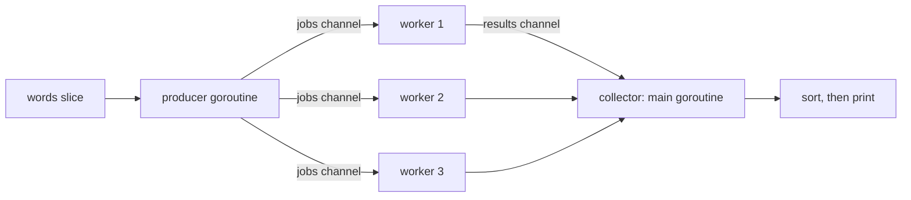

# 02. Goroutines and channels

> **Draft: written but not yet run.** The code and the expected output in this lesson were prepared by reading the code and the official documentation. They have not been executed yet. If something does not behave as described, trust your tool's real output and report it.

## What you will be able to do
By the end of this lesson you will be able to:
- start goroutines and wait for them with a `sync.WaitGroup`;
- choose between an unbuffered and a buffered channel and say who must close it;
- build a worker pool and a small pipeline, and explain why their results arrive in no fixed order;
- use `select` to wait for the first of several events, or to avoid blocking.

## Recap
1. (Lesson 01) Why does `Welcome` accept a `Sender` instead of a `*ConsoleSender`?
   <details><summary>Answer</summary>So any implementation, including a fake in a test, can be passed in. The consumer asks only for the behaviour it uses.</details>
2. (Go 101, lesson 09) What do you do with the error value of a function that can fail?
   <details><summary>Answer</summary>Check it straight away; return it (wrapped with context) or handle it. Never ignore it by accident.</details>

## Why it matters
Servers handle many requests at once, clients call several services at once, and batch jobs use every core. Go makes this cheap: a goroutine starts with a few kilobytes of stack, and the runtime multiplexes thousands of them over a few OS threads. The price is that you must now think about *coordination*: who waits for whom, who owns a channel, and what happens when one side stops listening. The Go slogan is "do not communicate by sharing memory; share memory by communicating". This lesson teaches the communicating half (channels). Lesson 03 teaches the sharing half (mutexes) and how to stop work (context).

## What you will build
A worker pool that upper-cases words with three goroutines, a three-stage pipeline (`generate` to `square` to `sum`), a buffered-channel demo and a non-blocking send.



## Before you start
- Lesson 01 finished (any folder habits are in the [level 201 guide](../README.md#how-every-201-lesson-works)). Go 1.22.0 or newer: the code uses `for range workers` over an integer, which needs `go 1.22` in `go.mod`.
- Time: 45 minutes.
- Source pack (optional): every file is shown in full in this lesson, so you can follow without it. The finished code, the exercise starter and the solution are in the
  course repository https://github.com/Uee03/Code101 under `source/go/201-hero-to-super-hero/phase-1-core-skills/02-goroutines-and-channels/` (on that page choose **Code, Download ZIP**, or run
  `git clone https://github.com/Uee03/Code101.git`).
- No external packages.

## Steps

### Step 1. Create the folder and the module
Same steps as [Step 1 of lesson 01](01-interfaces-and-embedding.md#step-1-create-the-folder-and-the-module) with two differences: the folder is `lesson02` and the module is `example.com/code101/go201/lesson02`. Expected output of `go mod init`:
```text
go: creating new go.mod: module example.com/code101/go201/lesson02
```

### Step 2. The worker pool
Create `pool.go`.

**File: `pool.go`**
```go
package main

import (
	"sort"
	"strings"
	"sync"
)

type result struct {
	Word  string
	Upper string
	Len   int
}

// process sends the words to a fixed number of workers and gathers their results.
func process(words []string, workers int) []result {
	if workers < 1 {
		workers = 1
	}
	jobs := make(chan string)
	results := make(chan result)

	var wg sync.WaitGroup
	for range workers {
		wg.Add(1)
		go func() {
			defer wg.Done()
			for w := range jobs {
				results <- result{Word: w, Upper: strings.ToUpper(w), Len: len(w)}
			}
		}()
	}

	go func() {
		defer close(jobs)
		for _, w := range words {
			jobs <- w
		}
	}()

	go func() {
		wg.Wait()
		close(results)
	}()

	var out []result
	for r := range results {
		out = append(out, r)
	}
	sort.Slice(out, func(i, j int) bool { return out[i].Word < out[j].Word })
	return out
}
```

Read it in the order the goroutines are born:
1. **Two unbuffered channels.** `jobs` carries words in, `results` carries answers out. An *unbuffered* channel makes sender and receiver meet: a send blocks until another goroutine receives. That meeting is the synchronisation.
2. **The workers.** `for range workers` starts that many goroutines (Go 1.22 can range over an integer). Each loops `for w := range jobs`: a `range` over a channel receives until the channel is *closed* and drained. `wg.Done()` runs when the loop ends.
3. **The producer** runs in its own goroutine because `jobs <- w` blocks until a worker is free; if `process` itself did the sending before reading results, the workers would block on `results <-` and nobody would read: deadlock. `defer close(jobs)` tells the workers "no more work". **Only the sender closes a channel**, because closing is a statement about sending.
4. **The closer goroutine** waits for all workers, then closes `results`, so the `range results` loop in the caller can end.
5. **The collector** appends results as they arrive and finally sorts them. Workers finish in whatever order the scheduler picks; sorting is what makes the output the same on every run.
6. `if workers < 1 { workers = 1 }` is a guard: with zero workers nobody would ever receive from `jobs`, and the program would hang with `fatal error: all goroutines are asleep - deadlock!`.

### Step 3. The pipeline
Create `pipeline.go`. A pipeline is a chain of stages connected by channels; each stage is a goroutine that reads from the previous channel and writes to the next.

**File: `pipeline.go`**
```go
package main

// generate sends the numbers on a channel and closes it: the sender owns the closing.
func generate(nums ...int) <-chan int {
	out := make(chan int)
	go func() {
		defer close(out)
		for _, n := range nums {
			out <- n
		}
	}()
	return out
}

// square is one pipeline stage: it reads from in until in is closed.
func square(in <-chan int) <-chan int {
	out := make(chan int)
	go func() {
		defer close(out)
		for n := range in {
			out <- n * n
		}
	}()
	return out
}

// sum is the last stage: it drains its input and returns the total.
func sum(in <-chan int) int {
	total := 0
	for n := range in {
		total += n
	}
	return total
}
```

The types `<-chan int` (receive only) and `chan<- int` (send only) are *directional channels*. They make the compiler enforce ownership: `square` cannot close or send on `in`, and a caller of `generate` cannot send into the channel it receives.

### Step 4. main
Create `main.go`.

**File: `main.go`**
```go
package main

import "fmt"

func main() {
	words := []string{"gopher", "channel", "goroutine", "select", "mutex"}
	for _, r := range process(words, 3) {
		fmt.Println(r.Word, r.Upper, r.Len)
	}

	bufferedDemo()

	fmt.Println(sum(square(generate(1, 2, 3, 4))))

	full := make(chan int, 1)
	fmt.Println(trySend(full, 1), trySend(full, 2))
}

// bufferedDemo shows that a buffered channel accepts sends until it is full,
// and that a closed channel still delivers what it holds.
func bufferedDemo() {
	ch := make(chan string, 2)
	ch <- "first"
	ch <- "second"
	close(ch)
	for v := range ch {
		fmt.Println(v)
	}
	v, ok := <-ch
	fmt.Printf("%q %v\n", v, ok)
}

// trySend uses select with default so it never blocks.
func trySend(ch chan<- int, v int) bool {
	select {
	case ch <- v:
		return true
	default:
		return false
	}
}
```

### Step 5. Predict, then run
Before running, predict:
- the order of the first five lines (are they in the order of the `words` slice?);
- what `bufferedDemo` prints for the last `<-ch` after the channel is closed and drained;
- the result of `trySend(full, 1), trySend(full, 2)` for a channel with a buffer of one.

## Run it
In `lesson02`, on every OS:
```text
go run .
```
Expected output (derived by reading the code, not yet run):
```text
channel CHANNEL 7
gopher GOPHER 6
goroutine GOROUTINE 9
mutex MUTEX 5
select SELECT 6
first
second
"" false
30
true false
```

## How it works
- The first five lines are **alphabetical, not input order**, because `process` sorts. Without the sort the order would vary from run to run, which is the first thing to accept about concurrency: results arrive in completion order.
- `bufferedDemo`: a channel with a buffer of two takes two sends without a receiver. `close` then says "no more sends"; the receiver can still drain what is in the buffer. A receive on a closed *and empty* channel returns immediately with the zero value and `ok == false`, hence `"" false` (`%q` shows an empty string as `""`).
- `30` is 1 + 4 + 9 + 16 across three goroutines that never share a variable: they only pass values.
- `trySend`: `select` picks a ready case; `default` runs when none is ready. The first send fits the buffer (`true`), the second finds it full (`false`) and moves on instead of blocking.
- **The rule of channel ownership:** one goroutine creates a channel and closes it. Sending on a closed channel panics (`panic: send on closed channel`), closing twice panics (`panic: close of closed channel`), and receivers can never tell the difference between "closed" and "nothing yet" except through `ok` or `range`.

**Misconception:** a goroutine is not a thread you control. You cannot stop one from outside, and you do not get a handle to it. A goroutine ends when its function returns. Everything you need (finish, cancel, report an error) has to be built from channels, a `WaitGroup` and, from lesson 03, a `context`.

## Why this, not that
| Need | Use | Why not the alternative |
|---|---|---|
| Hand work to a few goroutines and collect answers | Channels (this lesson) | A shared slice needs a mutex and you lose the natural "done" signal |
| Many goroutines each fill their own element | A pre-sized slice, each goroutine writes its own index (exercise) | Channels add cost when no hand-off is needed |
| Protect a shared counter or cache | `sync.Mutex` (lesson 03) | Funnelling every update through a channel is slower and harder to read |
| Wait for a group to finish | `sync.WaitGroup` | A `done` channel per goroutine is more code |
| Stop work early | `context` (lesson 03) | A bare `quit` channel works but does not compose with timeouts and libraries |
| Unlimited `go f()` per request | A bounded pool | Unbounded goroutines can exhaust memory or a downstream service |

## Test it
**File: `pool_test.go`**
```go
package main

import (
	"reflect"
	"testing"
)

func TestProcessReturnsEveryWordSorted(t *testing.T) {
	got := process([]string{"b", "a", "ccc"}, 2)
	want := []result{
		{Word: "a", Upper: "A", Len: 1},
		{Word: "b", Upper: "B", Len: 1},
		{Word: "ccc", Upper: "CCC", Len: 3},
	}
	if !reflect.DeepEqual(got, want) {
		t.Fatalf("got %v, want %v", got, want)
	}
}

func TestProcessWithZeroWorkersStillFinishes(t *testing.T) {
	got := process([]string{"x"}, 0)
	if len(got) != 1 {
		t.Fatalf("got %d results, want 1", len(got))
	}
}

func TestPipelineSumsSquares(t *testing.T) {
	if got := sum(square(generate(1, 2, 3))); got != 14 {
		t.Fatalf("got %d, want 14", got)
	}
}

func TestTrySendDoesNotBlockOnFullChannel(t *testing.T) {
	ch := make(chan int, 1)
	if !trySend(ch, 1) {
		t.Fatal("first send should succeed")
	}
	if trySend(ch, 2) {
		t.Fatal("second send should be refused")
	}
}
```

Run in `lesson02`:
```text
go test ./...
```
It should end with a line starting `ok`. Also try the race detector: `go test -race ./...`. The race detector instruments memory accesses and reports a `WARNING: DATA RACE` when two goroutines touch the same variable without synchronisation. It can need a C compiler on some platforms; if `-race` is refused, run the plain command and read the [race detector article](https://go.dev/doc/articles/race_detector) for your platform.

## Try it
Work in a copy of the starter: [exercise folders](../README.md#exercise-folders). Name the folder `try02`.

1. **Guided.** `parallelSquares` must return the squares of the numbers **in input order**, using the given number of workers. Think first: if workers send results on a channel, the order is lost. How can each worker put its answer in the right place without a lock?
2. **Change.** Write `waitOrTimeout`: it returns the next string from a channel, or the text `timeout` if nothing arrives within the duration. Use a timer you stop when you are done.
3. **Stretch (no single answer).** Add a `limit` parameter to the pipeline so that at most N values are in flight. Would you use a buffered channel as the limit, or a semaphore built from a channel of empty structs? Write down one cost of each.

**File: `go.mod (starter)`**
```text
module example.com/code101/go201/try02

go 1.22.0
```
**File: `main.go (starter)`**
```go
package main

import (
	"fmt"
	"time"
)

func main() {
	fmt.Println(parallelSquares([]int{1, 2, 3, 4, 5}, 3))

	ready := make(chan string, 1)
	ready <- "ready"
	fmt.Println(waitOrTimeout(ready, 50*time.Millisecond))

	never := make(chan string)
	fmt.Println(waitOrTimeout(never, 20*time.Millisecond))
}
```
**File: `squares.go (starter)`**
```go
package main

import "time"

// parallelSquares returns the square of every number, in the same order as the input,
// computed by the given number of worker goroutines.
func parallelSquares(nums []int, workers int) []int {
	out := make([]int, len(nums))
	// TODO 1: start the workers, hand each number to a worker together with its position,
	// and wait for all workers before returning. Add the imports you need.
	return out
}

// waitOrTimeout returns the next value from ch, or the text "timeout" if nothing
// arrives within d.
func waitOrTimeout(ch <-chan string, d time.Duration) string {
	// TODO 2: wait for whichever happens first.
	return ""
}
```

Run in `try02`:
```text
go run .
```
Expected output once both TODOs are done:
```text
[1 4 9 16 25]
ready
timeout
```
With the starter as given, the program prints `[0 0 0 0 0]` and then two empty lines.

<details><summary>Solution</summary>

`main.go` and `go.mod` are unchanged. Replace `squares.go`:

**File: `squares.go (solution)`**
```go
package main

import (
	"sync"
	"time"
)

type job struct {
	index int
	value int
}

// parallelSquares returns the square of every number, in the same order as the input,
// computed by the given number of worker goroutines.
func parallelSquares(nums []int, workers int) []int {
	out := make([]int, len(nums))
	if workers < 1 {
		workers = 1
	}
	jobs := make(chan job)
	var wg sync.WaitGroup
	for range workers {
		wg.Add(1)
		go func() {
			defer wg.Done()
			for j := range jobs {
				out[j.index] = j.value * j.value
			}
		}()
	}
	for i, n := range nums {
		jobs <- job{index: i, value: n}
	}
	close(jobs)
	wg.Wait()
	return out
}

// waitOrTimeout returns the next value from ch, or the text "timeout" if nothing
// arrives within d.
func waitOrTimeout(ch <-chan string, d time.Duration) string {
	timer := time.NewTimer(d)
	defer timer.Stop()
	select {
	case v := <-ch:
		return v
	case <-timer.C:
		return "timeout"
	}
}
```

Why this is safe without a lock: each `job` carries its `index`, every index is handed to exactly one worker, so no two goroutines write the same element, and `wg.Wait()` makes all those writes visible to the caller before it reads `out`. If two workers could write one element you would need a mutex (lesson 03).

For the stretch: a buffered channel of size N as a *queue* bounds how many values wait, not how many are being processed; a semaphore (`sem := make(chan struct{}, N)`, send to acquire, receive to release) bounds concurrent work directly. The semaphore costs you the discipline to always release, usually with `defer`.

</details>

## Check yourself
1. Who should close a channel: the sender or the receiver? What happens if you get it wrong?
   <details><summary>Answer</summary>The sender, once, when no more values will be sent. A send on a closed channel panics; a receiver that closes can make a still-sending goroutine panic.</details>
2. What does `v, ok := <-ch` return when `ch` is closed and empty?
   <details><summary>Answer</summary>The zero value and `false`.</details>
3. Why does `process` sort its output?
   <details><summary>Answer</summary>Workers finish in an unpredictable order; sorting makes the result deterministic.</details>
4. Find the bug: `for _, w := range words { go func() { fmt.Println(w) }() }` in a module that says `go 1.21`.
   <details><summary>Answer</summary>Before Go 1.22 the loop variable `w` was shared by all iterations, so the goroutines often printed the last word. With `go 1.22` in `go.mod` each iteration has its own `w`. Pass `w` as an argument to be safe on older modules.</details>

## Common mistakes
| Symptom or error text | Cause | Fix |
|---|---|---|
| `fatal error: all goroutines are asleep - deadlock!` | Every goroutine is blocked, for example sending on a channel nobody receives from, or `wg.Wait()` while a worker waits for work | Make sure every send has a receiver and every `range` over a channel has a closer |
| `panic: send on closed channel` | A sender sent after the channel was closed | Close only after the last send, from the sending side |
| `panic: close of closed channel` | Two goroutines both close the channel | One owner closes it |
| `range` over a channel never ends | The channel is never closed | Close it from the sender once the work is done (the closer goroutine in `process`) |
| `WARNING: DATA RACE` under `go test -race` | Two goroutines accessed one variable, one of them writing, with no synchronisation | Pass values by channel, or protect the variable (lesson 03) |
| `for range workers` fails to compile (`cannot range over workers (variable of type int)`; typical message) | `go.mod` says a Go version older than 1.22 | Set `go 1.22.0` or newer |

## Best practice
Make sure every goroutine you start has a defined way to end, and that the code that starts it knows how to wait for it; do not start goroutines you cannot account for. Source: Effective Go, Concurrency https://go.dev/doc/effective_go#concurrency and Go Concurrency Patterns: Pipelines and cancellation https://go.dev/blog/pipelines

## Going further
- The Go memory model, for what "happens before" guarantees a channel or `WaitGroup` gives: https://go.dev/ref/mem
- `golang.org/x/sync/errgroup` is a `WaitGroup` that also collects the first error (external module, so not used here).
- Where this reappears: lesson 03 (cancelling a ticker goroutine), lesson 07 (the server runs in a goroutine while `main` waits for a signal).

## Summary
- You started goroutines, waited with a `WaitGroup` and gathered results over channels.
- You built a worker pool and a pipeline and explained why output order needs sorting.
- You used buffered and unbuffered channels, `close`, directional channel types, and `select` with `default` and with a timer.
- You applied the ownership rule: one goroutine creates and closes a channel.

## Next lesson
**[03. sync, context and cancellation](03-sync-context-cancellation.md):** protect shared state with a mutex and stop goroutines with a context so nothing leaks.
