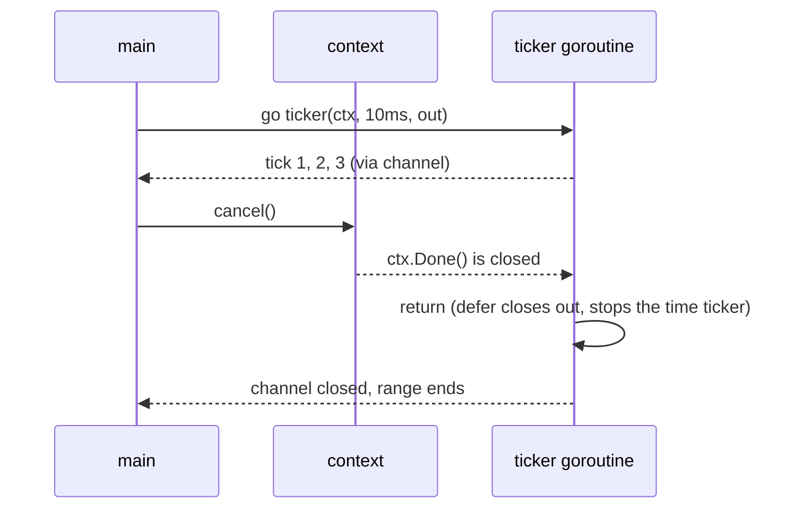

# 03. sync, context and cancellation

> **Draft: written but not yet run.** The code and the expected output in this lesson were prepared by reading the code and the official documentation. They have not been executed yet. If something does not behave as described, trust your tool's real output and report it.

## What you will be able to do
By the end of this lesson you will be able to:
- protect shared state with a `sync.Mutex` (and know when a `sync.RWMutex` is worth it);
- create a context with a timeout or a manual cancel, pass it as the first parameter, and stop work when it is done;
- check for a timeout with `errors.Is(err, context.DeadlineExceeded)`;
- write a goroutine that always has a way to end, so nothing leaks.

## Recap
1. (Lesson 02) Who closes a channel, and what does `v, ok := <-ch` return once it is closed and empty?
   <details><summary>Answer</summary>The sender closes it. The receive returns the zero value and `false`.</details>
2. (Lesson 02) Why did `process` start a separate goroutine for `wg.Wait()`?
   <details><summary>Answer</summary>So `results` could be closed after all workers finish while the caller is already reading from it; waiting in the caller would deadlock.</details>
3. (Lesson 01) What does `%w` in `fmt.Errorf` give you later on?
   <details><summary>Answer</summary>`errors.Is` and `errors.As` still see the wrapped error. You use that today with `context.DeadlineExceeded`.</details>

## Why it matters
Two things go wrong in every concurrent program sooner or later. First, two goroutines change the same variable and the result is wrong only sometimes (a *data race*). Second, work keeps running after nobody wants the answer: the user closed the tab, the deadline passed, the server is shutting down. The first is solved by a mutex, the second by a `context.Context`. Every HTTP request, database call and outgoing request in the rest of this level takes a context as its first argument.

## What you will build
A thread-safe counter used by 100 goroutines, a call that gives up after 50 milliseconds, and a ticker goroutine that you can stop and that proves it stopped.



## Before you start
- Lessons 01 and 02 finished. Go 1.22.0 or newer. The [level 201 guide](../README.md#how-every-201-lesson-works) explains the folder and exercise conventions.
- Time: 45 minutes.
- Source pack (optional): every file is shown in full in this lesson, so you can follow without it. The finished code, the exercise starter and the solution are in the
  course repository https://github.com/Uee03/Code101 under `source/go/201-hero-to-super-hero/phase-1-core-skills/03-sync-context-cancellation/` (on that page choose **Code, Download ZIP**, or run
  `git clone https://github.com/Uee03/Code101.git`).
- No external packages.

## Steps

### Step 1. Create the folder and the module
As in [lesson 01, Step 1](01-interfaces-and-embedding.md#step-1-create-the-folder-and-the-module), with folder `lesson03` and module `example.com/code101/go201/lesson03`. Expected output of `go mod init`:
```text
go: creating new go.mod: module example.com/code101/go201/lesson03
```

### Step 2. A counter that many goroutines can use
Create `counter.go`.

**File: `counter.go`**
```go
package main

import "sync"

// SafeCounter can be used by many goroutines at once.
// The mutex guards counts: nothing else may touch the map.
type SafeCounter struct {
	mu     sync.Mutex
	counts map[string]int
}

func NewSafeCounter() *SafeCounter {
	return &SafeCounter{counts: make(map[string]int)}
}

func (c *SafeCounter) Inc(key string) {
	c.mu.Lock()
	defer c.mu.Unlock()
	c.counts[key]++
}

func (c *SafeCounter) Get(key string) int {
	c.mu.Lock()
	defer c.mu.Unlock()
	return c.counts[key]
}
```

A `sync.Mutex` allows one goroutine at a time between `Lock` and `Unlock`. `defer c.mu.Unlock()` runs on every return path, including a panic, so the lock cannot be forgotten. Two habits make a mutex safe: **keep the mutex next to the data it guards** (here the field above `counts`), and **never copy a struct that contains a mutex** (use pointer receivers, as here; `go vet` reports copies).

### Step 3. Work that obeys a context
Create `work.go`.

**File: `work.go`**
```go
package main

import (
	"context"
	"time"
)

// slowCall pretends to call a remote service that takes d. It gives up as soon as ctx is done.
func slowCall(ctx context.Context, d time.Duration) error {
	timer := time.NewTimer(d)
	defer timer.Stop()
	select {
	case <-timer.C:
		return nil
	case <-ctx.Done():
		return ctx.Err()
	}
}

// ticker sends 1, 2, 3, ... on out every interval until ctx is cancelled, then closes out.
func ticker(ctx context.Context, interval time.Duration, out chan<- int) {
	defer close(out)
	t := time.NewTicker(interval)
	defer t.Stop()
	for i := 1; ; i++ {
		select {
		case <-ctx.Done():
			return
		case <-t.C:
		}
		select {
		case out <- i:
		case <-ctx.Done():
			return
		}
	}
}
```

A `context.Context` carries a *deadline* or a *cancellation signal* across API boundaries. The two methods you use every day:
- `ctx.Done()` returns a channel that is closed when the work should stop. Because a closed channel is always ready to receive, it fits in a `select` next to the real work.
- `ctx.Err()` tells why it stopped: `context.Canceled` or `context.DeadlineExceeded`.

Two conventions the standard library relies on: a context is the **first parameter**, named `ctx`, and it is **never stored in a struct**. And `time.NewTimer` plus `defer timer.Stop()` is preferred to `time.After` in a loop or a long-lived function, because the timer is released as soon as you return.

`ticker` has two `select` statements on purpose. The first waits for the next tick *or* cancellation. The second hands the value over *or* notices cancellation, because the receiver may already have left: without it, the goroutine would block on `out <- i` forever, which is a **goroutine leak**.

### Step 4. main
Create `main.go`.

**File: `main.go`**
```go
package main

import (
	"context"
	"errors"
	"fmt"
	"sync"
	"time"
)

func main() {
	// 1. Shared state: 100 goroutines add 10 each.
	counter := NewSafeCounter()
	var wg sync.WaitGroup
	for range 100 {
		wg.Add(1)
		go func() {
			defer wg.Done()
			for range 10 {
				counter.Inc("hits")
			}
		}()
	}
	wg.Wait()
	fmt.Println("hits:", counter.Get("hits"))

	// 2. A deadline: the call would take 2 seconds, the context allows 50 milliseconds.
	ctx, cancel := context.WithTimeout(context.Background(), 50*time.Millisecond)
	defer cancel()
	err := slowCall(ctx, 2*time.Second)
	fmt.Println("slowCall:", err)
	fmt.Println("deadline exceeded:", errors.Is(err, context.DeadlineExceeded))

	// 3. Manual cancellation: stop the ticker after the third tick.
	tctx, stop := context.WithCancel(context.Background())
	ticks := make(chan int)
	go ticker(tctx, 10*time.Millisecond, ticks)
	for n := range ticks {
		fmt.Println("tick", n)
		if n == 3 {
			stop()
			break
		}
	}
	for range ticks {
	}
	fmt.Println("ticker stopped")
}
```

### Step 5. Predict, then run
Predict before you run:
- What does `counter.Get("hits")` print, and what would it be without the mutex?
- What is printed for `slowCall`, and for `errors.Is(err, context.DeadlineExceeded)`?
- Does the program print `tick 4`?

## Run it
In `lesson03`, on every OS:
```text
go run .
```
Expected output (derived by reading the code, not yet run):
```text
hits: 1000
slowCall: context deadline exceeded
deadline exceeded: true
tick 1
tick 2
tick 3
ticker stopped
```

## How it works
- **`hits: 1000`.** 100 goroutines each add 10. With the mutex every increment is a full read-modify-write; without it two goroutines can read the same old value and one increment is lost, so the answer would often be below 1000, and a plain map write from two goroutines can crash the program with `fatal error: concurrent map writes`. The race detector (`go test -race`) finds this class of bug reliably.
- **Why not channels here?** It is possible to funnel every increment to one goroutine that owns the map, but for a small piece of shared state a mutex is shorter and faster. Use channels to hand off *ownership* of data or to signal events; use a mutex to guard state that several goroutines touch in place.
- **`context deadline exceeded`.** `WithTimeout` created a context that closes its `Done` channel after 50 ms. `slowCall` was waiting for a 2-second timer; the `select` took the `ctx.Done()` case and returned `ctx.Err()`. The call took about 50 ms, not 2 s.
- **`defer cancel()`.** Every `WithCancel`, `WithTimeout` and `WithDeadline` returns a cancel function. Call it when the work is finished, even if the timeout would fire anyway, so the context's resources are released at once. `go vet` has a `lostcancel` check for this.
- **No `tick 4`.** After tick 3, `main` calls `stop()`, which closes `tctx.Done()`. The ticker goroutine sees it in one of its two `select`s and returns, running its `defer`s: the time ticker stops and `out` is closed. The final `for range ticks {}` waits for that close and discards anything already in flight, which is why `ticker stopped` is printed only after the goroutine has really ended.

**Misconception:** cancelling a context does not stop anything by itself. It only *signals*. The code that does the work has to look at `ctx.Done()` or pass `ctx` to a function that does (for example `http.NewRequestWithContext`, `database/sql` and `pgx` calls). A function that ignores its context cannot be cancelled.

## Why this, not that
| Question | This | Not that | Reason |
|---|---|---|---|
| Guard a shared map | `sync.Mutex` (or `RWMutex` when reads far outnumber writes) | A bare map | Concurrent map access is a bug, not just slow |
| Many readers, rare writers | `sync.RWMutex` (exercise) | Mutex everywhere | Readers do not block each other; measure before using it, it is slower when writes are common |
| Stop work | `context` | A `quit chan bool` | A context composes: parent cancel stops children, timeouts and deadlines are built in, libraries accept it |
| Pass request data | Typed context keys, sparingly (lesson 09) | A context for optional parameters | Values in a context are invisible in function signatures |
| Wait with a limit | `select` on `ctx.Done()` | `time.Sleep` polling | Sleeping wastes time and cannot react to cancellation |

## Test it
**File: `sync_test.go`**
```go
package main

import (
	"context"
	"errors"
	"sync"
	"testing"
	"time"
)

func TestSafeCounterCountsEveryIncrement(t *testing.T) {
	c := NewSafeCounter()
	var wg sync.WaitGroup
	for range 50 {
		wg.Add(1)
		go func() {
			defer wg.Done()
			c.Inc("x")
		}()
	}
	wg.Wait()
	if got := c.Get("x"); got != 50 {
		t.Fatalf("got %d, want 50", got)
	}
}

func TestSlowCallStopsWhenContextIsDone(t *testing.T) {
	ctx, cancel := context.WithTimeout(context.Background(), 10*time.Millisecond)
	defer cancel()
	start := time.Now()
	err := slowCall(ctx, 5*time.Second)
	if !errors.Is(err, context.DeadlineExceeded) {
		t.Fatalf("got %v, want deadline exceeded", err)
	}
	if time.Since(start) > time.Second {
		t.Fatal("slowCall ignored the context")
	}
}

func TestTickerClosesItsChannelOnCancel(t *testing.T) {
	ctx, cancel := context.WithCancel(context.Background())
	out := make(chan int)
	go ticker(ctx, time.Millisecond, out)
	<-out
	cancel()

	done := make(chan struct{})
	go func() {
		for range out {
		}
		close(done)
	}()
	select {
	case <-done:
	case <-time.After(time.Second):
		t.Fatal("ticker did not stop after cancel")
	}
}
```

Run in `lesson03`:
```text
go test ./...
```
It should end with a line starting `ok`. If your platform supports it, also run `go test -race ./...`; the counter test is the one that would fail without the mutex.

## Try it
Use the [exercise folders](../README.md#exercise-folders) steps and name the copy `try03`.

1. **Guided.** Give `Cache` its fields and make `Get` and `Set` safe for concurrent use. Reads should not block each other.
2. **Change.** Implement `waitAll`: it waits for a `WaitGroup`, but gives up with the context's error if the context finishes first. `sync.WaitGroup.Wait` has no timeout of its own, so think about what you can wait on instead.
3. **Stretch (no single answer).** After `waitAll` returns because of the timeout, the goroutine you started inside it is still waiting. Is that a leak? When would it matter? Write down how you would remove it.

**File: `go.mod (starter)`**
```text
module example.com/code101/go201/try03

go 1.22.0
```
**File: `main.go (starter)`**
```go
package main

import (
	"context"
	"fmt"
	"sync"
	"time"
)

func main() {
	cache := NewCache()
	cache.Set("greeting", "hello")
	v, ok := cache.Get("greeting")
	fmt.Println("cache:", v, ok)
	v, ok = cache.Get("missing")
	fmt.Printf("cache: %q %v\n", v, ok)

	var fast sync.WaitGroup
	fast.Add(1)
	go func() {
		defer fast.Done()
	}()
	fmt.Println("waitAll fast:", waitAll(context.Background(), &fast))

	var slow sync.WaitGroup
	slow.Add(1)
	go func() {
		defer slow.Done()
		time.Sleep(time.Second)
	}()
	ctx, cancel := context.WithTimeout(context.Background(), 20*time.Millisecond)
	defer cancel()
	fmt.Println("waitAll slow:", waitAll(ctx, &slow))
}
```
**File: `cache.go (starter)`**
```go
package main

// Cache is a map of strings that many goroutines may read and write at the same time.
type Cache struct {
	// TODO 1: add the fields you need: a lock that lets many readers in at once, and the map.
}

func NewCache() *Cache {
	return &Cache{}
}

// Get returns the value stored under key and whether it was present.
func (c *Cache) Get(key string) (string, bool) {
	return "", false
}

// Set stores value under key.
func (c *Cache) Set(key, value string) {
}
```
**File: `wait.go (starter)`**
```go
package main

import (
	"context"
	"sync"
)

// waitAll waits for wg to finish, but returns ctx.Err() if ctx is done first.
func waitAll(ctx context.Context, wg *sync.WaitGroup) error {
	// TODO 2: wait for whichever happens first, without blocking the caller past the context.
	return nil
}
```

Run in `try03`:
```text
go run .
```
Expected output once both TODOs are done:
```text
cache: hello true
cache: "" false
waitAll fast: <nil>
waitAll slow: context deadline exceeded
```

<details><summary>Solution</summary>

`main.go` and `go.mod` are unchanged.

**File: `cache.go (solution)`**
```go
package main

import "sync"

// Cache is a map of strings that many goroutines may read and write at the same time.
type Cache struct {
	mu    sync.RWMutex
	items map[string]string
}

func NewCache() *Cache {
	return &Cache{items: make(map[string]string)}
}

// Get returns the value stored under key and whether it was present.
func (c *Cache) Get(key string) (string, bool) {
	c.mu.RLock()
	defer c.mu.RUnlock()
	v, ok := c.items[key]
	return v, ok
}

// Set stores value under key.
func (c *Cache) Set(key, value string) {
	c.mu.Lock()
	defer c.mu.Unlock()
	c.items[key] = value
}
```
**File: `wait.go (solution)`**
```go
package main

import (
	"context"
	"sync"
)

// waitAll waits for wg to finish, but returns ctx.Err() if ctx is done first.
func waitAll(ctx context.Context, wg *sync.WaitGroup) error {
	done := make(chan struct{})
	go func() {
		wg.Wait()
		close(done)
	}()
	select {
	case <-done:
		return nil
	case <-ctx.Done():
		return ctx.Err()
	}
}
```

`RLock` lets any number of readers in together and blocks only while a writer holds `Lock`. `waitAll` turns "wait for a WaitGroup" into "wait for a channel", and a channel can sit in a `select` with `ctx.Done()`.

Stretch: yes, the helper goroutine lives until `wg.Wait()` returns. Here the sleeping goroutine ends after a second, so it is bounded; in a long-lived server with work that may never finish, it would accumulate. The real fix is to make the *work itself* obey the context, so it finishes soon after cancellation, and `waitAll` is then only a convenience.

</details>

## Check yourself
1. Why does `Inc` use `defer c.mu.Unlock()`?
   <details><summary>Answer</summary>It runs on every exit path, including panics, so the lock is always released.</details>
2. What are the two errors a finished context can report?
   <details><summary>Answer</summary>`context.Canceled` (someone called cancel) and `context.DeadlineExceeded` (the timeout or deadline passed).</details>
3. Why does `ticker` check `ctx.Done()` while sending on `out`?
   <details><summary>Answer</summary>Otherwise it blocks forever if the receiver has gone away, leaking the goroutine.</details>
4. Find the bug: `func fetch(url string, ctx context.Context)` stores `ctx` in a global.
   <details><summary>Answer</summary>The context should be the first parameter, and must not be stored in a global or a long-lived struct; it belongs to one call chain.</details>

## Common mistakes
| Symptom or error text | Cause | Fix |
|---|---|---|
| `fatal error: concurrent map writes` | Two goroutines wrote one map without a lock | Guard the map with a mutex, as in `SafeCounter` |
| `fatal error: all goroutines are asleep - deadlock!` | Locking a mutex twice in one goroutine (`sync.Mutex` is not reentrant), or waiting on a channel nobody serves | Do not call a locking method from inside another locking method; keep critical sections small |
| `go vet` reports `copylocks` (typical message: "passes lock by value") | A struct containing a `sync.Mutex` was copied (value receiver or assignment) | Use pointer receivers and pass pointers |
| `go vet` reports `lostcancel` (typical message: "the cancel function is not used on all paths") | `cancel` was never called | `defer cancel()` right after creating the context |
| The program waits the full 2 seconds | `slowCall` was given `context.Background()` instead of the timeout context | Pass the derived `ctx` |
| A goroutine count that keeps growing | Goroutines blocked on sends or receives after the consumer left | Select on `ctx.Done()` around every blocking operation |

## Best practice
Pass a `context.Context` as the first parameter to anything that blocks, may take long or crosses a process boundary; do not store it in a struct; always call the cancel function. Source: Package context documentation https://pkg.go.dev/context and Go Concurrency Patterns: Context https://go.dev/blog/context

## Going further
- `sync.Once` runs initialisation exactly once; `sync/atomic` handles single counters without a mutex: https://pkg.go.dev/sync and https://pkg.go.dev/sync/atomic
- `context.WithCancelCause` (Go 1.20) records *why* work was cancelled: https://pkg.go.dev/context#WithCancelCause
- Where this reappears: lesson 07 cancels the HTTP server with a signal context, lesson 08 passes the request context into every database call.

## Summary
- You guarded shared state with a mutex and explained why channels are not always the answer.
- You created timeout and cancel contexts, passed them first, and observed `context deadline exceeded`.
- You wrote a goroutine that selects on `ctx.Done()` around every blocking operation, and proved it stopped.
- You built a read-mostly cache with `RWMutex` and a context-aware wait.

## Next lesson
**[04. Generics](04-generics.md):** write one function or type that works for many element types, and learn when not to.
