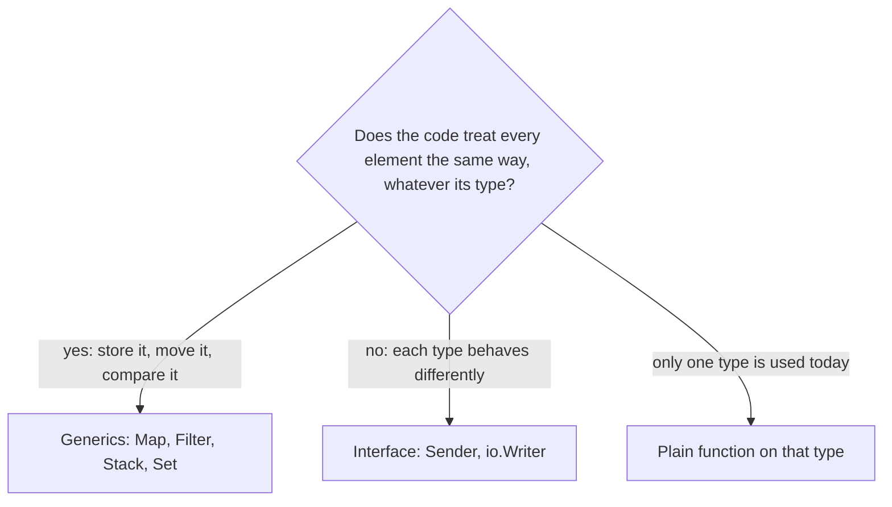

# 04. Generics

> **Draft: written but not yet run.** The code and the expected output in this lesson were prepared by reading the code and the official documentation. They have not been executed yet. If something does not behave as described, trust your tool's real output and report it.

## What you will be able to do
By the end of this lesson you will be able to:
- write a generic function and a generic type with type parameters and constraints (`any`, `comparable`, `cmp.Ordered`, your own);
- explain what the `~` in a constraint means and when type inference fills in the type arguments;
- decide when generics are the right tool and when a plain function or an interface is better;
- use the standard library's `slices` and `maps` packages instead of rewriting them.

## Recap
1. (Lesson 01) What does an interface describe: data or behaviour?
   <details><summary>Answer</summary>Behaviour: the set of methods a value must have.</details>
2. (Lesson 03) Why is `SafeCounter` used through a pointer?
   <details><summary>Answer</summary>It contains a mutex, which must not be copied. Pointer receivers keep one mutex shared by all callers.</details>
3. (Go 101) What does a `map` iteration order guarantee?
   <details><summary>Answer</summary>None. Sort the keys if you need a stable order (you will do that in the exercise).</details>

## Why it matters
Before Go 1.18 you had two choices for a function that works on "a slice of anything": copy it once per type, or use `interface{}` and lose type safety. Generics add a third: write the algorithm once with a *type parameter* and let the compiler check each use. They are for **containers and algorithms that do not care what the element is** (`Map`, `Filter`, `Stack`, `Set`). They are not a replacement for interfaces, which describe behaviour that differs per type (lesson 01). Misusing generics is the quickest way to make Go code harder to read.

## What you will build
A small collections file: `Map`, `Filter`, `Reduce`, `Sum`, `MaxOf`, a `Stack[T]` and a `Set[T]`; a `main` that prints the results; tests.



## Before you start
- Lessons 01 to 03 done. Go 1.22.0 or newer (generics need 1.18; `cmp`, `slices`, `maps` need 1.21). See the [level 201 guide](../README.md#how-every-201-lesson-works).
- Time: 40 minutes.
- Source pack (optional): every file is shown in full in this lesson, so you can follow without it. The finished code, the exercise starter and the solution are in the
  course repository https://github.com/Uee03/Code101 under `source/go/201-hero-to-super-hero/phase-1-core-skills/04-generics/` (on that page choose **Code, Download ZIP**, or run
  `git clone https://github.com/Uee03/Code101.git`).
- No external packages.

## Steps

### Step 1. Create the folder and the module
As in [lesson 01, Step 1](01-interfaces-and-embedding.md#step-1-create-the-folder-and-the-module), with folder `lesson04` and module `example.com/code101/go201/lesson04`. Expected output of `go mod init`:
```text
go: creating new go.mod: module example.com/code101/go201/lesson04
```

### Step 2. Write the generic code
Create `collections.go`.

**File: `collections.go`**
```go
package main

import "cmp"

// Number lists the types Sum accepts. The ~ means "any type whose underlying type is this",
// so a named type such as type Celsius float64 is accepted too.
type Number interface {
	~int | ~int64 | ~float64
}

// Map returns a new slice with f applied to every element.
func Map[T, U any](items []T, f func(T) U) []U {
	out := make([]U, 0, len(items))
	for _, item := range items {
		out = append(out, f(item))
	}
	return out
}

// Filter returns the elements for which keep returns true.
func Filter[T any](items []T, keep func(T) bool) []T {
	var out []T
	for _, item := range items {
		if keep(item) {
			out = append(out, item)
		}
	}
	return out
}

// Reduce folds the slice into one value, starting from start.
func Reduce[T, A any](items []T, start A, f func(A, T) A) A {
	acc := start
	for _, item := range items {
		acc = f(acc, item)
	}
	return acc
}

// Sum adds up any slice of numbers.
func Sum[T Number](items []T) T {
	var total T
	for _, item := range items {
		total += item
	}
	return total
}

// MaxOf returns the largest of its arguments. cmp.Ordered covers every type that supports < and >.
func MaxOf[T cmp.Ordered](first T, rest ...T) T {
	largest := first
	for _, v := range rest {
		if v > largest {
			largest = v
		}
	}
	return largest
}

// Stack is a last-in, first-out collection of any element type.
type Stack[T any] struct {
	items []T
}

func (s *Stack[T]) Push(v T) {
	s.items = append(s.items, v)
}

// Pop removes and returns the newest element; ok is false when the stack is empty.
func (s *Stack[T]) Pop() (v T, ok bool) {
	if len(s.items) == 0 {
		return v, false
	}
	last := len(s.items) - 1
	v = s.items[last]
	s.items = s.items[:last]
	return v, true
}

// Set is a collection of unique values. comparable means the type supports == and can be a map key.
type Set[T comparable] map[T]struct{}

func NewSet[T comparable](items ...T) Set[T] {
	s := make(Set[T], len(items))
	for _, item := range items {
		s[item] = struct{}{}
	}
	return s
}

func (s Set[T]) Has(v T) bool {
	_, ok := s[v]
	return ok
}

func (s Set[T]) Len() int {
	return len(s)
}
```

The new pieces, in order:
1. **Type parameters** go in square brackets after the function name: `Map[T, U any]`. `T` is the element type going in, `U` the type coming out. `any` is the constraint "no restriction" (an alias for `interface{}`).
2. **Constraints are interfaces.** `Number` is an interface that lists types instead of methods: a *type set*. `~int` means "`int` and every type whose underlying type is `int`", which is how a named type like `Celsius` is allowed. Without the `~`, only plain `int` would match.
3. **`cmp.Ordered`** (standard library, Go 1.21) is the constraint for "supports `<`, `>`": all integers, floats and strings. **`comparable`** means "supports `==` and `!=`", which is what a map key needs.
4. **Generic types** carry their parameter with them: `Stack[T any]`, `Set[T comparable]`. Methods repeat the parameter in the receiver (`func (s *Stack[T]) Push(v T)`) but cannot add new type parameters of their own.
5. **The zero value of `T`.** In `Pop` the named results `v T, ok bool` start as `T`'s zero value, which is how you return "nothing" without knowing what `T` is.
6. `Sum` starts from `var total T`: for any number type, the zero value is 0.

### Step 3. main
Create `main.go`.

**File: `main.go`**
```go
package main

import "fmt"

func main() {
	words := []string{"go", "generics", "are", "typed"}

	lengths := Map(words, func(s string) int { return len(s) })
	fmt.Println(lengths)

	long := Filter(words, func(s string) bool { return len(s) > 2 })
	fmt.Println(long)

	fmt.Println(Sum(lengths))
	fmt.Println(Sum([]float64{1.5, 2.25}))

	type Celsius float64
	fmt.Println(Sum([]Celsius{20.5, 1.5}))

	fmt.Println(MaxOf(3, 9, 4), MaxOf("pear", "apple"))

	total := Reduce(words, 0, func(acc int, s string) int { return acc + len(s) })
	fmt.Println(total)

	stack := &Stack[string]{}
	stack.Push("a")
	stack.Push("b")
	top, ok := stack.Pop()
	fmt.Println(top, ok)
	_, ok = (&Stack[int]{}).Pop()
	fmt.Println(ok)

	set := NewSet("a", "b", "a")
	fmt.Println(set.Len(), set.Has("b"), set.Has("z"))
}
```

You never wrote `Map[string, int](...)`: the compiler **inferred** the type arguments from the arguments you passed. Inference works from the function arguments; it cannot guess a type that appears only in the result, so `Stack[string]{}` needs the explicit `[string]`.

### Step 4. Predict, then run
Predict each of the ten lines before you run. Two to look at closely: `Sum([]Celsius{20.5, 1.5})` (why does a named type work?) and `MaxOf(3, 9, 4)` (what type is `T`?).

## Run it
In `lesson04`, on every OS:
```text
go run .
```
Expected output (derived by reading the code, not yet run):
```text
[2 8 3 5]
[generics are typed]
18
3.75
22
9 pear
18
b true
false
2 true false
```

## How it works
- `Map(words, ...)` has `T = string` (from `words`) and `U = int` (from the result type of the function literal). The compiler generates, or reuses, code for that combination and checks that `len(s)` is valid for a `string`.
- `Filter` keeps `"generics"`, `"are"` and `"typed"` (length above 2) and drops `"go"`.
- `Sum(lengths)` is `2 + 8 + 3 + 5 = 18`; `Sum` of two floats is `3.75`.
- `Sum([]Celsius{20.5, 1.5})` works because `Celsius`'s underlying type is `float64` and the constraint says `~float64`. The result type is `Celsius`, printed as `22`.
- `MaxOf(3, 9, 4)`: untyped constants default to `int`, so `T = int` and the answer is `9`. `MaxOf("pear", "apple")` compares strings: `"pear"` is larger.
- `Reduce(words, 0, ...)` folds the lengths into one `int`: the accumulator type `A` is different from the element type `T`, which is what makes `Reduce` more general than `Sum`.
- `Stack`: `Pop` returns `b true` (last in, first out); an empty `Stack[int]` returns `false`.
- `Set`: `NewSet("a", "b", "a")` has length 2; `Has("b")` is true.

**Misconception:** generics are not "templates that check later". The body of a generic function is type-checked once, against the constraint. If you write `total += item` and the constraint does not permit `+`, the error is in the function, not at the call.

## Why this, not that
| Situation | Prefer | Why |
|---|---|---|
| Same algorithm for many element types (`Map`, `Set`, `Stack`) | Generics | One implementation, compile-time safety |
| Different behaviour per type (sending email vs SMS) | Interface | Behaviour varies; generics cannot express it |
| One concrete type today | A plain function | Do not generalise before there are two uses |
| Sorting, searching, `Contains`, `Index`, `Max` | `slices` (Go 1.21+) | Already written, tested and optimised |
| Key and value helpers for maps | `maps` package (`maps.Keys` returns an iterator from Go 1.23; `maps.Clone`, `maps.Copy` exist since 1.21) | Do not reinvent them |
| "I may need other types later" | Wait | A generic signature is harder to read and to change than a concrete one |

## Test it
**File: `collections_test.go`**
```go
package main

import (
	"reflect"
	"testing"
)

func TestMapChangesTheElementType(t *testing.T) {
	got := Map([]int{1, 2, 3}, func(n int) string { return string(rune('a' + n - 1)) })
	want := []string{"a", "b", "c"}
	if !reflect.DeepEqual(got, want) {
		t.Fatalf("got %v, want %v", got, want)
	}
}

func TestFilterKeepsMatchesInOrder(t *testing.T) {
	got := Filter([]int{1, 2, 3, 4, 5, 6}, func(n int) bool { return n%2 == 0 })
	want := []int{2, 4, 6}
	if !reflect.DeepEqual(got, want) {
		t.Fatalf("got %v, want %v", got, want)
	}
}

func TestSumOfNothingIsZero(t *testing.T) {
	if got := Sum([]int(nil)); got != 0 {
		t.Fatalf("got %d, want 0", got)
	}
}

func TestMaxOfWorksForSeveralTypes(t *testing.T) {
	if got := MaxOf(2, 7, 5); got != 7 {
		t.Fatalf("ints: got %d, want 7", got)
	}
	if got := MaxOf("b", "c", "a"); got != "c" {
		t.Fatalf("strings: got %q, want c", got)
	}
}

func TestStackIsLastInFirstOut(t *testing.T) {
	var s Stack[int]
	s.Push(1)
	s.Push(2)
	if v, ok := s.Pop(); !ok || v != 2 {
		t.Fatalf("got %d %v, want 2 true", v, ok)
	}
	if v, ok := s.Pop(); !ok || v != 1 {
		t.Fatalf("got %d %v, want 1 true", v, ok)
	}
	if _, ok := s.Pop(); ok {
		t.Fatal("pop on empty stack should report false")
	}
}
```

Run in `lesson04`:
```text
go test ./...
```
It should end with a line starting `ok`. These five tests are written in the plainest form; lesson 10 turns this style into table-driven tests.

## Try it
Follow the [exercise folders](../README.md#exercise-folders) steps; the folder is `try04`.

1. **Guided.** `SortedKeys` returns the keys of any map whose keys can be ordered, in ascending order. Look at the signature: the constraint `cmp.Ordered` is already chosen for you. Remember that Go randomises map iteration order.
2. **Change.** `GroupBy` collects the items of a slice into lists keyed by a function of each item. Items in each list keep their input order.
3. **Stretch (no single answer).** Design `Cache[K comparable, V any]` with `Get` and `Set`. Do you also want a `GetOrCompute(key, func() V) V`? Decide who is responsible for locking (lesson 03) and what the type of the `compute` function should be if it can fail.

**File: `go.mod (starter)`**
```text
module example.com/code101/go201/try04

go 1.22.0
```
**File: `main.go (starter)`**
```go
package main

import "fmt"

func main() {
	ages := map[string]int{"cherry": 3, "apple": 1, "banana": 2}
	fmt.Println(SortedKeys(ages))

	words := []string{"a", "bb", "cc", "d"}
	fmt.Println(GroupBy(words, func(s string) int { return len(s) }))
}
```
**File: `maps.go (starter)`**
```go
package main

import "cmp"

// SortedKeys returns the keys of m in ascending order. Map order is random, so the result must be sorted.
// The constraint says what the key type must support; choose it from the standard library's cmp package.
func SortedKeys[K cmp.Ordered, V any](m map[K]V) []K {
	// TODO 1: collect the keys, then sort them (the standard library has a generic sort in package slices).
	return nil
}

// GroupBy collects items into lists, one list per key returned by key(item).
// Items in each list keep their input order.
func GroupBy[T any, K comparable](items []T, key func(T) K) map[K][]T {
	// TODO 2: build and return the map.
	return nil
}
```

Run in `try04`:
```text
go run .
```
Expected output once both TODOs are done:
```text
[apple banana cherry]
map[1:[a d] 2:[bb cc]]
```
With the starter as given you see `[]` and `map[]`. (`fmt` prints maps with their keys sorted, so the second line is stable.)

<details><summary>Solution</summary>

`main.go` and `go.mod` are unchanged.

**File: `maps.go (solution)`**
```go
package main

import (
	"cmp"
	"slices"
)

// SortedKeys returns the keys of m in ascending order. Map order is random, so the result must be sorted.
// The constraint says what the key type must support; choose it from the standard library's cmp package.
func SortedKeys[K cmp.Ordered, V any](m map[K]V) []K {
	keys := make([]K, 0, len(m))
	for k := range m {
		keys = append(keys, k)
	}
	slices.Sort(keys)
	return keys
}

// GroupBy collects items into lists, one list per key returned by key(item).
// Items in each list keep their input order.
func GroupBy[T any, K comparable](items []T, key func(T) K) map[K][]T {
	out := make(map[K][]T)
	for _, item := range items {
		k := key(item)
		out[k] = append(out[k], item)
	}
	return out
}
```

`slices.Sort` is itself generic over `cmp.Ordered` element types, which is why the constraint in the signature matches. In `GroupBy`, `out[k]` on a missing key is a nil slice, and `append` on a nil slice works, so no "does the key exist" check is needed.

</details>

## Check yourself
1. What does `~int` allow that `int` does not?
   <details><summary>Answer</summary>Any named type whose underlying type is `int`, such as `type Count int`.</details>
2. Why is `Sum[T Number]` better than `Sum[T any]`?
   <details><summary>Answer</summary>With `any`, `total += item` does not compile, because `any` does not guarantee `+` exists. The constraint states what the body needs.</details>
3. Does this compile, and why? `var s Stack = Stack{}` (assume the type above)
   <details><summary>Answer</summary>No: a generic type must be instantiated with a type argument, `Stack[int]`, before it is used as a type.</details>
4. Your colleague wrote `func Send[T any](s T)` and calls `s.Send()` inside. What is wrong?
   <details><summary>Answer</summary>`any` has no methods. Use an interface constraint (`interface{ Send() }`), or just take the interface as a parameter. This is a job for lesson 01's interface, not for generics.</details>

## Common mistakes
These are typical messages; the wording differs between Go versions.

| Symptom or error text | Cause | Fix |
|---|---|---|
| `cannot infer T` (typical message) | The compiler cannot see the type from the arguments, for example `NewSet()` with no arguments | Give the type argument explicitly: `NewSet[string]()` |
| `T (type) does not satisfy Number` or `float32 does not satisfy Number` (typical message) | The type is not in the constraint's type set | Add the type to the constraint, or use a different constraint |
| `invalid operation: operator + not defined on total (variable of type T constrained by any)` (typical message) | The constraint does not promise the operator you use | Constrain `T` to the types that support it |
| `cannot use generic type Stack[T any] without instantiation` (typical message) | Used `Stack` without `[...]` | Write `Stack[int]` |
| `methods cannot have type parameters` (typical message) | Tried to write `func (s *Stack[T]) Map[U any](...)` | Make it a function: `func MapStack[T, U any](s *Stack[T], ...)` |
| Code that is harder to read after "generalising" | Generics where an interface or a concrete function was enough | Go back to the concrete version until there are two real uses |

## Best practice
Use generics for containers and algorithms that do not depend on the element type; write ordinary code first and generalise when you have two or three real uses. Source: Go blog, "When To Use Generics" https://go.dev/blog/when-generics and Go Tutorial: Getting started with generics https://go.dev/doc/tutorial/generics

## Going further
- Type sets and constraints in the spec: https://go.dev/ref/spec#Type_constraints
- Packages worth knowing: https://pkg.go.dev/slices, https://pkg.go.dev/maps, https://pkg.go.dev/cmp
- Where this reappears: lesson 10 turns the plain test style used here into table-driven tests.

## Phase 1 review (mixed)
Answer without looking back, then check.
1. A `Welcome` function must work with email and SMS senders and be testable. Interface or generic? <details><summary>Answer</summary>Interface (lesson 01): behaviour differs per type.</details>
2. You need the total of 10,000 numbers computed by 4 goroutines. What do you pass them, what do you wait on, and how do you stop them if the user cancels? <details><summary>Answer</summary>A channel or an index range per worker, a `WaitGroup` to wait, and a `context` whose `Done` the workers select on (lessons 02 and 03).</details>
3. What can go wrong if a goroutine writes to a shared map? <details><summary>Answer</summary>A data race and possibly `fatal error: concurrent map writes`; guard it with a mutex (lesson 03).</details>
4. Why is `Stack[T any]` generic but `Sender` an interface? <details><summary>Answer</summary>A stack treats every element the same; senders behave differently.</details>

## Summary
- You wrote generic functions with `any`, `comparable`, `cmp.Ordered` and a custom `~` constraint.
- You wrote generic `Stack` and `Set` types and used the zero value of `T`.
- You explained when inference works and when to name the type argument.
- You chose between generics, interfaces and plain functions with a rule of thumb, and reused `slices.Sort` in the exercise.

## Next lesson
**[05. net/http server](../phase-2-http-and-json/05-net-http-server.md):** phase 2 starts: a real HTTP server with the 1.22 `ServeMux` patterns, handlers and middleware.
