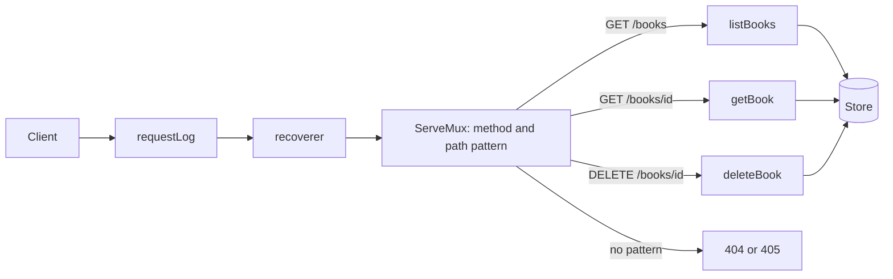

# 05. net/http server: ServeMux patterns, handlers and middleware

> **Draft: written but not yet run.** The code and the expected output in this lesson were prepared by reading the code and the official documentation. They have not been executed yet. If something does not behave as described, trust your tool's real output and report it.

## What you will be able to do
By the end of this lesson you will be able to:
- register routes with method and wildcard patterns (`GET /books/{id}`) and read the value with `r.PathValue`;
- write handlers that set headers, status code and body in the right order, and map failures to 400, 404, 405 and 500;
- write middleware (`func(http.Handler) http.Handler`) for logging and panic recovery, and explain why order matters;
- configure an `http.Server` with timeouts and a safe bind address, and test routes with `httptest` without opening a port.

## Recap
1. (Lesson 01) `http.Handler` has one method. What does that make it easy to do?
   <details><summary>Answer</summary>Anything with a `ServeHTTP(w, r)` method is a handler, so you can wrap, fake and compose handlers. It is the small-interface idea again.</details>
2. (Lesson 03) The server will run your handlers on many goroutines. What must a shared in-memory store use?
   <details><summary>Answer</summary>A mutex (or another synchronisation). Reads and writes from different requests can happen at the same time.</details>
3. (Lesson 03) What is `r.Context()` going to be cancelled by?
   <details><summary>Answer</summary>The client disconnecting or the server finishing the request. Pass it to anything slow (database calls in lesson 08).</details>

## Why it matters
Most Go you will write at work is an HTTP service. The standard library is enough for a production-grade server: since Go 1.22 the built-in router understands methods and path wildcards, which removed the most common reason to reach for a router package. Knowing the standard pieces (`Handler`, `ServeMux`, middleware, `Server` timeouts) means every framework you meet later is a thin layer over something you already understand.

## What you will build
A small books API on `127.0.0.1:8080`: health check, list, get one and delete, with request logging and panic recovery. It keeps data in memory (a database comes in lesson 08) and answers in JSON (lesson 06 formalises request and error bodies).



## Before you start
- Phase 1 finished. Go 1.22.0 or newer is required: the `"GET /books/{id}"` patterns and `r.PathValue` were added in Go 1.22. The [level 201 guide](../README.md#how-every-201-lesson-works) explains folders and exercises.
- `curl` to call the server. On macOS and Linux it is `curl`. In Windows PowerShell write **`curl.exe`**: plain `curl` is an alias for `Invoke-WebRequest` and behaves differently.
- Time: 50 minutes.
- Source pack (optional): every file is shown in full in this lesson, so you can follow without it. The finished code, the exercise starter and the solution are in the
  course repository https://github.com/Uee03/Code101 under `source/go/201-hero-to-super-hero/phase-2-http-and-json/05-net-http-server/` (on that page choose **Code, Download ZIP**, or run
  `git clone https://github.com/Uee03/Code101.git`).
- No external packages.

## Steps

### Step 1. Create the folder and the module
As in [lesson 01, Step 1](../phase-1-core-skills/01-interfaces-and-embedding.md#step-1-create-the-folder-and-the-module), with folder `lesson05` and module `example.com/code101/go201/lesson05`. Expected output of `go mod init`:
```text
go: creating new go.mod: module example.com/code101/go201/lesson05
```

### Step 2. The store and the handlers
Create `books.go`.

**File: `books.go`**
```go
package main

import (
	"encoding/json"
	"log"
	"net/http"
	"slices"
	"strconv"
	"sync"
)

type Book struct {
	ID     int    `json:"id"`
	Title  string `json:"title"`
	Author string `json:"author"`
}

// Store keeps books in memory. The mutex makes it safe for the many goroutines net/http starts.
type Store struct {
	mu    sync.RWMutex
	books map[int]Book
}

func NewStore() *Store {
	return &Store{books: map[int]Book{
		1: {ID: 1, Title: "The Go Programming Language", Author: "Donovan and Kernighan"},
		2: {ID: 2, Title: "Concurrency in Go", Author: "Katherine Cox-Buday"},
	}}
}

func (s *Store) List() []Book {
	s.mu.RLock()
	defer s.mu.RUnlock()
	out := make([]Book, 0, len(s.books))
	for _, b := range s.books {
		out = append(out, b)
	}
	slices.SortFunc(out, func(a, b Book) int { return a.ID - b.ID })
	return out
}

func (s *Store) Get(id int) (Book, bool) {
	s.mu.RLock()
	defer s.mu.RUnlock()
	b, ok := s.books[id]
	return b, ok
}

func (s *Store) Delete(id int) bool {
	s.mu.Lock()
	defer s.mu.Unlock()
	_, ok := s.books[id]
	delete(s.books, id)
	return ok
}

// api holds what the handlers need; each handler is a method, so they share it without globals.
type api struct {
	store *Store
}

func (a *api) health(w http.ResponseWriter, r *http.Request) {
	writeJSON(w, http.StatusOK, map[string]string{"status": "ok"})
}

func (a *api) listBooks(w http.ResponseWriter, r *http.Request) {
	writeJSON(w, http.StatusOK, a.store.List())
}

func (a *api) getBook(w http.ResponseWriter, r *http.Request) {
	id, err := strconv.Atoi(r.PathValue("id"))
	if err != nil {
		http.Error(w, "id must be a number", http.StatusBadRequest)
		return
	}
	book, ok := a.store.Get(id)
	if !ok {
		http.Error(w, "book not found", http.StatusNotFound)
		return
	}
	writeJSON(w, http.StatusOK, book)
}

func (a *api) deleteBook(w http.ResponseWriter, r *http.Request) {
	id, err := strconv.Atoi(r.PathValue("id"))
	if err != nil {
		http.Error(w, "id must be a number", http.StatusBadRequest)
		return
	}
	if !a.store.Delete(id) {
		http.Error(w, "book not found", http.StatusNotFound)
		return
	}
	w.WriteHeader(http.StatusNoContent)
}

// writeJSON sets the headers first, then the status, then the body: the order matters,
// because headers cannot change after WriteHeader (or the first Write) has been called.
func writeJSON(w http.ResponseWriter, status int, v any) {
	w.Header().Set("Content-Type", "application/json")
	w.WriteHeader(status)
	if err := json.NewEncoder(w).Encode(v); err != nil {
		log.Printf("write response: %v", err)
	}
}
```

Points to notice:
1. **A handler is a function `func(w http.ResponseWriter, r *http.Request)`.** Here each one is a *method* of `api`, so all handlers share `a.store` without a global variable. Registering `a.listBooks` passes a method value (a function that remembers `a`).
2. **`r.PathValue("id")`** returns the text matched by the `{id}` wildcard. It is always a string, so you convert and validate it yourself: `strconv.Atoi` failing means the client sent something that is not a number, which is a **400 Bad Request**, not a 404 and never a 500.
3. **Status codes tell clients what happened.** 200 OK with a body; 204 No Content for a successful delete (no body); 400 the request is wrong; 404 there is no such resource; 405 the path exists but not for this method; 500 your bug.
4. **Order inside a response:** headers, then `WriteHeader(status)`, then the body. After the first `Write` (or `WriteHeader`) the status line and headers are already sent; `w.Header().Set` afterwards silently does nothing. This is why `writeJSON` sets `Content-Type` first.
5. **`http.Error`** writes a plain-text body and sets the status. It is fine for now; lesson 06 replaces it with a structured JSON error.
6. The `Store` has an `RWMutex` because handlers run concurrently (lesson 03). `List` sorts by ID since map iteration order is random.

### Step 3. Middleware
Create `middleware.go`.

**File: `middleware.go`**
```go
package main

import (
	"log"
	"net/http"
	"time"
)

// middleware wraps a handler and returns a new handler.
type middleware func(http.Handler) http.Handler

// chain applies the middleware so that the first one in the list is the outermost.
func chain(h http.Handler, mws ...middleware) http.Handler {
	for i := len(mws) - 1; i >= 0; i-- {
		h = mws[i](h)
	}
	return h
}

// statusRecorder embeds the real ResponseWriter (lesson 01) and remembers the status code.
type statusRecorder struct {
	http.ResponseWriter
	status int
}

func (s *statusRecorder) WriteHeader(code int) {
	s.status = code
	s.ResponseWriter.WriteHeader(code)
}

// Unwrap lets http.ResponseController reach the original writer (for flushing, deadlines).
func (s *statusRecorder) Unwrap() http.ResponseWriter {
	return s.ResponseWriter
}

// requestLog logs one line per request, after the handler has finished.
func requestLog(next http.Handler) http.Handler {
	return http.HandlerFunc(func(w http.ResponseWriter, r *http.Request) {
		start := time.Now()
		rec := &statusRecorder{ResponseWriter: w, status: http.StatusOK}
		next.ServeHTTP(rec, r)
		log.Printf("%s %s -> %d (%s)", r.Method, r.URL.Path, rec.status, time.Since(start))
	})
}

// recoverer turns a panic in a handler into a 500 response instead of a dropped connection.
func recoverer(next http.Handler) http.Handler {
	return http.HandlerFunc(func(w http.ResponseWriter, r *http.Request) {
		defer func() {
			if v := recover(); v != nil {
				log.Printf("panic: %v", v)
				http.Error(w, "internal server error", http.StatusInternalServerError)
			}
		}()
		next.ServeHTTP(w, r)
	})
}
```

A **middleware** is a function that takes a handler and returns a handler that does something before and/or after calling it. `chain` applies a list of them so the first listed is the outermost.

- `statusRecorder` **embeds** `http.ResponseWriter` (lesson 01): every method is forwarded automatically, and we override only `WriteHeader` to remember the code. `Unwrap` is the convention `http.ResponseController` uses to find the real writer. A caution: wrapping hides *optional* interfaces of the real writer (such as `http.Flusher`), exactly like `describe(counted)` in lesson 01; `Unwrap` and `ResponseController` are the supported way around that.
- `requestLog` measures time around `next.ServeHTTP` and logs method, path, status and duration.
- `recoverer` uses `defer` and `recover()` to catch a panic in any later handler, logs it on the server, and sends the client only a generic `500` text. **Never send the panic value or a stack trace to the client**: it leaks internals.

### Step 4. The router and the server
Create `main.go`.

**File: `main.go`**
```go
package main

import (
	"errors"
	"log"
	"net/http"
	"time"
)

func newRouter(store *Store) http.Handler {
	a := &api{store: store}
	mux := http.NewServeMux()
	mux.HandleFunc("GET /healthz", a.health)
	mux.HandleFunc("GET /books", a.listBooks)
	mux.HandleFunc("GET /books/{id}", a.getBook)
	mux.HandleFunc("DELETE /books/{id}", a.deleteBook)
	// Teaching route: it panics so you can watch recoverer work. Remove it in a real service.
	mux.HandleFunc("GET /boom", func(http.ResponseWriter, *http.Request) { panic("boom") })
	return chain(mux, requestLog, recoverer)
}

func main() {
	srv := &http.Server{
		Addr:              "127.0.0.1:8080",
		Handler:           newRouter(NewStore()),
		ReadHeaderTimeout: 5 * time.Second,
		ReadTimeout:       10 * time.Second,
		WriteTimeout:      10 * time.Second,
		IdleTimeout:       60 * time.Second,
	}
	log.Printf("listening on http://%s", srv.Addr)
	if err := srv.ListenAndServe(); err != nil && !errors.Is(err, http.ErrServerClosed) {
		log.Fatal(err)
	}
}
```

**Patterns.** A pattern is `[METHOD ][HOST]/[PATH]`.
| Pattern | Matches |
|---|---|
| `GET /books` | `GET /books` only (and `HEAD /books`). Other methods on that path get **405** with an `Allow` header |
| `GET /books/{id}` | `/books/` plus exactly one more segment, which `r.PathValue("id")` returns |
| `/files/{path...}` | everything below `/files/`, in one value (not used here) |
| `GET /{$}` | exactly `/`, nothing below it (not used here) |

When two patterns match, the **more specific one wins**; if neither is more specific than the other, registering both panics at start-up with a message about conflicting patterns, which is the behaviour you want: the mistake appears on day one, not in production.

`chain(mux, requestLog, recoverer)` makes `requestLog` the outer layer and `recoverer` the inner one. Order matters: if `recoverer` were outside, a panic would unwind through `requestLog` before being caught, and the request would never be logged. With this order a panicking request is recovered, answered 500 and logged as 500.

**The server settings** are security settings, not tuning:
| Field | What it protects against |
|---|---|
| `Addr: "127.0.0.1:8080"` | Binding to the loopback address keeps the service private while you develop. `":8080"` would expose it on every network interface |
| `ReadHeaderTimeout` | A client that sends headers very slowly (a "slowloris" attack) cannot hold a connection forever |
| `ReadTimeout`, `WriteTimeout` | Bound the time to read the whole request and to write the response |
| `IdleTimeout` | Closes idle keep-alive connections |

`http.ListenAndServe(addr, handler)` has no timeouts at all. Always build an `http.Server` yourself.

### Step 5. Predict, then run
The server logs in the standard `log` format (date, time, message). Predict the status code for each call below before you run it.

## Run it
In `lesson05` (needs no `go.sum`: there are no dependencies):
```text
go run .
```
Expected output; the date and time on your machine differ:
```text
<date> <time> listening on http://127.0.0.1:8080
```
Leave it running. Open a **second terminal** and call it. Each command prints the body and then the status (`-w` is curl's output template).

PowerShell: use `curl.exe`. macOS and Linux: use `curl`.
```text
curl.exe -s -w "status %{http_code}\n" http://127.0.0.1:8080/healthz
```
Expected output:
```text
{"status":"ok"}
status 200
```
List and get one:
```text
curl.exe -s http://127.0.0.1:8080/books
curl.exe -s http://127.0.0.1:8080/books/1
```
Expected output:
```text
[{"id":1,"title":"The Go Programming Language","author":"Donovan and Kernighan"},{"id":2,"title":"Concurrency in Go","author":"Katherine Cox-Buday"}]
{"id":1,"title":"The Go Programming Language","author":"Donovan and Kernighan"}
```
The error paths:
```text
curl.exe -s -w "status %{http_code}\n" http://127.0.0.1:8080/books/99
```
Expected output:
```text
book not found
status 404
```
```text
curl.exe -s -w "status %{http_code}\n" http://127.0.0.1:8080/books/abc
```
Expected output:
```text
id must be a number
status 400
```
```text
curl.exe -s -w "status %{http_code}\n" -X POST http://127.0.0.1:8080/books
```
Expected output (the body is the standard status text, so only the last line matters):
```text
Method Not Allowed
status 405
```
Delete, delete again, and trigger the panic:
```text
curl.exe -s -w "status %{http_code}\n" -X DELETE http://127.0.0.1:8080/books/1
curl.exe -s -w "status %{http_code}\n" -X DELETE http://127.0.0.1:8080/books/1
curl.exe -s -w "status %{http_code}\n" http://127.0.0.1:8080/boom
```
Expected output:
```text
status 204
book not found
status 404
internal server error
status 500
```
In the server terminal you see one line per request, for example (durations vary):
```text
<date> <time> GET /healthz -> 200 (<duration>)
<date> <time> panic: boom
<date> <time> GET /boom -> 500 (<duration>)
```
Stop the server with **Ctrl+C**. (Lesson 07 makes it finish in-flight requests first.)

## How it works
1. `ListenAndServe` accepts connections and starts **one goroutine per request**. That is why the store has a lock and why a panic in one handler must not take the others down (`recoverer`).
2. The server calls `Handler.ServeHTTP`. Our handler is the chain: `requestLog` starts a clock, wraps `w` in a `statusRecorder`, and calls `recoverer`, which calls the `ServeMux`.
3. The mux compares method and path with its patterns, stores wildcard values in the request, and calls the matching handler. With no match it answers 404; with a path match but a different method, 405.
4. The handler returns; control flows back out through `recoverer` (nothing to recover) and `requestLog` (logs `-> 200`).
5. `/boom` panics inside the handler; `recoverer`'s deferred function catches it, writes 500 through the recorder, and `requestLog` then logs `-> 500`.

**Misconception:** a handler is not a background job. It runs on the request's own goroutine, and the response is complete when the handler returns. If you start your own goroutine inside a handler and use `w` after the handler has returned, you have a bug.

## Why this, not that
| Choice | Use it when | Trade-off |
|---|---|---|
| `net/http` `ServeMux` (Go 1.22+) | Methods and simple path wildcards cover your routes | No built-in route groups or regex; you write small helpers like `chain` |
| A router package (`chi`, `gorilla/mux`, `gin`) | You want route groups, per-route middleware or built-in helpers | One more dependency to update; the middleware signature stays `func(http.Handler) http.Handler` with chi, so skills transfer |
| Middleware as `func(http.Handler) http.Handler` | Cross-cutting concerns: logging, auth, recovery, limits | Order matters and is easy to get wrong; test it |
| Plain `http.Error` text | Quick prototypes | Clients cannot parse it; replaced by problem details in lesson 06 |
| `http.ListenAndServe(...)` | Never in a service | No timeouts |

## Test it
You can test the whole router without opening a port: `httptest.NewRecorder` is an `http.ResponseWriter` that records what the handler wrote, and `httptest.NewRequest` builds a request. A new `Store` per case keeps the cases independent. Lesson 10 explains this style in depth.

**File: `server_test.go`**
```go
package main

import (
	"net/http"
	"net/http/httptest"
	"testing"
)

func TestRoutes(t *testing.T) {
	tests := []struct {
		name   string
		method string
		path   string
		want   int
	}{
		{"health", "GET", "/healthz", http.StatusOK},
		{"list", "GET", "/books", http.StatusOK},
		{"get one", "GET", "/books/1", http.StatusOK},
		{"missing book", "GET", "/books/99", http.StatusNotFound},
		{"bad id", "GET", "/books/abc", http.StatusBadRequest},
		{"delete", "DELETE", "/books/1", http.StatusNoContent},
		{"wrong method", "POST", "/books", http.StatusMethodNotAllowed},
		{"unknown path", "GET", "/nope", http.StatusNotFound},
		{"panic is recovered", "GET", "/boom", http.StatusInternalServerError},
	}
	for _, tc := range tests {
		t.Run(tc.name, func(t *testing.T) {
			rec := httptest.NewRecorder()
			req := httptest.NewRequest(tc.method, tc.path, nil)
			newRouter(NewStore()).ServeHTTP(rec, req)
			if rec.Code != tc.want {
				t.Fatalf("%s %s: status %d, want %d", tc.method, tc.path, rec.Code, tc.want)
			}
		})
	}
}

func TestGetBookBodyAndContentType(t *testing.T) {
	rec := httptest.NewRecorder()
	newRouter(NewStore()).ServeHTTP(rec, httptest.NewRequest("GET", "/books/2", nil))
	want := `{"id":2,"title":"Concurrency in Go","author":"Katherine Cox-Buday"}` + "\n"
	if rec.Body.String() != want {
		t.Fatalf("body %q, want %q", rec.Body.String(), want)
	}
	if ct := rec.Header().Get("Content-Type"); ct != "application/json" {
		t.Fatalf("content type %q, want application/json", ct)
	}
}
```

Run in `lesson05`:
```text
go test ./...
```
It should end with a line starting `ok`. If a case fails, `t.Fatalf` prints the method, path and the status you got.

## Try it
Use the [exercise folders](../README.md#exercise-folders) steps; folder name `try05`. This exercise is test-driven: the tests are already written and describe what you must build.

1. **Guided.** Register `GET /hello` (text `hello, world`) and `GET /hello/{name}` (text `hello, ` and the name). Answer as `text/plain; charset=utf-8`. The reason for the explicit content type: the name comes from the URL, and you do not want a browser guessing it is HTML.
2. **Change.** Write a middleware `nosniff` that sets `X-Content-Type-Options: nosniff` and wrap the mux in it, so even 404 and 405 responses carry it.
3. **Stretch (no single answer).** Where would you put a request-size limit, an authentication check and the logger relative to each other in a `chain(...)`? Write down the order and one request that behaves wrongly in a different order.

**File: `go.mod (starter)`**
```text
module example.com/code101/go201/try05

go 1.22.0
```
**File: `main.go (starter)`**
```go
package main

import (
	"log"
	"net/http"
	"time"
)

// newRouter must serve:
//
//	GET /hello         -> 200 and the text "hello, world"
//	GET /hello/{name}  -> 200 and the text "hello, " followed by the name
//
// and every response, including 404 and 405, must carry the header
// X-Content-Type-Options: nosniff, set by a middleware named nosniff.
func newRouter() http.Handler {
	mux := http.NewServeMux()
	// TODO 1: register the two routes. Send the text as text/plain; charset=utf-8.
	// TODO 2: write the middleware nosniff and return mux wrapped in it.
	return mux
}

func main() {
	srv := &http.Server{
		Addr:              "127.0.0.1:8080",
		Handler:           newRouter(),
		ReadHeaderTimeout: 5 * time.Second,
	}
	log.Printf("listening on http://%s", srv.Addr)
	log.Fatal(srv.ListenAndServe())
}
```
**File: `main_test.go (starter)`**
```go
package main

import (
	"net/http"
	"net/http/httptest"
	"testing"
)

func get(t *testing.T, path string) *httptest.ResponseRecorder {
	t.Helper()
	rec := httptest.NewRecorder()
	newRouter().ServeHTTP(rec, httptest.NewRequest(http.MethodGet, path, nil))
	return rec
}

func TestHelloWithName(t *testing.T) {
	rec := get(t, "/hello/ada")
	if rec.Code != http.StatusOK || rec.Body.String() != "hello, ada" {
		t.Fatalf("got %d %q, want 200 \"hello, ada\"", rec.Code, rec.Body.String())
	}
}

func TestHelloWithoutName(t *testing.T) {
	rec := get(t, "/hello")
	if rec.Code != http.StatusOK || rec.Body.String() != "hello, world" {
		t.Fatalf("got %d %q, want 200 \"hello, world\"", rec.Code, rec.Body.String())
	}
}

func TestNosniffOnEveryResponse(t *testing.T) {
	for _, path := range []string{"/hello", "/hello/ada", "/missing"} {
		if got := get(t, path).Header().Get("X-Content-Type-Options"); got != "nosniff" {
			t.Errorf("%s: header is %q, want nosniff", path, got)
		}
	}
}

func TestPostIsNotAllowed(t *testing.T) {
	rec := httptest.NewRecorder()
	newRouter().ServeHTTP(rec, httptest.NewRequest(http.MethodPost, "/hello", nil))
	if rec.Code != http.StatusMethodNotAllowed {
		t.Fatalf("got %d, want 405", rec.Code)
	}
}
```

Run in `try05`:
```text
go test ./...
```
Before your changes it fails: you will see `--- FAIL:` lines for the tests that need your routes and header. When you are done it ends with a line starting `ok`.

<details><summary>Solution</summary>

`main_test.go` and `go.mod` are unchanged. Replace `main.go`:

**File: `main.go (solution)`**
```go
package main

import (
	"fmt"
	"log"
	"net/http"
	"time"
)

// newRouter must serve:
//
//	GET /hello         -> 200 and the text "hello, world"
//	GET /hello/{name}  -> 200 and the text "hello, " followed by the name
//
// and every response, including 404 and 405, must carry the header
// X-Content-Type-Options: nosniff, set by a middleware named nosniff.
func newRouter() http.Handler {
	mux := http.NewServeMux()
	mux.HandleFunc("GET /hello", func(w http.ResponseWriter, r *http.Request) {
		w.Header().Set("Content-Type", "text/plain; charset=utf-8")
		fmt.Fprint(w, "hello, world")
	})
	mux.HandleFunc("GET /hello/{name}", func(w http.ResponseWriter, r *http.Request) {
		w.Header().Set("Content-Type", "text/plain; charset=utf-8")
		fmt.Fprintf(w, "hello, %s", r.PathValue("name"))
	})
	return nosniff(mux)
}

func nosniff(next http.Handler) http.Handler {
	return http.HandlerFunc(func(w http.ResponseWriter, r *http.Request) {
		w.Header().Set("X-Content-Type-Options", "nosniff")
		next.ServeHTTP(w, r)
	})
}

func main() {
	srv := &http.Server{
		Addr:              "127.0.0.1:8080",
		Handler:           newRouter(),
		ReadHeaderTimeout: 5 * time.Second,
	}
	log.Printf("listening on http://%s", srv.Addr)
	log.Fatal(srv.ListenAndServe())
}
```

`nosniff` wraps the *mux*, not each handler, so it also covers the 404 and 405 answers the mux produces itself. Because it sets the header before calling `next`, nothing later can forget it. `fmt.Fprint(w, ...)` works because `http.ResponseWriter` is an `io.Writer` (lesson 01 again).

Stretch: a sensible order is `requestLog` (outermost, so every request is logged, including rejected ones), then `recoverer`, then a body-size limit, then authentication, then the mux. Authentication before the size limit lets an anonymous client make you read a large body.

</details>

## Check yourself
1. What status do you send for a request to `/books/abc`, and why not 404?
   <details><summary>Answer</summary>400. The route exists; the client sent an invalid value. 404 means the resource does not exist.</details>
2. Why does `requestLog` come before `recoverer` in `chain(mux, requestLog, recoverer)`?
   <details><summary>Answer</summary>The first listed is outermost. With `recoverer` inside, a panic is turned into a 500 before control returns to `requestLog`, so the request is still logged.</details>
3. What is wrong with `w.WriteHeader(201); w.Header().Set("Location", "/books/3")`?
   <details><summary>Answer</summary>Headers must be set before `WriteHeader`; afterwards the header is ignored.</details>
4. Why is `http.ListenAndServe(":8080", h)` risky in production?
   <details><summary>Answer</summary>It has no timeouts, so slow or stalled clients can hold connections, and `:8080` listens on all interfaces.</details>

## Common mistakes
| Symptom or error text | Cause | Fix |
|---|---|---|
| `listen tcp 127.0.0.1:8080: bind: ...` (typical message; wording differs by OS) | Another program already uses port 8080 | Stop it, or change `Addr` |
| `404 page not found` for `GET /books/` | Trailing slash: the pattern `GET /books` does not match `/books/` | Call `/books`, or register the pattern you want |
| 405 when you expected a handler to run | Wrong method for that path (for example `POST /books`) | Register the method, or call with the right one |
| Panic at start-up that mentions `conflicts with pattern` (typical message) | Two patterns overlap and neither is more specific | Make one pattern more specific, or remove one |
| `r.PathValue("id")` is always empty | The pattern has no `{id}` wildcard, or you built the request in a test without going through the mux | Register the wildcard; test through `newRouter(...).ServeHTTP` |
| Header set but missing from the response | `w.Header().Set` called after `WriteHeader` or `Write` | Set headers first |
| `curl` in PowerShell prints a long object or asks about scripts | In Windows PowerShell `curl` is an alias for `Invoke-WebRequest` | Type `curl.exe` |
| `go: go.mod file not found in current directory or any parent directory; see 'go help modules'` | Running `go run .` outside the module folder | `cd` into `lesson05` |

## Best practice
Build an `http.Server` with timeouts instead of calling `ListenAndServe` directly, bind to the narrowest address you need, and keep middleware as `func(http.Handler) http.Handler` so it stays portable. Source: Go blog, "Routing Enhancements for Go 1.22" https://go.dev/blog/routing-enhancements and net/http package documentation https://pkg.go.dev/net/http

## Going further
- Read the pattern rules in full: https://pkg.go.dev/net/http#hdr-Patterns-ServeMux
- Per-route middleware and security headers, CORS and rate limits appear in the capstone hardening chapter: [`capstones/backend-go`](../../../../capstones/backend-go/tutorials/phase-5-hardening/07-hardening.md).
- Next, lesson 06 makes the request and error bodies explicit and safe.

## Summary
- You registered method and wildcard routes on the standard `ServeMux` and read path values.
- You returned 200, 204, 400, 404, 405 and 500 for the right reasons and set headers before the status.
- You wrote logging and recovery middleware, embedded `ResponseWriter` to capture the status, and explained the order.
- You configured an `http.Server` with timeouts and a loopback address, and tested routes with `httptest`.

## Next lesson
**[06. JSON DTOs, validation and problem+json errors](06-json-dtos-and-problems.md):** accept a JSON body safely, validate it and answer errors in a standard format.
