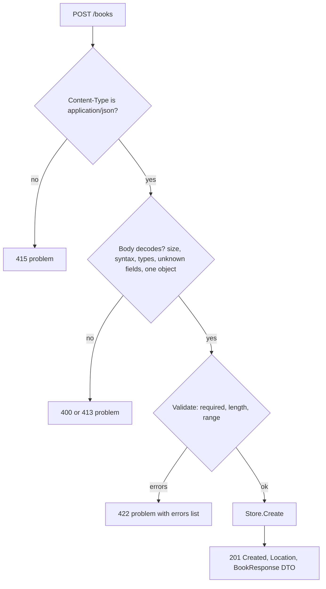

# 06. JSON DTOs, validation and problem+json errors

> **Draft: written but not yet run.** The code and the expected output in this lesson were prepared by reading the code and the official documentation. They have not been executed yet. If something does not behave as described, trust your tool's real output and report it.

## What you will be able to do
By the end of this lesson you will be able to:
- separate request and response DTOs from the internal type, and explain which attacks and leaks that prevents;
- decode a JSON body safely: content type check, size limit, unknown fields rejected, one object only;
- validate a request, collect every field error, and choose between 400 and 422;
- return every error as `application/problem+json` (RFC 9457) without leaking internals.

## Recap
1. (Lesson 05) Why must headers be set before `WriteHeader`?
   <details><summary>Answer</summary>After `WriteHeader` or the first `Write` the headers are already sent; later changes are ignored.</details>
2. (Lesson 05) Which status code means "the route exists but the client's value is wrong"?
   <details><summary>Answer</summary>400 Bad Request (for example a non-numeric id). 404 is for a resource that does not exist.</details>
3. (Lesson 01) How does `errors.As` help you read an error returned from a library?
   <details><summary>Answer</summary>It finds an error of a given concrete type anywhere in the wrapped chain, so you can read its fields. You use it today with `*json.SyntaxError`.</details>

## Why it matters
The request body is the part of your program an attacker controls completely. A handler that decodes straight into its database struct lets the client set fields it should never touch (a "mass assignment" bug: `{"isAdmin": true}`), accepts any size, and answers errors in a format no client can parse. DTOs (data transfer objects) are small structs that describe exactly what crosses the wire; validation says what is acceptable; problem details give every error one predictable shape. This is the pattern behind every API in the capstones.

## What you will build
`POST /books` and `GET /books/{id}` with a request DTO, a response DTO, validation, and RFC 9457 errors for every failure path.



## Before you start
- Lesson 05 finished. Go 1.22.0 or newer. See the [level 201 guide](../README.md#how-every-201-lesson-works).
- `curl` (`curl.exe` in Windows PowerShell). `%header{location}` in the examples needs curl 7.84 or newer; if yours is older, omit that part.
- Time: 50 minutes.
- Source pack (optional): every file is shown in full in this lesson, so you can follow without it. The finished code, the exercise starter and the solution are in the
  course repository https://github.com/Uee03/Code101 under `source/go/201-hero-to-super-hero/phase-2-http-and-json/06-json-dtos-and-problems/` (on that page choose **Code, Download ZIP**, or run
  `git clone https://github.com/Uee03/Code101.git`).
- No external packages.

## Steps

### Step 1. Create the folder and the module
As in [lesson 01, Step 1](../phase-1-core-skills/01-interfaces-and-embedding.md#step-1-create-the-folder-and-the-module), with folder `lesson06` and module `example.com/code101/go201/lesson06`. Expected output of `go mod init`:
```text
go: creating new go.mod: module example.com/code101/go201/lesson06
```
Inside `lesson06` also create a folder `requests`; it holds three sample bodies (Step 7).

### Step 2. The domain type and the store
Create `store.go`. `Book` is the *internal* type. It has an `InternalNote` that must never reach a client.

**File: `store.go`**
```go
package main

import "sync"

// Book is the internal (domain) type. Clients never receive it directly:
// InternalNote must not leak, so the API answers with BookResponse instead.
type Book struct {
	ID           int
	Title        string
	Author       string
	Pages        int
	InternalNote string
}

// Store keeps books in memory, safe for concurrent use.
type Store struct {
	mu     sync.Mutex
	nextID int
	books  map[int]Book
}

func NewStore() *Store {
	return &Store{nextID: 1, books: make(map[int]Book)}
}

// Create assigns the next ID, stores the book and returns it.
func (s *Store) Create(b Book) Book {
	s.mu.Lock()
	defer s.mu.Unlock()
	b.ID = s.nextID
	s.nextID++
	s.books[b.ID] = b
	return b
}

func (s *Store) Get(id int) (Book, bool) {
	s.mu.Lock()
	defer s.mu.Unlock()
	b, ok := s.books[id]
	return b, ok
}
```

### Step 3. The DTOs and validation
Create `dto.go`.

**File: `dto.go`**
```go
package main

import (
	"strings"
	"unicode/utf8"
)

// CreateBookRequest is what a client may send. Only these fields can be set from outside:
// ID and InternalNote are not here, so a client cannot choose them.
type CreateBookRequest struct {
	Title  string `json:"title"`
	Author string `json:"author"`
	Pages  int    `json:"pages"`
}

// BookResponse is what a client receives.
type BookResponse struct {
	ID     int    `json:"id"`
	Title  string `json:"title"`
	Author string `json:"author"`
	Pages  int    `json:"pages"`
}

// FieldError describes one invalid field.
type FieldError struct {
	Field   string `json:"field"`
	Message string `json:"message"`
}

// Validate checks business rules that JSON decoding cannot: required, length, range.
func (r CreateBookRequest) Validate() []FieldError {
	var errs []FieldError
	title := strings.TrimSpace(r.Title)
	switch {
	case title == "":
		errs = append(errs, FieldError{Field: "title", Message: "is required"})
	case utf8.RuneCountInString(title) > 200:
		errs = append(errs, FieldError{Field: "title", Message: "must be at most 200 characters"})
	}
	if strings.TrimSpace(r.Author) == "" {
		errs = append(errs, FieldError{Field: "author", Message: "is required"})
	}
	if r.Pages < 1 || r.Pages > 10000 {
		errs = append(errs, FieldError{Field: "pages", Message: "must be between 1 and 10000"})
	}
	return errs
}

func (r CreateBookRequest) toBook() Book {
	return Book{
		Title:  strings.TrimSpace(r.Title),
		Author: strings.TrimSpace(r.Author),
		Pages:  r.Pages,
	}
}

func toResponse(b Book) BookResponse {
	return BookResponse{ID: b.ID, Title: b.Title, Author: b.Author, Pages: b.Pages}
}
```

Why separate types?
1. **No over-posting.** `CreateBookRequest` has no `ID` and no `InternalNote`. With `DisallowUnknownFields` (Step 5) a client who sends `"id": 99` is rejected instead of silently ignored, and could never set it even if it were not.
2. **No accidental leaks.** `BookResponse` lists what the client may see. Adding a field to `Book` later does not change the API unless you also add it here.
3. **The API can evolve independently** of the storage layout.

Validation rules, and why they look like this:
- **Trim, then check.** `"   "` is not a title.
- **Count characters, not bytes.** `utf8.RuneCountInString` counts runes, so a title in Japanese is not penalised three times.
- **Collect every error.** A client fixing a form wants the full list, not one problem per round trip.
- **`json` tags** name the wire format (`"pages"`), independent of Go field names. `omitempty` (used in `Problem`) drops zero values.

### Step 4. Problem details
Create `respond.go`.

**File: `respond.go`**
```go
package main

import (
	"encoding/json"
	"log"
	"net/http"
)

const problemBase = "https://example.com/problems/"

// Problem is an RFC 9457 "problem details" object. The media type is application/problem+json.
type Problem struct {
	Type     string       `json:"type"`
	Title    string       `json:"title"`
	Status   int          `json:"status"`
	Detail   string       `json:"detail,omitempty"`
	Instance string       `json:"instance,omitempty"`
	Errors   []FieldError `json:"errors,omitempty"`
}

func badRequest(detail string) Problem {
	return Problem{Type: problemBase + "bad-request", Title: "Bad request", Status: http.StatusBadRequest, Detail: detail}
}

func notFound(detail string) Problem {
	return Problem{Type: problemBase + "not-found", Title: "Not found", Status: http.StatusNotFound, Detail: detail}
}

func unsupportedMediaType(detail string) Problem {
	return Problem{Type: problemBase + "unsupported-media-type", Title: "Unsupported media type", Status: http.StatusUnsupportedMediaType, Detail: detail}
}

func payloadTooLarge(detail string) Problem {
	return Problem{Type: problemBase + "payload-too-large", Title: "Payload too large", Status: http.StatusRequestEntityTooLarge, Detail: detail}
}

func validationFailed(errs []FieldError) Problem {
	return Problem{
		Type:   problemBase + "validation-error",
		Title:  "Validation failed",
		Status: http.StatusUnprocessableEntity,
		Detail: "One or more fields are invalid.",
		Errors: errs,
	}
}

// writeProblem sends p as application/problem+json. Instance says which request failed.
func writeProblem(w http.ResponseWriter, r *http.Request, p Problem) {
	p.Instance = r.URL.Path
	w.Header().Set("Content-Type", "application/problem+json")
	w.WriteHeader(p.Status)
	if err := json.NewEncoder(w).Encode(p); err != nil {
		log.Printf("write problem: %v", err)
	}
}

func writeJSON(w http.ResponseWriter, status int, v any) {
	w.Header().Set("Content-Type", "application/json")
	w.WriteHeader(status)
	if err := json.NewEncoder(w).Encode(v); err != nil {
		log.Printf("write response: %v", err)
	}
}
```

RFC 9457 defines a standard error body. Its members: `type` (a URI that identifies the kind of problem), `title` (short, the same for every instance of that type), `status` (the HTTP status), `detail` (this occurrence, human-readable), `instance` (which request). We add one **extension member**, `errors`, for field errors; extensions are allowed. The media type is **`application/problem+json`**, so clients can recognise the shape before reading it. The `type` URIs here use `example.com`, a reserved domain; a real service would host a page describing each problem at its `type` URL.

Rules the constructors follow: the `title` never changes per type; `detail` is written by us and never contains a raw error string, a stack trace, an SQL fragment or a file path.

### Step 5. Decoding safely
Create `decode.go`.

**File: `decode.go`**
```go
package main

import (
	"encoding/json"
	"errors"
	"io"
	"mime"
	"net/http"
)

const maxBodyBytes = 1 << 20

// decodeJSON reads exactly one JSON object from the request body into dst.
// When the request is not acceptable it returns the Problem to send and false.
func decodeJSON(w http.ResponseWriter, r *http.Request, dst any) (Problem, bool) {
	mediaType, _, err := mime.ParseMediaType(r.Header.Get("Content-Type"))
	if err != nil || mediaType != "application/json" {
		return unsupportedMediaType("Content-Type must be application/json."), false
	}

	r.Body = http.MaxBytesReader(w, r.Body, maxBodyBytes)
	dec := json.NewDecoder(r.Body)
	dec.DisallowUnknownFields()
	if err := dec.Decode(dst); err != nil {
		return decodeProblem(err), false
	}
	// A second Decode must reach the end of the body; anything else is trailing data.
	if err := dec.Decode(&struct{}{}); !errors.Is(err, io.EOF) {
		return badRequest("Body must contain a single JSON object."), false
	}
	return Problem{}, true
}

// decodeProblem maps decoding errors to a client-safe message. It never echoes the raw error text.
func decodeProblem(err error) Problem {
	var syntaxErr *json.SyntaxError
	var typeErr *json.UnmarshalTypeError
	var tooBig *http.MaxBytesError
	switch {
	case errors.Is(err, io.EOF):
		return badRequest("Body must not be empty.")
	case errors.As(err, &syntaxErr), errors.Is(err, io.ErrUnexpectedEOF):
		return badRequest("Body is not valid JSON.")
	case errors.As(err, &typeErr):
		return badRequest("Field " + typeErr.Field + " has the wrong type.")
	case errors.As(err, &tooBig):
		return payloadTooLarge("Body must be at most 1 MiB.")
	default:
		return badRequest("Body does not match the expected fields.")
	}
}
```

Each guard answers one attack or mistake:
| Guard | What it stops |
|---|---|
| `mime.ParseMediaType` and the 415 | A body sent as `text/plain` or a form: no guessing, no cross-site form posts that happen to look like JSON |
| `http.MaxBytesReader(w, body, 1 MiB)` | A client streaming gigabytes. It also tells the server to close the connection when exceeded. The error is `*http.MaxBytesError` (Go 1.19+) |
| `DisallowUnknownFields` | Typos (`"autor"`) and over-posting attempts become errors, not silent no-ops |
| Second `Decode` must be `io.EOF` | `{...}{...}` or `{...} garbage`: only one object is accepted |
| `decodeProblem` | Error text from `encoding/json` is for developers. We map error *types* to our own stable sentences |

### Step 6. Handlers and main
Create `books.go`, then `main.go`.

**File: `books.go`**
```go
package main

import (
	"fmt"
	"net/http"
	"strconv"
)

type api struct {
	store *Store
}

func (a *api) createBook(w http.ResponseWriter, r *http.Request) {
	var req CreateBookRequest
	if p, ok := decodeJSON(w, r, &req); !ok {
		writeProblem(w, r, p)
		return
	}
	if errs := req.Validate(); len(errs) > 0 {
		writeProblem(w, r, validationFailed(errs))
		return
	}
	book := a.store.Create(req.toBook())
	w.Header().Set("Location", "/books/"+strconv.Itoa(book.ID))
	writeJSON(w, http.StatusCreated, toResponse(book))
}

func (a *api) getBook(w http.ResponseWriter, r *http.Request) {
	id, err := strconv.Atoi(r.PathValue("id"))
	if err != nil {
		writeProblem(w, r, badRequest("id must be a number."))
		return
	}
	book, ok := a.store.Get(id)
	if !ok {
		writeProblem(w, r, notFound(fmt.Sprintf("No book with id %d.", id)))
		return
	}
	writeJSON(w, http.StatusOK, toResponse(book))
}
```
**File: `main.go`**
```go
package main

import (
	"errors"
	"log"
	"net/http"
	"time"
)

func newRouter(store *Store) http.Handler {
	a := &api{store: store}
	mux := http.NewServeMux()
	mux.HandleFunc("POST /books", a.createBook)
	mux.HandleFunc("GET /books/{id}", a.getBook)
	return mux
}

func main() {
	srv := &http.Server{
		Addr:              "127.0.0.1:8080",
		Handler:           newRouter(NewStore()),
		ReadHeaderTimeout: 5 * time.Second,
		ReadTimeout:       10 * time.Second,
		WriteTimeout:      10 * time.Second,
		IdleTimeout:       60 * time.Second,
	}
	log.Printf("listening on http://%s", srv.Addr)
	if err := srv.ListenAndServe(); err != nil && !errors.Is(err, http.ErrServerClosed) {
		log.Fatal(err)
	}
}
```

`createBook` has a fixed order: **decode, validate, act**. It answers `201 Created` with a `Location` header pointing at the new resource, and the body is the *response DTO*, not the stored `Book`. Note that the `Location` header is set before `writeJSON`, which calls `WriteHeader`.

### Step 7. The sample requests
Create the folder `requests` and three files. Each is one line.

**File: `requests/valid.json`**
```json
{"title":"Learning Go","author":"Jon Bodner","pages":375}
```
**File: `requests/invalid.json`**
```json
{"title":"","author":"","pages":0}
```
**File: `requests/malformed.json`**
```json
{"title":"Broken"
```

`malformed.json` is cut off on purpose: the closing brace is missing.

### Step 8. Predict, then run
Before you run the calls below, predict: the status for each of the five requests, and which of them returns `application/problem+json`.

## Run it
In `lesson06`:
```text
go run .
```
Expected output; the date and time on your machine differ:
```text
<date> <time> listening on http://127.0.0.1:8080
```
In a **second terminal**, in `lesson06` (so `requests/...` resolves). PowerShell: `curl.exe`; macOS and Linux: `curl`. The `-w` text prints the status after the body.

A valid create:
```text
curl.exe -s -w "status %{http_code}\nlocation %header{location}\n" -X POST -H "Content-Type: application/json" --data-binary "@requests/valid.json" http://127.0.0.1:8080/books
```
Expected output:
```text
{"id":1,"title":"Learning Go","author":"Jon Bodner","pages":375}
status 201
location /books/1
```
Read it back:
```text
curl.exe -s http://127.0.0.1:8080/books/1
```
Expected output:
```text
{"id":1,"title":"Learning Go","author":"Jon Bodner","pages":375}
```
Validation errors (422):
```text
curl.exe -s -w "status %{http_code}\n" -X POST -H "Content-Type: application/json" --data-binary "@requests/invalid.json" http://127.0.0.1:8080/books
```
Expected output:
```text
{"type":"https://example.com/problems/validation-error","title":"Validation failed","status":422,"detail":"One or more fields are invalid.","instance":"/books","errors":[{"field":"title","message":"is required"},{"field":"author","message":"is required"},{"field":"pages","message":"must be between 1 and 10000"}]}
status 422
```
Broken JSON (400):
```text
curl.exe -s -w "status %{http_code}\n" -X POST -H "Content-Type: application/json" --data-binary "@requests/malformed.json" http://127.0.0.1:8080/books
```
Expected output:
```text
{"type":"https://example.com/problems/bad-request","title":"Bad request","status":400,"detail":"Body is not valid JSON.","instance":"/books"}
status 400
```
No `Content-Type` header (415). Without `-H`, curl labels the body as a web form:
```text
curl.exe -s -w "status %{http_code}\n" -X POST --data-binary "@requests/valid.json" http://127.0.0.1:8080/books
```
Expected output:
```text
{"type":"https://example.com/problems/unsupported-media-type","title":"Unsupported media type","status":415,"detail":"Content-Type must be application/json.","instance":"/books"}
status 415
```
A missing book (404):
```text
curl.exe -s -w "status %{http_code}\n" http://127.0.0.1:8080/books/7
```
Expected output:
```text
{"type":"https://example.com/problems/not-found","title":"Not found","status":404,"detail":"No book with id 7.","instance":"/books/7"}
status 404
```
Stop the server with **Ctrl+C**.

## How it works
- **400 versus 422.** 400 means "I could not understand your request" (syntax, wrong JSON types, unknown fields, unreadable). 422 Unprocessable Content means "I understood it, but it breaks the rules". Both conventions are common; what matters is that you choose one and document it. Clients can use the split: 400 is a client bug, 422 is something to show to a user. The capstone API uses exactly this split.
- **Pointer to the problem:** `instance` is the request path, so a client can log which call failed.
- **No echo.** The 404 detail repeats the id because we parsed it into an `int`: it cannot contain markup. We never echo a raw string from the client into `detail`.
- **Writing order.** `writeProblem` sets `Content-Type` and calls `WriteHeader(p.Status)` before the body; if the body encoding fails afterwards the status has already gone out, so the error can only be logged.
- **`json.NewEncoder(w).Encode`** adds a trailing newline; that is why the expected output ends with a line break.
- **The mux's own 404 and 405 are still plain text.** `ServeMux` answers unknown paths itself. A full API wraps the mux so those answers are problem details too; the capstone does this.

**Misconception:** "validation in the frontend is enough". The browser is not under your control; any client can send anything. Validate on the server every time. Client-side checks are only a convenience.

## Why this, not that
| Choice | Use | Instead of | Reason |
|---|---|---|---|
| Request and response DTOs | Separate small structs | Decoding into the domain struct | Prevents over-posting and accidental leaks |
| Strict decoding | `DisallowUnknownFields` | Lenient decoding | Catches typos early; lenient is acceptable only for public APIs that must tolerate newer clients (then ignore unknown fields on purpose) |
| Hand-written `Validate` | A method returning `[]FieldError` | A reflection-based tag library | No dependency, plain Go, testable; a library helps when you have dozens of structs |
| Error body | `application/problem+json` | `{"error":"..."}` invented per API | A standard clients and gateways understand |
| `http.MaxBytesReader` | Always on request bodies | Trusting `Content-Length` | Clients can lie or stream |
| Machine-readable `errors[]` | Field and message | A single sentence | UIs can attach messages to inputs |

## Test it
**File: `api_test.go`**
```go
package main

import (
	"net/http"
	"net/http/httptest"
	"strings"
	"testing"
)

func do(t *testing.T, h http.Handler, method, path, contentType, body string) *httptest.ResponseRecorder {
	t.Helper()
	req := httptest.NewRequest(method, path, strings.NewReader(body))
	if contentType != "" {
		req.Header.Set("Content-Type", contentType)
	}
	rec := httptest.NewRecorder()
	h.ServeHTTP(rec, req)
	return rec
}

func TestCreateBookStatuses(t *testing.T) {
	tests := []struct {
		name        string
		contentType string
		body        string
		wantStatus  int
		wantType    string
	}{
		{"valid", "application/json", `{"title":"Learning Go","author":"Jon Bodner","pages":375}`, 201, "application/json"},
		{"missing fields", "application/json", `{"title":"","author":"","pages":0}`, 422, "application/problem+json"},
		{"wrong field type", "application/json", `{"title":"x","author":"y","pages":"many"}`, 400, "application/problem+json"},
		{"unknown field", "application/json", `{"title":"x","author":"y","pages":1,"admin":true}`, 400, "application/problem+json"},
		{"truncated json", "application/json", `{"title":"x"`, 400, "application/problem+json"},
		{"empty body", "application/json", ``, 400, "application/problem+json"},
		{"trailing data", "application/json", `{"title":"x","author":"y","pages":1} {}`, 400, "application/problem+json"},
		{"wrong content type", "text/plain", `{"title":"x","author":"y","pages":1}`, 415, "application/problem+json"},
	}
	for _, tc := range tests {
		t.Run(tc.name, func(t *testing.T) {
			rec := do(t, newRouter(NewStore()), "POST", "/books", tc.contentType, tc.body)
			if rec.Code != tc.wantStatus {
				t.Fatalf("status %d, want %d (body %s)", rec.Code, tc.wantStatus, rec.Body.String())
			}
			if got := rec.Header().Get("Content-Type"); got != tc.wantType {
				t.Fatalf("content type %q, want %q", got, tc.wantType)
			}
		})
	}
}

func TestValidationProblemBody(t *testing.T) {
	rec := do(t, newRouter(NewStore()), "POST", "/books", "application/json", `{"title":"","author":"","pages":0}`)
	want := `{"type":"https://example.com/problems/validation-error","title":"Validation failed","status":422,` +
		`"detail":"One or more fields are invalid.","instance":"/books",` +
		`"errors":[{"field":"title","message":"is required"},{"field":"author","message":"is required"},` +
		`{"field":"pages","message":"must be between 1 and 10000"}]}` + "\n"
	if rec.Body.String() != want {
		t.Fatalf("body\n%s\nwant\n%s", rec.Body.String(), want)
	}
}

func TestCreateThenGet(t *testing.T) {
	h := newRouter(NewStore())
	created := do(t, h, "POST", "/books", "application/json", `{"title":"Learning Go","author":"Jon Bodner","pages":375}`)
	if loc := created.Header().Get("Location"); loc != "/books/1" {
		t.Fatalf("Location %q, want /books/1", loc)
	}
	got := do(t, h, "GET", "/books/1", "", "")
	if got.Body.String() != created.Body.String() {
		t.Fatalf("GET body %q differs from POST body %q", got.Body.String(), created.Body.String())
	}
	if missing := do(t, h, "GET", "/books/7", "", ""); missing.Code != http.StatusNotFound {
		t.Fatalf("missing book: status %d, want 404", missing.Code)
	}
}
```

Run in `lesson06`:
```text
go test ./...
```
It should end with a line starting `ok`. The first test is **table-driven**: one slice of cases, one loop, each case a named subtest (`t.Run`). Adding a case is one line. Lesson 10 covers the style in depth.

## Try it
Use the [exercise folders](../README.md#exercise-folders) steps; the folder is `try06`. This is a small library package, driven by tests that already exist.

1. **Guided.** Implement `Request.Validate` for a sign-up form: email required (after trimming) and containing `@`; age between 13 and 120. Return `nil` when everything is fine, otherwise one `FieldError` per broken rule, email first.
2. **Change.** Implement `Decode`: strict JSON decoding of exactly one object, with the same guards as `decodeJSON` (no unknown fields, no trailing data, a size limit). Wrap any error with context using `%w`.
3. **Stretch (no single answer).** An email check that is "correct" is surprisingly hard (RFC 5322). What would you check at sign-up, and what is the only reliable validation of an email address? Decide how you would handle `ada+news@example.com`.

**File: `go.mod (starter)`**
```text
module example.com/code101/go201/try06

go 1.22.0
```
**File: `signup.go (starter)`**
```go
package signup

import "io"

// Request is the JSON body of a sign-up call.
type Request struct {
	Email string `json:"email"`
	Age   int    `json:"age"`
}

// FieldError names one invalid field and says why.
type FieldError struct {
	Field   string `json:"field"`
	Message string `json:"message"`
}

// Validate checks the rules and returns one FieldError per broken rule, in the order email, age.
// It returns nil when the request is valid.
//
//	email: required (after trimming spaces); must contain "@"
//	age:   must be between 13 and 120
//
// The exact messages are in signup_test.go.
func (r Request) Validate() []FieldError {
	// TODO 1: apply the rules.
	return nil
}

// Decode reads exactly one JSON object from body into a Request.
// It must fail for an empty body, an unknown field, a wrong type and trailing data after the object.
func Decode(body io.Reader) (Request, error) {
	// TODO 2: decode strictly and return a wrapped error on failure.
	return Request{}, nil
}
```
**File: `signup_test.go (starter)`**
```go
package signup

import (
	"reflect"
	"strings"
	"testing"
)

func TestValidate(t *testing.T) {
	tests := []struct {
		name string
		req  Request
		want []FieldError
	}{
		{"valid", Request{Email: "ada@example.com", Age: 36}, nil},
		{"missing email", Request{Age: 36}, []FieldError{{"email", "is required"}}},
		{"blank email", Request{Email: "   ", Age: 36}, []FieldError{{"email", "is required"}}},
		{"email without at", Request{Email: "ada.example.com", Age: 36}, []FieldError{{"email", "must contain @"}}},
		{"too young", Request{Email: "ada@example.com", Age: 12}, []FieldError{{"age", "must be between 13 and 120"}}},
		{"too old", Request{Email: "ada@example.com", Age: 121}, []FieldError{{"age", "must be between 13 and 120"}}},
		{"two problems keep their order", Request{}, []FieldError{{"email", "is required"}, {"age", "must be between 13 and 120"}}},
	}
	for _, tc := range tests {
		t.Run(tc.name, func(t *testing.T) {
			if got := tc.req.Validate(); !reflect.DeepEqual(got, tc.want) {
				t.Fatalf("got %v, want %v", got, tc.want)
			}
		})
	}
}

func TestDecode(t *testing.T) {
	tests := []struct {
		name    string
		body    string
		want    Request
		wantErr bool
	}{
		{"valid", `{"email":"ada@example.com","age":36}`, Request{Email: "ada@example.com", Age: 36}, false},
		{"empty", ``, Request{}, true},
		{"unknown field", `{"email":"a@b.c","age":20,"admin":true}`, Request{}, true},
		{"wrong type", `{"email":"a@b.c","age":"twenty"}`, Request{}, true},
		{"trailing data", `{"email":"a@b.c","age":20} {}`, Request{}, true},
	}
	for _, tc := range tests {
		t.Run(tc.name, func(t *testing.T) {
			got, err := Decode(strings.NewReader(tc.body))
			if (err != nil) != tc.wantErr {
				t.Fatalf("error = %v, want error: %v", err, tc.wantErr)
			}
			if got != tc.want {
				t.Fatalf("got %+v, want %+v", got, tc.want)
			}
		})
	}
}
```

Run in `try06`:
```text
go test ./...
```
Before your changes the tests fail (`--- FAIL:` lines). When both parts are done, the last line starts with `ok`.

<details><summary>Solution</summary>

`signup_test.go` and `go.mod` are unchanged. Replace `signup.go`:

**File: `signup.go (solution)`**
```go
package signup

import (
	"encoding/json"
	"errors"
	"fmt"
	"io"
	"strings"
)

// Request is the JSON body of a sign-up call.
type Request struct {
	Email string `json:"email"`
	Age   int    `json:"age"`
}

// FieldError names one invalid field and says why.
type FieldError struct {
	Field   string `json:"field"`
	Message string `json:"message"`
}

// Validate checks the rules and returns one FieldError per broken rule, in the order email, age.
// It returns nil when the request is valid.
//
//	email: required (after trimming spaces); must contain "@"
//	age:   must be between 13 and 120
//
// The exact messages are in signup_test.go.
func (r Request) Validate() []FieldError {
	var errs []FieldError
	email := strings.TrimSpace(r.Email)
	switch {
	case email == "":
		errs = append(errs, FieldError{Field: "email", Message: "is required"})
	case !strings.Contains(email, "@"):
		errs = append(errs, FieldError{Field: "email", Message: "must contain @"})
	}
	if r.Age < 13 || r.Age > 120 {
		errs = append(errs, FieldError{Field: "age", Message: "must be between 13 and 120"})
	}
	return errs
}

// Decode reads exactly one JSON object from body into a Request.
// It must fail for an empty body, an unknown field, a wrong type and trailing data after the object.
func Decode(body io.Reader) (Request, error) {
	dec := json.NewDecoder(io.LimitReader(body, 1<<20))
	dec.DisallowUnknownFields()
	var req Request
	if err := dec.Decode(&req); err != nil {
		return Request{}, fmt.Errorf("decode sign-up: %w", err)
	}
	if err := dec.Decode(&struct{}{}); !errors.Is(err, io.EOF) {
		return Request{}, errors.New("decode sign-up: body must contain a single JSON object")
	}
	return req, nil
}
```

Notes. `Validate` returns a nil slice for valid input, which is what the first test case expects (`reflect.DeepEqual` distinguishes a nil slice from an empty one). `io.LimitReader` caps what the decoder can read; the capped body then fails as an unexpected end of JSON, which is acceptable for a library.

Stretch: check only what is cheap and certain (non-empty, one `@`, a length limit), and prove ownership by sending a confirmation message. `+` is a legal character in the local part and many people use it, so rejecting it is a bug.

</details>

## Check yourself
1. Why does `CreateBookRequest` not contain `ID`?
   <details><summary>Answer</summary>The server assigns it. A DTO lists only what a client may set, which prevents over-posting.</details>
2. A client posts `{"title":"x","author":"y","pages":"many"}`. Which status and why?
   <details><summary>Answer</summary>400. The JSON is well formed but `pages` has the wrong type, which `encoding/json` reports as an `UnmarshalTypeError`; we map it to a bad request.</details>
3. What is wrong with `writeProblem(w, r, Problem{Detail: err.Error()})` for a database error?
   <details><summary>Answer</summary>It leaks internals (table names, SQL, paths). Log the error on the server and send a generic problem.</details>
4. Which media type do you send for an error body, and why not `application/json`?
   <details><summary>Answer</summary>`application/problem+json`. It tells clients the body follows RFC 9457 so generic tooling can parse it.</details>

## Common mistakes
| Symptom or error text | Cause | Fix |
|---|---|---|
| Status 415 although the body is valid JSON | Missing `-H "Content-Type: application/json"`, so curl sends a form content type | Add the header |
| Status 400 with `Body does not match the expected fields.` | An unknown field, for example a typo | Compare the keys with the DTO's `json` tags |
| In PowerShell, curl reports a JSON error when the body is typed inline with `-d '{"a":1}'` | PowerShell strips the inner double quotes before `curl.exe` sees them | Put the body in a file and use `--data-binary "@file.json"`, as in this lesson |
| `422` fields come back empty or wrong | `json` tag missing or misspelt, so the field was never filled | Check the tags: `json:"title"` |
| Response has no `Location` header | `Header().Set` was called after `writeJSON` (after `WriteHeader`) | Set it before |
| `curl: (26) Failed to open/read local data from file/application` (typical message) | The `requests/...` path is wrong because you are in another folder | Run curl from `lesson06` |
| A struct field is missing from the JSON output | The field name starts with a lowercase letter, so `encoding/json` cannot see it | Export it (capital first letter) and tag it |

## Best practice
Decode into a purpose-built request type, reject what you do not understand, validate on the server, and answer failures with RFC 9457 problem details that never contain internals. Source: RFC 9457 Problem Details for HTTP APIs https://www.rfc-editor.org/rfc/rfc9457 and OWASP API Security Top 10, API3:2023 Broken Object Property Level Authorization https://owasp.org/API-Security/editions/2023/en/0xa3-broken-object-property-level-authorization/

## Going further
- `encoding/json` documentation: https://pkg.go.dev/encoding/json (see `Decoder.DisallowUnknownFields`, `RawMessage`, custom `UnmarshalJSON`).
- The full API contract, with `pointer` for field errors, `traceId` and a problem catalogue: [`capstones/backend-go`](../../../../capstones/backend-go/tutorials/phase-1-skeleton/01-skeleton.md) (skeleton chapter) and the [platform contract](../../../../capstones/platform/README.md).
- Next, lesson 07 reads configuration from the environment, switches to structured logging and shuts down gracefully.

## Summary
- You separated request and response DTOs from the internal `Book` and explained over-posting.
- You decoded bodies with a content-type check, a size limit, strict fields and a single object.
- You validated, collected every error, and used 400 for unreadable requests and 422 for rule violations.
- You answered every failure as `application/problem+json` without leaking internals.

## Next lesson
**[07. Configuration, slog logging and graceful shutdown](07-config-slog-shutdown.md):** twelve-factor configuration, structured logs and stopping a server without dropping requests.
