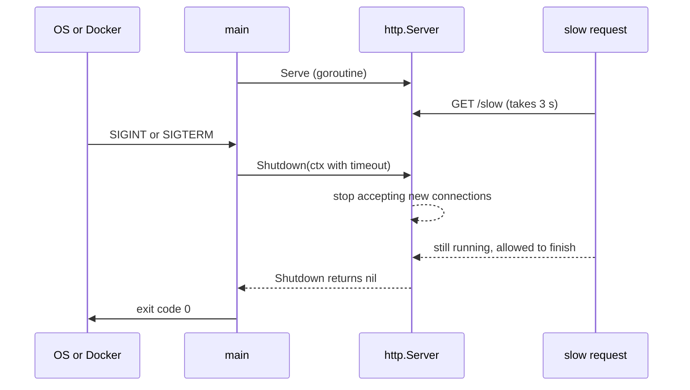

# 07. Configuration, slog logging and graceful shutdown

> **Draft: written but not yet run.** The code and the expected output in this lesson were prepared by reading the code and the official documentation. They have not been executed yet. If something does not behave as described, trust your tool's real output and report it.

## What you will be able to do
By the end of this lesson you will be able to:
- load validated configuration from environment variables with safe defaults, failing fast and reporting every problem at once;
- build a `log/slog` logger (text or JSON, chosen level) and log requests as structured records;
- stop an HTTP server gracefully on Ctrl+C or SIGTERM so in-flight requests finish;
- test configuration and logging without touching the real environment or the terminal.

## Recap
1. (Lesson 03) What does `signal.NotifyContext` have in common with `context.WithCancel`?
   <details><summary>Answer</summary>Both return a context and a stop function; the context's `Done` channel closes on cancellation (here: when a signal arrives). Always call the stop function.</details>
2. (Lesson 05) Which struct fields of `http.Server` protect against slow clients?
   <details><summary>Answer</summary>`ReadHeaderTimeout`, `ReadTimeout`, `WriteTimeout` and `IdleTimeout`.</details>
3. (Lesson 06) Why must error details never contain raw internal error text?
   <details><summary>Answer</summary>It can leak internals. Log the detail on the server; send a stable, generic message to the client.</details>

## Why it matters
A service that runs in more than one place needs three habits. **Configuration outside the code**: the same binary runs on your laptop, in a test and in production, and only the environment differs (the "twelve-factor app" rule). **Logs a machine can read**: one record per event with named fields, so you can filter `status>=500` instead of grepping prose. **A clean exit**: container platforms stop a service by sending SIGTERM and then killing it after a grace period; a server that just dies drops the requests it was handling, a graceful one finishes them.

## What you will build
A small service that reads four environment variables, logs with `slog` to stderr, serves `/healthz` and a deliberately slow `/slow`, and shuts down cleanly on Ctrl+C.



## Before you start
- Lesson 05 finished (lesson 06 is not required for the code). Go 1.22.0 or newer; `log/slog` needs 1.21. See the [level 201 guide](../README.md#how-every-201-lesson-works).
- `curl` (`curl.exe` in PowerShell) and two terminals.
- Time: 50 minutes.
- Source pack (optional): every file is shown in full in this lesson, so you can follow without it. The finished code, the exercise starter and the solution are in the
  course repository https://github.com/Uee03/Code101 under `source/go/201-hero-to-super-hero/phase-2-http-and-json/07-config-slog-shutdown/` (on that page choose **Code, Download ZIP**, or run
  `git clone https://github.com/Uee03/Code101.git`).
- No external packages.

## Steps

### Step 1. Create the folder and the module
As in [lesson 01, Step 1](../phase-1-core-skills/01-interfaces-and-embedding.md#step-1-create-the-folder-and-the-module), with folder `lesson07` and module `example.com/code101/go201/lesson07`. Expected output of `go mod init`:
```text
go: creating new go.mod: module example.com/code101/go201/lesson07
```

### Step 2. Configuration
Create `config.go`.

**File: `config.go`**
```go
package main

import (
	"errors"
	"fmt"
	"log/slog"
	"time"
)

// Config holds every setting the service needs. It is read once at start-up and never changed.
type Config struct {
	Addr            string
	LogLevel        slog.Level
	LogFormat       string
	ShutdownTimeout time.Duration
}

// LoadConfig reads the settings through getenv (os.Getenv in production, a map lookup in tests).
// Defaults are safe for development; every invalid value is reported at once.
func LoadConfig(getenv func(string) string) (Config, error) {
	cfg := Config{
		Addr:            "127.0.0.1:8080",
		LogLevel:        slog.LevelInfo,
		LogFormat:       "text",
		ShutdownTimeout: 10 * time.Second,
	}
	var errs []error

	if v := getenv("APP_ADDR"); v != "" {
		cfg.Addr = v
	}
	if v := getenv("APP_LOG_LEVEL"); v != "" {
		if err := cfg.LogLevel.UnmarshalText([]byte(v)); err != nil {
			errs = append(errs, fmt.Errorf("APP_LOG_LEVEL %q: want debug, info, warn or error", v))
		}
	}
	if v := getenv("APP_LOG_FORMAT"); v != "" {
		if v != "text" && v != "json" {
			errs = append(errs, fmt.Errorf("APP_LOG_FORMAT %q: want text or json", v))
		} else {
			cfg.LogFormat = v
		}
	}
	if v := getenv("APP_SHUTDOWN_TIMEOUT"); v != "" {
		d, err := time.ParseDuration(v)
		if err != nil || d <= 0 {
			errs = append(errs, fmt.Errorf("APP_SHUTDOWN_TIMEOUT %q: want a positive duration such as 10s", v))
		} else {
			cfg.ShutdownTimeout = d
		}
	}
	return cfg, errors.Join(errs...)
}
```

Design choices:
1. **Environment variables, prefixed `APP_`.** They work the same on every OS, in Docker (`environment:`) and in CI. The prefix avoids clashes with variables other programs define.
2. **Defaults are safe for development**: the address is loopback, the level is `info`. A missing variable should never make the service *less* safe.
3. **`getenv` is a parameter.** The function does not call `os.Getenv` itself; `main` passes it in. Tests pass a map lookup instead, so they never read or change the real environment (no cleanup, and tests can run in parallel). This is the small-interface idea again: `func(string) string`.
4. **Validate and fail fast.** A typo in `APP_LOG_LEVEL` is found at start-up, not at 3 a.m. `errors.Join` (Go 1.20) combines all problems into one error, so the operator fixes everything in one go.
5. **Never put a secret in an error or a log line.** These messages echo values like `loud`, which is fine for a log level. For a password or token, name the variable and never print its value.

### Step 3. Logging
Create `logging.go`.

**File: `logging.go`**
```go
package main

import (
	"io"
	"log/slog"
	"net/http"
	"time"
)

// newLogger builds the application logger. Text is easy to read in a terminal;
// JSON is what log collectors in production expect.
func newLogger(cfg Config, w io.Writer) *slog.Logger {
	opts := &slog.HandlerOptions{Level: cfg.LogLevel}
	var h slog.Handler
	if cfg.LogFormat == "json" {
		h = slog.NewJSONHandler(w, opts)
	} else {
		h = slog.NewTextHandler(w, opts)
	}
	return slog.New(h)
}

// statusRecorder embeds the ResponseWriter and remembers the status code (as in lesson 05).
type statusRecorder struct {
	http.ResponseWriter
	status int
}

func (s *statusRecorder) WriteHeader(code int) {
	s.status = code
	s.ResponseWriter.WriteHeader(code)
}

func (s *statusRecorder) Unwrap() http.ResponseWriter {
	return s.ResponseWriter
}

// requestLog writes one structured record per request, with key-value attributes instead of a sentence.
func requestLog(logger *slog.Logger) func(http.Handler) http.Handler {
	return func(next http.Handler) http.Handler {
		return http.HandlerFunc(func(w http.ResponseWriter, r *http.Request) {
			start := time.Now()
			rec := &statusRecorder{ResponseWriter: w, status: http.StatusOK}
			next.ServeHTTP(rec, r)
			logger.Info("request",
				"method", r.Method,
				"path", r.URL.Path,
				"status", rec.status,
				"duration", time.Since(start),
			)
		})
	}
}
```

`log/slog` concepts:
- A **`Logger`** has methods `Debug`, `Info`, `Warn`, `Error`. Each takes a message and then alternating **keys and values** (`"status", 200`). Output: one record per call with a time, a level, the message and those attributes.
- A **`Handler`** decides the format: `NewTextHandler` writes `key=value` pairs (easy to read in a terminal), `NewJSONHandler` writes one JSON object per line (what log systems ingest). We choose from configuration; the code that logs does not change.
- **`HandlerOptions.Level`** is the minimum level. Below it, calls are skipped cheaply.
- **Log what you would filter on**, as attributes, not as a sentence: `"path", r.URL.Path` rather than `"handled "+path`.
- **Do not log** passwords, tokens, full request bodies or personal data you do not need.

`statusRecorder` is the same wrapper as in lesson 05 (embedding the `ResponseWriter` and remembering the status). The only difference is that `requestLog` now takes the logger as a parameter, so it returns a function that returns a middleware.

### Step 4. The server and graceful shutdown
Create `server.go`.

**File: `server.go`**
```go
package main

import (
	"context"
	"fmt"
	"log/slog"
	"net"
	"net/http"
	"time"
)

func newHandler(logger *slog.Logger) http.Handler {
	mux := http.NewServeMux()
	mux.HandleFunc("GET /healthz", func(w http.ResponseWriter, r *http.Request) {
		w.Header().Set("Content-Type", "application/json")
		fmt.Fprintln(w, `{"status":"ok"}`)
	})
	// A request that takes 3 seconds, to watch graceful shutdown let it finish.
	mux.HandleFunc("GET /slow", func(w http.ResponseWriter, r *http.Request) {
		timer := time.NewTimer(3 * time.Second)
		defer timer.Stop()
		select {
		case <-timer.C:
			fmt.Fprintln(w, "slow request finished")
		case <-r.Context().Done():
			logger.Warn("slow request abandoned", "reason", r.Context().Err())
		}
	})
	return requestLog(logger)(mux)
}

// run serves until ctx is cancelled (a signal), then shuts down gracefully:
// it stops accepting connections and waits for in-flight requests, up to cfg.ShutdownTimeout.
func run(ctx context.Context, cfg Config, logger *slog.Logger) error {
	srv := &http.Server{
		Handler:           newHandler(logger),
		ReadHeaderTimeout: 5 * time.Second,
		ReadTimeout:       10 * time.Second,
		WriteTimeout:      10 * time.Second,
		IdleTimeout:       60 * time.Second,
		ErrorLog:          slog.NewLogLogger(logger.Handler(), slog.LevelError),
	}

	ln, err := net.Listen("tcp", cfg.Addr)
	if err != nil {
		return fmt.Errorf("listen: %w", err)
	}

	serveErr := make(chan error, 1)
	go func() {
		logger.Info("server started", "addr", ln.Addr().String())
		serveErr <- srv.Serve(ln)
	}()

	select {
	case err := <-serveErr:
		return fmt.Errorf("serve: %w", err)
	case <-ctx.Done():
	}

	logger.Info("shutdown requested", "timeout", cfg.ShutdownTimeout)
	shutdownCtx, cancel := context.WithTimeout(context.Background(), cfg.ShutdownTimeout)
	defer cancel()
	if err := srv.Shutdown(shutdownCtx); err != nil {
		_ = srv.Close()
		return fmt.Errorf("graceful shutdown: %w", err)
	}
	logger.Info("server stopped")
	return nil
}
```

Walk through `run`:
1. **`net.Listen` first.** Binding the port in the calling goroutine returns "address already in use" immediately as an ordinary error; `Serve(ln)` then only accepts connections.
2. **The server runs in a goroutine** and reports its result on a buffered channel (buffer 1, so the goroutine can always finish even if nobody reads).
3. **`select`** waits for either the server failing (for example the listener closing) or `ctx.Done()`, which closes when a signal arrives.
4. **`srv.Shutdown(ctx)`** closes the listeners, then waits for active requests to finish, until its own context times out. It does **not** cancel the requests' contexts, which is why `/slow` finishes its 3 seconds. If the wait runs out, `Shutdown` returns the context error and we call `srv.Close()` to cut the remaining connections.
5. `Serve` returns `http.ErrServerClosed` after `Shutdown`; that is the normal end and is read from the buffered channel nobody waits on.

### Step 5. main
Create `main.go`.

**File: `main.go`**
```go
package main

import (
	"context"
	"fmt"
	"os"
	"os/signal"
	"syscall"
)

func main() {
	os.Exit(realMain())
}

// realMain returns an exit code instead of calling os.Exit itself,
// so its deferred calls (stop) run before the process ends.
func realMain() int {
	cfg, err := LoadConfig(os.Getenv)
	if err != nil {
		fmt.Fprintln(os.Stderr, "configuration error:")
		fmt.Fprintln(os.Stderr, err)
		return 2
	}
	logger := newLogger(cfg, os.Stderr)

	ctx, stop := signal.NotifyContext(context.Background(), os.Interrupt, syscall.SIGTERM)
	defer stop()

	if err := run(ctx, cfg, logger); err != nil {
		logger.Error("server failed", "err", err)
		return 1
	}
	return 0
}
```

- **`signal.NotifyContext`** gives a context that is cancelled on **Ctrl+C** (`os.Interrupt`) or **SIGTERM**, which is what `docker stop` and Kubernetes send. `syscall.SIGTERM` exists on Windows too (it simply never arrives from the console).
- **`realMain` returns an exit code** and `main` calls `os.Exit` with it. `os.Exit` skips deferred calls, so we keep everything that must be cleaned up inside `realMain` and let it return first.
- Exit code **2** for bad configuration, **1** for a runtime failure, **0** for a clean stop, so scripts and orchestrators can tell them apart.

### Step 6. Predict, then run
Predict what the first terminal prints after you press Ctrl+C while the slow request is still running, and what the second terminal receives.

## Run it
In `lesson07`:
```text
go run .
```
Expected output (on stderr); `<time>` is replaced by a real timestamp:
```text
time=<time> level=INFO msg="server started" addr=127.0.0.1:8080
```
In a second terminal:
```text
curl.exe -s http://127.0.0.1:8080/healthz
```
Expected output:
```text
{"status":"ok"}
```
The server terminal now shows one structured record (the duration varies):
```text
time=<time> level=INFO msg=request method=GET path=/healthz status=200 duration=<duration>
```
**Graceful shutdown.** Start the slow request in the second terminal, and within three seconds press **Ctrl+C** in the server terminal:
```text
curl.exe -s http://127.0.0.1:8080/slow
```
Expected output in the second terminal (after the full three seconds, even though shutdown began):
```text
slow request finished
```
Expected output in the server terminal after Ctrl+C:
```text
time=<time> level=INFO msg="shutdown requested" timeout=10s
time=<time> level=INFO msg=request method=GET path=/slow status=200 duration=<about 3s>
time=<time> level=INFO msg="server stopped"
```
**JSON logs.** Stop the server and start it again with another format:

PowerShell:
```text
$env:APP_LOG_FORMAT = "json"; go run .
```
macOS and Linux:
```text
APP_LOG_FORMAT=json go run .
```
Expected output:
```text
{"time":"<time>","level":"INFO","msg":"server started","addr":"127.0.0.1:8080"}
```
In PowerShell remove the setting afterwards with `Remove-Item Env:APP_LOG_FORMAT`; it lives only in that terminal.

**A configuration error.** PowerShell: `$env:APP_LOG_LEVEL = "loud"; go run .`. macOS and Linux: `APP_LOG_LEVEL=loud go run .`. Expected output:
```text
configuration error:
APP_LOG_LEVEL "loud": want debug, info, warn or error
exit status 2
```
The last line comes from `go run`, which reports a non-zero exit code of your program; the program itself printed the first two lines. Remove the variable (`Remove-Item Env:APP_LOG_LEVEL`) before continuing.

## How it works
- **Order of start-up:** load config, build the logger, install the signal context, run. Configuration errors happen before any logger exists, so they go to stderr by plain `fmt`.
- **Why the shutdown timeout is configurable:** it must be shorter than the platform's kill timeout (Docker's default is 10 seconds after SIGTERM; Kubernetes' `terminationGracePeriodSeconds` defaults to 30). If it is longer, the platform kills you before you finish.
- **Why `/slow` is not cut off:** `Shutdown` waits for handlers to return. A handler that never returns would hold the shutdown until the timeout, which is why long handlers should also watch `r.Context().Done()` and your own shutdown signal if they can.
- **What happens to new requests:** the listener is closed first, so a new connection is refused.

**Misconception:** "graceful" does not mean "nothing is lost". Requests that take longer than the timeout are cut off, and work you started in your own goroutines is not tracked by `Shutdown`. Anything you start must be stopped with the same context (lesson 03).

## Why this, not that
| Choice | Use | Instead of | Reason |
|---|---|---|---|
| Environment variables | `APP_*` read once at start-up | Config file in the image, or flags only | Same binary everywhere; no secrets in the image. A file is fine for large structured config |
| Passing `getenv` | A function parameter | Calling `os.Getenv` deep inside | Testable without changing the process environment |
| `log/slog` | Standard library (Go 1.21+) | `log.Printf` | Levels and structured attributes with no dependency |
| `slog` | Standard library | `zap`, `zerolog` | They are faster in extreme cases; measure before switching; `slog` can use them as handlers |
| `NotifyContext` plus `Shutdown` | Drain, then exit | `os.Exit` in a handler, or killing | Finishes in-flight work |
| `.env` files | Docker Compose reads them for you (lesson 08) | A dotenv library | Keeps loading logic out of the program |

## Test it
**File: `config_test.go`**
```go
package main

import (
	"bytes"
	"encoding/json"
	"log/slog"
	"net/http/httptest"
	"strings"
	"testing"
	"time"
)

func env(m map[string]string) func(string) string {
	return func(key string) string { return m[key] }
}

func TestLoadConfig(t *testing.T) {
	tests := []struct {
		name    string
		env     map[string]string
		want    Config
		wantErr string
	}{
		{"defaults", nil,
			Config{Addr: "127.0.0.1:8080", LogLevel: slog.LevelInfo, LogFormat: "text", ShutdownTimeout: 10 * time.Second}, ""},
		{"overrides",
			map[string]string{"APP_ADDR": ":9000", "APP_LOG_LEVEL": "debug", "APP_LOG_FORMAT": "json", "APP_SHUTDOWN_TIMEOUT": "2s"},
			Config{Addr: ":9000", LogLevel: slog.LevelDebug, LogFormat: "json", ShutdownTimeout: 2 * time.Second}, ""},
		{"bad level", map[string]string{"APP_LOG_LEVEL": "loud"}, Config{}, "APP_LOG_LEVEL"},
		{"bad format", map[string]string{"APP_LOG_FORMAT": "xml"}, Config{}, "APP_LOG_FORMAT"},
		{"zero timeout", map[string]string{"APP_SHUTDOWN_TIMEOUT": "0s"}, Config{}, "APP_SHUTDOWN_TIMEOUT"},
		{"not a duration", map[string]string{"APP_SHUTDOWN_TIMEOUT": "ten"}, Config{}, "APP_SHUTDOWN_TIMEOUT"},
	}
	for _, tc := range tests {
		t.Run(tc.name, func(t *testing.T) {
			got, err := LoadConfig(env(tc.env))
			if tc.wantErr != "" {
				if err == nil || !strings.Contains(err.Error(), tc.wantErr) {
					t.Fatalf("error %v, want one mentioning %s", err, tc.wantErr)
				}
				return
			}
			if err != nil {
				t.Fatalf("unexpected error: %v", err)
			}
			if got != tc.want {
				t.Fatalf("got %+v, want %+v", got, tc.want)
			}
		})
	}
}

func TestLoadConfigReportsEveryProblem(t *testing.T) {
	_, err := LoadConfig(env(map[string]string{"APP_LOG_LEVEL": "loud", "APP_LOG_FORMAT": "xml"}))
	if err == nil || !strings.Contains(err.Error(), "APP_LOG_LEVEL") || !strings.Contains(err.Error(), "APP_LOG_FORMAT") {
		t.Fatalf("error %v should mention both settings", err)
	}
}

func TestRequestLogWritesOneStructuredRecord(t *testing.T) {
	var buf bytes.Buffer
	logger := slog.New(slog.NewJSONHandler(&buf, nil))
	rec := httptest.NewRecorder()
	newHandler(logger).ServeHTTP(rec, httptest.NewRequest("GET", "/healthz", nil))

	var line map[string]any
	if err := json.Unmarshal(buf.Bytes(), &line); err != nil {
		t.Fatalf("log output is not one JSON object: %v (%q)", err, buf.String())
	}
	if line["msg"] != "request" || line["path"] != "/healthz" || line["status"] != float64(200) {
		t.Fatalf("unexpected record: %v", line)
	}
}
```

Run in `lesson07`:
```text
go test ./...
```
It should end with a line starting `ok`. The third test captures the logger's output in a `bytes.Buffer`, decodes it as JSON and checks the fields: a test of the *structure* of the log, not the text. (`slog.NewJSONHandler(&buf, nil)` uses the default options.)

## Try it
Use the [exercise folders](../README.md#exercise-folders) steps; the folder is `try07`. The tests already exist.

1. **Guided.** `Load` reads `PORT` (default 8080, from 1 to 65535) and `DEBUG` (default false, anything `strconv.ParseBool` accepts). Return an error that names the variable when a value is invalid.
2. **Change.** `NewQuietLogger` returns a text logger without the `time` attribute, so its output is the same on every run. Look at the `ReplaceAttr` field of `slog.HandlerOptions`.
3. **Stretch (no single answer).** After the first Ctrl+C the program waits up to the timeout. How would you let a *second* Ctrl+C exit immediately? (Look at what the `stop` function returned by `NotifyContext` does.) Is that always the right behaviour in production?

**File: `go.mod (starter)`**
```text
module example.com/code101/go201/try07

go 1.22.0
```
**File: `config.go (starter)`**
```go
package config

import (
	"io"
	"log/slog"
)

// Settings is what the program needs to start.
type Settings struct {
	Port  int
	Debug bool
}

// Load reads PORT and DEBUG through getenv.
//
//	PORT:  default 8080; when set it must be a whole number from 1 to 65535
//	DEBUG: default false; when set it must be a boolean that strconv.ParseBool accepts
//
// Any invalid value returns a non-nil error that names the variable.
func Load(getenv func(string) string) (Settings, error) {
	// TODO 1: apply the defaults, then the overrides, validating each.
	return Settings{}, nil
}

// NewQuietLogger returns a text logger that writes to w and leaves out the time attribute,
// so its output is identical on every run (handy in tests).
func NewQuietLogger(w io.Writer) *slog.Logger {
	// TODO 2: configure the handler so the "time" attribute is dropped.
	return slog.New(slog.NewTextHandler(w, nil))
}
```
**File: `config_test.go (starter)`**
```go
package config

import (
	"bytes"
	"strings"
	"testing"
)

func env(m map[string]string) func(string) string {
	return func(key string) string { return m[key] }
}

func TestLoad(t *testing.T) {
	tests := []struct {
		name    string
		env     map[string]string
		want    Settings
		wantErr string
	}{
		{"defaults", nil, Settings{Port: 8080, Debug: false}, ""},
		{"overrides", map[string]string{"PORT": "9000", "DEBUG": "true"}, Settings{Port: 9000, Debug: true}, ""},
		{"port is not a number", map[string]string{"PORT": "abc"}, Settings{}, "PORT"},
		{"port is zero", map[string]string{"PORT": "0"}, Settings{}, "PORT"},
		{"port is too large", map[string]string{"PORT": "70000"}, Settings{}, "PORT"},
		{"debug is not a boolean", map[string]string{"DEBUG": "maybe"}, Settings{}, "DEBUG"},
	}
	for _, tc := range tests {
		t.Run(tc.name, func(t *testing.T) {
			got, err := Load(env(tc.env))
			if tc.wantErr != "" {
				if err == nil || !strings.Contains(err.Error(), tc.wantErr) {
					t.Fatalf("error %v, want one mentioning %s", err, tc.wantErr)
				}
				return
			}
			if err != nil || got != tc.want {
				t.Fatalf("got %+v, %v; want %+v", got, err, tc.want)
			}
		})
	}
}

func TestQuietLoggerHasNoTime(t *testing.T) {
	var buf bytes.Buffer
	NewQuietLogger(&buf).Info("hello", "user", "ada")
	want := "level=INFO msg=hello user=ada\n"
	if buf.String() != want {
		t.Fatalf("got %q, want %q", buf.String(), want)
	}
}
```

Run in `try07`:
```text
go test ./...
```
Before your changes it fails (`--- FAIL:` lines); when done, the last line starts with `ok`.

<details><summary>Solution</summary>

`config_test.go` and `go.mod` are unchanged. Replace `config.go`:

**File: `config.go (solution)`**
```go
package config

import (
	"fmt"
	"io"
	"log/slog"
	"strconv"
)

// Settings is what the program needs to start.
type Settings struct {
	Port  int
	Debug bool
}

// Load reads PORT and DEBUG through getenv.
//
//	PORT:  default 8080; when set it must be a whole number from 1 to 65535
//	DEBUG: default false; when set it must be a boolean that strconv.ParseBool accepts
//
// Any invalid value returns a non-nil error that names the variable.
func Load(getenv func(string) string) (Settings, error) {
	s := Settings{Port: 8080}
	if v := getenv("PORT"); v != "" {
		port, err := strconv.Atoi(v)
		if err != nil || port < 1 || port > 65535 {
			return Settings{}, fmt.Errorf("PORT %q: want a number from 1 to 65535", v)
		}
		s.Port = port
	}
	if v := getenv("DEBUG"); v != "" {
		debug, err := strconv.ParseBool(v)
		if err != nil {
			return Settings{}, fmt.Errorf("DEBUG %q: want true or false", v)
		}
		s.Debug = debug
	}
	return s, nil
}

// NewQuietLogger returns a text logger that writes to w and leaves out the time attribute,
// so its output is identical on every run (handy in tests).
func NewQuietLogger(w io.Writer) *slog.Logger {
	opts := &slog.HandlerOptions{
		ReplaceAttr: func(groups []string, a slog.Attr) slog.Attr {
			if len(groups) == 0 && a.Key == slog.TimeKey {
				return slog.Attr{}
			}
			return a
		},
	}
	return slog.New(slog.NewTextHandler(w, opts))
}
```

`ReplaceAttr` is called for every attribute (and for the built-in time, level and message). Returning the zero `slog.Attr{}` removes it. The `len(groups) == 0` check limits it to top-level attributes, so an attribute of your own that happens to be called `time` inside a group is kept.

Stretch: after the first signal, call `stop()` so the default behaviour (terminate) returns; the next Ctrl+C then ends the process. Keep the double-signal behaviour for developers' terminals; in production the orchestrator's kill timeout already plays that role.

</details>

## Check yourself
1. Why does `LoadConfig` take a `getenv` function?
   <details><summary>Answer</summary>So tests can supply values without touching the process environment, and the function stays a pure mapping from settings to a `Config`.</details>
2. What does `Shutdown` do to a request that is already running?
   <details><summary>Answer</summary>It lets it finish, until the shutdown context expires. It does not cancel the request's context.</details>
3. A colleague logs `logger.Info("login " + user + " password " + pw)`. Name two problems.
   <details><summary>Answer</summary>A secret is written to the log, and the message mixes data into prose so you cannot filter by field. Log `"user", user` and never the password.</details>
4. Why does `main` call `os.Exit(realMain())` instead of `os.Exit(1)` inside `run`?
   <details><summary>Answer</summary>`os.Exit` does not run deferred functions. Returning the code to `main` lets `defer stop()` and others run first.</details>

## Common mistakes
| Symptom or error text | Cause | Fix |
|---|---|---|
| `configuration error:` followed by a message and `exit status 2` | An environment variable has an invalid value | Read the message; it names the variable |
| The new value has no effect | The variable was set in a different terminal, or after the program started | Set it in the same terminal, before `go run .` |
| `listen: listen tcp 127.0.0.1:8080: bind: ...` (typical message; wording varies by OS) | The port is taken, possibly by a lesson-05 server you forgot to stop | Stop the other program or set `APP_ADDR` |
| Ctrl+C prints nothing and the process lingers for up to the timeout | A request is still running (the slow one) | Wait, or lower `APP_SHUTDOWN_TIMEOUT` |
| Logs show `time=` lines but your tool expects JSON | Default format is text | Set `APP_LOG_FORMAT=json` |
| In PowerShell, `APP_LOG_FORMAT=json go run .` fails | That form is for bash and zsh | Use `$env:APP_LOG_FORMAT = "json"; go run .` |
| `go: go.mod file not found in current directory or any parent directory; see 'go help modules'` | Running outside the module folder | `cd` into `lesson07` |

## Best practice
Read configuration once at start-up from the environment, validate it, and fail fast; log structured records with `log/slog`; and always drain requests with `Server.Shutdown` on SIGTERM. Source: The Twelve-Factor App, III. Config https://12factor.net/config, Go blog "Structured Logging with slog" https://go.dev/blog/slog and net/http Server.Shutdown https://pkg.go.dev/net/http#Server.Shutdown

## Going further
- `slog.With`, `slog.Group` and a request-scoped logger carrying a request ID: https://pkg.go.dev/log/slog
- The capstone's configuration, JSON logging and shutdown, wired together: [`capstones/backend-go`, skeleton chapter](../../../../capstones/backend-go/tutorials/phase-1-skeleton/01-skeleton.md).
- Lesson 08 uses `docker compose` and a `.env` file to supply configuration to a database.

## Phase 2 review (mixed)
1. A handler panics. Which two pieces of lessons 05 and 07 make sure it is logged with status 500? <details><summary>Answer</summary>`recoverer` turns the panic into a 500; the request logger, being outside it, records the status.</details>
2. A client posts `{"title":"x","admin":true}` to a DTO without an `admin` field. What happens and why is it good? <details><summary>Answer</summary>400 (unknown field) because the decoder disallows unknown fields; over-posting attempts are visible, not silently ignored.</details>
3. What goes wrong if the shutdown timeout is longer than the platform's kill timeout? <details><summary>Answer</summary>The platform kills the process first, so graceful shutdown does not finish.</details>
4. Why is `ListenAndServe` without an `http.Server` struct risky? <details><summary>Answer</summary>No timeouts: slow clients can hold connections indefinitely.</details>

## Summary
- You loaded and validated configuration from the environment through an injected `getenv`, and reported every problem together.
- You built a text or JSON `slog` logger and logged requests as structured records.
- You stopped a server gracefully with `NotifyContext` and `Shutdown`, and watched a slow request finish.
- You tested configuration and log structure without the terminal or the real environment.

## Next lesson
**[08. Postgres with pgx](../phase-3-data-and-security/08-postgres-with-pgx.md):** phase 3: run Postgres in Docker and talk to it with a connection pool, queries, transactions and a stored function.
