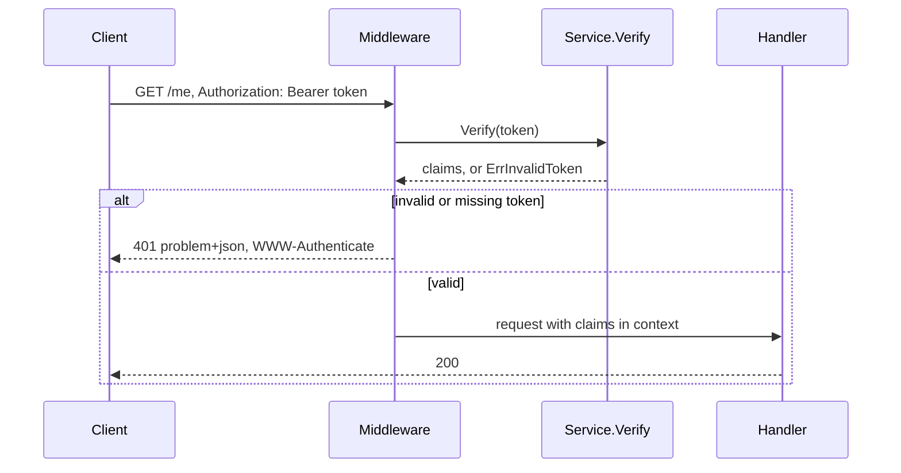
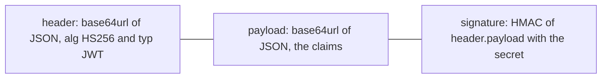

# 09. Authentication middleware: JWT validation basics

> **Draft: written but not yet run.** The code and the expected output in this lesson were prepared by reading the code and the official documentation. They have not been executed yet. If something does not behave as described, trust your tool's real output and report it.

## What you will be able to do
By the end of this lesson you will be able to:
- explain what a JSON Web Token is (and is not) and read its three parts;
- write middleware that validates a bearer token and puts the caller's identity in the request context;
- apply the checks that make validation safe: pinned algorithm, expiry required, issuer, audience, a strong key;
- return 401 for "who are you?" and 403 for "you may not", and write role checks as middleware.

## Recap
1. (Lesson 05) What does a middleware return, and what decides whether the next handler runs?
   <details><summary>Answer</summary>It takes an `http.Handler` and returns an `http.Handler`. It calls `next.ServeHTTP` only when it wants the request to continue.</details>
2. (Lesson 03) What belongs in a context value, and what does not?
   <details><summary>Answer</summary>Request-scoped facts such as the authenticated caller. Optional parameters and dependencies do not belong there.</details>
3. (Lesson 06) Which media type carries error bodies, and what must they never contain?
   <details><summary>Answer</summary>`application/problem+json`. They must not contain internals or the reason a secret check failed.</details>

## Why it matters
Almost every real API has users and rules about who may do what. Two words keep getting mixed up: **authentication** (who are you?) and **authorisation** (what may you do?). The common design is that a trusted *identity provider* signs in the user and issues a **token**; your API receives the token on every request, checks it, and decides. Checking a token wrongly is one of the most damaging bugs an API can have: a token accepted without a signature check, with the wrong algorithm or past its expiry hands the system to anyone. This lesson teaches the checks, in the smallest correct form. The full production version (an external identity provider, key rotation, roles from Keycloak) is the capstone's identity chapter.

## What you will build
A small `auth` package with a `Service` that mints and verifies HS256 tokens, a `Middleware`, `RequireRole`, and a server with a public route, a protected route and an admin-only route. You will also see how a tampered token is rejected.



## Before you start
- Lessons 05 to 07 finished. Go 1.22.0 or newer and internet access for `go mod tidy`. See the [level 201 guide](../README.md#how-every-201-lesson-works).
- `curl` (`curl.exe` in PowerShell) and two terminals.
- Time: 55 minutes.
- Source pack (optional): every file is shown in full in this lesson, so you can follow without it. The finished code, the exercise starter and the solution are in the
  course repository https://github.com/Uee03/Code101 under `source/go/201-hero-to-super-hero/phase-3-data-and-security/09-auth-middleware-jwt/` (on that page choose **Code, Download ZIP**, or run
  `git clone https://github.com/Uee03/Code101.git`).
- The secret in this lesson is for local practice only. Real secrets come from a secret store and are never committed.

## What a JWT is
A **JSON Web Token** (JWT, pronounced "jot") is a string of three parts separated by dots:

```text
eyJhbGciOiJIUzI1NiIsInR5cCI6IkpXVCJ9 . <payload> . <signature>
   header                               claims       proof
```

- The **header** says which algorithm signed it. The first 36 characters in the example are always the same for HS256 tokens from this library: they are the text `{"alg":"HS256","typ":"JWT"}` in base64url.
- The **payload** holds *claims*: statements about the user and the token. Registered names you will use: `iss` (issuer: who made it), `sub` (subject: who it is about), `aud` (audience: which API it is for), `exp` (expiry time), `iat` (issued at). We add our own claim, `roles`.
- The **signature** is a keyed hash of the first two parts. Whoever changes a character of the payload cannot produce a matching signature without the key.

**A JWT is signed, not encrypted.** Anyone who holds the token can decode and read the payload. Never put secrets or sensitive personal data in it. The signature only prevents *changes*.

**HS256 versus RS256/ES256.** HS256 uses one shared secret for signing *and* verifying: every service that can verify can also forge tokens. Production systems use an **asymmetric** algorithm: the identity provider signs with a private key and your API verifies with the public key (published as a JWKS document). This lesson uses HS256 because it needs no key infrastructure; the checks are the same, and the capstone does the asymmetric version with Keycloak.

## Steps

### Step 1. Create the folder, the module and the package folder
As in [lesson 01, Step 1](../phase-1-core-skills/01-interfaces-and-embedding.md#step-1-create-the-folder-and-the-module), with folder `lesson09`. Do not run `go mod init`; you write `go.mod` yourself so the library version is pinned. Inside `lesson09` create a folder `auth`.

**File: `go.mod`** (create it in `lesson09`)

**File: `go.mod`**
```text
module example.com/code101/go201/lesson09

go 1.22.0

require github.com/golang-jwt/jwt/v5 v5.3.1
```

The module name matters: `main.go` imports the `auth` package as `example.com/code101/go201/lesson09/auth`, which is the module path plus the folder.

### Step 2. Tokens: mint and verify
Create `auth/token.go`.

**File: `auth/token.go`**
```go
package auth

import (
	"errors"
	"fmt"
	"time"

	"github.com/golang-jwt/jwt/v5"
)

// Claims is the payload of our tokens: the standard registered claims (iss, sub, aud, exp, iat)
// plus the roles of the user.
type Claims struct {
	Roles []string `json:"roles"`
	jwt.RegisteredClaims
}

// ErrInvalidToken is returned for every verification failure. Callers must not tell the client why.
var ErrInvalidToken = errors.New("invalid token")

// Service signs and verifies tokens with a shared secret (HS256).
type Service struct {
	secret   []byte
	issuer   string
	audience string
	now      func() time.Time
}

// NewService refuses a short secret: HS256 is only as strong as its key.
func NewService(secret, issuer, audience string) (*Service, error) {
	if len(secret) < 32 {
		return nil, errors.New("must be set and at least 32 bytes long")
	}
	return &Service{secret: []byte(secret), issuer: issuer, audience: audience, now: time.Now}, nil
}

// Mint creates a signed token for subject with the given roles, valid for ttl.
// In production an identity provider issues tokens; this stands in for it in the lesson.
func (s *Service) Mint(subject string, roles []string, ttl time.Duration) (string, error) {
	now := s.now()
	claims := Claims{
		Roles: roles,
		RegisteredClaims: jwt.RegisteredClaims{
			Issuer:    s.issuer,
			Subject:   subject,
			Audience:  jwt.ClaimStrings{s.audience},
			IssuedAt:  jwt.NewNumericDate(now),
			ExpiresAt: jwt.NewNumericDate(now.Add(ttl)),
		},
	}
	return jwt.NewWithClaims(jwt.SigningMethodHS256, claims).SignedString(s.secret)
}

// Verify checks the signature, the algorithm, the issuer, the audience and the expiry.
func (s *Service) Verify(tokenString string) (*Claims, error) {
	claims := &Claims{}
	token, err := jwt.ParseWithClaims(tokenString, claims,
		func(t *jwt.Token) (any, error) { return s.secret, nil },
		jwt.WithValidMethods([]string{jwt.SigningMethodHS256.Alg()}),
		jwt.WithIssuer(s.issuer),
		jwt.WithAudience(s.audience),
		jwt.WithExpirationRequired(),
		jwt.WithTimeFunc(s.now),
		jwt.WithLeeway(5*time.Second),
	)
	if err != nil || !token.Valid {
		return nil, fmt.Errorf("%w: %v", ErrInvalidToken, err)
	}
	return claims, nil
}
```

Every option in `Verify` closes a known attack:
| Option or check | What it stops |
|---|---|
| `jwt.WithValidMethods([]string{"HS256"})` | **Algorithm confusion.** The header is attacker-controlled. Without a pinned list, a library might accept `alg: none` (no signature at all) or be tricked into verifying an RSA-signed token with the public key used as an HMAC secret. Always list exactly the algorithms you issue |
| `jwt.WithExpirationRequired()` | A token without `exp` would be valid forever. By default a missing `exp` is accepted |
| `jwt.WithIssuer`, `jwt.WithAudience` | A token made for another service (or by another issuer) with the same signing key is not accepted here |
| `jwt.WithLeeway(5s)` | Servers' clocks differ slightly. Keep it small |
| `jwt.WithTimeFunc(s.now)` | Lets tests freeze time (see the tests) |
| key length check in `NewService` | HS256 with a short or guessable secret can be brute-forced offline; use at least 32 random bytes |
| One error value for everything | The client never learns *why* a token failed, which would help an attacker |

### Step 3. Middleware and role checks
Create `auth/middleware.go`.

**File: `auth/middleware.go`**
```go
package auth

import (
	"context"
	"encoding/json"
	"log"
	"net/http"
	"slices"
	"strings"
)

// ctxKey is a private type, so no other package can read or overwrite our context value by accident.
type ctxKey struct{}

// FromContext returns the claims that Middleware stored for this request.
func FromContext(ctx context.Context) (*Claims, bool) {
	claims, ok := ctx.Value(ctxKey{}).(*Claims)
	return claims, ok
}

// Middleware requires a valid bearer token. It answers 401 itself and calls next only for authenticated requests.
func (s *Service) Middleware(next http.Handler) http.Handler {
	return http.HandlerFunc(func(w http.ResponseWriter, r *http.Request) {
		token, ok := bearerToken(r)
		if !ok {
			unauthorized(w)
			return
		}
		claims, err := s.Verify(token)
		if err != nil {
			log.Printf("auth: token rejected: %v", err)
			unauthorized(w)
			return
		}
		ctx := context.WithValue(r.Context(), ctxKey{}, claims)
		next.ServeHTTP(w, r.WithContext(ctx))
	})
}

// RequireRole must run after Middleware. It answers 403 when the caller lacks the role.
func RequireRole(role string) func(http.Handler) http.Handler {
	return func(next http.Handler) http.Handler {
		return http.HandlerFunc(func(w http.ResponseWriter, r *http.Request) {
			claims, ok := FromContext(r.Context())
			if !ok {
				unauthorized(w)
				return
			}
			if !slices.Contains(claims.Roles, role) {
				forbidden(w)
				return
			}
			next.ServeHTTP(w, r)
		})
	}
}

// bearerToken extracts the token from "Authorization: Bearer <token>".
func bearerToken(r *http.Request) (string, bool) {
	const prefix = "Bearer "
	header := r.Header.Get("Authorization")
	if len(header) <= len(prefix) || !strings.EqualFold(header[:len(prefix)], prefix) {
		return "", false
	}
	return strings.TrimSpace(header[len(prefix):]), true
}

type problem struct {
	Type   string `json:"type"`
	Title  string `json:"title"`
	Status int    `json:"status"`
	Detail string `json:"detail"`
}

// unauthorized means "we do not know who you are": 401 plus the challenge header.
func unauthorized(w http.ResponseWriter) {
	w.Header().Set("WWW-Authenticate", `Bearer realm="api"`)
	writeProblem(w, http.StatusUnauthorized, "Unauthorized", "A valid bearer token is required.")
}

// forbidden means "we know who you are, and you may not": 403.
func forbidden(w http.ResponseWriter) {
	writeProblem(w, http.StatusForbidden, "Forbidden", "You do not have the role required for this resource.")
}

func writeProblem(w http.ResponseWriter, status int, title, detail string) {
	w.Header().Set("Content-Type", "application/problem+json")
	w.WriteHeader(status)
	_ = json.NewEncoder(w).Encode(problem{Type: "about:blank", Title: title, Status: status, Detail: detail})
}
```

Walk through it:
1. **`bearerToken`** reads `Authorization: Bearer <token>`. The scheme name is case-insensitive; an empty token is rejected. Tokens belong in the header, **never in the URL**, because URLs end up in logs and browser history.
2. **`Middleware`** answers 401 itself for a missing or invalid token; only valid requests reach `next`. The reason is logged **on the server**; the client gets a fixed message. The token itself is never logged.
3. **`context.WithValue` with a private key type** (`ctxKey struct{}`) stores the claims; `FromContext` is the only way to read them. A plain string key could collide with another package's key.
4. **`RequireRole`** is a second middleware that runs *after* `Middleware` (it needs the claims). It answers 403 when the role is missing.
5. **401 versus 403.** 401 Unauthorized means "no valid credentials": the client may try again with a token, and the response carries `WWW-Authenticate: Bearer`. 403 Forbidden means "valid credentials, not allowed": a new token for the same user will not help.

### Step 4. The server and a development token command
Create `main.go`.

**File: `main.go`**
```go
package main

import (
	"encoding/json"
	"errors"
	"fmt"
	"log"
	"net/http"
	"os"
	"time"

	"example.com/code101/go201/lesson09/auth"
)

const (
	issuer   = "https://issuer.example.com"
	audience = "go201-api"
)

func main() {
	if err := run(os.Args[1:]); err != nil {
		fmt.Fprintln(os.Stderr, "error:", err)
		os.Exit(1)
	}
}

func run(args []string) error {
	svc, err := auth.NewService(os.Getenv("AUTH_SECRET"), issuer, audience)
	if err != nil {
		return fmt.Errorf("AUTH_SECRET: %w", err)
	}
	if len(args) > 0 && args[0] == "mint" {
		return mint(svc, args[1:])
	}
	return serve(svc)
}

// mint prints a token for development: go run . mint <subject> [role ...]
func mint(svc *auth.Service, args []string) error {
	if len(args) < 1 {
		return errors.New("usage: go run . mint <subject> [role ...]")
	}
	token, err := svc.Mint(args[0], args[1:], time.Hour)
	if err != nil {
		return err
	}
	fmt.Println(token)
	return nil
}

func serve(svc *auth.Service) error {
	mux := http.NewServeMux()
	mux.HandleFunc("GET /public", func(w http.ResponseWriter, r *http.Request) {
		fmt.Fprintln(w, "anyone can read this")
	})
	mux.Handle("GET /me", svc.Middleware(http.HandlerFunc(me)))
	mux.Handle("GET /admin", svc.Middleware(auth.RequireRole("admin")(http.HandlerFunc(admin))))

	srv := &http.Server{
		Addr:              "127.0.0.1:8080",
		Handler:           mux,
		ReadHeaderTimeout: 5 * time.Second,
		ReadTimeout:       10 * time.Second,
		WriteTimeout:      10 * time.Second,
		IdleTimeout:       60 * time.Second,
	}
	log.Printf("listening on http://%s", srv.Addr)
	if err := srv.ListenAndServe(); err != nil && !errors.Is(err, http.ErrServerClosed) {
		return err
	}
	return nil
}

func me(w http.ResponseWriter, r *http.Request) {
	claims, _ := auth.FromContext(r.Context())
	w.Header().Set("Content-Type", "application/json")
	_ = json.NewEncoder(w).Encode(struct {
		Sub   string   `json:"sub"`
		Roles []string `json:"roles"`
	}{Sub: claims.Subject, Roles: claims.Roles})
}

func admin(w http.ResponseWriter, r *http.Request) {
	claims, _ := auth.FromContext(r.Context())
	fmt.Fprintf(w, "welcome, admin %s\n", claims.Subject)
}
```

- The same binary does two jobs: `go run . mint ada admin` prints a token (a stand-in for a login page and identity provider), and `go run .` serves.
- The secret comes from `AUTH_SECRET`; `NewService` refuses to start with a missing or short one.
- **Routes are protected where they are registered**: `/public` has no wrapper, `/me` has `Middleware`, `/admin` has `Middleware` then `RequireRole("admin")`. Wrapping each route explicitly makes it visible in the route table which routes are open. Wrapping the whole mux instead is safer against forgetting, but then public routes need an exception list; either way, test that protected routes return 401 without a token.

### Step 5. Tests
Create `auth/auth_test.go`.

**File: `auth/auth_test.go`**
```go
package auth

import (
	"errors"
	"net/http"
	"net/http/httptest"
	"testing"
	"time"

	"github.com/golang-jwt/jwt/v5"
)

const testSecret = "0123456789abcdef0123456789abcdef"

var t0 = time.Date(2030, 1, 1, 12, 0, 0, 0, time.UTC)

// serviceAt builds a Service whose clock is frozen at now, so expiry tests never depend on the real time.
func serviceAt(t *testing.T, secret, issuer, audience string, now time.Time) *Service {
	t.Helper()
	svc, err := NewService(secret, issuer, audience)
	if err != nil {
		t.Fatalf("NewService: %v", err)
	}
	svc.now = func() time.Time { return now }
	return svc
}

func TestMintThenVerify(t *testing.T) {
	svc := serviceAt(t, testSecret, "iss", "aud", t0)
	token, err := svc.Mint("ada", []string{"admin"}, time.Hour)
	if err != nil {
		t.Fatalf("Mint: %v", err)
	}
	claims, err := svc.Verify(token)
	if err != nil {
		t.Fatalf("Verify: %v", err)
	}
	if claims.Subject != "ada" || len(claims.Roles) != 1 || claims.Roles[0] != "admin" {
		t.Fatalf("unexpected claims: %+v", claims)
	}
}

func TestNewServiceRejectsShortSecret(t *testing.T) {
	if _, err := NewService("too-short", "iss", "aud"); err == nil {
		t.Fatal("a short secret should be refused")
	}
}

func TestVerifyRejectsBadTokens(t *testing.T) {
	good := serviceAt(t, testSecret, "iss", "aud", t0)
	valid := Claims{
		Roles: []string{"admin"},
		RegisteredClaims: jwt.RegisteredClaims{
			Issuer:    "iss",
			Subject:   "ada",
			Audience:  jwt.ClaimStrings{"aud"},
			ExpiresAt: jwt.NewNumericDate(t0.Add(time.Hour)),
		},
	}
	sign := func(method jwt.SigningMethod, key any, c Claims) string {
		s, err := jwt.NewWithClaims(method, c).SignedString(key)
		if err != nil {
			t.Fatalf("sign: %v", err)
		}
		return s
	}
	with := func(change func(*Claims)) Claims {
		c := valid
		change(&c)
		return c
	}
	secret := []byte(testSecret)

	// The positive control proves the failing cases below fail for their own reason.
	if _, err := good.Verify(sign(jwt.SigningMethodHS256, secret, valid)); err != nil {
		t.Fatalf("a correct token was rejected: %v", err)
	}

	tests := []struct {
		name  string
		token string
	}{
		{"expired", sign(jwt.SigningMethodHS256, secret, with(func(c *Claims) { c.ExpiresAt = jwt.NewNumericDate(t0.Add(-time.Hour)) }))},
		{"no expiry", sign(jwt.SigningMethodHS256, secret, with(func(c *Claims) { c.ExpiresAt = nil }))},
		{"wrong secret", sign(jwt.SigningMethodHS256, []byte("another-secret-another-secret-123456"), valid)},
		{"wrong issuer", sign(jwt.SigningMethodHS256, secret, with(func(c *Claims) { c.Issuer = "someone-else" }))},
		{"wrong audience", sign(jwt.SigningMethodHS256, secret, with(func(c *Claims) { c.Audience = jwt.ClaimStrings{"other"} }))},
		{"algorithm none", sign(jwt.SigningMethodNone, jwt.UnsafeAllowNoneSignatureType, valid)},
		{"garbage", "not-a-token"},
		{"empty", ""},
	}
	for _, tc := range tests {
		t.Run(tc.name, func(t *testing.T) {
			if _, err := good.Verify(tc.token); !errors.Is(err, ErrInvalidToken) {
				t.Fatalf("got %v, want ErrInvalidToken", err)
			}
		})
	}
}

func TestMiddleware(t *testing.T) {
	svc := serviceAt(t, testSecret, "iss", "aud", t0)
	handler := svc.Middleware(RequireRole("admin")(http.HandlerFunc(func(w http.ResponseWriter, r *http.Request) {
		claims, _ := FromContext(r.Context())
		_, _ = w.Write([]byte("hello " + claims.Subject))
	})))
	adminToken, _ := svc.Mint("grace", []string{"admin"}, time.Hour)
	userToken, _ := svc.Mint("ada", nil, time.Hour)

	tests := []struct {
		name   string
		header string
		want   int
	}{
		{"no header", "", http.StatusUnauthorized},
		{"wrong scheme", "Basic abc", http.StatusUnauthorized},
		{"bad token", "Bearer nope", http.StatusUnauthorized},
		{"user without the role", "Bearer " + userToken, http.StatusForbidden},
		{"admin", "Bearer " + adminToken, http.StatusOK},
	}
	for _, tc := range tests {
		t.Run(tc.name, func(t *testing.T) {
			rec := httptest.NewRecorder()
			req := httptest.NewRequest("GET", "/", nil)
			if tc.header != "" {
				req.Header.Set("Authorization", tc.header)
			}
			handler.ServeHTTP(rec, req)
			if rec.Code != tc.want {
				t.Fatalf("status %d, want %d", rec.Code, tc.want)
			}
			if tc.want == http.StatusUnauthorized && rec.Header().Get("WWW-Authenticate") == "" {
				t.Fatal("a 401 must carry a WWW-Authenticate header")
			}
		})
	}
}
```

Notes: `serviceAt` freezes the service's clock, so "expired" is tested without waiting. The table has **a positive control first** (a correct token passes), which proves the negative cases fail for their own reason and not because of a typo. The `algorithm none` case builds an unsigned token on purpose: it must be refused.

### Step 6. Fetch the dependency
In `lesson09`:
```text
go mod tidy
```
This downloads the JWT library and creates `go.sum`.

### Step 7. Predict, then run
Predict: the status of `/me` without a token; of `/admin` with a token that has no roles; of `/me` with a token whose last three characters were changed.

## Run it
In the **first terminal**, in `lesson09`, set the secret and run the tests, then the server.

PowerShell (Windows):
```powershell
$env:AUTH_SECRET = "local-development-secret-do-not-use-in-production"
go test ./...
go run .
```
macOS and Linux:
```bash
export AUTH_SECRET="local-development-secret-do-not-use-in-production"
go test ./...
go run .
```
`go test` should end with a line starting `ok`. The server prints (the date and time differ):
```text
<date> <time> listening on http://127.0.0.1:8080
```
In a **second terminal**, in `lesson09`, set `AUTH_SECRET` to the same value (an environment variable belongs to one terminal). PowerShell uses `curl.exe`; macOS and Linux use `curl`.

An open route and a protected one without a token:
```text
curl.exe -s -w "status %{http_code}\n" http://127.0.0.1:8080/public
curl.exe -s -w "status %{http_code}\n" http://127.0.0.1:8080/me
```
Expected output:
```text
anyone can read this
status 200
{"type":"about:blank","title":"Unauthorized","status":401,"detail":"A valid bearer token is required."}
status 401
```
Mint a token for `ada` with no roles and keep it in a variable.

PowerShell:
```powershell
$token = go run . mint ada
$token.Substring(0, 36)
```
macOS and Linux:
```bash
token=$(go run . mint ada)
echo "${token:0:36}"
```
Expected output (the first 36 characters are the base64url header):
```text
eyJhbGciOiJIUzI1NiIsInR5cCI6IkpXVCJ9
```
Call `/me` and `/admin` with it.

PowerShell:
```powershell
curl.exe -s -w "status %{http_code}\n" -H "Authorization: Bearer $token" http://127.0.0.1:8080/me
curl.exe -s -w "status %{http_code}\n" -H "Authorization: Bearer $token" http://127.0.0.1:8080/admin
```
macOS and Linux:
```bash
curl -s -w "status %{http_code}\n" -H "Authorization: Bearer $token" http://127.0.0.1:8080/me
curl -s -w "status %{http_code}\n" -H "Authorization: Bearer $token" http://127.0.0.1:8080/admin
```
Expected output:
```text
{"sub":"ada","roles":[]}
status 200
{"type":"about:blank","title":"Forbidden","status":403,"detail":"You do not have the role required for this resource."}
status 403
```
Mint an admin token and call `/admin`:

PowerShell:
```powershell
$admin = go run . mint grace admin
curl.exe -s -w "status %{http_code}\n" -H "Authorization: Bearer $admin" http://127.0.0.1:8080/admin
```
macOS and Linux:
```bash
admin=$(go run . mint grace admin)
curl -s -w "status %{http_code}\n" -H "Authorization: Bearer $admin" http://127.0.0.1:8080/admin
```
Expected output:
```text
welcome, admin grace
status 200
```
Finally tamper with `ada`'s token: replace its last three characters.

PowerShell:
```powershell
$bad = $token.Substring(0, $token.Length - 3) + "abc"
curl.exe -s -w "status %{http_code}\n" -H "Authorization: Bearer $bad" http://127.0.0.1:8080/me
```
macOS and Linux:
```bash
bad="${token%???}abc"
curl -s -w "status %{http_code}\n" -H "Authorization: Bearer $bad" http://127.0.0.1:8080/me
```
Expected output (the client learns nothing about the reason):
```text
{"type":"about:blank","title":"Unauthorized","status":401,"detail":"A valid bearer token is required."}
status 401
```
The server terminal logs the reason, which starts like this (the rest of the text depends on the library version):
```text
<date> <time> auth: token rejected: invalid token: ...
```
Stop the server with **Ctrl+C**.

## How it works
- The payload you minted looks like this when decoded (illustration; the times differ and your tool may order keys differently): `{"roles":[],"iss":"https://issuer.example.com","sub":"ada","aud":["go201-api"],"exp":<unix time>,"iat":<unix time>}`. You can paste a token at a JWT debugger to see it, which proves the payload is readable by anyone.
- When a request arrives, `Verify` recomputes the HMAC over the first two parts with the secret and compares it in constant time with the third. A changed character makes them differ, so the tampered token fails.
- Then the claims are checked: not expired (with 5 seconds' leeway), issuer and audience equal ours. A token that is correctly signed but for another audience is rejected too.
- The middleware does **authentication** (who). `RequireRole` is **authorisation** (may they). Keeping them separate lets you reuse the first and vary the second per route.

**Misconception:** "the JWT is encrypted, so I can store the user's email or a secret in it". It is only signed. Put in a token what the API needs to decide, nothing private.

**Another one:** "once the token is valid the user may do anything on that route". Roles say what *kind* of caller this is. They do not say the caller may open *this particular record*. For `GET /users/{id}` you must also check that the caller owns `{id}` or is an administrator (the exercise). Skipping that check is the most common API security bug (broken object level authorisation).

## Why this, not that
| Choice | Use | Instead of | Reason |
|---|---|---|---|
| Library | `golang-jwt/jwt/v5` | Parsing tokens by hand | Parsing and signature checks have many subtle failure modes |
| Algorithm | Pin the allowed list | Trust the header's `alg` | Prevents `none` and algorithm confusion |
| Signing | Asymmetric (RS256, ES256, EdDSA) from an identity provider in production | Shared HS256 secret across services | Verifiers cannot forge tokens; keys can be rotated and published |
| Token lifetime | Short (minutes) plus a refresh mechanism | Days or months | A leaked token is valid until it expires; JWTs cannot be revoked individually without extra state |
| Where to send it | `Authorization` header | Query string or cookie by default | URLs are logged; cookies need CSRF protection |
| Identity | An identity provider (Keycloak, Authentik, a cloud IdP) | Your own password database | Password storage, MFA, resets and lockouts are a product in themselves |
| Sessions | Server-side session | JWT, when you have one web app and one server | A plain session cookie is simpler and revocable; JWTs shine across services |

## Try it
Add to your lesson folder instead of starting a new program. Copy the `lesson09` folder to a new folder `try09` beside it (copy the folder and rename the copy). Add the two files from `exercise/starter/auth/` into `try09/auth/`. They add two more role middlewares; the test file already describes the behaviour.

1. **Guided.** Implement `RequireAnyRole(roles ...string)`: allow the request when the caller has at least one of the roles. Without claims in the context answer 401; with claims but no matching role, 403.
2. **Change.** Implement `RequireSelfOrRole(role string)`: allow when the token's subject equals the route's `{id}` path value, or when the caller has the role.
3. **Stretch (no single answer).** Where would you put the third check, "does this user belong to the team that owns the resource", which needs a database lookup? In middleware, in the handler, or in the store (lesson 08)? Write down which layer can enforce it for every code path and why.

**File: `auth/roles.go (starter)`**
```go
package auth

import "net/http"

// RequireAnyRole lets a request through when the caller has at least one of the given roles.
// It must run after Middleware. No claims in the context means 401; claims without a matching role mean 403.
func RequireAnyRole(roles ...string) func(http.Handler) http.Handler {
	// TODO 1: this stub refuses everyone (it "fails closed"). Replace it.
	return func(next http.Handler) http.Handler {
		return http.HandlerFunc(func(w http.ResponseWriter, r *http.Request) {
			forbidden(w)
		})
	}
}

// RequireSelfOrRole lets a request through when the token's subject equals the {id} path value
// of the route, or when the caller has the given role (for example an administrator).
// It must run after Middleware and be used on a route with an {id} wildcard.
func RequireSelfOrRole(role string) func(http.Handler) http.Handler {
	// TODO 2: this stub also fails closed. Replace it.
	return func(next http.Handler) http.Handler {
		return http.HandlerFunc(func(w http.ResponseWriter, r *http.Request) {
			forbidden(w)
		})
	}
}
```
**File: `auth/roles_test.go (starter)`**
```go
package auth

import (
	"net/http"
	"net/http/httptest"
	"testing"
	"time"
)

// protect puts mw behind Middleware on a route with an {id} wildcard, as a real service would.
func protect(svc *Service, mw func(http.Handler) http.Handler) http.Handler {
	ok := http.HandlerFunc(func(w http.ResponseWriter, r *http.Request) { w.WriteHeader(http.StatusOK) })
	mux := http.NewServeMux()
	mux.Handle("GET /users/{id}", svc.Middleware(mw(ok)))
	return mux
}

// statusFor calls GET /users/ada with a token for subject and roles (no token when subject is empty).
func statusFor(t *testing.T, svc *Service, h http.Handler, subject string, roles []string) int {
	t.Helper()
	req := httptest.NewRequest("GET", "/users/ada", nil)
	if subject != "" {
		token, err := svc.Mint(subject, roles, time.Hour)
		if err != nil {
			t.Fatalf("Mint: %v", err)
		}
		req.Header.Set("Authorization", "Bearer "+token)
	}
	rec := httptest.NewRecorder()
	h.ServeHTTP(rec, req)
	return rec.Code
}

func TestRequireAnyRole(t *testing.T) {
	svc := serviceAt(t, testSecret, "iss", "aud", t0)
	h := protect(svc, RequireAnyRole("admin", "auditor"))

	tests := []struct {
		name    string
		subject string
		roles   []string
		want    int
	}{
		{"has the second role", "grace", []string{"auditor"}, http.StatusOK},
		{"has an unrelated role", "ada", []string{"user"}, http.StatusForbidden},
		{"has no roles", "ada", nil, http.StatusForbidden},
		{"has no token", "", nil, http.StatusUnauthorized},
	}
	for _, tc := range tests {
		t.Run(tc.name, func(t *testing.T) {
			if got := statusFor(t, svc, h, tc.subject, tc.roles); got != tc.want {
				t.Fatalf("status %d, want %d", got, tc.want)
			}
		})
	}
}

func TestRequireSelfOrRole(t *testing.T) {
	svc := serviceAt(t, testSecret, "iss", "aud", t0)
	h := protect(svc, RequireSelfOrRole("admin"))

	tests := []struct {
		name    string
		subject string
		roles   []string
		want    int
	}{
		{"owner of the resource", "ada", nil, http.StatusOK},
		{"someone else", "linus", nil, http.StatusForbidden},
		{"administrator", "linus", []string{"admin"}, http.StatusOK},
	}
	for _, tc := range tests {
		t.Run(tc.name, func(t *testing.T) {
			if got := statusFor(t, svc, h, tc.subject, tc.roles); got != tc.want {
				t.Fatalf("status %d, want %d", got, tc.want)
			}
		})
	}
}
```

Run in `try09`, with `go mod tidy` first if you did not copy `go.sum`:
```text
go test ./...
```
The stubs *fail closed* (they refuse everyone), so before your changes you see `--- FAIL:` lines for the cases that expect 200. Never leave a stub that lets requests through. When you are done, the last line starts with `ok`.

<details><summary>Solution</summary>

Replace `auth/roles.go` in `try09` (the test file is unchanged):

**File: `auth/roles.go (solution)`**
```go
package auth

import (
	"net/http"
	"slices"
)

// RequireAnyRole lets a request through when the caller has at least one of the given roles.
// It must run after Middleware. No claims in the context means 401; claims without a matching role mean 403.
func RequireAnyRole(roles ...string) func(http.Handler) http.Handler {
	return func(next http.Handler) http.Handler {
		return http.HandlerFunc(func(w http.ResponseWriter, r *http.Request) {
			claims, ok := FromContext(r.Context())
			if !ok {
				unauthorized(w)
				return
			}
			for _, role := range roles {
				if slices.Contains(claims.Roles, role) {
					next.ServeHTTP(w, r)
					return
				}
			}
			forbidden(w)
		})
	}
}

// RequireSelfOrRole lets a request through when the token's subject equals the {id} path value
// of the route, or when the caller has the given role (for example an administrator).
// It must run after Middleware and be used on a route with an {id} wildcard.
func RequireSelfOrRole(role string) func(http.Handler) http.Handler {
	return func(next http.Handler) http.Handler {
		return http.HandlerFunc(func(w http.ResponseWriter, r *http.Request) {
			claims, ok := FromContext(r.Context())
			if !ok {
				unauthorized(w)
				return
			}
			if claims.Subject == r.PathValue("id") || slices.Contains(claims.Roles, role) {
				next.ServeHTTP(w, r)
				return
			}
			forbidden(w)
		})
	}
}
```

Stretch: only the layer that every path goes through can *guarantee* the check. Middleware does not know the resource; a handler can forget; the store sees every access to the data, so a query such as `WHERE id = $1 AND team_id IN (the caller's teams)` cannot be bypassed by a new handler. In practice you combine them: middleware for "who", handlers for "what kind of action", the store query for "which rows".

</details>

## Check yourself
1. Is the payload of a JWT secret? Why or why not?
   <details><summary>Answer</summary>No. It is base64url-encoded JSON that anyone can read. The signature only detects changes.</details>
2. Why do we pass `WithValidMethods` when we only ever issue HS256 tokens?
   <details><summary>Answer</summary>The algorithm in the header is chosen by the sender. Pinning prevents `none` and algorithm-confusion attacks.</details>
3. A valid token is sent to `/admin` but the user has no `admin` role. 401 or 403?
   <details><summary>Answer</summary>403. The caller is authenticated but not authorised.</details>
4. Why should `Verify` return one error value for expired, wrong signature and wrong audience?
   <details><summary>Answer</summary>Detailed reasons help an attacker probe the system. Log the reason on the server, tell the client nothing specific.</details>
5. Find the bug: `jwt.ParseWithClaims(tok, claims, keyFunc)` with no options.
   <details><summary>Answer</summary>No algorithm pinning, no required expiry, no issuer or audience check. Add the options from `Verify`.</details>

## Common mistakes
These are typical messages unless the text comes from this lesson's own code.

| Symptom or error text | Cause | Fix |
|---|---|---|
| `error: AUTH_SECRET: must be set and at least 32 bytes long` | The variable is missing or short in this terminal | Set it in *that* terminal (PowerShell: `$env:AUTH_SECRET = "..."`) |
| Every token gets 401 after you restart the server with a different secret | Tokens signed with the old secret no longer verify | Mint a new token with the same secret the server uses |
| Every token gets 401 and the server log says the signature is invalid | `mint` ran with a different `AUTH_SECRET` than the server | Use one value in both terminals |
| 401 and a log line about the token being expired (typical message) | The token's `exp` is in the past (or your clock is far off) | Mint a new token; check the system time |
| `curl` reports `{"...Unauthorized..."}` although you sent a token | The header is `Authorization: Bearer <token>` with exactly one space; a missing `Bearer` or a quoted token fails | Copy the header form from this lesson; in PowerShell use `$token` inside double quotes |
| `missing go.sum entry for module providing package github.com/golang-jwt/jwt/v5` (typical message) | `go mod tidy` has not run | Run `go mod tidy` |
| `$token` is empty in PowerShell | `go run . mint` failed (for example because `AUTH_SECRET` is not set in that terminal) so it printed nothing to stdout | Run the command alone and read the error |

## Best practice
Validate every token with a pinned algorithm, a required expiry, the expected issuer and audience, and a key of at least 256 bits; return generic 401 and 403 problems; keep tokens out of URLs and logs. Source: RFC 8725 JSON Web Token Best Current Practices https://www.rfc-editor.org/rfc/rfc8725, OWASP API Security Top 10 2023, API2 Broken Authentication https://owasp.org/API-Security/editions/2023/en/0xa2-broken-authentication/ and golang-jwt documentation https://pkg.go.dev/github.com/golang-jwt/jwt/v5

## Going further
- The production version of this lesson: Keycloak issues RS256 tokens, the API downloads and caches the signing keys (JWKS), checks scopes and roles, and rotates keys without downtime: [`capstones/backend-go`, JWT and roles chapter](../../../../capstones/backend-go/tutorials/phase-3-identity/05-jwt-and-roles.md) and the [platform contract](../../../../capstones/platform/README.md).
- JWT specification: https://www.rfc-editor.org/rfc/rfc7519
- Object-level authorisation: https://owasp.org/API-Security/editions/2023/en/0xa1-broken-object-level-authorization/

## Phase 3 review (mixed)
1. Why is the password in `docker-compose.yml` read from `.env` rather than written in the file? <details><summary>Answer</summary>So no secret is committed; `.env` is ignored by git and `.env.example` documents the keys.</details>
2. A request is cancelled by the client halfway through `Transfer`. What protects the data? <details><summary>Answer</summary>The context is cancelled, the transaction is not committed, and the deferred rollback discards it.</details>
3. Which two places in lessons 08 and 09 turn an internal failure into a safe external answer? <details><summary>Answer</summary>`translate` (database errors to sentinel errors) and the middleware's generic 401 and 403 problems.</details>
4. You see `Authorization: Bearer ...` tokens in your access logs. What do you change? <details><summary>Answer</summary>Stop logging the header (and never accept tokens in the URL). Anyone who can read the logs can replay valid tokens.</details>

## Summary
- You decoded the three parts of a JWT and explained why it is signed but not encrypted.
- You wrote a verifier with a pinned algorithm, required expiry, issuer, audience and a strong key, and tested the attack cases with a frozen clock.
- You wrote middleware that stores the caller in a typed context key, answers 401 and 403 correctly, and protects routes individually.
- You wrote role middleware and separated authentication from authorisation.

## Next lesson
**[10. Testing, and a mini project: the notes API](../phase-4-quality-and-ship/10-testing-and-notes-api.md):** table-driven tests, `httptest`, and a small API packaged in a multi-stage non-root Docker image.
