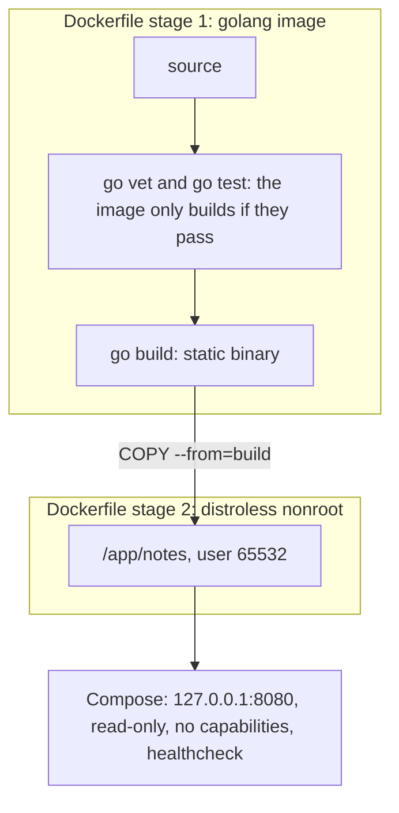

# 10. Testing, and a mini project: the notes API in a container

> **Draft: written but not yet run.** The code and the expected output in this lesson were prepared by reading the code and the official documentation. They have not been executed yet. If something does not behave as described, trust your tool's real output and report it.

## What you will be able to do
By the end of this lesson you will be able to:
- write table-driven tests with subtests, helpers and a frozen clock, and run them with `-v`, `-run`, `-cover`, `-count=1` and `-race`;
- test an HTTP API three ways: `httptest.NewRecorder` for handlers, `httptest.NewServer` for the real network path, and a fake store for failure paths;
- assemble a small service (store interface, DTOs, validation, problem+json, logging, graceful shutdown) from what you learned in lessons 01 to 07;
- package it in a multi-stage Dockerfile that produces a small, non-root image, and run it hardened with Compose.

## Recap
1. (Lesson 01) Why can `failingStore` in the tests embed the `NoteStore` interface and override one method?
   <details><summary>Answer</summary>Embedding forwards the other methods, so a test fake only writes the method it cares about. (Calling an unwritten one would panic on the nil embedded value.)</details>
2. (Lesson 07) What does `Server.Shutdown` do when the container receives SIGTERM?
   <details><summary>Answer</summary>Stops accepting connections and waits for in-flight requests, up to the timeout, then returns so the process exits with code 0.</details>
3. (Lesson 06) Which two things must a response to a failed request never contain?
   <details><summary>Answer</summary>Internal error text (database hosts, SQL, file paths) and panic values or stack traces.</details>

## Why it matters
Tests are what let you change code without fear. The most useful Go tests are small, fast and cover behaviour from the outside: "when I send this request, I get this status and this body". Table-driven tests make adding a case a one-line change, so people actually add them. A container is how the finished service travels: the same image runs on your laptop, in CI and in production. A careless image (root user, a full OS, secrets baked in, a 1 GB build toolchain inside) is a liability; a multi-stage build with a non-root, shell-less base is small and has little to attack.

## What you will build
A **notes API**: create, list, get and delete notes over JSON, with validation, problem+json errors, structured logs and graceful shutdown, behind a `NoteStore` interface with an in-memory implementation. About 20 tests. A Dockerfile and a Compose file that run it as a non-root user with a read-only file system.



## Before you start
- **Prerequisites:** Go 201 lessons [01, interfaces and embedding](../phase-1-core-skills/01-interfaces-and-embedding.md), [05, the net/http server](../phase-2-http-and-json/05-net-http-server.md), [06, JSON, DTOs and problems](../phase-2-http-and-json/06-json-dtos-and-problems.md) and [07, config, slog and shutdown](../phase-2-http-and-json/07-config-slog-shutdown.md).
- Lessons 01 to 07 finished (lesson 08 is not needed). Go 1.22.0 or newer. For the second sitting: Docker with Compose v2 and the engine **running**.
- `curl` (`curl.exe` in PowerShell).
- Time: 90 minutes in **two sittings**. First sitting: Steps 1 to 8 (code, tests, run it locally). Break after Step 8. Second sitting: Steps 9 to 12 (container).
- Source pack (optional): every file is shown in full in this lesson, so you can follow without it. The finished code, the exercise starter and the solution are in the
  course repository https://github.com/Uee03/Code101 under `source/go/201-hero-to-super-hero/phase-4-quality-and-ship/10-testing-and-notes-api/` (on that page choose **Code, Download ZIP**, or run
  `git clone https://github.com/Uee03/Code101.git`).
- Much of the code repeats ideas from earlier lessons in a compact form; each file's comments point to the lesson. Reading it as a revision is part of the exercise.

## Steps

### Step 1. Create the folder and the module
As in [lesson 01, Step 1](../phase-1-core-skills/01-interfaces-and-embedding.md#step-1-create-the-folder-and-the-module), with folder `lesson10` and module `example.com/code101/go201/lesson10`. Expected output of `go mod init`:
```text
go: creating new go.mod: module example.com/code101/go201/lesson10
```
There are no dependencies, so there is no `go.sum` and nothing to download. Also create a folder `requests` inside `lesson10` (Step 8 uses it).

### Step 2. The store and its interface
Create `store.go`.

**File: `store.go`**
```go
package main

import (
	"context"
	"errors"
	"slices"
	"sync"
	"time"
)

var ErrNotFound = errors.New("note not found")

// Note is the internal type; the HTTP layer converts it to a response DTO.
type Note struct {
	ID        int
	Title     string
	Body      string
	CreatedAt time.Time
}

// NoteStore is what the HTTP layer needs (lesson 01: a small interface at the consumer).
// memoryStore implements it here; the pgx store of lesson 08 could implement it too.
type NoteStore interface {
	Create(ctx context.Context, title, body string) (Note, error)
	Get(ctx context.Context, id int) (Note, error)
	List(ctx context.Context) ([]Note, error)
	Delete(ctx context.Context, id int) error
}

// memoryStore keeps notes in a map. now is a field so tests can fix the clock.
type memoryStore struct {
	mu     sync.Mutex
	nextID int
	notes  map[int]Note
	now    func() time.Time
}

func newMemoryStore() *memoryStore {
	return &memoryStore{nextID: 1, notes: make(map[int]Note), now: time.Now}
}

func (s *memoryStore) Create(ctx context.Context, title, body string) (Note, error) {
	s.mu.Lock()
	defer s.mu.Unlock()
	n := Note{ID: s.nextID, Title: title, Body: body, CreatedAt: s.now().UTC()}
	s.nextID++
	s.notes[n.ID] = n
	return n, nil
}

func (s *memoryStore) Get(ctx context.Context, id int) (Note, error) {
	s.mu.Lock()
	defer s.mu.Unlock()
	n, ok := s.notes[id]
	if !ok {
		return Note{}, ErrNotFound
	}
	return n, nil
}

func (s *memoryStore) List(ctx context.Context) ([]Note, error) {
	s.mu.Lock()
	defer s.mu.Unlock()
	out := make([]Note, 0, len(s.notes))
	for _, n := range s.notes {
		out = append(out, n)
	}
	slices.SortFunc(out, func(a, b Note) int { return a.ID - b.ID })
	return out, nil
}

func (s *memoryStore) Delete(ctx context.Context, id int) error {
	s.mu.Lock()
	defer s.mu.Unlock()
	if _, ok := s.notes[id]; !ok {
		return ErrNotFound
	}
	delete(s.notes, id)
	return nil
}
```

`NoteStore` is the seam (lesson 01): the HTTP layer depends on four methods, not on a map. Tests can pass a real `memoryStore` or a fake; a Postgres implementation like lesson 08's would drop in without touching the handlers. The `now` field is a **clock you can replace**: any code that reads `time.Now()` directly is hard to test, so inject it.

### Step 3. Test the store: table-driven tests
Create `store_test.go`.

**File: `store_test.go`**
```go
package main

import (
	"context"
	"errors"
	"testing"
	"time"
)

var fixedTime = time.Date(2030, 1, 1, 12, 0, 0, 0, time.UTC)

// seeded returns a store with one note ("first", id 1) and a frozen clock.
func seeded(t *testing.T) *memoryStore {
	t.Helper()
	s := newMemoryStore()
	s.now = func() time.Time { return fixedTime }
	if _, err := s.Create(context.Background(), "first", "body"); err != nil {
		t.Fatalf("seed: %v", err)
	}
	return s
}

func TestCreateSetsIDsAndTime(t *testing.T) {
	s := seeded(t)
	second, err := s.Create(context.Background(), "second", "")
	if err != nil {
		t.Fatalf("Create: %v", err)
	}
	if second.ID != 2 {
		t.Fatalf("ID %d, want 2", second.ID)
	}
	if !second.CreatedAt.Equal(fixedTime) {
		t.Fatalf("CreatedAt %v, want %v", second.CreatedAt, fixedTime)
	}
}

func TestGet(t *testing.T) {
	tests := []struct {
		name      string
		id        int
		wantTitle string
		wantErr   error
	}{
		{"existing note", 1, "first", nil},
		{"missing note", 2, "", ErrNotFound},
		{"zero id", 0, "", ErrNotFound},
	}
	for _, tc := range tests {
		t.Run(tc.name, func(t *testing.T) {
			got, err := seeded(t).Get(context.Background(), tc.id)
			if !errors.Is(err, tc.wantErr) {
				t.Fatalf("error %v, want %v", err, tc.wantErr)
			}
			if got.Title != tc.wantTitle {
				t.Fatalf("title %q, want %q", got.Title, tc.wantTitle)
			}
		})
	}
}

func TestDelete(t *testing.T) {
	tests := []struct {
		name    string
		id      int
		wantErr error
	}{
		{"existing note", 1, nil},
		{"missing note", 9, ErrNotFound},
	}
	for _, tc := range tests {
		t.Run(tc.name, func(t *testing.T) {
			s := seeded(t)
			if err := s.Delete(context.Background(), tc.id); !errors.Is(err, tc.wantErr) {
				t.Fatalf("error %v, want %v", err, tc.wantErr)
			}
			if tc.wantErr == nil {
				if _, err := s.Get(context.Background(), tc.id); !errors.Is(err, ErrNotFound) {
					t.Fatalf("deleted note is still there: %v", err)
				}
			}
		})
	}
}

func TestListIsOrderedAndNeverNil(t *testing.T) {
	empty, err := newMemoryStore().List(context.Background())
	if err != nil || empty == nil || len(empty) != 0 {
		t.Fatalf("empty store: got %v, %v; want an empty non-nil slice", empty, err)
	}

	s := seeded(t)
	_, _ = s.Create(context.Background(), "second", "")
	_, _ = s.Create(context.Background(), "third", "")
	notes, _ := s.List(context.Background())
	for i, n := range notes {
		if n.ID != i+1 {
			t.Fatalf("position %d holds ID %d, want %d", i, n.ID, i+1)
		}
	}
}
```

How Go tests work, in the order they appear:
1. A file ending in `_test.go` is compiled only by `go test`. A function named `TestXxx(t *testing.T)` is a test. The first letter after `Test` must be uppercase.
2. **`t.Helper()`** marks `seeded` as a helper, so a failure inside it is reported at the line of the *caller*.
3. **`t.Fatalf`** reports and stops this test; **`t.Errorf`** reports and continues (use it when later checks are still informative).
4. **Table-driven tests**: a slice of cases (name, input, expected output), one loop, `t.Run(tc.name, ...)` per case. Each case is a **subtest** with its own name in the output, and you can run one with `-run 'TestGet/missing_note'`. Adding a case is one line, which is why Go programmers write so many.
5. `errors.Is(err, tc.wantErr)` works for `nil` too: `errors.Is(nil, nil)` is true, so one comparison covers "no error expected" and "this error expected".
6. Each subtest builds its own `seeded(t)` store, so cases cannot influence each other. Since Go 1.22 each loop iteration has its own `tc`, so the closure is safe (before 1.22 you needed `tc := tc`).
7. Tests check **behaviour** ("deleted notes are gone"), not the code's structure, so you can refactor the store without rewriting the tests.

### Step 4. Middleware and the API
Create `middleware.go` and `api.go`. These combine lessons 05, 06 and 07; read the comments for the lesson numbers.

**File: `middleware.go`**
```go
package main

import (
	"log/slog"
	"net/http"
	"time"
)

// middleware wraps a handler and returns a new one (lesson 05).
type middleware func(http.Handler) http.Handler

// chain applies the middleware so that the first one in the list is the outermost.
func chain(h http.Handler, mws ...middleware) http.Handler {
	for i := len(mws) - 1; i >= 0; i-- {
		h = mws[i](h)
	}
	return h
}

// statusRecorder embeds the ResponseWriter and remembers the status code (lessons 01 and 05).
type statusRecorder struct {
	http.ResponseWriter
	status int
}

func (s *statusRecorder) WriteHeader(code int) {
	s.status = code
	s.ResponseWriter.WriteHeader(code)
}

func (s *statusRecorder) Unwrap() http.ResponseWriter {
	return s.ResponseWriter
}

// requestLog writes one structured record per request (lesson 07).
func requestLog(logger *slog.Logger) middleware {
	return func(next http.Handler) http.Handler {
		return http.HandlerFunc(func(w http.ResponseWriter, r *http.Request) {
			start := time.Now()
			rec := &statusRecorder{ResponseWriter: w, status: http.StatusOK}
			next.ServeHTTP(rec, r)
			logger.Info("request",
				"method", r.Method,
				"path", r.URL.Path,
				"status", rec.status,
				"duration", time.Since(start),
			)
		})
	}
}

// recoverer turns a panic into a generic 500 and logs the panic value on the server only.
func recoverer(logger *slog.Logger) middleware {
	return func(next http.Handler) http.Handler {
		return http.HandlerFunc(func(w http.ResponseWriter, r *http.Request) {
			defer func() {
				if v := recover(); v != nil {
					logger.Error("panic in handler", "panic", v, "path", r.URL.Path)
					writeProblem(w, r, http.StatusInternalServerError, "internal-error", "Internal server error", "", nil)
				}
			}()
			next.ServeHTTP(w, r)
		})
	}
}
```
**File: `api.go`**
```go
package main

import (
	"encoding/json"
	"errors"
	"io"
	"log/slog"
	"mime"
	"net/http"
	"strconv"
	"strings"
	"time"
	"unicode/utf8"
)

// DTOs (lesson 06): what a client may send and what it receives.
type createNoteRequest struct {
	Title string `json:"title"`
	Body  string `json:"body"`
}

type noteResponse struct {
	ID        int       `json:"id"`
	Title     string    `json:"title"`
	Body      string    `json:"body"`
	CreatedAt time.Time `json:"createdAt"`
}

type fieldError struct {
	Field   string `json:"field"`
	Message string `json:"message"`
}

// problem is an RFC 9457 problem details object.
type problem struct {
	Type     string       `json:"type"`
	Title    string       `json:"title"`
	Status   int          `json:"status"`
	Detail   string       `json:"detail,omitempty"`
	Instance string       `json:"instance,omitempty"`
	Errors   []fieldError `json:"errors,omitempty"`
}

func (r createNoteRequest) validate() []fieldError {
	var errs []fieldError
	title := strings.TrimSpace(r.Title)
	if title == "" {
		errs = append(errs, fieldError{Field: "title", Message: "is required"})
	} else if utf8.RuneCountInString(title) > 100 {
		errs = append(errs, fieldError{Field: "title", Message: "must be at most 100 characters"})
	}
	if utf8.RuneCountInString(r.Body) > 2000 {
		errs = append(errs, fieldError{Field: "body", Message: "must be at most 2000 characters"})
	}
	return errs
}

func toResponse(n Note) noteResponse {
	return noteResponse{ID: n.ID, Title: n.Title, Body: n.Body, CreatedAt: n.CreatedAt}
}

type server struct {
	store  NoteStore
	logger *slog.Logger
}

// newRouter wires routes and middleware. It takes the store as an interface, so tests can pass a fake.
func newRouter(store NoteStore, logger *slog.Logger) http.Handler {
	s := &server{store: store, logger: logger}
	mux := http.NewServeMux()
	mux.HandleFunc("GET /healthz", s.health)
	mux.HandleFunc("POST /notes", s.createNote)
	mux.HandleFunc("GET /notes", s.listNotes)
	mux.HandleFunc("GET /notes/{id}", s.getNote)
	mux.HandleFunc("DELETE /notes/{id}", s.deleteNote)
	return chain(mux, requestLog(logger), recoverer(logger))
}

func (s *server) health(w http.ResponseWriter, r *http.Request) {
	writeJSON(w, http.StatusOK, map[string]string{"status": "ok"})
}

func (s *server) createNote(w http.ResponseWriter, r *http.Request) {
	var req createNoteRequest
	if !readJSON(w, r, &req) {
		return
	}
	if errs := req.validate(); len(errs) > 0 {
		writeProblem(w, r, http.StatusUnprocessableEntity, "validation-error", "Validation failed", "One or more fields are invalid.", errs)
		return
	}
	note, err := s.store.Create(r.Context(), strings.TrimSpace(req.Title), req.Body)
	if err != nil {
		s.fail(w, r, err)
		return
	}
	w.Header().Set("Location", "/notes/"+strconv.Itoa(note.ID))
	writeJSON(w, http.StatusCreated, toResponse(note))
}

func (s *server) listNotes(w http.ResponseWriter, r *http.Request) {
	notes, err := s.store.List(r.Context())
	if err != nil {
		s.fail(w, r, err)
		return
	}
	out := make([]noteResponse, 0, len(notes))
	for _, n := range notes {
		out = append(out, toResponse(n))
	}
	writeJSON(w, http.StatusOK, out)
}

func (s *server) getNote(w http.ResponseWriter, r *http.Request) {
	id, ok := pathID(w, r)
	if !ok {
		return
	}
	note, err := s.store.Get(r.Context(), id)
	if err != nil {
		s.fail(w, r, err)
		return
	}
	writeJSON(w, http.StatusOK, toResponse(note))
}

func (s *server) deleteNote(w http.ResponseWriter, r *http.Request) {
	id, ok := pathID(w, r)
	if !ok {
		return
	}
	if err := s.store.Delete(r.Context(), id); err != nil {
		s.fail(w, r, err)
		return
	}
	w.WriteHeader(http.StatusNoContent)
}

// fail maps a store error to a response. Unknown errors are logged and answered with a generic 500.
func (s *server) fail(w http.ResponseWriter, r *http.Request, err error) {
	if errors.Is(err, ErrNotFound) {
		writeProblem(w, r, http.StatusNotFound, "not-found", "Not found", "Note not found.", nil)
		return
	}
	s.logger.Error("request failed", "method", r.Method, "path", r.URL.Path, "err", err)
	writeProblem(w, r, http.StatusInternalServerError, "internal-error", "Internal server error", "", nil)
}

func pathID(w http.ResponseWriter, r *http.Request) (int, bool) {
	id, err := strconv.Atoi(r.PathValue("id"))
	if err != nil || id < 1 {
		writeProblem(w, r, http.StatusBadRequest, "bad-request", "Bad request", "id must be a positive number.", nil)
		return 0, false
	}
	return id, true
}

// readJSON decodes exactly one JSON object with the guards of lesson 06.
// On failure it has already written the problem response and returns false.
func readJSON(w http.ResponseWriter, r *http.Request, dst any) bool {
	mediaType, _, err := mime.ParseMediaType(r.Header.Get("Content-Type"))
	if err != nil || mediaType != "application/json" {
		writeProblem(w, r, http.StatusUnsupportedMediaType, "unsupported-media-type", "Unsupported media type", "Content-Type must be application/json.", nil)
		return false
	}
	r.Body = http.MaxBytesReader(w, r.Body, 1<<20)
	dec := json.NewDecoder(r.Body)
	dec.DisallowUnknownFields()
	if err := dec.Decode(dst); err != nil {
		status, detail := http.StatusBadRequest, "Body is not valid JSON for this endpoint."
		var tooBig *http.MaxBytesError
		if errors.As(err, &tooBig) {
			status, detail = http.StatusRequestEntityTooLarge, "Body must be at most 1 MiB."
		}
		writeProblem(w, r, status, "bad-request", "Bad request", detail, nil)
		return false
	}
	if err := dec.Decode(&struct{}{}); !errors.Is(err, io.EOF) {
		writeProblem(w, r, http.StatusBadRequest, "bad-request", "Bad request", "Body must contain a single JSON object.", nil)
		return false
	}
	return true
}

func writeProblem(w http.ResponseWriter, r *http.Request, status int, slug, title, detail string, errs []fieldError) {
	w.Header().Set("Content-Type", "application/problem+json")
	w.WriteHeader(status)
	_ = json.NewEncoder(w).Encode(problem{
		Type:     "https://example.com/problems/" + slug,
		Title:    title,
		Status:   status,
		Detail:   detail,
		Instance: r.URL.Path,
		Errors:   errs,
	})
}

func writeJSON(w http.ResponseWriter, status int, v any) {
	w.Header().Set("Content-Type", "application/json")
	w.WriteHeader(status)
	_ = json.NewEncoder(w).Encode(v)
}
```

What is new compared with earlier lessons:
- **`newRouter(store NoteStore, logger)`** takes the store as an *interface* and builds everything else: the tests call it with different stores.
- **One error funnel, `fail`**: known errors (`ErrNotFound`) become their problem response; anything else is logged with full detail on the server and answered with a generic 500 that contains no detail.
- **`recoverer(logger)`** now logs the panic and answers with a problem body, not plain text.
- `list` returns `[]` for no notes, not `null`: `make([]noteResponse, 0, ...)` instead of a nil slice. Clients often iterate the result, and `null` breaks them.

### Step 5. Test the API: three techniques
Create `api_test.go`.

**File: `api_test.go`**
```go
package main

import (
	"context"
	"encoding/json"
	"errors"
	"io"
	"log/slog"
	"net/http"
	"net/http/httptest"
	"strings"
	"testing"
)

var quiet = slog.New(slog.NewTextHandler(io.Discard, nil))

func doRequest(h http.Handler, method, path, contentType, body string) *httptest.ResponseRecorder {
	req := httptest.NewRequest(method, path, strings.NewReader(body))
	if contentType != "" {
		req.Header.Set("Content-Type", contentType)
	}
	rec := httptest.NewRecorder()
	h.ServeHTTP(rec, req)
	return rec
}

func TestNotesAPI(t *testing.T) {
	const validBody = `{"title":"Buy milk","body":"2 litres"}`
	tests := []struct {
		name        string
		seed        int // how many notes exist before the request
		method      string
		path        string
		contentType string
		body        string
		wantStatus  int
		wantBody    string // a fragment that must appear; empty means "do not check"
	}{
		{"create", 0, "POST", "/notes", "application/json", validBody, 201, `"title":"Buy milk"`},
		{"create without a title", 0, "POST", "/notes", "application/json", `{"title":"  "}`, 422, `"field":"title"`},
		{"create with an unknown field", 0, "POST", "/notes", "application/json", `{"title":"x","admin":true}`, 400, "not valid JSON"},
		{"create with the wrong content type", 0, "POST", "/notes", "text/plain", validBody, 415, "application/json"},
		{"list when empty", 0, "GET", "/notes", "", "", 200, "[]"},
		{"get existing", 1, "GET", "/notes/1", "", "", 200, `"id":1`},
		{"get missing", 1, "GET", "/notes/7", "", "", 404, "Note not found."},
		{"get with a bad id", 0, "GET", "/notes/abc", "", "", 400, "positive number"},
		{"delete existing", 1, "DELETE", "/notes/1", "", "", 204, ""},
		{"delete missing", 0, "DELETE", "/notes/1", "", "", 404, "Note not found."},
		{"unsupported method", 0, "PUT", "/notes/1", "", "", 405, ""},
	}
	for _, tc := range tests {
		t.Run(tc.name, func(t *testing.T) {
			store := newMemoryStore()
			for range tc.seed {
				if _, err := store.Create(context.Background(), "seed", ""); err != nil {
					t.Fatalf("seed: %v", err)
				}
			}
			rec := doRequest(newRouter(store, quiet), tc.method, tc.path, tc.contentType, tc.body)
			if rec.Code != tc.wantStatus {
				t.Fatalf("status %d, want %d (body %s)", rec.Code, tc.wantStatus, rec.Body.String())
			}
			if tc.wantBody != "" && !strings.Contains(rec.Body.String(), tc.wantBody) {
				t.Errorf("body %q does not contain %q", rec.Body.String(), tc.wantBody)
			}
		})
	}
}

// httptest.NewServer starts a real server on a free local port: the whole path, including the network.
func TestRoundTripOverRealHTTP(t *testing.T) {
	srv := httptest.NewServer(newRouter(newMemoryStore(), quiet))
	t.Cleanup(srv.Close)

	resp, err := http.Post(srv.URL+"/notes", "application/json", strings.NewReader(`{"title":"Buy milk","body":"2 litres"}`))
	if err != nil {
		t.Fatalf("POST: %v", err)
	}
	defer resp.Body.Close()
	if resp.StatusCode != http.StatusCreated {
		t.Fatalf("status %d, want 201", resp.StatusCode)
	}
	if loc := resp.Header.Get("Location"); loc != "/notes/1" {
		t.Fatalf("Location %q, want /notes/1", loc)
	}
	var created noteResponse
	if err := json.NewDecoder(resp.Body).Decode(&created); err != nil {
		t.Fatalf("decode: %v", err)
	}
	if created.ID != 1 || created.Title != "Buy milk" {
		t.Fatalf("created %+v", created)
	}

	got, err := http.Get(srv.URL + "/notes/1")
	if err != nil {
		t.Fatalf("GET: %v", err)
	}
	defer got.Body.Close()
	if got.StatusCode != http.StatusOK {
		t.Fatalf("GET status %d, want 200", got.StatusCode)
	}
}

// failingStore embeds the interface (lesson 01) and overrides one method; the other methods are never called.
type failingStore struct{ NoteStore }

func (failingStore) List(context.Context) ([]Note, error) {
	return nil, errors.New("connection to secret-host refused")
}

func TestStoreFailureBecomesAGeneric500(t *testing.T) {
	rec := doRequest(newRouter(failingStore{}, quiet), "GET", "/notes", "", "")
	if rec.Code != http.StatusInternalServerError {
		t.Fatalf("status %d, want 500", rec.Code)
	}
	if strings.Contains(rec.Body.String(), "secret-host") {
		t.Fatal("internal error text leaked to the client")
	}
}

type panickingStore struct{ NoteStore }

func (panickingStore) Get(context.Context, int) (Note, error) {
	panic("boom")
}

func TestPanicIsRecoveredAndNotLeaked(t *testing.T) {
	rec := doRequest(newRouter(panickingStore{}, quiet), "GET", "/notes/1", "", "")
	if rec.Code != http.StatusInternalServerError {
		t.Fatalf("status %d, want 500", rec.Code)
	}
	if strings.Contains(rec.Body.String(), "boom") {
		t.Fatal("panic value leaked to the client")
	}
}
```

| Technique | Where | What it gives you |
|---|---|---|
| `httptest.NewRecorder` and `router.ServeHTTP` | `TestNotesAPI` | Fast: no network. Check status, headers, body of any case. The table tests 11 requests including every error path |
| `httptest.NewServer` | `TestRoundTripOverRealHTTP` | A real server on a free port and a real `http.Client`: proves the whole path works, including headers such as `Location`. `t.Cleanup(srv.Close)` shuts it down when the test ends |
| A fake that embeds the interface | `failingStore`, `panickingStore` | Makes failures that are hard to produce for real (database down, a bug) happen on demand. The tests assert the client sees **no internal text** |

Notes: `quiet` is a logger that writes to `io.Discard`, so test output is not flooded with request logs. `seed` in the table says how many notes exist before the request. `wantBody` is a *fragment*, not the whole body: it keeps tests from breaking when unrelated fields change (the `createdAt` time, for example).

### Step 6. main
Create `main.go`.

**File: `main.go`**
```go
package main

import (
	"context"
	"fmt"
	"log/slog"
	"net"
	"net/http"
	"os"
	"os/signal"
	"syscall"
	"time"
)

func main() {
	os.Exit(realMain(os.Args[1:]))
}

// env returns the value of an environment variable, or fallback when it is empty.
func env(key, fallback string) string {
	if v := os.Getenv(key); v != "" {
		return v
	}
	return fallback
}

func realMain(args []string) int {
	addr := env("APP_ADDR", "127.0.0.1:8080")
	if len(args) > 0 && args[0] == "healthcheck" {
		return healthcheck(addr)
	}

	timeout, err := time.ParseDuration(env("APP_SHUTDOWN_TIMEOUT", "10s"))
	if err != nil || timeout <= 0 {
		fmt.Fprintln(os.Stderr, "APP_SHUTDOWN_TIMEOUT: want a positive duration such as 10s")
		return 2
	}
	var handler slog.Handler
	switch format := env("APP_LOG_FORMAT", "text"); format {
	case "text":
		handler = slog.NewTextHandler(os.Stderr, nil)
	case "json":
		handler = slog.NewJSONHandler(os.Stderr, nil)
	default:
		fmt.Fprintf(os.Stderr, "APP_LOG_FORMAT %q: want text or json\n", format)
		return 2
	}
	logger := slog.New(handler)

	ctx, stop := signal.NotifyContext(context.Background(), os.Interrupt, syscall.SIGTERM)
	defer stop()

	if err := serve(ctx, addr, timeout, newRouter(newMemoryStore(), logger), logger); err != nil {
		logger.Error("server failed", "err", err)
		return 1
	}
	return 0
}

// serve runs the server until ctx is cancelled, then drains in-flight requests (lesson 07).
func serve(ctx context.Context, addr string, timeout time.Duration, h http.Handler, logger *slog.Logger) error {
	srv := &http.Server{
		Handler:           h,
		ReadHeaderTimeout: 5 * time.Second,
		ReadTimeout:       10 * time.Second,
		WriteTimeout:      10 * time.Second,
		IdleTimeout:       60 * time.Second,
		ErrorLog:          slog.NewLogLogger(logger.Handler(), slog.LevelError),
	}
	ln, err := net.Listen("tcp", addr)
	if err != nil {
		return fmt.Errorf("listen: %w", err)
	}
	serveErr := make(chan error, 1)
	go func() {
		logger.Info("server started", "addr", ln.Addr().String())
		serveErr <- srv.Serve(ln)
	}()

	select {
	case err := <-serveErr:
		return fmt.Errorf("serve: %w", err)
	case <-ctx.Done():
	}

	logger.Info("shutdown requested", "timeout", timeout)
	shutdownCtx, cancel := context.WithTimeout(context.Background(), timeout)
	defer cancel()
	if err := srv.Shutdown(shutdownCtx); err != nil {
		_ = srv.Close()
		return fmt.Errorf("graceful shutdown: %w", err)
	}
	logger.Info("server stopped")
	return nil
}

// healthcheck lets the container ask itself "are you alive?". The runtime image has no shell and no curl,
// so the program itself is the health probe: exit code 0 means healthy.
func healthcheck(addr string) int {
	_, port, err := net.SplitHostPort(addr)
	if err != nil {
		fmt.Fprintln(os.Stderr, "healthcheck:", err)
		return 1
	}
	client := http.Client{Timeout: 2 * time.Second}
	resp, err := client.Get("http://127.0.0.1:" + port + "/healthz")
	if err != nil {
		fmt.Fprintln(os.Stderr, "healthcheck:", err)
		return 1
	}
	defer resp.Body.Close()
	if resp.StatusCode != http.StatusOK {
		fmt.Fprintln(os.Stderr, "healthcheck: status", resp.StatusCode)
		return 1
	}
	return 0
}
```

This is lesson 07 in compact form: configuration from `APP_ADDR`, `APP_LOG_FORMAT` and `APP_SHUTDOWN_TIMEOUT`, structured logging, `signal.NotifyContext`, `Shutdown`. Two additions for containers:
- The default address is `127.0.0.1:8080` for development; inside a container the image sets `APP_ADDR=0.0.0.0:8080`. A server bound to the loopback address *inside* a container cannot be reached through a published port.
- **`healthcheck`**: `notes healthcheck` calls the service's own `/healthz` and exits 0 or 1. The runtime image has no shell and no `curl`, so the program is its own probe.

### Step 7. Run the tests
In `lesson10`:
```text
go vet ./...
go test ./...
```
`go vet` has no output when it finds nothing. `go test` should end with a line like the following (the time differs):
```text
ok  	example.com/code101/go201/lesson10	0.0xxs
```
Useful variations:
```text
go test -v -run TestGet ./...
go test -cover ./...
go test -count=1 ./...
go test -race ./...
```
- `-v` lists every test and subtest. `-run` takes a regular expression. Typical output of the first command (timings differ):
```text
=== RUN   TestGet
=== RUN   TestGet/existing_note
=== RUN   TestGet/missing_note
=== RUN   TestGet/zero_id
--- PASS: TestGet (0.00s)
    --- PASS: TestGet/existing_note (0.00s)
    --- PASS: TestGet/missing_note (0.00s)
    --- PASS: TestGet/zero_id (0.00s)
PASS
ok  	example.com/code101/go201/lesson10	0.0xxs
```
- `-cover` appends `coverage: NN.N% of statements` to the `ok` line (the number depends on the code). Coverage tells you which lines never ran, not whether the tests are good.
- `go test` **caches** successful results: if neither code nor inputs changed, the line ends with `(cached)`. `-count=1` forces a real run.
- `-race` turns on the race detector (lesson 03). It may need a C compiler on your platform.

### Step 8. Run the service and call it
In `lesson10`:
```text
go run .
```
Expected output; `<time>` is a real timestamp:
```text
time=<time> level=INFO msg="server started" addr=127.0.0.1:8080
```
Create the two request files in `requests`.

**File: `requests/note.json`**
```json
{"title":"Buy milk","body":"2 litres, semi-skimmed"}
```
**File: `requests/invalid.json`**
```json
{"title":"   ","body":""}
```

In a second terminal, in `lesson10` (PowerShell: `curl.exe`; macOS and Linux: `curl`). Predict each status before you press Enter.

Create a note:
```text
curl.exe -s -w "status %{http_code}\nlocation %header{location}\n" -X POST -H "Content-Type: application/json" --data-binary "@requests/note.json" http://127.0.0.1:8080/notes
```
Expected output (the timestamp differs, in UTC):
```text
{"id":1,"title":"Buy milk","body":"2 litres, semi-skimmed","createdAt":"<time>"}
status 201
location /notes/1
```
Try the invalid one:
```text
curl.exe -s -w "status %{http_code}\n" -X POST -H "Content-Type: application/json" --data-binary "@requests/invalid.json" http://127.0.0.1:8080/notes
```
Expected output:
```text
{"type":"https://example.com/problems/validation-error","title":"Validation failed","status":422,"detail":"One or more fields are invalid.","instance":"/notes","errors":[{"field":"title","message":"is required"}]}
status 422
```
Delete the note and ask for it again:
```text
curl.exe -s -w "status %{http_code}\n" -X DELETE http://127.0.0.1:8080/notes/1
curl.exe -s -w "status %{http_code}\n" http://127.0.0.1:8080/notes/1
```
Expected output:
```text
status 204
{"type":"https://example.com/problems/not-found","title":"Not found","status":404,"detail":"Note not found.","instance":"/notes/1"}
status 404
```
Press **Ctrl+C** in the server terminal: it logs `shutdown requested` and `server stopped` and exits.

**Break here if you are doing two sittings.** Everything so far is on your machine; the container comes next.

### Step 9. The Dockerfile
Create `Dockerfile` (no extension) in `lesson10`.

**File: `Dockerfile`**
```dockerfile
FROM golang:1.27.4-alpine3.24 AS build
WORKDIR /src

# Copy the module file first: this layer is cached until go.mod changes.
COPY go.mod ./
RUN go mod download

COPY . .
# The image is only built if the tests pass.
RUN go vet ./... && go test ./...
# CGO_ENABLED=0 gives a static binary with no C library. -trimpath removes local file paths from the binary,
# -s -w remove the symbol table and debug information.
RUN CGO_ENABLED=0 GOOS=linux go build -trimpath -ldflags="-s -w" -o /out/notes .

# The runtime image has no shell and no package manager, and runs as user 65532 (nonroot).
FROM gcr.io/distroless/static-debian13:nonroot
COPY --from=build /out/notes /app/notes
USER nonroot:nonroot
EXPOSE 8080
ENV APP_ADDR=0.0.0.0:8080 APP_LOG_FORMAT=json
ENTRYPOINT ["/app/notes"]
```

Line by line:
| Line | What it does, and why |
|---|---|
| `FROM golang:1.27.4-alpine3.24 AS build` | Stage 1 starts from the Go toolchain image (Alpine Linux base, small for a toolchain) and names the stage `build`. The exact tag pins the Go version and OS release, so builds are reproducible. Use a version that matches your `go.mod` or is newer |
| `WORKDIR /src` | The folder inside the image where the next commands run |
| `COPY go.mod ./` and `RUN go mod download` | Copy only the module file and fetch dependencies *first*. Docker caches each step as a layer; as long as `go.mod` does not change, this layer is reused and source edits do not re-download anything. (With dependencies you would copy `go.sum` too) |
| `COPY . .` | Now copy the source (minus what `.dockerignore` lists) |
| `RUN go vet ./... && go test ./...` | **The image only builds if the checks pass.** A broken change cannot become an image |
| `RUN CGO_ENABLED=0 GOOS=linux go build -trimpath -ldflags="-s -w" -o /out/notes .` | `CGO_ENABLED=0` makes a **static** binary with no C library dependency, which is required to run on the shell-less base. `-trimpath` removes build paths, `-s -w` strip the symbol table and debug data (smaller) |
| `FROM gcr.io/distroless/static-debian13:nonroot` | Stage 2 starts from a nearly empty image: CA certificates, time zone data and a `nonroot` user, **no shell and no package manager**. Everything from stage 1 (compiler, source, caches) is thrown away |
| `COPY --from=build /out/notes /app/notes` | Copies only the binary out of stage 1 |
| `USER nonroot:nonroot` | The process runs as user 65532, not root: a bug in the service cannot write system files or bind low ports |
| `EXPOSE 8080` | Documentation: the container listens on 8080. It does not publish the port by itself |
| `ENV APP_ADDR=0.0.0.0:8080 APP_LOG_FORMAT=json` | Default settings *inside* the container: listen on all container interfaces; JSON logs for collectors. **Never put secrets in `ENV`**: they are readable by anyone with the image |
| `ENTRYPOINT ["/app/notes"]` | The **exec form** (a JSON array) starts the binary directly as the container's main process (PID 1), so `docker stop` delivers SIGTERM to *your* program and graceful shutdown works. The shell form (`ENTRYPOINT /app/notes`) would start a shell that does not forward signals |

### Step 10. `.dockerignore`
Create `.dockerignore` next to the Dockerfile. Files listed here are never sent to the build, so they cannot end up in an image layer.

**File: `.dockerignore`**
```text
.git
.gitignore
.dockerignore
.env
.env.example
Dockerfile
docker-compose.yml
requests/
*.exe
bin/
```

`.env` and `.env.example` are listed so that a file with real settings can never be copied in by `COPY . .`. `requests/` and the Docker files are not needed to build.

### Step 11. The Compose file
Create `docker-compose.yml`.

**File: `docker-compose.yml`**
```yaml
# Runs the notes API in a hardened container: loopback-only port, read-only file system, no Linux capabilities.
name: code101-go201-notes

services:
  api:
    build: .
    image: code101/go201-notes:dev
    ports:
      - "127.0.0.1:8080:8080"
    environment:
      APP_LOG_FORMAT: json
      APP_SHUTDOWN_TIMEOUT: 10s
    read_only: true
    cap_drop:
      - ALL
    security_opt:
      - no-new-privileges:true
    healthcheck:
      test: ["CMD", "/app/notes", "healthcheck"]
      interval: 5s
      timeout: 3s
      retries: 5
      start_period: 2s
    stop_grace_period: 15s
```

| Line | Effect |
|---|---|
| `build: .` and `image: code101/go201-notes:dev` | Build from the Dockerfile in this folder and name the result |
| `"127.0.0.1:8080:8080"` | Publish the port only on the loopback interface |
| `environment:` | Configuration for the container: JSON logs and a 10-second drain timeout |
| `read_only: true` | The container's root file system cannot be written. The service writes no files, so this blocks a whole class of attacks (dropping a file, changing a binary). If you ever need a scratch folder, add a `tmpfs` mount |
| `cap_drop: [ALL]` | Removes every Linux capability. A web service needs none |
| `security_opt: no-new-privileges:true` | The process and its children can never gain more privileges |
| `healthcheck` | Runs `/app/notes healthcheck` every 5 seconds; `--wait` below uses it |
| `stop_grace_period: 15s` | How long Docker waits after SIGTERM before it kills the container. It must be **longer than** `APP_SHUTDOWN_TIMEOUT` (10 s), otherwise Docker would kill the drain halfway |

### Step 12. Build, run, inspect, stop
In `lesson10`:
```text
docker compose up -d --build --wait
```
The first build downloads the two base images and runs the tests inside the build, so it takes a few minutes. The output ends with the container reported as healthy (the wording depends on your Compose version, so this is a typical output, not exact):
```text
 Container code101-go201-notes-api-1  Healthy
```
Check that it answers, and that it runs as a non-root user:
```text
curl.exe -s -w "status %{http_code}\n" http://127.0.0.1:8080/healthz
docker inspect --format "{{.Config.User}}" code101-go201-notes-api-1
```
Expected output:
```text
{"status":"ok"}
status 200
nonroot:nonroot
```
(In bash write the second command's format string with single quotes: `'{{.Config.User}}'`.) Look at the logs and see structured JSON, because the image sets `APP_LOG_FORMAT=json`:
```text
docker compose logs api
```
Typical output (Compose prefixes each line with the service name; the time differs). After the first line you also see one `request` record for `GET /healthz` every five seconds, written by the health check itself:
```text
api-1  | {"time":"<time>","level":"INFO","msg":"server started","addr":"0.0.0.0:8080"}
```
Now stop it and check how it ended:
```text
docker compose stop
docker inspect --format "{{.State.ExitCode}}" code101-go201-notes-api-1
```
Expected output of the second command:
```text
0
```
Exit code **0** shows that the program handled SIGTERM and shut down by itself; a container that was killed after the grace period would show 137. The last log lines contain the shutdown records; in JSON a `time.Duration` is written as a number of nanoseconds, so the timeout appears as `10000000000`:
```text
docker compose logs api
```
Typical output (the end of the log):
```text
api-1  | {"time":"<time>","level":"INFO","msg":"shutdown requested","timeout":10000000000}
api-1  | {"time":"<time>","level":"INFO","msg":"server stopped"}
```
Clean up the container, the network and the image you built:
```text
docker compose down --rmi local
```

## How it works
- **Request path:** `requestLog` (outer) starts a clock and wraps the writer; `recoverer` guards the handler; the mux picks the handler; the handler decodes, validates and calls the store; `fail` or `writeJSON` answers; the log record is written last.
- **Test pyramid in miniature:** many fast table tests on the store and handlers, one test through a real server, a few fakes for failures. The cheap tests carry most of the weight.
- **Why a fake and not a mock library:** Go's small interfaces make hand-written fakes short and readable; there is nothing to learn beyond the language.
- **Multi-stage build:** the final image contains one file you built and almost nothing else. There is no compiler, no shell, no package manager and no source, so there is little for an attacker to use and little to patch.

**Misconception:** "tests slow me down". They slow the first version slightly and speed up every change after that. And a table-driven test costs one line per case.

## Why this, not that
| Choice | Use | Instead of | Reason |
|---|---|---|---|
| Test style | Table-driven with `t.Run` | One function per case | One line per case; named failures |
| Test doubles | Hand-written fakes of small interfaces | A mocking framework | Less to learn, readable, no code generation |
| HTTP tests | `httptest.NewRecorder` for most, `NewServer` for a few | Starting the binary and using curl in tests | Fast, deterministic, no ports |
| Assertions | The standard library (`if got != want`) | Assertion libraries | No dependency; adopt one only if your team wants it |
| Base image | `distroless/static:nonroot` | `scratch`, `alpine`, `debian` | Includes CA certificates and a non-root user; no shell. `alpine` is fine if you need a shell for debugging. `scratch` has nothing at all |
| Build | Multi-stage | Building and running in one image | Smaller, safer, no toolchain in production |
| Healthcheck | The binary checks itself | Installing `curl` in the image | Keeps the shell-less image minimal |
| Config in image | Non-secret defaults only | Secrets in `ENV` or `COPY` | Image layers are readable |
| Tags | A pinned tag (better: a digest) | `latest` | Reproducible builds; a digest also resists tag changes |

## Try it
This exercise is a separate small package about writing tests. Use the [exercise folders](../README.md#exercise-folders) steps; the folder is `try10`.

1. **Guided.** `slug_test.go` has two rows. Add the five rows listed in the TODO comment, each with the result the rules in `slug.go` demand. Run `go test ./...` and read the failures: expect the given row `"Hello, World!"` to fail already.
2. **Change.** The failure tells you `Make` has a bug. Find it from the rules in the comment and fix `slug.go` so every row passes.
3. **Stretch (no single answer).** Write `FuzzMake`: for *any* input the result must never start or end with `-` and never contain `--`. Run it for ten seconds with `go test -fuzz=FuzzMake -fuzztime=10s`. What does the fuzzer try that you would not have thought of?

**File: `go.mod (starter)`**
```text
module example.com/code101/go201/try10

go 1.22.0
```
**File: `slug.go (starter)`**
```go
package slug

import (
	"strings"
	"unicode"
)

// Make turns a title into a URL-friendly slug.
//
//	"Hello World"       becomes "hello-world"
//	"  Hello, World!  " becomes "hello-world"
//
// Rules: lower case; letters and digits (any alphabet) are kept; every run of other characters
// becomes one hyphen; there is never a hyphen at the start or the end.
func Make(title string) string {
	var b strings.Builder
	lastHyphen := false
	for _, r := range strings.ToLower(title) {
		if unicode.IsLetter(r) || unicode.IsDigit(r) {
			b.WriteRune(r)
			lastHyphen = false
		} else if !lastHyphen {
			b.WriteByte('-')
			lastHyphen = true
		}
	}
	return b.String()
}
```
**File: `slug_test.go (starter)`**
```go
package slug

import "testing"

func TestMake(t *testing.T) {
	tests := []struct {
		name  string
		title string
		want  string
	}{
		{"simple words", "Hello World", "hello-world"},
		{"punctuation collapses", "Hello, World!", "hello-world"},
		// TODO 1: add rows for these cases, each with the result the rules in slug.go demand:
		//   leading and trailing spaces ("  Go  ")
		//   an empty title ("")
		//   only symbols ("***")
		//   digits are kept ("Go 1.22 released")
		//   non-ASCII letters are kept ("Crème Brûlée")
	}
	for _, tc := range tests {
		t.Run(tc.name, func(t *testing.T) {
			if got := Make(tc.title); got != tc.want {
				t.Errorf("Make(%q) = %q, want %q", tc.title, got, tc.want)
			}
		})
	}
}

// TODO 3 (stretch): write FuzzMake. Property: for any input, the result never starts or ends with "-"
// and never contains "--". See https://go.dev/doc/security/fuzz/
```

Run in `try10`:
```text
go test ./...
```
With the starter, the failure for the given row reads (the file and line prefix differ):
```text
Make("Hello, World!") = "hello-world-", want "hello-world"
```
When everything is fixed the output ends with a line starting `ok`.

<details><summary>Solution</summary>

The bug: a run of other characters at the *end* (or start) of the title leaves a hyphen, because the function adds one hyphen per run but never removes the ones at the edges. The fix is one line, `strings.Trim(b.String(), "-")`.

**File: `slug.go (solution)`**
```go
package slug

import (
	"strings"
	"unicode"
)

// Make turns a title into a URL-friendly slug.
//
//	"Hello World"       becomes "hello-world"
//	"  Hello, World!  " becomes "hello-world"
//
// Rules: lower case; letters and digits (any alphabet) are kept; every run of other characters
// becomes one hyphen; there is never a hyphen at the start or the end.
func Make(title string) string {
	var b strings.Builder
	lastHyphen := false
	for _, r := range strings.ToLower(title) {
		if unicode.IsLetter(r) || unicode.IsDigit(r) {
			b.WriteRune(r)
			lastHyphen = false
		} else if !lastHyphen {
			b.WriteByte('-')
			lastHyphen = true
		}
	}
	return strings.Trim(b.String(), "-")
}
```
**File: `slug_test.go (solution)`**
```go
package slug

import (
	"strings"
	"testing"
)

func TestMake(t *testing.T) {
	tests := []struct {
		name  string
		title string
		want  string
	}{
		{"simple words", "Hello World", "hello-world"},
		{"punctuation collapses", "Hello, World!", "hello-world"},
		{"leading and trailing spaces", "  Go  ", "go"},
		{"empty title", "", ""},
		{"only symbols", "***", ""},
		{"digits are kept", "Go 1.22 released", "go-1-22-released"},
		{"non-ASCII letters are kept", "Crème Brûlée", "crème-brûlée"},
	}
	for _, tc := range tests {
		t.Run(tc.name, func(t *testing.T) {
			if got := Make(tc.title); got != tc.want {
				t.Errorf("Make(%q) = %q, want %q", tc.title, got, tc.want)
			}
		})
	}
}

// FuzzMake checks a property for any input: no hyphen at either end and never two in a row.
// Without the -fuzz flag, go test runs only the seed inputs below.
func FuzzMake(f *testing.F) {
	f.Add("Hello, World!")
	f.Add("  ")
	f.Add("a--b")
	f.Fuzz(func(t *testing.T, title string) {
		got := Make(title)
		if strings.HasPrefix(got, "-") || strings.HasSuffix(got, "-") || strings.Contains(got, "--") {
			t.Fatalf("Make(%q) = %q has a stray hyphen", title, got)
		}
	})
}
```

`FuzzMake` states a **property** instead of examples. Without `-fuzz`, `go test` runs the three seed inputs only, so it stays fast in normal runs. When the fuzzer finds a failing input it saves it under `testdata/fuzz/` so it becomes a permanent regression test.

</details>

## Check yourself
1. Why does `newRouter` take a `NoteStore` and not a `*memoryStore`?
   <details><summary>Answer</summary>So tests (and later a Postgres store) can pass another implementation. The handlers depend on behaviour, not on the map.</details>
2. What does `-count=1` do and when do you need it?
   <details><summary>Answer</summary>It disables the test result cache. You need it when a test depends on something Go cannot see (an environment variable, a database, the clock) and you want a real run.</details>
3. Why does the Dockerfile set `CGO_ENABLED=0`?
   <details><summary>Answer</summary>The runtime image has no C library. A static binary runs there; a dynamically linked one fails at start-up.</details>
4. The container is stopped with `docker stop` and shows exit code 137 instead of 0. What probably happened?
   <details><summary>Answer</summary>The process did not handle SIGTERM in time (for example the `ENTRYPOINT` used the shell form, so a shell received the signal) and Docker killed it after the grace period.</details>
5. Find the bug: `docker-compose.yml` has `stop_grace_period: 5s` but the app's drain timeout is 10 s.
   <details><summary>Answer</summary>Docker kills the container after 5 seconds, so requests that need more than that are cut off. The grace period must be longer than the drain timeout.</details>

## Common mistakes
These are typical messages unless the text is from this lesson's own code.

| Symptom or error text | Cause | Fix |
|---|---|---|
| `ok ... (cached)` although you changed a test's environment | Go caches passing results | `go test -count=1 ./...` |
| `declared and not used: x` or `"os" imported and not used` (typical wording) | A variable or import that is never used is a compile error | Remove it or use it |
| `--- FAIL: TestNotesAPI/get_missing` with `status 400, want 404` | The path was changed (for example a typo in the route) | Compare the test row's `path` with the route pattern |
| `exec /app/notes: no such file or directory` (typical message) | The binary was built without `CGO_ENABLED=0`, so it needs a C library the image lacks | Keep `CGO_ENABLED=0` in the build line |
| `curl: (52) Empty reply from server` or `(56) Recv failure` (typical messages) | The server inside the container is bound to `127.0.0.1` | Set `APP_ADDR=0.0.0.0:8080` for the container (the Dockerfile does) |
| The container shows `unhealthy` | The healthcheck cannot reach `/healthz`: wrong `APP_ADDR` or the server crashed | `docker compose logs api` |
| Port is already allocated (typical message) | Another program (a lesson-05 server?) uses 8080 | Stop it, or change the left side of `"127.0.0.1:8080:8080"` |
| `Cannot connect to the Docker daemon` (typical message) | The engine is not running | Start Docker Desktop or the Docker service |
| The build stops at `go test` | A test fails inside the build | Run `go test ./...` on your machine and fix it; that is the gate working |
| `go: go.mod file not found in current directory or any parent directory; see 'go help modules'` | Running outside the module folder | `cd` into `lesson10` |

## Best practice
Write table-driven tests that check behaviour through the public surface, inject time and other hidden inputs, and build images in two stages, running as a non-root user from a minimal base. Source: Go wiki, TableDrivenTests https://go.dev/wiki/TableDrivenTests, package testing https://pkg.go.dev/testing, net/http/httptest https://pkg.go.dev/net/http/httptest and Docker, Building best practices https://docs.docker.com/build/building/best-practices/

## Going further
- The capstone containerises a Go API with the same pattern and adds a Compose stack with Postgres and Keycloak: [`capstones/backend-go`, Docker chapter](../../../../capstones/backend-go/tutorials/phase-4-run-and-ship/06-docker.md) and its [hardening chapter](../../../../capstones/backend-go/tutorials/phase-5-hardening/07-hardening.md).
- Fuzzing: https://go.dev/doc/security/fuzz/ and testing with `go test -bench`: https://pkg.go.dev/testing#hdr-Benchmarks
- Stretch project: implement `NoteStore` with the pgx code from lesson 08, run both implementations against the *same* test table, and choose which one `main` uses from an environment variable.

## Phase 4 review and level review (mixed)
1. Name three checks a request body goes through before it reaches the store. <details><summary>Answer</summary>Content type, size and syntax/unknown-field decoding, then validation (lesson 06, used in `readJSON` and `validate`).</details>
2. A handler needs the current time. How do you keep its test deterministic? <details><summary>Answer</summary>Inject a clock (`now func() time.Time`) and set it in the test, as in `memoryStore`.</details>
3. A goroutine you start in a handler keeps running after the client disconnects. What is missing? <details><summary>Answer</summary>It ignores `r.Context()`. It must select on `ctx.Done()` (lesson 03).</details>
4. Which three settings of the Compose file reduce the damage if the service is compromised? <details><summary>Answer</summary>`read_only`, `cap_drop: ALL` and `no-new-privileges` (plus the non-root user in the image and the loopback port).</details>
5. Where do roles from a token get checked, and where would an "is this your note" check belong? <details><summary>Answer</summary>Role checks in middleware (lesson 09); ownership checks in the handler or, better, in the store query so no path can skip it.</details>

## Summary
- You wrote table-driven tests with subtests, helpers and an injected clock, and ran them with `-v`, `-run`, `-cover`, `-count=1` and `-race`.
- You tested handlers with `httptest.NewRecorder`, the network path with `httptest.NewServer`, and failure paths with fakes that embed the interface.
- You assembled a notes API from interfaces, DTOs, validation, problem+json, structured logs and graceful shutdown.
- You built a multi-stage, non-root, shell-less image and ran it with a read-only file system, dropped capabilities and a self-checking health probe.

## Next lesson
That was the last lesson of Go 201. To see all of it working together, with Postgres, Keycloak, idempotency keys, hardening and a conformance suite, read the capstone: [`capstones/backend-go`](../../../../capstones/backend-go/README.md).
