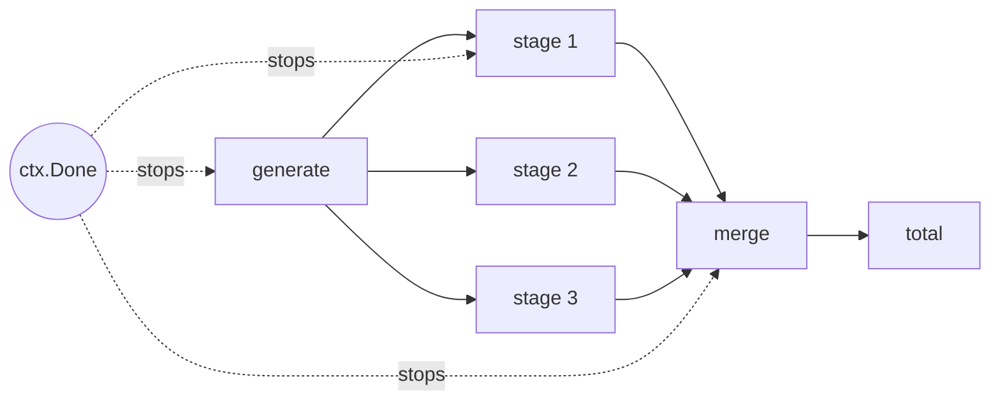

# 01. Concurrency patterns: worker pools, pipelines, fan-out and fan-in, errgroup, leak prevention

> **Draft: written but not yet run.** The code and the expected output in this lesson were prepared by reading the code and the official documentation. They have not been executed yet. If something does not behave as described, trust your tool's real output and report it.

## What you will be able to do
By the end of this lesson you will be able to:
- write a bounded worker pool, a pipeline and a fan-out/fan-in that all stop cleanly when their context is cancelled;
- use `errgroup` with a limit to run many calls concurrently and return the first error;
- explain, for each pattern, how a goroutine leaks and which line of code prevents it;
- decide when **not** to use a concurrency pattern and what to measure before adding one.

## Recap
Three questions from earlier lessons. Answer from memory first.
1. In Go, what does `fmt.Errorf("fetch %d: %w", id, err)` keep that `%v` would lose? <details><summary>Answer</summary>The wrapped error: `errors.Is` and `errors.As` can still find the cause (101 lesson 09).</details>
2. What does `ctx.Done()` return and when does it fire? <details><summary>Answer</summary>A channel that is closed when the context is cancelled or its deadline passes (Go 201, context).</details>
3. Who should close a channel: the sender or the receiver? <details><summary>Answer</summary>The sender, and only one owner. Closing twice or sending after close panics.</details>

## Why it matters
A kitchen with one cook is slow, but a kitchen with fifty cooks and one stove is chaos. Concurrency patterns are the house rules that decide how many cooks there are, how orders reach them and who turns the stove off at closing time. In production the expensive bugs are not "it is slow": they are goroutines that never exit (memory grows until the pod is killed), unbounded fan-out that melts a downstream database, and errors that are silently dropped.

## What you will build
One small module, `l01`, with four files of patterns and a test file:
- `pool.go`: a bounded **worker pool** with context cancellation;
- `pipeline.go`: a **pipeline** (generate, square) with a **fan-out** of the middle stage and a **fan-in** (`merge`);
- `group.go`: `fetchAll` with **errgroup** and a concurrency limit;
- `leak.go`: a **goroutine leak** you can measure, and the one-line fix;
- `main.go` and `patterns_test.go`: a demo and three tests.



## Before you start
- Go 1.26.0 or newer (`go version`). Go 1.25 added `sync.WaitGroup.Go`, which this lesson uses.
- You know goroutines, channels, `select` and `context` from Go 201: [lesson 02, goroutines and channels](../../201-hero-to-super-hero/phase-1-core-skills/02-goroutines-and-channels.md) and [lesson 03, sync, context and cancellation](../../201-hero-to-super-hero/phase-1-core-skills/03-sync-context-cancellation.md). This lesson goes deeper on the same patterns: leaks, ownership of `close`, `errgroup`.
- Time: 70 minutes (two sittings are fine; break after Step 6).
- Source pack (optional): every file is shown in full in this lesson, so you can follow without it. The finished code, the exercise starter and the solution are in the
  course repository https://github.com/Uee03/Code101 under `source/go/301-super-hero-to-legendary/phase-1-concurrency-and-performance/01-concurrency-patterns/` (on that page choose **Code, Download ZIP**, or run
  `git clone https://github.com/Uee03/Code101.git`).
- [How every lesson works](../../README.md#how-every-lesson-works) explains folders, saving and running.
- This module needs one dependency, `golang.org/x/sync`, so the first `go mod tidy` needs internet access. It creates `go.sum`; the pack does not ship `go.sum` because it is generated by that command.

## Steps

### Step 1. Create the working folder
Pick a folder that is not inside another lesson. Use the form for your shell.

**File: terminal (not a saved file)**
```powershell
New-Item -ItemType Directory -Force "$HOME/code101/go301/lesson01" | Out-Null
Set-Location "$HOME/code101/go301/lesson01"
```
```bash
mkdir -p ~/code101/go301/lesson01
cd ~/code101/go301/lesson01
```
Open **only** this folder in VS Code (**File > Open Folder**) and open **Terminal > New Terminal**. To recover when you lose the folder: `Set-Location "$HOME/code101/go301/lesson01"` (PowerShell) or `cd ~/code101/go301/lesson01` (macOS/Linux).

### Step 2. Write `go.mod`
In lesson 301 you write `go.mod` by hand so that the Go version and the dependency version are explicit and reviewable. Create the file `go.mod`:

**File: `go.mod`**
```text
module example.com/code101/go301/l01

go 1.26.0

require golang.org/x/sync v0.25.0
```
- `module` is this module's import path (any name works for a local lesson).
- `go 1.26.0` is the minimum language and toolchain version. A newer toolchain such as 1.27 builds it fine; an older one refuses (see Common mistakes).
- `require` pins `golang.org/x/sync` to the exact version `v0.25.0`. Pinning is an ADR-level decision: the build is repeatable, and upgrades become a reviewed change.

Now create `go.sum` and fill in anything missing:

**File: terminal (not a saved file)**
```text
go mod tidy
```
Expected result: no output on success, and a new file `go.sum`. If you run `go build` before this step, Go may stop with a message like `go: updates to go.mod needed; to update it: go mod tidy` (typical message): that is the same fix.

### Step 3. The worker pool
A **worker pool** runs a fixed number of goroutines that pull jobs from a channel. The point is the **bound**: with `workers = 4` there are never more than four calls in flight, however many jobs arrive.

**File: `pool.go`**
```go
package main

import (
	"context"
	"sort"
	"sync"
)

func square(n int) int { return n * n }

// workerPool runs fn over every input with a fixed number of workers.
// Results are sorted so the output does not depend on scheduling.
func workerPool(ctx context.Context, workers int, inputs []int, fn func(int) int) ([]int, error) {
	jobs := make(chan int)
	results := make(chan int)

	go func() {
		defer close(jobs)
		for _, n := range inputs {
			select {
			case jobs <- n:
			case <-ctx.Done():
				return
			}
		}
	}()

	var wg sync.WaitGroup
	for range workers {
		wg.Go(func() {
			for n := range jobs {
				select {
				case results <- fn(n):
				case <-ctx.Done():
					return
				}
			}
		})
	}

	go func() {
		wg.Wait()
		close(results)
	}()

	var out []int
	for r := range results {
		out = append(out, r)
	}
	if err := ctx.Err(); err != nil {
		return nil, err
	}
	sort.Ints(out)
	return out, nil
}
```
Read it in the order the data flows:
- The **producer** goroutine is the only sender on `jobs`, so it alone closes `jobs` (`defer close(jobs)`). Its `select` also listens to `ctx.Done()`: without that arm it would block forever on `jobs <- n` once the workers have quit, which is a leak.
- The `workers` goroutines are started with `wg.Go`, which adds to the WaitGroup, runs the function in a new goroutine and calls `Done` for you. (Before Go 1.25 you wrote `wg.Add(1)`, `go func() { defer wg.Done() ... }()`; calling `Add` inside the goroutine was the classic bug.)
- A **closer** goroutine waits for all workers and then closes `results`. Closing is what lets the consumer's `for r := range results` end.
- The consumer **always waits for `results` to be closed**, even after cancellation. `results` is closed only after every worker has returned, so when `workerPool` returns, none of its workers is still running. Returning early on `ctx.Done()` would also stop the workers (they listen to it) but you could no longer say when they are gone, and tests that count goroutines would be flaky.

### Step 4. Pipeline, fan-out and fan-in
A **pipeline** is a chain of stages connected by channels: each stage receives values, does one thing and sends results on. **Fan-out** means several goroutines read from the same channel; **fan-in** (`merge`) combines several channels into one.

**File: `pipeline.go`**
```go
package main

import (
	"context"
	"sync"
)

// generate is the first pipeline stage: it owns and closes its output channel.
func generate(ctx context.Context, nums ...int) <-chan int {
	out := make(chan int)
	go func() {
		defer close(out)
		for _, n := range nums {
			select {
			case out <- n:
			case <-ctx.Done():
				return
			}
		}
	}()
	return out
}

// stage applies fn to every value it receives.
func stage(ctx context.Context, in <-chan int, fn func(int) int) <-chan int {
	out := make(chan int)
	go func() {
		defer close(out)
		for n := range in {
			select {
			case out <- fn(n):
			case <-ctx.Done():
				return
			}
		}
	}()
	return out
}

// merge is the fan-in: it forwards every channel into one and closes it
// only after all inputs are drained.
func merge(ctx context.Context, inputs ...<-chan int) <-chan int {
	out := make(chan int)
	var wg sync.WaitGroup
	for _, in := range inputs {
		wg.Go(func() {
			for n := range in {
				select {
				case out <- n:
				case <-ctx.Done():
					return
				}
			}
		})
	}
	go func() {
		wg.Wait()
		close(out)
	}()
	return out
}

// sumOfSquares fans the squaring stage out to three goroutines that read the
// same source channel, then fans the results back in.
func sumOfSquares(ctx context.Context, nums ...int) int {
	src := generate(ctx, nums...)
	merged := merge(ctx,
		stage(ctx, src, square),
		stage(ctx, src, square),
		stage(ctx, src, square),
	)
	total := 0
	for n := range merged {
		total += n
	}
	return total
}
```
Three rules make every stage safe:
1. **A stage owns its output channel**: it creates it, it closes it (with `defer close(out)`), nobody else does.
2. **Every blocking send is a `select` with `ctx.Done()`**. A bare `out <- n` blocks for as long as the receiver is gone.
3. **A stage ranges over its input**, so closing the input is the "no more work" signal that cascades down the chain.

`sumOfSquares` fans the middle stage out: three `stage` goroutines share `src`. Go delivers each value from a channel to exactly one receiver, so the work is split without any extra code. Since Go 1.22 each loop iteration has its own `in` variable, so the closure in `merge` captures the right channel (in older Go versions you had to copy the variable first).

### Step 5. errgroup with a limit
`errgroup` is the standard tool when each unit of work can fail and you want the **first** error and a shared cancellation. It is in `golang.org/x/sync`, a module maintained by the Go team (not the standard library, so it is a dependency you pin).

**File: `group.go`**
```go
package main

import (
	"context"
	"errors"
	"fmt"

	"golang.org/x/sync/errgroup"
)

type fetchFunc func(ctx context.Context, id int) (string, error)

// fetchAll runs fetch for every id with at most limit goroutines at a time.
// The first error cancels the shared context and is the one Wait returns.
func fetchAll(ctx context.Context, ids []int, limit int, fetch fetchFunc) ([]string, error) {
	g, ctx := errgroup.WithContext(ctx)
	g.SetLimit(limit)

	results := make([]string, len(ids))
	for i, id := range ids {
		g.Go(func() error {
			v, err := fetch(ctx, id)
			if err != nil {
				return fmt.Errorf("fetch %d: %w", id, err)
			}
			results[i] = v // each goroutine writes its own index: no race
			return nil
		})
	}
	if err := g.Wait(); err != nil {
		return nil, err
	}
	return results, nil
}

// fakeFetch stands in for a network call. It fails for failID.
func fakeFetch(failID int) fetchFunc {
	return func(ctx context.Context, id int) (string, error) {
		if err := ctx.Err(); err != nil {
			return "", err
		}
		if id == failID {
			return "", errors.New("not found")
		}
		return fmt.Sprintf("item-%d", id), nil
	}
}
```
- `errgroup.WithContext` returns a group and a derived context. The context is cancelled when the first function returns a non-nil error **or** when `Wait` returns. Pass **that** context to the work, not the parent's.
- `g.SetLimit(limit)` makes `g.Go` **block** when `limit` goroutines are running. That is your back-pressure: the loop that starts the work cannot run ahead of the work. Call `SetLimit` before the first `Go`.
- Writing to `results[i]` from different goroutines is safe because every goroutine owns a different index. Appending to a shared slice would be a data race (lesson 02).
- `Wait` returns the first non-nil error. Later errors are discarded, which is a trade-off: if you need all of them use `errors.Join` in your own collector.

### Step 6. A goroutine leak you can count
A **goroutine leak** is a goroutine that can never finish, usually because it is blocked on a channel nobody will use again. Each one holds its stack and everything it references. This file creates one on purpose and counts it.

**File: `leak.go`**
```go
package main

import (
	"context"
	"runtime"
	"time"
)

// slowQuery waits for a result for as long as ctx allows. The worker takes
// 50 ms. With an unbuffered channel the worker blocks forever on its send when
// the caller has already given up; a buffer of one lets it finish and exit.
func slowQuery(ctx context.Context, buffered bool) error {
	size := 0
	if buffered {
		size = 1
	}
	ch := make(chan int, size)
	go func() {
		time.Sleep(50 * time.Millisecond)
		ch <- 42
	}()

	select {
	case <-ch:
		return nil
	case <-ctx.Done():
		return ctx.Err()
	}
}

// countLeaks gives up after 10 ms and reports how many goroutines are left
// over once the worker has had time to finish.
func countLeaks(buffered bool) int {
	time.Sleep(20 * time.Millisecond)
	before := runtime.NumGoroutine()

	ctx, cancel := context.WithTimeout(context.Background(), 10*time.Millisecond)
	defer cancel()
	_ = slowQuery(ctx, buffered)

	time.Sleep(150 * time.Millisecond)
	return runtime.NumGoroutine() - before
}
```
The caller waits 10 ms, the worker needs 50 ms. When the caller leaves, nobody receives from `ch`. With an unbuffered channel the worker's `ch <- 42` blocks **forever**: that goroutine is leaked. With a buffer of one the send completes immediately, the goroutine returns and the garbage collector reclaims everything. `countLeaks` measures the difference with `runtime.NumGoroutine`, which counts live goroutines. (This demo uses sleeps, so it is timing-based; the numbers are stable on a normal machine but a heavily loaded one could disturb them.)

### Step 7. The demo program and the tests
**File: `main.go`**
```go
package main

import (
	"context"
	"fmt"
)

func main() {
	ctx := context.Background()

	squares, err := workerPool(ctx, 4, []int{1, 2, 3, 4, 5, 6, 7, 8, 9, 10}, square)
	if err != nil {
		fmt.Println("worker pool failed:", err)
		return
	}
	fmt.Println("worker pool:", squares)

	fmt.Println("pipeline sum of squares 1..10:", sumOfSquares(ctx, 1, 2, 3, 4, 5, 6, 7, 8, 9, 10))

	ids := []int{1, 2, 3, 4, 5}
	items, err := fetchAll(ctx, ids, 2, fakeFetch(0))
	fmt.Println("errgroup ok:", items, err)

	_, err = fetchAll(ctx, ids, 2, fakeFetch(3))
	fmt.Println("errgroup failure:", err)

	fmt.Println("leak demo, unbuffered channel:", countLeaks(false), "leaked goroutine(s)")
	fmt.Println("leak demo, buffered channel:", countLeaks(true), "leaked goroutine(s)")
}
```
**File: `patterns_test.go`**
```go
package main

import (
	"context"
	"errors"
	"slices"
	"testing"
)

func TestWorkerPoolSquares(t *testing.T) {
	got, err := workerPool(context.Background(), 3, []int{3, 1, 2}, square)
	if err != nil {
		t.Fatal(err)
	}
	if want := []int{1, 4, 9}; !slices.Equal(got, want) {
		t.Fatalf("got %v, want %v", got, want)
	}
}

func TestWorkerPoolStopsWhenCancelled(t *testing.T) {
	ctx, cancel := context.WithCancel(context.Background())
	cancel()

	got, err := workerPool(ctx, 2, []int{1, 2, 3}, square)
	if !errors.Is(err, context.Canceled) {
		t.Fatalf("err = %v, want context.Canceled", err)
	}
	if got != nil {
		t.Fatalf("got %v, want nil", got)
	}
}

func TestFetchAllReturnsFirstError(t *testing.T) {
	_, err := fetchAll(context.Background(), []int{1, 2, 3, 4}, 2, fakeFetch(3))
	if err == nil || err.Error() != "fetch 3: not found" {
		t.Fatalf("err = %v, want \"fetch 3: not found\"", err)
	}
}
```

### Step 8. Predict, then run
**Predict before you run.** Write down: (a) the list printed by the worker pool; (b) the sum of the squares of 1 to 10; (c) how many goroutines leak in each of the two leak demos. Hint for (b): the sum of n squared for n = 1..10 is n(n+1)(2n+1)/6.

## Run it
In the lesson folder:

**File: terminal (not a saved file)**
```text
go run .
```
Expected output (derived by reading the code; not yet run):
```text
worker pool: [1 4 9 16 25 36 49 64 81 100]
pipeline sum of squares 1..10: 385
errgroup ok: [item-1 item-2 item-3 item-4 item-5] <nil>
errgroup failure: fetch 3: not found
leak demo, unbuffered channel: 1 leaked goroutine(s)
leak demo, buffered channel: 0 leaked goroutine(s)
```
Then run the tests, and run them again with the race detector (lesson 02 explains it; on Windows it needs a C compiler):

**File: terminal (not a saved file)**
```text
go test ./...
go test -race ./...
```
Expected: a line starting with `ok` and the module path, followed by a duration that differs on every machine. Run `go test -count=20 ./...` once as well: concurrent code that passes once can still fail one run in a hundred, so repeat it.

## How it works
- **Bounded concurrency** is the first design question. The pool bounds goroutines by `workers`; `errgroup` bounds by `SetLimit`; the pipeline is bounded by the number of stages times the channel capacity (zero here, so each stage holds at most one value).
- **Unbuffered channels** make a send wait for a receiver, so a slow consumer slows the producer (back-pressure) instead of memory growing. A **buffered** channel hides back-pressure until it is full; use buffers for a reason (the leak fix above, absorbing bursts), not to "make the deadlock go away".
- **Ownership of close**: exactly one goroutine closes a channel, and only the sender may. `merge` has many senders, so it uses a WaitGroup and a separate closer goroutine. Closing from inside a worker would panic with `send on closed channel` in the others.
- **Cancellation is cooperative.** `ctx.Done()` stops only goroutines that listen to it. A goroutine inside `fn(n)` (a long CPU loop, a call that ignores the context) is not interrupted; pass the context into `fn` and into every blocking call.
- **Misconception to correct:** "goroutines are free, so start one per item." They are cheap, not free: each holds a stack, and an unbounded fan-out multiplies pressure on whatever is downstream (database connections, file descriptors, a rate-limited API). Cheap to start, expensive to leak.

## Decision record (ADR style)
**ADR-01: bounded pools and errgroup, not a goroutine per item.**
- Context: a handler must call a downstream service for each of N items; N is user controlled.
- Options: (1) one goroutine per item; (2) fixed worker pool; (3) `errgroup` with `SetLimit`.
- Decision: use (3) for request-scoped work with error handling; use (2) for long-lived background processing where workers outlive a request.
- Consequences: the limit is a tuning knob you must choose from measurement (see below); an unbounded option (1) is allowed only when N is capped by validation.

**When not to use these patterns**
- The work is a few microseconds of CPU: the cost of channels and goroutines is higher than the work. A plain loop is faster and simpler.
- The work is I/O bound and sequential by nature (each step needs the previous result). Concurrency adds nothing.
- You need ordered results with minimal code: prefer the indexed-slice trick in `fetchAll` over a pool plus a sort.
- You are reaching for channels to protect shared state. A `sync.Mutex` is often clearer (lesson 02).

## Failure modes
| Failure | How it shows up | Prevention |
|---|---|---|
| Sender blocked after the receiver left | goroutine count rises forever; memory grows | every send in `select` with `ctx.Done()`, or a buffer sized so the send cannot block |
| Receiver waits for a close that never comes | `fatal error: all goroutines are asleep - deadlock!` when nothing else runs; a silent hang otherwise | one owner closes; `defer close(out)` |
| `wg.Add` called after `wg.Wait` started | wait returns too early, or a panic about a negative counter | use `wg.Go`, or call `Add` before starting the goroutine |
| Unbounded fan-out | downstream errors, timeouts, connection exhaustion | `SetLimit` or a fixed pool |
| First error hides the others | you see one failure of five | `errors.Join` in a collector when you need all |
| Result order depends on scheduling | flaky tests | write to a fixed index, or sort (as `workerPool` does) |

## Measurements to take (never trust a guess)
Do not choose `workers` or `SetLimit` by feel. Before and after a change, record:
1. **Goroutine count over time** (`runtime.NumGoroutine()` exported as a metric, lesson 07). A line that only goes up is a leak.
2. **Latency percentiles** (p50, p95, p99) of the whole operation at limits 1, 2, 4, 8, 16 on the target hardware. Throughput usually rises and then flattens; the knee is your starting point.
3. **Downstream saturation**: the downstream's own CPU, connection count and error rate while you test. Your limit must stay below what the downstream can take.
4. A **goroutine profile** from `pprof` (lesson 03) when the count looks wrong: it lists where every goroutine is blocked.
Write the numbers you measured into the pull request; this lesson gives none because they depend on your machine.

## Production checklist
- [ ] Every goroutine has an owner that knows when it ends.
- [ ] Every blocking channel operation also listens to `ctx.Done()` (or cannot block).
- [ ] The concurrency limit is explicit, documented and comes from a measurement.
- [ ] The context passed to the work is the errgroup's derived one.
- [ ] Tests exist for cancellation and for the first-error path, and run with `-race` in CI.
- [ ] The goroutine count is exported as a metric and alerted on.

## Try it
Exercise folder: `exercise/starter` and `exercise/solution`. Copy the `starter` folder next to your lesson folder and rename the copy `try01` (copy it as a whole so `go.mod` and `main.go` sit directly inside `try01`). The starter's `go.mod` already requires `golang.org/x/sync`; run `go mod tidy` in `try01` once.

1. **Guided.** Open `main.go` in `try01`. `processAll` returns an error for now. Implement it with `errgroup.WithContext` and `SetLimit`, writing each result to its own index. Goal output:
```text
[GO RUST ZIG] <nil>
process "boom": rejected
```
Starter file for reference:

**File: `exercise/starter/main.go`**
```go
package main

import (
	"context"
	"errors"
	"fmt"
	"strings"
)

type processFunc func(ctx context.Context, word string) (string, error)

// processAll applies fn to every word with at most limit goroutines at once.
// TODO 1: use errgroup.WithContext and SetLimit(limit).
// TODO 2: write each result to its own index so the output keeps the input order.
// TODO 3: on failure return no results and the first error, as: process "boom": rejected
func processAll(ctx context.Context, words []string, limit int, fn processFunc) ([]string, error) {
	return nil, errors.New("not implemented")
}

func upper(ctx context.Context, word string) (string, error) {
	if err := ctx.Err(); err != nil {
		return "", err
	}
	if word == "boom" {
		return "", errors.New("rejected")
	}
	return strings.ToUpper(word), nil
}

func main() {
	ctx := context.Background()

	got, err := processAll(ctx, []string{"go", "rust", "zig"}, 2, upper)
	fmt.Println(got, err)

	_, err = processAll(ctx, []string{"go", "boom", "zig"}, 2, upper)
	fmt.Println(err)
}
```
2. **Change.** Wrap the first call's context in `context.WithTimeout` of 20 ms and make `upper` sleep 100 ms for the word `rust`. Predict the printed error, then run it. Which goroutines are still running when `processAll` returns? (Hint: `Wait` waits for all of them.)
3. **Stretch (no single answer).** `processAll` currently starts a goroutine per word and the limit only caps concurrency. Write down, in three sentences, when you would switch to a fixed worker pool that reads from a channel instead, and what you would measure to justify it.

<details><summary>Solution</summary>

**File: `exercise/solution/main.go` (changed region: `processAll` and the new import)**
```go
import (
	"context"
	"errors"
	"fmt"
	"strings"

	"golang.org/x/sync/errgroup"
)

func processAll(ctx context.Context, words []string, limit int, fn processFunc) ([]string, error) {
	g, ctx := errgroup.WithContext(ctx)
	g.SetLimit(limit)

	results := make([]string, len(words))
	for i, word := range words {
		g.Go(func() error {
			out, err := fn(ctx, word)
			if err != nil {
				return fmt.Errorf("process %q: %w", word, err)
			}
			results[i] = out
			return nil
		})
	}
	if err := g.Wait(); err != nil {
		return nil, err
	}
	return results, nil
}
```
Everything else in `main.go` is unchanged from the starter. For rung 2 the error is typically `process "rust": context deadline exceeded` only if `upper` honours the context while sleeping (use a `select` on `ctx.Done()` and `time.After`); if it just calls `time.Sleep` it ignores the deadline and the call takes the full 100 ms. That difference is the lesson: cancellation is cooperative.
</details>

## Check yourself
1. Why does `workerPool` keep reading `results` until it is closed, even after the context is cancelled? <details><summary>Answer</summary>`results` is closed only after every worker has returned (the closer goroutine waits on the WaitGroup). Waiting for the close means no worker outlives the function call, which makes the behaviour testable and leak-free by construction.</details>
2. In `merge`, why can a worker not simply call `close(out)` when its input ends? <details><summary>Answer</summary>`out` has several senders. The first to close would make the others panic on send. A WaitGroup plus one closer goroutine closes it exactly once, after all senders are done.</details>
3. Predict: what changes in `fetchAll` if you remove `g.SetLimit(limit)`? <details><summary>Answer</summary>Nothing changes in the result, but all N goroutines start at once. With N controlled by a user, that is unbounded concurrency against the downstream.</details>
4. The leak demo prints 1 for the unbuffered version. Which single goroutine is it and where is it blocked? <details><summary>Answer</summary>The worker started inside `slowQuery`, blocked on `ch <- 42` because the caller returned on timeout and nobody receives.</details>

## Common mistakes
| Symptom or error text | Cause | Fix |
|---|---|---|
| `go: updates to go.mod needed; to update it: go mod tidy` (typical message) | `go.sum` or an indirect requirement is missing | run `go mod tidy` in the folder that holds `go.mod` |
| `go: go.mod requires go >= 1.26.0` (typical message; the exact wording differs by version) | an older toolchain | install a newer Go (or let `GOTOOLCHAIN` download one) |
| `fatal error: all goroutines are asleep - deadlock!` | a channel is never closed or never read | find the owner of `close`; check the stage that should call `defer close(out)` |
| `panic: send on closed channel` | two goroutines close, or one closes while another still sends | one owner closes; use the `merge` pattern |
| The program hangs after cancellation | a send without `select` on `ctx.Done()` | add the `ctx.Done()` arm |
| Leak demo prints `0` for the unbuffered case | machine too fast or timers changed | the demo is timing-based; increase the 50 ms worker delay |
| `wg.Go undefined` (typical message) | Go older than 1.25 | upgrade Go, or use `wg.Add(1)` and `go func() { defer wg.Done() ... }()` |

## Best practice
Every goroutine you start must have a stated way to end, and every blocking send must either be unable to block or also wait on `ctx.Done()`. Source: Go Concurrency Patterns: Pipelines and cancellation, https://go.dev/blog/pipelines

## Going further
- `golang.org/x/sync/errgroup` reference: https://pkg.go.dev/golang.org/x/sync/errgroup
- `sync.WaitGroup.Go`: https://pkg.go.dev/sync#WaitGroup.Go
- Go 1.26 added an experimental `goroutineleak` profile that reports goroutines blocked forever (enabled with `GOEXPERIMENT=goroutineleakprofile`): https://go.dev/doc/go1.26
- The capstone backend uses the same ideas for graceful shutdown: [Go backend capstone, chapter 01](../../../../capstones/backend-go/tutorials/phase-1-skeleton/01-skeleton.md).

## Summary
- You wrote a bounded worker pool, a three-stage pipeline with fan-out and fan-in, and an errgroup with a limit, all cancellable.
- You counted a goroutine leak and removed it with a one-slot buffer.
- You can name the failure mode behind each pattern and the measurement that justifies its limits.
- You know when a plain loop beats all of this.

## Next lesson
02. Memory model, data races and the race detector: why `results[i] = v` is safe and `results = append(results, v)` is not, and how to prove it.
