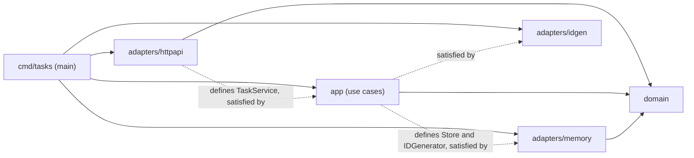

# 04. Clean architecture in Go: packages, interfaces at the consumer, dependency direction

> **Draft: written but not yet run.** The code and the expected output in this lesson were prepared by reading the code and the official documentation. They have not been executed yet. If something does not behave as described, trust your tool's real output and report it.

## What you will be able to do
By the end of this lesson you will be able to:
- lay out a Go service in packages whose imports point in one direction, from the outside in;
- define an interface **at the consumer** and explain why Go makes that the natural place;
- test a use case with a hand-written fake, and enforce the dependency rules with a test;
- say when this structure is too much, and write the decision as an ADR.

## Recap
1. What makes a type satisfy an interface in Go? <details><summary>Answer</summary>Having the methods. There is no `implements` keyword (101 lesson 11).</details>
2. What is the difference between `errors.Is` and `==` for an error that was wrapped with `%w`? <details><summary>Answer</summary>`errors.Is` looks through the chain of wrapped errors; `==` compares only the outermost value.</details>
3. From lesson 03: what do you do before optimising a function? <details><summary>Answer</summary>Write a test that pins the behaviour, benchmark, and profile it.</details>

## Why it matters
A restaurant has a recipe book (the rules), a kitchen (the procedure for turning an order into a dish) and a dining room with waiters (the way customers talk to the kitchen). You can repaint the dining room, change the menu card or switch from paper orders to a tablet without rewriting the recipes. Software has the same three layers, and the whole value of "clean" or "hexagonal" architecture is one rule: **the recipe book must not know the dining room exists.** In practice that means your business rules compile and are tested without HTTP, a database or a logger, and swapping Postgres for a fake in a test is a one-line change.

## What you will build
A small task API (create a task, get it, complete it) in four layers:

```text
l04/
  go.mod
  cmd/tasks/main.go                         composition root: wires the concrete types
  internal/
    domain/task.go                          entity and rules; imports only the standard library
    app/service.go                          use cases; defines the interfaces it needs
    app/service_test.go                     tests with hand-written fakes
    adapters/memory/store.go                an in-memory store
    adapters/idgen/sequential.go            an ID generator
    adapters/httpapi/handler.go             HTTP routes, JSON, error mapping
    adapters/httpapi/handler_test.go        handler tests with a fake service
    archtest/archtest_test.go               a test that fails when an import rule is broken
  requests/create.json, requests/empty.json request bodies for curl
```

Solid arrows are imports: they all point toward `domain`. Dotted arrows are interfaces: they are *defined* by the consumer and *satisfied* by the adapter **without the adapter importing the consumer**.

## Before you start
- Lessons 01 to 03. Go 1.26.0 or newer. `curl` (on Windows use `curl.exe`; plain `curl` in Windows PowerShell 5.1 is an alias of `Invoke-WebRequest`).
- Time: 80 minutes; two sittings, break after Step 7.
- Source pack (optional): every file is shown in full in this lesson, so you can follow without it. The finished code, the exercise starter and the solution are in the
  course repository https://github.com/Uee03/Code101 under `source/go/301-super-hero-to-legendary/phase-2-architecture-and-services/04-clean-architecture/` (on that page choose **Code, Download ZIP**, or run
  `git clone https://github.com/Uee03/Code101.git`).
- [How every lesson works](../../README.md#how-every-lesson-works) explains folders, saving and running.
- No dependencies, so there is no `go.sum`.
- The capstone applies the same layering to a large API; see the [backend-go TDD](../../../../capstones/backend-go/TDD.md) section on the internal packages.

## Steps

### Step 1. Folders and module
**File: terminal (not a saved file)**
```powershell
$root = "$HOME/code101/go301/lesson04"
foreach ($d in "cmd/tasks","internal/domain","internal/app","internal/adapters/memory","internal/adapters/idgen","internal/adapters/httpapi","internal/archtest","requests") {
  New-Item -ItemType Directory -Force "$root/$d" | Out-Null
}
Set-Location $root
```
```bash
mkdir -p ~/code101/go301/lesson04/{cmd/tasks,internal/{domain,app,archtest},internal/adapters/{memory,idgen,httpapi},requests}
cd ~/code101/go301/lesson04
```
Open this folder in VS Code. Recovery: `Set-Location "$HOME/code101/go301/lesson04"` or `cd ~/code101/go301/lesson04`.

**File: `go.mod`**
```text
module example.com/code101/go301/l04

go 1.26.0
```

### Step 2. The domain: rules with no dependencies
**File: `internal/domain/task.go`**
```go
package domain

import (
	"errors"
	"strings"
	"unicode/utf8"
)

const MaxTitleLength = 120

var (
	ErrEmptyTitle   = errors.New("title must not be empty")
	ErrTitleTooLong = errors.New("title must be at most 120 characters")
	ErrNotFound     = errors.New("task not found")
)

// Task is the core business entity. It knows its own rules and nothing about
// HTTP, JSON, databases or logging.
type Task struct {
	ID    string
	Title string
	Done  bool
}

// NewTask validates the title and returns a task without an ID; the use case
// assigns the ID.
func NewTask(title string) (Task, error) {
	title = strings.TrimSpace(title)
	if title == "" {
		return Task{}, ErrEmptyTitle
	}
	if utf8.RuneCountInString(title) > MaxTitleLength {
		return Task{}, ErrTitleTooLong
	}
	return Task{Title: title}, nil
}

// Completed returns a copy of the task marked as done.
func (t Task) Completed() Task {
	t.Done = true
	return t
}
```
- The package imports `errors`, `strings` and `unicode/utf8` and nothing else. No struct tags, no `json`, no SQL: how a task is **stored** or **shown** is not the domain's business.
- The errors are **sentinel values** the outer layers can test with `errors.Is`. The domain decides what "empty title" means; the HTTP layer decides it is a 400.
- `Completed` has a value receiver and returns a copy: the domain stays free of aliasing surprises.

### Step 3. The use cases, and the interfaces they need
**File: `internal/app/service.go`**
```go
package app

import (
	"context"
	"fmt"

	"example.com/code101/go301/l04/internal/domain"
)

// Store is what the use cases need from persistence. The interface lives here,
// with its consumer, and lists only the methods the consumer calls.
type Store interface {
	Save(ctx context.Context, t domain.Task) error
	Get(ctx context.Context, id string) (domain.Task, error)
}

// IDGenerator is what the use cases need to name new tasks.
type IDGenerator interface {
	NewID() string
}

// Service holds the application's use cases.
type Service struct {
	store Store
	ids   IDGenerator
}

func NewService(store Store, ids IDGenerator) *Service {
	return &Service{store: store, ids: ids}
}

func (s *Service) Create(ctx context.Context, title string) (domain.Task, error) {
	t, err := domain.NewTask(title)
	if err != nil {
		return domain.Task{}, err
	}
	t.ID = s.ids.NewID()
	if err := s.store.Save(ctx, t); err != nil {
		return domain.Task{}, fmt.Errorf("save task: %w", err)
	}
	return t, nil
}

func (s *Service) Get(ctx context.Context, id string) (domain.Task, error) {
	t, err := s.store.Get(ctx, id)
	if err != nil {
		return domain.Task{}, fmt.Errorf("get task %q: %w", id, err)
	}
	return t, nil
}

func (s *Service) Complete(ctx context.Context, id string) (domain.Task, error) {
	t, err := s.Get(ctx, id)
	if err != nil {
		return domain.Task{}, err
	}
	t = t.Completed()
	if err := s.store.Save(ctx, t); err != nil {
		return domain.Task{}, fmt.Errorf("save task: %w", err)
	}
	return t, nil
}
```
This is the heart of the lesson. Read the two interfaces:
- They are **declared in the package that uses them**, not in the package that implements them. In Java or C# habit you would write `interface ITaskRepository` next to the Postgres code. In Go the consumer says "I need something with `Save` and `Get`", and any type with those methods qualifies. The implementer never imports `app`.
- They are **small**: the methods this one consumer calls, not everything a store could do. A bigger interface is a bigger promise every fake must keep. Go proverb: *the bigger the interface, the weaker the abstraction.*
- Context is the first parameter of anything that may block, so deadlines and cancellation (lesson 06) reach the store.
- Errors are **wrapped with `%w`**, adding context but keeping the cause, so `errors.Is(err, domain.ErrNotFound)` still works three layers up.
- `Complete` calls `s.Get`, which wraps with the id. The error then reads, for example, `get task "t-9": task not found`.

### Step 4. Tests for the use cases, with fakes you write by hand
**File: `internal/app/service_test.go`**
```go
package app

import (
	"context"
	"errors"
	"testing"

	"example.com/code101/go301/l04/internal/domain"
)

// fakeStore and fixedID are test doubles. They satisfy the interfaces in
// service.go without importing any real adapter.
type fakeStore struct {
	tasks   map[string]domain.Task
	saveErr error
}

func (f *fakeStore) Save(_ context.Context, t domain.Task) error {
	if f.saveErr != nil {
		return f.saveErr
	}
	f.tasks[t.ID] = t
	return nil
}

func (f *fakeStore) Get(_ context.Context, id string) (domain.Task, error) {
	t, ok := f.tasks[id]
	if !ok {
		return domain.Task{}, domain.ErrNotFound
	}
	return t, nil
}

type fixedID string

func (f fixedID) NewID() string { return string(f) }

func TestCreateTrimsTitleAndAssignsID(t *testing.T) {
	store := &fakeStore{tasks: map[string]domain.Task{}}
	svc := NewService(store, fixedID("t-9"))

	got, err := svc.Create(context.Background(), "  write tests  ")
	if err != nil {
		t.Fatal(err)
	}
	if got.ID != "t-9" || got.Title != "write tests" || got.Done {
		t.Fatalf("unexpected task %+v", got)
	}
	if _, ok := store.tasks["t-9"]; !ok {
		t.Fatal("task was not saved")
	}
}

func TestCreateRejectsEmptyTitleWithoutSaving(t *testing.T) {
	store := &fakeStore{tasks: map[string]domain.Task{}}
	svc := NewService(store, fixedID("t-1"))

	_, err := svc.Create(context.Background(), "   ")
	if !errors.Is(err, domain.ErrEmptyTitle) {
		t.Fatalf("err = %v, want ErrEmptyTitle", err)
	}
	if len(store.tasks) != 0 {
		t.Fatal("an invalid task must not be saved")
	}
}

func TestCompleteMissingTaskIsNotFound(t *testing.T) {
	svc := NewService(&fakeStore{tasks: map[string]domain.Task{}}, fixedID("t-1"))

	_, err := svc.Complete(context.Background(), "nope")
	if !errors.Is(err, domain.ErrNotFound) {
		t.Fatalf("err = %v, want ErrNotFound", err)
	}
}

func TestStoreFailureIsWrappedNotReplaced(t *testing.T) {
	boom := errors.New("disk full")
	svc := NewService(&fakeStore{tasks: map[string]domain.Task{}, saveErr: boom}, fixedID("t-1"))

	_, err := svc.Create(context.Background(), "x")
	if !errors.Is(err, boom) {
		t.Fatalf("err = %v, want it to wrap %v", err, boom)
	}
}
```
No mocking library: a fake is 10 lines, and you can read it. These tests run in microseconds because no network, disk or HTTP is involved, which is the practical payoff of the architecture.

### Step 5. The adapters: memory store and ID generator
**File: `internal/adapters/memory/store.go`**
```go
package memory

import (
	"context"
	"sync"

	"example.com/code101/go301/l04/internal/domain"
)

// Store keeps tasks in a map. It satisfies app.Store without importing the
// app package: Go interfaces are satisfied implicitly.
type Store struct {
	mu    sync.RWMutex
	tasks map[string]domain.Task
}

func NewStore() *Store {
	return &Store{tasks: make(map[string]domain.Task)}
}

func (s *Store) Save(_ context.Context, t domain.Task) error {
	s.mu.Lock()
	defer s.mu.Unlock()
	s.tasks[t.ID] = t
	return nil
}

func (s *Store) Get(_ context.Context, id string) (domain.Task, error) {
	s.mu.RLock()
	defer s.mu.RUnlock()
	t, ok := s.tasks[id]
	if !ok {
		return domain.Task{}, domain.ErrNotFound
	}
	return t, nil
}
```
**File: `internal/adapters/idgen/sequential.go`**
```go
package idgen

import (
	"strconv"
	"sync/atomic"
)

// Sequential hands out t-1, t-2, ... It is safe for concurrent use.
type Sequential struct {
	n atomic.Int64
}

func (s *Sequential) NewID() string {
	return "t-" + strconv.FormatInt(s.n.Add(1), 10)
}
```
The map is protected by an `RWMutex` because HTTP handlers run on many goroutines (lesson 02). The store returns `domain.ErrNotFound`: a real Postgres adapter would translate its own "no rows" error into the same sentinel, so the layers above never learn which database you use.

### Step 6. The HTTP adapter
**File: `internal/adapters/httpapi/handler.go`**
```go
package httpapi

import (
	"context"
	"encoding/json"
	"errors"
	"log/slog"
	"net/http"

	"example.com/code101/go301/l04/internal/domain"
)

// TaskService is what the HTTP layer needs from the application. It is
// defined here, at the consumer, so tests can pass a fake.
type TaskService interface {
	Create(ctx context.Context, title string) (domain.Task, error)
	Get(ctx context.Context, id string) (domain.Task, error)
	Complete(ctx context.Context, id string) (domain.Task, error)
}

// taskJSON is the wire format. It is a separate type from domain.Task so the
// API can change without touching the domain, and the other way round.
type taskJSON struct {
	ID    string `json:"id"`
	Title string `json:"title"`
	Done  bool   `json:"done"`
}

type createRequest struct {
	Title string `json:"title"`
}

type handler struct {
	svc TaskService
	log *slog.Logger
}

// New returns the router for the task API.
func New(svc TaskService, log *slog.Logger) http.Handler {
	h := &handler{svc: svc, log: log}
	mux := http.NewServeMux()
	mux.HandleFunc("POST /tasks", h.create)
	mux.HandleFunc("GET /tasks/{id}", h.get)
	mux.HandleFunc("POST /tasks/{id}/complete", h.complete)
	return mux
}

func (h *handler) create(w http.ResponseWriter, r *http.Request) {
	r.Body = http.MaxBytesReader(w, r.Body, 1<<20)
	dec := json.NewDecoder(r.Body)
	dec.DisallowUnknownFields()

	var req createRequest
	if err := dec.Decode(&req); err != nil {
		h.writeJSON(w, r, http.StatusBadRequest, map[string]string{"error": "body must be a JSON object with a title"})
		return
	}
	t, err := h.svc.Create(r.Context(), req.Title)
	if err != nil {
		h.fail(w, r, err)
		return
	}
	h.writeJSON(w, r, http.StatusCreated, toJSON(t))
}

func (h *handler) get(w http.ResponseWriter, r *http.Request) {
	t, err := h.svc.Get(r.Context(), r.PathValue("id"))
	if err != nil {
		h.fail(w, r, err)
		return
	}
	h.writeJSON(w, r, http.StatusOK, toJSON(t))
}

func (h *handler) complete(w http.ResponseWriter, r *http.Request) {
	t, err := h.svc.Complete(r.Context(), r.PathValue("id"))
	if err != nil {
		h.fail(w, r, err)
		return
	}
	h.writeJSON(w, r, http.StatusOK, toJSON(t))
}

// fail maps errors to responses in one place. Domain errors are safe to show;
// anything else is logged in full and answered with a generic message.
func (h *handler) fail(w http.ResponseWriter, r *http.Request, err error) {
	switch {
	case errors.Is(err, domain.ErrEmptyTitle), errors.Is(err, domain.ErrTitleTooLong):
		h.writeJSON(w, r, http.StatusBadRequest, map[string]string{"error": err.Error()})
	case errors.Is(err, domain.ErrNotFound):
		h.writeJSON(w, r, http.StatusNotFound, map[string]string{"error": "task not found"})
	default:
		h.log.ErrorContext(r.Context(), "request failed", "method", r.Method, "path", r.URL.Path, "error", err)
		h.writeJSON(w, r, http.StatusInternalServerError, map[string]string{"error": "internal error"})
	}
}

func (h *handler) writeJSON(w http.ResponseWriter, r *http.Request, status int, v any) {
	w.Header().Set("Content-Type", "application/json")
	w.WriteHeader(status)
	if err := json.NewEncoder(w).Encode(v); err != nil {
		h.log.ErrorContext(r.Context(), "write response", "error", err)
	}
}

func toJSON(t domain.Task) taskJSON {
	return taskJSON{ID: t.ID, Title: t.Title, Done: t.Done}
}
```
- The route patterns (`"POST /tasks"`, `"GET /tasks/{id}"`) and `r.PathValue` are the standard library router (Go 1.22 and newer): no framework is needed for this.
- `http.MaxBytesReader` caps the request body at 1 MiB, and `DisallowUnknownFields` rejects fields the API does not define, which catches client typos early.
- The single `fail` function is the one place that decides **what the client may see**. An unexpected error is logged with detail and answered with the generic `internal error`: error strings can contain table names, paths or secrets.
- `taskJSON` duplicates three fields of `domain.Task` on purpose. A change of the public API (renaming `title`) then cannot silently change the domain, and a change of the domain cannot silently change the API.

**File: `internal/adapters/httpapi/handler_test.go`**
```go
package httpapi

import (
	"context"
	"errors"
	"log/slog"
	"net/http"
	"net/http/httptest"
	"strings"
	"testing"

	"example.com/code101/go301/l04/internal/domain"
)

// fakeService returns the same task and error for every call.
type fakeService struct {
	task domain.Task
	err  error
}

func (f fakeService) Create(context.Context, string) (domain.Task, error) {
	return f.task, f.err
}

func (f fakeService) Get(context.Context, string) (domain.Task, error) {
	return f.task, f.err
}

func (f fakeService) Complete(context.Context, string) (domain.Task, error) {
	return f.task, f.err
}

func do(svc TaskService, method, target, body string) *httptest.ResponseRecorder {
	h := New(svc, slog.New(slog.DiscardHandler))
	req := httptest.NewRequest(method, target, strings.NewReader(body))
	rec := httptest.NewRecorder()
	h.ServeHTTP(rec, req)
	return rec
}

func TestErrorsMapToStatusCodes(t *testing.T) {
	cases := []struct {
		name string
		err  error
		want int
	}{
		{"empty title", domain.ErrEmptyTitle, http.StatusBadRequest},
		{"not found", domain.ErrNotFound, http.StatusNotFound},
		{"unexpected", errors.New("db password is hunter2"), http.StatusInternalServerError},
	}
	for _, tc := range cases {
		t.Run(tc.name, func(t *testing.T) {
			rec := do(fakeService{err: tc.err}, http.MethodPost, "/tasks", `{"title":"x"}`)
			if rec.Code != tc.want {
				t.Fatalf("status = %d, want %d", rec.Code, tc.want)
			}
			if strings.Contains(rec.Body.String(), "hunter2") {
				t.Fatalf("internal error text leaked to the client: %s", rec.Body.String())
			}
		})
	}
}

func TestCreateReturnsCreatedJSON(t *testing.T) {
	svc := fakeService{task: domain.Task{ID: "t-1", Title: "write", Done: false}}
	rec := do(svc, http.MethodPost, "/tasks", `{"title":"write"}`)

	if rec.Code != http.StatusCreated {
		t.Fatalf("status = %d, want 201", rec.Code)
	}
	want := `{"id":"t-1","title":"write","done":false}` + "\n"
	if rec.Body.String() != want {
		t.Fatalf("body = %q, want %q", rec.Body.String(), want)
	}
}

func TestCreateRejectsUnknownFields(t *testing.T) {
	rec := do(fakeService{}, http.MethodPost, "/tasks", `{"title":"x","admin":true}`)
	if rec.Code != http.StatusBadRequest {
		t.Fatalf("status = %d, want 400", rec.Code)
	}
}
```
The "unexpected" case asserts that an internal error message (here a fake password) is **not** in the response body: a security property tested as a behaviour.

### Step 7. A test that guards the architecture
Layering rules rot silently: one convenient import and the domain depends on `net/http`. A tiny test turns the rule into a failing build. It parses only the import lines of each package (`parser.ImportsOnly`) and compares them with a table.

**File: `internal/archtest/archtest_test.go`**
```go
package archtest

import (
	"go/parser"
	"go/token"
	"path/filepath"
	"strings"
	"testing"
)

// rules lists, for each package directory, import paths it must never use.
// A rule is a substring match on the import path.
var rules = []struct {
	dir       string
	forbidden []string
}{
	{"../domain", []string{"/internal/", "net/http", "database/sql", "encoding/json"}},
	{"../app", []string{"/adapters/", "net/http", "database/sql", "encoding/json"}},
	{"../adapters/memory", []string{"/adapters/httpapi", "/internal/app", "net/http"}},
	{"../adapters/httpapi", []string{"/adapters/memory", "/adapters/idgen"}},
}

func TestDependencyRules(t *testing.T) {
	fset := token.NewFileSet()
	for _, rule := range rules {
		files, err := filepath.Glob(filepath.Join(rule.dir, "*.go"))
		if err != nil || len(files) == 0 {
			t.Fatalf("%s: no Go files found (err = %v)", rule.dir, err)
		}
		for _, name := range files {
			if strings.HasSuffix(name, "_test.go") {
				continue
			}
			f, err := parser.ParseFile(fset, name, nil, parser.ImportsOnly)
			if err != nil {
				t.Fatal(err)
			}
			for _, imp := range f.Imports {
				path := strings.Trim(imp.Path.Value, `"`)
				for _, bad := range rule.forbidden {
					if strings.Contains(path, bad) {
						t.Errorf("%s imports %q, which breaks the rule against %q", name, path, bad)
					}
				}
			}
		}
	}
}
```
(Teams with many packages use a tool such as `go-arch-lint` or `depguard`; a 40-line test is enough to start and has no dependencies.)

### Step 8. The composition root
**File: `cmd/tasks/main.go`**
```go
package main

import (
	"context"
	"errors"
	"log/slog"
	"net/http"
	"os"
	"os/signal"
	"syscall"
	"time"

	"example.com/code101/go301/l04/internal/adapters/httpapi"
	"example.com/code101/go301/l04/internal/adapters/idgen"
	"example.com/code101/go301/l04/internal/adapters/memory"
	"example.com/code101/go301/l04/internal/app"
)

func main() {
	log := slog.New(slog.NewTextHandler(os.Stderr, nil))
	if err := run(log); err != nil {
		log.Error("server stopped", "error", err)
		os.Exit(1)
	}
}

// run is the composition root: the only place that knows every concrete type.
func run(log *slog.Logger) error {
	addr := os.Getenv("ADDR")
	if addr == "" {
		addr = "127.0.0.1:8080"
	}

	service := app.NewService(memory.NewStore(), &idgen.Sequential{})
	srv := &http.Server{
		Addr:              addr,
		Handler:           httpapi.New(service, log),
		ReadHeaderTimeout: 5 * time.Second,
		ReadTimeout:       10 * time.Second,
		WriteTimeout:      10 * time.Second,
		IdleTimeout:       time.Minute,
	}

	ctx, stop := signal.NotifyContext(context.Background(), os.Interrupt, syscall.SIGTERM)
	defer stop()

	errCh := make(chan error, 1)
	go func() { errCh <- srv.ListenAndServe() }()
	log.Info("listening", "addr", addr)

	select {
	case err := <-errCh:
		return err
	case <-ctx.Done():
	}

	shutdownCtx, cancel := context.WithTimeout(context.Background(), 10*time.Second)
	defer cancel()
	if err := srv.Shutdown(shutdownCtx); err != nil {
		return err
	}
	if err := <-errCh; err != nil && !errors.Is(err, http.ErrServerClosed) {
		return err
	}
	return nil
}
```
- `main` only creates the logger and calls `run`; `run` returns errors instead of calling `os.Exit` in the middle, so deferred cleanups run.
- **This is the only file that imports every layer.** The composition root is where the dependency graph is *assembled*; nowhere else uses `memory.NewStore` or `idgen.Sequential`.
- The server sets all four timeouts. `http.ListenAndServe` with no timeouts is the default in many tutorials, and a client that opens a connection and sends nothing can then hold it forever (slow-client attacks).
- `ctx.Done()` triggers `Shutdown`, which stops accepting connections and waits (up to 10 seconds) for in-flight requests: graceful shutdown.
- Binding to `127.0.0.1` by default means the lesson server is not reachable from other machines. Set `ADDR=0.0.0.0:8080` deliberately when you containerise (lesson 09).

**File: `requests/create.json`**
```json
{"title": "write the lesson"}
```
**File: `requests/empty.json`**
```json
{"title": "   "}
```

### Step 9. Predict, then run
**Predict before you run:** after the first `POST /tasks`, what `id` does the response contain? What happens to the id counter when a create request fails validation?

## Run it
**File: terminal (not a saved file)**
```text
go test ./...
```
Expected: three `ok` lines (for `internal/app`, `internal/adapters/httpapi` and `internal/archtest`) and `no test files` for the other packages, with durations that differ on your machine.

Start the server in one terminal:

**File: terminal (not a saved file)**
```text
go run ./cmd/tasks
```
It logs one line on standard error like `time=... level=INFO msg=listening addr=127.0.0.1:8080` (the timestamp differs). In a second terminal, in the same folder:

**File: terminal (not a saved file)**
```text
curl.exe -s -w "%{http_code}\n" -X POST -H "Content-Type: application/json" --data-binary "@requests/create.json" http://127.0.0.1:8080/tasks
curl.exe -s -w "%{http_code}\n" http://127.0.0.1:8080/tasks/t-1
curl.exe -s -w "%{http_code}\n" -X POST http://127.0.0.1:8080/tasks/t-1/complete
curl.exe -s -w "%{http_code}\n" -X POST -H "Content-Type: application/json" --data-binary "@requests/empty.json" http://127.0.0.1:8080/tasks
curl.exe -s -w "%{http_code}\n" http://127.0.0.1:8080/tasks/t-99
```
On macOS and Linux use `curl` instead of `curl.exe`. Expected output (derived by reading the code; not yet run):
```text
{"id":"t-1","title":"write the lesson","done":false}
201
{"id":"t-1","title":"write the lesson","done":false}
200
{"id":"t-1","title":"write the lesson","done":true}
200
{"error":"title must not be empty"}
400
{"error":"task not found"}
404
```
Stop the server with Ctrl+C in its terminal; it logs nothing more and returns to the prompt after in-flight requests finish.

The answer to the prediction: the first id is `t-1`; a rejected create fails in `domain.NewTask` **before** `NewID` is called, so the counter does not move.

## How it works
- **Direction of dependencies.** Imports point inward: adapters know the domain, the use cases know the domain, the domain knows nothing. Interfaces invert the remaining arrow: `app` needs a store, so it declares one, and `memory` satisfies it. This is the "dependency inversion" of the SOLID principles, done without a framework.
- **Interfaces at the consumer.** Because Go interfaces are satisfied implicitly, the *user* of a capability can describe exactly what it needs. This is why Go code rarely has a `repository` package full of interfaces next to the implementation; the Go Code Review Comments say interfaces generally belong in the package that uses them, not in the package that implements them.
- **Accept interfaces, return structs.** `NewService` takes interfaces and returns `*Service`, a concrete type. Callers get everything the type offers; tests can still substitute the inputs.
- **`internal/`** is enforced by the compiler: packages under `internal` can be imported only from the parent of `internal` (here, anywhere inside the module). That makes it safe to refactor them without breaking outside importers.
- **Misconception to correct:** "clean architecture means one folder per layer and an interface for everything." It means *the dependency rule*. A package with one implementation and no second consumer does not need an interface yet: add it when a test, or a second implementation, needs it.

## Decision record (ADR style)
**ADR-04: package layout for the tasks service.**
- Context: a new service with three use cases, one HTTP adapter, a store that will change from memory to Postgres, a team of five.
- Options: (1) everything in `package main`; (2) layers by role as above (`domain`, `app`, `adapters`); (3) by feature (`tasks/`, `users/`) with each feature containing its own layers; (4) the "standard project layout" with `pkg/`, `api/`, `build/`.
- Decision: (2) while the service has one bounded context; move to (3) when a second context appears. Avoid `pkg/` and avoid packages named `utils`, `common`, `models` or `helpers`.
- Consequences: the domain is testable alone; there is a small amount of mapping code (domain to JSON); an architecture test guards the imports. Revisit when `app` grows past about a dozen use cases or when two teams edit it.
- The "standard project layout" repository that suggests `pkg/` and `api/` folders is a community convention, not an official Go team standard; the official guidance for server projects is in *Organizing a Go module* (see Going further).

**When not to use this structure**
- A 200-line tool, a one-off migration or a script: use one package. Layers add files and mapping code and give nothing back.
- A pure CRUD service with no rules: the domain layer will be empty; a thin handler over a store may be the honest design. Add layers when rules appear.
- A team that cannot yet explain *why* each arrow points the way it does: the folder names will be copied and the rule ignored. Teach the rule first.

## Failure modes
| Failure | Symptom | Prevention |
|---|---|---|
| Interface defined next to the implementation | the consumer imports the adapter package; tests need a real database | define the interface where it is used |
| Giant interface (10 methods) | every fake is 10 methods; changes ripple | one interface per consumer, only the methods it calls |
| Domain structs carry `json` and `db` tags | API and storage changes break the domain | separate wire and storage types, map at the edge |
| Leaking internal errors to clients | table names or paths in HTTP responses | one `fail` function; generic message for unknown errors |
| Import cycles (`import cycle not allowed`) | compile error when two packages need each other | move the shared type down to `domain`, or define an interface at the consumer |
| Layers copied without the rule | `domain` imports `net/http` after a "quick fix" | the architecture test in CI |
| Mapping code drift | a field added to the domain but never to the JSON | handler tests that compare whole response bodies |

## Measurements to take
1. **Test time of the use-case package** (it should be milliseconds): `go test ./internal/app -count=1`. When it is slow, something real (disk, network, sleep) has leaked into the use cases.
2. **Import graph**: `go list -f '{{.ImportPath}}: {{join .Imports " "}}' ./...` and check that arrows point inward. Re-run it in code review for any new package.
3. **Mapping cost**: the number of lines of mapping code per field of the domain. If most of your lines are mapping, you may have layered a CRUD service that needed no layers.
4. **Change radius**: how many packages you touch to add one field or one use case. A good layout keeps it to two or three.

## Production checklist
- [ ] Packages follow one rule for dependency direction, and a test or linter enforces it.
- [ ] Interfaces are declared by consumers and are small.
- [ ] Wire types, domain types and storage types are separate where the three can change independently.
- [ ] All errors are wrapped with `%w` and mapped to responses in a single place; clients never see raw internal errors.
- [ ] `http.Server` has read-header, read, write and idle timeouts and a graceful shutdown.
- [ ] `main` only wires; no business rule lives in `cmd/`.

## Try it
Copy `exercise/starter` next to your lesson folder and rename the copy `try04`. It already runs, but one dependency points the wrong way.

**File: `exercise/starter/app/billing.go`**
```go
package app

import (
	"fmt"

	"example.com/code101/go301/l04/try/adapters/smtp"
	"example.com/code101/go301/l04/try/domain"
)

// TODO: the dependency points the wrong way. app imports the concrete smtp
// adapter. Define a small interface here, at the consumer, with only the method
// Billing calls; make the field and NewBilling use it; delete the smtp import.
type Billing struct {
	mailer smtp.Client
}

func NewBilling(mailer smtp.Client) *Billing {
	return &Billing{mailer: mailer}
}

func (b *Billing) Send(inv domain.Invoice) error {
	subject := fmt.Sprintf("Invoice %d", inv.ID)
	body := fmt.Sprintf("Amount due: %d cents", inv.Cents)
	return b.mailer.Send(inv.Email, subject, body)
}
```
The other starter files are `domain/invoice.go` (an `Invoice` struct with `ID`, `Email`, `Cents`), `adapters/smtp/smtp.go` (a `Client` whose `Send` prints the message) and `main.go` (builds `app.NewBilling(smtp.Client{})` and sends invoice 7 to `ada@example.com` for 1250 cents). Run `go run .` first to see the starting behaviour.
1. **Guided.** Fix the TODO. Goal: the program prints exactly what it printed before the change, and `app` no longer imports `adapters/smtp`. Check with `go list -f '{{join .Imports " "}}' ./app`.
2. **Change.** Add `app/billing_test.go` with a hand-written recording fake of your new interface, and assert the subject is `Invoice 7`. The test must not import `adapters/smtp`.
3. **Stretch (no single answer).** Billing now needs to send an SMS as well as an email. Would you add a method to the interface, add a second interface, or add a separate use case? Write three sentences with your reasoning and the trade-off.

<details><summary>Solution</summary>

**File: `exercise/solution/app/billing.go`**
```go
package app

import (
	"fmt"

	"example.com/code101/go301/l04/try/domain"
)

// Mailer is defined where it is used and lists only what Billing calls.
type Mailer interface {
	Send(to, subject, body string) error
}

type Billing struct {
	mailer Mailer
}

func NewBilling(mailer Mailer) *Billing {
	return &Billing{mailer: mailer}
}

func (b *Billing) Send(inv domain.Invoice) error {
	subject := fmt.Sprintf("Invoice %d", inv.ID)
	body := fmt.Sprintf("Amount due: %d cents", inv.Cents)
	return b.mailer.Send(inv.Email, subject, body)
}
```
`main.go` is unchanged: `smtp.Client` already has a `Send(to, subject, body string) error` method, so it satisfies `Mailer` with no edit. Expected output of `go run .` (the same before and after):
```text
fake smtp: to=ada@example.com subject="Invoice 7" body="Amount due: 1250 cents"
sent invoice 7
```
For rung 3, a reasonable answer is a **second small interface** (`Texter`) if some callers need only one channel, because adding a method to `Mailer` forces every fake and implementation to change and couples two unrelated capabilities. A single `Notifier` interface is better if every caller always needs both.
</details>

## Check yourself
1. Which package defines `Store`, and why is that the right place? <details><summary>Answer</summary>`app`, the consumer. The implementation then has no import of `app`, and `app` can be tested with a fake without any adapter.</details>
2. Predict: what status and body does `GET /tasks/t-99` return, and which layer decides the status? <details><summary>Answer</summary>`404` with `{"error":"task not found"}`. The store returns `domain.ErrNotFound`, `app` wraps it, the HTTP adapter's `fail` maps it.</details>
3. A teammate adds `import "net/http"` to `domain/task.go` to use `http.StatusBadRequest`. What happens, and why is it wrong even though it compiles? <details><summary>Answer</summary>The architecture test fails. It is wrong because the domain would now depend on a delivery mechanism, so it can no longer be reused or tested without it.</details>
4. Why is `taskJSON` a separate type from `domain.Task`? <details><summary>Answer</summary>So the public API and the domain can change independently; it also keeps tags and wire names out of the domain.</details>

## Common mistakes
| Symptom or error text | Cause | Fix |
|---|---|---|
| `import cycle not allowed` (typical message) | two packages import each other | move the shared type into `domain`, or define the interface at the consumer |
| `use of internal package ... not allowed` (typical message) | importing `internal/...` from outside the module | keep the importer inside the same module root |
| `curl: (7) Failed to connect to 127.0.0.1 port 8080` (typical message) | the server is not running, or `ADDR` points elsewhere | start `go run ./cmd/tasks` in another terminal |
| `bind: address already in use` (typical message) | port 8080 taken | `ADDR=127.0.0.1:8090` (PowerShell: `$env:ADDR = "127.0.0.1:8090"`) |
| `405 Method Not Allowed` | wrong HTTP method for the route | use `-X POST` for create and complete |
| `400` and `body must be a JSON object with a title` | JSON unreadable, or an unknown field | send valid JSON with only `title` |
| In PowerShell, curl prints a long object | the `curl` alias of `Invoke-WebRequest` | type `curl.exe` |
| Test `TestDependencyRules` says `no Go files found` | test run from a different folder layout | run `go test ./...` from the module root |

## Best practice
Define interfaces in the package that consumes them, keep them small, and return concrete types from constructors. Source: Go Code Review Comments (Interfaces) https://go.dev/wiki/CodeReviewComments#interfaces and the Google Go Style Guide, Style Decisions https://google.github.io/styleguide/go/decisions

## Going further
- Organizing a Go module: https://go.dev/doc/modules/layout
- Effective Go, interfaces: https://go.dev/doc/effective_go#interfaces
- Google Go Style Guide: https://google.github.io/styleguide/go/
- The capstone's layering, in full: [Go backend capstone TDD](../../../../capstones/backend-go/TDD.md) and chapter [01 the skeleton](../../../../capstones/backend-go/tutorials/phase-1-skeleton/01-skeleton.md).

## Summary
- You built four layers whose imports all point toward the domain.
- You declared interfaces at their consumers and tested use cases and handlers with hand-written fakes.
- You turned the dependency rule into a failing test.
- You can say when to skip the layers and you recorded the layout as ADR-04.

## Next lesson
05. gRPC services: define a service in protobuf, generate code with `buf`, and implement unary and streaming calls.
