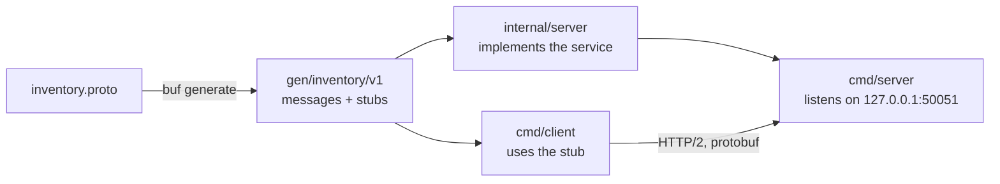

# 05. gRPC services: protobuf, unary and streaming calls, buf

> **Draft: written but not yet run.** The code and the expected output in this lesson were prepared by reading the code and the official documentation. They have not been executed yet. If something does not behave as described, trust your tool's real output and report it.

## What you will be able to do
By the end of this lesson you will be able to:
- write a `.proto` file for a service with unary, server-streaming, client-streaming and bidirectional calls, and lint it with `buf`;
- generate Go code with `buf generate` and implement the server and a client with deadlines and status codes;
- test a gRPC server in memory with `bufconn`;
- state the schema-evolution rules that keep old clients working, and decide when gRPC is the wrong tool.

## Recap
1. In lesson 04, which package should define the interface a use case needs? <details><summary>Answer</summary>The consumer of the interface (the use-case package).</details>
2. In lesson 01, what must every blocking operation also listen to? <details><summary>Answer</summary>The context, so that cancellation and deadlines stop it.</details>
3. What does `errors.Is(err, io.EOF)` test? <details><summary>Answer</summary>Whether `io.EOF` is somewhere in the error chain: the normal end of a stream or reader.</details>

## Why it matters
REST over JSON is a letter in plain language: any reader can open it, and writing it takes no special form. gRPC is a **standard shipping container**: the shape is fixed, so cranes (code generators) can load and unload it without a human, it is compact, and both ends agree on the contents before anything is sent. For many internal calls between services this gives you a typed contract, generated clients in many languages, deadlines that cross service boundaries, and streaming. It also gives you costs: a build step, binary payloads you cannot read in a log, and a poor fit for browsers.

## What you will build
An `InventoryService` with one call of each kind, in a module `l05`:

| Kind | RPC | What it does |
|---|---|---|
| Unary | `GetItem` | one request, one answer or a status code |
| Server streaming | `ListItems` | the server sends one message per matching item |
| Client streaming | `UploadStock` | the client sends many stock changes, the server answers once |
| Bidirectional | `CheckStock` | each request gets an answer as it arrives |

You will write the proto, the `buf` configuration, the server, a client, tests that use an in-memory connection, and a health-check service.



## Before you start
- Lessons 01 and 04. Go 1.26.0 or newer.
- Three tools, installed with `go install` (this puts them in `$(go env GOPATH)/bin`, which must be on your `PATH`; open a new terminal after changing `PATH`):

**File: terminal (not a saved file)**
```text
go install github.com/bufbuild/buf/cmd/buf@v1.75.0
go install google.golang.org/protobuf/cmd/protoc-gen-go@v1.36.12
go install google.golang.org/grpc/cmd/protoc-gen-go-grpc@v1.6.2
```
Check with `buf --version`. Pinning exact versions is deliberate: generated code depends on the plugin version, and a different plugin can produce a different file for the same proto (lesson 08 covers pinning tools).
- Time: 90 minutes; break after Step 5.
- Source pack (optional): every file is shown in full in this lesson, so you can follow without it. The finished code, the exercise starter and the solution are in the
  course repository https://github.com/Uee03/Code101 under `source/go/301-super-hero-to-legendary/phase-2-architecture-and-services/05-grpc-services/` (on that page choose **Code, Download ZIP**, or run
  `git clone https://github.com/Uee03/Code101.git`).
- [How every lesson works](../../README.md#how-every-lesson-works) explains folders, saving and running.
- **Generated files are not in the pack.** `gen/inventory/v1/*.pb.go` are created by `buf generate`, and `go.sum` is created by `go mod tidy`; neither can exist before those commands run, so neither is shipped.

## Steps

### Step 1. Folders and `go.mod`
**File: terminal (not a saved file)**
```powershell
$root = "$HOME/code101/go301/lesson05"
foreach ($d in "proto/inventory/v1","internal/server","cmd/server","cmd/client") {
  New-Item -ItemType Directory -Force "$root/$d" | Out-Null
}
Set-Location $root
```
```bash
mkdir -p ~/code101/go301/lesson05/{proto/inventory/v1,internal/server,cmd/server,cmd/client}
cd ~/code101/go301/lesson05
```
Open this folder in VS Code. Recovery: `Set-Location "$HOME/code101/go301/lesson05"` or `cd ~/code101/go301/lesson05`.

**File: `go.mod`**
```text
module example.com/code101/go301/l05

go 1.26.0

require (
	google.golang.org/grpc v1.85.0
	google.golang.org/protobuf v1.36.12
)
```
The `require` block lists the two modules the generated code imports. `go mod tidy` (Step 5) adds the indirect ones and creates `go.sum`.

### Step 2. The contract: `inventory.proto`
**File: `proto/inventory/v1/inventory.proto`**
```proto
syntax = "proto3";

package inventory.v1;

option go_package = "example.com/code101/go301/l05/gen/inventory/v1;inventoryv1";

// InventoryService shows the four kinds of gRPC call on one small domain.
service InventoryService {
  // Unary: one request, one response.
  rpc GetItem(GetItemRequest) returns (GetItemResponse);

  // Server streaming: one request, many responses.
  rpc ListItems(ListItemsRequest) returns (stream ListItemsResponse);

  // Client streaming: many requests, one response.
  rpc UploadStock(stream UploadStockRequest) returns (UploadStockResponse);

  // Bidirectional streaming: both sides send independently.
  rpc CheckStock(stream CheckStockRequest) returns (stream CheckStockResponse);
}

message Item {
  string sku = 1;
  string name = 2;
  int32 quantity = 3;
}

message GetItemRequest {
  string sku = 1;
}

message GetItemResponse {
  Item item = 1;
}

message ListItemsRequest {
  // Only items with at least this quantity are returned. Zero means all.
  int32 min_quantity = 1;
}

message ListItemsResponse {
  Item item = 1;
}

message UploadStockRequest {
  string sku = 1;
  // Positive adds stock, negative removes it.
  int32 delta = 2;
}

message UploadStockResponse {
  int32 updated = 1;
}

message CheckStockRequest {
  string sku = 1;
}

message CheckStockResponse {
  string sku = 1;
  int32 quantity = 2;
  bool found = 3;
}
```
Line by line:
- `syntax = "proto3";` selects the language version; always the first statement.
- `package inventory.v1;` namespaces the messages and becomes part of every RPC's wire name, `/inventory.v1.InventoryService/GetItem`. The **`v1`** suffix is how you ship an incompatible `v2` later next to it.
- `option go_package` tells the Go generator the import path of the generated package and its name after the semicolon (`inventoryv1`). It matches the folder `gen/inventory/v1` inside this module.
- `service` lists the RPCs. The word `stream` before a type marks which side sends many messages.
- Every field has a **number** (`= 1`). The number, not the name, identifies the field on the wire. **Never reuse or renumber a field** that was ever released; to retire one, mark it `reserved` (see "Schema evolution" below).
- Every RPC has its **own request and response messages** (`GetItemRequest`, `GetItemResponse`), even when they are tiny. Later you can add a field to one RPC without touching another. This is also what the `buf lint` rule set expects.
- proto3 has no `required`: every field has a default (empty string, 0, false), so you cannot tell "sent 0" from "not sent" unless you use `optional` or a wrapper. Design so that the default is a safe, meaningful value.

### Step 3. Tool configuration
**File: `buf.yaml`**
```yaml
version: v2
modules:
  - path: proto
lint:
  use:
    - STANDARD
breaking:
  use:
    - FILE
```
- `version: v2` is the current `buf` configuration format.
- `modules` says the proto sources live under `proto/`; file paths and package names are then checked **relative to that folder** (so `inventory/v1/inventory.proto` must declare package `inventory.v1`).
- `lint: use: STANDARD` turns on the standard lint rules: naming, package versioning, request and response naming and more. Removing a rule from the list is allowed; do it deliberately and record why.
- `breaking: use: FILE` makes `buf breaking` flag changes that would break generated code per file (renamed or removed fields, changed types, moved packages).

**File: `buf.gen.yaml`**
```yaml
version: v2
plugins:
  - local: protoc-gen-go
    out: gen
    opt: paths=source_relative
  - local: protoc-gen-go-grpc
    out: gen
    opt: paths=source_relative
```
- Two plugins run: `protoc-gen-go` writes the message types (`inventory.pb.go`); `protoc-gen-go-grpc` writes the service stubs (`inventory_grpc.pb.go`).
- `local:` means "use the executable with this name found on `PATH`", which is why we installed them at an exact version.
- `out: gen` puts the output in `gen/`, and `paths=source_relative` keeps the folder structure of the proto (`gen/inventory/v1/`), which matches `go_package`.
- If you prefer `protoc`, the equivalent is: `protoc --proto_path=proto --go_out=gen --go_opt=paths=source_relative --go-grpc_out=gen --go-grpc_opt=paths=source_relative proto/inventory/v1/inventory.proto` (create the folder `gen` first). `buf` is easier to pin and to run in CI, and adds linting and breaking-change checks.

### Step 4. Lint and generate
**File: terminal (not a saved file)**
```text
buf lint
buf generate
```
Expected: `buf lint` prints nothing when the proto is clean. `buf generate` prints nothing and creates `gen/inventory/v1/inventory.pb.go` and `gen/inventory/v1/inventory_grpc.pb.go`. Open `inventory_grpc.pb.go` and find three things: the interface `InventoryServiceServer` (what you must implement), `UnimplementedInventoryServiceServer` (a struct you embed), and `NewInventoryServiceClient` (the client constructor). **Do not edit generated files**; they start with a `Code generated ... DO NOT EDIT.` line.

### Step 5. The server implementation
**File: `internal/server/server.go`**
```go
package server

import (
	"cmp"
	"context"
	"errors"
	"io"
	"slices"
	"sync"

	"google.golang.org/grpc"
	"google.golang.org/grpc/codes"
	"google.golang.org/grpc/status"

	inventoryv1 "example.com/code101/go301/l05/gen/inventory/v1"
)

type stock struct {
	name     string
	quantity int32
}

// Server implements inventoryv1.InventoryServiceServer. Embedding the
// Unimplemented type by value is required by the generated code: methods
// added to the proto later return codes.Unimplemented instead of breaking the build.
type Server struct {
	inventoryv1.UnimplementedInventoryServiceServer

	mu    sync.RWMutex
	items map[string]stock
}

// New creates a server pre-loaded with items.
func New(seed ...*inventoryv1.Item) *Server {
	s := &Server{items: make(map[string]stock, len(seed))}
	for _, it := range seed {
		s.items[it.GetSku()] = stock{name: it.GetName(), quantity: it.GetQuantity()}
	}
	return s
}

// GetItem is a unary call.
func (s *Server) GetItem(_ context.Context, req *inventoryv1.GetItemRequest) (*inventoryv1.GetItemResponse, error) {
	if req.GetSku() == "" {
		return nil, status.Error(codes.InvalidArgument, "sku is required")
	}
	item, ok := s.lookup(req.GetSku())
	if !ok {
		return nil, status.Errorf(codes.NotFound, "item %q not found", req.GetSku())
	}
	return &inventoryv1.GetItemResponse{Item: item}, nil
}

// ListItems is server streaming: it sends one message per matching item, in
// SKU order, and stops early when the client cancels.
func (s *Server) ListItems(req *inventoryv1.ListItemsRequest, stream grpc.ServerStreamingServer[inventoryv1.ListItemsResponse]) error {
	for _, item := range s.snapshot() {
		if item.GetQuantity() < req.GetMinQuantity() {
			continue
		}
		if err := stream.Context().Err(); err != nil {
			return status.FromContextError(err).Err()
		}
		if err := stream.Send(&inventoryv1.ListItemsResponse{Item: item}); err != nil {
			return err
		}
	}
	return nil
}

// UploadStock is client streaming. Each message is applied as it arrives, so a
// failure half-way leaves the earlier changes in place (not transactional).
func (s *Server) UploadStock(stream grpc.ClientStreamingServer[inventoryv1.UploadStockRequest, inventoryv1.UploadStockResponse]) error {
	var updated int32
	for {
		req, err := stream.Recv()
		if errors.Is(err, io.EOF) {
			return stream.SendAndClose(&inventoryv1.UploadStockResponse{Updated: updated})
		}
		if err != nil {
			return err
		}
		if err := s.adjust(req.GetSku(), req.GetDelta()); err != nil {
			return err
		}
		updated++
	}
}

// CheckStock is bidirectional streaming: it answers each request as it arrives.
func (s *Server) CheckStock(stream grpc.BidiStreamingServer[inventoryv1.CheckStockRequest, inventoryv1.CheckStockResponse]) error {
	for {
		req, err := stream.Recv()
		if errors.Is(err, io.EOF) {
			return nil
		}
		if err != nil {
			return err
		}
		resp := &inventoryv1.CheckStockResponse{Sku: req.GetSku()}
		if item, ok := s.lookup(req.GetSku()); ok {
			resp.Quantity = item.GetQuantity()
			resp.Found = true
		}
		if err := stream.Send(resp); err != nil {
			return err
		}
	}
}

func (s *Server) lookup(sku string) (*inventoryv1.Item, bool) {
	s.mu.RLock()
	defer s.mu.RUnlock()
	st, ok := s.items[sku]
	if !ok {
		return nil, false
	}
	return &inventoryv1.Item{Sku: sku, Name: st.name, Quantity: st.quantity}, true
}

func (s *Server) snapshot() []*inventoryv1.Item {
	s.mu.RLock()
	defer s.mu.RUnlock()
	out := make([]*inventoryv1.Item, 0, len(s.items))
	for sku, st := range s.items {
		out = append(out, &inventoryv1.Item{Sku: sku, Name: st.name, Quantity: st.quantity})
	}
	slices.SortFunc(out, func(a, b *inventoryv1.Item) int { return cmp.Compare(a.GetSku(), b.GetSku()) })
	return out
}

func (s *Server) adjust(sku string, delta int32) error {
	s.mu.Lock()
	defer s.mu.Unlock()
	st, ok := s.items[sku]
	if !ok {
		return status.Errorf(codes.NotFound, "item %q not found", sku)
	}
	if st.quantity+delta < 0 {
		return status.Errorf(codes.FailedPrecondition, "item %q would go below zero", sku)
	}
	st.quantity += delta
	s.items[sku] = st
	return nil
}
```
Read these points:
- **Status codes are the contract for failure.** `NotFound`, `InvalidArgument`, `FailedPrecondition` are part of the API as much as the messages. Return `status.Error`/`status.Errorf`; a plain `errors.New` reaches the client as `codes.Unknown`, which tells the caller nothing. Pick codes from the [gRPC status code list](https://grpc.io/docs/guides/status-codes/): for example `InvalidArgument` means "this request is wrong whatever the state", `FailedPrecondition` means "valid request, wrong state of the system".
- **Getters** (`req.GetSku()`) are safe on a `nil` message; fields accessed directly are not. Use getters when reading messages.
- **Streams end with `io.EOF`.** On the server, `Recv` returning `io.EOF` means the client finished sending; on the client, `Recv` returning `io.EOF` means the server finished. Any other error is a failure.
- **`stream.Context()`** is cancelled when the client cancels or its deadline passes. A long-running server-streaming loop must check it, or it keeps working for a client that left (the leak pattern from lesson 01).
- The server copies data out of its map into new `Item` messages instead of handing out shared pointers: protobuf messages are mutable pointers, and sharing them between a store and callers is a data race waiting to happen (lesson 02).
- `UploadStock` is **not transactional**: changes are applied as they arrive. That is a real design decision; if you need all-or-nothing, collect the messages and apply them together after `io.EOF`, at the cost of memory.

**File: `internal/server/server_test.go`**
```go
package server

import (
	"context"
	"errors"
	"io"
	"net"
	"testing"

	"google.golang.org/grpc"
	"google.golang.org/grpc/codes"
	"google.golang.org/grpc/credentials/insecure"
	"google.golang.org/grpc/status"
	"google.golang.org/grpc/test/bufconn"

	inventoryv1 "example.com/code101/go301/l05/gen/inventory/v1"
)

func seed() []*inventoryv1.Item {
	return []*inventoryv1.Item{
		{Sku: "A-100", Name: "Widget", Quantity: 10},
		{Sku: "B-200", Name: "Gadget", Quantity: 0},
		{Sku: "C-300", Name: "Gizmo", Quantity: 5},
	}
}

// newClient starts the server on an in-memory connection: a real gRPC stack
// (framing, status codes, streaming) without a network port.
func newClient(t *testing.T) inventoryv1.InventoryServiceClient {
	t.Helper()
	lis := bufconn.Listen(1 << 20)
	srv := grpc.NewServer()
	inventoryv1.RegisterInventoryServiceServer(srv, New(seed()...))
	go func() { _ = srv.Serve(lis) }()
	t.Cleanup(srv.Stop)

	conn, err := grpc.NewClient("passthrough:///bufnet",
		grpc.WithContextDialer(func(ctx context.Context, _ string) (net.Conn, error) {
			return lis.DialContext(ctx)
		}),
		grpc.WithTransportCredentials(insecure.NewCredentials()),
	)
	if err != nil {
		t.Fatal(err)
	}
	t.Cleanup(func() { _ = conn.Close() })
	return inventoryv1.NewInventoryServiceClient(conn)
}

func TestGetItemNotFound(t *testing.T) {
	client := newClient(t)

	_, err := client.GetItem(context.Background(), &inventoryv1.GetItemRequest{Sku: "nope"})
	if got := status.Code(err); got != codes.NotFound {
		t.Fatalf("code = %v, want NotFound (err: %v)", got, err)
	}
}

func TestListItemsFiltersByMinQuantity(t *testing.T) {
	client := newClient(t)

	stream, err := client.ListItems(context.Background(), &inventoryv1.ListItemsRequest{MinQuantity: 1})
	if err != nil {
		t.Fatal(err)
	}
	var skus []string
	for {
		msg, err := stream.Recv()
		if errors.Is(err, io.EOF) {
			break
		}
		if err != nil {
			t.Fatal(err)
		}
		skus = append(skus, msg.GetItem().GetSku())
	}
	if len(skus) != 2 || skus[0] != "A-100" || skus[1] != "C-300" {
		t.Fatalf("skus = %v, want [A-100 C-300]", skus)
	}
}

func TestUploadStockRejectsNegativeResult(t *testing.T) {
	client := newClient(t)

	up, err := client.UploadStock(context.Background())
	if err != nil {
		t.Fatal(err)
	}
	if err := up.Send(&inventoryv1.UploadStockRequest{Sku: "C-300", Delta: -99}); err != nil {
		t.Fatal(err)
	}
	_, err = up.CloseAndRecv()
	if got := status.Code(err); got != codes.FailedPrecondition {
		t.Fatalf("code = %v, want FailedPrecondition (err: %v)", got, err)
	}
}
```
`bufconn` is an in-memory listener from the grpc module: the test exercises the real gRPC stack (serialisation, status codes, streaming) with no port and no firewall prompt. The target `passthrough:///bufnet` tells `grpc.NewClient` not to try DNS resolution of the name; a plain `bufnet` would use the default `dns` resolver.

Now fix the dependencies and run the tests:

**File: terminal (not a saved file)**
```text
go mod tidy
go test ./...
```
Expected: `go mod tidy` prints nothing (it may download modules first) and creates `go.sum`; `go test` ends with `ok  	example.com/code101/go301/l05/internal/server` and a duration, and `no test files` for the other packages.

### Step 6. The server program
**File: `cmd/server/main.go`**
```go
package main

import (
	"context"
	"log/slog"
	"net"
	"os"
	"os/signal"
	"syscall"
	"time"

	"google.golang.org/grpc"
	"google.golang.org/grpc/health"
	healthpb "google.golang.org/grpc/health/grpc_health_v1"
	"google.golang.org/grpc/status"

	inventoryv1 "example.com/code101/go301/l05/gen/inventory/v1"
	"example.com/code101/go301/l05/internal/server"
)

func main() {
	log := slog.New(slog.NewTextHandler(os.Stderr, nil))
	if err := run(log); err != nil {
		log.Error("server stopped", "error", err)
		os.Exit(1)
	}
}

func run(log *slog.Logger) error {
	addr := os.Getenv("GRPC_ADDR")
	if addr == "" {
		addr = "127.0.0.1:50051"
	}
	lis, err := net.Listen("tcp", addr)
	if err != nil {
		return err
	}

	srv := grpc.NewServer(
		grpc.MaxRecvMsgSize(1<<20),
		grpc.ChainUnaryInterceptor(logUnary(log)),
	)
	inventoryv1.RegisterInventoryServiceServer(srv, server.New(
		&inventoryv1.Item{Sku: "A-100", Name: "Widget", Quantity: 10},
		&inventoryv1.Item{Sku: "B-200", Name: "Gadget", Quantity: 0},
		&inventoryv1.Item{Sku: "C-300", Name: "Gizmo", Quantity: 5},
	))

	hs := health.NewServer()
	healthpb.RegisterHealthServer(srv, hs)
	hs.SetServingStatus("inventory.v1.InventoryService", healthpb.HealthCheckResponse_SERVING)

	ctx, stop := signal.NotifyContext(context.Background(), os.Interrupt, syscall.SIGTERM)
	defer stop()
	go func() {
		<-ctx.Done()
		hs.Shutdown()
		done := make(chan struct{})
		go func() {
			srv.GracefulStop()
			close(done)
		}()
		select {
		case <-done:
		case <-time.After(10 * time.Second):
			srv.Stop() // long-lived streams can block a graceful stop
		}
	}()

	log.Info("listening", "addr", addr)
	return srv.Serve(lis)
}

// logUnary logs every unary call with its status code and duration.
func logUnary(log *slog.Logger) grpc.UnaryServerInterceptor {
	return func(ctx context.Context, req any, info *grpc.UnaryServerInfo, handler grpc.UnaryHandler) (any, error) {
		start := time.Now()
		resp, err := handler(ctx, req)
		log.InfoContext(ctx, "rpc", "method", info.FullMethod, "code", status.Code(err).String(), "duration", time.Since(start))
		return resp, err
	}
}
```
- `grpc.NewServer` options are where limits live: `MaxRecvMsgSize(1<<20)` lowers the receive limit to 1 MiB (the default is 4 MiB). An explicit limit is a defence against oversized messages; choose it from the largest legitimate message you measured.
- An **interceptor** is gRPC's middleware. `logUnary` wraps every unary call; there are separate stream interceptors. Lesson 07 turns the same hook into metrics and traces, lesson 06 into timeouts and rate limits.
- The **health service** (`grpc.health.v1.Health`) is the standard way for Kubernetes probes, load balancers and tools such as `grpc_health_probe` to ask "is this server ready?". `hs.Shutdown()` flips every service to `NOT_SERVING` before the stop, so a load balancer drains first.
- `GracefulStop` waits for in-flight calls; a server stream that never ends can block it forever, hence the 10-second fallback to `Stop`.
- The listener is on `127.0.0.1`, and the transport is plaintext: **do not expose this beyond your machine.** Lesson 08 adds TLS and mutual TLS.

### Step 7. The client
**File: `cmd/client/main.go`**
```go
package main

import (
	"context"
	"errors"
	"fmt"
	"io"
	"os"
	"time"

	"google.golang.org/grpc"
	"google.golang.org/grpc/credentials/insecure"
	"google.golang.org/grpc/status"

	inventoryv1 "example.com/code101/go301/l05/gen/inventory/v1"
)

func main() {
	if err := run(); err != nil {
		fmt.Fprintln(os.Stderr, "error:", err)
		os.Exit(1)
	}
}

func run() error {
	addr := os.Getenv("GRPC_ADDR")
	if addr == "" {
		addr = "127.0.0.1:50051"
	}
	// Plaintext is for this local lesson only; lesson 08 adds TLS.
	conn, err := grpc.NewClient(addr, grpc.WithTransportCredentials(insecure.NewCredentials()))
	if err != nil {
		return err
	}
	defer conn.Close()
	client := inventoryv1.NewInventoryServiceClient(conn)

	// Every call shares one deadline: if the whole sequence is slower than this, it fails.
	ctx, cancel := context.WithTimeout(context.Background(), 5*time.Second)
	defer cancel()

	res, err := client.GetItem(ctx, &inventoryv1.GetItemRequest{Sku: "A-100"})
	if err != nil {
		return err
	}
	fmt.Printf("GetItem A-100: %s qty=%d\n", res.GetItem().GetName(), res.GetItem().GetQuantity())

	_, err = client.GetItem(ctx, &inventoryv1.GetItemRequest{Sku: "Z-999"})
	fmt.Printf("GetItem Z-999: code=%s message=%s\n", status.Code(err), status.Convert(err).Message())

	list, err := client.ListItems(ctx, &inventoryv1.ListItemsRequest{MinQuantity: 1})
	if err != nil {
		return err
	}
	for {
		msg, err := list.Recv()
		if errors.Is(err, io.EOF) {
			break
		}
		if err != nil {
			return err
		}
		fmt.Printf("ListItems: %s %s qty=%d\n", msg.GetItem().GetSku(), msg.GetItem().GetName(), msg.GetItem().GetQuantity())
	}

	up, err := client.UploadStock(ctx)
	if err != nil {
		return err
	}
	for _, change := range []struct {
		sku   string
		delta int32
	}{{"A-100", 5}, {"C-300", -2}} {
		if err := up.Send(&inventoryv1.UploadStockRequest{Sku: change.sku, Delta: change.delta}); err != nil {
			return err
		}
	}
	summary, err := up.CloseAndRecv()
	if err != nil {
		return err
	}
	fmt.Printf("UploadStock: updated %d items\n", summary.GetUpdated())

	chk, err := client.CheckStock(ctx)
	if err != nil {
		return err
	}
	for _, sku := range []string{"A-100", "B-200", "Q-000"} {
		if err := chk.Send(&inventoryv1.CheckStockRequest{Sku: sku}); err != nil {
			return err
		}
		r, err := chk.Recv()
		if err != nil {
			return err
		}
		fmt.Printf("CheckStock: %s found=%t qty=%d\n", r.GetSku(), r.GetFound(), r.GetQuantity())
	}
	return chk.CloseSend()
}
```
- `grpc.NewClient` does **not** connect immediately: it creates a channel that connects lazily on the first call. (Older code used `grpc.Dial`, which is deprecated.) A failure to connect therefore shows up as `code = Unavailable` on the first RPC.
- A single `context.WithTimeout` sets a **deadline** for the whole sequence. gRPC sends the remaining time to the server in a header, so the server's `ctx` is cancelled at the same moment: deadlines propagate across services. Lesson 06 shows how to budget them.
- `status.Code(err)` and `status.Convert(err)` read the gRPC status from an error; for a `nil` error `status.Code` is `OK`.
- The bidirectional example sends one request and reads one answer in lockstep, which is deterministic. In real code, send and receive from separate goroutines when the two directions are independent, and always finish with `CloseSend`.

### Step 8. Predict, then run
**Predict before you run:** what quantity will `CheckStock` report for `A-100` and for `C-300`? (Hint: `UploadStock` ran just before.) What will the second run of the client print for `GetItem A-100`?

## Run it
Terminal 1, in the lesson folder:

**File: terminal (not a saved file)**
```text
go run ./cmd/server
```
Expected: one log line like `time=... level=INFO msg=listening addr=127.0.0.1:50051` (the time differs). Terminal 2, same folder:

**File: terminal (not a saved file)**
```text
go run ./cmd/client
```
Expected output on a freshly started server (derived by reading the code; not yet run):
```text
GetItem A-100: Widget qty=10
GetItem Z-999: code=NotFound message=item "Z-999" not found
ListItems: A-100 Widget qty=10
ListItems: C-300 Gizmo qty=5
UploadStock: updated 2 items
CheckStock: A-100 found=true qty=15
CheckStock: B-200 found=true qty=0
CheckStock: Q-000 found=false qty=0
```
The server terminal shows one `rpc` log line for each of the two `GetItem` calls (and none for the streaming calls: the interceptor wraps only unary RPCs). **Running the client a second time without restarting the server** prints `GetItem A-100: Widget qty=15`, because the server keeps its state in memory and `UploadStock` changed it. Stop the server with Ctrl+C.

## How it works
- **Protobuf** is a binary encoding: each field is written as its number, a type and the value; names never travel. That is why numbers must never change and why the payload is small and fast to parse. **gRPC** is a calling convention over **HTTP/2**: one long-lived TCP connection carries many concurrent calls (streams), with headers for the deadline, metadata and the final status trailer.
- **Four call shapes** differ only in where the stream arrows are. A stream is flow-controlled by HTTP/2: when the receiver is slow, `Send` blocks, so a slow client slows a fast server instead of exhausting memory (the same back-pressure as an unbuffered channel in lesson 01).
- **Generated code is a build artefact.** Commit it or generate it in CI: both work. Committing keeps `go build` working without `buf`; generating keeps diffs small. This course does not commit it, and says so in the pack.
- **Misconception to correct:** "gRPC is faster than REST, so use it everywhere." It can cut payload size and parsing time, but you must measure with your messages. The bigger wins are the typed contract, deadlines and streaming. For a browser or a public API the costs usually dominate.

### Schema evolution (what you may change in a released proto)
| Change | Safe? | Rule |
|---|---|---|
| Add a new field with a new number | Yes | old readers ignore unknown fields; new readers see the default for old messages |
| Add a new RPC | Yes | old clients never call it |
| Remove a field | Only with `reserved` | `reserved 4; reserved "location";` stops anyone from reusing the number or name |
| Rename a field | Wire-safe, source-breaking | generated code changes; JSON mappings change; avoid |
| Change a field's number or type | **No** | corrupts or misreads old data |
| Change `int32` to `int64` | Practically no | some pairs are wire compatible, but read the docs per type; do not rely on it |
| Add an enum value | Yes, with care | old readers see an unknown value; always keep `*_UNSPECIFIED = 0` |
| Move to a new package | **No** | breaks the RPC path; make `v2` instead |
Run `buf breaking --against '.git#branch=main'` in CI to catch these automatically.

## Decision record (ADR style)
**ADR-05: gRPC between internal services; REST and JSON at the public edge.**
- Context: the platform contract in this course is a REST API for browsers and mobile apps; several internal services call each other many times per request.
- Options: (1) REST everywhere; (2) gRPC everywhere; (3) gRPC internally with REST at the edge; (4) a gRPC-Web or Connect gateway so browsers can call gRPC.
- Decision: (3). Public clients keep the REST contract (easy to debug, cacheable, works in every browser); internal calls use gRPC for the typed contract, deadlines and streaming. Revisit (4) if browsers need streaming.
- Consequences: two contract formats to maintain; a mapping layer at the edge; an extra build step (`buf generate`) and a pinned plugin version in CI.

**When not to use gRPC**
- A **public API** consumed by unknown clients or by browsers directly. Browsers cannot speak native gRPC; you need gRPC-Web or a proxy.
- **Simple CRUD** with a handful of endpoints and one client team: JSON over HTTP is less machinery.
- You rely on **HTTP caching, CDNs or curl-based debugging**. gRPC responses are POSTs of binary bodies. (`grpcurl` and server reflection help in development, but reflection exposes your schema: keep it off in production unless you decided otherwise.)
- Very large payloads (hundreds of MB): messages are loaded fully in memory; use streaming in chunks or object storage with signed URLs.

## Failure modes
| Failure | Symptom | Prevention |
|---|---|---|
| No deadline on a call | a slow downstream holds goroutines and connections forever | always `context.WithTimeout`; enforce with a client interceptor |
| `errors.New` returned from a handler | client sees `code = Unknown` | return `status.Error` with the right code |
| Reusing a field number | old clients decode garbage silently | `reserved`, `buf breaking` in CI |
| Long-lived connection pins to one backend | one pod takes all traffic after a scale-up | client-side load balancing, or a gRPC-aware L7 proxy, and connection max-age on the server |
| Message over the size limit | `code = ResourceExhausted` (typical) | raise the limit deliberately or chunk the data |
| Server stream ignores `stream.Context()` | wasted work for departed clients | check the context in loops |
| Plaintext in production | traffic readable and alterable on the network | TLS or mTLS (lesson 08) |
| Retried non-idempotent call | duplicate effects | idempotency keys (lesson 06) |

## Measurements to take
1. **Latency histogram per method** (p50, p95, p99) from an interceptor, split by status code (lesson 07).
2. **Message sizes** (bytes) of your real requests and responses, to set `MaxRecvMsgSize` from data.
3. **Concurrent streams and connection count** on the server, and the CPU cost of serialisation in a CPU profile (lesson 03).
4. A comparison of **your** payloads encoded as protobuf and as JSON (size and time with `testing` benchmarks) before claiming a speed-up.

## Production checklist
- [ ] `buf lint` and `buf breaking` run in CI; plugin and `buf` versions are pinned.
- [ ] Every client call has a deadline; servers respect `ctx.Done()`.
- [ ] Handlers return meaningful status codes; internal errors are logged, not sent (see lesson 04's mapping).
- [ ] The health service reports `NOT_SERVING` before shutdown; `GracefulStop` has a timeout fallback.
- [ ] Message size limits, keepalive settings and `MaxConcurrentStreams` are explicit and based on measurement.
- [ ] TLS (or mTLS) is on for every non-loopback connection; reflection is off in production.
- [ ] Unary and stream interceptors provide logs, metrics and traces.

## Try it
This exercise is an **overlay** on the finished lesson: copy the whole lesson folder to a new folder named `try05`, then make the changes there.
1. **Guided.** Add a unary RPC `DeleteItem(DeleteItemRequest) returns (DeleteItemResponse)` to the proto, with `DeleteItemRequest { string sku = 1; }` and `DeleteItemResponse { bool deleted = 1; }`. Run `buf lint` and `buf generate`, then `go build ./...`: it still builds, because the embedded `UnimplementedInventoryServiceServer` provides a default `DeleteItem` that answers `codes.Unimplemented`. Then implement `DeleteItem` in a new file `internal/server/delete.go` following the rules in the starter file.

**File: `exercise/starter/internal/server/delete.go`**
```go
package server

// TODO 2: after regenerating the code, implement
//
//   func (s *Server) DeleteItem(ctx context.Context, req *inventoryv1.DeleteItemRequest) (*inventoryv1.DeleteItemResponse, error)
//
// Rules: an empty sku is codes.InvalidArgument; an unknown sku is
// codes.NotFound (same message style as GetItem); otherwise delete it under
// the write lock and answer Deleted: true.
//
// Until you do, the generated Unimplemented type answers codes.Unimplemented.
```
The proto edit (TODO 1) is described in `exercise/starter/proto/inventory/v1/TODO.txt`: the new RPC line and the two messages.
2. **Change.** Write `internal/server/delete_test.go` using `newClient(t)`: delete `A-100`, expect `GetItem` to return `NotFound` afterwards, and a second delete to return `NotFound` too.
3. **Stretch (no single answer).** `DeleteItem` is not idempotent in the "second call returns an error" sense. A client that retries after a timeout cannot tell whether its first attempt worked. Write down two designs (for example "deleting a missing item succeeds", or an idempotency key) and the trade-off of each. Lesson 06 continues this question.

<details><summary>Solution</summary>

**File: `exercise/solution/proto/inventory/v1/inventory.proto` (changed regions)**
```proto
  // Unary: remove an item.
  rpc DeleteItem(DeleteItemRequest) returns (DeleteItemResponse);
}
```
(inside `service InventoryService`, after `CheckStock`) and, after `CheckStockResponse`:
```proto
message DeleteItemRequest {
  string sku = 1;
}

message DeleteItemResponse {
  bool deleted = 1;
}
```
**File: `exercise/solution/internal/server/delete.go`**
```go
package server

import (
	"context"

	"google.golang.org/grpc/codes"
	"google.golang.org/grpc/status"

	inventoryv1 "example.com/code101/go301/l05/gen/inventory/v1"
)

// DeleteItem is a unary call that removes an item.
func (s *Server) DeleteItem(_ context.Context, req *inventoryv1.DeleteItemRequest) (*inventoryv1.DeleteItemResponse, error) {
	if req.GetSku() == "" {
		return nil, status.Error(codes.InvalidArgument, "sku is required")
	}
	s.mu.Lock()
	defer s.mu.Unlock()
	if _, ok := s.items[req.GetSku()]; !ok {
		return nil, status.Errorf(codes.NotFound, "item %q not found", req.GetSku())
	}
	delete(s.items, req.GetSku())
	return &inventoryv1.DeleteItemResponse{Deleted: true}, nil
}
```
**File: `exercise/solution/internal/server/delete_test.go`**
```go
package server

import (
	"context"
	"testing"

	"google.golang.org/grpc/codes"
	"google.golang.org/grpc/status"

	inventoryv1 "example.com/code101/go301/l05/gen/inventory/v1"
)

func TestDeleteItem(t *testing.T) {
	client := newClient(t)
	ctx := context.Background()

	res, err := client.DeleteItem(ctx, &inventoryv1.DeleteItemRequest{Sku: "A-100"})
	if err != nil || !res.GetDeleted() {
		t.Fatalf("delete: res = %v, err = %v", res, err)
	}
	_, err = client.GetItem(ctx, &inventoryv1.GetItemRequest{Sku: "A-100"})
	if got := status.Code(err); got != codes.NotFound {
		t.Fatalf("after delete: code = %v, want NotFound", got)
	}
	_, err = client.DeleteItem(ctx, &inventoryv1.DeleteItemRequest{Sku: "A-100"})
	if got := status.Code(err); got != codes.NotFound {
		t.Fatalf("second delete: code = %v, want NotFound", got)
	}
}
```
The solution's full proto is in `exercise/solution/proto/inventory/v1/inventory.proto`. Adding an RPC and messages is a backward-compatible change, so `buf breaking` reports nothing. For rung 3: "delete of a missing item succeeds" is simpler and retry-friendly, but it hides typos; an idempotency key keeps the strict answer and still makes retries safe, at the cost of storing keys.
</details>

## Check yourself
1. Why must you never renumber a field in a released proto? <details><summary>Answer</summary>The number identifies the field on the wire; old messages and old clients would be read as different fields.</details>
2. Predict: a handler returns `errors.New("boom")`. Which code does the client see, and what should the handler have returned? <details><summary>Answer</summary>`Unknown`. It should return a `status` error with a specific code such as `Internal`, `NotFound` or `InvalidArgument`.</details>
3. What does `io.EOF` from `stream.Recv()` mean on a server in a client-streaming handler? <details><summary>Answer</summary>The client has finished sending; the server should now call `SendAndClose` with its single response.</details>
4. Why does the client use `passthrough:///bufnet` in the test? <details><summary>Answer</summary>So the client does not try to resolve the made-up name through DNS; the custom dialer connects to the in-memory listener.</details>
5. Name two reasons to prefer REST for a public API. <details><summary>Answer</summary>Browsers cannot call native gRPC, and HTTP tooling (caches, CDNs, curl) works with JSON over HTTP.</details>

## Common mistakes
| Symptom or error text | Cause | Fix |
|---|---|---|
| `buf: command not found` or `not recognized` (typical message) | `$(go env GOPATH)/bin` is not on `PATH` | add it and open a new terminal |
| `plugin protoc-gen-go: ... not found` (typical message) | plugins not installed or not on `PATH` | run the three `go install` commands |
| `package .../gen/inventory/v1 is not in std` or `cannot find package` (typical message) | generated code missing | run `buf generate` in the lesson folder |
| `missing method mustEmbedUnimplementedInventoryServiceServer` (typical message) | the `Server` struct does not embed `UnimplementedInventoryServiceServer` | embed it by value, as shown |
| `rpc error: code = Unavailable desc = ...connection refused` (typical message) | the server is not running, or the address is wrong | start `go run ./cmd/server`; check `GRPC_ADDR` |
| `rpc error: code = DeadlineExceeded desc = context deadline exceeded` | the call outlived its deadline | find the slow step; do not just raise the timeout |
| `rpc error: code = Unimplemented` | the server does not implement the method (old binary, or a method you forgot) | rebuild and restart the server; implement the method |
| `go: updates to go.mod needed` (typical message) | dependencies not tidied after generation | `go mod tidy` |
| Second client run prints different numbers | the in-memory server kept state | restart the server |

## Best practice
Treat the `.proto` as the public contract: lint it, check for breaking changes in CI, give every RPC a deadline and a meaningful status code. Source: gRPC documentation, https://grpc.io/docs/ (Status codes, Deadlines, Error handling guides) and the Protocol Buffers language guide, https://protobuf.dev/programming-guides/proto3/

## Going further
- gRPC Go quick start and basics tutorial: https://grpc.io/docs/languages/go/
- gRPC status codes: https://grpc.io/docs/guides/status-codes/ and deadlines: https://grpc.io/docs/guides/deadlines/
- Buf documentation (lint, breaking, generate): https://buf.build/docs/
- Package docs: https://pkg.go.dev/google.golang.org/grpc
- How the capstone exposes its contract (REST at the edge): [platform contract](../../../../capstones/platform/README.md).

## Summary
- You wrote a proto with all four call kinds, linted it and generated Go code with `buf`.
- You implemented the server with status codes, streaming loops that honour cancellation, a health service and an interceptor.
- You wrote a client with a shared deadline and tested the server in memory with `bufconn`.
- You can list the safe and unsafe schema changes and say when REST is the better choice.

## Next lesson
06. Resilience: timeouts, retries with backoff and jitter, circuit breakers, rate limiting and idempotency, for the calls you just made.
