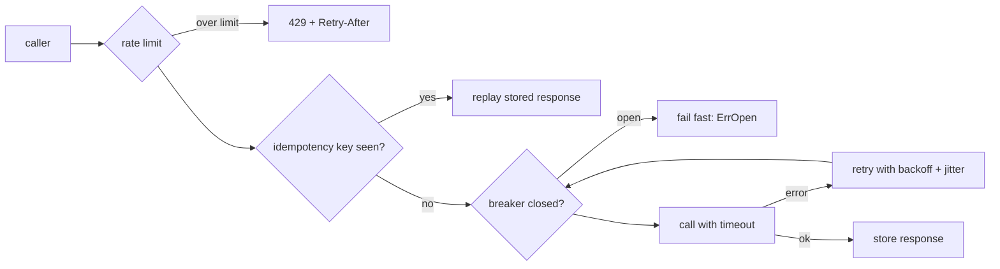

# 06. Resilience: timeouts, retries with backoff, circuit breakers, rate limiting and idempotency

> **Draft: written but not yet run.** The code and the expected output in this lesson were prepared by reading the code and the official documentation. They have not been executed yet. If something does not behave as described, trust your tool's real output and report it.

## What you will be able to do
By the end of this lesson you will be able to:
- set timeouts at every layer and explain how a deadline budget is shared by a chain of calls;
- write a retry loop with exponential backoff and jitter that stops on permanent errors and when the context ends;
- implement and test a circuit breaker with an injected clock, and a per-key token-bucket rate limiter;
- make a `POST` safe to retry with an idempotency key, and say when each technique makes things worse.

## Recap
1. In lesson 05, what carries a client's deadline to the server? <details><summary>Answer</summary>gRPC sends the remaining time in a header, and the server's context is cancelled when it passes.</details>
2. In lesson 01, what is the risk of retrying work with an unbounded number of goroutines? <details><summary>Answer</summary>Load multiplies on a service that may already be struggling; always bound concurrency.</details>
3. In lesson 04, why do handlers return a generic message for unexpected errors? <details><summary>Answer</summary>Internal error text can leak secrets or structure; log the detail, answer generically.</details>

## Why it matters
When a restaurant's kitchen is overwhelmed, three things make it worse: customers who shout the order again every ten seconds (retries), a waiter who keeps walking into the kitchen although it is on fire (no breaker), and a door with no limit on how many parties may enter (no rate limit). Distributed systems fail in pieces all the time. Resilience is how one slow dependency stays a slow dependency instead of becoming an outage of everything that calls it. The same tools, used badly, are how outages are *created*: a retry loop that multiplies load by five has taken down more services than the original fault.

## What you will build
A small library package `resilience` with four parts, a demo program and tests:
- `retry.go`: `RetryPolicy` with exponential backoff, full jitter, a cap, and a `Permanent` error type;
- `breaker.go`: a three-state circuit breaker with an injected clock;
- `limiter.go`: a per-key token bucket (on `golang.org/x/time/rate`) and an HTTP middleware that answers `429` with `Retry-After`;
- `idempotency.go`: middleware that makes `POST` retry-safe using the `Idempotency-Key` header;
- `main.go`: a deterministic demo of all four.



## Before you start
- Lessons 01, 04 and 05. Go 1.26.0 or newer. `golang.org/x/time` is downloaded by `go mod tidy`.
- Time: 90 minutes; break after Step 4.
- Source pack (optional): every file is shown in full in this lesson, so you can follow without it. The finished code, the exercise starter and the solution are in the
  course repository https://github.com/Uee03/Code101 under `source/go/301-super-hero-to-legendary/phase-2-architecture-and-services/06-resilience/` (on that page choose **Code, Download ZIP**, or run
  `git clone https://github.com/Uee03/Code101.git`).
- [How every lesson works](../../README.md#how-every-lesson-works) explains folders, saving and running.
- `go.sum` is created by `go mod tidy` and is not shipped in the pack.
- The capstone has a database-backed version of the idempotency key: [Go backend capstone chapter 04](../../../../capstones/backend-go/tutorials/phase-2-data/04-idempotency.md), and its rate limiter is in [chapter 07](../../../../capstones/backend-go/tutorials/phase-5-hardening/07-hardening.md).

## Steps

### Step 1. Folders and `go.mod`
**File: terminal (not a saved file)**
```powershell
New-Item -ItemType Directory -Force "$HOME/code101/go301/lesson06/resilience" | Out-Null
Set-Location "$HOME/code101/go301/lesson06"
```
```bash
mkdir -p ~/code101/go301/lesson06/resilience
cd ~/code101/go301/lesson06
```
Recovery: `Set-Location "$HOME/code101/go301/lesson06"` or `cd ~/code101/go301/lesson06`.

**File: `go.mod`**
```text
module example.com/code101/go301/l06

go 1.26.0

require golang.org/x/time v0.16.0
```
Then run `go mod tidy` once (it writes `go.sum`).

### Step 2. Timeouts first: the budget idea
Retries, breakers and limits all assume that **every call has a timeout**. Without one, a hung dependency holds a goroutine, a connection and memory for as long as the dependency stays hung; with thousands of requests per second that is minutes to exhaustion. Timeouts are set in layers, and each inner layer must be shorter than the outer one:

| Layer | Setting | Meaning |
|---|---|---|
| Client request | `context.WithTimeout(ctx, d)` | total time for one logical operation, including retries |
| One attempt | a shorter context inside the retry loop | one try may not eat the whole budget |
| HTTP client | `http.Client.Timeout` and `http.Transport` timeouts | connect, TLS, first byte |
| HTTP server | `ReadHeaderTimeout`, `ReadTimeout`, `WriteTimeout`, `IdleTimeout` | slow or malicious clients (lesson 04) |
| Database | `context` passed to every query, plus server-side `statement_timeout` | slow queries |

This snippet is illustrative (not part of the pack); it shows the transport settings people forget:

**File: example, not saved in the lesson folder**
```go
client := &http.Client{
	Timeout: 3 * time.Second, // whole request, including reading the body
	Transport: &http.Transport{
		DialContext:           (&net.Dialer{Timeout: time.Second}).DialContext,
		TLSHandshakeTimeout:   time.Second,
		ResponseHeaderTimeout: 2 * time.Second,
		MaxIdleConnsPerHost:   10,
	},
}
```
**Deadline budget.** If the user-facing request has 2 seconds, and it calls service B, which calls service C, then B must give C **less** than the time B itself has left. With contexts this happens for free as long as you pass the incoming `ctx` down: the deadline is a point in time, so the remaining time shrinks on every hop, and gRPC (lesson 05) even sends it over the wire. The mistake is to start a new `context.Background()` inside a handler, which detaches the call from the caller's deadline and cancellation.

### Step 3. Retries with exponential backoff and jitter
**File: `resilience/retry.go`**
```go
package resilience

import (
	"context"
	"errors"
	"fmt"
	"math/rand/v2"
	"time"
)

// permanentError marks an error that retrying cannot fix.
type permanentError struct{ err error }

func (p permanentError) Error() string { return p.err.Error() }
func (p permanentError) Unwrap() error { return p.err }

// Permanent wraps err so that Do stops at once. Use it for failures that will
// repeat identically, such as a 400 Bad Request.
func Permanent(err error) error {
	if err == nil {
		return nil
	}
	return permanentError{err: err}
}

// RetryPolicy describes exponential backoff with jitter.
type RetryPolicy struct {
	MaxAttempts int           // total tries, including the first; default 3
	BaseDelay   time.Duration // wait before the second try, before jitter
	MaxDelay    time.Duration // cap for the wait
	// Jitter picks the real wait from the computed ceiling. The default is
	// "full jitter": a random value between zero and the ceiling.
	Jitter func(ceiling time.Duration) time.Duration
	// Sleep waits for d or until ctx ends. Tests replace it.
	Sleep func(ctx context.Context, d time.Duration) error
}

// Do calls op until it succeeds, returns a Permanent error, runs out of
// attempts or ctx ends while waiting.
func (p RetryPolicy) Do(ctx context.Context, op func(context.Context) error) error {
	if p.MaxAttempts < 1 {
		p.MaxAttempts = 3
	}
	if p.Jitter == nil {
		p.Jitter = fullJitter
	}
	if p.Sleep == nil {
		p.Sleep = sleepContext
	}

	for attempt := 1; ; attempt++ {
		err := op(ctx)
		if err == nil {
			return nil
		}

		var perm permanentError
		if errors.As(err, &perm) {
			return fmt.Errorf("permanent error on attempt %d: %w", attempt, perm.err)
		}
		if attempt >= p.MaxAttempts {
			return fmt.Errorf("gave up after %d attempts: %w", attempt, err)
		}

		wait := p.Jitter(backoff(p.BaseDelay, p.MaxDelay, attempt))
		if serr := p.Sleep(ctx, wait); serr != nil {
			return fmt.Errorf("retry aborted after %d attempts: %w (last error: %v)", attempt, serr, err)
		}
	}
}

// backoff doubles the base delay for every attempt already made and caps it.
func backoff(base, limit time.Duration, attempt int) time.Duration {
	d := base
	for i := 1; i < attempt; i++ {
		d *= 2
		if d >= limit {
			return limit
		}
	}
	return min(d, limit)
}

func fullJitter(ceiling time.Duration) time.Duration {
	if ceiling <= 0 {
		return 0
	}
	return rand.N(ceiling + 1)
}

func sleepContext(ctx context.Context, d time.Duration) error {
	t := time.NewTimer(d)
	defer t.Stop()
	select {
	case <-t.C:
		return nil
	case <-ctx.Done():
		return ctx.Err()
	}
}
```
Why each piece exists:
- **Exponential backoff**: the wait doubles (10 ms, 20 ms, 40 ms ...) so a struggling service gets *more* room as the failure lasts, and **`MaxDelay`** keeps the wait from growing to minutes.
- **Jitter**: if 1,000 clients all fail at the same instant and all wait exactly 40 ms, they all retry at the same instant: a *thundering herd*. "Full jitter" picks a random wait between zero and the ceiling, which spreads the retries out. The `Jitter` field exists so tests and the demo can make it deterministic.
- **`Permanent`**: retrying a `400 Bad Request` three times only wastes time. The caller marks errors that will not change.
- **Context-aware sleep**: `sleepContext` returns as soon as the context ends, so a cancelled request does not sit in a `time.Sleep`. (A bare `time.Sleep` ignores cancellation: the same leak as in lesson 01.)
- The error messages **wrap** the last error with `%w`, so callers can still use `errors.Is`.
- `math/rand/v2` is fine for jitter. It is **not** for tokens or keys (lesson 08 uses `crypto/rand`).

### Step 4. A circuit breaker
**File: `resilience/breaker.go`**
```go
package resilience

import (
	"errors"
	"sync"
	"time"
)

// State is the position of a circuit breaker.
type State int

const (
	Closed   State = iota // calls pass through; failures are counted
	Open                  // calls are rejected without running
	HalfOpen              // one probe call is allowed to test recovery
)

func (s State) String() string {
	switch s {
	case Closed:
		return "closed"
	case Open:
		return "open"
	case HalfOpen:
		return "half-open"
	}
	return "unknown"
}

// ErrOpen is returned when the breaker rejects a call.
var ErrOpen = errors.New("circuit breaker is open")

// Breaker opens after threshold consecutive failures, rejects calls for
// openFor, then lets a single probe through.
type Breaker struct {
	mu        sync.Mutex
	threshold int
	openFor   time.Duration
	now       func() time.Time

	state    State
	failures int
	openedAt time.Time
	probing  bool
}

func NewBreaker(threshold int, openFor time.Duration, now func() time.Time) *Breaker {
	return &Breaker{threshold: threshold, openFor: openFor, now: now}
}

func (b *Breaker) State() State {
	b.mu.Lock()
	defer b.mu.Unlock()
	return b.state
}

// Do runs op unless the breaker is open.
func (b *Breaker) Do(op func() error) error {
	if err := b.before(); err != nil {
		return err
	}
	err := op()
	b.after(err)
	return err
}

func (b *Breaker) before() error {
	b.mu.Lock()
	defer b.mu.Unlock()
	switch b.state {
	case Open:
		if b.now().Sub(b.openedAt) < b.openFor {
			return ErrOpen
		}
		b.state = HalfOpen
		b.probing = true
	case HalfOpen:
		if b.probing {
			return ErrOpen
		}
		b.probing = true
	}
	return nil
}

func (b *Breaker) after(err error) {
	b.mu.Lock()
	defer b.mu.Unlock()
	switch b.state {
	case HalfOpen:
		b.probing = false
		if err != nil {
			b.trip()
			return
		}
		b.state = Closed
		b.failures = 0
	case Closed:
		if err == nil {
			b.failures = 0
			return
		}
		b.failures++
		if b.failures >= b.threshold {
			b.trip()
		}
	}
}

func (b *Breaker) trip() {
	b.state = Open
	b.openedAt = b.now()
	b.failures = 0
}
```
The breaker is the electrical fuse of the call path:
- **Closed**: normal. Consecutive failures are counted; one success resets the count.
- **Open**: after `threshold` failures in a row, every call is rejected **immediately** with `ErrOpen`, without touching the failing dependency. That gives it room to recover and gives your callers a fast, cheap failure instead of a slow timeout.
- **Half-open**: once `openFor` has passed, exactly **one probe** call is let through. Success closes the breaker; failure reopens it for another `openFor`.
- The clock is **injected** (`now func() time.Time`) so tests move time without sleeping.
- The mutex covers only the bookkeeping in `before` and `after`, never the call itself (lesson 02: do not hold a lock while calling out).
- This is deliberately simple: it counts *consecutive* failures. Production libraries add a rolling error *rate* over a window, a minimum number of requests and per-error classification (see "Failure modes").

### Step 5. Rate limiting with a token bucket
A **token bucket** holds up to `burst` tokens and refills at `limit` tokens per second. Each request takes a token; with none left the request is refused. It allows short bursts but caps the average rate.

**File: `resilience/limiter.go`**
```go
package resilience

import (
	"math"
	"net"
	"net/http"
	"strconv"
	"sync"
	"time"

	"golang.org/x/time/rate"
)

type limiterEntry struct {
	limiter *rate.Limiter
	seen    time.Time
}

// KeyedLimiter keeps one token bucket per key (a user, an API key, an address).
type KeyedLimiter struct {
	mu      sync.Mutex
	limit   rate.Limit
	burst   int
	entries map[string]*limiterEntry
}

func NewKeyedLimiter(limit rate.Limit, burst int) *KeyedLimiter {
	return &KeyedLimiter{limit: limit, burst: burst, entries: make(map[string]*limiterEntry)}
}

// Allow takes one token for key at time now. When it refuses, it also returns
// how long the caller should wait for a token.
func (k *KeyedLimiter) Allow(key string, now time.Time) (bool, time.Duration) {
	k.mu.Lock()
	defer k.mu.Unlock()

	e, ok := k.entries[key]
	if !ok {
		e = &limiterEntry{limiter: rate.NewLimiter(k.limit, k.burst)}
		k.entries[key] = e
	}
	e.seen = now

	r := e.limiter.ReserveN(now, 1)
	if !r.OK() {
		return false, 0
	}
	if delay := r.DelayFrom(now); delay > 0 {
		r.CancelAt(now) // give the token back: we are refusing, not waiting
		return false, delay
	}
	return true, 0
}

// Sweep forgets keys not seen for idle, so the map cannot grow without bound.
func (k *KeyedLimiter) Sweep(now time.Time, idle time.Duration) int {
	k.mu.Lock()
	defer k.mu.Unlock()
	removed := 0
	for key, e := range k.entries {
		if now.Sub(e.seen) > idle {
			delete(k.entries, key)
			removed++
		}
	}
	return removed
}

// RateLimit answers 429 with a Retry-After header when the caller is over its limit.
func RateLimit(l *KeyedLimiter, key func(*http.Request) string, next http.Handler) http.Handler {
	return http.HandlerFunc(func(w http.ResponseWriter, r *http.Request) {
		ok, wait := l.Allow(key(r), time.Now())
		if !ok {
			seconds := max(int(math.Ceil(wait.Seconds())), 1)
			w.Header().Set("Retry-After", strconv.Itoa(seconds))
			http.Error(w, "rate limit exceeded", http.StatusTooManyRequests)
			return
		}
		next.ServeHTTP(w, r)
	})
}

// ClientIP is the address of the direct peer. Behind a proxy it is the proxy's
// address; only read forwarding headers from proxies you control.
func ClientIP(r *http.Request) string {
	host, _, err := net.SplitHostPort(r.RemoteAddr)
	if err != nil {
		return r.RemoteAddr
	}
	return host
}
```
- `rate.Limiter` is the Go team's token bucket (`golang.org/x/time/rate`). We pass an explicit time (`ReserveN(now, 1)`) instead of using `Allow`, for two reasons: tests control the clock, and a **reservation** tells us the delay, which becomes the `Retry-After` header. If the delay is positive we refuse and `CancelAt` returns the token, because we are not going to wait.
- **One limiter per key** keeps one noisy caller from using up everyone's allowance. The map grows with the number of keys, so `Sweep` (called from a timer) removes idle ones. Without it, a flood of random keys is a memory-exhaustion attack on your limiter.
- `RateLimit` answers `429 Too Many Requests` with `Retry-After` in whole seconds, rounded **up** so a client that waits exactly that long is not refused again. `ClientIP` returns the direct peer; trusting `X-Forwarded-For` blindly lets a client choose its own key, so only read it from proxies you operate.
- This limiter lives **in one process**. With ten replicas, each allows the full rate, so the real limit is ten times higher. A shared limit needs a shared store (for example Redis) or a gateway; that is a different trade-off (extra dependency, extra latency, a new failure mode: what do you do when the limiter is down?).

### Step 6. Idempotency keys
A retry is only safe if repeating the operation does the same thing as doing it once. `GET`, `PUT` and `DELETE` are idempotent by definition; `POST` usually is not: if the response is lost, a retried "create order" creates a second order. The fix is an **idempotency key**: the client invents a unique key per logical operation and sends it in the `Idempotency-Key` header; the server runs the operation **once** and stores the response.

**File: `resilience/idempotency.go`**
```go
package resilience

import (
	"bytes"
	"crypto/sha256"
	"encoding/hex"
	"io"
	"net/http"
	"sync"
)

type idempotencyEntry struct {
	fingerprint string
	done        bool
	status      int
	contentType string
	body        []byte
}

// IdempotencyStore remembers the first response for each Idempotency-Key.
// It is in memory and has no expiry: a real service uses a shared database
// table with a time-to-live (see the capstone chapter on idempotency keys).
type IdempotencyStore struct {
	mu      sync.Mutex
	entries map[string]*idempotencyEntry
}

func NewIdempotencyStore() *IdempotencyStore {
	return &IdempotencyStore{entries: make(map[string]*idempotencyEntry)}
}

// Idempotent makes POST requests that carry an Idempotency-Key safe to retry:
// the handler runs once per key, and repeats get the stored response.
func Idempotent(store *IdempotencyStore, next http.Handler) http.Handler {
	return http.HandlerFunc(func(w http.ResponseWriter, r *http.Request) {
		key := r.Header.Get("Idempotency-Key")
		if key == "" || r.Method != http.MethodPost {
			next.ServeHTTP(w, r)
			return
		}

		body, err := io.ReadAll(http.MaxBytesReader(w, r.Body, 1<<20))
		if err != nil {
			http.Error(w, "request body too large or unreadable", http.StatusBadRequest)
			return
		}
		r.Body = io.NopCloser(bytes.NewReader(body))
		sum := sha256.Sum256(append([]byte(r.Method+" "+r.URL.Path+"\n"), body...))
		fingerprint := hex.EncodeToString(sum[:])

		store.mu.Lock()
		if e, seen := store.entries[key]; seen {
			snapshot := *e
			store.mu.Unlock()
			replay(w, snapshot, fingerprint)
			return
		}
		store.entries[key] = &idempotencyEntry{fingerprint: fingerprint}
		store.mu.Unlock()

		stored := false
		defer func() {
			if !stored { // server error or panic: let the client try again
				store.mu.Lock()
				delete(store.entries, key)
				store.mu.Unlock()
			}
		}()

		rec := &recorder{ResponseWriter: w}
		next.ServeHTTP(rec, r)

		if rec.status() < 500 {
			store.mu.Lock()
			e := store.entries[key]
			e.done = true
			e.status = rec.status()
			e.contentType = w.Header().Get("Content-Type")
			e.body = rec.body.Bytes()
			store.mu.Unlock()
			stored = true
		}
	})
}

func replay(w http.ResponseWriter, e idempotencyEntry, fingerprint string) {
	switch {
	case e.fingerprint != fingerprint:
		http.Error(w, "Idempotency-Key was already used with a different request", http.StatusUnprocessableEntity)
	case !e.done:
		w.Header().Set("Retry-After", "1")
		http.Error(w, "a request with this Idempotency-Key is still in progress", http.StatusConflict)
	default:
		if e.contentType != "" {
			w.Header().Set("Content-Type", e.contentType)
		}
		w.Header().Set("Idempotent-Replay", "true")
		w.WriteHeader(e.status)
		_, _ = w.Write(e.body)
	}
}

// recorder copies what the handler writes so it can be stored and replayed.
type recorder struct {
	http.ResponseWriter
	code int
	body bytes.Buffer
}

func (r *recorder) WriteHeader(code int) {
	r.code = code
	r.ResponseWriter.WriteHeader(code)
}

func (r *recorder) Write(b []byte) (int, error) {
	if r.code == 0 {
		r.code = http.StatusOK
	}
	r.body.Write(b)
	return r.ResponseWriter.Write(b)
}

func (r *recorder) status() int {
	if r.code == 0 {
		return http.StatusOK
	}
	return r.code
}
```
The three cases, the heart of an idempotency design:
1. **First time**: reserve the key (marked "in progress"), run the handler, store status, content type and body.
2. **Same key, same request, finished**: replay the stored response with `Idempotent-Replay: true`. The handler does **not** run again.
3. **Same key, different request**: a bug in the client or a collision; answer `422`. The **fingerprint** (a SHA-256 over method, path and body) is how the server tells. (Without it a client could reuse a key for another order and silently get the first order's response.)
Plus the **in-flight** case: a second request with the same key arrives while the first is still running; it gets `409 Conflict` with `Retry-After` instead of running a second copy.
Server errors (5xx) and panics **delete** the entry so the retry can run for real; client errors (4xx) are stored, because repeating them would give the same answer.

Honest limits of this version: it is in memory (a restart forgets every key; a second replica does not know the keys), it never expires entries, and the "check, then insert" is atomic only inside one process. A production design stores keys in the same database transaction as the business change, with a unique constraint and a time-to-live; the capstone chapter shows it.

### Step 7. The demo and the tests
**File: `main.go`**
```go
package main

import (
	"context"
	"errors"
	"fmt"
	"net/http"
	"net/http/httptest"
	"strings"
	"time"

	"golang.org/x/time/rate"

	"example.com/code101/go301/l06/resilience"
)

func main() {
	demoRetry()
	demoBreaker()
	demoLimiter()
	demoIdempotency()
}

func demoRetry() {
	var waits []time.Duration
	policy := resilience.RetryPolicy{
		MaxAttempts: 5,
		BaseDelay:   10 * time.Millisecond,
		MaxDelay:    time.Second,
		Jitter:      func(ceiling time.Duration) time.Duration { return ceiling }, // no randomness, for a stable demo
		Sleep: func(_ context.Context, d time.Duration) error {
			waits = append(waits, d)
			return nil
		},
	}
	ctx := context.Background()

	calls := 0
	err := policy.Do(ctx, func(context.Context) error {
		calls++
		if calls < 4 {
			return errors.New("503 service unavailable")
		}
		return nil
	})
	fmt.Printf("retry: err=%v attempts=%d waits=%v\n", err, calls, waits)

	calls = 0
	err = policy.Do(ctx, func(context.Context) error {
		calls++
		return resilience.Permanent(errors.New("400 bad request"))
	})
	fmt.Printf("retry: %d attempt: %v\n", calls, err)

	waits = nil
	err = policy.Do(ctx, func(context.Context) error { return errors.New("503 service unavailable") })
	fmt.Printf("retry: %v (waits %v)\n", err, waits)
}

func demoBreaker() {
	now := time.Date(2026, 1, 1, 12, 0, 0, 0, time.UTC)
	b := resilience.NewBreaker(3, 30*time.Second, func() time.Time { return now })

	for range 3 {
		_ = b.Do(func() error { return errors.New("downstream failed") })
	}
	fmt.Println("breaker: state after 3 failures:", b.State())

	ran := false
	err := b.Do(func() error { ran = true; return nil })
	fmt.Printf("breaker: call while open: err=%v, operation ran=%t\n", err, ran)

	now = now.Add(31 * time.Second)
	err = b.Do(func() error { return nil })
	fmt.Printf("breaker: probe after 31s: err=%v, state=%v\n", err, b.State())
}

func demoLimiter() {
	limiter := resilience.NewKeyedLimiter(rate.Every(time.Second), 2)
	t0 := time.Date(2026, 1, 1, 12, 0, 0, 0, time.UTC)

	var results []bool
	var retryAfter time.Duration
	for range 3 {
		ok, wait := limiter.Allow("client-a", t0)
		results = append(results, ok)
		if !ok {
			retryAfter = wait
		}
	}
	later, _ := limiter.Allow("client-a", t0.Add(time.Second))
	other, _ := limiter.Allow("client-b", t0)
	fmt.Printf("limiter: client-a=%v retry-after=%v; one second later=%t; client-b=%t\n", results, retryAfter, later, other)
}

func demoIdempotency() {
	runs := 0
	create := http.HandlerFunc(func(w http.ResponseWriter, r *http.Request) {
		runs++
		w.Header().Set("Content-Type", "application/json")
		w.WriteHeader(http.StatusCreated)
		fmt.Fprintf(w, "{\"id\":%d}\n", runs)
	})
	handler := resilience.Idempotent(resilience.NewIdempotencyStore(), create)

	post := func(key, body string) *httptest.ResponseRecorder {
		req := httptest.NewRequest(http.MethodPost, "/orders", strings.NewReader(body))
		req.Header.Set("Idempotency-Key", key)
		rec := httptest.NewRecorder()
		handler.ServeHTTP(rec, req)
		return rec
	}

	first := post("k1", `{"item":"tea"}`)
	again := post("k1", `{"item":"tea"}`)
	other := post("k1", `{"item":"coffee"}`)
	fmt.Printf("idempotency: first=%d again=%d replayed=%s handler runs=%d body=%s", first.Code, again.Code, again.Header().Get("Idempotent-Replay"), runs, again.Body.String())
	fmt.Printf("idempotency: same key, different body: %d\n", other.Code)
}
```
**File: `resilience/resilience_test.go`**
```go
package resilience

import (
	"context"
	"errors"
	"net/http"
	"net/http/httptest"
	"strings"
	"sync"
	"sync/atomic"
	"testing"
	"time"

	"golang.org/x/time/rate"
)

func noSleep(waits *[]time.Duration) func(context.Context, time.Duration) error {
	return func(_ context.Context, d time.Duration) error {
		*waits = append(*waits, d)
		return nil
	}
}

func TestRetryBacksOffExponentiallyAndStopsAtMaxDelay(t *testing.T) {
	var waits []time.Duration
	policy := RetryPolicy{
		MaxAttempts: 6,
		BaseDelay:   100 * time.Millisecond,
		MaxDelay:    300 * time.Millisecond,
		Jitter:      func(d time.Duration) time.Duration { return d },
		Sleep:       noSleep(&waits),
	}

	err := policy.Do(context.Background(), func(context.Context) error { return errors.New("down") })
	if err == nil {
		t.Fatal("expected an error after the last attempt")
	}
	want := []time.Duration{100 * time.Millisecond, 200 * time.Millisecond, 300 * time.Millisecond, 300 * time.Millisecond, 300 * time.Millisecond}
	if len(waits) != len(want) {
		t.Fatalf("waits = %v, want %v", waits, want)
	}
	for i := range want {
		if waits[i] != want[i] {
			t.Fatalf("waits = %v, want %v", waits, want)
		}
	}
}

func TestRetryStopsOnPermanentError(t *testing.T) {
	calls := 0
	policy := RetryPolicy{MaxAttempts: 5, Sleep: noSleep(new([]time.Duration))}

	bad := errors.New("bad request")
	err := policy.Do(context.Background(), func(context.Context) error {
		calls++
		return Permanent(bad)
	})
	if calls != 1 || !errors.Is(err, bad) {
		t.Fatalf("calls = %d, err = %v; want 1 call and an error wrapping %v", calls, err, bad)
	}
}

func TestRetryStopsWhenContextEndsDuringWait(t *testing.T) {
	ctx, cancel := context.WithCancel(context.Background())
	policy := RetryPolicy{MaxAttempts: 5, BaseDelay: time.Hour, MaxDelay: time.Hour}

	err := policy.Do(ctx, func(context.Context) error {
		cancel()
		return errors.New("down")
	})
	if !errors.Is(err, context.Canceled) {
		t.Fatalf("err = %v, want it to wrap context.Canceled", err)
	}
}

func TestBreakerOpensThenRecovers(t *testing.T) {
	now := time.Date(2026, 1, 1, 12, 0, 0, 0, time.UTC)
	b := NewBreaker(2, time.Minute, func() time.Time { return now })
	fail := func() error { return errors.New("down") }

	_ = b.Do(fail)
	_ = b.Do(fail)
	if b.State() != Open {
		t.Fatalf("state = %v, want open", b.State())
	}
	if err := b.Do(func() error { t.Fatal("must not run while open"); return nil }); !errors.Is(err, ErrOpen) {
		t.Fatalf("err = %v, want ErrOpen", err)
	}

	now = now.Add(time.Minute + time.Second)
	if err := b.Do(func() error { return nil }); err != nil {
		t.Fatal(err)
	}
	if b.State() != Closed {
		t.Fatalf("state = %v, want closed after a successful probe", b.State())
	}
}

func TestBreakerReopensWhenProbeFails(t *testing.T) {
	now := time.Date(2026, 1, 1, 12, 0, 0, 0, time.UTC)
	b := NewBreaker(1, time.Minute, func() time.Time { return now })
	fail := func() error { return errors.New("down") }

	_ = b.Do(fail)
	now = now.Add(2 * time.Minute)
	_ = b.Do(fail)
	if b.State() != Open {
		t.Fatalf("state = %v, want open again after a failed probe", b.State())
	}
}

func TestKeyedLimiterIsolatesKeys(t *testing.T) {
	l := NewKeyedLimiter(rate.Every(time.Second), 1)
	t0 := time.Date(2026, 1, 1, 12, 0, 0, 0, time.UTC)

	if ok, _ := l.Allow("a", t0); !ok {
		t.Fatal("first call for a must pass")
	}
	if ok, wait := l.Allow("a", t0); ok || wait != time.Second {
		t.Fatalf("second call for a: ok = %t, wait = %v; want refused with 1s", ok, wait)
	}
	if ok, _ := l.Allow("b", t0); !ok {
		t.Fatal("key b must have its own bucket")
	}
	if removed := l.Sweep(t0.Add(time.Hour), time.Minute); removed != 2 {
		t.Fatalf("removed = %d, want 2", removed)
	}
}

func TestIdempotentRunsHandlerOnceUnderConcurrency(t *testing.T) {
	var runs atomic.Int32
	slow := http.HandlerFunc(func(w http.ResponseWriter, r *http.Request) {
		runs.Add(1)
		time.Sleep(20 * time.Millisecond)
		w.WriteHeader(http.StatusCreated)
	})
	h := Idempotent(NewIdempotencyStore(), slow)

	var wg sync.WaitGroup
	codes := make(chan int, 10)
	for range 10 {
		wg.Go(func() {
			req := httptest.NewRequest(http.MethodPost, "/orders", strings.NewReader(`{"item":"tea"}`))
			req.Header.Set("Idempotency-Key", "k1")
			rec := httptest.NewRecorder()
			h.ServeHTTP(rec, req)
			codes <- rec.Code
		})
	}
	wg.Wait()
	close(codes)

	created := 0
	for code := range codes {
		switch code {
		case http.StatusCreated:
			created++
		case http.StatusConflict:
		default:
			t.Fatalf("unexpected status %d", code)
		}
	}
	if runs.Load() != 1 || created < 1 {
		t.Fatalf("handler ran %d times and %d responses were 201; want exactly 1 run and at least one 201", runs.Load(), created)
	}
}
```
The tests never sleep for real (except the 20 ms in the concurrency test, which creates the overlap on purpose): time is injected, and a fake `Sleep` records the waits.

### Step 8. Predict, then run
**Predict before you run.** (a) The demo's first retry succeeds on the 4th call: which waits will be recorded? (b) After three failures with a threshold of three, what does the fourth call return, and does its operation run? (c) The limiter has burst 2 and refills 1 token per second: what are the first three results at the same instant, and what `Retry-After` does the third get?

## Run it
**File: terminal (not a saved file)**
```text
go mod tidy
go run .
```
Expected output (derived by reading the code; not yet run):
```text
retry: err=<nil> attempts=4 waits=[10ms 20ms 40ms]
retry: 1 attempt: permanent error on attempt 1: 400 bad request
retry: gave up after 5 attempts: 503 service unavailable (waits [10ms 20ms 40ms 80ms])
breaker: state after 3 failures: open
breaker: call while open: err=circuit breaker is open, operation ran=false
breaker: probe after 31s: err=<nil>, state=closed
limiter: client-a=[true true false] retry-after=1s; one second later=true; client-b=true
idempotency: first=201 again=201 replayed=true handler runs=1 body={"id":1}
idempotency: same key, different body: 422
```
Then the tests, including the race detector (needs a C compiler, see lesson 02):

**File: terminal (not a saved file)**
```text
go test ./...
go test -race ./...
```
Expected: `ok  	example.com/code101/go301/l06/resilience` with a duration, and `no test files` for the root package.

## How it works
- **Where the pieces sit.** The order in the diagram is a design decision: rate limit first (cheapest, protects everything behind), then idempotency (a replay costs nothing), then breaker and timeout around the outgoing call, with retry **outside** the breaker so every attempt is counted. A retry loop *inside* a breaker would hide failures from it.
- **Retry amplification.** If a three-tier chain A → B → C has three attempts at each hop, one failing user request can become 3 x 3 = 9 calls on C, and 27 with one more tier. Fixes: retry at **one** layer (usually the edge), use a **retry budget** (for example retries may add at most 10% extra load), and stop retrying on overload signals such as `429`, `503` with `Retry-After`, or an open breaker.
- **What to retry.** Retry timeouts, connection resets and `503`/`429` **only if the operation is idempotent** (or carries an idempotency key). Never retry on `400`-class errors; never retry blindly on `500`, which may mean the work half-happened.
- **Respect `Retry-After`.** When a server says how long to wait, use it instead of your own backoff (the exercise parses it).
- **Misconception to correct:** "a circuit breaker makes my service reliable." It makes your service fail **faster and more cheaply** when a dependency is down, and protects the dependency. You still need a fallback (cached data, a degraded answer, a clear error) or the user sees the failure either way.

## Decision record (ADR style)
**ADR-06: retry at the edge only, with a budget; breakers per dependency; limits per caller.**
- Context: three services in a chain, each currently retrying three times.
- Decision: only the outermost service retries (idempotent operations or those with an idempotency key); inner services fail fast and return `503` with `Retry-After`; every outgoing dependency has its own breaker; every inbound caller class has its own rate limit; every call has a timeout shorter than its caller's.
- Consequences: load amplification is bounded; inner services are simpler; the edge service needs to know which operations are safe to retry; there are more settings to tune, so each setting is exported as a metric (lesson 07).

**When not to use each tool**
- **Retries**: on non-idempotent operations without a key; when the failure is overload (retries add load); when the caller's budget is too small for even one extra attempt.
- **Circuit breakers**: for a dependency with so little traffic that a threshold is statistical noise; when the dependency has no fallback and "fail fast" changes nothing for the user; per-instance breakers hide a *partial* outage (one bad replica) that load balancing should handle.
- **In-process rate limits**: when you need one global limit across replicas (use a gateway or shared store).
- **Idempotency keys**: for operations that are naturally idempotent (`PUT` of a full resource), where they add storage for no gain.

## Failure modes
| Failure | Symptom | Prevention |
|---|---|---|
| No timeout | goroutines and connections pile up behind a hung dependency | a timeout on every outgoing call and every query |
| Retry storm | load on a failing service goes up 3x to 27x | single retry layer, jitter, cap, budget |
| Synchronised retries | spikes at 10 ms, 20 ms, 40 ms ... after each failure | jitter |
| Retrying non-idempotent calls | duplicate orders and double charges | idempotency keys, or no retry |
| Breaker counts the wrong errors | a flood of `400`s opens the breaker | count only errors that signal dependency health (timeouts, 5xx), not caller mistakes or cancellations |
| Breaker flapping | open, probe, open, probe | longer `openFor`, a rolling error rate, several probes before closing |
| Breaker state per instance | each replica learns the outage separately | accept it, or use outlier detection in the proxy |
| Limiter memory growth | memory rises with the number of distinct keys | `Sweep`, a maximum number of keys |
| Spoofed limiter key | clients rotate `X-Forwarded-For` to dodge the limit | key on authenticated identity; trust headers only from your proxy |
| Idempotency store lost on restart | duplicates after a deploy | durable store with TTL |

## Measurements to take
1. **Retry rate**: retries divided by first attempts, per dependency. A rising ratio is an early warning long before errors show.
2. **Latency percentiles with and without retries** (p50, p95, p99), and the **attempts histogram** (how many requests needed 1, 2, 3 attempts).
3. **Breaker state transitions** (a counter per transition and a gauge for the current state) and the number of fast-failed calls.
4. **Rejected requests** by the limiter, by key class, and the `Retry-After` values you hand out.
5. **Idempotent replays** versus first executions: if replays are common, clients are retrying a lot and you should ask why.
6. In a **load or chaos test**, kill or slow a dependency and record: time to detect, time until the breaker opens, error rate seen by users, time to recover. Do not guess these.

## Production checklist
- [ ] Every outgoing call (HTTP, gRPC, SQL) has a timeout, and inner timeouts are shorter than outer ones.
- [ ] Retries: one layer, exponential backoff with jitter and a cap, only for idempotent operations, honouring `Retry-After`.
- [ ] A breaker per dependency, with documented thresholds and a defined fallback.
- [ ] Inbound rate limits keyed by authenticated identity, with `429` and `Retry-After`, and a memory bound on the key table.
- [ ] `POST` endpoints that clients retry accept an idempotency key backed by durable storage with a TTL.
- [ ] Every setting above is exported as a metric and has an alert.
- [ ] A failure-injection test proves the behaviour (slow dependency, dead dependency, burst traffic).

## Try it
Copy `exercise/starter` next to your lesson folder and rename the copy `try06`. It has `go.mod` and `main.go` only, with no dependency.

**File: `exercise/starter/main.go`**
```go
package main

import (
	"fmt"
	"time"
)

// parseRetryAfter reads the value of a Retry-After header relative to now.
// TODO: support both forms HTTP defines: a whole number of seconds ("3") and
// an HTTP date ("Mon, 02 Jan 2006 15:04:10 GMT"). Return (0, false) for
// anything else, for negative numbers and for dates that are not in the future.
func parseRetryAfter(value string, now time.Time) (time.Duration, bool) {
	return 0, false
}

func main() {
	now := time.Date(2006, time.January, 2, 15, 4, 5, 0, time.UTC)
	values := []string{
		"3",
		"Mon, 02 Jan 2006 15:04:10 GMT",
		"-4",
		"soon",
		"Mon, 02 Jan 2006 15:04:00 GMT",
	}
	for _, v := range values {
		d, ok := parseRetryAfter(v, now)
		fmt.Printf("%q -> %v %t\n", v, d, ok)
	}
}
```
1. **Guided.** Implement `parseRetryAfter` so that the program prints:
```text
"3" -> 3s true
"Mon, 02 Jan 2006 15:04:10 GMT" -> 5s true
"-4" -> 0s false
"soon" -> 0s false
"Mon, 02 Jan 2006 15:04:00 GMT" -> 0s false
```
Hint: the standard library has a parser for exactly the HTTP date format (`net/http`).
2. **Change.** A hostile server could send `Retry-After: 99999999999`. Decide a maximum wait you accept (say, 30 seconds), clamp to it, and print a line that shows the clamp. Which value did you choose, and why?
3. **Stretch (no single answer).** Add `parseRetryAfter` to `RetryPolicy`: when the failed call carries a `Retry-After`, use `max(backoff, retryAfter)` instead of the jittered backoff. Sketch the type of error that would carry the header value from the HTTP client to the retry loop, and where a breaker would see it.

<details><summary>Solution</summary>

**File: `exercise/solution/main.go` (changed region)**
```go
import (
	"fmt"
	"net/http"
	"strconv"
	"strings"
	"time"
)

// parseRetryAfter reads the value of a Retry-After header relative to now.
func parseRetryAfter(value string, now time.Time) (time.Duration, bool) {
	if seconds, err := strconv.Atoi(strings.TrimSpace(value)); err == nil {
		if seconds < 0 {
			return 0, false
		}
		return time.Duration(seconds) * time.Second, true
	}
	if t, err := http.ParseTime(value); err == nil {
		if d := t.Sub(now); d > 0 {
			return d, true
		}
	}
	return 0, false
}
```
`main` is unchanged. For rung 2, add `const maxWait = 30 * time.Second` and `d = min(d, maxWait)` before returning; the reason is that a retry loop must never let the *server* decide how long your goroutine sleeps. For rung 3, a small error type such as `type RetryAfterError struct { Err error; After time.Duration }` returned by the HTTP client, found in `Do` with `errors.As`, lets the policy use it; the breaker should still count the underlying failure.
</details>

## Check yourself
1. Why does full jitter use a random wait between zero and the ceiling instead of adding a small random amount to the ceiling? <details><summary>Answer</summary>Spreading retries over the whole interval removes the synchronised spikes; a small random addition leaves most retries clustered.</details>
2. Predict: with `MaxAttempts: 4` and every call failing, how many times is `Sleep` called? <details><summary>Answer</summary>Three: there is a wait after attempts 1, 2 and 3, and none after the last.</details>
3. What does the breaker return for a call while it is open, and does the operation run? <details><summary>Answer</summary>`ErrOpen`, and the operation does not run.</details>
4. A client sends the same `Idempotency-Key` with a different body. What status does this implementation return and why? <details><summary>Answer</summary>`422`. The fingerprint differs, so the key is being reused for a different request; replaying the first response would be wrong.</details>
5. Why is `Retry-After` rounded up in the middleware? <details><summary>Answer</summary>A client that waits the advertised whole seconds must not be refused again for a fractional remainder.</details>

## Common mistakes
| Symptom or error text | Cause | Fix |
|---|---|---|
| `go: updates to go.mod needed; to update it: go mod tidy` (typical message) | `go.sum` not created yet | run `go mod tidy` |
| Retries finish instantly in tests but take seconds in production | tests inject a fake `Sleep`; production uses the real one | expected; keep one test with the real sleep and a tiny delay |
| The breaker never opens | failures are not consecutive (a success resets the count), or `threshold` is too high | lower the threshold, or use an error-rate breaker |
| `429` for every request behind a load balancer | all clients share one address (the balancer) | key on authenticated identity, not the peer address |
| `409` on a retry | the first request with this key is still running | wait `Retry-After` and try again; this is the intended signal |
| The same key returns a stale response for a changed payload | no fingerprint check | compare a hash of method, path and body, as the middleware does |
| `fatal error: all goroutines are asleep - deadlock!` in a test using the breaker | a `t.Fatal` inside a goroutine, or a lock held across the call | keep calls outside the mutex |
| Idempotent replay missing `Content-Type` | handler did not set it before writing | set headers before `WriteHeader` |

## Best practice
Make every operation that may be retried idempotent, retry with capped exponential backoff and jitter in a single layer, and give every call a deadline. Source: gRPC, Deadlines https://grpc.io/docs/guides/deadlines/ and Go Concurrency Patterns: Context https://go.dev/blog/context

## Going further
- `golang.org/x/time/rate`: https://pkg.go.dev/golang.org/x/time/rate
- Go `context` package: https://pkg.go.dev/context and the blog post https://go.dev/blog/context
- gRPC retries and deadlines: https://grpc.io/docs/guides/retry/ and https://grpc.io/docs/guides/deadlines/
- Further reading on backoff, jitter and overload: Timeouts, retries and backoff with jitter (Amazon Builders' Library) https://aws.amazon.com/builders-library/timeouts-retries-and-backoff-with-jitter/ and Handling Overload (Google SRE book) https://sre.google/sre-book/handling-overload/
- HTTP `Retry-After`: https://www.rfc-editor.org/rfc/rfc9110#field.retry-after and the `Idempotency-Key` header draft: https://datatracker.ietf.org/doc/draft-ietf-httpapi-idempotency-key-header/
- Applied in the capstone: [chapter 04, idempotency keys](../../../../capstones/backend-go/tutorials/phase-2-data/04-idempotency.md) and [chapter 07, rate limits](../../../../capstones/backend-go/tutorials/phase-5-hardening/07-hardening.md).

## Summary
- You set out the timeout layers and the deadline-budget rule.
- You wrote a retry policy with backoff, jitter, a cap, permanent errors and context-aware waiting.
- You built a circuit breaker with an injected clock and a per-key token-bucket limiter with `Retry-After`.
- You made `POST` retry-safe with idempotency keys and listed what each technique costs and when to skip it.

## Next lesson
07. Observability: structured logs with `slog`, Prometheus metrics and OpenTelemetry traces, so the numbers this lesson asked you to measure exist.
