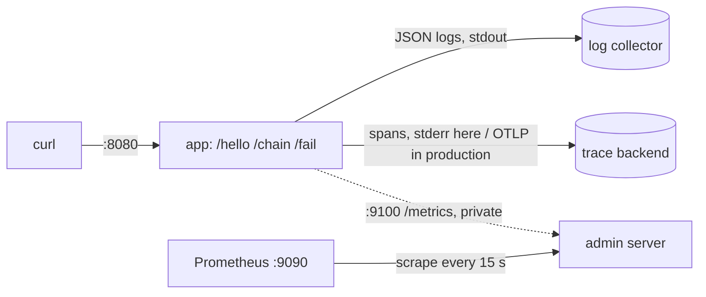

# 07. Observability: slog logs, Prometheus metrics and OpenTelemetry traces

> **Draft: written but not yet run.** The code and the expected output in this lesson were prepared by reading the code and the official documentation. They have not been executed yet. If something does not behave as described, trust your tool's real output and report it.

## What you will be able to do
By the end of this lesson you will be able to:
- write structured JSON logs with `log/slog` that carry the trace and span IDs and never print secrets;
- expose Prometheus metrics for request count, latency and in-flight requests with bounded label values;
- create OpenTelemetry spans, propagate trace context across an HTTP call, and read the result;
- choose between logs, metrics and traces for a question, and keep their cost under control.

## Recap
1. Lesson 06 asked you to measure the retry rate and the breaker state. Which signal type is right for "how many requests were refused per minute"? <details><summary>Answer</summary>A metric (a counter), because you want an aggregate rate over time, not one event.</details>
2. In lesson 03, why were pprof endpoints bound to a private address? <details><summary>Answer</summary>They expose internals and can trigger expensive work; operator-only interfaces must not be public.</details>
3. In lesson 04, what is the composition root for? <details><summary>Answer</summary>It is the one place that builds and wires the concrete types, so this is where logging, metrics and tracing are set up.</details>

## Why it matters
A hospital patient has three kinds of record: the nurse's **notes** (what happened, in words, at 03:12), the **vital-sign chart** (numbers over time, so you can see a trend) and the **referral trail** (which departments touched this patient, in which order, and how long each took). Production services need the same three: **logs**, **metrics** and **traces**. Without them you find out about an outage from your customers, and every investigation starts with "can we reproduce it?". With them, the question "why was that one request slow?" can be answered in minutes, from data you collected before the problem.

## What you will build
A small service `l07` with:
- `GET /hello`, `GET /chain` (which calls `/hello` through an instrumented HTTP client) and `GET /fail`;
- JSON logs with `service`, `trace_id` and `span_id`, and a `Secret` type that redacts itself;
- Prometheus metrics on a **separate admin port** (`/metrics`);
- OpenTelemetry traces printed to standard error (swap the exporter for production);
- a `Dockerfile`, `compose.yaml` and `prometheus.yml` that run the service with a Prometheus server, plus tests.



## Before you start
- Lessons 03, 04 and 06. Go 1.26.0 or newer. `curl` (`curl.exe` on Windows). [Go 201 lesson 07](../../201-hero-to-super-hero/phase-2-http-and-json/07-config-slog-shutdown.md) introduced `log/slog`, configuration and graceful shutdown; this lesson adds trace correlation, metrics and traces on top.
- Docker with Compose v2 for the last part (optional: everything before "Run with Docker Compose" works with only Go).
- Time: 100 minutes; two sittings, break after Step 6.
- Source pack (optional): every file is shown in full in this lesson, so you can follow without it. The finished code, the exercise starter and the solution are in the
  course repository https://github.com/Uee03/Code101 under `source/go/301-super-hero-to-legendary/phase-3-production/07-observability/` (on that page choose **Code, Download ZIP**, or run
  `git clone https://github.com/Uee03/Code101.git`).
- [How every lesson works](../../README.md#how-every-lesson-works) explains folders, saving and running.
- `go.sum` is created by `go mod tidy` (the pack does not ship it). The Dockerfile copies `go.sum`, so run `go mod tidy` **before** `docker compose up --build`.

## Steps

### Step 1. Folder, `go.mod`, dependencies
**File: terminal (not a saved file)**
```powershell
New-Item -ItemType Directory -Force "$HOME/code101/go301/lesson07" | Out-Null
Set-Location "$HOME/code101/go301/lesson07"
```
```bash
mkdir -p ~/code101/go301/lesson07
cd ~/code101/go301/lesson07
```
Recovery: `Set-Location "$HOME/code101/go301/lesson07"` or `cd ~/code101/go301/lesson07`.

**File: `go.mod`**
```text
module example.com/code101/go301/l07

go 1.26.0

require (
	github.com/prometheus/client_golang v1.25.0
	go.opentelemetry.io/contrib/instrumentation/net/http/otelhttp v0.72.0
	go.opentelemetry.io/otel v1.47.0
	go.opentelemetry.io/otel/exporters/stdout/stdouttrace v1.47.0
	go.opentelemetry.io/otel/sdk v1.47.0
	go.opentelemetry.io/otel/trace v1.47.0
)
```
Six direct dependencies: the Prometheus client; the OpenTelemetry API (`otel`), SDK (`sdk`), the span type package (`trace`); the exporter that prints spans (`stdouttrace`); and `otelhttp`, the instrumentation for `net/http`. OpenTelemetry modules are versioned together: keep them on the same minor version. `go mod tidy` adds the indirect requirements and `go.sum`.

### Step 2. Configuration
**File: `config.go`**
```go
package main

import "os"

type config struct {
	service   string
	httpAddr  string
	adminAddr string
	baseURL   string
	logLevel  string
	apiKey    Secret
}

// loadConfig reads the environment once, at start-up. Defaults bind to the
// loopback address so a laptop run is not exposed to the network.
func loadConfig() config {
	return config{
		service:   env("SERVICE_NAME", "go301-observability"),
		httpAddr:  env("HTTP_ADDR", "127.0.0.1:8080"),
		adminAddr: env("ADMIN_ADDR", "127.0.0.1:9100"),
		baseURL:   env("BASE_URL", "http://127.0.0.1:8080"),
		logLevel:  env("LOG_LEVEL", "info"),
		apiKey:    Secret(os.Getenv("API_KEY")),
	}
}

func env(key, fallback string) string {
	if v := os.Getenv(key); v != "" {
		return v
	}
	return fallback
}
```
Configuration comes from environment variables (the usual contract with containers). `apiKey` has the type `Secret` from the next step: even if someone logs the whole config, the value will not appear. `baseURL` is where `/chain` calls `/hello`; it is **configuration, not read from the request's `Host` header**, because a client-controlled `Host` would let a caller make your server fetch arbitrary URLs.

### Step 3. Logs with `slog`
**File: `logging.go`**
```go
package main

import (
	"context"
	"io"
	"log/slog"

	"go.opentelemetry.io/otel/trace"
)

// newLogger writes one JSON object per line. Level names such as "debug",
// "info", "warn" and "error" are accepted; anything else falls back to info.
func newLogger(w io.Writer, level string) *slog.Logger {
	var lvl slog.Level
	if err := lvl.UnmarshalText([]byte(level)); err != nil {
		lvl = slog.LevelInfo
	}
	return slog.New(traceHandler{slog.NewJSONHandler(w, &slog.HandlerOptions{Level: lvl})})
}

// traceHandler adds trace_id and span_id to every record whose context holds
// an active span, so a log line can be matched to its trace.
type traceHandler struct {
	slog.Handler
}

func (h traceHandler) Handle(ctx context.Context, r slog.Record) error {
	if sc := trace.SpanContextFromContext(ctx); sc.IsValid() {
		r.AddAttrs(
			slog.String("trace_id", sc.TraceID().String()),
			slog.String("span_id", sc.SpanID().String()),
		)
	}
	return h.Handler.Handle(ctx, r)
}

func (h traceHandler) WithAttrs(attrs []slog.Attr) slog.Handler {
	return traceHandler{h.Handler.WithAttrs(attrs)}
}

func (h traceHandler) WithGroup(name string) slog.Handler {
	return traceHandler{h.Handler.WithGroup(name)}
}

// Secret is a string that never prints its value, in logs or with fmt.
type Secret string

func (Secret) LogValue() slog.Value { return slog.StringValue("[redacted]") }
func (Secret) String() string       { return "[redacted]" }
```
- **`log/slog`** (standard library since Go 1.21) writes **structured** logs: a message plus key-value attributes, not a sentence with values glued in. A JSON line per event can be indexed and filtered by a log platform: `level=ERROR AND route="/fail"`.
- Use the `...Context` methods (`InfoContext`, `ErrorContext`) and pass the request's context. The handler then sees the active span and adds `trace_id` and `span_id`: **the join key** between a log line and a trace.
- `traceHandler` is a *wrapper handler*: it embeds the real handler (so `Enabled` is inherited) and overrides `Handle`, `WithAttrs` and `WithGroup` so the wrapper survives `logger.With(...)`. Forgetting `WithAttrs` is a classic bug: after the first `With`, the wrapper silently disappears.
- `Secret` implements `slog.LogValuer` (`LogValue`) so slog logs `[redacted]`, and `String()` so `fmt` and `%v` do not leak it either. Type-level redaction is stronger than remembering to omit a field.
- **What to log:** one line per significant event (start, stop, request outcome at the edge, error with its cause). **What never to log:** passwords, tokens, API keys, full card numbers, request bodies with personal data. Levels: `debug` off in production by default; `info` for state changes; `warn` for recoverable surprises; `error` for failures someone should look at. Do not log the same error at every layer: log it **once**, where it is handled.

### Step 4. Metrics with Prometheus
**File: `metrics.go`**
```go
package main

import (
	"net/http"
	"strconv"
	"time"

	"github.com/prometheus/client_golang/prometheus"
	"github.com/prometheus/client_golang/prometheus/collectors"
	"github.com/prometheus/client_golang/prometheus/promauto"
)

type metrics struct {
	requests *prometheus.CounterVec
	duration *prometheus.HistogramVec
	inFlight prometheus.Gauge
}

// newRegistry returns a private registry with the Go runtime and process
// collectors. A private registry (not the global default) keeps tests isolated.
func newRegistry() *prometheus.Registry {
	reg := prometheus.NewRegistry()
	reg.MustRegister(
		collectors.NewGoCollector(),
		collectors.NewProcessCollector(collectors.ProcessCollectorOpts{}),
	)
	return reg
}

func newMetrics(reg prometheus.Registerer) *metrics {
	factory := promauto.With(reg)
	return &metrics{
		requests: factory.NewCounterVec(prometheus.CounterOpts{
			Name: "app_http_requests_total",
			Help: "Total HTTP requests by route, method and status code.",
		}, []string{"route", "method", "code"}),
		duration: factory.NewHistogramVec(prometheus.HistogramOpts{
			Name:    "app_http_request_duration_seconds",
			Help:    "HTTP request latency in seconds by route and method.",
			Buckets: []float64{0.005, 0.01, 0.025, 0.05, 0.1, 0.25, 0.5, 1, 2.5},
		}, []string{"route", "method"}),
		inFlight: factory.NewGauge(prometheus.GaugeOpts{
			Name: "app_http_in_flight_requests",
			Help: "HTTP requests currently being served.",
		}),
	}
}

// instrument records request count, latency and in-flight requests. The route
// label is the registered pattern, never the raw URL path: a label with
// unbounded values (ids, random paths) would create unbounded time series.
func (m *metrics) instrument(route string, next http.Handler) http.Handler {
	return http.HandlerFunc(func(w http.ResponseWriter, r *http.Request) {
		start := time.Now()
		m.inFlight.Inc()
		defer m.inFlight.Dec()

		sw := &statusWriter{ResponseWriter: w, status: http.StatusOK}
		next.ServeHTTP(sw, r)

		m.requests.WithLabelValues(route, r.Method, strconv.Itoa(sw.status)).Inc()
		m.duration.WithLabelValues(route, r.Method).Observe(time.Since(start).Seconds())
	})
}

// statusWriter remembers the status code the handler wrote.
type statusWriter struct {
	http.ResponseWriter
	status int
}

func (s *statusWriter) WriteHeader(code int) {
	s.status = code
	s.ResponseWriter.WriteHeader(code)
}
```
Three metric types, three jobs:
- **Counter** (`app_http_requests_total`): only goes up; you ask for its **rate** (`rate(...[5m])`). Name ends in `_total`.
- **Histogram** (`app_http_request_duration_seconds`): counts observations into buckets so Prometheus can compute **percentiles** over any window and across instances (`histogram_quantile`). The bucket boundaries are a decision: they must straddle your SLO (for a 300 ms target, have buckets around 0.25 and 0.5). Averages hide tail latency; never alert on the mean.
- **Gauge** (`app_http_in_flight_requests`): goes up and down; a snapshot of "how many right now".
- **Cardinality** is the cost driver: every distinct combination of label values is a separate time series stored in memory and on disk. The `route` label uses the **registered pattern** (`/hello`), not `r.URL.Path`; a label made from user ids, emails or raw paths grows without bound and has taken down monitoring systems. Rule: label values must come from a small, fixed set.
- The **Go and process collectors** add `go_goroutines`, `go_memstats_*`, GC metrics and `process_*` for free. `go_goroutines` is the goroutine-leak alarm from lesson 01.
- `promauto.With(reg)` registers each metric in `reg` at creation, and a private registry (not the global default) means tests can create many without "duplicate registration" panics.

### Step 5. Traces with OpenTelemetry
**File: `tracing.go`**
```go
package main

import (
	"context"
	"io"

	"go.opentelemetry.io/otel"
	"go.opentelemetry.io/otel/attribute"
	"go.opentelemetry.io/otel/exporters/stdout/stdouttrace"
	"go.opentelemetry.io/otel/propagation"
	"go.opentelemetry.io/otel/sdk/resource"
	sdktrace "go.opentelemetry.io/otel/sdk/trace"
)

// setupTracing installs a global tracer provider that prints finished spans
// to out. It returns a shutdown function that flushes buffered spans.
//
// In production, replace the stdout exporter with an OTLP exporter that sends
// spans to a collector; the rest of the program does not change.
func setupTracing(ctx context.Context, service string, out io.Writer) (func(context.Context) error, error) {
	exporter, err := stdouttrace.New(stdouttrace.WithWriter(out))
	if err != nil {
		return nil, err
	}
	res, err := resource.New(ctx, resource.WithAttributes(attribute.String("service.name", service)))
	if err != nil {
		return nil, err
	}

	provider := sdktrace.NewTracerProvider(
		sdktrace.WithBatcher(exporter),
		sdktrace.WithResource(res),
		// Follow the caller's sampling decision; sample everything when we start the trace.
		sdktrace.WithSampler(sdktrace.ParentBased(sdktrace.AlwaysSample())),
	)
	otel.SetTracerProvider(provider)
	otel.SetTextMapPropagator(propagation.NewCompositeTextMapPropagator(
		propagation.TraceContext{},
		propagation.Baggage{},
	))
	return provider.Shutdown, nil
}
```
Vocabulary:
- A **trace** is the story of one request across services; it is a tree of **spans**. A span has a name, start and end time, attributes, a status, and a parent. The trace ID is shared by all spans of the request.
- The **resource** says who produced the spans (`service.name` is the one attribute every backend needs).
- The **exporter** sends finished spans somewhere. `stdouttrace` prints JSON: perfect for learning, wrong for production. The standard production path is the **OTLP** exporter (for example `go.opentelemetry.io/otel/exporters/otlp/otlptrace/otlptracegrpc`) sending to an OpenTelemetry Collector, which batches, filters, and forwards to your backend.
- The **batcher** collects spans and exports them in groups, which keeps the cost off the request path. It also means spans can be lost on a crash and **must be flushed at shutdown**: that is what the returned `Shutdown` is for.
- The **propagator** defines how trace context travels between services. `TraceContext` is the W3C `traceparent` header: it carries the trace ID, the caller's span ID and the sampling flag. Without a configured propagator, traces **silently break** at every service boundary.
- The **sampler** decides which traces are recorded. `ParentBased(AlwaysSample())` records everything we start and follows the caller's decision for traces started elsewhere. Recording everything is fine for a lesson; at scale you sample (for example `TraceIDRatioBased`) or use tail sampling in the collector, because tracing every request has a real CPU, network and storage cost. Never sample **out** errors if you can help it.

### Step 6. Handlers and the server
**File: `handlers.go`**
```go
package main

import (
	"fmt"
	"io"
	"log/slog"
	"net/http"

	"go.opentelemetry.io/contrib/instrumentation/net/http/otelhttp"
	"go.opentelemetry.io/otel/attribute"
	"go.opentelemetry.io/otel/codes"
	"go.opentelemetry.io/otel/trace"
)

type app struct {
	log     *slog.Logger
	tracer  trace.Tracer
	client  *http.Client
	baseURL string
}

// routes wires the three endpoints. Each handler is wrapped twice: instrument
// records the metrics for a fixed route name, and otelhttp creates the server
// span and reads the incoming trace context.
func (a *app) routes(m *metrics) http.Handler {
	mux := http.NewServeMux()
	mux.Handle("GET /hello", m.instrument("/hello", http.HandlerFunc(a.hello)))
	mux.Handle("GET /chain", m.instrument("/chain", http.HandlerFunc(a.chain)))
	mux.Handle("GET /fail", m.instrument("/fail", http.HandlerFunc(a.fail)))
	return otelhttp.NewHandler(mux, "http.server")
}

var greetings = map[string]string{"": "Hello", "en": "Hello", "fr": "Bonjour", "de": "Hallo"}

func (a *app) hello(w http.ResponseWriter, r *http.Request) {
	ctx, span := a.tracer.Start(r.Context(), "lookup-greeting")
	defer span.End()

	lang := r.URL.Query().Get("lang")
	span.SetAttributes(attribute.String("greeting.lang", lang))

	greeting, ok := greetings[lang]
	if !ok {
		err := fmt.Errorf("unsupported language %q", lang)
		span.RecordError(err)
		span.SetStatus(codes.Error, "unsupported language")
		a.log.WarnContext(ctx, "unsupported language", "lang", lang)
		http.Error(w, "unsupported language", http.StatusBadRequest)
		return
	}
	a.log.InfoContext(ctx, "greeted", "lang", lang)
	fmt.Fprintln(w, greeting)
}

// chain calls /hello through an instrumented client. The client adds the
// traceparent header, so both requests belong to one trace.
func (a *app) chain(w http.ResponseWriter, r *http.Request) {
	req, err := http.NewRequestWithContext(r.Context(), http.MethodGet, a.baseURL+"/hello?lang=fr", nil)
	if err != nil {
		a.log.ErrorContext(r.Context(), "build request", "error", err)
		http.Error(w, "internal error", http.StatusInternalServerError)
		return
	}
	resp, err := a.client.Do(req)
	if err != nil {
		a.log.ErrorContext(r.Context(), "call /hello", "error", err)
		http.Error(w, "upstream unavailable", http.StatusBadGateway)
		return
	}
	defer resp.Body.Close()

	body, err := io.ReadAll(io.LimitReader(resp.Body, 1<<10))
	if err != nil {
		a.log.ErrorContext(r.Context(), "read response", "error", err)
		http.Error(w, "upstream unavailable", http.StatusBadGateway)
		return
	}
	a.log.InfoContext(r.Context(), "chained", "upstream_status", resp.StatusCode)
	fmt.Fprintf(w, "chain: %s", body)
}

func (a *app) fail(w http.ResponseWriter, r *http.Request) {
	a.log.ErrorContext(r.Context(), "simulated failure", "route", "/fail")
	http.Error(w, "something broke", http.StatusInternalServerError)
}
```
- `otelhttp.NewHandler` creates the **server span** for each request and extracts the incoming `traceparent`. `a.tracer.Start(r.Context(), "lookup-greeting")` makes a **child span** because the request context already holds the server span; always pass the context you were given.
- When something goes wrong, tell the span: `RecordError` attaches the error as an event and `SetStatus(codes.Error, ...)` marks the span failed, so error filters work in the trace backend. A span with an error and status `Unset` looks healthy.
- `chain` builds its request with `NewRequestWithContext(r.Context(), ...)` and uses `a.client`, whose transport is `otelhttp.NewTransport`: the transport creates a **client span** and injects `traceparent`. The `/hello` handler then continues the **same trace**. That propagation is the entire reason traces work across services.
- Every handler logs with `...Context(r.Context())`, so each log line carries the trace ID of its request.
- `fail` logs the error and answers with a generic body; no internal detail leaves the process (lesson 04).

**File: `main.go`**
```go
package main

import (
	"context"
	"errors"
	"fmt"
	"net/http"
	"os"
	"os/signal"
	"syscall"
	"time"

	"github.com/prometheus/client_golang/prometheus/promhttp"
	"go.opentelemetry.io/contrib/instrumentation/net/http/otelhttp"
	"go.opentelemetry.io/otel"
)

func main() {
	if err := run(); err != nil {
		fmt.Fprintln(os.Stderr, "error:", err)
		os.Exit(1)
	}
}

func run() error {
	cfg := loadConfig()
	log := newLogger(os.Stdout, cfg.logLevel).With("service", cfg.service)

	ctx, stop := signal.NotifyContext(context.Background(), os.Interrupt, syscall.SIGTERM)
	defer stop()

	// Spans go to standard error so they do not mix with the JSON logs on standard output.
	shutdownTracing, err := setupTracing(ctx, cfg.service, os.Stderr)
	if err != nil {
		return err
	}

	reg := newRegistry()
	m := newMetrics(reg)
	a := &app{
		log:     log,
		tracer:  otel.Tracer("go301/observability"),
		client:  &http.Client{Timeout: 2 * time.Second, Transport: otelhttp.NewTransport(http.DefaultTransport)},
		baseURL: cfg.baseURL,
	}

	api := &http.Server{
		Addr:              cfg.httpAddr,
		Handler:           a.routes(m),
		ReadHeaderTimeout: 5 * time.Second,
		ReadTimeout:       10 * time.Second,
		WriteTimeout:      10 * time.Second,
		IdleTimeout:       time.Minute,
	}

	// Metrics live on a separate admin port that is never published to the internet.
	adminMux := http.NewServeMux()
	adminMux.Handle("GET /metrics", promhttp.HandlerFor(reg, promhttp.HandlerOpts{}))
	adminMux.HandleFunc("GET /healthz", func(w http.ResponseWriter, _ *http.Request) {
		w.WriteHeader(http.StatusOK)
	})
	admin := &http.Server{Addr: cfg.adminAddr, Handler: adminMux, ReadHeaderTimeout: 5 * time.Second}

	errCh := make(chan error, 2)
	go func() { errCh <- api.ListenAndServe() }()
	go func() { errCh <- admin.ListenAndServe() }()
	log.Info("started", "http_addr", cfg.httpAddr, "admin_addr", cfg.adminAddr, "api_key", cfg.apiKey)

	select {
	case err := <-errCh:
		return err
	case <-ctx.Done():
	}

	shutdownCtx, cancel := context.WithTimeout(context.Background(), 10*time.Second)
	defer cancel()
	err = errors.Join(api.Shutdown(shutdownCtx), admin.Shutdown(shutdownCtx), shutdownTracing(shutdownCtx))
	log.Info("stopped")
	return err
}
```
- Two servers: the **API** and an **admin** server for `/metrics` and `/healthz`. Metrics reveal route names, traffic and runtime details, so they belong on an internal port. In Compose below only the API port is published to the host, and Prometheus reaches the admin port through the private Compose network.
- The shutdown order matters: stop accepting requests (`Shutdown` for both servers), then flush traces (`shutdownTracing`) so the last spans are not lost. `errors.Join` returns all errors, not just the first.
- The `started` line logs `cfg.apiKey`: the output shows `[redacted]`, proving the `Secret` type works.

**File: `observability_test.go`**
```go
package main

import (
	"bytes"
	"context"
	"net/http"
	"net/http/httptest"
	"strings"
	"testing"

	"github.com/prometheus/client_golang/prometheus"
	"github.com/prometheus/client_golang/prometheus/testutil"
	"go.opentelemetry.io/otel/trace"
)

func TestInstrumentCountsRequestsByRouteAndStatus(t *testing.T) {
	m := newMetrics(prometheus.NewRegistry())
	h := m.instrument("/fail", http.HandlerFunc(func(w http.ResponseWriter, _ *http.Request) {
		http.Error(w, "boom", http.StatusInternalServerError)
	}))

	for range 3 {
		h.ServeHTTP(httptest.NewRecorder(), httptest.NewRequest(http.MethodGet, "/fail", nil))
	}

	got := testutil.ToFloat64(m.requests.WithLabelValues("/fail", "GET", "500"))
	if got != 3 {
		t.Fatalf("counter = %v, want 3", got)
	}
}

func TestTraceHandlerAddsTraceAndSpanIDs(t *testing.T) {
	var buf bytes.Buffer
	log := newLogger(&buf, "info")
	sc := trace.NewSpanContext(trace.SpanContextConfig{
		TraceID:    trace.TraceID{1},
		SpanID:     trace.SpanID{2},
		TraceFlags: trace.FlagsSampled,
	})
	ctx := trace.ContextWithSpanContext(context.Background(), sc)

	log.InfoContext(ctx, "hello")

	for _, want := range []string{
		`"trace_id":"` + sc.TraceID().String() + `"`,
		`"span_id":"` + sc.SpanID().String() + `"`,
	} {
		if !strings.Contains(buf.String(), want) {
			t.Fatalf("log line %q does not contain %s", buf.String(), want)
		}
	}
}

func TestSecretIsRedactedInLogs(t *testing.T) {
	var buf bytes.Buffer
	log := newLogger(&buf, "info")

	log.Info("config", "api_key", Secret("hunter2"))

	out := buf.String()
	if strings.Contains(out, "hunter2") || !strings.Contains(out, "[redacted]") {
		t.Fatalf("secret was not redacted: %s", out)
	}
}
```
The tests check the three behaviours that quietly break in real projects: labels and counts, log-trace correlation, and redaction. `testutil.ToFloat64` reads one metric's current value.

### Step 7. Predict, then run
**Predict before you run.** You will send four requests: `/hello`, `/hello?lang=xx`, `/chain` and `/fail`. Predict the value of `app_http_requests_total` for `route="/hello"` with `code="200"`. (Hint: `/chain` calls `/hello` internally.)

## Run it
**File: terminal (not a saved file)**
```text
go mod tidy
go test ./...
go run .
```
Expected: `go test` ends with `ok` and the module path. `go run .` prints one JSON line on standard output (the time differs):
```text
{"time":"...","level":"INFO","msg":"started","service":"go301-observability","http_addr":"127.0.0.1:8080","admin_addr":"127.0.0.1:9100","api_key":"[redacted]"}
```
In a second terminal send the four requests (`curl` instead of `curl.exe` on macOS and Linux):

**File: terminal (not a saved file)**
```text
curl.exe -s -w "%{http_code}\n" http://127.0.0.1:8080/hello
curl.exe -s -w "%{http_code}\n" "http://127.0.0.1:8080/hello?lang=xx"
curl.exe -s -w "%{http_code}\n" http://127.0.0.1:8080/chain
curl.exe -s -w "%{http_code}\n" http://127.0.0.1:8080/fail
```
Expected output (derived by reading the code; not yet run):
```text
Hello
200
unsupported language
400
chain: Bonjour
200
something broke
500
```
Now the metrics (PowerShell first, then macOS/Linux):

**File: terminal (not a saved file)**
```powershell
curl.exe -s http://127.0.0.1:9100/metrics | Select-String '^app_http_requests_total'
```
```bash
curl -s http://127.0.0.1:9100/metrics | grep '^app_http_requests_total'
```
Expected output (labels are printed in alphabetical order of their names):
```text
app_http_requests_total{code="200",method="GET",route="/chain"} 1
app_http_requests_total{code="200",method="GET",route="/hello"} 2
app_http_requests_total{code="400",method="GET",route="/hello"} 1
app_http_requests_total{code="500",method="GET",route="/fail"} 1
```
(Answer to the prediction: **2**: the direct call plus the one `/chain` makes.) Also look at `go_goroutines` and the `app_http_request_duration_seconds_bucket` lines in the full output.

**Logs.** The server's standard output now has lines like this (typical shape; times and IDs differ). Note that `trace_id` and `span_id` come last, and the three IDs of the `/chain` request are the same:
```text
{"time":"...","level":"INFO","msg":"greeted","service":"go301-observability","lang":"","trace_id":"<32 hex characters>","span_id":"<16 hex characters>"}
{"time":"...","level":"WARN","msg":"unsupported language","service":"go301-observability","lang":"xx","trace_id":"<32 hex characters>","span_id":"<16 hex characters>"}
{"time":"...","level":"ERROR","msg":"simulated failure","service":"go301-observability","route":"/fail","trace_id":"<32 hex characters>","span_id":"<16 hex characters>"}
```
**Traces.** On the server's standard error, one JSON object per finished span. Typical fields you should find (not exact): `Name` (`lookup-greeting`, `http.server`, and an HTTP client span for the `/chain` call), `SpanContext` with `TraceID` and `SpanID`, `Parent` with the parent's `SpanID`, `Attributes` (including `greeting.lang`), `Status` (for the `xx` request: code `Error` and the description `unsupported language`) and `Resource` with `service.name`. For the `/chain` request, find the three spans that share one `TraceID`: server span of `/chain`, client span, server span of `/hello` plus its `lookup-greeting` child. Spans are exported in batches, so they may appear a few seconds after the request, or when you stop the server with Ctrl+C (which flushes them).

## Run with Docker Compose
Three more files. The Dockerfile builds a static binary in one stage and copies it into a minimal runtime image; lesson 09 explains every line of such a file in detail.

**File: `Dockerfile`**
```dockerfile
# syntax=docker/dockerfile:1
FROM golang:1.27.4-alpine AS build
WORKDIR /src
COPY go.mod go.sum ./
RUN go mod download
COPY . .
RUN CGO_ENABLED=0 go build -trimpath -ldflags="-s -w" -o /out/app .

FROM gcr.io/distroless/static-debian13:nonroot
COPY --from=build /out/app /app
USER nonroot:nonroot
EXPOSE 8080 9100
ENTRYPOINT ["/app"]
```
- Line 1 selects the Dockerfile syntax version (BuildKit). `FROM golang:1.27.4-alpine AS build` is the build stage with a **pinned** toolchain version. `COPY go.mod go.sum` and `go mod download` come **before** `COPY . .` so the dependency layer is cached until the module files change.
- `CGO_ENABLED=0` makes a static binary that needs no C library, so it can run on the minimal `static` image. `-trimpath` removes local file paths from the binary; `-ldflags="-s -w"` strips the symbol table and debug info (smaller; stack traces still work).
- The runtime stage is `distroless/static-debian13:nonroot`: no shell, no package manager, a non-root user. `USER nonroot:nonroot` states it. `EXPOSE` documents the ports; it does not publish them. `ENTRYPOINT` uses the exec form (JSON array), required because there is no shell.

**File: `.dockerignore`**
```text
.git
.env
*.md
*.test
```
The build context is everything `COPY . .` can see. Excluding `.git`, `.env` (secrets) and test binaries keeps them out of the image and speeds up the build.

**File: `compose.yaml`**
```yaml
services:
  app:
    build: .
    environment:
      HTTP_ADDR: "0.0.0.0:8080"
      ADMIN_ADDR: "0.0.0.0:9100"
      BASE_URL: "http://127.0.0.1:8080"
      SERVICE_NAME: "go301-observability"
      LOG_LEVEL: "${LOG_LEVEL:-info}"
    ports:
      - "127.0.0.1:8080:8080"
    read_only: true
    cap_drop:
      - ALL
    security_opt:
      - no-new-privileges:true
    restart: unless-stopped

  prometheus:
    image: prom/prometheus:v3.16.0
    volumes:
      - ./prometheus.yml:/etc/prometheus/prometheus.yml:ro
    ports:
      - "127.0.0.1:9090:9090"
    depends_on:
      - app
```
- `build: .` builds the Dockerfile above. Inside a container the app must listen on `0.0.0.0` (all interfaces of the container), otherwise nothing outside can reach it; `HTTP_ADDR` and `ADMIN_ADDR` set that.
- `BASE_URL` is the container's own loopback, so `/chain` calls itself inside the container.
- `ports: "127.0.0.1:8080:8080"` publishes **only** the API, and only on the host's loopback. The admin port 9100 is **not** published: only containers on the Compose network (Prometheus) can reach it.
- `read_only: true` makes the root file system read-only (the app writes nothing). `cap_drop: ALL` removes every Linux capability. `no-new-privileges` stops processes gaining privileges. `restart: unless-stopped` restarts after crashes.
- `LOG_LEVEL: "${LOG_LEVEL:-info}"` reads `LOG_LEVEL` from your shell or the `.env` file next to `compose.yaml`, and defaults to `info`.
- The Prometheus image is pinned to `v3.16.0` (never `latest`). The config file is mounted read-only. `depends_on` controls start order only; it does not wait for the app to be ready (Prometheus simply retries its scrapes).

**File: `prometheus.yml`**
```yaml
global:
  scrape_interval: 15s

scrape_configs:
  - job_name: app
    static_configs:
      - targets: ["app:9100"]
```
Every 15 seconds Prometheus fetches `http://app:9100/metrics`. `app` is the Compose service name, resolved by Compose's internal DNS.

**File: `.env.example`**
```text
# Copy this file to .env. Never commit .env.
# Allowed values: debug, info, warn, error
LOG_LEVEL=info
```
Copy it to `.env` (`Copy-Item .env.example .env` in PowerShell, `cp .env.example .env` in bash). `.env` is git-ignored in this repository, and there is no secret in it; real secrets come from a secret store (lesson 08).

Start, check and stop (in the lesson folder, after `go mod tidy`):

**File: terminal (not a saved file)**
```text
docker compose up --build -d
docker compose ps
docker compose logs app
```
Expected: `docker compose ps` lists two services, `app` and `prometheus`, in state `running` (exact columns vary by Compose version). `logs app` shows the JSON `started` line. Send the four `curl` requests from above to `http://127.0.0.1:8080`, wait for one scrape interval (15 seconds), then open `http://127.0.0.1:9090` in a browser, type `app_http_requests_total` in the query box and press **Execute**. To see the 99th percentile latency per route, query `histogram_quantile(0.99, sum by (le, route) (rate(app_http_request_duration_seconds_bucket[5m])))`. Open **Status > Targets**: the `app` target should be `UP`. Clean up:

**File: terminal (not a saved file)**
```text
docker compose down
```
Expected: both containers and the Compose network are removed. (The images stay in the local cache.)

## How it works
- **Three signals, three questions.** *Metrics* answer "is something wrong, and how bad?" (cheap, aggregated, good for alerts). *Logs* answer "what exactly happened?" (detailed, expensive at volume). *Traces* answer "where did the time go across services?" (per-request, sampled). They link through shared identifiers: the `route` label on metrics, the `trace_id` on logs and spans.
- **Metrics are cheap because they aggregate in the process**: a counter is one number per label combination no matter how many requests. Logs and traces cost per event, which is why you sample traces and keep log lines purposeful.
- **The RED method** for services: **R**ate (requests per second), **E**rrors (failed requests per second), **D**uration (latency distribution). The **USE method** for resources: **U**tilisation, **S**aturation, **E**rrors (CPU, memory, connections, goroutines, queue length). Instrument both and you can answer most incident questions.
- **SLOs** turn metrics into decisions: "99% of requests under 300 ms over 30 days" gives you an error budget. Alert on **budget burn rate** (how fast the budget is being spent), not on every blip.
- **Misconception to correct:** "more logging means more observability." Past a point it means a larger bill and a haystack. Decide the questions you must be able to answer, instrument for those, and keep logs for events a human or a query will actually use.

## Decision record (ADR style)
**ADR-07: standard-library `slog`, Prometheus metrics, OpenTelemetry traces with an OTLP collector.**
- Context: ten services, three teams, no common way to find out why a request was slow.
- Options: (1) each team picks tools; (2) a vendor agent that auto-instruments everything; (3) open standards: `slog` JSON on stdout, Prometheus exposition format, OpenTelemetry with OTLP to a collector.
- Decision: (3). Standards keep the code free of vendor SDKs; the collector decides where data goes and can change without redeploying services.
- Consequences: you run (or buy) a collector, a metrics store and a trace store; teams must follow label and naming rules (`app_` prefix, bounded labels); the platform team owns sampling policy and retention.

**When not to...**
- ...add tracing to a **single-process monolith** with one database: metrics, logs with request IDs and database slow-query logs usually answer the questions more cheaply. Add traces when a request crosses processes.
- ...put **high-cardinality values** (user id, email, URL path, error text) in metric labels: use logs or span attributes.
- ...log at `debug` in production by default: volume and cost, and a chance of leaking data.
- ...expose `/metrics` on the public port: it is an information leak and an easy target.

## Failure modes
| Failure | Symptom | Prevention |
|---|---|---|
| Label cardinality explosion | Prometheus memory and storage grow; queries slow | fixed label sets; review every new label; use the route pattern |
| Unflushed spans | the last seconds of traces are missing after a deploy | flush with `Shutdown` before exit |
| No propagator | every service starts a new trace; no cross-service traces | `otel.SetTextMapPropagator` and instrumented clients and servers |
| Context not passed | log lines and spans lose the request's `trace_id` | always pass `r.Context()` and use `...Context` log methods |
| Secrets in logs | tokens in a log platform that many people can read | `LogValuer` types, review of every logged struct |
| Wrapper handler loses `WithAttrs` | trace IDs vanish after `logger.With` | implement all three handler methods |
| Alerting on averages | users suffer while the mean looks fine | alert on percentiles and burn rates |
| Telemetry outage takes the app down | exporter blocks or queue grows | batch exporters with bounded queues; timeouts; the app must not wait for telemetry |
| Metrics port public | route names, runtime details visible | separate admin port, private network |

## Measurements to take
1. **The cost of observability itself**: CPU and memory of the service with tracing on and off at your production sampling rate, using the benchmarks and profiles from lesson 03.
2. **Active series count** in Prometheus (`prometheus_tsdb_head_series`) before and after adding a metric.
3. **Log volume**: bytes per request and per day by level; the five noisiest messages.
4. **Trace coverage**: the fraction of requests that produce a complete trace across all services; the fraction of error requests that are sampled.
5. **Alert quality**: the number of alerts per week and the fraction that needed human action.

## Production checklist
- [ ] Logs are structured JSON on stdout, with `service`, `trace_id` and `span_id`; levels are controlled by configuration.
- [ ] No secrets or personal data in logs; secret types redact themselves; log review is part of code review.
- [ ] RED metrics for every service entry point; USE metrics for pools, queues and the runtime; `go_goroutines` has an alert (lesson 01).
- [ ] Every metric label has a small, fixed set of values.
- [ ] `/metrics`, `/debug/pprof` and `/healthz` are on an internal admin port, not the public one.
- [ ] Trace context propagates through every inbound and outbound HTTP and gRPC call; spans are flushed on shutdown.
- [ ] Sampling is a deliberate, documented setting; errors are always kept.
- [ ] Dashboards exist for the RED metrics, and alerts are tied to SLOs.
- [ ] The telemetry pipeline has its own monitoring.

## Try it
Copy `exercise/starter` next to your lesson folder and rename the copy `try07` (it has `go.mod` and `main.go`, no dependencies).

**File: `exercise/starter/main.go`**
```go
package main

import (
	"log/slog"
	"os"
)

// Token is a bearer token.
// TODO 1: give Token a LogValue method (the slog.LogValuer interface) that
// returns the text [redacted], so the log line below never shows the value.
type Token string

func main() {
	opts := &slog.HandlerOptions{
		// Drop the time attribute so the output is the same on every run.
		ReplaceAttr: func(groups []string, a slog.Attr) slog.Attr {
			if a.Key == slog.TimeKey && len(groups) == 0 {
				return slog.Attr{}
			}
			return a
		},
	}
	log := slog.New(slog.NewTextHandler(os.Stdout, opts))

	log.Info("login", "user", "ada", "token", Token("s3cr3t-value"))
}
```
1. **Guided.** Run the starter and notice that the token is printed. Implement TODO 1. Goal output:
```text
level=INFO msg=login user=ada token=[redacted]
```
2. **Change.** Log the same event with a group: `slog.Group("request", "method", "GET", "token", Token("x"))`. Predict the key names in the text output, then run it.
3. **Stretch (no single answer).** `Token` redacts itself everywhere. Name one situation where that is *wrong* (for example during a support investigation) and describe how you would allow a deliberate, audited way to see the value, or decide that you never should.

<details><summary>Solution</summary>

**File: `exercise/solution/main.go` (changed region)**
```go
// Token is a bearer token. LogValue keeps its value out of every log line.
type Token string

func (Token) LogValue() slog.Value { return slog.StringValue("[redacted]") }
```
`main` is unchanged. Rung 2 prints keys joined with a dot by the text handler: `request.method=GET request.token=[redacted]`. For rung 3, a reasonable answer is that you should not make the value retrievable from logs at all: if support needs to verify a token, compare a **hash** or the last four characters stored separately, and keep the full value only in the system that issued it.
</details>

## Check yourself
1. Why is `route` a metric label but `user_id` is not? <details><summary>Answer</summary>Routes come from a small fixed set; user ids are unbounded, and each distinct label value creates a new time series.</details>
2. What do you lose if the propagator is not configured? <details><summary>Answer</summary>Trace context is not carried between services, so each service starts its own trace and cross-service traces break.</details>
3. A log line has no `trace_id`. Name two likely causes. <details><summary>Answer</summary>The code called `Info` instead of `InfoContext`, or passed a context without a span (for example `context.Background()`); or the wrapper handler lost `WithAttrs`.</details>
4. Predict: after the four curl requests, what is `app_http_requests_total{code="200",method="GET",route="/hello"}`? <details><summary>Answer</summary>2: one direct request and one from `/chain`.</details>
5. Why is the metrics endpoint on a separate port? <details><summary>Answer</summary>It exposes internal detail and is not for the public; a private admin port can be kept off the internet.</details>

## Common mistakes
| Symptom or error text | Cause | Fix |
|---|---|---|
| `go: updates to go.mod needed; to update it: go mod tidy` (typical message) | dependencies not tidied | `go mod tidy` |
| `bind: address already in use` (typical message) | port 8080 or 9100 is taken | set `HTTP_ADDR` and `ADMIN_ADDR` to free ports (also change `BASE_URL`) |
| `/chain` answers `502` with `upstream unavailable` | `BASE_URL` does not match where the API listens | make `BASE_URL` match `HTTP_ADDR` |
| `/metrics` on port 8080 returns `404` (typical) | metrics are on the admin port 9100 | use `http://127.0.0.1:9100/metrics` |
| Docker build fails at `COPY go.mod go.sum` (typical message: file not found) | `go.sum` does not exist yet | run `go mod tidy` first |
| Prometheus target is `DOWN` (typical) | the app is not running, or `ADMIN_ADDR` is not `0.0.0.0:9100` in the container | check `docker compose logs app` and the environment values |
| No spans printed | spans are batched and exported later | wait a few seconds, or stop the server with Ctrl+C to flush |
| `panic: duplicate metrics collector registration attempted` (typical message) | registering the same metric twice in one registry | create one registry per test, as the code does |
| JSON logs show `"api_key":"[redacted]"` even though you set `API_KEY` | working as designed | the value is intentionally never printed |

## Best practice
Instrument with open standards, propagate context everywhere, keep metric labels bounded, and never log secrets. Source: OpenTelemetry documentation, Go https://opentelemetry.io/docs/languages/go/ ; Go blog, Structured logging with slog https://go.dev/blog/slog ; and Prometheus client library for Go https://pkg.go.dev/github.com/prometheus/client_golang/prometheus

## Going further
- OpenTelemetry Go getting started, instrumentation and exporters: https://opentelemetry.io/docs/languages/go/
- The OpenTelemetry Collector: https://opentelemetry.io/docs/collector/
- `log/slog` package: https://pkg.go.dev/log/slog and its guide https://go.dev/blog/slog
- Prometheus: naming and label guidance https://prometheus.io/docs/practices/naming/ and instrumentation practices https://prometheus.io/docs/practices/instrumentation/
- gRPC interceptors are the equivalent hook for lesson 05: the same three signals can be added there.
- The capstone's logging policy and redacted configuration log: [Go backend capstone chapter 07](../../../../capstones/backend-go/tutorials/phase-5-hardening/07-hardening.md).

## Summary
- You wrote structured logs that carry trace IDs and never print a secret.
- You exposed counters, histograms and gauges with bounded labels on a private admin port.
- You created spans, propagated trace context across an HTTP call and read the three-span trace.
- You ran the service with Prometheus in Compose, with a read-only, capability-free container.
- You can say which signal answers which question, and what each one costs.

## Next lesson
08. Security and supply chain: `govulncheck`, secrets, input validation, TLS and service-to-service JWTs.
