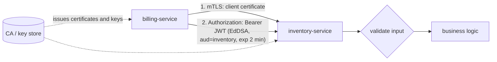

# 08. Security and supply chain: govulncheck, secrets, input validation, TLS and service-to-service JWT

> **Draft: written but not yet run.** The code and the expected output in this lesson were prepared by reading the code and the official documentation. They have not been executed yet. If something does not behave as described, trust your tool's real output and report it.

## What you will be able to do
By the end of this lesson you will be able to:
- run `govulncheck` against source and against a built binary, read its result, and wire it into CI;
- load secrets without leaking them, and validate untrusted input strictly (size, shape, allow-lists);
- configure TLS and mutual TLS in Go, and explain what each setting protects against;
- issue and verify short-lived service-to-service JWTs with asymmetric keys, and name the classic JWT mistakes.

## Recap
1. In lesson 07, what did the `Secret` type protect against? <details><summary>Answer</summary>Accidentally printing a secret in logs or with `fmt`; it redacts itself.</details>
2. In lesson 06, which status code and header tell a client to slow down? <details><summary>Answer</summary>`429 Too Many Requests` with `Retry-After`.</details>
3. In lesson 05, what was the transport of the gRPC lesson and what was missing? <details><summary>Answer</summary>Plaintext HTTP/2 on loopback; there was no TLS (this lesson adds it).</details>

## Why it matters
A bank vault has a strong door, but the building has a contractor's delivery entrance, a cleaning crew with keys, and a safe-deposit clerk who believes anything written on a form. Application security is mostly about those *other* entrances: the libraries you did not write (your supply chain), the data you did not create (your input), the keys you had to hand out (your secrets), and the calls that arrive from inside your own network (your identity between services). Go removes whole classes of bugs (no buffer overflows in safe code), but it cannot protect a secret you committed, a dependency with a known vulnerability, or a token you forgot to check the audience of.

## What you will build
A module `l08` with five small, tested building blocks and a demo that prints what each one accepts and rejects:
- `validate.go`: `DecodeStrict` (size limit, unknown fields, trailing data) and an allow-list `Validate`;
- `secrets.go`: a `Secret` type and `ReadSecret` with the `NAME_FILE` convention;
- `tokens.go`: an `Issuer` and `Verifier` for **Ed25519-signed JWTs** with `kid` based key rotation and a short life;
- `pki.go` and `tlsdemo.go`: an in-memory test CA and a **mutual TLS** server and client;
- `main.go` and `security_test.go`.
Then you will learn the toolchain side: `govulncheck`, `go mod verify`, pinning and checksums.



## Before you start
- Lessons 05, 06 and 07. Go 1.26.0 or newer. [Go 201 lesson 09](../../201-hero-to-super-hero/phase-3-data-and-security/09-auth-middleware-jwt.md) verified HS256 tokens with a shared secret; this lesson moves to asymmetric keys, rotation and service identity.
- The race detector is not needed here.
- Time: 110 minutes; two sittings, break after Step 5.
- Source pack (optional): every file is shown in full in this lesson, so you can follow without it. The finished code, the exercise starter and the solution are in the
  course repository https://github.com/Uee03/Code101 under `source/go/301-super-hero-to-legendary/phase-3-production/08-security-and-supply-chain/` (on that page choose **Code, Download ZIP**, or run
  `git clone https://github.com/Uee03/Code101.git`).
- [How every lesson works](../../README.md#how-every-lesson-works) explains folders, saving and running.
- `go.sum` is created by `go mod tidy`; the pack does not ship it.
- The capstone shows the JWT validation of a real identity provider, with JWKS and roles: [Go backend capstone chapter 05](../../../../capstones/backend-go/tutorials/phase-3-identity/05-jwt-and-roles.md); the hardening checklist is in [chapter 07](../../../../capstones/backend-go/tutorials/phase-5-hardening/07-hardening.md).

## Steps

### Step 1. Folder and `go.mod`
**File: terminal (not a saved file)**
```powershell
New-Item -ItemType Directory -Force "$HOME/code101/go301/lesson08" | Out-Null
Set-Location "$HOME/code101/go301/lesson08"
```
```bash
mkdir -p ~/code101/go301/lesson08
cd ~/code101/go301/lesson08
```
Recovery: `Set-Location "$HOME/code101/go301/lesson08"` or `cd ~/code101/go301/lesson08`.

**File: `go.mod`**
```text
module example.com/code101/go301/l08

go 1.26.0

require github.com/golang-jwt/jwt/v5 v5.3.1
```
One third-party dependency, **pinned to an exact version**. Everything else in this lesson uses the standard library, including its cryptography. Run `go mod tidy` now: it creates `go.sum`, the file of cryptographic checksums that makes the dependency tamper-evident (see "Supply chain" below).

### Step 2. A threat model before any code
A **threat model** is the short list of who might attack, what they want and where they can get in. Write it down before choosing controls, or you will pick the controls you already know.

| Asset | Who attacks | Entry point | Control in this lesson |
|---|---|---|---|
| User data in requests | anyone on the internet | request bodies | strict decoding, size limits, allow-lists |
| Credentials and keys | a developer mistake, a leaked image, a log reader | code, images, logs, env dumps | secrets from files or a store, `Secret` type, scanning |
| Service-to-service calls | a compromised or impersonating service | the internal network | mTLS, short-lived JWTs with audience |
| Third-party code | a malicious or vulnerable dependency | `go.mod` | pinning, checksums, `govulncheck`, review |
| Traffic on the wire | a network attacker | any hop | TLS 1.3, certificate verification |
Zero trust in one sentence: **being inside the network proves nothing**; every call proves who it is and what it may do.

### Step 3. Strict input: decode, bound, validate
**File: `validate.go`**
```go
package main

import (
	"encoding/json"
	"errors"
	"fmt"
	"io"
	"net/http"
	"net/mail"
	"slices"
	"strings"
	"unicode"
	"unicode/utf8"
)

// ErrBodyTooLarge is returned when a request body exceeds the allowed size.
var ErrBodyTooLarge = errors.New("request body too large")

// CreateUser is the shape of one request body.
type CreateUser struct {
	Name  string `json:"name"`
	Email string `json:"email"`
	Role  string `json:"role"`
}

var allowedRoles = []string{"member", "admin"}

// Validate checks every field against an allow-list or a bound and returns
// one message per problem, in a fixed order. No messages means valid.
func (c CreateUser) Validate() []string {
	var problems []string
	if n := utf8.RuneCountInString(c.Name); n < 1 || n > 64 || strings.IndexFunc(c.Name, unicode.IsControl) >= 0 {
		problems = append(problems, "name: must be 1 to 64 characters without control characters")
	}
	if addr, err := mail.ParseAddress(c.Email); err != nil || addr.Address != c.Email || len(c.Email) > 254 {
		problems = append(problems, "email: not a valid address")
	}
	if !slices.Contains(allowedRoles, c.Role) {
		problems = append(problems, "role: must be one of "+strings.Join(allowedRoles, ", "))
	}
	return problems
}

// DecodeStrict reads exactly one JSON value of type T from the request body.
// It caps the size, rejects unknown fields and rejects trailing data.
func DecodeStrict[T any](w http.ResponseWriter, r *http.Request, maxBytes int64) (T, error) {
	var v T
	r.Body = http.MaxBytesReader(w, r.Body, maxBytes)
	dec := json.NewDecoder(r.Body)
	dec.DisallowUnknownFields()

	if err := dec.Decode(&v); err != nil {
		var tooLarge *http.MaxBytesError
		if errors.As(err, &tooLarge) {
			return v, ErrBodyTooLarge
		}
		return v, fmt.Errorf("decode: %w", err)
	}
	if _, err := dec.Token(); !errors.Is(err, io.EOF) {
		return v, errors.New("decode: body must contain a single JSON value")
	}
	return v, nil
}
```
The rules behind each line:
- **Bound everything before you read it.** `http.MaxBytesReader` stops reading after `maxBytes`, so a 5 GB body cannot fill your memory. Also set `ReadTimeout` on the server (lesson 04).
- **Reject what you do not know.** `DisallowUnknownFields` turns a misspelt field or an attempt at mass assignment (`"admin": true`) into an error instead of silently ignoring it. The trailing-data check blocks a second JSON value smuggled after the first.
- **Allow-list, never deny-list.** `role` must be one of two known values; you list what is allowed instead of trying to list every bad value. Length is counted in **runes** (characters), not bytes, and control characters are refused because they cause log-injection and display problems.
- `mail.ParseAddress` parses RFC 5322 addresses, which includes `"Ada <ada@example.com>"`; comparing `addr.Address` with the input accepts only the bare address. Deliverability is checked by sending mail, not by regex.
- **Validation is not sanitising.** Do not "fix" input silently; reject it. Where the data is later used, use the **safe API for that context**: parameterised queries for SQL (never string concatenation), `html/template` for HTML, `exec.Command` with separate arguments (never a shell string), and for files `os.OpenRoot` (Go 1.24) or a path check, because `../` in a name must not escape its directory.

### Step 4. Secrets
**File: `secrets.go`**
```go
package main

import (
	"fmt"
	"log/slog"
	"os"
	"strings"
)

// Secret is a string that never prints its value, in logs or with fmt.
// Call Reveal only at the point of use, for example when building a request.
type Secret string

func (Secret) String() string       { return "[redacted]" }
func (Secret) LogValue() slog.Value { return slog.StringValue("[redacted]") }
func (s Secret) Reveal() string     { return string(s) }

// ReadSecret returns the secret called name. If NAME_FILE is set, the value is
// read from that file (the convention used by Docker and Kubernetes secrets);
// otherwise it comes from the environment variable NAME.
func ReadSecret(name string) (Secret, error) {
	if path := os.Getenv(name + "_FILE"); path != "" {
		b, err := os.ReadFile(path)
		if err != nil {
			return "", fmt.Errorf("read %s_FILE: %w", name, err)
		}
		return nonEmpty(name, strings.TrimSpace(string(b)))
	}
	return nonEmpty(name, os.Getenv(name))
}

func nonEmpty(name, value string) (Secret, error) {
	if value == "" {
		return "", fmt.Errorf("secret %s is not set", name)
	}
	return Secret(value), nil
}
```
Secrets policy in six lines:
1. **Never in source control, never in an image, never in a log.** Git history is forever: a committed secret is compromised even after you delete the file, and must be **rotated**.
2. **Read at start-up, from the environment or a file mounted by the platform.** The `NAME_FILE` convention (used by Docker secrets, Kubernetes mounted secrets and many images) keeps the value out of `docker inspect` and process environment listings, which can be read by other users or crash reporters.
3. **Fail fast** when a required secret is missing: `ReadSecret` returns an error, `main` exits, and the orchestrator shows a clear failure instead of a service that "works" until the first request.
4. **Type it.** `Secret` cannot be printed by accident; `Reveal()` is a deliberate act that shows up in code review.
5. **Do not pass secrets as Docker build arguments or `ENV` lines**: both stay in the image history. Use BuildKit secret mounts (`RUN --mount=type=secret,...`) if a build needs one.
6. **Rotate** on a schedule and on suspicion, and make rotation possible without a redeploy where you can (the `kid` list in the token section is the pattern). Scan commits for secrets with a scanner in CI and a pre-commit hook (for example `gitleaks`) and enable your host's push protection.
A `.gitignore` entry for `.env` and a committed `.env.example` with placeholders is the minimum.

### Step 5. Service-to-service JWTs
**File: `tokens.go`**
```go
package main

import (
	"crypto/ed25519"
	"crypto/rand"
	"errors"
	"fmt"
	"time"

	"github.com/golang-jwt/jwt/v5"
)

const (
	tokenIssuer  = "https://auth.internal.example"
	maxTokenLife = 5 * time.Minute
)

// KeySet maps a key id (the "kid" header) to a public key. Having several
// entries is how keys are rotated without downtime.
type KeySet map[string]ed25519.PublicKey

// Issuer signs short-lived service-to-service tokens.
type Issuer struct {
	kid string
	key ed25519.PrivateKey
	now func() time.Time
}

func NewIssuer(kid string, key ed25519.PrivateKey, now func() time.Time) *Issuer {
	return &Issuer{kid: kid, key: key, now: now}
}

// Issue creates a token that says: the service called subject may call the
// service called audience during the next ttl.
func (i *Issuer) Issue(subject, audience string, ttl time.Duration) (string, error) {
	if ttl <= 0 || ttl > maxTokenLife {
		return "", fmt.Errorf("ttl must be between 0 and %s", maxTokenLife)
	}
	now := i.now()
	claims := jwt.RegisteredClaims{
		Issuer:    tokenIssuer,
		Subject:   subject,
		Audience:  jwt.ClaimStrings{audience},
		IssuedAt:  jwt.NewNumericDate(now),
		NotBefore: jwt.NewNumericDate(now),
		ExpiresAt: jwt.NewNumericDate(now.Add(ttl)),
		ID:        rand.Text(),
	}
	token := jwt.NewWithClaims(jwt.SigningMethodEdDSA, claims)
	token.Header["kid"] = i.kid
	return token.SignedString(i.key)
}

// Verifier checks tokens presented to one service.
type Verifier struct {
	keys     KeySet
	audience string
	now      func() time.Time
}

func NewVerifier(keys KeySet, audience string, now func() time.Time) *Verifier {
	return &Verifier{keys: keys, audience: audience, now: now}
}

// Verify returns the calling service's name, or an error.
func (v *Verifier) Verify(tokenString string) (string, error) {
	claims := &jwt.RegisteredClaims{}
	_, err := jwt.ParseWithClaims(tokenString, claims, v.keyFunc,
		jwt.WithValidMethods([]string{"EdDSA"}),
		jwt.WithIssuer(tokenIssuer),
		jwt.WithAudience(v.audience),
		jwt.WithExpirationRequired(),
		jwt.WithIssuedAt(),
		jwt.WithLeeway(5*time.Second),
		jwt.WithTimeFunc(v.now),
	)
	if err != nil {
		return "", err
	}
	if claims.Subject == "" {
		return "", errors.New("token has no subject")
	}
	return claims.Subject, nil
}

// keyFunc picks the public key by the kid header. It never trusts the token
// to say which algorithm or which key type to use.
func (v *Verifier) keyFunc(t *jwt.Token) (any, error) {
	kid, _ := t.Header["kid"].(string)
	key, ok := v.keys[kid]
	if !ok {
		return nil, fmt.Errorf("unknown key id %q", kid)
	}
	return key, nil
}

// Reason turns a verification error into a short label that is safe to put
// in logs, metrics and responses.
func Reason(err error) string {
	switch {
	case err == nil:
		return "ok"
	case errors.Is(err, jwt.ErrTokenExpired):
		return "expired"
	case errors.Is(err, jwt.ErrTokenInvalidAudience):
		return "wrong audience"
	case errors.Is(err, jwt.ErrTokenInvalidIssuer):
		return "wrong issuer"
	case errors.Is(err, jwt.ErrTokenSignatureInvalid):
		return "bad signature"
	case errors.Is(err, jwt.ErrTokenMalformed):
		return "malformed"
	case errors.Is(err, jwt.ErrTokenUnverifiable):
		return "unverifiable"
	default:
		return "invalid"
	}
}
```
A **JWT** (JSON Web Token) is three base64url parts: a header (`alg`, `kid`), claims (the payload) and a signature. The signature proves the header and claims were not changed by anyone who does not hold the private key. It does **not** encrypt anything: anyone can read the claims, so never put secrets in them.

Why these choices:
- **Asymmetric signing (Ed25519).** The issuer holds the private key; every service holds only the **public** key. A compromised service can verify tokens but cannot mint them. With a shared secret (HS256), every verifier can forge tokens for every other service.
- **Short life (`maxTokenLife` five minutes, two in the demo).** Stateless JWTs cannot be revoked before they expire. Keeping them short is the revocation strategy; services fetch a new one before expiry.
- **`aud` (audience).** A token minted for `inventory` is refused by `payments`. Without audience checks, any token from your issuer works on every service, so one stolen token reaches everything.
- **`WithValidMethods([]string{"EdDSA"})`.** The classic JWT attacks are *algorithm confusion*: a token claims `alg: none` (no signature) or claims `HS256` and uses your **public** key as the HMAC secret. Never let the token choose the algorithm; the verifier states it.
- **`WithExpirationRequired`.** By default a token without `exp` is accepted forever. Make expiry mandatory.
- **`kid` and a `KeySet`.** During rotation you publish the new public key next to the old one, switch the issuer to the new `kid`, wait for old tokens to expire (at most five minutes), then remove the old key. Services in real systems fetch the set from a JWKS endpoint and cache it (capstone chapter 05); here it is a map.
- **Leeway of 5 seconds** tolerates small clock differences between machines; larger leeway extends every token's life. Keep clocks synchronised (NTP) and the leeway small.
- **`rand.Text()`** (`crypto/rand`, Go 1.24) makes a random `jti` (token id) usable for logging and, if you need it, a replay cache. For anything secret use `crypto/rand`, never `math/rand`.
- `Reason` maps errors to **short safe labels**. The raw error can include key ids or claim values; log the label, not the token, and never log the token itself.

### Step 6. TLS and mutual TLS
**File: `pki.go`**
```go
package main

import (
	"crypto/ecdsa"
	"crypto/elliptic"
	"crypto/rand"
	"crypto/tls"
	"crypto/x509"
	"crypto/x509/pkix"
	"math/big"
	"net"
	"time"
)

// PKI is a throw-away certificate authority for tests and demos.
// Never use it for real traffic: production certificates come from your
// organisation's CA or a service such as cert-manager, with short lifetimes.
type PKI struct {
	Cert *x509.Certificate
	Pool *x509.CertPool
	key  *ecdsa.PrivateKey
}

func NewCA() (*PKI, error) {
	key, err := ecdsa.GenerateKey(elliptic.P256(), rand.Reader)
	if err != nil {
		return nil, err
	}
	sn, err := serial()
	if err != nil {
		return nil, err
	}
	tmpl := &x509.Certificate{
		SerialNumber:          sn,
		Subject:               pkix.Name{CommonName: "code101 test CA"},
		NotBefore:             time.Now().Add(-time.Minute),
		NotAfter:              time.Now().Add(time.Hour),
		IsCA:                  true,
		KeyUsage:              x509.KeyUsageCertSign | x509.KeyUsageCRLSign,
		BasicConstraintsValid: true,
	}
	der, err := x509.CreateCertificate(rand.Reader, tmpl, tmpl, &key.PublicKey, key)
	if err != nil {
		return nil, err
	}
	cert, err := x509.ParseCertificate(der)
	if err != nil {
		return nil, err
	}
	pool := x509.NewCertPool()
	pool.AddCert(cert)
	return &PKI{Cert: cert, Pool: pool, key: key}, nil
}

// Issue creates a certificate signed by the CA. Use ExtKeyUsageServerAuth for
// servers and ExtKeyUsageClientAuth for clients.
func (p *PKI) Issue(commonName string, dnsNames []string, ips []net.IP, usage x509.ExtKeyUsage) (tls.Certificate, error) {
	key, err := ecdsa.GenerateKey(elliptic.P256(), rand.Reader)
	if err != nil {
		return tls.Certificate{}, err
	}
	sn, err := serial()
	if err != nil {
		return tls.Certificate{}, err
	}
	tmpl := &x509.Certificate{
		SerialNumber: sn,
		Subject:      pkix.Name{CommonName: commonName},
		DNSNames:     dnsNames,
		IPAddresses:  ips,
		NotBefore:    time.Now().Add(-time.Minute),
		NotAfter:     time.Now().Add(time.Hour),
		KeyUsage:     x509.KeyUsageDigitalSignature,
		ExtKeyUsage:  []x509.ExtKeyUsage{usage},
	}
	der, err := x509.CreateCertificate(rand.Reader, tmpl, p.Cert, &key.PublicKey, p.key)
	if err != nil {
		return tls.Certificate{}, err
	}
	return tls.Certificate{Certificate: [][]byte{der}, PrivateKey: key}, nil
}

// serial returns a random 127-bit serial number, as certificate authorities should.
func serial() (*big.Int, error) {
	return rand.Int(rand.Reader, new(big.Int).Lsh(big.NewInt(1), 127))
}
```
This file exists so the demo needs no files and no `openssl`. Concepts: a **certificate** binds a public key to an identity (a DNS name, an IP address or a name like `billing-service`) and is signed by a **certificate authority (CA)**. A peer **verifies** a certificate by checking the signature chain up to a CA it trusts, the validity dates, the name and the **key usage** (`ServerAuth` or `ClientAuth`). In production, certificates are short-lived (hours to days) and rotated automatically by tooling; long-lived certificates are an incident waiting for a calendar date.

**File: `tlsdemo.go`**
```go
package main

import (
	"crypto/tls"
	"crypto/x509"
	"fmt"
	"io"
	"log"
	"net"
	"net/http"
	"net/http/httptest"
	"time"
)

// mtlsDemo starts a server that requires a client certificate and calls it
// twice: once with a certificate from the trusted CA, once without.
func mtlsDemo() (with string, without string, err error) {
	ca, err := NewCA()
	if err != nil {
		return "", "", err
	}
	serverCert, err := ca.Issue("inventory.internal", []string{"inventory.internal"}, []net.IP{net.ParseIP("127.0.0.1")}, x509.ExtKeyUsageServerAuth)
	if err != nil {
		return "", "", err
	}
	clientCert, err := ca.Issue("billing-service", nil, nil, x509.ExtKeyUsageClientAuth)
	if err != nil {
		return "", "", err
	}

	srv := httptest.NewUnstartedServer(http.HandlerFunc(func(w http.ResponseWriter, r *http.Request) {
		// The caller's identity comes from the verified certificate, not from a header.
		fmt.Fprintf(w, "hello %s", r.TLS.PeerCertificates[0].Subject.CommonName)
	}))
	srv.Config.ErrorLog = log.New(io.Discard, "", 0) // keep expected handshake failures quiet
	srv.TLS = &tls.Config{
		Certificates: []tls.Certificate{serverCert},
		ClientAuth:   tls.RequireAndVerifyClientCert,
		ClientCAs:    ca.Pool,
		MinVersion:   tls.VersionTLS13,
	}
	srv.StartTLS()
	defer srv.Close()

	with, err = get(srv.URL, ca, &clientCert)
	if err != nil {
		return "", "", err
	}
	if _, err := get(srv.URL, ca, nil); err != nil {
		without = "rejected"
	} else {
		without = "accepted (this is a bug)"
	}
	return with, without, nil
}

// get calls url, trusting only ca, and presenting cert when it is not nil.
func get(url string, ca *PKI, cert *tls.Certificate) (string, error) {
	cfg := &tls.Config{RootCAs: ca.Pool, MinVersion: tls.VersionTLS13}
	if cert != nil {
		cfg.Certificates = []tls.Certificate{*cert}
	}
	client := &http.Client{
		Timeout:   5 * time.Second,
		Transport: &http.Transport{TLSClientConfig: cfg},
	}
	defer client.CloseIdleConnections()

	resp, err := client.Get(url)
	if err != nil {
		return "", err
	}
	defer resp.Body.Close()
	body, err := io.ReadAll(io.LimitReader(resp.Body, 1<<10))
	if err != nil {
		return "", err
	}
	return fmt.Sprintf("%d %s", resp.StatusCode, body), nil
}
```
- **TLS** gives confidentiality and integrity on the wire and proves the **server's** identity to the client. **Mutual TLS (mTLS)** also makes the server verify the **client's** certificate (`RequireAndVerifyClientCert` with `ClientCAs`), so both ends know who they talk to.
- `MinVersion: tls.VersionTLS13` is fine inside a fleet you control. For public servers with older clients, `tls.VersionTLS12` is the usual floor. **Do not set `CipherSuites`** unless a standard requires it: Go's defaults are chosen and updated by the Go team, and a hand-written list ages badly.
- The server certificate here carries the **IP address** `127.0.0.1` because the demo connects by IP. In real life it carries DNS names, and the client verifies that the name it dialled appears in the certificate.
- The client trusts **only** the test CA (`RootCAs: ca.Pool`) rather than the system roots: for service-to-service calls, trust your own CA, not every public CA.
- **Never** set `InsecureSkipVerify: true` to "make the error go away": it disables the check that makes TLS worth having. The right fix is nearly always a missing CA in the pool, a wrong name or an expired certificate.
- `r.TLS.PeerCertificates[0].Subject.CommonName` is the caller's identity, **already verified** by the handshake. Authorise on it (an allow-list of service names), not on a self-declared header.
- With TLS 1.3 a client without a certificate may complete its half of the handshake and only fail when it reads the reply, which is why `get` returns the error from `client.Get` (a typical message is `remote error: tls: certificate required`, but do not match on text).
- `srv.Config.ErrorLog` is silenced so the **expected** handshake failure does not print noise in the demo; never silence logs like that in production.
- In production, add **rotation without restart**: set `GetCertificate` (server) or `GetClientCertificate` (client) on `tls.Config` to a function that returns the current certificate, reloaded from disk when the file changes.

### Step 7. The demo and the tests
**File: `main.go`**
```go
package main

import (
	"bytes"
	"crypto/ed25519"
	"fmt"
	"net/http"
	"net/http/httptest"
	"strings"
	"time"

	"github.com/golang-jwt/jwt/v5"
)

func main() {
	demoValidation()
	demoTokens()
	demoMTLS()
}

func demoValidation() {
	decode := func(body string, maxBytes int64) (CreateUser, error) {
		req := httptest.NewRequest(http.MethodPost, "/users", strings.NewReader(body))
		return DecodeStrict[CreateUser](httptest.NewRecorder(), req, maxBytes)
	}

	user, err := decode(`{"name":"Ada","email":"ada@example.com","role":"member"}`, 1024)
	fmt.Printf("validate: valid request accepted: %+v (err=%v, problems=%v)\n", user, err, user.Validate())

	_, err = decode(`{"name":"Ada","admin":true}`, 1024)
	fmt.Println("validate: unknown field rejected:", err)

	_, err = decode(`{"name":"`+strings.Repeat("a", 100)+`"}`, 32)
	fmt.Println("validate: oversized body rejected:", err)

	user, _ = decode(`{"name":"","email":"not-an-email","role":"root"}`, 1024)
	fmt.Println("validate: invalid values:", strings.Join(user.Validate(), "; "))
}

func demoTokens() {
	// A fixed seed makes the demo repeatable. Real keys come from a key
	// management system or are generated once and stored as secrets.
	seed := bytes.Repeat([]byte{7}, ed25519.SeedSize)
	priv := ed25519.NewKeyFromSeed(seed)
	keys := KeySet{"k1": priv.Public().(ed25519.PublicKey)}

	now := time.Date(2026, 1, 1, 12, 0, 0, 0, time.UTC)
	clock := func() time.Time { return now }

	token, err := NewIssuer("k1", priv, clock).Issue("billing", "inventory", 2*time.Minute)
	if err != nil {
		fmt.Println("jwt: issue failed:", err)
		return
	}

	subject, err := NewVerifier(keys, "inventory", clock).Verify(token)
	fmt.Printf("jwt: billing -> inventory accepted: subject=%s (err=%v)\n", subject, err)

	_, err = NewVerifier(keys, "payments", clock).Verify(token)
	fmt.Printf("jwt: same token presented to payments: rejected (%s)\n", Reason(err))

	later := func() time.Time { return now.Add(10 * time.Minute) }
	_, err = NewVerifier(keys, "inventory", later).Verify(token)
	fmt.Printf("jwt: ten minutes later: rejected (%s)\n", Reason(err))

	attacker := ed25519.NewKeyFromSeed(bytes.Repeat([]byte{8}, ed25519.SeedSize))
	forged, _ := NewIssuer("k1", attacker, clock).Issue("billing", "inventory", 2*time.Minute)
	_, err = NewVerifier(keys, "inventory", clock).Verify(forged)
	fmt.Printf("jwt: forged with another key: rejected (%s)\n", Reason(err))

	unsigned, _ := jwt.NewWithClaims(jwt.SigningMethodNone, jwt.RegisteredClaims{Subject: "billing"}).SignedString(jwt.UnsafeAllowNoneSignatureType)
	_, err = NewVerifier(keys, "inventory", clock).Verify(unsigned)
	fmt.Printf("jwt: alg none token: rejected=%t\n", err != nil)
}

func demoMTLS() {
	with, without, err := mtlsDemo()
	if err != nil {
		fmt.Println("mtls: demo failed:", err)
		return
	}
	fmt.Println("mtls: with client certificate ->", with)
	fmt.Println("mtls: without client certificate ->", without)
}
```
**File: `security_test.go`**
```go
package main

import (
	"bytes"
	"crypto/ed25519"
	"errors"
	"net/http"
	"net/http/httptest"
	"os"
	"path/filepath"
	"strings"
	"testing"
	"time"
)

func decodeUser(body string, maxBytes int64) (CreateUser, error) {
	req := httptest.NewRequest(http.MethodPost, "/users", strings.NewReader(body))
	return DecodeStrict[CreateUser](httptest.NewRecorder(), req, maxBytes)
}

func TestDecodeStrictRejectsBadBodies(t *testing.T) {
	cases := []struct {
		name string
		body string
		max  int64
		want error
	}{
		{"unknown field", `{"name":"Ada","admin":true}`, 1024, nil},
		{"trailing data", `{"name":"Ada"} {"name":"Eve"}`, 1024, nil},
		{"too large", `{"name":"` + strings.Repeat("a", 100) + `"}`, 32, ErrBodyTooLarge},
	}
	for _, tc := range cases {
		t.Run(tc.name, func(t *testing.T) {
			_, err := decodeUser(tc.body, tc.max)
			if err == nil {
				t.Fatal("expected an error")
			}
			if tc.want != nil && !errors.Is(err, tc.want) {
				t.Fatalf("err = %v, want %v", err, tc.want)
			}
		})
	}
}

func TestValidate(t *testing.T) {
	good := CreateUser{Name: "Ada", Email: "ada@example.com", Role: "member"}
	if p := good.Validate(); len(p) != 0 {
		t.Fatalf("valid user got problems: %v", p)
	}

	bad := []CreateUser{
		{Name: "", Email: "ada@example.com", Role: "member"},
		{Name: "Ada\x00", Email: "ada@example.com", Role: "member"},
		{Name: "Ada", Email: "Ada <ada@example.com>", Role: "member"},
		{Name: "Ada", Email: "ada@example.com", Role: "root"},
	}
	for _, u := range bad {
		if len(u.Validate()) != 1 {
			t.Errorf("%+v: want exactly one problem, got %v", u, u.Validate())
		}
	}
}

func TestVerifierRejectsWrongAudienceExpiredAndForged(t *testing.T) {
	priv := ed25519.NewKeyFromSeed(bytes.Repeat([]byte{7}, ed25519.SeedSize))
	other := ed25519.NewKeyFromSeed(bytes.Repeat([]byte{8}, ed25519.SeedSize))
	keys := KeySet{"k1": priv.Public().(ed25519.PublicKey)}
	now := time.Date(2026, 1, 1, 12, 0, 0, 0, time.UTC)
	clock := func() time.Time { return now }

	good, err := NewIssuer("k1", priv, clock).Issue("billing", "inventory", time.Minute)
	if err != nil {
		t.Fatal(err)
	}
	if sub, err := NewVerifier(keys, "inventory", clock).Verify(good); err != nil || sub != "billing" {
		t.Fatalf("good token: subject = %q, err = %v", sub, err)
	}

	forged, _ := NewIssuer("k1", other, clock).Issue("billing", "inventory", time.Minute)
	checks := []struct {
		name     string
		verifier *Verifier
		token    string
		reason   string
	}{
		{"wrong audience", NewVerifier(keys, "payments", clock), good, "wrong audience"},
		{"expired", NewVerifier(keys, "inventory", func() time.Time { return now.Add(time.Hour) }), good, "expired"},
		{"forged", NewVerifier(keys, "inventory", clock), forged, "bad signature"},
		{"unknown kid", NewVerifier(KeySet{}, "inventory", clock), good, "unverifiable"},
	}
	for _, c := range checks {
		_, err := c.verifier.Verify(c.token)
		if got := Reason(err); got != c.reason {
			t.Errorf("%s: reason = %q (err: %v), want %q", c.name, got, err, c.reason)
		}
	}
}

func TestIssueRejectsLongLivedTokens(t *testing.T) {
	priv := ed25519.NewKeyFromSeed(bytes.Repeat([]byte{7}, ed25519.SeedSize))
	_, err := NewIssuer("k1", priv, time.Now).Issue("billing", "inventory", 24*time.Hour)
	if err == nil {
		t.Fatal("a 24 hour service token must be refused")
	}
}

func TestMutualTLS(t *testing.T) {
	with, without, err := mtlsDemo()
	if err != nil {
		t.Fatal(err)
	}
	if with != "200 hello billing-service" || without != "rejected" {
		t.Fatalf("with = %q, without = %q", with, without)
	}
}

func TestReadSecretFromFileAndRedaction(t *testing.T) {
	path := filepath.Join(t.TempDir(), "db_password")
	if err := os.WriteFile(path, []byte("s3cr3t\n"), 0o600); err != nil {
		t.Fatal(err)
	}
	t.Setenv("DB_PASSWORD_FILE", path)

	s, err := ReadSecret("DB_PASSWORD")
	if err != nil {
		t.Fatal(err)
	}
	if s.Reveal() != "s3cr3t" || s.String() != "[redacted]" {
		t.Fatalf("Reveal = %q, String = %q", s.Reveal(), s.String())
	}
}

func TestReadSecretMissing(t *testing.T) {
	t.Setenv("L08_MISSING", "")
	if _, err := ReadSecret("L08_MISSING"); err == nil || !strings.Contains(err.Error(), "not set") {
		t.Fatalf("err = %v, want a 'not set' error", err)
	}
}
```
The tests are the security regression suite: each rejection in the demo is also an assertion, so a future "small refactor" that drops `WithAudience` fails a test. They include the **negative** cases, which are the ones that matter.

### Step 8. Predict, then run
**Predict before you run.** For the five token cases (accepted, wrong audience, ten minutes later, forged, alg none), which will be accepted? And what will `mtls: without client certificate` print?

## Run it
**File: terminal (not a saved file)**
```text
go mod tidy
go run .
```
Expected output (derived by reading the code; not yet run):
```text
validate: valid request accepted: {Name:Ada Email:ada@example.com Role:member} (err=<nil>, problems=[])
validate: unknown field rejected: decode: json: unknown field "admin"
validate: oversized body rejected: request body too large
validate: invalid values: name: must be 1 to 64 characters without control characters; email: not a valid address; role: must be one of member, admin
jwt: billing -> inventory accepted: subject=billing (err=<nil>)
jwt: same token presented to payments: rejected (wrong audience)
jwt: ten minutes later: rejected (expired)
jwt: forged with another key: rejected (bad signature)
jwt: alg none token: rejected=true
mtls: with client certificate -> 200 hello billing-service
mtls: without client certificate -> rejected
```
Then the tests:

**File: terminal (not a saved file)**
```text
go test ./...
```
Expected: `ok` and the module path with a duration. The mTLS test generates keys, so it takes a few hundred milliseconds at most on a normal machine (measure it, do not assume).

## The toolchain side: vulnerabilities and the supply chain
**govulncheck.** Go maintains a vulnerability database (https://pkg.go.dev/vuln) and the `govulncheck` tool checks your code against it. Its key idea is **reachability**: it reports vulnerabilities in functions your code can actually **call**, and lists the others as informational, so the alert list is short and actionable. Install with a **pinned version** and run it:

**File: terminal (not a saved file)**
```text
go install golang.org/x/vuln/cmd/govulncheck@v1.10.0
govulncheck ./...
```
When nothing is found it prints a line such as `No vulnerabilities found.` (typical message). When something is found, each finding names the vulnerability ID (`GO-YYYY-NNNN`), the affected module and version, the **fixed version** and an example call stack from your code into the vulnerable function. The fix is almost always `go get module@fixed-version`, `go mod tidy`, then your tests.

Two modes, two jobs:
- **Source mode** (`govulncheck ./...`) analyses your module and its dependencies: run it on every pull request and on a **nightly schedule**, because new vulnerabilities are published against code that did not change.
- **Binary mode** (`govulncheck -mode=binary ./app`) analyses a built executable, using the module list that Go embeds in every binary. It checks what you **actually ship** and works on artefacts from other teams. Run it on the release artefact.
The Go standard library is checked too, which is one more reason to track Go patch releases: a toolchain update is a security update. With the default text output the tool exits with a non-zero status when it finds called vulnerabilities; with `-format json` or `sarif` it exits 0 and you must read the findings (check the tool's documentation for your version before you build a CI gate on exit codes).

**What `go.sum` and the checksum database do.** `go.mod` lists the exact version of each module (Go uses *minimal version selection*: it builds with the versions the files say, and never silently floats to a newer one). `go.sum` stores a hash of each module version's contents. The first time a version is downloaded, the `go` command also checks the hash against the public **checksum database** (`sum.golang.org`), so everyone gets the same bytes for the same version and a re-tagged or modified version is detected. Consequences:
- **Commit `go.sum`.** It is not generated noise.
- In CI run `go mod verify` (re-checks the downloaded modules against `go.sum`) and `go mod tidy -diff` (fails when `go.mod` or `go.sum` are not tidy).
- Private modules must be listed in `GOPRIVATE` so their paths are not sent to the public proxy or checksum database.
- Build with `-mod=readonly` (the default for `go build`), so a build never edits your module files.

**Dependency hygiene** (each is a trade-off):
| Practice | Why | Cost |
|---|---|---|
| Few dependencies; prefer the standard library | less code you do not control | you write more |
| Pin exact versions (as in this lesson) | repeatable builds | you must upgrade deliberately |
| Automated update pull requests (Dependabot or Renovate) plus review of the diff | steady, small upgrades | review time; noisy without grouping |
| `go mod why -m <module>` before adding or keeping a module | find out who pulls what | none |
| Vendor (`go mod vendor`) for builds without network | offline, auditable | bigger repository; diffs of vendored code |
| Pin **tools** too (`go install tool@version`, or the `tool` directive in `go.mod`, Go 1.24) | the scanner itself is code you run | one more list to update |
| Check the module's maintainers, license and recent activity; beware look-alike names (typosquatting) | malicious packages exist | a few minutes per new dependency |

## How it works
- **Defence in depth.** No single control here is enough: validation stops bad input, TLS stops eavesdroppers, mTLS and JWTs stop impostors, `govulncheck` stops known-bad code, the secret type stops accidents. An attacker must defeat several, and each one's failure is survivable.
- **Authentication versus authorisation.** mTLS and JWT answer "**who** are you?" (authentication). Whether `billing` may call `POST /stock` is a separate decision (authorisation): keep an allow-list of subjects per route, or put scopes in the token. Both belong in code review.
- **mTLS or JWT?** They solve different layers. mTLS authenticates the **connection** between two workloads and encrypts it, and needs certificate issuance and rotation. A JWT carries **claims** (who, for whom, until when, with which scopes) and can be forwarded or logged, and needs key distribution and short lifetimes. Using both is common: mTLS for the transport identity, JWT for the application-level claims or the end-user identity.
- **Misconception to correct:** "our services are on a private network, so TLS and tokens are optional." Networks are shared, flat and mis-configured; one compromised pod becomes a tourist in everything else. Treat the internal network as hostile.

## Decision record (ADR style)
**ADR-08: mTLS for service identity, short-lived EdDSA JWTs for claims, no shared secrets between services.**
- Context: nine internal services; today they trust each other by network location and share one API key.
- Options: (1) keep the shared key; (2) HS256 JWTs signed with a shared secret; (3) asymmetric JWTs only; (4) mTLS only; (5) mTLS plus asymmetric JWTs; (6) a service mesh that does mTLS transparently.
- Decision: (5) now, with the aim of (6) when the platform team can run it. The issuer service holds the only private key, services get public keys by `kid`, tokens live at most five minutes and carry `aud`; certificates are issued by the organisation's CA and live for days, not years.
- Consequences: a CA and a key-distribution process to operate; clock synchronisation matters; tokens cannot be revoked early (accepted, because of the five-minute life); every service needs an allow-list of callers.

**When not to use these**
- **JWTs for browser sessions** that need instant revocation or "log out everywhere": server-side sessions (or short JWTs plus refresh tokens with revocation) fit better. Never store long-lived JWTs in `localStorage`.
- **mTLS between two processes on one host** that already share a trust boundary (a sidecar over a Unix socket): file permissions may be the right control.
- **`govulncheck` as the only supply-chain control**: it knows about vulnerabilities that were *reported*; it does not detect a malicious new package. Combine with review and pinning.
- **Hand-rolled cryptography**: use the standard library's `crypto` packages and well-maintained libraries; never invent a signature scheme or token format.

## Failure modes
| Failure | How it happens | Prevention |
|---|---|---|
| `alg: none` or algorithm confusion | the verifier lets the token pick the algorithm | `WithValidMethods`, a key function that fixes the key type |
| Missing `aud` check | a token for service A works on service B | `WithAudience` on every verifier |
| No expiry | a stolen token works forever | `WithExpirationRequired`, short `ttl` at issue time |
| Secret in logs, images or Git | printed config, `ENV`, committed `.env` | secret types, files, scanning, `.gitignore` |
| `InsecureSkipVerify: true` | copied from a forum answer | fix the trust root or the name instead |
| Long-lived certificates | outage or breach on the expiry date | automatic issuance and rotation, alerts on expiry |
| Unbounded input | memory exhaustion, slow parsing | `MaxBytesReader`, timeouts, limits per field |
| Mass assignment | a client sets fields it should not | `DisallowUnknownFields` and separate request types |
| Vulnerable dependency unnoticed | no scheduled scan | `govulncheck` in CI and nightly, binary mode on releases |
| Dependency confusion or typosquat | wrong or malicious module path | review new modules, `GOPRIVATE`, `GONOSUMDB` only for private paths |
| Clock skew | valid tokens rejected, or accepted too long | NTP, small leeway, monitor `nbf`/`exp` failures |

## Measurements to take
1. **Time to patch**: days between a vulnerability being published and the fix being deployed, per service. Track it as an SLO for critical findings.
2. **Dependency inventory**: number of direct and indirect modules (`go list -m all | wc -l` or `(go list -m all).Count`), and how many are more than a year behind.
3. **Token verification failures by reason** (the `Reason` label as a metric): a spike of `expired` points to clock skew or a stuck issuer; a spike of `bad signature` is an attack or a rotation mistake.
4. **TLS handshake failures and certificate days-to-expiry** per service.
5. **Rejected requests by validation rule**: which fields attackers (or buggy clients) probe.
6. **Secret age**: days since each secret was rotated.

## Production checklist
- [ ] `govulncheck` runs on every pull request, nightly, and in binary mode on release artefacts; the versions of the scanner and Go are pinned and updated.
- [ ] `go.sum` is committed; CI runs `go mod verify` and `go mod tidy -diff`; private modules are covered by `GOPRIVATE`.
- [ ] Every request body has a size cap, strict decoding and an allow-list validator; queries are parameterised.
- [ ] Secrets come from a secret store or mounted files, are typed so they cannot be logged, are never in images, and have a rotation plan.
- [ ] All traffic between services uses TLS 1.2 or newer (1.3 where you control both ends), with certificate verification on and no `InsecureSkipVerify`.
- [ ] Service tokens are asymmetric, audience-bound, short-lived; verifiers fix the algorithm and require `exp`.
- [ ] Each route states which callers may use it; denials are logged with a reason label and counted.
- [ ] Clocks are synchronised; certificate and key expiry is monitored.
- [ ] Containers run as non-root with a read-only file system and no capabilities (lesson 09).

## Try it
Copy `exercise/starter` next to your lesson folder and rename the copy `try08` (it has `go.mod` and `main.go`; run `go mod tidy` in it once).

**File: `exercise/starter/main.go`**
```go
package main

import (
	"bytes"
	"crypto/ed25519"
	"fmt"
	"time"

	"github.com/golang-jwt/jwt/v5"
)

var now = time.Date(2026, 1, 1, 12, 0, 0, 0, time.UTC)

func sign(method jwt.SigningMethod, key any, c jwt.RegisteredClaims) string {
	s, err := jwt.NewWithClaims(method, c).SignedString(key)
	if err != nil {
		panic(err)
	}
	return s
}

func claims(audience string, expires *jwt.NumericDate) jwt.RegisteredClaims {
	return jwt.RegisteredClaims{
		Issuer:    "auth.example",
		Subject:   "billing",
		Audience:  jwt.ClaimStrings{audience},
		IssuedAt:  jwt.NewNumericDate(now),
		ExpiresAt: expires,
	}
}

// verify must accept only: EdDSA tokens, issued by "auth.example", meant for
// the audience "inventory", that carry an expiry that has not passed.
// TODO: add the four parser options (jwt.WithValidMethods, jwt.WithIssuer,
// jwt.WithAudience, jwt.WithExpirationRequired) to the call below.
func verify(tokenString string, pub ed25519.PublicKey) error {
	_, err := jwt.ParseWithClaims(tokenString, &jwt.RegisteredClaims{},
		func(*jwt.Token) (any, error) { return pub, nil },
		jwt.WithTimeFunc(func() time.Time { return now }), // fixed clock for a stable demo
	)
	return err
}

func main() {
	priv := ed25519.NewKeyFromSeed(bytes.Repeat([]byte{9}, ed25519.SeedSize))
	pub := priv.Public().(ed25519.PublicKey)
	soon := jwt.NewNumericDate(now.Add(time.Minute))

	cases := []struct{ name, token string }{
		{"billing", sign(jwt.SigningMethodEdDSA, priv, claims("inventory", soon))},
		{"wrong audience", sign(jwt.SigningMethodEdDSA, priv, claims("payments", soon))},
		{"expired", sign(jwt.SigningMethodEdDSA, priv, claims("inventory", jwt.NewNumericDate(now.Add(-time.Hour))))},
		{"alg none", sign(jwt.SigningMethodNone, jwt.UnsafeAllowNoneSignatureType, claims("inventory", soon))},
		{"no expiry", sign(jwt.SigningMethodEdDSA, priv, claims("inventory", nil))},
	}
	for _, c := range cases {
		if err := verify(c.token, pub); err != nil {
			fmt.Printf("%s: rejected\n", c.name)
		} else {
			fmt.Printf("%s: accepted\n", c.name)
		}
	}
}
```
1. **Guided.** Run the starter and note which two cases are **wrongly accepted** (this is a real kind of bug: a verifier that "works" for the happy path). Add the four options named in the TODO. Goal output:
```text
billing: accepted
wrong audience: rejected
expired: rejected
alg none: rejected
no expiry: rejected
```
Check the first line carefully after your change: `billing` must still be accepted.
2. **Change.** Add a sixth case: a token signed correctly but issued by `"evil.example"`. Predict which option rejects it, and add the case.
3. **Stretch (no single answer).** Your verifier now has one hard-coded public key. Describe the smallest design that supports **key rotation** (two valid keys during the overlap, selected by `kid`), where the public keys come from, how often a service reloads them, and what happens to tokens already in flight when you retire a key.

<details><summary>Solution</summary>

**File: `exercise/solution/main.go` (changed region: `verify`)**
```go
// verify accepts only: EdDSA tokens, issued by "auth.example", meant for the
// audience "inventory", that carry an expiry that has not passed.
func verify(tokenString string, pub ed25519.PublicKey) error {
	_, err := jwt.ParseWithClaims(tokenString, &jwt.RegisteredClaims{},
		func(*jwt.Token) (any, error) { return pub, nil },
		jwt.WithValidMethods([]string{"EdDSA"}),
		jwt.WithIssuer("auth.example"),
		jwt.WithAudience("inventory"),
		jwt.WithExpirationRequired(),
		jwt.WithTimeFunc(func() time.Time { return now }), // fixed clock for a stable demo
	)
	return err
}
```
The rest of `main.go` is unchanged. The two cases the starter wrongly accepts are `wrong audience` and `no expiry`: `expired` is rejected by default (an `exp` in the past is always checked) and `alg none` fails because the key function returns an Ed25519 key, which the unsigned token cannot satisfy; with `WithValidMethods` it is refused even earlier. For rung 2, `WithIssuer` rejects the `evil.example` token. For rung 3, a map from `kid` to public key (like `KeySet`), refreshed from an endpoint every few minutes (and immediately on an unknown `kid`, with a rate limit so attackers cannot make you fetch on every request), with the new key published **before** the issuer starts using it and the old one removed only after the maximum token lifetime has passed.
</details>

## Check yourself
1. Why must the verifier, not the token, decide the signing algorithm? <details><summary>Answer</summary>The token is attacker-controlled input. If it picks `none` or an HMAC algorithm, the attacker can forge a token that passes verification.</details>
2. A JWT has a five-minute life. Why is that the revocation plan? <details><summary>Answer</summary>A stateless token cannot be recalled; a short life bounds how long a stolen or obsolete token works.</details>
3. Predict: what does `govulncheck` do with a vulnerability in a function your code never calls? <details><summary>Answer</summary>It lists it as informational (present in a dependency but not reachable) rather than as an actionable finding.</details>
4. Why does the demo client trust only the test CA instead of the system roots? <details><summary>Answer</summary>For internal calls you trust your own CA; trusting every public CA widens who can impersonate your services.</details>
5. What is wrong with `InsecureSkipVerify: true` in a client config, even for "internal" calls? <details><summary>Answer</summary>It turns off certificate verification, so anyone on the path can impersonate the server; TLS then gives encryption without authentication.</details>

## Common mistakes
| Symptom or error text | Cause | Fix |
|---|---|---|
| `go: updates to go.mod needed; to update it: go mod tidy` (typical message) | `go.sum` not created | `go mod tidy` |
| `x509: certificate signed by unknown authority` (typical message) | the client does not trust the CA that signed the server certificate | put the CA in `RootCAs`; do not skip verification |
| `x509: certificate is valid for ..., not ...` (typical message) | the certificate has no matching name or IP | issue it with the right `DNSNames` or `IPAddresses` |
| `x509: certificate has expired or is not yet valid` (typical message) | wrong clock, or an expired certificate | fix the clock; automate renewal |
| `remote error: tls: certificate required` or `bad certificate` (typical message) | the server demands a client certificate and none was sent | configure `Certificates` on the client |
| Token rejected as `expired` right after issue | clocks differ between issuer and verifier | synchronise clocks; small `WithLeeway` |
| `token is unverifiable: error while executing keyfunc: unknown key id ...` (typical message) | the `kid` is not in the `KeySet` | publish the new public key before issuing with it |
| `token signature is invalid: signing method none is invalid` (typical message) | an unsigned token was presented | working as intended |
| `govulncheck: command not found` or `not recognized` | `$(go env GOPATH)/bin` not on `PATH` | add it and open a new terminal |
| `http: request body too large` (typical message) | the body exceeded `maxBytes` | working as intended; raise the limit only with a reason |

## Best practice
Verify everything an attacker controls (algorithm, audience, expiry, size, shape), keep secrets and private keys out of code and logs, pin and scan dependencies, and prefer the standard library's cryptography. Source: Go Security Best Practices https://go.dev/doc/security/best-practices ; Go Vulnerability Management https://go.dev/doc/security/vuln/ ; crypto/tls https://pkg.go.dev/crypto/tls

## Going further
- Tutorial: Find and fix vulnerable dependencies with govulncheck: https://go.dev/doc/tutorial/govulncheck
- The Go vulnerability database: https://pkg.go.dev/vuln/
- Module authentication and the checksum database: https://go.dev/ref/mod#authenticating
- `crypto/tls` and `crypto/x509` package documentation: https://pkg.go.dev/crypto/tls and https://pkg.go.dev/crypto/x509
- JSON Web Token best current practices (RFC 8725): https://www.rfc-editor.org/rfc/rfc8725
- `golang-jwt/jwt` v5 documentation: https://pkg.go.dev/github.com/golang-jwt/jwt/v5
- Applied in the capstone: [identity chapter 05](../../../../capstones/backend-go/tutorials/phase-3-identity/05-jwt-and-roles.md) and [hardening chapter 07](../../../../capstones/backend-go/tutorials/phase-5-hardening/07-hardening.md).

## Summary
- You wrote strict request decoding and allow-list validation, and typed secrets loaded from files or the environment.
- You issued and verified short-lived Ed25519 JWTs with audience, expiry, issuer and `kid` checks, and proved that forged, expired, mis-addressed and unsigned tokens fail.
- You ran a mutual-TLS server and client from an in-memory CA and listed what each TLS setting protects.
- You can use `govulncheck` in source and binary mode, explain `go.sum`, and keep tools and dependencies pinned and scanned.

## Next lesson
09. Release engineering and a production checklist: build flags, reproducible builds, an SBOM, multi-architecture images and versioning, ending with a review exercise.
