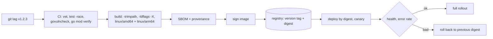

# 09. Release engineering and the production checklist: build flags, reproducible builds, SBOM, multi-arch images, versioning

> **Draft: written but not yet run.** The code and the expected output in this lesson were prepared by reading the code and the official documentation. They have not been executed yet. If something does not behave as described, trust your tool's real output and report it.

## What you will be able to do
By the end of this lesson you will be able to:
- build a small, static, version-stamped Go binary and a minimal non-root container image from it;
- check that two builds of the same commit produce byte-identical binaries, and say what breaks that;
- produce a software bill of materials (SBOM), build for several CPU architectures and choose a versioning scheme;
- review a service against a production checklist and write findings with severity and a fix.

## Recap
1. In lesson 08, what does `go.sum` protect against? <details><summary>Answer</summary>A dependency version changing underneath you: it stores hashes of module contents, checked against each download and the public checksum database.</details>
2. In lesson 07, why is `/metrics` on a separate port? <details><summary>Answer</summary>It reveals internal detail and should be reachable only from the private network.</details>
3. In lesson 04, what are the four `http.Server` timeouts for? <details><summary>Answer</summary>Slow or malicious clients: reading headers, reading the request, writing the response and idle connections.</details>

## Why it matters
A restaurant's food is only as safe as its delivery: the same sealed, labelled crate must arrive from the supplier to the kitchen, and you must be able to say which batch it came from and what is in it. **Release engineering** is that delivery chain for software. When the build is repeatable, labelled and inspectable, an incident takes minutes: "which commit is running? what exactly is in it? can we roll back to the previous one?" When it is not, every one of those questions is a day of archaeology, and a vulnerable library in a binary nobody can inventory is a crisis instead of a ticket.

## What you will build
- A tiny service with `/healthz`, `/readyz`, `/version`, a `-version` flag, a `-healthcheck` flag and graceful shutdown.
- A `Dockerfile` (multi-stage, cross-compiling, distroless, non-root), a `.dockerignore`, a `compose.yaml` with hardening and limits, and a `.env.example`.
- The commands for reproducibility, SBOM, multi-architecture builds and signing.
- The **production checklist** of the whole course, and a **review exercise** where you audit a flawed service.



## Before you start
- Lessons 03, 04, 07 and 08. Go 1.26.0 or newer. [Go 201 lesson 10](../../201-hero-to-super-hero/phase-4-quality-and-ship/10-testing-and-notes-api.md) shipped a small non-root container; this lesson turns that into a release process.
- Docker with **Buildx** and **Compose v2** for the container parts. The Go-only parts (version stamping, reproducibility) need no Docker.
- Time: 120 minutes; two sittings, break after Step 6.
- Source pack (optional): every file is shown in full in this lesson, so you can follow without it. The finished code, the exercise starter and the solution are in the
  course repository https://github.com/Uee03/Code101 under `source/go/301-super-hero-to-legendary/phase-3-production/09-release-engineering/` (on that page choose **Code, Download ZIP**, or run
  `git clone https://github.com/Uee03/Code101.git`).
- [How every lesson works](../../README.md#how-every-lesson-works) explains folders, saving and running.
- This module has no third-party dependency, so there is **no `go.sum`** and the Dockerfile copies only `go.mod`.
- The capstone's production image is explained in [Go backend capstone chapter 06](../../../../capstones/backend-go/tutorials/phase-4-run-and-ship/06-docker.md).

## Steps

### Step 1. Folders and `go.mod`
**File: terminal (not a saved file)**
```powershell
$root = "$HOME/code101/go301/lesson09"
foreach ($d in "cmd/app","internal/version") { New-Item -ItemType Directory -Force "$root/$d" | Out-Null }
Set-Location $root
```
```bash
mkdir -p ~/code101/go301/lesson09/{cmd/app,internal/version}
cd ~/code101/go301/lesson09
```
Recovery: `Set-Location "$HOME/code101/go301/lesson09"` or `cd ~/code101/go301/lesson09`.

**File: `go.mod`**
```text
module example.com/code101/go301/l09

go 1.26.0
```

### Step 2. The version package
**File: `internal/version/version.go`**
```go
package version

import (
	"fmt"
	"runtime"
	"runtime/debug"
)

// Version and Commit are replaced at build time:
//
//	go build -ldflags "-X example.com/code101/go301/l09/internal/version.Version=1.2.3"
//
// The defaults mark a build that did not come from the release pipeline.
var (
	Version = "dev"
	Commit  = "none"
)

// Info is what /version returns.
type Info struct {
	Version     string `json:"version"`
	Commit      string `json:"commit"`
	GoVersion   string `json:"go_version"`
	VCSRevision string `json:"vcs_revision,omitempty"`
	VCSModified string `json:"vcs_modified,omitempty"`
}

// String is the one-line text printed by the -version flag.
func String() string {
	return fmt.Sprintf("app %s (commit %s)", Version, Commit)
}

// Get combines the values set by the release pipeline with what the Go
// toolchain itself recorded in the binary (version control data is present
// when the binary was built with go build inside a git checkout).
func Get() Info {
	info := Info{Version: Version, Commit: Commit, GoVersion: runtime.Version()}
	if bi, ok := debug.ReadBuildInfo(); ok {
		for _, s := range bi.Settings {
			switch s.Key {
			case "vcs.revision":
				info.VCSRevision = s.Value
			case "vcs.modified":
				info.VCSModified = s.Value
			}
		}
	}
	return info
}
```
**File: `internal/version/version_test.go`**
```go
package version

import "testing"

func TestStringUsesBuildTimeValues(t *testing.T) {
	oldVersion, oldCommit := Version, Commit
	t.Cleanup(func() { Version, Commit = oldVersion, oldCommit })

	Version, Commit = "1.2.3", "abc1234"
	if got, want := String(), "app 1.2.3 (commit abc1234)"; got != want {
		t.Fatalf("String() = %q, want %q", got, want)
	}
}

func TestGetReportsTheGoVersion(t *testing.T) {
	if Get().GoVersion == "" {
		t.Fatal("GoVersion must not be empty")
	}
}
```
- `Version` and `Commit` are **package-level string variables** so the linker flag `-X importpath.Name=value` can replace them. It works only for `string` variables that are not initialised by a function call. The default values (`dev`, `none`) make an unstamped developer build obvious in logs and in `/version`.
- Go also embeds **build information** in every binary: the Go version, the module and its dependency versions, build flags and, for builds made inside a Git checkout, the commit (`vcs.revision`), its time and whether the tree had uncommitted changes (`vcs.modified`). `debug.ReadBuildInfo` reads it. `go version -m <binary>` prints it, which is how scanners and SBOM tools inventory a binary you only have as a file.
- Two sources on purpose: the pipeline-set `Version` (a human release name such as `1.2.3`) and the toolchain's `vcs.*` data. Seeing `vcs_modified: true` on a production binary means someone shipped from a dirty tree.

### Step 3. The application
**File: `cmd/app/main.go`**
```go
package main

import (
	"context"
	"encoding/json"
	"errors"
	"flag"
	"fmt"
	"log/slog"
	"net"
	"net/http"
	"os"
	"os/signal"
	"sync/atomic"
	"syscall"
	"time"

	"example.com/code101/go301/l09/internal/version"
)

func main() {
	showVersion := flag.Bool("version", false, "print the version and exit")
	healthcheck := flag.Bool("healthcheck", false, "probe /healthz and exit with 0 (healthy) or 1")
	flag.Parse()

	addr := env("HTTP_ADDR", "127.0.0.1:8080")
	switch {
	case *showVersion:
		fmt.Println(version.String())
	case *healthcheck:
		os.Exit(probe(addr))
	default:
		if err := serve(addr); err != nil {
			slog.Error("server stopped", "error", err)
			os.Exit(1)
		}
	}
}

// probe is used by the container health check: a distroless image has no
// shell and no curl, so the binary checks itself.
func probe(addr string) int {
	_, port, err := net.SplitHostPort(addr)
	if err != nil {
		return 1
	}
	client := &http.Client{Timeout: 2 * time.Second}
	resp, err := client.Get("http://127.0.0.1:" + port + "/healthz")
	if err != nil {
		return 1
	}
	defer resp.Body.Close()
	if resp.StatusCode != http.StatusOK {
		return 1
	}
	return 0
}

func serve(addr string) error {
	log := slog.New(slog.NewJSONHandler(os.Stdout, nil))
	var ready atomic.Bool

	mux := http.NewServeMux()
	// Liveness: the process is running. Never check dependencies here.
	mux.HandleFunc("GET /healthz", func(w http.ResponseWriter, _ *http.Request) {
		w.WriteHeader(http.StatusOK)
	})
	// Readiness: should the load balancer send traffic now?
	mux.HandleFunc("GET /readyz", func(w http.ResponseWriter, _ *http.Request) {
		if !ready.Load() {
			w.WriteHeader(http.StatusServiceUnavailable)
			return
		}
		w.WriteHeader(http.StatusOK)
	})
	mux.HandleFunc("GET /version", func(w http.ResponseWriter, _ *http.Request) {
		w.Header().Set("Content-Type", "application/json")
		_ = json.NewEncoder(w).Encode(version.Get())
	})

	srv := &http.Server{
		Addr:              addr,
		Handler:           mux,
		ReadHeaderTimeout: 5 * time.Second,
		ReadTimeout:       10 * time.Second,
		WriteTimeout:      10 * time.Second,
		IdleTimeout:       time.Minute,
	}

	ln, err := net.Listen("tcp", addr)
	if err != nil {
		return err
	}
	ctx, stop := signal.NotifyContext(context.Background(), os.Interrupt, syscall.SIGTERM)
	defer stop()

	errCh := make(chan error, 1)
	go func() { errCh <- srv.Serve(ln) }()
	ready.Store(true)
	log.Info("started", "addr", addr, "version", version.Version, "commit", version.Commit)

	select {
	case err := <-errCh:
		return err
	case <-ctx.Done():
	}

	// Graceful shutdown: say "not ready", give the load balancer time to
	// notice, then stop accepting connections and let in-flight requests finish.
	ready.Store(false)
	if d, err := time.ParseDuration(env("SHUTDOWN_DELAY", "0s")); err == nil && d > 0 {
		time.Sleep(d)
	}
	shutdownCtx, cancel := context.WithTimeout(context.Background(), 10*time.Second)
	defer cancel()
	if err := srv.Shutdown(shutdownCtx); err != nil && !errors.Is(err, http.ErrServerClosed) {
		return err
	}
	log.Info("stopped")
	return nil
}

func env(key, fallback string) string {
	if v := os.Getenv(key); v != "" {
		return v
	}
	return fallback
}
```
- **Liveness versus readiness.** `/healthz` answers "is the process alive?" and must not call databases: if it fails, the orchestrator **restarts** the container, and a database blip would then restart every replica at once. `/readyz` answers "send me traffic?" and may depend on warm-up or dependencies: if it fails, the instance is only **removed from the load balancer**. This split is the standard Kubernetes probe model.
- **`-healthcheck`.** A distroless image has no shell and no `curl`, so the binary probes itself: it connects to its own port on loopback and exits `0` or `1`, which is exactly what a container health check wants.
- **Graceful shutdown order**: on `SIGTERM` flip readiness to false, optionally wait `SHUTDOWN_DELAY` so the load balancer stops sending new requests, then `Shutdown` to finish in-flight requests, with a timeout. Orchestrators send `SIGTERM`, wait a grace period, then `SIGKILL`; your timeouts must fit inside that period (see `stop_grace_period` below).
- `net.Listen` first, `Serve` second: if the port is taken we fail **before** reporting ready. The server listens on `127.0.0.1` by default; the container sets `0.0.0.0` explicitly.

### Step 4. Build flags, one at a time
Run these in the lesson folder. First the unstamped and stamped versions:

**File: terminal (not a saved file)**
```text
go run ./cmd/app -version
```
Expected output (derived by reading the code; not yet run):
```text
app dev (commit none)
```
Now stamp the version with the linker flag (the quotes keep both `-X` settings in one argument; this form works in PowerShell, bash and zsh):

**File: terminal (not a saved file)**
```text
go run -ldflags "-X example.com/code101/go301/l09/internal/version.Version=1.2.3 -X example.com/code101/go301/l09/internal/version.Commit=abc1234" ./cmd/app -version
```
Expected output:
```text
app 1.2.3 (commit abc1234)
```
The flags a release build should consider, and what each costs:

| Flag or setting | What it does | Trade-off |
|---|---|---|
| `-trimpath` | removes local file system paths from the binary | stack traces show module paths instead of your home folder; needed for reproducibility and avoids leaking directory names |
| `-ldflags="-s -w"` | strips the symbol table and DWARF debug information | smaller binary (measure how much); stack traces and `pprof` still work, but debuggers such as Delve lose symbols |
| `-ldflags="-X pkg.Var=value"` | sets a string variable at link time | only strings; keep it for version and commit |
| `CGO_ENABLED=0` | no C code: a **static** binary that runs on `scratch` or `distroless/static` | no cgo libraries (some SQLite and DNS-through-libc setups); Go's own resolver is used |
| `-buildvcs=false` | do not stamp Git data | use in containers without `.git`; then pass the commit yourself (`-X`) |
| `GOOS`, `GOARCH` | target operating system and CPU | one build per target; Go cross-compiles without extra tools when cgo is off |
| `GOAMD64=v3` (and `GOARM64` variants) | allows newer CPU instructions | faster on modern hardware, **crashes on older CPUs**: only if you control the fleet |
| `-pgo=auto` with `default.pgo` in the main package folder | profile-guided optimisation from a CPU profile of real traffic (lesson 03) | longer builds; the gain depends on the program: measure with benchmarks before you commit a profile |
| `-race` | the race detector (lesson 02) | for tests and canaries, not default release builds |
| `-mod=readonly` (default) / `-mod=vendor` | never edit module files / build from `vendor/` | vendoring makes offline builds possible and diffs bigger |
Inspect what a binary contains:

**File: terminal (not a saved file)**
```powershell
go build -trimpath -buildvcs=false -o dist/app-a.exe ./cmd/app
go version -m dist/app-a.exe
```
```bash
go build -trimpath -buildvcs=false -o dist/app-a ./cmd/app
go version -m dist/app-a
```
Expected shape (not exact): the first line is the binary path and the Go version it was built with, followed by `path`, `mod` and `build` lines such as `build -trimpath=true`, `build CGO_ENABLED=...`, `build GOARCH=...`. This is the same data an SBOM generator reads. Remember the `dist` folder is in `.dockerignore`.

### Step 5. A reproducible build you can check
A **reproducible build** produces the **same bytes** from the same source, whoever builds it and wherever. It lets you answer "is this binary really made from that commit?" by building it again and comparing hashes. The Go toolchain is designed for this: given the same Go version, the same source and dependencies, the same flags and environment, the output is identical; `-trimpath` removes the one input people forget, the checkout path.

**File: terminal (not a saved file)**
```powershell
go build -trimpath -buildvcs=false -o dist/app-a.exe ./cmd/app
go build -trimpath -buildvcs=false -o dist/app-b.exe ./cmd/app
Get-FileHash dist/app-a.exe, dist/app-b.exe -Algorithm SHA256
```
```bash
go build -trimpath -buildvcs=false -o dist/app-a ./cmd/app
go build -trimpath -buildvcs=false -o dist/app-b ./cmd/app
sha256sum dist/app-a dist/app-b
```
Expected result (reasoned from how the toolchain works; not yet run): the two SHA-256 values are **identical**. Then prove that the path really mattered: copy the whole lesson folder to another location (for example `lesson09-copy`), build there with the **same** command and compare again: identical with `-trimpath`. Remove `-trimpath` from both builds and the hashes differ, because the absolute source path is embedded.

What breaks reproducibility, and what to do:
- **Different Go version** (a floating `latest` image): pin the exact toolchain.
- **Missing `-trimpath`**: add it.
- **Embedding time or randomness** (`-X Built=$(date)`): never stamp the build time; stamp the commit. If you need a time, derive it from the commit (`git log -1 --format=%ct`).
- **Different environment** that reaches the binary (`CGO_ENABLED`, `GOFLAGS`, `GOAMD64`): fix and record it.
- **Dirty tree or VCS stamping** differences: `-buildvcs=false` plus an explicit `-X` commit.
- **Unpinned dependencies**: `go.sum` and exact `go.mod` versions (lesson 08).
Reproducibility is a **verification tool**, not a ritual: its value is that a second, independent builder can confirm the published artefact. Do it if you ship software others must trust, or have strong supply-chain requirements; for an internal service it may be enough to get the pinned, stamped build right and add the SBOM.

### Step 6. The container image
**File: `Dockerfile`**
```dockerfile
# syntax=docker/dockerfile:1
FROM --platform=$BUILDPLATFORM golang:1.27.4-alpine AS build
WORKDIR /src
COPY go.mod ./
RUN go mod download
COPY . .
ARG TARGETOS
ARG TARGETARCH
ARG VERSION=dev
ARG COMMIT=none
RUN --mount=type=cache,target=/root/.cache/go-build \
    CGO_ENABLED=0 GOOS=$TARGETOS GOARCH=$TARGETARCH \
    go build -trimpath -buildvcs=false \
      -ldflags="-s -w -X example.com/code101/go301/l09/internal/version.Version=${VERSION} -X example.com/code101/go301/l09/internal/version.Commit=${COMMIT}" \
      -o /out/app ./cmd/app

FROM gcr.io/distroless/static-debian13:nonroot
COPY --from=build /out/app /app
USER nonroot:nonroot
EXPOSE 8080
ENTRYPOINT ["/app"]
```
Line by line:
- `# syntax=docker/dockerfile:1` selects the current Dockerfile frontend (needed for `--mount`).
- `FROM --platform=$BUILDPLATFORM golang:1.27.4-alpine AS build`: the **build stage runs on the machine that builds** (`$BUILDPLATFORM`), not on the target CPU. Go then cross-compiles for the target, so building an `arm64` image on an `amd64` machine is as fast as a native build and needs no CPU emulation (QEMU). The toolchain version is **pinned**; for production also pin the image **digest** (`golang:1.27.4-alpine@sha256:...`, obtained with `docker buildx imagetools inspect golang:1.27.4-alpine`), because a tag can be re-pushed.
- `WORKDIR /src`; `COPY go.mod ./` and `RUN go mod download` come **before** `COPY . .`. Docker caches each layer: while `go.mod` does not change, the dependency download layer is reused and only the compile step reruns. (With dependencies you copy `go.sum` too, as lesson 07 did.)
- `ARG TARGETOS` and `ARG TARGETARCH` are filled by BuildKit with the platform being built for (`linux`, `amd64` or `arm64`). `VERSION` and `COMMIT` come from `--build-arg`; the defaults are the "unstamped" markers.
- `RUN --mount=type=cache,target=/root/.cache/go-build` keeps Go's build cache between builds without putting it in an image layer.
- `CGO_ENABLED=0 GOOS=... GOARCH=...` produce a static binary for the target. `-trimpath -buildvcs=false` as in Step 5; `-ldflags="-s -w -X ..."` strips symbols and stamps version and commit. The backslashes continue one long shell command.
- The runtime stage `gcr.io/distroless/static-debian13:nonroot` is the smallest sensible base for a static binary: no shell, no package manager, only what a static binary needs, including CA certificates and time-zone data. Fewer files means fewer things to patch, fewer CVEs reported by scanners and less for an attacker to use. `nonroot` is the tag whose default user is not root.
- `COPY --from=build` brings in only the binary. `USER nonroot:nonroot` is explicit. `EXPOSE 8080` documents the port (it publishes nothing). `ENTRYPOINT ["/app"]` is the **exec form**: the binary is process 1 and receives `SIGTERM` directly. With the shell form (`ENTRYPOINT /app`) a shell would be process 1 and the signal would not reach your program, so shutdown would always take the full grace period and then be killed.

**Trade-offs of the base image:** `scratch` is smaller still but has no CA certificates or time zones (you must copy them in, or embed `time/tzdata`); `alpine` has a shell and package manager, which helps debugging and helps attackers equally, and uses musl; the `:debug` tag of distroless adds a busybox shell for investigations; Kubernetes **ephemeral containers** (`kubectl debug`) attach a toolbox to a running pod without putting tools in the image.

**File: `.dockerignore`**
```text
.git
.env
*.md
*.test
dist
```
**File: `compose.yaml`**
```yaml
services:
  app:
    build:
      context: .
      args:
        VERSION: "${VERSION:-dev}"
        COMMIT: "${COMMIT:-none}"
    image: "code101/l09-app:${VERSION:-dev}"
    environment:
      HTTP_ADDR: "0.0.0.0:8080"
      SHUTDOWN_DELAY: "${SHUTDOWN_DELAY:-0s}"
    ports:
      - "127.0.0.1:8080:8080"
    user: "65532:65532"
    read_only: true
    cap_drop:
      - ALL
    security_opt:
      - no-new-privileges:true
    pids_limit: 100
    mem_limit: 128m
    cpus: 0.5
    tmpfs:
      - /tmp
    healthcheck:
      test: ["CMD", "/app", "-healthcheck"]
      interval: 10s
      timeout: 3s
      retries: 3
      start_period: 5s
    stop_grace_period: 15s
    restart: unless-stopped
```
- `build.args` pass `VERSION` and `COMMIT` into the Dockerfile; `${VERSION:-dev}` reads the variable from your shell or the `.env` file and defaults to `dev`. `image:` names the result with the version in the tag.
- `HTTP_ADDR: "0.0.0.0:8080"` makes the app listen on all of the container's interfaces; `ports: "127.0.0.1:8080:8080"` publishes it only on the host's loopback.
- `user: "65532:65532"` is the numeric id of the distroless `nonroot` user (numeric ids work even when the image has no user database). `read_only: true` mounts the root file system read-only; `tmpfs: /tmp` gives a small writable in-memory folder in case something needs one. `cap_drop: ALL` removes every Linux capability (a web service needs none, because it listens on a port above 1024). `no-new-privileges` blocks privilege gain through setuid programs.
- `pids_limit`, `mem_limit` and `cpus` cap the process count, memory and CPU. **These numbers are examples**: choose them from measurements (lesson 03), and note how Go reacts: since Go 1.25 `GOMAXPROCS` follows a Linux CPU limit, and you can set `GOMEMLIMIT` a little below the memory limit so the garbage collector works harder before the kernel kills the process. A limit that is too low turns into restarts you must diagnose.
- `healthcheck` runs `/app -healthcheck` every 10 seconds; `start_period` gives it time before failures count. `stop_grace_period: 15s` is longer than the app's 10-second shutdown timeout plus `SHUTDOWN_DELAY`, so Compose waits for the graceful exit before killing.
- `restart: unless-stopped` restarts after a crash or a daemon restart, but not after you stop it. Pair it with an alert on restart counts, because a restart loop is otherwise invisible.

**File: `.env.example`**
```text
# Copy this file to .env. Never commit .env.
VERSION=1.0.0
COMMIT=local
SHUTDOWN_DELAY=0s
```
Copy it (`Copy-Item .env.example .env` or `cp .env.example .env`). Run it (Docker required):

**File: terminal (not a saved file)**
```text
docker compose up --build -d
docker compose ps
curl.exe -s http://127.0.0.1:8080/version
curl.exe -s -o NUL -w "%{http_code}\n" http://127.0.0.1:8080/readyz
docker compose down
```
(On macOS and Linux use `curl`, and `-o /dev/null` instead of `-o NUL`.) Expected: `docker compose ps` shows `app` as `running` and, after the start period, `healthy`. `/version` returns one JSON line of this shape (typical; the Go version is yours): `{"version":"1.0.0","commit":"local","go_version":"go1.27.4"}`; the `vcs_*` fields are absent because the Dockerfile passes `-buildvcs=false`. The `readyz` probe prints `200`. `docker compose down` removes the container and the network.

Check the result with `docker image ls code101/l09-app` and record the image size. Compare with a build FROM `golang:1.27.4-alpine` alone: the difference is what you are no longer shipping and patching.

### Step 7. SBOM, multi-architecture builds, signing
An **SBOM** (software bill of materials) is a machine-readable list of everything in an artefact: modules and versions, packages, base-image components. It is what lets you answer "are we affected by CVE-X?" in minutes across every service, and it is increasingly required by customers and regulators. Formats: **SPDX** and **CycloneDX**. **Provenance** (for example SLSA provenance) is a signed statement of *how* an artefact was built: which source, which builder, which inputs.

The commands below need the tools installed and, for pushing, a registry you control. They are shown as a recipe; `registry.example.com/team/app` is a placeholder for your registry path. **Pin the version of every tool you install** in CI.

**File: terminal (not a saved file)**
```bash
# 1. Inventory from the Go binary (reads the embedded module list)
syft dist/app-a -o cyclonedx-json=sbom.cdx.json

# 2. Build for two architectures and attach an SBOM and provenance (BuildKit)
docker buildx create --name release --use          # once: a builder that supports multi-platform
docker buildx build \
  --platform linux/amd64,linux/arm64 \
  --build-arg VERSION=1.2.3 \
  --build-arg COMMIT="$(git rev-parse --short HEAD)" \
  --sbom=true --provenance=mode=max \
  -t registry.example.com/team/app:1.2.3 \
  --push .

# 3. Find the digest of what you pushed, and sign it (keyless, needs an identity provider)
docker buildx imagetools inspect registry.example.com/team/app:1.2.3
cosign sign registry.example.com/team/app@sha256:<digest>
```
- `syft` (an SBOM generator) reads the module list Go embedded in the binary; `-o cyclonedx-json=FILE` selects the format and file. Alternatives: `cyclonedx-gomod`, or Docker's own `docker sbom` and BuildKit attestations.
- `--platform linux/amd64,linux/arm64` builds both architectures from one Dockerfile and pushes a **manifest list**: a client pulling `app:1.2.3` automatically receives the right image for its CPU. The `--platform=$BUILDPLATFORM` line in the Dockerfile is what keeps the `arm64` build fast. Multi-platform images generally must be pushed to a registry (or loaded into the containerd image store), which is why this example uses `--push`.
- `--sbom=true --provenance=mode=max` ask BuildKit to attach attestations to the image; they are stored **next to** the image in the registry.
- **Deploy by digest** (`app@sha256:...`), not by tag: a digest identifies exact bytes, a tag can be moved. **Sign** the digest with `cosign` (Sigstore); in the cluster, an admission policy then accepts only signed images from your pipeline.
- Check the architecture of a Go binary without Docker: `go version -m <binary>` shows `build GOARCH=`; and test the cross-compile quickly: `GOOS=linux GOARCH=arm64 CGO_ENABLED=0 go build -o dist/app-arm64 ./cmd/app` (PowerShell: set `$env:GOOS`, `$env:GOARCH`, `$env:CGO_ENABLED` first and remove them afterwards).
- **Cost:** multi-arch doubles build time and test surface (run at least a smoke test on each architecture), SBOM generation adds a pipeline step, signing needs an identity and key management. Do them when you have more than one architecture in production, customers who ask, or a compliance reason; do not add them as decoration.

### Step 8. Versioning and the release flow
**Semantic versioning (SemVer)** is `MAJOR.MINOR.PATCH`: bump MAJOR for incompatible changes, MINOR for compatible features, PATCH for compatible fixes. Rules that matter in Go:
- **Go modules use Git tags** prefixed with `v`: `v1.4.2`. A library's consumers select versions by those tags.
- **Major version 2 or higher changes the import path**: `example.com/lib/v2`. A breaking change without it is a bug in the release.
- **`v0.x`** carries no compatibility promise. **Pre-release** tags look like `v1.5.0-rc.1`; **pseudo-versions** (`v0.0.0-2026...-abcdef123456`) point at an untagged commit and should not be in a release.
- A bad release cannot be deleted from the module proxy and checksum database. Publish a **`retract`** directive in `go.mod` (`retract v1.4.1 // contains a data race`) in a later version.
- For a **service** (not a library), the version is a label for humans and for rollback: tag the commit `v1.2.3`, stamp `1.2.3` and the short commit hash, tag the image `1.2.3` (and perhaps `1.2`), keep the digest. **Never deploy `latest`.**
- The **API version** (for example `/v1/` in the URL or `inventory.v1` in a proto package, lesson 05) is a separate thing from the binary's version. One binary can serve several API versions.

A release, end to end:
1. **Tag** the commit (`git tag -s v1.2.3`), after the main branch is green.
2. **CI** on the tag: `go vet`, `go test -race ./...`, `govulncheck ./...`, `go mod verify`, `go mod tidy -diff`.
3. **Build** the image for every architecture with the version and commit stamped; **scan** the image and run `govulncheck -mode=binary` on the artefact.
4. **Attach** the SBOM and provenance; **sign** the digest.
5. **Push** and record the digest in the release notes.
6. **Deploy** by digest with a **canary** (a small share of traffic) or a rolling update gated by `/readyz`.
7. **Watch** the RED metrics and logs of the new version (lesson 07) for a fixed period; **roll back** automatically or by one command to the previous digest if the error rate or latency leaves its budget.
8. Database changes go in two steps (**expand, then contract**): first add the new column or table in a backward-compatible way and deploy code that works with both, later remove the old structure. This is what makes step 7's rollback possible.

### Step 9. Run the tests
**File: terminal (not a saved file)**
```text
go vet ./...
go test ./...
```
Expected: `go vet` prints nothing; `go test` ends with `ok  	example.com/code101/go301/l09/internal/version` and a duration, with `no test files` for the other packages.

## Run it (Go only)
**File: terminal (not a saved file)**
```text
go run ./cmd/app
```
Expected: one JSON log line on standard output (typical shape; the time is yours): `{"time":"...","level":"INFO","msg":"started","addr":"127.0.0.1:8080","version":"dev","commit":"none"}`. In another terminal: `curl.exe -s http://127.0.0.1:8080/version` returns `{"version":"dev","commit":"none","go_version":"..."}` (and the `go_version` is your toolchain's). Press Ctrl+C: the log shows `stopped`.

## The production checklist
This is the checklist for the whole level. Each line has an **ID** so review findings can refer to it. Copy it into your repository as a template and mark every item **Yes, No (with a ticket) or Not applicable (with a reason)**; never leave a blank.

**B. Build and release**
- **B1** Toolchain and base images are pinned to exact versions (digests in production); nothing deploys from `latest`.
- **B2** Builds use `-trimpath`, set `CGO_ENABLED` deliberately and stamp version and commit.
- **B3** CI runs `go vet`, `go test -race`, `govulncheck`, `go mod verify` and `go mod tidy -diff`.
- **B4** The release build is reproducible, and you have checked it at least once.
- **B5** Each release has an SBOM and provenance, and the artefact is signed.
- **B6** Images are multi-stage, minimal, built for every target architecture, tagged immutably and deployed by digest.

**C. Container and runtime**
- **C1** Non-root user, read-only root file system, all capabilities dropped, no-new-privileges, never privileged.
- **C2** Memory, CPU and process limits are set from measurement; `GOMEMLIMIT` is set below the memory limit.
- **C3** Liveness and readiness endpoints exist and are wired to the platform's probes.
- **C4** Graceful shutdown: readiness off, drain, `Shutdown` with a timeout, and a grace period longer than both.
- **C5** Only needed ports are published, on the right interface; admin and metrics ports are private.

**S. Configuration and secrets**
- **S1** No secret in code, image layers, compose files, logs or version control; secrets are rotated.
- **S2** Configuration comes from the environment or files, is validated at start-up and fails fast.

**O. Observability**
- **O1** Structured logs with trace IDs; no secrets or personal data.
- **O2** RED metrics for entry points, runtime metrics, goroutine count; bounded labels.
- **O3** Traces propagate across calls; the sampling policy is deliberate.
- **O4** Alerts are tied to SLOs and each has a runbook.

**R. Resilience**
- **R1** Timeouts on every server, client call and query, nested shorter inward.
- **R2** Retries are bounded, jittered and limited to idempotent operations; breakers where a dependency can hang.
- **R3** Rate limits and request body limits at the edge.

**X. Security**
- **X1** TLS or mTLS between services; no `InsecureSkipVerify`.
- **X2** Input is strictly decoded and allow-list validated; output is encoded for its context.
- **X3** Debug and profiling endpoints are not on a public listener.
- **X4** Dependencies are scanned continuously and updated on a schedule.

**P. Operations**
- **P1** The previous version is available by digest and a rollback has been practised.
- **P2** Rollouts are gradual and gated by readiness and error-rate checks, with automatic rollback.
- **P3** Data migrations are backward-compatible (expand, then contract).
- **P4** Backups are restored in practice; there is a runbook and an on-call owner; restarts and crash loops alert.

## How it works
- **A release is an artefact plus evidence.** The image is the artefact; the version stamp, SBOM, provenance and signature are the evidence that it is what you say it is. Without evidence you cannot answer an audit, an incident or a vulnerability report quickly.
- **Immutability.** Tags move; digests do not. Deploy digests, keep a record of which digest ran when, and rollback becomes "redeploy the previous digest", which needs no rebuild.
- **Small images are an operations tool, not a trophy.** They pull faster during scale-out and restarts, carry less to patch, and shrink the attack surface. A smaller image that you cannot debug at 3 a.m. is a loss; decide how you will debug (`:debug` image, ephemeral containers, good logs and metrics) before you remove the shell.
- **Misconception to correct:** "reproducible builds are only for large organisations." The simple form (pin everything, `-trimpath`, stamp commit not time, compare two hashes) takes ten minutes and finds accidental non-determinism; the expensive form (independent rebuilders) is for projects whose users must not trust the builder.

## Decision record (ADR style)
**ADR-09: distroless static runtime, pinned toolchain, SBOM and provenance on every release, rollback by digest.**
- Context: nine services each with a hand-written Dockerfile based on `latest`, running as root, with no record of what is deployed.
- Options: (1) keep per-team Dockerfiles; (2) one shared template with the settings of this lesson; (3) buildpacks or a platform that builds for you; (4) `ko` or a similar tool that builds Go images without a Dockerfile.
- Decision: (2) now, because it is transparent and teams can read every line; reconsider (4) when Dockerfile maintenance outweighs the control it gives.
- Consequences: one template to maintain and version; services that need cgo or system libraries need an exception (`base` instead of `static`); the pipeline needs registry credentials, a builder with multi-platform support and an SBOM tool.

**When not to use...**
- ...**multi-architecture images** when every host in your fleet is one architecture and none is planned. Build one, test it well.
- ...**`-ldflags="-s -w"`** for a service you debug with Delve in production-like environments (it removes symbols the debugger needs; stack traces still work).
- ...**`GOAMD64=v3`** on a fleet with older CPUs or mixed cloud instance types.
- ...**distroless or `scratch`** when your process needs a shell, system libraries or cgo, or your operators cannot debug without a shell and have no other way in.
- ...**reproducible-build verification** for throw-away internal tools; keep the pinning and stamping, skip the ceremony.

## Failure modes
| Failure | Symptom | Prevention |
|---|---|---|
| Floating base image or toolchain | "same commit, different behaviour" | pin tags and digests; update by pull request |
| Secrets baked into a layer | credentials in `docker history` and in every copy of the image | secrets at run time only; `.dockerignore` for `.env` and `.git` |
| Shell-form entrypoint | slow shutdowns that end in `SIGKILL`; dropped requests | exec form |
| No readiness gating | requests sent to an instance that is not ready, errors during rollout | `/readyz`, gradual rollout |
| Health check depends on the database | one database blip restarts every replica | liveness checks only the process |
| `latest` tag deployed | cannot tell or roll back what runs | immutable version tags, digests |
| Build time in the binary | non-reproducible builds, cache misses | stamp commits, not times |
| Limits guessed, not measured | OOM kills or CPU throttling under load | measure (lesson 03); set `GOMEMLIMIT` |
| Rollback impossible after a destructive migration | the old version cannot read the new schema | expand and contract |
| Unsigned artefacts, no SBOM | cannot prove or inventory what runs | sign and attach at build time |

## Measurements to take
1. **Binary size** with and without `-ldflags="-s -w"`, and **image size** of your image against a naive single-stage one.
2. **Build time**, cold and warm cache, for one and for two architectures.
3. **Reproducibility check**: do two clean builds on two machines give the same SHA-256? Record yes or no and the cause when no.
4. **Start-up time to ready** and **shutdown time** under load (does a rolling deploy drop requests? count them).
5. **Memory and CPU at the limit** during a load test: the headroom between normal peak and the limit.
6. **Delivery metrics**: deployment frequency, lead time from commit to production, change failure rate, time to restore service. Review them monthly; they show whether this pipeline helps.
7. **SBOM coverage**: the share of running services whose current SBOM you can query.

## Try it
**This exercise is a review, not a coding task.** Copy `exercise/starter` next to your lesson folder and rename it `try09`. Inside is a folder `service/` with four files: `go.mod`, `main.go`, `Dockerfile` and `compose.yaml`, written by "a colleague in a hurry". Read them against the checklist above.

**File: `exercise/starter/service/main.go`**
```go
package main

import (
	"fmt"
	"log"
	"net/http"
	_ "net/http/pprof"
)

var dbPassword = "hunter2"

func main() {
	http.HandleFunc("/hello", func(w http.ResponseWriter, r *http.Request) {
		log.Printf("hello from %s using password %s", r.RemoteAddr, dbPassword)
		fmt.Fprintf(w, "<h1>Hello %s</h1>", r.URL.Query().Get("name"))
	})
	http.ListenAndServe(":8080", nil)
}
```
**File: `exercise/starter/service/Dockerfile`**
```dockerfile
FROM golang:latest
WORKDIR /app
COPY . .
ENV DB_PASSWORD=hunter2
RUN go build -o app .
EXPOSE 8080
CMD ./app
```
**File: `exercise/starter/service/compose.yaml`**
```yaml
services:
  app:
    build: .
    image: myorg/app:latest
    ports:
      - "8080:8080"
    environment:
      DB_PASSWORD: hunter2
    privileged: true
    restart: always
```
1. **Guided.** Write `REVIEW.md` with a table: `#`, finding, severity (High, Medium, Low), checklist ID, and the fix. Aim for every issue you can see: there are more than twenty. Group by file. Rank by what you would fix **first**.
2. **Change.** Fix `main.go` yourself (do not touch the Dockerfile and compose files yet): timeouts, escaping, health endpoint, no secret, no pprof on the public mux, graceful shutdown. Run `go vet ./...` in the folder.
3. **Stretch (no single answer).** The reviewer must decide which findings **block the release** and which can be tickets. Write the rule you would use (for example: "any High finding blocks; Medium needs a ticket and an owner; Low is optional"), then say which item of the list you would defend against a manager who wants to ship tomorrow, and why.

<details><summary>Solution</summary>

The full review is in `exercise/solution/REVIEW.md`: 24 findings (10 High, 12 Medium, 2 Low). The most important ones, in the order to fix them:
1. **Rotate the leaked password** and remove it from the code, the Dockerfile `ENV`, the compose file and the log line (S1): it is in Git history and in an image layer, so it is compromised.
2. **Remove pprof from the public listener** (X3) and **add server timeouts** (R1).
3. **Escape the `name` parameter** (X2): reflected cross-site scripting.
4. **Run as non-root, not privileged, with capabilities dropped and a read-only file system** (C1).
5. **Pin the toolchain and the image tags; build in two stages; use exec-form entrypoint** (B1, B6, C4).
6. **Add health endpoints, graceful shutdown, limits, loopback publishing** (C3, C4, C2, C5).

**File: `exercise/solution/service/main.go`** fixes findings 1 to 8; its structure is the same as `cmd/app/main.go` in this lesson, with an escaped handler:
```go
mux.HandleFunc("GET /hello", func(w http.ResponseWriter, r *http.Request) {
	log.InfoContext(r.Context(), "hello", "remote", r.RemoteAddr)
	w.Header().Set("Content-Type", "text/html; charset=utf-8")
	fmt.Fprintf(w, "<h1>Hello %s</h1>", html.EscapeString(r.URL.Query().Get("name")))
})
```
The corrected Dockerfile and compose file are the files of this lesson. For rung 3, a defensible rule is that **High findings block the release**, because each is a direct route to a breach (secrets, injection, root, public profiler), while Medium findings need a named owner and a date. The item to defend against schedule pressure is the secret: it needs only minutes to rotate, and the cost of leaving it is unbounded.
</details>

## Check yourself
1. What does `-trimpath` change in the binary, and why does it matter for reproducibility? <details><summary>Answer</summary>It removes absolute source paths. Without it the path of your checkout is embedded, so builds in different folders differ.</details>
2. Why does the Dockerfile's build stage use `--platform=$BUILDPLATFORM`? <details><summary>Answer</summary>The Go compiler runs natively on the build machine and cross-compiles for the target, avoiding slow CPU emulation when building for another architecture.</details>
3. Predict: what does `go run ./cmd/app -version` print without `-ldflags`? <details><summary>Answer</summary>`app dev (commit none)`.</details>
4. Why must `/healthz` not check the database? <details><summary>Answer</summary>A failing liveness probe restarts the container; a database outage would restart every replica without fixing anything.</details>
5. What is the difference between deploying `app:1.2.3` and `app@sha256:...`? <details><summary>Answer</summary>A tag can be moved to different content; a digest identifies exactly one image, so it makes deployments and rollbacks exact.</details>
6. Name two things that make a Go build non-reproducible. <details><summary>Answer</summary>Embedding the build time, building without `-trimpath`, using a different Go version or environment, or unpinned dependencies.</details>

## Common mistakes
| Symptom or error text | Cause | Fix |
|---|---|---|
| `docker: 'buildx' is not a docker command` (typical message) | Buildx plugin missing | install or update Docker Desktop / the buildx plugin |
| `multiple platforms feature is currently not supported for docker driver` (typical message) | the default builder cannot build multi-platform images | `docker buildx create --use` for a `docker-container` builder, or enable the containerd image store |
| `ERROR: failed to solve: ... COPY go.mod ... not found` (typical message) | build context is the wrong folder | run `docker compose` in the folder that contains the Dockerfile |
| The container shows `unhealthy` | the app is not listening on `HTTP_ADDR`'s port, or still starting | read `docker compose logs app`; extend `start_period` |
| `curl: (52) Empty reply` or connection reset (typical) | app bound to `127.0.0.1` inside the container | set `HTTP_ADDR=0.0.0.0:8080` in the container |
| `/version` shows `dev` and `none` in the image | `--build-arg` values were not passed | pass them (`VERSION`, `COMMIT`) or set them in `.env` |
| Two builds give different hashes | missing `-trimpath`, a different Go version or a stamped timestamp | compare `go version -m` output of the two files to find the difference |
| `exec format error` (typical message) | an image for the wrong CPU architecture | build the platform you run (`--platform`), or use the manifest list |
| `permission denied` writing a file in the container | root file system is read-only | write to a mounted volume or `tmpfs` |
| `go: -ldflags -X ...: not a string variable` or no effect (typical) | the variable is not a plain string, or the path is wrong | use the full import path of the package and a `string` variable |

## Best practice
Pin everything that affects the artefact, stamp the commit rather than the time, ship a minimal non-root image, attach an SBOM, deploy by digest and keep a rehearsed rollback. Source: Go 1.18 release notes, build information with version control data https://go.dev/doc/go1.18 ; Perfectly Reproducible, Verified Go Toolchains https://go.dev/blog/rebuild ; Go Security Best Practices https://go.dev/doc/security/best-practices

## Going further
- `go build` flags: https://pkg.go.dev/cmd/go#hdr-Compile_packages_and_dependencies and linker flags https://pkg.go.dev/cmd/link
- Profile-guided optimisation: https://go.dev/doc/pgo
- Managing module source and versions, `retract`: https://go.dev/ref/mod#go-mod-file-retract and https://go.dev/doc/modules/release-workflow
- Go and containers (`GOMAXPROCS`, `GOMEMLIMIT`): https://go.dev/doc/go1.25#container-aware-gomaxprocs and https://go.dev/doc/gc-guide
- Multi-platform builds with Docker: https://docs.docker.com/build/building/multi-platform/ ; distroless images: https://github.com/GoogleContainerTools/distroless ; Sigstore: https://docs.sigstore.dev/ ; SLSA: https://slsa.dev/
- Applied in the capstone: [chapter 06, Docker](../../../../capstones/backend-go/tutorials/phase-4-run-and-ship/06-docker.md) and [chapter 07, hardening](../../../../capstones/backend-go/tutorials/phase-5-hardening/07-hardening.md).

## Summary
- You stamped a version into a Go binary at link time and read the build information the toolchain embeds.
- You built a static, trimmed binary, checked reproducibility by comparing hashes, and listed what breaks it.
- You wrote a multi-stage, cross-compiling, distroless, non-root image and a compose file with limits, health check and graceful stop.
- You know how to produce an SBOM, build for several architectures, sign and deploy by digest, and how to version and roll back.
- You reviewed a flawed service against the 28-item production checklist and ranked the findings.

## Next lesson
This is the last lesson of Go 301. Continue with the Go backend capstone, where these practices are applied end to end, or with the practice capstones in `capstones/_practice`.
