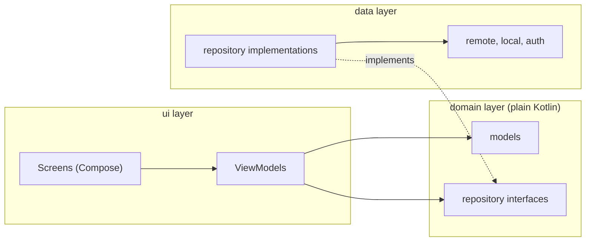

# 01. MVVM and clean layers

> **Draft: written but not yet run.** The code and the expected output in this lesson were prepared by reading the code and the official documentation. They have not been executed yet. If something does not behave as described, trust your tool's real output and report it.

## What you will be able to do
By the end of this lesson you will be able to:
- explain MVVM and the three layers `ui`, `domain` and `data`, and state the dependency rule;
- build three screens (Teams, Projects, Tasks) on a fake repository behind a domain interface;
- model loading, success and failure with one generic `UiState` and show it with one shared composable;
- navigate with type-safe `@Serializable` routes and decide when a use case is worth it.

## Recap
1. In 101 lesson 09, what did a ViewModel keep alive and why? <details><summary>Answer</summary>The screen's state across a rotation, because it outlives the activity.</details>
2. In 101 lesson 11, what did the repository hide from the ViewModel? <details><summary>Answer</summary>Where data comes from: Room, DataStore or the network.</details>

## Why it matters
A restaurant works because roles are separate: the dining room (what the guest sees), the recipes and menu (what the restaurant promises) and the kitchen supply chain (where the food comes from). If the waiter cooked and bought the food, every change would break something else. In 101 your task app already had these roles in embryo. This lesson names them, separates them in packages, and states one rule that keeps them separate. The capstone `capstones/mobile-kotlin` is built exactly this way (TDD section 4 and 8), so every package here has the same name there.

## What you will build
**Tasks Mini**, a thin slice of the capstone: Teams, then Projects of a team, then Tasks of a project with an "add task" field, all from an in-memory fake. The slice is the base for lessons 02 to 10; the fake is replaced by the real platform API from lesson 04 on.


The dependency rule is `ui -> domain <- data`: `ui` and `data` both know `domain`, but `domain` knows neither, and `ui` never imports `data`.

## Before you start
- Android Studio, the Android 37 platform and an emulator, as in 101 lesson 05. The 101 lessons on Compose, ViewModel and Room are assumed.
- Time: about 75 to 90 minutes.
- Source pack (optional): every file is shown in full in this lesson, so you can follow without it. The finished code, the exercise starter and the solution are in the
  course repository https://github.com/Uee03/Code101 under `source/kotlin/201-hero-to-super-hero/phase-1-architecture/01-mvvm-and-clean-layers/` (on that page choose **Code, Download ZIP**, or run
  `git clone https://github.com/Uee03/Code101.git`).
- Naming: the project is called `TasksMini`, the Kotlin package `com.code101.tasks` (the capstone's package) and the application id `com.code101.tasks.lab`. Android identifies an installed app by its application id, so this id differs from the capstone's `com.code101.tasks.kotlin` and both can be installed. From lesson 06 both claim the same sign-in redirect scheme; install one at a time then.

New words: MVVM, layer, dependency rule, domain model, repository interface, `UiState`, generic, type-safe route, use case, module.

## Steps

### Step 1. Create the project folder and the Gradle files
Create `Documents/code101/tasks-mini` and open it in Android Studio (**File > Open**, **Trust Project**). Create these files (right-click, **New > File**; slashes create folders). The project is a normal Android app as in 101 lesson 05; differences are explained.

**File: `settings.gradle.kts`**
```kotlin
pluginManagement {
    repositories {
        google()
        mavenCentral()
        gradlePluginPortal()
    }
}
dependencyResolutionManagement {
    repositoriesMode.set(RepositoriesMode.FAIL_ON_PROJECT_REPOS)
    repositories {
        google()
        mavenCentral()
    }
}
rootProject.name = "TasksMini"
include(":app")
```
**File: `build.gradle.kts`**
```kotlin
plugins {
    alias(libs.plugins.android.application) apply false
    alias(libs.plugins.kotlin.compose) apply false
    alias(libs.plugins.kotlin.serialization) apply false
}
```
The `kotlin-serialization` plugin is new compared with 101 lesson 05: type-safe navigation routes are `@Serializable` classes.

**File: `gradle.properties`**
```properties
org.gradle.jvmargs=-Xmx3g -Dfile.encoding=UTF-8
org.gradle.workers.max=2
android.useAndroidX=true
kotlin.code.style=official
android.builtInKotlin=true
```
`org.gradle.workers.max=2` limits parallel workers, which keeps memory use friendly on laptops.

**File: `gradle/wrapper/gradle-wrapper.properties`**
```properties
distributionBase=GRADLE_USER_HOME
distributionPath=wrapper/dists
distributionUrl=https\://services.gradle.org/distributions/gradle-9.6.0-bin.zip
networkTimeout=10000
retries=0
retryBackOffMs=500
validateDistributionUrl=true
zipStoreBase=GRADLE_USER_HOME
zipStorePath=wrapper/dists
distributionSha256Sum=bbaeb2fef8710818cf0e261201dab964c572f92b942812df0c3620d62a529a01
```
`distributionSha256Sum` is new compared with 101: Gradle checks that the downloaded distribution has exactly this SHA-256 fingerprint. If a download were tampered with, the build would stop (supply-chain protection). The value is the fingerprint Gradle publishes for 9.6.0. Android Studio still creates `gradlew`, `gradlew.bat` and the wrapper jar for you; do not copy them from anywhere.

**File: `.gitignore`**
```text
**/build/
.gradle/
.idea/
local.properties
keystore.properties
*.jks
*.keystore
*.hprof
```
Signing material (`*.jks`, `keystore.properties`) is ignored from day one, so it cannot be committed by accident.

**File: `gradle/libs.versions.toml`**
```toml
[versions]
agp = "9.5.1"
kotlin = "2.4.21"
compose = "2026.11.01"
activity = "1.13.0"
lifecycle = "2.11.1"
navigation = "2.10.2"
serialization = "1.13.0"
coroutines = "1.11.0"

[libraries]
compose-bom = { module = "androidx.compose:compose-bom", version.ref = "compose" }
compose-material3 = { module = "androidx.compose.material3:material3" }
compose-ui = { module = "androidx.compose.ui:ui" }
compose-ui-tooling = { module = "androidx.compose.ui:ui-tooling" }
compose-ui-tooling-preview = { module = "androidx.compose.ui:ui-tooling-preview" }
activity-compose = { module = "androidx.activity:activity-compose", version.ref = "activity" }
lifecycle-runtime = { module = "androidx.lifecycle:lifecycle-runtime-compose", version.ref = "lifecycle" }
lifecycle-viewmodel = { module = "androidx.lifecycle:lifecycle-viewmodel-compose", version.ref = "lifecycle" }
navigation = { module = "androidx.navigation:navigation-compose", version.ref = "navigation" }
serialization = { module = "org.jetbrains.kotlinx:kotlinx-serialization-json", version.ref = "serialization" }
coroutines = { module = "org.jetbrains.kotlinx:kotlinx-coroutines-android", version.ref = "coroutines" }

[plugins]
android-application = { id = "com.android.application", version.ref = "agp" }
kotlin-compose = { id = "org.jetbrains.kotlin.plugin.compose", version.ref = "kotlin" }
kotlin-serialization = { id = "org.jetbrains.kotlin.plugin.serialization", version.ref = "kotlin" }
```
These are the capstone's pins (see its VERSIONS.md); later lessons add libraries to this file when they need them.

**File: `app/build.gradle.kts`**
```kotlin
plugins {
    alias(libs.plugins.android.application)
    alias(libs.plugins.kotlin.compose)
    alias(libs.plugins.kotlin.serialization)
}

android {
    namespace = "com.code101.tasks"
    compileSdk { version = release(37) }

    defaultConfig {
        applicationId = "com.code101.tasks.lab"
        minSdk = 26
        targetSdk = 36
        versionCode = 1
        versionName = "1.0"
    }

    buildFeatures {
        compose = true
    }

    compileOptions {
        sourceCompatibility = JavaVersion.VERSION_17
        targetCompatibility = JavaVersion.VERSION_17
    }
}

kotlin {
    compilerOptions {
        jvmTarget.set(org.jetbrains.kotlin.gradle.dsl.JvmTarget.JVM_17)
    }
}

dependencies {
    implementation(platform(libs.compose.bom))
    implementation(libs.compose.material3)
    implementation(libs.compose.ui)
    implementation(libs.compose.ui.tooling.preview)
    implementation(libs.activity.compose)
    implementation(libs.lifecycle.runtime)
    implementation(libs.lifecycle.viewmodel)
    implementation(libs.navigation)
    implementation(libs.serialization)
    implementation(libs.coroutines)
    debugImplementation(libs.compose.ui.tooling)
}
```
The capstone writes `release(37) { minorApiLevel = 2 }` because its author had platform 37.2 installed; use `release(37)` with whatever Android 37 platform your SDK Manager shows.

### Step 2. Manifest and strings
**File: `app/src/main/AndroidManifest.xml`**
```xml
<?xml version="1.0" encoding="utf-8"?>
<manifest xmlns:android="http://schemas.android.com/apk/res/android">
    <application
        android:name=".TasksApplication"
        android:allowBackup="false"
        android:label="@string/app_name"
        android:theme="@android:style/Theme.Material.Light.NoActionBar">
        <activity
            android:name=".MainActivity"
            android:exported="true">
            <intent-filter>
                <action android:name="android.intent.action.MAIN" />
                <category android:name="android.intent.category.LAUNCHER" />
            </intent-filter>
        </activity>
    </application>
</manifest>
```
`allowBackup="false"` is a security default from the capstone (M-06 and the design's STORAGE row): app data is not copied to cloud backups.

**File: `app/src/main/res/values/strings.xml`**
```xml
<resources>
    <string name="app_name">Tasks Mini</string>
    <string name="teams">Teams</string>
    <string name="projects">Projects</string>
    <string name="tasks">Tasks</string>
    <string name="back">Back</string>
    <string name="retry">Retry</string>
    <string name="error_offline">The data could not be loaded. Check the connection and try again.</string>
    <string name="empty">Nothing here yet.</string>
    <string name="members">%1$d members</string>
    <string name="new_task">New task</string>
    <string name="add">Add</string>
    <string name="open_count">%1$d open</string>
    <string name="status_todo">To do</string>
    <string name="status_in_progress">In progress</string>
    <string name="status_blocked">Blocked</string>
    <string name="status_done">Done</string>
    <string name="status_cancelled">Cancelled</string>
</resources>
```
Every user-visible text lives here (capstone requirement M-23: no string literals in `ui/` files).

### Step 3. The domain layer: plain Kotlin
Create the folders `app/src/main/kotlin/com/code101/tasks/domain/model` and `.../domain/repository`.

**File: `app/src/main/kotlin/com/code101/tasks/domain/model/Models.kt`**
```kotlin
package com.code101.tasks.domain.model

data class Team(
    val id: String,
    val name: String,
    val description: String,
    val memberCount: Int,
)

data class Project(
    val id: String,
    val teamId: String,
    val key: String,
    val name: String,
)

data class TaskItem(
    val id: String,
    val projectId: String,
    val title: String,
    val status: String,
    val version: Int,
    val syncState: String = "synced",
)
```
These are *domain* models: what the app means by a team, a project and a task. `status` is a string such as `todo`, `in_progress`, `blocked`, `done` or `cancelled`, the values of the platform contract. `version` and `syncState` are used from lesson 05 and 08. The domain imports nothing from Android.

**File: `app/src/main/kotlin/com/code101/tasks/domain/repository/TasksRepository.kt`**
```kotlin
package com.code101.tasks.domain.repository

import com.code101.tasks.domain.model.Project
import com.code101.tasks.domain.model.TaskItem
import com.code101.tasks.domain.model.Team

interface TasksRepository {
    suspend fun teams(): List<Team>

    suspend fun projects(teamId: String): List<Project>

    suspend fun tasks(projectId: String): List<TaskItem>

    suspend fun addTask(projectId: String, title: String): TaskItem
}
```
The interface is the *contract* between the UI and any source of data. It speaks domain language only.

### Step 4. The data layer: a fake behind the interface
Create `app/src/main/kotlin/com/code101/tasks/data/repository`.

**File: `app/src/main/kotlin/com/code101/tasks/data/repository/FakeTasksRepository.kt`**
```kotlin
package com.code101.tasks.data.repository

import com.code101.tasks.domain.model.Project
import com.code101.tasks.domain.model.TaskItem
import com.code101.tasks.domain.model.Team
import com.code101.tasks.domain.repository.TasksRepository
import java.util.UUID
import kotlinx.coroutines.delay

class FakeTasksRepository : TasksRepository {
    private val sampleTeams = listOf(
        Team("t1", "Platform Team", "Services and tooling", 4),
        Team("t2", "Mobile Team", "Android and iOS apps", 3),
    )
    private val sampleProjects = listOf(
        Project("p1", "t1", "PLAT", "API gateway"),
        Project("p2", "t2", "MOB", "Tasks app"),
    )
    private val sampleTasks = mutableListOf(
        TaskItem("k1", "p2", "Draw the login screen", "todo", 1),
        TaskItem("k2", "p2", "Wire the Retrofit client", "in_progress", 1),
        TaskItem("k3", "p1", "Write the OpenAPI file", "done", 3),
    )

    override suspend fun teams(): List<Team> {
        delay(300)
        return sampleTeams
    }

    override suspend fun projects(teamId: String): List<Project> {
        delay(300)
        return sampleProjects.filter { it.teamId == teamId }
    }

    override suspend fun tasks(projectId: String): List<TaskItem> {
        delay(300)
        return sampleTasks.filter { it.projectId == projectId }
    }

    override suspend fun addTask(projectId: String, title: String): TaskItem {
        delay(300)
        val task = TaskItem(UUID.randomUUID().toString(), projectId, title, "todo", 1)
        sampleTasks.add(task)
        return task
    }
}
```
`delay(300)` imitates network time, so loading states are visible. The names (Platform Team, Mobile Team) are the platform's seed teams.

### Step 5. Application, activity and theme
For now the "wiring" is manual: the `Application` creates the repository once. Lesson 02 replaces this with Hilt.

**File: `app/src/main/kotlin/com/code101/tasks/TasksApplication.kt`**
```kotlin
package com.code101.tasks

import android.app.Application
import com.code101.tasks.data.repository.FakeTasksRepository
import com.code101.tasks.domain.repository.TasksRepository

class TasksApplication : Application() {
    val repository: TasksRepository by lazy { FakeTasksRepository() }
}
```
The property's type is the *interface*, not the fake. Nothing outside this file knows which implementation is in use.

**File: `app/src/main/kotlin/com/code101/tasks/MainActivity.kt`**
```kotlin
package com.code101.tasks

import android.os.Bundle
import androidx.activity.ComponentActivity
import androidx.activity.compose.setContent
import androidx.activity.enableEdgeToEdge
import com.code101.tasks.ui.navigation.AppGraph
import com.code101.tasks.ui.theme.TasksTheme

class MainActivity : ComponentActivity() {
    override fun onCreate(savedInstanceState: Bundle?) {
        super.onCreate(savedInstanceState)
        enableEdgeToEdge()
        setContent {
            TasksTheme {
                AppGraph()
            }
        }
    }
}
```
**File: `app/src/main/kotlin/com/code101/tasks/ui/theme/Theme.kt`**
```kotlin
package com.code101.tasks.ui.theme

import androidx.compose.foundation.isSystemInDarkTheme
import androidx.compose.material3.MaterialTheme
import androidx.compose.material3.darkColorScheme
import androidx.compose.material3.lightColorScheme
import androidx.compose.runtime.Composable

@Composable
fun TasksTheme(
    darkTheme: Boolean = isSystemInDarkTheme(),
    content: @Composable () -> Unit,
) {
    MaterialTheme(
        colorScheme = if (darkTheme) darkColorScheme() else lightColorScheme(),
        content = content,
    )
}
```

### Step 6. One state type for every screen
**File: `app/src/main/kotlin/com/code101/tasks/ui/common/UiState.kt`**
```kotlin
package com.code101.tasks.ui.common

sealed interface UiState<out T> {
    data object Loading : UiState<Nothing>
    data class Success<T>(val data: T) : UiState<T>
    data class Failure(val messageRes: Int) : UiState<Nothing>
}
```
A **generic** type `UiState<T>` is one definition that works for lists of teams, of projects and of tasks. `out T` ("covariant") together with `Nothing` lets `Loading` and `Failure` be used as a `UiState` of *any* data type. `Failure` carries a string resource id, not a text, so the ViewModel never contains a user-visible string.

**File: `app/src/main/kotlin/com/code101/tasks/ui/components/Components.kt`**
```kotlin
package com.code101.tasks.ui.components

import androidx.compose.foundation.layout.Arrangement
import androidx.compose.foundation.layout.Box
import androidx.compose.foundation.layout.Column
import androidx.compose.foundation.layout.PaddingValues
import androidx.compose.foundation.layout.fillMaxSize
import androidx.compose.foundation.layout.padding
import androidx.compose.material3.Button
import androidx.compose.material3.CircularProgressIndicator
import androidx.compose.material3.ExperimentalMaterial3Api
import androidx.compose.material3.Scaffold
import androidx.compose.material3.Text
import androidx.compose.material3.TextButton
import androidx.compose.material3.TopAppBar
import androidx.compose.runtime.Composable
import androidx.compose.ui.Alignment
import androidx.compose.ui.Modifier
import androidx.compose.ui.res.stringResource
import androidx.compose.ui.semantics.heading
import androidx.compose.ui.semantics.semantics
import androidx.compose.ui.unit.dp
import com.code101.tasks.R
import com.code101.tasks.ui.common.UiState

@OptIn(ExperimentalMaterial3Api::class)
@Composable
fun AppScaffold(
    titleRes: Int,
    onBack: (() -> Unit)? = null,
    content: @Composable (PaddingValues) -> Unit,
) {
    Scaffold(
        topBar = {
            TopAppBar(
                title = {
                    Text(
                        text = stringResource(titleRes),
                        modifier = Modifier.semantics { heading() },
                    )
                },
                navigationIcon = {
                    if (onBack != null) {
                        TextButton(onClick = onBack) {
                            Text(stringResource(R.string.back))
                        }
                    }
                },
            )
        },
        content = content,
    )
}

@Composable
fun <T> UiStateContent(
    state: UiState<T>,
    onRetry: () -> Unit,
    modifier: Modifier = Modifier,
    content: @Composable (T) -> Unit,
) {
    when (state) {
        UiState.Loading -> Box(
            modifier = modifier.fillMaxSize(),
            contentAlignment = Alignment.Center,
        ) {
            CircularProgressIndicator()
        }
        is UiState.Failure -> Column(
            modifier = modifier.padding(16.dp),
            verticalArrangement = Arrangement.spacedBy(12.dp),
        ) {
            Text(text = stringResource(state.messageRes))
            Button(onClick = onRetry) {
                Text(stringResource(R.string.retry))
            }
        }
        is UiState.Success -> content(state.data)
    }
}

fun statusLabel(status: String): Int = when (status) {
    "todo" -> R.string.status_todo
    "in_progress" -> R.string.status_in_progress
    "blocked" -> R.string.status_blocked
    "done" -> R.string.status_done
    else -> R.string.status_cancelled
}
```
`AppScaffold` is the shared frame (title as a heading for TalkBack, optional Back). `UiStateContent` is written once and decides what each state looks like: a spinner, an error with a Retry button, or your content. Every screen gets consistent loading and error behaviour for free. `statusLabel` maps the contract's status text to a string resource.

### Step 7. Type-safe routes and the navigation graph
**File: `app/src/main/kotlin/com/code101/tasks/ui/navigation/Routes.kt`**
```kotlin
package com.code101.tasks.ui.navigation

import kotlinx.serialization.Serializable

@Serializable
data object TeamsRoute

@Serializable
data class ProjectsRoute(val teamId: String)

@Serializable
data class TasksRoute(val projectId: String)
```
In 101 lesson 08 a route was a text such as `"detail/{taskId}"` and you could misspell it. Here a route is a **class**: `ProjectsRoute(teamId = "t1")`. The compiler checks names and types of the arguments, and `@Serializable` lets Navigation turn them into a back-stack entry.

### Step 8. The three features (ViewModel and screen each)
Create the folders `ui/teams`, `ui/projects` and `ui/tasks` below `app/src/main/kotlin/com/code101/tasks`.

**File: `app/src/main/kotlin/com/code101/tasks/ui/teams/TeamsViewModel.kt`**
```kotlin
package com.code101.tasks.ui.teams

import androidx.lifecycle.ViewModel
import androidx.lifecycle.viewModelScope
import androidx.lifecycle.viewmodel.initializer
import androidx.lifecycle.viewmodel.viewModelFactory
import com.code101.tasks.R
import com.code101.tasks.domain.model.Team
import com.code101.tasks.domain.repository.TasksRepository
import com.code101.tasks.ui.common.UiState
import java.io.IOException
import kotlinx.coroutines.flow.MutableStateFlow
import kotlinx.coroutines.flow.StateFlow
import kotlinx.coroutines.flow.asStateFlow
import kotlinx.coroutines.launch

class TeamsViewModel(private val repository: TasksRepository) : ViewModel() {
    private val _state = MutableStateFlow<UiState<List<Team>>>(UiState.Loading)
    val state: StateFlow<UiState<List<Team>>> = _state.asStateFlow()

    init {
        load()
    }

    fun load() {
        viewModelScope.launch {
            _state.value = UiState.Loading
            _state.value = try {
                UiState.Success(repository.teams())
            } catch (e: IOException) {
                UiState.Failure(R.string.error_offline)
            }
        }
    }

    companion object {
        fun factory(repository: TasksRepository) = viewModelFactory {
            initializer { TeamsViewModel(repository) }
        }
    }
}
```
**File: `app/src/main/kotlin/com/code101/tasks/ui/teams/TeamsScreen.kt`**
```kotlin
package com.code101.tasks.ui.teams

import androidx.compose.foundation.clickable
import androidx.compose.foundation.layout.Arrangement
import androidx.compose.foundation.layout.Column
import androidx.compose.foundation.layout.PaddingValues
import androidx.compose.foundation.layout.fillMaxSize
import androidx.compose.foundation.layout.fillMaxWidth
import androidx.compose.foundation.layout.padding
import androidx.compose.foundation.lazy.LazyColumn
import androidx.compose.foundation.lazy.items
import androidx.compose.material3.Card
import androidx.compose.material3.MaterialTheme
import androidx.compose.material3.Text
import androidx.compose.runtime.Composable
import androidx.compose.ui.Modifier
import androidx.compose.ui.res.stringResource
import androidx.compose.ui.unit.dp
import com.code101.tasks.R
import com.code101.tasks.domain.model.Team
import com.code101.tasks.ui.common.UiState
import com.code101.tasks.ui.components.AppScaffold
import com.code101.tasks.ui.components.UiStateContent

@Composable
fun TeamsScreen(
    state: UiState<List<Team>>,
    onRetry: () -> Unit,
    onOpenTeam: (String) -> Unit,
) {
    AppScaffold(titleRes = R.string.teams) { padding ->
        UiStateContent(
            state = state,
            onRetry = onRetry,
            modifier = Modifier.padding(padding),
        ) { teams ->
            if (teams.isEmpty()) {
                Text(text = stringResource(R.string.empty), modifier = Modifier.padding(16.dp))
            } else {
                LazyColumn(
                    modifier = Modifier.fillMaxSize(),
                    contentPadding = PaddingValues(16.dp),
                    verticalArrangement = Arrangement.spacedBy(12.dp),
                ) {
                    items(teams, key = { it.id }) { team ->
                        Card(
                            modifier = Modifier
                                .fillMaxWidth()
                                .clickable { onOpenTeam(team.id) },
                        ) {
                            Column(modifier = Modifier.padding(16.dp)) {
                                Text(team.name, style = MaterialTheme.typography.titleMedium)
                                Text(team.description)
                                Text(stringResource(R.string.members, team.memberCount))
                            }
                        }
                    }
                }
            }
        }
    }
}
```
**File: `app/src/main/kotlin/com/code101/tasks/ui/projects/ProjectsViewModel.kt`**
```kotlin
package com.code101.tasks.ui.projects

import androidx.lifecycle.ViewModel
import androidx.lifecycle.viewModelScope
import androidx.lifecycle.viewmodel.initializer
import androidx.lifecycle.viewmodel.viewModelFactory
import com.code101.tasks.R
import com.code101.tasks.domain.model.Project
import com.code101.tasks.domain.repository.TasksRepository
import com.code101.tasks.ui.common.UiState
import java.io.IOException
import kotlinx.coroutines.flow.MutableStateFlow
import kotlinx.coroutines.flow.StateFlow
import kotlinx.coroutines.flow.asStateFlow
import kotlinx.coroutines.launch

class ProjectsViewModel(
    private val repository: TasksRepository,
    private val teamId: String,
) : ViewModel() {
    private val _state = MutableStateFlow<UiState<List<Project>>>(UiState.Loading)
    val state: StateFlow<UiState<List<Project>>> = _state.asStateFlow()

    init {
        load()
    }

    fun load() {
        viewModelScope.launch {
            _state.value = UiState.Loading
            _state.value = try {
                UiState.Success(repository.projects(teamId))
            } catch (e: IOException) {
                UiState.Failure(R.string.error_offline)
            }
        }
    }

    companion object {
        fun factory(repository: TasksRepository, teamId: String) = viewModelFactory {
            initializer { ProjectsViewModel(repository, teamId) }
        }
    }
}
```
**File: `app/src/main/kotlin/com/code101/tasks/ui/projects/ProjectsScreen.kt`**
```kotlin
package com.code101.tasks.ui.projects

import androidx.compose.foundation.clickable
import androidx.compose.foundation.layout.Arrangement
import androidx.compose.foundation.layout.Column
import androidx.compose.foundation.layout.PaddingValues
import androidx.compose.foundation.layout.fillMaxSize
import androidx.compose.foundation.layout.fillMaxWidth
import androidx.compose.foundation.layout.padding
import androidx.compose.foundation.lazy.LazyColumn
import androidx.compose.foundation.lazy.items
import androidx.compose.material3.Card
import androidx.compose.material3.MaterialTheme
import androidx.compose.material3.Text
import androidx.compose.runtime.Composable
import androidx.compose.ui.Modifier
import androidx.compose.ui.res.stringResource
import androidx.compose.ui.unit.dp
import com.code101.tasks.R
import com.code101.tasks.domain.model.Project
import com.code101.tasks.ui.common.UiState
import com.code101.tasks.ui.components.AppScaffold
import com.code101.tasks.ui.components.UiStateContent

@Composable
fun ProjectsScreen(
    state: UiState<List<Project>>,
    onRetry: () -> Unit,
    onOpenProject: (String) -> Unit,
    onBack: () -> Unit,
) {
    AppScaffold(titleRes = R.string.projects, onBack = onBack) { padding ->
        UiStateContent(
            state = state,
            onRetry = onRetry,
            modifier = Modifier.padding(padding),
        ) { projects ->
            if (projects.isEmpty()) {
                Text(text = stringResource(R.string.empty), modifier = Modifier.padding(16.dp))
            } else {
                LazyColumn(
                    modifier = Modifier.fillMaxSize(),
                    contentPadding = PaddingValues(16.dp),
                    verticalArrangement = Arrangement.spacedBy(12.dp),
                ) {
                    items(projects, key = { it.id }) { project ->
                        Card(
                            modifier = Modifier
                                .fillMaxWidth()
                                .clickable { onOpenProject(project.id) },
                        ) {
                            Column(modifier = Modifier.padding(16.dp)) {
                                Text(project.name, style = MaterialTheme.typography.titleMedium)
                                Text(project.key)
                            }
                        }
                    }
                }
            }
        }
    }
}
```
**File: `app/src/main/kotlin/com/code101/tasks/ui/tasks/TasksViewModel.kt`**
```kotlin
package com.code101.tasks.ui.tasks

import androidx.lifecycle.ViewModel
import androidx.lifecycle.viewModelScope
import androidx.lifecycle.viewmodel.initializer
import androidx.lifecycle.viewmodel.viewModelFactory
import com.code101.tasks.R
import com.code101.tasks.domain.model.TaskItem
import com.code101.tasks.domain.repository.TasksRepository
import com.code101.tasks.ui.common.UiState
import java.io.IOException
import kotlinx.coroutines.flow.MutableStateFlow
import kotlinx.coroutines.flow.StateFlow
import kotlinx.coroutines.flow.asStateFlow
import kotlinx.coroutines.launch

class TasksViewModel(
    private val repository: TasksRepository,
    private val projectId: String,
) : ViewModel() {
    private val _state = MutableStateFlow<UiState<List<TaskItem>>>(UiState.Loading)
    val state: StateFlow<UiState<List<TaskItem>>> = _state.asStateFlow()

    init {
        load()
    }

    fun load() {
        viewModelScope.launch {
            _state.value = UiState.Loading
            _state.value = try {
                UiState.Success(repository.tasks(projectId))
            } catch (e: IOException) {
                UiState.Failure(R.string.error_offline)
            }
        }
    }

    fun addTask(title: String) {
        val clean = title.trim()
        if (clean.isEmpty()) return
        viewModelScope.launch {
            try {
                repository.addTask(projectId, clean)
                _state.value = UiState.Success(repository.tasks(projectId))
            } catch (e: IOException) {
                _state.value = UiState.Failure(R.string.error_offline)
            }
        }
    }

    companion object {
        fun factory(repository: TasksRepository, projectId: String) = viewModelFactory {
            initializer { TasksViewModel(repository, projectId) }
        }
    }
}
```
**File: `app/src/main/kotlin/com/code101/tasks/ui/tasks/TasksScreen.kt`**
```kotlin
package com.code101.tasks.ui.tasks

import androidx.compose.foundation.layout.Arrangement
import androidx.compose.foundation.layout.Column
import androidx.compose.foundation.layout.Row
import androidx.compose.foundation.layout.fillMaxSize
import androidx.compose.foundation.layout.fillMaxWidth
import androidx.compose.foundation.layout.padding
import androidx.compose.foundation.lazy.LazyColumn
import androidx.compose.foundation.lazy.items
import androidx.compose.material3.Button
import androidx.compose.material3.Card
import androidx.compose.material3.MaterialTheme
import androidx.compose.material3.OutlinedTextField
import androidx.compose.material3.Text
import androidx.compose.runtime.Composable
import androidx.compose.runtime.getValue
import androidx.compose.runtime.mutableStateOf
import androidx.compose.runtime.saveable.rememberSaveable
import androidx.compose.runtime.setValue
import androidx.compose.ui.Alignment
import androidx.compose.ui.Modifier
import androidx.compose.ui.res.stringResource
import androidx.compose.ui.unit.dp
import com.code101.tasks.R
import com.code101.tasks.domain.model.TaskItem
import com.code101.tasks.ui.common.UiState
import com.code101.tasks.ui.components.AppScaffold
import com.code101.tasks.ui.components.UiStateContent
import com.code101.tasks.ui.components.statusLabel

@Composable
fun TasksScreen(
    state: UiState<List<TaskItem>>,
    onRetry: () -> Unit,
    onAdd: (String) -> Unit,
    onBack: () -> Unit,
) {
    var draft by rememberSaveable { mutableStateOf("") }

    AppScaffold(titleRes = R.string.tasks, onBack = onBack) { padding ->
        Column(
            modifier = Modifier
                .padding(padding)
                .padding(16.dp),
            verticalArrangement = Arrangement.spacedBy(12.dp),
        ) {
            Row(
                modifier = Modifier.fillMaxWidth(),
                verticalAlignment = Alignment.CenterVertically,
                horizontalArrangement = Arrangement.spacedBy(8.dp),
            ) {
                OutlinedTextField(
                    value = draft,
                    onValueChange = { draft = it },
                    label = { Text(stringResource(R.string.new_task)) },
                    singleLine = true,
                    modifier = Modifier.weight(1f),
                )
                Button(
                    onClick = {
                        onAdd(draft)
                        draft = ""
                    },
                    enabled = draft.isNotBlank(),
                ) {
                    Text(stringResource(R.string.add))
                }
            }
            UiStateContent(
                state = state,
                onRetry = onRetry,
                modifier = Modifier.weight(1f),
            ) { tasks ->
                if (tasks.isEmpty()) {
                    Text(text = stringResource(R.string.empty))
                } else {
                    LazyColumn(
                        modifier = Modifier.fillMaxSize(),
                        verticalArrangement = Arrangement.spacedBy(12.dp),
                    ) {
                        items(tasks, key = { it.id }) { task ->
                            Card(modifier = Modifier.fillMaxWidth()) {
                                Column(modifier = Modifier.padding(16.dp)) {
                                    Text(task.title, style = MaterialTheme.typography.titleMedium)
                                    Text(stringResource(statusLabel(task.status)))
                                }
                            }
                        }
                    }
                }
            }
        }
    }
}
```

### Step 9. The graph that connects it all
**File: `app/src/main/kotlin/com/code101/tasks/ui/navigation/AppGraph.kt`**
```kotlin
package com.code101.tasks.ui.navigation

import androidx.compose.runtime.Composable
import androidx.compose.runtime.getValue
import androidx.compose.ui.platform.LocalContext
import androidx.lifecycle.compose.collectAsStateWithLifecycle
import androidx.lifecycle.viewmodel.compose.viewModel
import androidx.navigation.compose.NavHost
import androidx.navigation.compose.composable
import androidx.navigation.compose.rememberNavController
import androidx.navigation.toRoute
import com.code101.tasks.TasksApplication
import com.code101.tasks.ui.projects.ProjectsScreen
import com.code101.tasks.ui.projects.ProjectsViewModel
import com.code101.tasks.ui.tasks.TasksScreen
import com.code101.tasks.ui.tasks.TasksViewModel
import com.code101.tasks.ui.teams.TeamsScreen
import com.code101.tasks.ui.teams.TeamsViewModel

@Composable
fun AppGraph() {
    val navController = rememberNavController()
    val application = LocalContext.current.applicationContext as TasksApplication
    val repository = application.repository

    NavHost(navController = navController, startDestination = TeamsRoute) {
        composable<TeamsRoute> {
            val viewModel: TeamsViewModel = viewModel(factory = TeamsViewModel.factory(repository))
            val state by viewModel.state.collectAsStateWithLifecycle()
            TeamsScreen(
                state = state,
                onRetry = viewModel::load,
                onOpenTeam = { teamId -> navController.navigate(ProjectsRoute(teamId)) },
            )
        }
        composable<ProjectsRoute> { entry ->
            val route = entry.toRoute<ProjectsRoute>()
            val viewModel: ProjectsViewModel =
                viewModel(factory = ProjectsViewModel.factory(repository, route.teamId))
            val state by viewModel.state.collectAsStateWithLifecycle()
            ProjectsScreen(
                state = state,
                onRetry = viewModel::load,
                onOpenProject = { projectId -> navController.navigate(TasksRoute(projectId)) },
                onBack = { navController.popBackStack() },
            )
        }
        composable<TasksRoute> { entry ->
            val route = entry.toRoute<TasksRoute>()
            val viewModel: TasksViewModel =
                viewModel(factory = TasksViewModel.factory(repository, route.projectId))
            val state by viewModel.state.collectAsStateWithLifecycle()
            TasksScreen(
                state = state,
                onRetry = viewModel::load,
                onAdd = viewModel::addTask,
                onBack = { navController.popBackStack() },
            )
        }
    }
}
```
This is the only place that knows both the ViewModels and the repository instance. Predict before you run: the Mobile Team has one project, "Tasks app". How many tasks will you see inside it, and what do you expect to see for about 300 ms after you open each screen?

## Run it
Sync Gradle, choose an emulator and press **Run**.

Expected result (described, not yet seen): a **Teams** screen with "Platform Team" (4 members) and "Mobile Team" (3 members), after a short spinner. Tap **Mobile Team**: **Projects** shows "Tasks app" (key MOB). Tap it: **Tasks** shows "Draw the login screen" (To do) and "Wire the Retrofit client" (In progress). Type a title and press **Add**: the list reloads with the new task as "To do". The system Back gesture or the **Back** button goes up one level.

## How it works
**MVVM.** *Model* is the data and rules (domain and data layers); *View* is the Compose screens, which only draw state and report events; *ViewModel* sits between: it holds the state as a `StateFlow` and exposes functions such as `load` and `addTask`. State flows down, events flow up (101 lesson 09).

**The dependency rule.** `ui` imports `domain`; `data` imports `domain`; `domain` imports nothing of Android. Check your imports: no file in `ui/` mentions `data.repository`. Only `TasksApplication` (and, from lesson 02, the DI module) knows the concrete class. The payoff: you can swap the fake for the network, then for a database, without touching a single screen or ViewModel; and the domain can be understood without knowing Android. The official architecture guide (see Best practice) recommends this separation, with the domain layer *optional* for small apps.

**One module, packages for layers.** We keep one Gradle module and enforce the layers by package names (capstone TDD section 4). Splitting into modules per layer would enforce the rule at compile time but costs build complexity; that is the 301 topic.

**Generic `UiState` and the shared composable.** Instead of three copies of "if loading … else if error …", `UiState<T>` and `UiStateContent` appear once. A `sealed` hierarchy means `when` must handle all three states. Misconception: a boolean `isLoading` plus a nullable `error` would be simpler. It allows impossible combinations (loading *and* error); the sealed type allows exactly three valid states.

**Failure carries a resource id.** ViewModels are plain Kotlin classes that must not hold user text, or you could not translate it or follow the string rule. `R.string.error_offline` is only a number.

**Type-safe routes.** `composable<ProjectsRoute> { entry -> entry.toRoute<ProjectsRoute>() }` reads the argument back as a typed object. No string parsing, no `NavType` boilerplate.

**ViewModel factories (for now).** Each ViewModel needs the repository (and an id), and Android can only create a ViewModel without arguments by default. `viewModelFactory { initializer { ... } }` gives Android a recipe. Writing that by hand for every ViewModel is exactly the repeated chore that dependency injection removes in lesson 02.

**Why this, not that.**

| Question | Choice here | Alternative | Why |
|---|---|---|---|
| State holder | ViewModel + `StateFlow` | `LiveData`; Compose `mutableStateOf` inside the ViewModel | Flows compose with Room and Retrofit later and are plain Kotlin; `mutableStateOf` ties the ViewModel to Compose |
| Architecture style | MVVM, unidirectional data flow | MVI with one reducer | MVVM is what the official guide teaches; MVI adds ceremony that this app does not need |
| Use cases | None yet | A class per action ("GetTeams", "AddTask") | A use case earns its place only when logic merges repositories or is reused (capstone: `SyncAllUseCase`); a class that only forwards one call is noise |
| Modules | One | One per layer | Simplicity; modularisation is a 301 topic |
| Fake data | In-memory repository | Hard-coded lists in ViewModels | The interface boundary is the point; the fake can be swapped for the real thing |

**Where this reappears.** The capstone's chapter 01 (setup) and 03 (screens and state) use exactly these packages and the same `UiState` idea; read `capstones/mobile-kotlin/tutorials/phase-1-setup/01-setup.md` after lesson 04.

## Try it
1. **Guided:** create `domain/model/TaskStats.kt` from the starter and write the body: count the tasks that are neither `done` nor `cancelled`. It is plain Kotlin, so no Android is needed.

**File: `app/src/main/kotlin/com/code101/tasks/domain/model/TaskStats.kt`**
```kotlin
package com.code101.tasks.domain.model

import com.code101.tasks.domain.model.TaskItem

// TODO: return how many tasks are still open: every status except "done" and "cancelled"
fun List<TaskItem>.openCount(): Int = 0
```
Expected: for the Tasks app project, `listOf(todo, in_progress).openCount()` is `2`.
2. **Change:** show the count above the list in `TasksScreen`, using the string `open_count` that already exists (`stringResource(R.string.open_count, tasks.openCount())`).
3. **Stretch (optional):** write down which layer should own "a task counts as open unless it is done or cancelled", and why that is not a ViewModel decision. Would you make it a use case? Defend your answer in three sentences.

<details><summary>Solution</summary>

**File: `app/src/main/kotlin/com/code101/tasks/domain/model/TaskStats.kt`**
```kotlin
package com.code101.tasks.domain.model

fun List<TaskItem>.openCount(): Int =
    count { it.status != "done" && it.status != "cancelled" }
```
An extension function in the domain is enough: it is a business rule, pure and reusable, and it needs no class. A use case would add nothing because it merges no repositories.

</details>

## Check yourself
1. State the dependency rule in one line. <details><summary>Answer</summary>`ui -> domain <- data`: ui and data depend on domain; domain depends on neither; ui never imports data.</details>
2. Why does `UiState.Failure` hold an `Int` and not a `String`? <details><summary>Answer</summary>The ViewModel stays free of user-visible text; the id is resolved to a translatable resource in the UI.</details>
3. Why is a boolean `isLoading` plus `error: String?` a weaker model than a sealed `UiState`? <details><summary>Answer</summary>It permits impossible combinations; the sealed type has exactly the valid states and forces `when` to cover them.</details>
4. Find the bug: `TeamsScreen` imports `com.code101.tasks.data.repository.FakeTasksRepository`. <details><summary>Answer</summary>The ui layer must not import data; ask the ViewModel, which holds the interface.</details>

## Common mistakes
| Symptom or error text | Cause | Fix |
|---|---|---|
| `Unresolved reference 'toRoute'` (typical message) | Missing import `androidx.navigation.toRoute` | Add the import |
| An error that a class is not serializable or a route cannot be found (typical) | The `kotlin-serialization` plugin is missing in the app module, or `@Serializable` is missing | Add the plugin and the annotation, sync |
| `ClassCastException` for `TasksApplication` at start (typical) | `android:name=".TasksApplication"` missing in the manifest | Add it to `<application>` |
| The spinner never stops | The coroutine threw a non-`IOException` | The fake never throws; if you edited it, catch the right exception |
| A new task shows after the reload but disappears on restart | The fake is in memory | Expected; persistence arrives in lesson 07 |

## Best practice
Separate the UI, optional domain and data layers; expose state from ViewModels and depend on repository interfaces. Source: Guide to app architecture https://developer.android.com/topic/architecture and Architecture recommendations https://developer.android.com/topic/architecture/recommendations

## Going further
- Android's modularisation guide (for the 301 level): https://developer.android.com/topic/modularization
- Capstone TDD, sections 4 and 8: `capstones/mobile-kotlin/TDD.md`.

## Summary
- You explained MVVM and the three layers and the dependency rule.
- You built three screens on a fake repository behind a domain interface.
- You modelled screen state with a generic sealed `UiState` and one shared composable.
- You used type-safe `@Serializable` routes and saw why use cases are not automatic.

## Next lesson
02. Dependency injection with Hilt: replace the hand-written factories and the Application wiring.
