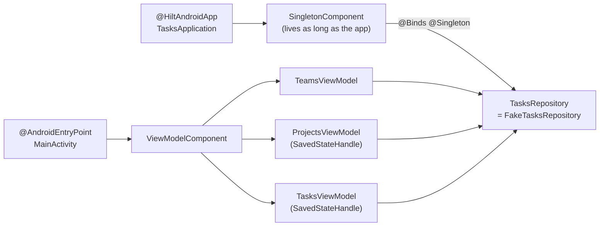

# 02. Dependency injection with Hilt

> **Draft: written but not yet run.** The code and the expected output in this lesson were prepared by reading the code and the official documentation. They have not been executed yet. If something does not behave as described, trust your tool's real output and report it.

## What you will be able to do
By the end of this lesson you will be able to:
- explain what a dependency is and what **injection** does for you;
- turn the hand-written factories of lesson 01 into `@HiltViewModel` classes;
- choose between `@Binds` and `@Provides`, and between scopes;
- read route arguments inside a Hilt ViewModel with `SavedStateHandle`.

## Recap
1. In lesson 01, which file knew the concrete `FakeTasksRepository`? <details><summary>Answer</summary>`TasksApplication` only.</details>
2. What is the dependency rule? <details><summary>Answer</summary>`ui -> domain <- data`; ui never imports data.</details>

## Why it matters
Your three ViewModels each need a repository, and two need an id. In lesson 01 you wrote a factory per ViewModel and a hand-built object in the `Application`. That works for three classes; for thirty it is a chore that is easy to get wrong. **Dependency injection** (DI) means a class does not build the things it needs; it *asks* for them in its constructor and someone else supplies them. **Hilt** is Google's DI library for Android; it checks the whole graph while compiling and ships the ViewModel, WorkManager and Navigation integrations that the capstone uses.

## What you will build
The same Tasks Mini app, with no behaviour change, but wired by Hilt:



## Before you start
- The project from lesson 01.
- Time: about 60 to 75 minutes.
- Source pack (optional): every file is shown in full in this lesson, so you can follow without it. The finished code, the exercise starter and the solution are in the
  course repository https://github.com/Uee03/Code101 under `source/kotlin/201-hero-to-super-hero/phase-1-architecture/02-dependency-injection-hilt/` (on that page choose **Code, Download ZIP**, or run
  `git clone https://github.com/Uee03/Code101.git`).

Files that stay **exactly as in lesson 01**: `settings.gradle.kts`, `gradle.properties`, `gradle/wrapper/gradle-wrapper.properties`, `.gitignore`, the manifest, `strings.xml`, `Theme.kt`, `domain/model/Models.kt`, `domain/repository/TasksRepository.kt`, `UiState.kt`, `Components.kt`, `Routes.kt`, `TeamsScreen.kt`, `ProjectsScreen.kt` and `TasksScreen.kt`. Changed: `build.gradle.kts` (root), `libs.versions.toml`, `app/build.gradle.kts`, `TasksApplication.kt`, `MainActivity.kt`, `FakeTasksRepository.kt`, the three ViewModels and `AppGraph.kt`. New: `di/RepositoryModule.kt`.

New words: dependency, injection, graph, component, scope, `@Inject`, `@Module`, `@Binds`, `@Provides`, `@Singleton`, `SavedStateHandle`, KSP.

## Steps

### Step 1. Add Hilt and KSP
Hilt generates code at build time. It does that through **KSP** (Kotlin Symbol Processing), which reads your annotations.

**File: `build.gradle.kts`**
```kotlin
plugins {
    alias(libs.plugins.android.application) apply false
    alias(libs.plugins.kotlin.compose) apply false
    alias(libs.plugins.kotlin.serialization) apply false
    alias(libs.plugins.ksp) apply false
    alias(libs.plugins.hilt) apply false
}
```
**File: `gradle/libs.versions.toml`**
```toml
[versions]
agp = "9.5.1"
kotlin = "2.4.21"
ksp = "2.3.14"
compose = "2026.11.01"
activity = "1.13.0"
lifecycle = "2.11.1"
navigation = "2.10.2"
serialization = "1.13.0"
coroutines = "1.11.0"
hilt = "2.60.1"
androidx-hilt = "1.4.0"

[libraries]
compose-bom = { module = "androidx.compose:compose-bom", version.ref = "compose" }
compose-material3 = { module = "androidx.compose.material3:material3" }
compose-ui = { module = "androidx.compose.ui:ui" }
compose-ui-tooling = { module = "androidx.compose.ui:ui-tooling" }
compose-ui-tooling-preview = { module = "androidx.compose.ui:ui-tooling-preview" }
activity-compose = { module = "androidx.activity:activity-compose", version.ref = "activity" }
lifecycle-runtime = { module = "androidx.lifecycle:lifecycle-runtime-compose", version.ref = "lifecycle" }
lifecycle-viewmodel = { module = "androidx.lifecycle:lifecycle-viewmodel-compose", version.ref = "lifecycle" }
navigation = { module = "androidx.navigation:navigation-compose", version.ref = "navigation" }
serialization = { module = "org.jetbrains.kotlinx:kotlinx-serialization-json", version.ref = "serialization" }
coroutines = { module = "org.jetbrains.kotlinx:kotlinx-coroutines-android", version.ref = "coroutines" }
hilt-android = { module = "com.google.dagger:hilt-android", version.ref = "hilt" }
hilt-compiler = { module = "com.google.dagger:hilt-compiler", version.ref = "hilt" }
hilt-viewmodel = { module = "androidx.hilt:hilt-lifecycle-viewmodel-compose", version.ref = "androidx-hilt" }

[plugins]
android-application = { id = "com.android.application", version.ref = "agp" }
kotlin-compose = { id = "org.jetbrains.kotlin.plugin.compose", version.ref = "kotlin" }
kotlin-serialization = { id = "org.jetbrains.kotlin.plugin.serialization", version.ref = "kotlin" }
ksp = { id = "com.google.devtools.ksp", version.ref = "ksp" }
hilt = { id = "com.google.dagger.hilt.android", version.ref = "hilt" }
```
The capstone notes (TDD section 4, from the AGP 9 migration notes) that AGP 9 needs Hilt 2.59.2 or newer and KSP 2.3.6 or newer; the pins above satisfy both. `hilt-viewmodel` is the AndroidX Hilt artifact `hilt-lifecycle-viewmodel-compose`, which provides `hiltViewModel()` for Compose.

**File: `app/build.gradle.kts`**
```kotlin
plugins {
    alias(libs.plugins.android.application)
    alias(libs.plugins.kotlin.compose)
    alias(libs.plugins.kotlin.serialization)
    alias(libs.plugins.ksp)
    alias(libs.plugins.hilt)
}

android {
    namespace = "com.code101.tasks"
    compileSdk { version = release(37) }

    defaultConfig {
        applicationId = "com.code101.tasks.lab"
        minSdk = 26
        targetSdk = 36
        versionCode = 1
        versionName = "1.0"
    }

    buildFeatures {
        compose = true
    }

    compileOptions {
        sourceCompatibility = JavaVersion.VERSION_17
        targetCompatibility = JavaVersion.VERSION_17
    }
}

kotlin {
    compilerOptions {
        jvmTarget.set(org.jetbrains.kotlin.gradle.dsl.JvmTarget.JVM_17)
    }
}

dependencies {
    implementation(platform(libs.compose.bom))
    implementation(libs.compose.material3)
    implementation(libs.compose.ui)
    implementation(libs.compose.ui.tooling.preview)
    implementation(libs.activity.compose)
    implementation(libs.lifecycle.runtime)
    implementation(libs.lifecycle.viewmodel)
    implementation(libs.navigation)
    implementation(libs.serialization)
    implementation(libs.coroutines)
    implementation(libs.hilt.android)
    implementation(libs.hilt.viewmodel)
    ksp(libs.hilt.compiler)
    debugImplementation(libs.compose.ui.tooling)
}
```
New: two plugins and three dependency lines (`hilt.android`, `hilt.viewmodel`, and the `ksp(hilt.compiler)` that runs Hilt's code generator). Sync Gradle.

### Step 2. The application and the activity become entry points
**File: `app/src/main/kotlin/com/code101/tasks/TasksApplication.kt`**
```kotlin
package com.code101.tasks

import android.app.Application
import dagger.hilt.android.HiltAndroidApp

@HiltAndroidApp
class TasksApplication : Application()
```
`@HiltAndroidApp` makes Hilt create the app-wide container. The hand-written repository property is gone.

**File: `app/src/main/kotlin/com/code101/tasks/MainActivity.kt`**
```kotlin
package com.code101.tasks

import android.os.Bundle
import androidx.activity.ComponentActivity
import androidx.activity.compose.setContent
import androidx.activity.enableEdgeToEdge
import com.code101.tasks.ui.navigation.AppGraph
import com.code101.tasks.ui.theme.TasksTheme
import dagger.hilt.android.AndroidEntryPoint

@AndroidEntryPoint
class MainActivity : ComponentActivity() {
    override fun onCreate(savedInstanceState: Bundle?) {
        super.onCreate(savedInstanceState)
        enableEdgeToEdge()
        setContent {
            TasksTheme {
                AppGraph()
            }
        }
    }
}
```
`@AndroidEntryPoint` tells Hilt "this Android class may receive injected things", which also enables `hiltViewModel()` below it.

### Step 3. Tell Hilt how to supply a `TasksRepository`
A ViewModel asks for the *interface* `TasksRepository`. Hilt cannot guess which class implements it; a **module** states it.

**File: `app/src/main/kotlin/com/code101/tasks/di/RepositoryModule.kt`**
```kotlin
package com.code101.tasks.di

import com.code101.tasks.data.repository.FakeTasksRepository
import com.code101.tasks.domain.repository.TasksRepository
import dagger.Binds
import dagger.Module
import dagger.hilt.InstallIn
import dagger.hilt.components.SingletonComponent
import javax.inject.Singleton

@Module
@InstallIn(SingletonComponent::class)
abstract class RepositoryModule {
    @Binds
    @Singleton
    abstract fun tasksRepository(impl: FakeTasksRepository): TasksRepository
}
```
- `@Module` marks the class as a recipe book; `@InstallIn(SingletonComponent::class)` puts it in the app-wide container.
- `@Binds` says "whenever someone needs a `TasksRepository`, use a `FakeTasksRepository`". It is abstract: no code runs, Hilt generates it.
- `@Singleton` keeps **one** instance for the whole app. Without it every ViewModel would get its own fake, and tasks added on one screen would vanish.

**File: `app/src/main/kotlin/com/code101/tasks/data/repository/FakeTasksRepository.kt`**
```kotlin
package com.code101.tasks.data.repository

import com.code101.tasks.domain.model.Project
import com.code101.tasks.domain.model.TaskItem
import com.code101.tasks.domain.model.Team
import com.code101.tasks.domain.repository.TasksRepository
import java.util.UUID
import javax.inject.Inject
import kotlinx.coroutines.delay

class FakeTasksRepository @Inject constructor() : TasksRepository {
    private val sampleTeams = listOf(
        Team("t1", "Platform Team", "Services and tooling", 4),
        Team("t2", "Mobile Team", "Android and iOS apps", 3),
    )
    private val sampleProjects = listOf(
        Project("p1", "t1", "PLAT", "API gateway"),
        Project("p2", "t2", "MOB", "Tasks app"),
    )
    private val sampleTasks = mutableListOf(
        TaskItem("k1", "p2", "Draw the login screen", "todo", 1),
        TaskItem("k2", "p2", "Wire the Retrofit client", "in_progress", 1),
        TaskItem("k3", "p1", "Write the OpenAPI file", "done", 3),
    )

    override suspend fun teams(): List<Team> {
        delay(300)
        return sampleTeams
    }

    override suspend fun projects(teamId: String): List<Project> {
        delay(300)
        return sampleProjects.filter { it.teamId == teamId }
    }

    override suspend fun tasks(projectId: String): List<TaskItem> {
        delay(300)
        return sampleTasks.filter { it.projectId == projectId }
    }

    override suspend fun addTask(projectId: String, title: String): TaskItem {
        delay(300)
        val task = TaskItem(UUID.randomUUID().toString(), projectId, title, "todo", 1)
        sampleTasks.add(task)
        return task
    }
}
```
Only the class header changed: `@Inject constructor()` is a promise "Hilt may construct me by calling this constructor".

### Step 4. ViewModels ask for what they need
**File: `app/src/main/kotlin/com/code101/tasks/ui/teams/TeamsViewModel.kt`**
```kotlin
package com.code101.tasks.ui.teams

import androidx.lifecycle.ViewModel
import androidx.lifecycle.viewModelScope
import com.code101.tasks.R
import com.code101.tasks.domain.model.Team
import com.code101.tasks.domain.repository.TasksRepository
import com.code101.tasks.ui.common.UiState
import dagger.hilt.android.lifecycle.HiltViewModel
import java.io.IOException
import javax.inject.Inject
import kotlinx.coroutines.flow.MutableStateFlow
import kotlinx.coroutines.flow.StateFlow
import kotlinx.coroutines.flow.asStateFlow
import kotlinx.coroutines.launch

@HiltViewModel
class TeamsViewModel @Inject constructor(
    private val repository: TasksRepository,
) : ViewModel() {
    private val _state = MutableStateFlow<UiState<List<Team>>>(UiState.Loading)
    val state: StateFlow<UiState<List<Team>>> = _state.asStateFlow()

    init {
        load()
    }

    fun load() {
        viewModelScope.launch {
            _state.value = UiState.Loading
            _state.value = try {
                UiState.Success(repository.teams())
            } catch (e: IOException) {
                UiState.Failure(R.string.error_offline)
            }
        }
    }
}
```
**File: `app/src/main/kotlin/com/code101/tasks/ui/projects/ProjectsViewModel.kt`**
```kotlin
package com.code101.tasks.ui.projects

import androidx.lifecycle.SavedStateHandle
import androidx.lifecycle.ViewModel
import androidx.lifecycle.viewModelScope
import androidx.navigation.toRoute
import com.code101.tasks.R
import com.code101.tasks.domain.model.Project
import com.code101.tasks.domain.repository.TasksRepository
import com.code101.tasks.ui.common.UiState
import com.code101.tasks.ui.navigation.ProjectsRoute
import dagger.hilt.android.lifecycle.HiltViewModel
import java.io.IOException
import javax.inject.Inject
import kotlinx.coroutines.flow.MutableStateFlow
import kotlinx.coroutines.flow.StateFlow
import kotlinx.coroutines.flow.asStateFlow
import kotlinx.coroutines.launch

@HiltViewModel
class ProjectsViewModel @Inject constructor(
    private val repository: TasksRepository,
    savedStateHandle: SavedStateHandle,
) : ViewModel() {
    private val teamId = savedStateHandle.toRoute<ProjectsRoute>().teamId

    private val _state = MutableStateFlow<UiState<List<Project>>>(UiState.Loading)
    val state: StateFlow<UiState<List<Project>>> = _state.asStateFlow()

    init {
        load()
    }

    fun load() {
        viewModelScope.launch {
            _state.value = UiState.Loading
            _state.value = try {
                UiState.Success(repository.projects(teamId))
            } catch (e: IOException) {
                UiState.Failure(R.string.error_offline)
            }
        }
    }
}
```
**File: `app/src/main/kotlin/com/code101/tasks/ui/tasks/TasksViewModel.kt`**
```kotlin
package com.code101.tasks.ui.tasks

import androidx.lifecycle.SavedStateHandle
import androidx.lifecycle.ViewModel
import androidx.lifecycle.viewModelScope
import androidx.navigation.toRoute
import com.code101.tasks.R
import com.code101.tasks.domain.model.TaskItem
import com.code101.tasks.domain.repository.TasksRepository
import com.code101.tasks.ui.common.UiState
import com.code101.tasks.ui.navigation.TasksRoute
import dagger.hilt.android.lifecycle.HiltViewModel
import java.io.IOException
import javax.inject.Inject
import kotlinx.coroutines.flow.MutableStateFlow
import kotlinx.coroutines.flow.StateFlow
import kotlinx.coroutines.flow.asStateFlow
import kotlinx.coroutines.launch

@HiltViewModel
class TasksViewModel @Inject constructor(
    private val repository: TasksRepository,
    savedStateHandle: SavedStateHandle,
) : ViewModel() {
    private val projectId = savedStateHandle.toRoute<TasksRoute>().projectId

    private val _state = MutableStateFlow<UiState<List<TaskItem>>>(UiState.Loading)
    val state: StateFlow<UiState<List<TaskItem>>> = _state.asStateFlow()

    init {
        load()
    }

    fun load() {
        viewModelScope.launch {
            _state.value = UiState.Loading
            _state.value = try {
                UiState.Success(repository.tasks(projectId))
            } catch (e: IOException) {
                UiState.Failure(R.string.error_offline)
            }
        }
    }

    fun addTask(title: String) {
        val clean = title.trim()
        if (clean.isEmpty()) return
        viewModelScope.launch {
            try {
                repository.addTask(projectId, clean)
                _state.value = UiState.Success(repository.tasks(projectId))
            } catch (e: IOException) {
                _state.value = UiState.Failure(R.string.error_offline)
            }
        }
    }
}
```
`@HiltViewModel` plus `@Inject constructor` replaces the `companion object { fun factory(...) }`. A `SavedStateHandle` is a small map that Hilt fills with the navigation arguments of the back-stack entry the ViewModel belongs to; `toRoute<ProjectsRoute>()` rebuilds the typed route from it. The handle also survives process death, which is why Android recommends reading ids from it.

### Step 5. The graph asks Hilt for ViewModels
**File: `app/src/main/kotlin/com/code101/tasks/ui/navigation/AppGraph.kt`**
```kotlin
package com.code101.tasks.ui.navigation

import androidx.compose.runtime.Composable
import androidx.compose.runtime.getValue
import androidx.hilt.lifecycle.viewmodel.compose.hiltViewModel
import androidx.lifecycle.compose.collectAsStateWithLifecycle
import androidx.navigation.compose.NavHost
import androidx.navigation.compose.composable
import androidx.navigation.compose.rememberNavController
import com.code101.tasks.ui.projects.ProjectsScreen
import com.code101.tasks.ui.projects.ProjectsViewModel
import com.code101.tasks.ui.tasks.TasksScreen
import com.code101.tasks.ui.tasks.TasksViewModel
import com.code101.tasks.ui.teams.TeamsScreen
import com.code101.tasks.ui.teams.TeamsViewModel

@Composable
fun AppGraph() {
    val navController = rememberNavController()

    NavHost(navController = navController, startDestination = TeamsRoute) {
        composable<TeamsRoute> {
            val viewModel: TeamsViewModel = hiltViewModel()
            val state by viewModel.state.collectAsStateWithLifecycle()
            TeamsScreen(
                state = state,
                onRetry = viewModel::load,
                onOpenTeam = { teamId -> navController.navigate(ProjectsRoute(teamId)) },
            )
        }
        composable<ProjectsRoute> {
            val viewModel: ProjectsViewModel = hiltViewModel()
            val state by viewModel.state.collectAsStateWithLifecycle()
            ProjectsScreen(
                state = state,
                onRetry = viewModel::load,
                onOpenProject = { projectId -> navController.navigate(TasksRoute(projectId)) },
                onBack = { navController.popBackStack() },
            )
        }
        composable<TasksRoute> {
            val viewModel: TasksViewModel = hiltViewModel()
            val state by viewModel.state.collectAsStateWithLifecycle()
            TasksScreen(
                state = state,
                onRetry = viewModel::load,
                onAdd = viewModel::addTask,
                onBack = { navController.popBackStack() },
            )
        }
    }
}
```
`hiltViewModel()` inside `composable<...>` creates the ViewModel for that back-stack entry. The graph no longer reaches into the `Application` or the repository: the ui layer now only depends on Hilt, not on any concrete data class.

Predict before you run: add a task in "Tasks app", go back twice and open it again. Is the task still there? Would it still be there if `@Singleton` were removed from `@Binds`?

## Run it
Sync and run.

Expected result (described, not yet seen): identical to lesson 01. Also the new task is still in the list after you leave and return, because every screen receives the same singleton repository. Without `@Singleton` each new ViewModel would get a fresh fake and the task would disappear.

## How it works
**Dependencies and injection.** `TeamsViewModel` *depends on* a `TasksRepository`. It states that in its constructor and never says how one is built. That is **constructor injection**, the form Android recommends because dependencies are visible and cannot be forgotten.

**The graph.** Hilt reads all `@Inject`, `@Binds`, `@Provides` and entry-point annotations at compile time, builds a graph of who needs whom, and generates the code. If something cannot be supplied (for example you forget the `@Binds`), the **build fails** with an explanation, not the app at run time. That fail-early property is the main reason to prefer Hilt (compile-time) over a service locator such as Koin (run-time).

**Components and scopes.** A *component* is a container with a lifetime: `SingletonComponent` lives as long as the app; the ViewModel component lives as long as a ViewModel. A *scope* annotation (`@Singleton`) says "one instance per container". Use the narrowest scope that works; a singleton must not hold an Activity or other short-lived object.

**`@Binds` vs `@Provides`.**

| | `@Binds` | `@Provides` |
|---|---|---|
| Use when | one class implements an interface and has an `@Inject` constructor | you cannot annotate the class (library types such as `Retrofit`, `Clock`) or construction needs code |
| Shape | `abstract fun` in an `abstract class` module | a normal function with a body in an `object` module |
| Cost | generates less code | runs your function |

**Why this, not that.**

| Option | Verdict |
|---|---|
| Hand-written factories (lesson 01) | Fine for a few classes; repeated code and every new dependency touches many files |
| Koin or another service locator | Simple setup, but missing bindings fail at run time and it is not what the capstone uses |
| Plain Dagger | Same engine as Hilt with far more set-up code |
| Hilt | Standard Android components, ViewModel, WorkManager and Navigation support; compile-time checks; needs KSP and some annotations |

**KSP, not kapt.** KSP is the faster, Kotlin-aware annotation processor. The older `kapt` is in maintenance mode, so new projects use `ksp(...)`.

**Where this reappears.** The capstone has `di/NetworkModule`, `DatabaseModule`, `AuthModule`, `SyncModule` and `RepositoryModule`; you will write the first ones in lessons 04, 06, 07 and 08.

## Try it
1. **Guided:** the starter `TimeModule.kt` is an empty module. Add a function that provides one shared `java.time.Clock` (`Clock.systemUTC()`), annotated so that Hilt treats it as a provider and keeps a single instance.

**File: `app/src/main/kotlin/com/code101/tasks/di/TimeModule.kt`**
```kotlin
package com.code101.tasks.di

import dagger.Module
import dagger.hilt.InstallIn
import dagger.hilt.components.SingletonComponent
import java.time.Clock

@Module
@InstallIn(SingletonComponent::class)
object TimeModule {
    // TODO: add a function that provides one shared Clock.systemUTC() for the whole app
    // (annotate it so that Hilt knows it is a provider and keeps a single instance)
}
```
Expected: the project still builds. `Clock` is a library type, which is why `@Provides` and not `@Binds`.
2. **Change:** inject the `Clock` into `FakeTasksRepository` (`class FakeTasksRepository @Inject constructor(private val clock: Clock)`) and use `clock.millis()` in `addTask`. Why is this easier to change than calling `System.currentTimeMillis()` directly?
3. **Stretch (optional):** make a second class `EmptyTasksRepository` that returns empty lists and change **only** `RepositoryModule`. Which files did you not have to touch?

<details><summary>Solution</summary>

**File: `app/src/main/kotlin/com/code101/tasks/di/TimeModule.kt`**
```kotlin
package com.code101.tasks.di

import dagger.Module
import dagger.Provides
import dagger.hilt.InstallIn
import dagger.hilt.components.SingletonComponent
import java.time.Clock
import javax.inject.Singleton

@Module
@InstallIn(SingletonComponent::class)
object TimeModule {
    @Provides
    @Singleton
    fun clock(): Clock = Clock.systemUTC()
}
```
An `object` module may use ordinary functions: `@Provides` marks the provider and `@Singleton` keeps one instance.

</details>

## Check yourself
1. What does `@Inject constructor(...)` promise? <details><summary>Answer</summary>Hilt may build this class by calling that constructor and supplying the parameters from the graph.</details>
2. When do you need `@Provides` and not `@Binds`? <details><summary>Answer</summary>When the class cannot be annotated (library types) or building it needs code.</details>
3. What goes wrong if two ViewModels each get their own repository instance? <details><summary>Answer</summary>They do not share data: a task added on one screen is not seen on another; use `@Singleton`.</details>
4. Find the bug: a ViewModel is `@HiltViewModel` but `MainActivity` has no `@AndroidEntryPoint`. <details><summary>Answer</summary>`hiltViewModel()` fails at run time: the activity must be an entry point.</details>

## Common mistakes
| Symptom or error text | Cause | Fix |
|---|---|---|
| A Dagger build error that `TasksRepository` cannot be provided without an `@Provides`-annotated method (typical message) | The `@Binds` module is missing or not installed | Add `RepositoryModule` with `@InstallIn(SingletonComponent::class)` |
| A runtime error that the Application is not a Hilt application (typical) | `@HiltAndroidApp` is missing or the manifest does not name `.TasksApplication` | Add the annotation and check `android:name` |
| `Unresolved reference 'hiltViewModel'` (typical) | Wrong import or the `hilt-viewmodel` library is missing | Use `androidx.hilt.lifecycle.viewmodel.compose.hiltViewModel` and add the dependency |
| Hilt cannot find the route arguments (typical) | `toRoute` called with a route the destination does not use | Match the route class of the `composable<...>` |
| The build is slow after adding Hilt | KSP generates code | Expected on the first build; later builds are incremental |

## Best practice
Prefer constructor injection, depend on interfaces, scope as narrowly as possible, and keep module code in one `di` package. Source: Dependency injection with Hilt https://developer.android.com/training/dependency-injection/hilt-android

## Going further
- Hilt and Jetpack integrations: https://developer.android.com/training/dependency-injection/hilt-jetpack
- Capstone chapter 01 (`capstones/mobile-kotlin/tutorials/phase-1-setup/01-setup.md`) shows the finished module set.

## Summary
- You explained dependencies, injection and the Hilt graph.
- You replaced the hand-written factories by `@HiltViewModel` and `@Inject`.
- You bound an interface with `@Binds`, scoped it as a singleton and read route arguments from `SavedStateHandle`.

## Next lesson
03. Coroutines and Flow in depth: structured concurrency, cancellation, `StateFlow` operators and one-off events.
