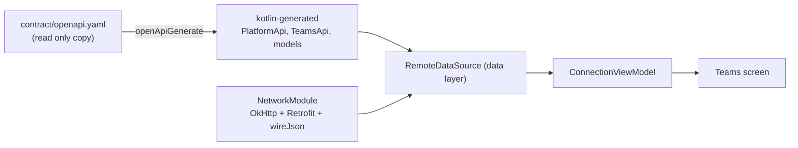

# 04. A generated API client with Retrofit and OkHttp

> **Draft: written but not yet run.** The code and the expected output in this lesson were prepared by reading the code and the official documentation. They have not been executed yet. If something does not behave as described, trust your tool's real output and report it.

## What you will be able to do
- generate typed Retrofit interfaces and models from `openapi.yaml` with one Gradle task, and never edit them;
- configure OkHttp, Retrofit and kotlinx.serialization through Hilt;
- allow cleartext HTTP to the emulator host in debug builds only;
- call the unauthenticated `/health` endpoint from the app and show the answer.

## Recap
1. Why does `FakeTasksRepository` take an `@IoDispatcher`? <details><summary>Answer</summary>So the thread choice is injectable and every function is main-safe.</details>
2. Which layer may import generated code? <details><summary>Answer</summary>Only the data layer; ui and domain never see it.</details>

## Why it matters
The platform publishes its contract as `openapi.yaml`. Writing DTOs by hand means typing the contract a second time, and every typo is a bug that appears only at run time. A **generator** reads the contract and writes the Retrofit interfaces and the model classes; when the contract changes you run the task again and the compiler shows you everything that broke. This is requirement M-02 of the capstone (`capstones/mobile-kotlin/TDD.md`).

## What you will build
Tasks Mini gains the generated client (committed under `app/src/main/kotlin-generated`), a `NetworkModule`, debug-only cleartext rules, and a connection line on the Teams screen: *Backend: database up*. Teams, Projects and Tasks still use the fake repository; lesson 05 switches them to the network, lesson 06 adds the sign-in the API needs.



## Before you start
- The project from lesson 03. Time: about 75 to 90 minutes.
- For the *Run it* step you need the platform and one backend (ASP.NET, Python or Go) on port 8000, started as described in `capstones/mobile-kotlin/tutorials/phase-5-ship/05-build-run-ship.md`. Without it everything builds and the connection line shows its error text; that is a valid result too.
- Source pack (optional): https://github.com/Uee03/Code101 under `source/kotlin/201-hero-to-super-hero/phase-2-network-and-auth/04-generated-api-client/` (**Code, Download ZIP**, or `git clone https://github.com/Uee03/Code101.git`).

**Files that stay as in lesson 03:** `settings.gradle.kts`, `gradle.properties`, the wrapper properties, `.gitignore`, `TasksApplication.kt`, `MainActivity.kt`, `Theme.kt`, `Models.kt`, `Routes.kt`, the repository interface, `FakeTasksRepository.kt`, `DispatchersModule.kt`, `RepositoryModule.kt`, `Components.kt`, `UiState.kt`, the Projects and Tasks screens and ViewModels, `TeamsViewModel.kt`.

**Generated and copied files (not shown line by line):** `contract/openapi.yaml` is a read-only copy of the platform contract (copy it from `capstones/mobile-kotlin/source/phase-1-setup/01-setup/code/contract/openapi.yaml`); everything below `app/src/main/kotlin-generated/` is the generator's output for that file (about 50 small files: `TeamsApi`, `ProjectsApi`, `TasksApi`, `PlatformApi`, models such as `Team`, `Task`, `Problem`, `Health`, `Me`). These are listed in `verify.json` as *skip_lesson_check*. You create them by running the task in Step 3, you do not type them.

New words: OpenAPI, generator, DTO, interceptor, base URL, cleartext, network security config, `BuildConfig`.

## Steps

### Step 1. Libraries
**File: `gradle/libs.versions.toml`**
```toml
[versions]
agp = "9.5.1"
kotlin = "2.4.21"
ksp = "2.3.14"
compose = "2026.11.01"
activity = "1.13.0"
lifecycle = "2.11.1"
navigation = "2.10.2"
serialization = "1.13.0"
coroutines = "1.11.0"
hilt = "2.60.1"
androidx-hilt = "1.4.0"
retrofit = "3.0.0"
okhttp = "5.5.1"

[libraries]
compose-bom = { module = "androidx.compose:compose-bom", version.ref = "compose" }
compose-material3 = { module = "androidx.compose.material3:material3" }
compose-ui = { module = "androidx.compose.ui:ui" }
compose-ui-tooling = { module = "androidx.compose.ui:ui-tooling" }
compose-ui-tooling-preview = { module = "androidx.compose.ui:ui-tooling-preview" }
activity-compose = { module = "androidx.activity:activity-compose", version.ref = "activity" }
lifecycle-runtime = { module = "androidx.lifecycle:lifecycle-runtime-compose", version.ref = "lifecycle" }
lifecycle-viewmodel = { module = "androidx.lifecycle:lifecycle-viewmodel-compose", version.ref = "lifecycle" }
navigation = { module = "androidx.navigation:navigation-compose", version.ref = "navigation" }
serialization = { module = "org.jetbrains.kotlinx:kotlinx-serialization-json", version.ref = "serialization" }
coroutines = { module = "org.jetbrains.kotlinx:kotlinx-coroutines-android", version.ref = "coroutines" }
hilt-android = { module = "com.google.dagger:hilt-android", version.ref = "hilt" }
hilt-compiler = { module = "com.google.dagger:hilt-compiler", version.ref = "hilt" }
hilt-viewmodel = { module = "androidx.hilt:hilt-lifecycle-viewmodel-compose", version.ref = "androidx-hilt" }
retrofit = { module = "com.squareup.retrofit2:retrofit", version.ref = "retrofit" }
retrofit-converter = { module = "com.squareup.retrofit2:converter-kotlinx-serialization", version.ref = "retrofit" }
okhttp = { module = "com.squareup.okhttp3:okhttp", version.ref = "okhttp" }
okhttp-logging = { module = "com.squareup.okhttp3:logging-interceptor", version.ref = "okhttp" }

[plugins]
android-application = { id = "com.android.application", version.ref = "agp" }
kotlin-compose = { id = "org.jetbrains.kotlin.plugin.compose", version.ref = "kotlin" }
kotlin-serialization = { id = "org.jetbrains.kotlin.plugin.serialization", version.ref = "kotlin" }
ksp = { id = "com.google.devtools.ksp", version.ref = "ksp" }
hilt = { id = "com.google.dagger.hilt.android", version.ref = "hilt" }
```
New: `retrofit`, `okhttp` versions and four libraries.

### Step 2. The generator task and its configuration
**File: `build.gradle.kts`**
```kotlin
plugins {
    alias(libs.plugins.android.application) apply false
    alias(libs.plugins.kotlin.compose) apply false
    alias(libs.plugins.kotlin.serialization) apply false
    alias(libs.plugins.ksp) apply false
    alias(libs.plugins.hilt) apply false
}

val generator = configurations.create("generator")
dependencies {
    generator("org.openapitools:openapi-generator-cli:7.27.0")
}

tasks.register<JavaExec>("openApiGenerate") {
    group = "code generation"
    classpath = generator
    mainClass.set("org.openapitools.codegen.OpenAPIGenerator")
    args(
        "generate",
        "-i", "$rootDir/contract/openapi.yaml",
        "-g", "kotlin",
        "-c", "$rootDir/openapi/generator-config.json",
        "-o", "$rootDir/app/src/main/kotlin-generated",
        "--global-property",
        "apis,models,supportingFiles=CollectionFormats.kt,apiDocs=false,modelDocs=false,apiTests=false,modelTests=false",
        "--ignore-file-override", "$rootDir/openapi/.openapi-generator-ignore",
    )
}
```
- `generator` is a separate dependency group that only holds the generator tool (OpenAPI Generator CLI 7.27.0), so it never ends up in the app.
- The task runs that tool as a Java program (`JavaExec`) with: the input contract, generator name `kotlin`, a config file, an output folder, and a global property that limits output to API interfaces, models and one helper file (no docs, no tests).
- The capstone uses this same task instead of the generator's Gradle plugin because it needs no plugin version to track.

**File: `openapi/generator-config.json`**
```json
{
  "library": "jvm-retrofit2",
  "apiPackage": "com.code101.tasks.generated.api",
  "modelPackage": "com.code101.tasks.generated.model",
  "serializationLibrary": "kotlinx_serialization",
  "useCoroutines": true,
  "dateLibrary": "java8",
  "enumPropertyNaming": "original",
  "omitGradleWrapper": true,
  "typeMappings": {
    "AnyType": "JsonElement"
  },
  "importMappings": {
    "JsonElement": "kotlinx.serialization.json.JsonElement"
  }
}
```
`jvm-retrofit2` makes Retrofit interfaces; `kotlinx_serialization` uses the same JSON library as the rest of the app; `useCoroutines` makes functions `suspend`; `java8` maps dates to `java.time`; `enumPropertyNaming: original` keeps enum names as in the contract (`in_progress`); `AnyType` (a free-form JSON value) maps to `JsonElement`.

**File: `openapi/.openapi-generator-ignore`**
```text
**/ApiClient.kt
**/auth/**
README.md
build.gradle
settings.gradle
gradle/**
gradlew
gradlew.bat
```
These patterns stop the generator from writing its own HTTP client, auth helpers, wrapper and build files; we use our own OkHttp and Retrofit.

### Step 3. Copy the contract and generate the client
1. Create `contract/openapi.yaml` by copying the platform file (see "Before you start"). It is a **read-only copy**: if the contract must change, change it in the platform, never here.
2. In Android Studio open the **Gradle** tool window, **Tasks > code generation > openApiGenerate**, and run it. (A terminal alternative from the project root, after Android Studio has created the wrapper: Windows `.\gradlew.bat openApiGenerate`, macOS and Linux `./gradlew openApiGenerate`.)

Expected result: the folder `app/src/main/kotlin-generated` contains `.openapi-generator/` and `src/main/kotlin/` with the packages `com/code101/tasks/generated/api` and `.../model`, and `org/openapitools/client/infrastructure/CollectionFormats.kt`. For example `TasksApi` has `suspend fun createTask(...)`, `getTask`, `updateTask`, `completeTask`. **Never edit these files**; commit them so a build does not depend on the generator.

A taste of the output (excerpt, not a file you type):
```kotlin
@GET("v1/teams")
suspend fun listTeams(@Query("limit") limit: kotlin.Int? = 25, @Query("cursor") cursor: kotlin.String? = null,
    @Query("sort") sort: SortListTeams? = SortListTeams.MinusCreatedAt, @Query("q") q: kotlin.String? = null): Response<TeamPage>
```
Each operation returns a Retrofit `Response<T>`, so you can look at the status code and the error body yourself (lesson 05).

### Step 4. Build configuration
**File: `app/build.gradle.kts`**
```kotlin
plugins {
    alias(libs.plugins.android.application)
    alias(libs.plugins.kotlin.compose)
    alias(libs.plugins.kotlin.serialization)
    alias(libs.plugins.ksp)
    alias(libs.plugins.hilt)
}

android {
    namespace = "com.code101.tasks"
    compileSdk { version = release(37) }

    defaultConfig {
        applicationId = "com.code101.tasks.lab"
        minSdk = 26
        targetSdk = 36
        versionCode = 1
        versionName = "1.0"
    }

    buildTypes {
        debug {
            buildConfigField(
                "String",
                "API_BASE_URL",
                "\"${providers.gradleProperty("apiBaseUrl").getOrElse("http://10.0.2.2:8000")}\"",
            )
        }
        release {
            buildConfigField(
                "String",
                "API_BASE_URL",
                "\"${providers.gradleProperty("apiBaseUrl").getOrElse("https://tasks.example.invalid")}\"",
            )
        }
    }

    sourceSets.named("main") {
        kotlin.directories += "src/main/kotlin-generated/src/main/kotlin"
    }

    buildFeatures {
        compose = true
        buildConfig = true
    }

    compileOptions {
        sourceCompatibility = JavaVersion.VERSION_17
        targetCompatibility = JavaVersion.VERSION_17
    }
}

kotlin {
    compilerOptions {
        jvmTarget.set(org.jetbrains.kotlin.gradle.dsl.JvmTarget.JVM_17)
    }
}

dependencies {
    implementation(platform(libs.compose.bom))
    implementation(libs.compose.material3)
    implementation(libs.compose.ui)
    implementation(libs.compose.ui.tooling.preview)
    implementation(libs.activity.compose)
    implementation(libs.lifecycle.runtime)
    implementation(libs.lifecycle.viewmodel)
    implementation(libs.navigation)
    implementation(libs.serialization)
    implementation(libs.coroutines)
    implementation(libs.hilt.android)
    implementation(libs.hilt.viewmodel)
    ksp(libs.hilt.compiler)
    implementation(libs.retrofit)
    implementation(libs.retrofit.converter)
    implementation(libs.okhttp)
    implementation(libs.okhttp.logging)
    debugImplementation(libs.compose.ui.tooling)
}
```
- `buildConfigField` writes a constant into the generated `BuildConfig` class: `API_BASE_URL` is `http://10.0.2.2:8000` in debug (the emulator's alias for your computer; capstone TDD section 4) and an `https` placeholder in release. Override with `-PapiBaseUrl=...` (a USB phone uses `http://localhost:8000` with `adb reverse tcp:8000 tcp:8000`). **No feature code contains a URL literal** (requirement M-01).
- `kotlin.directories += ...` registers the generator output as a Kotlin source folder (the AGP 9 way; the capstone does the same).
- `buildConfig = true` switches `BuildConfig` generation on.

### Step 5. Cleartext only for development hosts
Android 9 and newer block plain `http://` by default. The emulator host is `http://10.0.2.2`, so the **debug** build opens exactly three hosts; **release** allows none.

**File: `app/src/main/AndroidManifest.xml`**
```xml
<?xml version="1.0" encoding="utf-8"?>
<manifest xmlns:android="http://schemas.android.com/apk/res/android">
    <uses-permission android:name="android.permission.INTERNET" />
    <application
        android:name=".TasksApplication"
        android:allowBackup="false"
        android:usesCleartextTraffic="false"
        android:label="@string/app_name"
        android:theme="@android:style/Theme.Material.Light.NoActionBar">
        <activity
            android:name=".MainActivity"
            android:exported="true">
            <intent-filter>
                <action android:name="android.intent.action.MAIN" />
                <category android:name="android.intent.category.LAUNCHER" />
            </intent-filter>
        </activity>
    </application>
</manifest>
```
`usesCleartextTraffic="false"` is the release default made explicit. The debug-only exception lives in a separate source set that Gradle merges only into debug builds:

**File: `app/src/debug/AndroidManifest.xml`**
```xml
<manifest xmlns:android="http://schemas.android.com/apk/res/android">
    <application android:networkSecurityConfig="@xml/network_security_config" />
</manifest>
```
**File: `app/src/debug/res/xml/network_security_config.xml`**
```xml
<network-security-config>
    <base-config cleartextTrafficPermitted="false" />
    <domain-config cleartextTrafficPermitted="true">
        <domain>10.0.2.2</domain>
        <domain>localhost</domain>
        <domain>127.0.0.1</domain>
    </domain-config>
</network-security-config>
```
The base rule forbids cleartext; the `domain-config` re-allows it for three development hosts only. This is capstone requirement M-03.

**File: `app/src/main/res/values/strings.xml`**
```xml
<resources>
    <string name="app_name">Tasks Mini</string>
    <string name="teams">Teams</string>
    <string name="projects">Projects</string>
    <string name="tasks">Tasks</string>
    <string name="back">Back</string>
    <string name="retry">Retry</string>
    <string name="error_offline">The data could not be loaded. Check the connection and try again.</string>
    <string name="empty">Nothing here yet.</string>
    <string name="members">%1$d members</string>
    <string name="new_task">New task</string>
    <string name="add">Add</string>
    <string name="open_count">%1$d open</string>
    <string name="search_teams">Search teams</string>
    <string name="task_added">Task added</string>
    <string name="refresh_failed">Could not refresh. Showing the saved data.</string>
    <string name="status_todo">To do</string>
    <string name="status_in_progress">In progress</string>
    <string name="status_blocked">Blocked</string>
    <string name="status_done">Done</string>
    <string name="status_cancelled">Cancelled</string>
    <string name="checking_connection">Checking the backend...</string>
    <string name="connection_ok">Backend: database %1$s</string>
    <string name="error_connection">The backend did not answer. Is it running on port 8000?</string>
    <string name="check_connection">Check again</string>
</resources>
```

### Step 6. JSON, URL policy and query enums
**File: `app/src/main/kotlin/com/code101/tasks/data/remote/WireJson.kt`**
```kotlin
package com.code101.tasks.data.remote

import kotlinx.serialization.KSerializer
import kotlinx.serialization.descriptors.PrimitiveKind
import kotlinx.serialization.descriptors.PrimitiveSerialDescriptor
import kotlinx.serialization.encoding.Decoder
import kotlinx.serialization.encoding.Encoder
import kotlinx.serialization.json.Json
import kotlinx.serialization.modules.SerializersModule
import kotlinx.serialization.modules.contextual
import java.time.LocalDate
import java.time.OffsetDateTime
import java.util.UUID

class TextSerializer<T : Any>(name: String, private val parse: (String) -> T) : KSerializer<T> {
    override val descriptor = PrimitiveSerialDescriptor(name, PrimitiveKind.STRING)
    override fun deserialize(decoder: Decoder) = parse(decoder.decodeString())
    override fun serialize(encoder: Encoder, value: T) = encoder.encodeString(value.toString())
}

val wireJson = Json {
    ignoreUnknownKeys = true
    explicitNulls = true
    serializersModule = SerializersModule {
        contextual(UUID::class, TextSerializer("UUID", UUID::fromString))
        contextual(LocalDate::class, TextSerializer("LocalDate", LocalDate::parse))
        contextual(OffsetDateTime::class, TextSerializer("OffsetDateTime", OffsetDateTime::parse))
    }
}
```
The generated models mark `UUID`, `LocalDate` and `OffsetDateTime` fields `@Contextual`, which means "the serializer for this type is registered elsewhere". This file registers them. `ignoreUnknownKeys` makes the client tolerate new fields in newer servers.

**File: `app/src/main/kotlin/com/code101/tasks/data/remote/HttpUrlPolicy.kt`**
```kotlin
package com.code101.tasks.data.remote

import com.code101.tasks.BuildConfig
import okhttp3.HttpUrl
import okhttp3.Interceptor
import okhttp3.Response

object HttpUrlPolicy {
    private val devHosts = setOf("10.0.2.2", "localhost", "127.0.0.1")

    fun requireAllowed(url: HttpUrl) {
        require(url.isHttps || (BuildConfig.DEBUG && url.scheme == "http" && url.host in devHosts))
        require(url.username.isEmpty() && url.password.isEmpty())
    }
}

class UrlPolicyInterceptor : Interceptor {
    override fun intercept(chain: Interceptor.Chain): Response {
        HttpUrlPolicy.requireAllowed(chain.request().url)
        return chain.proceed(chain.request())
    }
}
```
The manifest rule is the platform's guard; this is the same rule in code, so a wrong URL fails *before* a request leaves the app and also protects code paths that bypass the platform (AppAuth in lesson 06 reuses it). Credentials in the URL are refused.

**File: `app/src/main/kotlin/com/code101/tasks/data/remote/QueryEnums.kt`**
```kotlin
package com.code101.tasks.data.remote

import com.code101.tasks.generated.api.ProjectsApi
import com.code101.tasks.generated.api.TasksApi
import com.code101.tasks.generated.api.TeamsApi
import com.code101.tasks.generated.model.TaskPriority
import com.code101.tasks.generated.model.TaskStatus
import java.lang.reflect.Type
import retrofit2.Converter
import retrofit2.Retrofit

// The generated query enums print their Kotlin name by default; the server needs their wire value.
class QueryEnums : Converter.Factory() {
    override fun stringConverter(
        type: Type,
        annotations: Array<Annotation>,
        retrofit: Retrofit,
    ): Converter<*, String>? {
        val known = setOf<Type>(
            TasksApi.SortListTasks::class.java,
            TeamsApi.SortListTeams::class.java,
            ProjectsApi.SortListProjects::class.java,
            TaskStatus::class.java,
            TaskPriority::class.java,
        )
        if (type !in known) return null
        return Converter<Any, String> { value ->
            when (value) {
                is TasksApi.SortListTasks -> value.value
                is TeamsApi.SortListTeams -> value.value
                is ProjectsApi.SortListProjects -> value.value
                is TaskStatus -> value.value
                is TaskPriority -> value.value
                else -> error("Unsupported query enum")
            }
        }
    }
}
```
Retrofit turns a query parameter into text with `toString()`. The generated sort enums keep names such as `MinusCreatedAt` whose wire value is `-createdAt`; without this converter the app would send the wrong sort. This is a real generator quirk: check query parameters in the generated code before trusting them.

### Step 7. Hilt provides the network stack
**File: `app/src/main/kotlin/com/code101/tasks/di/NetworkModule.kt`**
```kotlin
package com.code101.tasks.di

import com.code101.tasks.BuildConfig
import com.code101.tasks.data.remote.QueryEnums
import com.code101.tasks.data.remote.UrlPolicyInterceptor
import com.code101.tasks.data.remote.wireJson
import com.code101.tasks.generated.api.PlatformApi
import com.code101.tasks.generated.api.ProjectsApi
import com.code101.tasks.generated.api.TasksApi
import com.code101.tasks.generated.api.TeamsApi
import dagger.Module
import dagger.Provides
import dagger.hilt.InstallIn
import dagger.hilt.components.SingletonComponent
import javax.inject.Singleton
import okhttp3.MediaType.Companion.toMediaType
import okhttp3.OkHttpClient
import okhttp3.logging.HttpLoggingInterceptor
import retrofit2.Retrofit
import retrofit2.converter.kotlinx.serialization.asConverterFactory

@Module
@InstallIn(SingletonComponent::class)
object NetworkModule {
    @Provides
    @Singleton
    fun okHttpClient(): OkHttpClient = OkHttpClient.Builder()
        .followRedirects(false)
        .followSslRedirects(false)
        .addInterceptor(UrlPolicyInterceptor())
        .apply {
            if (BuildConfig.DEBUG) {
                addInterceptor(
                    HttpLoggingInterceptor().apply {
                        redactHeader("Authorization")
                        level = HttpLoggingInterceptor.Level.BASIC
                    },
                )
            }
        }
        .build()

    @Provides
    @Singleton
    fun retrofit(client: OkHttpClient): Retrofit = Retrofit.Builder()
        .baseUrl(BuildConfig.API_BASE_URL + "/")
        .client(client)
        .addConverterFactory(QueryEnums())
        .addConverterFactory(wireJson.asConverterFactory("application/json".toMediaType()))
        .build()

    @Provides
    @Singleton
    fun platformApi(retrofit: Retrofit): PlatformApi = retrofit.create(PlatformApi::class.java)

    @Provides
    @Singleton
    fun teamsApi(retrofit: Retrofit): TeamsApi = retrofit.create(TeamsApi::class.java)

    @Provides
    @Singleton
    fun projectsApi(retrofit: Retrofit): ProjectsApi = retrofit.create(ProjectsApi::class.java)

    @Provides
    @Singleton
    fun tasksApi(retrofit: Retrofit): TasksApi = retrofit.create(TasksApi::class.java)
}
```
- `followRedirects(false)`: an API should answer directly; a redirect could send the bearer token (lesson 06) to another host.
- Logging runs only in debug, at `BASIC` level (method, URL, status, time; no bodies), and the `Authorization` header is redacted. Logs never contain tokens (capstone M-06).
- Order of converter factories matters: `QueryEnums` handles only query text and returns `null` for everything else, so the JSON converter still takes the bodies.
- `@Provides` is the right tool here (see lesson 02): Retrofit and OkHttp are library types.

### Step 8. The data source and a visible result
**File: `app/src/main/kotlin/com/code101/tasks/data/remote/RemoteDataSource.kt`**
```kotlin
package com.code101.tasks.data.remote

import com.code101.tasks.generated.api.PlatformApi
import java.io.IOException
import javax.inject.Inject
import javax.inject.Singleton

@Singleton
class RemoteDataSource @Inject constructor(
    private val platformApi: PlatformApi,
) {
    suspend fun health(): String {
        val response = platformApi.getHealth()
        if (!response.isSuccessful) throw IOException("Health returned ${response.code()}")
        val body = response.body() ?: throw IOException("Empty health body")
        return body.database?.value ?: body.status.value
    }
}
```
**File: `app/src/main/kotlin/com/code101/tasks/ui/teams/ConnectionViewModel.kt`**
```kotlin
package com.code101.tasks.ui.teams

import androidx.lifecycle.ViewModel
import androidx.lifecycle.viewModelScope
import com.code101.tasks.R
import com.code101.tasks.data.remote.RemoteDataSource
import com.code101.tasks.ui.common.UiState
import dagger.hilt.android.lifecycle.HiltViewModel
import java.io.IOException
import javax.inject.Inject
import kotlinx.coroutines.flow.MutableStateFlow
import kotlinx.coroutines.flow.StateFlow
import kotlinx.coroutines.flow.asStateFlow
import kotlinx.coroutines.launch

// Lesson 05 moves this call behind the domain layer; for now the health check is a data-layer demo.
@HiltViewModel
class ConnectionViewModel @Inject constructor(
    private val remote: RemoteDataSource,
) : ViewModel() {
    private val _state = MutableStateFlow<UiState<String>>(UiState.Loading)
    val state: StateFlow<UiState<String>> = _state.asStateFlow()

    init {
        check()
    }

    fun check() {
        viewModelScope.launch {
            _state.value = UiState.Loading
            _state.value = try {
                UiState.Success(remote.health())
            } catch (e: IOException) {
                UiState.Failure(R.string.error_connection)
            }
        }
    }
}
```
This ViewModel breaks the dependency rule on purpose (it touches the data layer directly) and says so in a comment: it is a throw-away probe, and lesson 05 puts the real calls behind `TasksRepository`.

**File: `app/src/main/kotlin/com/code101/tasks/ui/teams/TeamsScreen.kt`**
```kotlin
package com.code101.tasks.ui.teams

import androidx.compose.foundation.clickable
import androidx.compose.foundation.layout.Arrangement
import androidx.compose.foundation.layout.Column
import androidx.compose.foundation.layout.PaddingValues
import androidx.compose.foundation.layout.Row
import androidx.compose.foundation.layout.fillMaxSize
import androidx.compose.foundation.layout.fillMaxWidth
import androidx.compose.foundation.layout.padding
import androidx.compose.foundation.lazy.LazyColumn
import androidx.compose.foundation.lazy.items
import androidx.compose.material3.Card
import androidx.compose.material3.MaterialTheme
import androidx.compose.material3.OutlinedTextField
import androidx.compose.material3.Text
import androidx.compose.material3.TextButton
import androidx.compose.runtime.Composable
import androidx.compose.ui.Alignment
import androidx.compose.ui.Modifier
import androidx.compose.ui.res.stringResource
import androidx.compose.ui.semantics.LiveRegionMode
import androidx.compose.ui.semantics.liveRegion
import androidx.compose.ui.semantics.semantics
import androidx.compose.ui.unit.dp
import com.code101.tasks.R
import com.code101.tasks.domain.model.Team
import com.code101.tasks.ui.common.UiState
import com.code101.tasks.ui.components.AppScaffold
import com.code101.tasks.ui.components.UiStateContent

@Composable
fun TeamsScreen(
    state: UiState<List<Team>>,
    connection: UiState<String>,
    searchText: String,
    onSearchChange: (String) -> Unit,
    onCheckConnection: () -> Unit,
    onRetry: () -> Unit,
    onOpenTeam: (String) -> Unit,
) {
    AppScaffold(titleRes = R.string.teams) { padding ->
        Column(
            modifier = Modifier
                .padding(padding)
                .padding(16.dp),
            verticalArrangement = Arrangement.spacedBy(12.dp),
        ) {
            Row(
                modifier = Modifier.fillMaxWidth(),
                verticalAlignment = Alignment.CenterVertically,
            ) {
                val text = when (connection) {
                    UiState.Loading -> stringResource(R.string.checking_connection)
                    is UiState.Success -> stringResource(R.string.connection_ok, connection.data)
                    is UiState.Failure -> stringResource(connection.messageRes)
                }
                Text(
                    text = text,
                    modifier = Modifier
                        .weight(1f)
                        .semantics { liveRegion = LiveRegionMode.Polite },
                )
                TextButton(onClick = onCheckConnection) {
                    Text(stringResource(R.string.check_connection))
                }
            }
            OutlinedTextField(
                value = searchText,
                onValueChange = onSearchChange,
                label = { Text(stringResource(R.string.search_teams)) },
                singleLine = true,
                modifier = Modifier.fillMaxWidth(),
            )
            UiStateContent(
                state = state,
                onRetry = onRetry,
                modifier = Modifier.weight(1f),
            ) { teams ->
                if (teams.isEmpty()) {
                    Text(text = stringResource(R.string.empty))
                } else {
                    LazyColumn(
                        modifier = Modifier.fillMaxSize(),
                        contentPadding = PaddingValues(vertical = 4.dp),
                        verticalArrangement = Arrangement.spacedBy(12.dp),
                    ) {
                        items(teams, key = { it.id }) { team ->
                            Card(
                                modifier = Modifier
                                    .fillMaxWidth()
                                    .clickable { onOpenTeam(team.id) },
                            ) {
                                Column(modifier = Modifier.padding(16.dp)) {
                                    Text(team.name, style = MaterialTheme.typography.titleMedium)
                                    Text(team.description)
                                    Text(stringResource(R.string.members, team.memberCount))
                                }
                            }
                        }
                    }
                }
            }
        }
    }
}
```
**File: `app/src/main/kotlin/com/code101/tasks/ui/navigation/AppGraph.kt`**
```kotlin
package com.code101.tasks.ui.navigation

import androidx.compose.runtime.Composable
import androidx.compose.runtime.getValue
import androidx.hilt.lifecycle.viewmodel.compose.hiltViewModel
import androidx.lifecycle.compose.collectAsStateWithLifecycle
import androidx.navigation.compose.NavHost
import androidx.navigation.compose.composable
import androidx.navigation.compose.rememberNavController
import com.code101.tasks.ui.projects.ProjectsScreen
import com.code101.tasks.ui.projects.ProjectsViewModel
import com.code101.tasks.ui.tasks.TasksScreen
import com.code101.tasks.ui.tasks.TasksViewModel
import com.code101.tasks.ui.teams.ConnectionViewModel
import com.code101.tasks.ui.teams.TeamsScreen
import com.code101.tasks.ui.teams.TeamsViewModel

@Composable
fun AppGraph() {
    val navController = rememberNavController()

    NavHost(navController = navController, startDestination = TeamsRoute) {
        composable<TeamsRoute> {
            val viewModel: TeamsViewModel = hiltViewModel()
            val connectionViewModel: ConnectionViewModel = hiltViewModel()
            val state by viewModel.state.collectAsStateWithLifecycle()
            val connection by connectionViewModel.state.collectAsStateWithLifecycle()
            val searchText by viewModel.searchText.collectAsStateWithLifecycle()
            TeamsScreen(
                state = state,
                connection = connection,
                searchText = searchText,
                onSearchChange = viewModel::onSearchChange,
                onCheckConnection = connectionViewModel::check,
                onRetry = viewModel::refresh,
                onOpenTeam = { teamId -> navController.navigate(ProjectsRoute(teamId)) },
            )
        }
        composable<ProjectsRoute> {
            val viewModel: ProjectsViewModel = hiltViewModel()
            val state by viewModel.state.collectAsStateWithLifecycle()
            ProjectsScreen(
                state = state,
                onRetry = viewModel::refresh,
                onOpenProject = { projectId -> navController.navigate(TasksRoute(projectId)) },
                onBack = { navController.popBackStack() },
            )
        }
        composable<TasksRoute> {
            val viewModel: TasksViewModel = hiltViewModel()
            val state by viewModel.state.collectAsStateWithLifecycle()
            TasksScreen(
                state = state,
                events = viewModel.events,
                onRetry = viewModel::refresh,
                onAdd = viewModel::addTask,
                onBack = { navController.popBackStack() },
            )
        }
    }
}
```
Predict before you run: with the backend stopped, what does the line at the top of Teams say? With the backend running, what two words does it end with?

## Run it
Sync Gradle (the first sync downloads the generator; it runs only when you start `openApiGenerate`), then run the app on an emulator with the backend listening on port 8000.

Expected result (described, not yet seen): the Teams screen shows "Checking the backend..." and then "Backend: database up" (the word comes from the contract's `Health.database` value). With the backend stopped, the line reads "The backend did not answer. Is it running on port 8000?". **Check again** repeats the call. In Logcat (filter `OkHttp`) a line with `GET http://10.0.2.2:8000/health` and a status appears; there is no `Authorization` line.

## How it works
**Contract first.** The yaml file is the single truth; both the backends and this client are checked against it (the platform's conformance script). Generating code removes a whole class of "the server renamed a field" bugs from the app; they become compile errors after regeneration.

**Why committed, why never edited.** Generated files live in their own source folder so tools and reviewers know to skip them. Committing them means a normal build needs no generator and a diff after regeneration shows exactly what the contract change did.

**The generator's limits.** Nullable fields lose "absent versus null", which matters for JSON Merge Patch in the capstone (it builds a `JsonObject` by hand for that one call). Its Retrofit templates pin an old Retrofit; only the interfaces and models are used, and our pinned Retrofit 3.0.0 is on the classpath (capstone TDD, decision table).

**Retrofit `Response<T>`.** Because every generated function returns `Response<T>`, an HTTP 404 or 500 is *not* an exception: you inspect `isSuccessful`, the code and `errorBody()`. Network failures (no route, timeout) are `IOException`. Lesson 05 turns this into one error model.

**Why this, not that.**

| Choice | Alternative | Why |
|---|---|---|
| OpenAPI Generator with Retrofit | hand-written DTOs and interfaces | no drift from the contract; costs a generated folder and a few quirks |
| Retrofit + OkHttp | Ktor client | the generator's Ktor option belongs to its multiplatform library; OkHttp interceptors and `Authenticator` are the standard place for bearer tokens |
| `buildConfigField` | URL literals; `local.properties` | one source, per build type, overridable by `-P`, no secrets needed (public client) |
| Debug-only cleartext | `usesCleartextTraffic=true` | a release build must never accept plain HTTP |

**Where this reappears.** Capstone chapter 01 (`capstones/mobile-kotlin/tutorials/phase-1-setup/01-setup.md`) is this lesson at full size, with all ten icons and the `assembleDebug` exit check.

## Try it
1. **Guided:** add `callerName()` to `RemoteDataSource` (the starter has the TODO). It calls `getMe()` and returns the caller's `displayName`. The endpoint needs a token, so you cannot see it work before lesson 06; make sure it compiles.

**File: `app/src/main/kotlin/com/code101/tasks/data/remote/RemoteDataSource.kt`**
```kotlin
package com.code101.tasks.data.remote

import com.code101.tasks.generated.api.PlatformApi
import java.io.IOException
import javax.inject.Inject
import javax.inject.Singleton

@Singleton
class RemoteDataSource @Inject constructor(
    private val platformApi: PlatformApi,
) {
    suspend fun health(): String {
        val response = platformApi.getHealth()
        if (!response.isSuccessful) throw IOException("Health returned ${response.code()}")
        val body = response.body() ?: throw IOException("Empty health body")
        return body.database?.value ?: body.status.value
    }

    // TODO: add suspend fun callerName(): String that calls platformApi.getMe(), throws IOException
    // when the response is not successful or has no body, and returns the displayName of the caller
}
```
2. **Change:** run the app on a USB phone: pass `-PapiBaseUrl=http://localhost:8000` and run `adb reverse tcp:8000 tcp:8000`. Which line of this lesson makes `localhost` allowed in debug?
3. **Stretch (optional):** find the generated `Task` class and list which fields can be `null`. Which of them would you show differently in the UI?

<details><summary>Solution</summary>

**File: `app/src/main/kotlin/com/code101/tasks/data/remote/RemoteDataSource.kt`**
```kotlin
package com.code101.tasks.data.remote

import com.code101.tasks.generated.api.PlatformApi
import java.io.IOException
import javax.inject.Inject
import javax.inject.Singleton

@Singleton
class RemoteDataSource @Inject constructor(
    private val platformApi: PlatformApi,
) {
    suspend fun health(): String {
        val response = platformApi.getHealth()
        if (!response.isSuccessful) throw IOException("Health returned ${response.code()}")
        val body = response.body() ?: throw IOException("Empty health body")
        return body.database?.value ?: body.status.value
    }

    suspend fun callerName(): String {
        val response = platformApi.getMe()
        if (!response.isSuccessful) throw IOException("Me returned ${response.code()}")
        val body = response.body() ?: throw IOException("Empty me body")
        return body.displayName
    }
}
```
</details>

## Check yourself
1. Why are the generated files committed but never edited? <details><summary>Answer</summary>Builds need no generator and a regeneration diff shows the contract change; edits would be lost on the next run.</details>
2. Why does a 500 answer not throw from a generated function? <details><summary>Answer</summary>The function returns `Response<T>`; only transport failures throw `IOException`.</details>
3. How does the debug build reach a server on your computer, and why not the release build? <details><summary>Answer</summary>`10.0.2.2` over cleartext allowed by the debug-only network security config; release allows no cleartext at all.</details>
4. Predict: you delete `QueryEnums` from the Retrofit builder. What goes wrong later? <details><summary>Answer</summary>Sort and status query values would be sent as enum names instead of wire values, so the server would reject or ignore them.</details>

## Common mistakes
| Symptom or error text | Cause | Fix |
|---|---|---|
| `Unresolved reference 'generated'` (typical message) | The generator has not been run, or the generated folder is not registered as a source folder | Run `openApiGenerate`; check `kotlin.directories` |
| A cleartext traffic not permitted exception (typical) | The debug network config is missing or the host is not one of the three | Add the debug manifest and config; use `10.0.2.2` |
| `IllegalArgumentException` from `HttpUrlPolicy` (typical) | A release build with an `http` URL, or credentials in the URL | Use `https` in release; keep credentials out of URLs |
| Retrofit complains about the base URL not ending in `/` (typical) | `BuildConfig.API_BASE_URL` was used without a slash | Append `"/"` as in `NetworkModule` |
| `Unresolved reference 'BuildConfig'` | `buildConfig = true` is missing | Add it to `buildFeatures` and sync |

## Best practice
Treat the API description as the source of truth, generate the client, keep generated code isolated, and allow cleartext only where it is needed. Source: OpenAPI Generator Kotlin docs https://openapi-generator.tech/docs/generators/kotlin/ and Network security configuration https://developer.android.com/privacy-and-security/security-config

## Going further
- Retrofit: https://square.github.io/retrofit/ and OkHttp interceptors: https://square.github.io/okhttp/features/interceptors/
- Capstone requirements M-01 to M-04.

## Summary
- You generated a typed client from the contract with one Gradle task and kept it untouched.
- You wired OkHttp, Retrofit and kotlinx.serialization through Hilt, with a URL policy and debug-only cleartext.
- You called `/health` and showed the result.

## Next lesson
05. Errors and RFC 9457 problem details: one error model for every failure, and the repository goes online.
