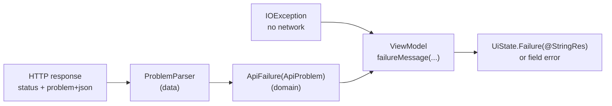

# 05. Errors and RFC 9457 problem details

> **Draft: written but not yet run.** The code and the expected output in this lesson were prepared by reading the code and the official documentation. They have not been executed yet. If something does not behave as described, trust your tool's real output and report it.

## What you will be able to do
- read an RFC 9457 `application/problem+json` body, including `errors[]` pointers and `Retry-After`, into one domain error type;
- map every failure (transport, HTTP status, validation) to one user message without strings in ViewModels;
- switch the repository from the fake to the real API and show a field error next to the input;
- explain which failures are retryable and which are permanent.

## Recap
1. Why do generated functions return `Response<T>`? <details><summary>Answer</summary>So HTTP errors are values you inspect; only transport failures throw `IOException`.</details>
2. What does `screenState` do when a refresh failed but cached data exists? <details><summary>Answer</summary>It shows the cached data; the error is shown only when there is nothing to show.</details>

## Why it matters
When a parcel cannot be delivered, a good courier leaves a card: what went wrong, what you can do, a tracking number. A bad one just says "failed". **RFC 9457** is the standard for that card in HTTP APIs: `type`, `title`, `status`, `detail`, plus extensions. The platform contract uses it for every error (`traceId` correlates with the server log; a 422 carries `errors[]` with a JSON pointer such as `/title`). A client that understands it can tell the user *what to fix* instead of "something went wrong" (capstone M-16).

## What you will build
`ApiProblem` and `ApiFailure` in the domain, a `ProblemParser` in the data layer, a `RemoteTasksRepository` that replaces the fake, and message mapping in the UI. Without a token the real API answers **401**, so after this lesson the Teams screen shows "Sign in again. Your saved work is kept."; that is the correct behaviour and the reason lesson 06 exists. Adding a task with a blank title shows the field error under the input.



## Before you start
- The project from lesson 04, with the backend from lesson 04 running if you want to see real answers. Time: about 75 to 90 minutes.
- Source pack (optional): https://github.com/Uee03/Code101 under `source/kotlin/201-hero-to-super-hero/phase-2-network-and-auth/05-errors-and-problem-details/` (**Code, Download ZIP**, or `git clone https://github.com/Uee03/Code101.git`).

**Files that stay as in lesson 04:** all Gradle files, the manifests (main and debug), the network security config, the generated client and contract, `TasksApplication.kt`, `MainActivity.kt`, `Theme.kt`, `Models.kt`, `Routes.kt`, `TasksRepository.kt`, `DispatchersModule.kt`, `NetworkModule.kt`, `WireJson.kt`, `HttpUrlPolicy.kt`, `QueryEnums.kt`, `Components.kt`, `TeamsScreen.kt`, `ProjectsScreen.kt`. **Deleted:** `FakeTasksRepository.kt`.

New words: problem details, `type`, `title`, JSON pointer, `Retry-After`, retryable, permanent failure, field error, `traceId`.

## Steps

### Step 1. The error type in the domain
**File: `app/src/main/kotlin/com/code101/tasks/domain/model/ApiProblem.kt`**
```kotlin
package com.code101.tasks.domain.model

data class FieldError(val pointer: String, val detail: String)

data class ApiProblem(
    val type: String,
    val title: String,
    val status: Int,
    val errors: List<FieldError> = emptyList(),
    val retryAfterMillis: Long = 0,
    val traceId: String? = null,
)

class ApiFailure(val problem: ApiProblem) : Exception(problem.title)
```
The domain owns the error shape; nothing in it mentions Retrofit or JSON. `ApiFailure` is an `Exception`, deliberately **not** an `IOException`: "the server said no" and "I could not reach the server" need different handling.

### Step 2. Parse the answer
**File: `app/src/main/kotlin/com/code101/tasks/data/remote/ProblemParser.kt`**
```kotlin
package com.code101.tasks.data.remote

import com.code101.tasks.domain.model.ApiFailure
import com.code101.tasks.domain.model.ApiProblem
import com.code101.tasks.domain.model.FieldError
import java.io.IOException
import java.time.ZonedDateTime
import java.time.format.DateTimeFormatter
import kotlinx.serialization.json.JsonArray
import kotlinx.serialization.json.JsonObject
import kotlinx.serialization.json.contentOrNull
import kotlinx.serialization.json.jsonObject
import kotlinx.serialization.json.jsonPrimitive
import retrofit2.Response

object ProblemParser {
    fun parse(response: Response<*>): ApiProblem {
        val json = runCatching {
            wireJson.parseToJsonElement(response.errorBody()?.string().orEmpty()).jsonObject
        }.getOrNull()

        val header = response.headers()["Retry-After"]
        val retryAfter = header?.toLongOrNull()?.let { seconds -> seconds * 1000 }
            ?: runCatching {
                ZonedDateTime.parse(header, DateTimeFormatter.RFC_1123_DATE_TIME)
                    .toInstant().toEpochMilli() - System.currentTimeMillis()
            }.getOrDefault(0L)

        val errors = (json?.get("errors") as? JsonArray).orEmpty().mapNotNull { item ->
            val obj = item as? JsonObject ?: return@mapNotNull null
            FieldError(
                pointer = obj["pointer"]?.jsonPrimitive?.content.orEmpty(),
                detail = obj["detail"]?.jsonPrimitive?.content.orEmpty(),
            )
        }

        return ApiProblem(
            type = json?.get("type")?.jsonPrimitive?.content.orEmpty(),
            title = json?.get("title")?.jsonPrimitive?.contentOrNull ?: response.message(),
            status = response.code(),
            errors = errors,
            retryAfterMillis = retryAfter.coerceAtLeast(0L),
            traceId = json?.get("traceId")?.jsonPrimitive?.contentOrNull,
        )
    }
}

fun <T> Response<T>.required(): T {
    if (!isSuccessful) throw ApiFailure(ProblemParser.parse(this))
    return body() ?: throw IOException("Empty response")
}
```
- The parser must never throw: a proxy or a crashed server may answer with HTML. `runCatching { ... }.getOrNull()` turns unparsable bodies into `null`, and the status code plus HTTP message still describe the failure.
- `Retry-After` is either whole seconds or an HTTP date (RFC 9110); both are read, into milliseconds from now.
- `required()` is the single bridge from `Response<T>` to either the body or an `ApiFailure`.

### Step 3. The remote data source maps to domain models
**File: `app/src/main/kotlin/com/code101/tasks/data/remote/RemoteDataSource.kt`**
```kotlin
package com.code101.tasks.data.remote

import com.code101.tasks.domain.model.Project
import com.code101.tasks.domain.model.TaskItem
import com.code101.tasks.domain.model.Team
import com.code101.tasks.generated.api.PlatformApi
import com.code101.tasks.generated.api.ProjectsApi
import com.code101.tasks.generated.api.TasksApi
import com.code101.tasks.generated.api.TeamsApi
import com.code101.tasks.generated.model.TaskCreate
import java.util.UUID
import javax.inject.Inject
import javax.inject.Singleton
import com.code101.tasks.generated.model.Project as ProjectDto
import com.code101.tasks.generated.model.Task as TaskDto
import com.code101.tasks.generated.model.Team as TeamDto

@Singleton
class RemoteDataSource @Inject constructor(
    private val platformApi: PlatformApi,
    private val teamsApi: TeamsApi,
    private val projectsApi: ProjectsApi,
    private val tasksApi: TasksApi,
) {
    suspend fun health(): String {
        val body = platformApi.getHealth().required()
        return body.database?.value ?: body.status.value
    }

    suspend fun teams(): List<Team> {
        val all = mutableListOf<Team>()
        var cursor: String? = null
        do {
            val page = teamsApi.listTeams(cursor = cursor).required()
            all += page.items.map { it.toDomain() }
            cursor = page.page.nextCursor
        } while (cursor != null)
        return all
    }

    suspend fun projects(teamId: String): List<Project> {
        val all = mutableListOf<Project>()
        var cursor: String? = null
        do {
            val page = projectsApi.listProjects(UUID.fromString(teamId), cursor = cursor).required()
            all += page.items.map { it.toDomain() }
            cursor = page.page.nextCursor
        } while (cursor != null)
        return all
    }

    suspend fun tasks(projectId: String): List<TaskItem> {
        val all = mutableListOf<TaskItem>()
        var cursor: String? = null
        do {
            val page = tasksApi.listTasks(UUID.fromString(projectId), cursor = cursor).required()
            all += page.items.map { it.toDomain() }
            cursor = page.page.nextCursor
        } while (cursor != null)
        return all
    }

    suspend fun createTask(projectId: String, title: String, idempotencyKey: String): TaskItem =
        tasksApi.createTask(
            projectId = UUID.fromString(projectId),
            taskCreate = TaskCreate(title = title),
            idempotencyKey = idempotencyKey,
        ).required().toDomain()
}

private fun TeamDto.toDomain() = Team(id.toString(), name, description, memberCount)

private fun ProjectDto.toDomain() = Project(id.toString(), teamId.toString(), key, name)

private fun TaskDto.toDomain() = TaskItem(id.toString(), projectId.toString(), title, status.value, version)
```
- Import aliases (`... as TeamDto`) keep the generated and domain types apart in one file; this is the only file that names both.
- The pagination loop follows `page.nextCursor` until it is `null`. The client never parses the cursor (capstone section 6).
- `Idempotency-Key` makes a create safe to repeat: the server replays the first answer for the same key. Here the key is made per call; lesson 08 ties it to the outbox row so a retry reuses it.

### Step 4. The repository goes online
**File: `app/src/main/kotlin/com/code101/tasks/data/repository/RemoteTasksRepository.kt`**
```kotlin
package com.code101.tasks.data.repository

import com.code101.tasks.data.remote.RemoteDataSource
import com.code101.tasks.domain.model.Project
import com.code101.tasks.domain.model.TaskItem
import com.code101.tasks.domain.model.Team
import com.code101.tasks.domain.repository.TasksRepository
import java.util.UUID
import javax.inject.Inject
import kotlinx.coroutines.flow.Flow
import kotlinx.coroutines.flow.MutableStateFlow
import kotlinx.coroutines.flow.map
import kotlinx.coroutines.flow.update

class RemoteTasksRepository @Inject constructor(
    private val remote: RemoteDataSource,
) : TasksRepository {
    private val cachedTeams = MutableStateFlow<List<Team>>(emptyList())
    private val cachedProjects = MutableStateFlow<List<Project>>(emptyList())
    private val cachedTasks = MutableStateFlow<List<TaskItem>>(emptyList())

    override fun teams(query: String): Flow<List<Team>> =
        cachedTeams.map { teams -> teams.filter { it.name.contains(query, ignoreCase = true) } }

    override fun projects(teamId: String): Flow<List<Project>> =
        cachedProjects.map { projects -> projects.filter { it.teamId == teamId } }

    override fun tasks(projectId: String): Flow<List<TaskItem>> =
        cachedTasks.map { tasks -> tasks.filter { it.projectId == projectId } }

    override suspend fun refreshTeams() {
        cachedTeams.value = remote.teams()
    }

    override suspend fun refreshProjects(teamId: String) {
        val fresh = remote.projects(teamId)
        cachedProjects.update { current -> current.filterNot { it.teamId == teamId } + fresh }
    }

    override suspend fun refreshTasks(projectId: String) {
        val fresh = remote.tasks(projectId)
        cachedTasks.update { current -> current.filterNot { it.projectId == projectId } + fresh }
    }

    override suspend fun addTask(projectId: String, title: String) {
        val created = remote.createTask(projectId, title, UUID.randomUUID().toString())
        cachedTasks.update { current -> current + created }
    }
}
```
**File: `app/src/main/kotlin/com/code101/tasks/di/RepositoryModule.kt`**
```kotlin
package com.code101.tasks.di

import com.code101.tasks.data.repository.RemoteTasksRepository
import com.code101.tasks.domain.repository.TasksRepository
import dagger.Binds
import dagger.Module
import dagger.hilt.InstallIn
import dagger.hilt.components.SingletonComponent
import javax.inject.Singleton

@Module
@InstallIn(SingletonComponent::class)
abstract class RepositoryModule {
    @Binds
    @Singleton
    abstract fun tasksRepository(impl: RemoteTasksRepository): TasksRepository
}
```
This is the lesson-02 payoff: one line changed (`FakeTasksRepository` to `RemoteTasksRepository`) and the whole app is on the network. The cache is still in memory; lesson 07 makes it persistent behind the same interface.

### Step 5. One mapping from failure to message
**File: `app/src/main/kotlin/com/code101/tasks/ui/common/UiState.kt`**
```kotlin
package com.code101.tasks.ui.common

sealed interface UiState<out T> {
    data object Loading : UiState<Nothing>
    data class Success<T>(val data: T) : UiState<T>
    data class Failure(val messageRes: Int) : UiState<Nothing>
}

fun <T> screenState(data: List<T>, refreshed: Boolean, failure: Int?): UiState<List<T>> = when {
    data.isNotEmpty() -> UiState.Success(data)
    failure != null -> UiState.Failure(failure)
    refreshed -> UiState.Success(data)
    else -> UiState.Loading
}
```
`screenState` now takes the message resource of the failure (or `null`) instead of a boolean.

**File: `app/src/main/kotlin/com/code101/tasks/ui/common/ProblemMessages.kt`**
```kotlin
package com.code101.tasks.ui.common

import com.code101.tasks.R
import com.code101.tasks.domain.model.ApiFailure
import com.code101.tasks.domain.model.ApiProblem

fun problemMessage(problem: ApiProblem): Int = when (problem.status) {
    400 -> R.string.problem_bad_request
    401 -> R.string.problem_unauthorized
    403 -> R.string.problem_forbidden
    404 -> R.string.problem_not_found
    409 -> R.string.problem_conflict
    412 -> R.string.problem_stale
    422 -> R.string.problem_validation
    428 -> R.string.problem_precondition
    429 -> R.string.problem_rate
    in 500..599 -> R.string.problem_server
    else -> R.string.problem_unknown
}

fun failureMessage(error: Exception): Int = when (error) {
    is ApiFailure -> problemMessage(error.problem)
    else -> R.string.problem_offline
}
```
The capstone chooses the message by the problem `type` suffix and falls back to the `title` for unknown types; this lesson keys on the status code (which always exists) and has one fallback string, to keep the UI free of text from the server. Showing a server `title` is acceptable only if the app is localised for it.

**File: `app/src/main/res/values/strings.xml`**
```xml
<resources>
    <string name="app_name">Tasks Mini</string>
    <string name="teams">Teams</string>
    <string name="projects">Projects</string>
    <string name="tasks">Tasks</string>
    <string name="back">Back</string>
    <string name="retry">Retry</string>
    <string name="error_offline">The data could not be loaded. Check the connection and try again.</string>
    <string name="empty">Nothing here yet.</string>
    <string name="members">%1$d members</string>
    <string name="new_task">New task</string>
    <string name="add">Add</string>
    <string name="open_count">%1$d open</string>
    <string name="search_teams">Search teams</string>
    <string name="task_added">Task added</string>
    <string name="refresh_failed">Could not refresh. Showing the saved data.</string>
    <string name="status_todo">To do</string>
    <string name="status_in_progress">In progress</string>
    <string name="status_blocked">Blocked</string>
    <string name="status_done">Done</string>
    <string name="status_cancelled">Cancelled</string>
    <string name="checking_connection">Checking the backend...</string>
    <string name="connection_ok">Backend: database %1$s</string>
    <string name="error_connection">The backend did not answer. Is it running on port 8000?</string>
    <string name="check_connection">Check again</string>
    <string name="error_title_invalid">Use 1 to 200 characters that are not all blank.</string>
    <string name="problem_bad_request">The request is invalid. Refresh and try again.</string>
    <string name="problem_unauthorized">Sign in again. Your saved work is kept.</string>
    <string name="problem_forbidden">Your account cannot do that.</string>
    <string name="problem_not_found">This item is missing or not visible to your account.</string>
    <string name="problem_conflict">The change conflicts with a server rule.</string>
    <string name="problem_stale">Someone changed this item. Refresh and try again.</string>
    <string name="problem_large">The request is too large. Shorten it.</string>
    <string name="problem_validation">Check the highlighted fields.</string>
    <string name="problem_precondition">A version was missing. Refresh before editing.</string>
    <string name="problem_rate">Too many requests. Try again in a moment.</string>
    <string name="problem_server">The server could not finish. Try again later.</string>
    <string name="problem_unknown">Something went wrong. Try again.</string>
    <string name="problem_offline">Cannot reach the server. Saved data is kept.</string>
</resources>
```

### Step 6. ViewModels use the mapping
**File: `app/src/main/kotlin/com/code101/tasks/ui/teams/TeamsViewModel.kt`**
```kotlin
package com.code101.tasks.ui.teams

import androidx.lifecycle.ViewModel
import androidx.lifecycle.viewModelScope
import com.code101.tasks.domain.model.ApiFailure
import com.code101.tasks.domain.model.Team
import com.code101.tasks.domain.repository.TasksRepository
import com.code101.tasks.ui.common.UiState
import com.code101.tasks.ui.common.failureMessage
import com.code101.tasks.ui.common.screenState
import dagger.hilt.android.lifecycle.HiltViewModel
import java.io.IOException
import javax.inject.Inject
import kotlinx.coroutines.ExperimentalCoroutinesApi
import kotlinx.coroutines.FlowPreview
import kotlinx.coroutines.flow.MutableStateFlow
import kotlinx.coroutines.flow.SharingStarted
import kotlinx.coroutines.flow.StateFlow
import kotlinx.coroutines.flow.asStateFlow
import kotlinx.coroutines.flow.combine
import kotlinx.coroutines.flow.debounce
import kotlinx.coroutines.flow.distinctUntilChanged
import kotlinx.coroutines.flow.flatMapLatest
import kotlinx.coroutines.flow.stateIn
import kotlinx.coroutines.launch

@HiltViewModel
class TeamsViewModel @Inject constructor(
    private val repository: TasksRepository,
) : ViewModel() {
    private val query = MutableStateFlow("")
    private val refreshed = MutableStateFlow(false)
    private val failure = MutableStateFlow<Int?>(null)

    val searchText: StateFlow<String> = query.asStateFlow()

    @OptIn(FlowPreview::class, ExperimentalCoroutinesApi::class)
    val state: StateFlow<UiState<List<Team>>> = combine(
        query
            .debounce { text -> if (text.isEmpty()) 0L else 300L }
            .distinctUntilChanged()
            .flatMapLatest { text -> repository.teams(text) },
        refreshed,
        failure,
    ) { teams, isRefreshed, failureRes ->
        screenState(teams, isRefreshed, failureRes)
    }.stateIn(
        scope = viewModelScope,
        started = SharingStarted.WhileSubscribed(5_000),
        initialValue = UiState.Loading,
    )

    init {
        refresh()
    }

    fun onSearchChange(text: String) {
        query.value = text
    }

    fun refresh() {
        viewModelScope.launch {
            failure.value = null
            try {
                repository.refreshTeams()
            } catch (e: ApiFailure) {
                failure.value = failureMessage(e)
            } catch (e: IOException) {
                failure.value = failureMessage(e)
            } finally {
                refreshed.value = true
            }
        }
    }
}
```
**File: `app/src/main/kotlin/com/code101/tasks/ui/projects/ProjectsViewModel.kt`**
```kotlin
package com.code101.tasks.ui.projects

import androidx.lifecycle.SavedStateHandle
import androidx.lifecycle.ViewModel
import androidx.lifecycle.viewModelScope
import androidx.navigation.toRoute
import com.code101.tasks.domain.model.ApiFailure
import com.code101.tasks.domain.model.Project
import com.code101.tasks.domain.repository.TasksRepository
import com.code101.tasks.ui.common.UiState
import com.code101.tasks.ui.common.failureMessage
import com.code101.tasks.ui.common.screenState
import com.code101.tasks.ui.navigation.ProjectsRoute
import dagger.hilt.android.lifecycle.HiltViewModel
import java.io.IOException
import javax.inject.Inject
import kotlinx.coroutines.flow.MutableStateFlow
import kotlinx.coroutines.flow.SharingStarted
import kotlinx.coroutines.flow.StateFlow
import kotlinx.coroutines.flow.combine
import kotlinx.coroutines.flow.stateIn
import kotlinx.coroutines.launch

@HiltViewModel
class ProjectsViewModel @Inject constructor(
    private val repository: TasksRepository,
    savedStateHandle: SavedStateHandle,
) : ViewModel() {
    private val teamId = savedStateHandle.toRoute<ProjectsRoute>().teamId
    private val refreshed = MutableStateFlow(false)
    private val failure = MutableStateFlow<Int?>(null)

    val state: StateFlow<UiState<List<Project>>> = combine(
        repository.projects(teamId),
        refreshed,
        failure,
    ) { projects, isRefreshed, failureRes ->
        screenState(projects, isRefreshed, failureRes)
    }.stateIn(
        scope = viewModelScope,
        started = SharingStarted.WhileSubscribed(5_000),
        initialValue = UiState.Loading,
    )

    init {
        refresh()
    }

    fun refresh() {
        viewModelScope.launch {
            failure.value = null
            try {
                repository.refreshProjects(teamId)
            } catch (e: ApiFailure) {
                failure.value = failureMessage(e)
            } catch (e: IOException) {
                failure.value = failureMessage(e)
            } finally {
                refreshed.value = true
            }
        }
    }
}
```
**File: `app/src/main/kotlin/com/code101/tasks/ui/teams/ConnectionViewModel.kt`**
```kotlin
package com.code101.tasks.ui.teams

import androidx.lifecycle.ViewModel
import androidx.lifecycle.viewModelScope
import com.code101.tasks.R
import com.code101.tasks.data.remote.RemoteDataSource
import com.code101.tasks.domain.model.ApiFailure
import com.code101.tasks.ui.common.UiState
import com.code101.tasks.ui.common.failureMessage
import dagger.hilt.android.lifecycle.HiltViewModel
import java.io.IOException
import javax.inject.Inject
import kotlinx.coroutines.flow.MutableStateFlow
import kotlinx.coroutines.flow.StateFlow
import kotlinx.coroutines.flow.asStateFlow
import kotlinx.coroutines.launch

// A data-layer probe kept from lesson 04; the real calls go through TasksRepository.
@HiltViewModel
class ConnectionViewModel @Inject constructor(
    private val remote: RemoteDataSource,
) : ViewModel() {
    private val _state = MutableStateFlow<UiState<String>>(UiState.Loading)
    val state: StateFlow<UiState<String>> = _state.asStateFlow()

    init {
        check()
    }

    fun check() {
        viewModelScope.launch {
            _state.value = UiState.Loading
            _state.value = try {
                UiState.Success(remote.health())
            } catch (e: ApiFailure) {
                UiState.Failure(failureMessage(e))
            } catch (e: IOException) {
                UiState.Failure(R.string.error_connection)
            }
        }
    }
}
```
**File: `app/src/main/kotlin/com/code101/tasks/ui/tasks/TasksViewModel.kt`**
```kotlin
package com.code101.tasks.ui.tasks

import androidx.lifecycle.SavedStateHandle
import androidx.lifecycle.ViewModel
import androidx.lifecycle.viewModelScope
import androidx.navigation.toRoute
import com.code101.tasks.R
import com.code101.tasks.domain.model.ApiFailure
import com.code101.tasks.domain.model.TaskItem
import com.code101.tasks.domain.repository.TasksRepository
import com.code101.tasks.ui.common.UiState
import com.code101.tasks.ui.common.failureMessage
import com.code101.tasks.ui.common.problemMessage
import com.code101.tasks.ui.common.screenState
import com.code101.tasks.ui.navigation.TasksRoute
import dagger.hilt.android.lifecycle.HiltViewModel
import java.io.IOException
import javax.inject.Inject
import kotlinx.coroutines.channels.Channel
import kotlinx.coroutines.flow.Flow
import kotlinx.coroutines.flow.MutableStateFlow
import kotlinx.coroutines.flow.SharingStarted
import kotlinx.coroutines.flow.StateFlow
import kotlinx.coroutines.flow.asStateFlow
import kotlinx.coroutines.flow.combine
import kotlinx.coroutines.flow.receiveAsFlow
import kotlinx.coroutines.flow.stateIn
import kotlinx.coroutines.launch

sealed interface TasksEvent {
    data object Added : TasksEvent
    data class Message(val messageRes: Int) : TasksEvent
}

@HiltViewModel
class TasksViewModel @Inject constructor(
    private val repository: TasksRepository,
    savedStateHandle: SavedStateHandle,
) : ViewModel() {
    private val projectId = savedStateHandle.toRoute<TasksRoute>().projectId
    private val refreshed = MutableStateFlow(false)
    private val failure = MutableStateFlow<Int?>(null)
    private val eventChannel = Channel<TasksEvent>(Channel.BUFFERED)
    private val _titleError = MutableStateFlow<Int?>(null)

    val events: Flow<TasksEvent> = eventChannel.receiveAsFlow()
    val titleError: StateFlow<Int?> = _titleError.asStateFlow()

    val state: StateFlow<UiState<List<TaskItem>>> = combine(
        repository.tasks(projectId),
        refreshed,
        failure,
    ) { tasks, isRefreshed, failureRes ->
        screenState(tasks, isRefreshed, failureRes)
    }.stateIn(
        scope = viewModelScope,
        started = SharingStarted.WhileSubscribed(5_000),
        initialValue = UiState.Loading,
    )

    init {
        refresh()
    }

    fun refresh() {
        viewModelScope.launch {
            failure.value = null
            try {
                repository.refreshTasks(projectId)
            } catch (e: ApiFailure) {
                failure.value = failureMessage(e)
            } catch (e: IOException) {
                failure.value = failureMessage(e)
            } finally {
                refreshed.value = true
            }
        }
    }

    fun clearTitleError() {
        _titleError.value = null
    }

    fun addTask(title: String) {
        val clean = title.trim()
        if (clean.isEmpty()) return
        viewModelScope.launch {
            try {
                repository.addTask(projectId, clean)
                _titleError.value = null
                eventChannel.send(TasksEvent.Added)
            } catch (e: ApiFailure) {
                if (e.problem.errors.any { it.pointer == "/title" }) {
                    _titleError.value = R.string.error_title_invalid
                } else {
                    eventChannel.send(TasksEvent.Message(problemMessage(e.problem)))
                }
            } catch (e: IOException) {
                eventChannel.send(TasksEvent.Message(R.string.problem_offline))
            }
        }
    }
}
```
A 422 whose `errors[]` contains the pointer `/title` becomes a field error; any other problem becomes a one-off snackbar message; no connection becomes the offline message.

### Step 7. The field error in the screen and the graph
**File: `app/src/main/kotlin/com/code101/tasks/ui/tasks/TasksScreen.kt`**
```kotlin
package com.code101.tasks.ui.tasks

import androidx.compose.foundation.layout.Arrangement
import androidx.compose.foundation.layout.Column
import androidx.compose.foundation.layout.Row
import androidx.compose.foundation.layout.fillMaxSize
import androidx.compose.foundation.layout.fillMaxWidth
import androidx.compose.foundation.layout.padding
import androidx.compose.foundation.lazy.LazyColumn
import androidx.compose.foundation.lazy.items
import androidx.compose.material3.Button
import androidx.compose.material3.Card
import androidx.compose.material3.MaterialTheme
import androidx.compose.material3.OutlinedTextField
import androidx.compose.material3.SnackbarHost
import androidx.compose.material3.SnackbarHostState
import androidx.compose.material3.Text
import androidx.compose.runtime.Composable
import androidx.compose.runtime.LaunchedEffect
import androidx.compose.runtime.getValue
import androidx.compose.runtime.mutableStateOf
import androidx.compose.runtime.remember
import androidx.compose.runtime.saveable.rememberSaveable
import androidx.compose.runtime.setValue
import androidx.compose.ui.Alignment
import androidx.compose.ui.Modifier
import androidx.compose.ui.platform.LocalContext
import androidx.compose.ui.res.stringResource
import androidx.compose.ui.unit.dp
import androidx.lifecycle.Lifecycle
import androidx.lifecycle.compose.LocalLifecycleOwner
import androidx.lifecycle.repeatOnLifecycle
import com.code101.tasks.R
import com.code101.tasks.domain.model.TaskItem
import com.code101.tasks.ui.common.UiState
import com.code101.tasks.ui.components.AppScaffold
import com.code101.tasks.ui.components.UiStateContent
import com.code101.tasks.ui.components.statusLabel
import kotlinx.coroutines.flow.Flow

@Composable
fun TasksScreen(
    state: UiState<List<TaskItem>>,
    events: Flow<TasksEvent>,
    titleError: Int?,
    onTitleEdited: () -> Unit,
    onRetry: () -> Unit,
    onAdd: (String) -> Unit,
    onBack: () -> Unit,
) {
    var draft by rememberSaveable { mutableStateOf("") }
    val snackbarHostState = remember { SnackbarHostState() }
    val lifecycleOwner = LocalLifecycleOwner.current
    val context = LocalContext.current
    val addedText = stringResource(R.string.task_added)

    LaunchedEffect(events, lifecycleOwner) {
        lifecycleOwner.lifecycle.repeatOnLifecycle(Lifecycle.State.STARTED) {
            events.collect { event ->
                val message = when (event) {
                    TasksEvent.Added -> addedText
                    is TasksEvent.Message -> context.getString(event.messageRes)
                }
                snackbarHostState.showSnackbar(message)
            }
        }
    }

    AppScaffold(
        titleRes = R.string.tasks,
        onBack = onBack,
        snackbarHost = { SnackbarHost(snackbarHostState) },
    ) { padding ->
        Column(
            modifier = Modifier
                .padding(padding)
                .padding(16.dp),
            verticalArrangement = Arrangement.spacedBy(12.dp),
        ) {
            Row(
                modifier = Modifier.fillMaxWidth(),
                verticalAlignment = Alignment.Top,
                horizontalArrangement = Arrangement.spacedBy(8.dp),
            ) {
                OutlinedTextField(
                    value = draft,
                    onValueChange = {
                        draft = it
                        onTitleEdited()
                    },
                    label = { Text(stringResource(R.string.new_task)) },
                    isError = titleError != null,
                    supportingText = {
                        if (titleError != null) Text(stringResource(titleError))
                    },
                    singleLine = true,
                    modifier = Modifier.weight(1f),
                )
                Button(
                    onClick = {
                        onAdd(draft)
                        draft = ""
                    },
                    enabled = draft.isNotBlank(),
                ) {
                    Text(stringResource(R.string.add))
                }
            }
            UiStateContent(
                state = state,
                onRetry = onRetry,
                modifier = Modifier.weight(1f),
            ) { tasks ->
                if (tasks.isEmpty()) {
                    Text(text = stringResource(R.string.empty))
                } else {
                    LazyColumn(
                        modifier = Modifier.fillMaxSize(),
                        verticalArrangement = Arrangement.spacedBy(12.dp),
                    ) {
                        items(tasks, key = { it.id }) { task ->
                            Card(modifier = Modifier.fillMaxWidth()) {
                                Column(modifier = Modifier.padding(16.dp)) {
                                    Text(task.title, style = MaterialTheme.typography.titleMedium)
                                    Text(stringResource(statusLabel(task.status)))
                                }
                            }
                        }
                    }
                }
            }
        }
    }
}
```
`isError` and `supportingText` are the Material 3 way to tie an error message to its field, and a screen reader reads both together. (The button clears the draft at once; so in this lesson a blank-after-trim title never reaches the server from the UI. See Try it for a way to see the 422 path.)

**File: `app/src/main/kotlin/com/code101/tasks/ui/navigation/AppGraph.kt`**
```kotlin
package com.code101.tasks.ui.navigation

import androidx.compose.runtime.Composable
import androidx.compose.runtime.getValue
import androidx.hilt.lifecycle.viewmodel.compose.hiltViewModel
import androidx.lifecycle.compose.collectAsStateWithLifecycle
import androidx.navigation.compose.NavHost
import androidx.navigation.compose.composable
import androidx.navigation.compose.rememberNavController
import com.code101.tasks.ui.projects.ProjectsScreen
import com.code101.tasks.ui.projects.ProjectsViewModel
import com.code101.tasks.ui.tasks.TasksScreen
import com.code101.tasks.ui.tasks.TasksViewModel
import com.code101.tasks.ui.teams.ConnectionViewModel
import com.code101.tasks.ui.teams.TeamsScreen
import com.code101.tasks.ui.teams.TeamsViewModel

@Composable
fun AppGraph() {
    val navController = rememberNavController()

    NavHost(navController = navController, startDestination = TeamsRoute) {
        composable<TeamsRoute> {
            val viewModel: TeamsViewModel = hiltViewModel()
            val connectionViewModel: ConnectionViewModel = hiltViewModel()
            val state by viewModel.state.collectAsStateWithLifecycle()
            val connection by connectionViewModel.state.collectAsStateWithLifecycle()
            val searchText by viewModel.searchText.collectAsStateWithLifecycle()
            TeamsScreen(
                state = state,
                connection = connection,
                searchText = searchText,
                onSearchChange = viewModel::onSearchChange,
                onCheckConnection = connectionViewModel::check,
                onRetry = viewModel::refresh,
                onOpenTeam = { teamId -> navController.navigate(ProjectsRoute(teamId)) },
            )
        }
        composable<ProjectsRoute> {
            val viewModel: ProjectsViewModel = hiltViewModel()
            val state by viewModel.state.collectAsStateWithLifecycle()
            ProjectsScreen(
                state = state,
                onRetry = viewModel::refresh,
                onOpenProject = { projectId -> navController.navigate(TasksRoute(projectId)) },
                onBack = { navController.popBackStack() },
            )
        }
        composable<TasksRoute> {
            val viewModel: TasksViewModel = hiltViewModel()
            val state by viewModel.state.collectAsStateWithLifecycle()
            val titleError by viewModel.titleError.collectAsStateWithLifecycle()
            TasksScreen(
                state = state,
                events = viewModel.events,
                titleError = titleError,
                onTitleEdited = viewModel::clearTitleError,
                onRetry = viewModel::refresh,
                onAdd = viewModel::addTask,
                onBack = { navController.popBackStack() },
            )
        }
    }
}
```
Predict before you run: the backend is up but you have no token. What exact text does the Teams list area show, and does "Backend: database up" still appear?

## Run it
Run the app with the backend on port 8000.

Expected result (described, not yet seen): the connection line still says "Backend: database up" (`/health` needs no token); below it the teams list area shows "Sign in again. Your saved work is kept." with **Retry** (the API answered 401 with a problem body). With the backend stopped the list area shows "Cannot reach the server. Saved data is kept." (an `IOException`).

## How it works
**Two kinds of failure.** *Transport* failures (no route, DNS, timeout) throw `IOException`; the request never produced an answer. *Protocol* failures are answers with status 4xx or 5xx and a problem body. Treat them differently: the first is "try later", the second says *why*.

**Problem details.** `type` is a stable identifier of the problem, `title` a short human summary, `status` the HTTP status, `detail` an explanation of this occurrence, `instance` the request path; the platform adds `traceId` and, for 422, `errors[]` of `{pointer, detail}` where `pointer` is a JSON Pointer such as `/title`. The pointer lets the client attach the message to the right input.

**Retryable or permanent.** For the outbox in lesson 08 the capstone rule is: network errors, 408 and 5xx are retryable; other 4xx except 425 and 429 are permanent (the same request will fail again); 429 is retryable after `Retry-After`. Write the rule once, in one function, rather than in every call site.

**No user text in ViewModels.** ViewModels carry `@StringRes` ids so that texts are translatable and testable, and so that logs never contain server text by accident. Never show `detail` or `traceId` as-is without a reason: they can reveal internals. `traceId` belongs in a "report a problem" action, not in the main message.

**Why this, not that.**

| Choice | Alternative | Why |
|---|---|---|
| `ApiFailure` separate from `IOException` | one exception type | different handling (field errors, auth, retry) |
| Map in `ui/common` | map in the repository | the repository speaks domain; wording is a UI decision |
| Status-code mapping with a fallback | exhaustive map of every `type` | unknown future types must still produce a sane message |

## Try it
1. **Guided:** add a message for **413** (request too large). The string `problem_large` already exists. Starter file below; remove the TODO line by adding the right branch.

**File: `app/src/main/kotlin/com/code101/tasks/ui/common/ProblemMessages.kt`**
```kotlin
package com.code101.tasks.ui.common

import com.code101.tasks.R
import com.code101.tasks.domain.model.ApiFailure
import com.code101.tasks.domain.model.ApiProblem

fun problemMessage(problem: ApiProblem): Int = when (problem.status) {
    400 -> R.string.problem_bad_request
    401 -> R.string.problem_unauthorized
    403 -> R.string.problem_forbidden
    404 -> R.string.problem_not_found
    409 -> R.string.problem_conflict
    412 -> R.string.problem_stale
    // TODO: 413 -> the string R.string.problem_large (the request is too large)
    422 -> R.string.problem_validation
    428 -> R.string.problem_precondition
    429 -> R.string.problem_rate
    in 500..599 -> R.string.problem_server
    else -> R.string.problem_unknown
}

fun failureMessage(error: Exception): Int = when (error) {
    is ApiFailure -> problemMessage(error.problem)
    else -> R.string.problem_offline
}
```
Expected: the file compiles and a 413 maps to its own text.
2. **Change:** temporarily send a title of 250 characters from `TasksViewModel.addTask` (for example `clean.padEnd(250, 'x')`) once you have a token (lesson 06) and watch the 422 field error appear under the input. Undo the change.
3. **Stretch (optional):** use `problem.retryAfterMillis` to disable the Add button for that long after a 429. Where would you keep that timestamp, and why not in the composable?

<details><summary>Solution</summary>

**File: `app/src/main/kotlin/com/code101/tasks/ui/common/ProblemMessages.kt`**
```kotlin
package com.code101.tasks.ui.common

import com.code101.tasks.R
import com.code101.tasks.domain.model.ApiFailure
import com.code101.tasks.domain.model.ApiProblem

fun problemMessage(problem: ApiProblem): Int = when (problem.status) {
    400 -> R.string.problem_bad_request
    401 -> R.string.problem_unauthorized
    403 -> R.string.problem_forbidden
    404 -> R.string.problem_not_found
    409 -> R.string.problem_conflict
    412 -> R.string.problem_stale
    413 -> R.string.problem_large
    422 -> R.string.problem_validation
    428 -> R.string.problem_precondition
    429 -> R.string.problem_rate
    in 500..599 -> R.string.problem_server
    else -> R.string.problem_unknown
}

fun failureMessage(error: Exception): Int = when (error) {
    is ApiFailure -> problemMessage(error.problem)
    else -> R.string.problem_offline
}
```
</details>

## Check yourself
1. Why is `ApiFailure` not an `IOException`? <details><summary>Answer</summary>A server answer and a missing connection need different handling (message, retry, auth).</details>
2. What is a JSON pointer in a 422 body used for? <details><summary>Answer</summary>To attach each message to the right input field, for example `/title`.</details>
3. Which failures are worth retrying automatically? <details><summary>Answer</summary>Network errors, 408, 5xx, and 429 after `Retry-After`; other 4xx will fail again.</details>
4. Predict: the server returns an HTML error page with status 502. What does the parser return? <details><summary>Answer</summary>An `ApiProblem` with empty type, the HTTP message as title and status 502: the JSON parse failure is swallowed safely.</details>

## Common mistakes
| Symptom or error text | Cause | Fix |
|---|---|---|
| The app crashes with an `ApiFailure` in the log (typical) | A call site catches only `IOException` | Also catch `ApiFailure` (as in the ViewModels) |
| The Teams screen shows the 401 text although you "signed in" | Lesson 06 is not done yet | Expected until lesson 06 |
| `Unresolved reference 'required'` (typical) | Missing import of `com.code101.tasks.data.remote.required` | It is in the same package as the data source; check the file location |
| An exception while parsing a body (typical) | `parseToJsonElement` called without protection | Keep the `runCatching` in `ProblemParser` |
| A message text from the server appears in the UI | A ViewModel passed `problem.title` on | Map to a string resource instead |

## Best practice
Parse problem details once at the edge, keep the typed error in the domain, and map it to translatable messages in the UI. Source: RFC 9457 Problem Details for HTTP APIs https://www.rfc-editor.org/rfc/rfc9457.html and Android guide to app architecture, data layer https://developer.android.com/topic/architecture/data-layer

## Going further
- Capstone chapter 04 (offline, sync and errors): conflict handling for 412 and the retry rules.
- RFC 9110 on `Retry-After`: https://www.rfc-editor.org/rfc/rfc9110.html#name-retry-after

## Summary
- You parsed RFC 9457 problems into `ApiFailure` with field errors and `Retry-After`.
- You mapped every failure to a string resource in one place.
- You moved the repository onto the real API and saw the 401 that lesson 06 solves.

## Next lesson
06. OIDC PKCE login with AppAuth and secure token storage: signing in with Keycloak.
