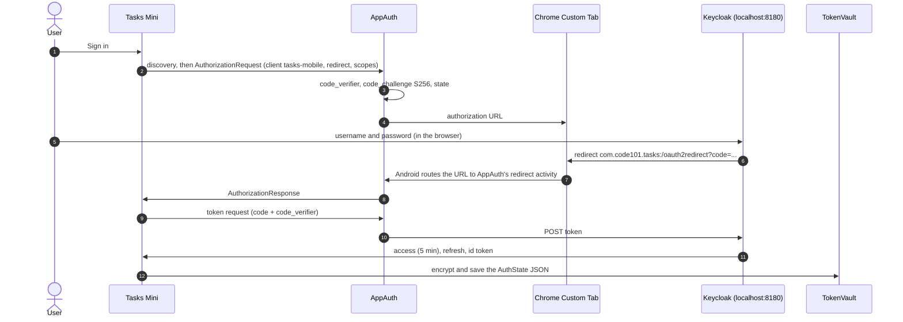

# 06. OIDC PKCE login with AppAuth and secure token storage

> **Draft: written but not yet run.** The code and the expected output in this lesson were prepared by reading the code and the official documentation. They have not been executed yet. If something does not behave as described, trust your tool's real output and report it.

## What you will be able to do
- explain the authorization code flow with PKCE and why a phone app uses the system browser (RFC 8252);
- sign in against Keycloak (realm `tasksteams`, client `tasks-mobile`) with AppAuth-Android;
- store the auth state encrypted with an Android Keystore key, never in plain text;
- add a bearer token to requests, refresh it once at a time, and handle a rejected token.

## Recap
1. What does the Teams screen show without a token after lesson 05, and why? <details><summary>Answer</summary>"Sign in again...": the API answered 401 with a problem body.</details>
2. Why is `ApiFailure` not an `IOException`? <details><summary>Answer</summary>Server answers and missing connections need different handling.</details>

## Why it matters
A hotel key card opens your room without the hotel telling you the master code. OIDC works the same: the app never sees your password; the identity provider (Keycloak) checks you in *its* browser page and gives the app a short-lived **access token** (the key card) and a **refresh token** (to get a new card). **PKCE** makes sure a stolen redirect cannot be turned into a token: the app invents a secret (`code_verifier`), sends only its hash (`code_challenge`), and proves it later. Getting this right is the largest security task of the mobile client (capstone M-05 to M-09, M-26, MASVS AUTH and STORAGE).

## What you will build
A Login screen with **Sign in**, the browser round trip, an encrypted `TokenVault`, an `AuthStateManager` that exposes a `Session`, an OkHttp interceptor and authenticator that add and renew the token, and **Sign out** on the Teams screen. After this lesson Teams, Projects and Tasks show real data for the seeded users (alice, bob, carol).



## Before you start
- The project from lesson 05. Time: about 90 to 120 minutes.
- To run it you need the platform (Keycloak on port 8180 and the API on 8000) and the emulator reverse rule for Keycloak, as in the capstone TDD section 4 and `capstones/mobile-kotlin/tutorials/phase-5-ship/05-build-run-ship.md`: run `adb reverse tcp:8180 tcp:8180` once per emulator boot. Why: the platform fixes the issuer to `http://localhost:8180/realms/tasksteams`, so the emulator must reach *its own* `localhost:8180`; `10.0.2.2:8180` would produce endpoints the emulator cannot open.
- Source pack (optional): https://github.com/Uee03/Code101 under `source/kotlin/201-hero-to-super-hero/phase-2-network-and-auth/06-oidc-pkce-appauth/` (**Code, Download ZIP**, or `git clone https://github.com/Uee03/Code101.git`).
- Install **one** Kotlin app at a time on the device: the realm allows exactly one redirect URI, `com.code101.tasks:/oauth2redirect`, so this app and the capstone app both claim the scheme `com.code101.tasks` and Android would show a chooser after sign-in.

**Files that stay as in lesson 05:** `settings.gradle.kts`, `build.gradle.kts` (root), `gradle.properties`, the wrapper properties, `.gitignore`, the debug manifest and network config, the generator files, the generated client, `TasksApplication.kt`, `Theme.kt`, `Models.kt`, `ApiProblem.kt`, `Routes.kt`, `TasksRepository.kt`, `RemoteTasksRepository.kt`, `RepositoryModule.kt`, `DispatchersModule.kt`, `WireJson.kt`, `HttpUrlPolicy.kt`, `QueryEnums.kt`, `ProblemParser.kt`, `RemoteDataSource.kt`, `UiState.kt`, `ProblemMessages.kt`, `Components.kt`, the Projects and Tasks screens and ViewModels, `TeamsViewModel.kt`, `ConnectionViewModel.kt`. **Changed files are shown as changed regions** (the line before and after is the context): `libs.versions.toml`, `app/build.gradle.kts`, the manifest, `NetworkModule.kt`, `MainActivity.kt`, `AppGraph.kt`, `TeamsScreen.kt`, `strings.xml`. New files are shown in full.

New words: OIDC, authorization code, PKCE, code verifier, access token, refresh token, id token, issuer, discovery document, redirect URI, scope, Keystore, AES-GCM, IV, rotation, `Authenticator`, `Mutex`.

## Steps

### Step 1. Libraries and build configuration
**File: `gradle/libs.versions.toml`** (changed lines)
```toml
okhttp = "5.5.1"
appauth = "0.11.1"
datastore = "1.3.0"

[libraries]
```
```toml
okhttp-logging = { module = "com.squareup.okhttp3:logging-interceptor", version.ref = "okhttp" }
appauth = { module = "net.openid:appauth", version.ref = "appauth" }
datastore = { module = "androidx.datastore:datastore-preferences", version.ref = "datastore" }
```
**File: `app/build.gradle.kts`** (changed regions)
```kotlin
        versionName = "1.0"
        manifestPlaceholders["appAuthRedirectScheme"] = "com.code101.tasks"
        buildConfigField("String", "OIDC_CLIENT_ID", "\"tasks-mobile\"")
        buildConfigField("String", "OIDC_REDIRECT_URI", "\"com.code101.tasks:/oauth2redirect\"")
        buildConfigField("String", "OIDC_LOGOUT_URI", "\"com.code101.tasks:/logout\"")
    }

    buildTypes {
        debug {
            buildConfigField(
                "String",
                "API_BASE_URL",
                "\"${providers.gradleProperty("apiBaseUrl").getOrElse("http://10.0.2.2:8000")}\"",
            )
            buildConfigField("String", "OIDC_ISSUER", "\"http://localhost:8180/realms/tasksteams\"")
        }
        release {
            buildConfigField(
                "String",
                "API_BASE_URL",
                "\"${providers.gradleProperty("apiBaseUrl").getOrElse("https://tasks.example.invalid")}\"",
            )
            buildConfigField(
                "String",
                "OIDC_ISSUER",
                "\"${providers.gradleProperty("oidcIssuer").getOrElse("https://identity.example.invalid/realms/tasksteams")}\"",
            )
        }
    }
```
```kotlin
    implementation(libs.okhttp.logging)
    implementation(libs.appauth)
    implementation(libs.datastore)
```
- `appAuthRedirectScheme` is a **manifest placeholder**: the AppAuth library's own manifest declares a `RedirectUriReceiverActivity` with an intent filter for `${appAuthRedirectScheme}`; Gradle fills in `com.code101.tasks`. That is how Android knows to hand `com.code101.tasks:/oauth2redirect` to AppAuth.
- The client id and URIs are build constants; they are **public** values, not secrets. A mobile app is a *public client*: it cannot keep a secret, which is exactly why PKCE exists. There is **no client secret** and no password grant anywhere in this app (M-26).
- Release builds take the issuer from `-PoidcIssuer=https://...`, and release must be `https`.

### Step 2. The manifest and backup rules
**File: `app/src/main/AndroidManifest.xml`** (changed region)
```xml
        android:allowBackup="false"
        android:dataExtractionRules="@xml/data_extraction_rules"
        android:usesCleartextTraffic="false"
```
`allowBackup="false"` covers old Android; **`dataExtractionRules`** covers Android 12 and newer, where the older flag is not enough. The file below excludes every data domain from cloud backup and from device-to-device transfer, so that the encrypted token file is never restored on a phone that lacks its Keystore key.

**File: `app/src/main/res/xml/data_extraction_rules.xml`**
```xml
<data-extraction-rules>
    <cloud-backup>
        <exclude domain="root" path="." />
        <exclude domain="file" path="." />
        <exclude domain="database" path="." />
        <exclude domain="sharedpref" path="." />
        <exclude domain="external" path="." />
        <exclude domain="device_root" path="." />
        <exclude domain="device_file" path="." />
        <exclude domain="device_database" path="." />
        <exclude domain="device_sharedpref" path="." />
    </cloud-backup>
    <device-transfer>
        <exclude domain="root" path="." />
        <exclude domain="file" path="." />
        <exclude domain="database" path="." />
        <exclude domain="sharedpref" path="." />
        <exclude domain="external" path="." />
        <exclude domain="device_root" path="." />
        <exclude domain="device_file" path="." />
        <exclude domain="device_database" path="." />
        <exclude domain="device_sharedpref" path="." />
    </device-transfer>
</data-extraction-rules>
```

### Step 3. The session contract in the domain
**File: `app/src/main/kotlin/com/code101/tasks/domain/repository/Session.kt`**
```kotlin
package com.code101.tasks.domain.repository

import kotlinx.coroutines.flow.StateFlow

enum class SessionStatus { Checking, SignedOut, SignedIn }

interface Session {
    val accountId: StateFlow<String?>
    val status: StateFlow<SessionStatus>

    suspend fun accessToken(force: Boolean = false, rejected: String? = null): String
}
```
The rest of the app only needs three things: who is signed in, whether a session exists, and a valid access token on demand. `force` and `rejected` support the "401, refresh once" rule below.

### Step 4. The single place for OIDC settings
**File: `app/src/main/kotlin/com/code101/tasks/data/auth/AuthConfig.kt`**
```kotlin
package com.code101.tasks.data.auth

import com.code101.tasks.BuildConfig

object AuthConfig {
    val issuer = BuildConfig.OIDC_ISSUER
    val clientId = BuildConfig.OIDC_CLIENT_ID
    val redirect = BuildConfig.OIDC_REDIRECT_URI
    val logout = BuildConfig.OIDC_LOGOUT_URI
    const val scopes = "openid profile email offline_access tasks:read tasks:write"
}
```
The scopes appear **once**. `openid profile email` ask for the identity, `tasks:read tasks:write` for the API, and `offline_access` for a refresh token that outlives the single-sign-on idle time while the phone is offline. There is no admin scope because no screen needs it (least privilege).

### Step 5. The encrypted token vault
**File: `app/src/main/kotlin/com/code101/tasks/data/auth/TokenVault.kt`**
```kotlin
package com.code101.tasks.data.auth

import android.content.Context
import android.security.keystore.KeyGenParameterSpec
import android.security.keystore.KeyProperties
import android.util.Base64
import androidx.datastore.preferences.core.edit
import androidx.datastore.preferences.core.stringPreferencesKey
import androidx.datastore.preferences.preferencesDataStore
import dagger.hilt.android.qualifiers.ApplicationContext
import kotlinx.coroutines.flow.first
import java.security.KeyStore
import javax.crypto.Cipher
import javax.crypto.KeyGenerator
import javax.crypto.SecretKey
import javax.crypto.spec.GCMParameterSpec
import javax.inject.Inject
import javax.inject.Singleton

private val Context.authStore by preferencesDataStore("auth")

@Singleton
class TokenVault @Inject constructor(@ApplicationContext private val context: Context) {
    private val blob = stringPreferencesKey("ciphertext")
    private fun key(): SecretKey {
        val store = KeyStore.getInstance("AndroidKeyStore").apply { load(null) }
        (store.getKey("tasks_auth_key", null) as? SecretKey)?.let { return it }
        return KeyGenerator.getInstance(KeyProperties.KEY_ALGORITHM_AES, "AndroidKeyStore").apply {
            init(KeyGenParameterSpec.Builder("tasks_auth_key", KeyProperties.PURPOSE_ENCRYPT or KeyProperties.PURPOSE_DECRYPT)
                .setBlockModes(KeyProperties.BLOCK_MODE_GCM)
                .setEncryptionPaddings(KeyProperties.ENCRYPTION_PADDING_NONE)
                .setKeySize(256).build())
        }.generateKey()
    }
    suspend fun save(json: String) {
        val cipher = Cipher.getInstance("AES/GCM/NoPadding")
        cipher.init(Cipher.ENCRYPT_MODE, key())
        val bytes = cipher.iv + cipher.doFinal(json.toByteArray(Charsets.UTF_8))
        context.authStore.edit { it[blob] = Base64.encodeToString(bytes, Base64.NO_WRAP) }
    }
    suspend fun read(): String? {
        val encoded = context.authStore.data.first()[blob] ?: return null
        val bytes = Base64.decode(encoded, Base64.NO_WRAP)
        require(bytes.size > 28)
        val cipher = Cipher.getInstance("AES/GCM/NoPadding")
        cipher.init(Cipher.DECRYPT_MODE, key(), GCMParameterSpec(128, bytes.copyOfRange(0, 12)))
        return cipher.doFinal(bytes.copyOfRange(12, bytes.size)).toString(Charsets.UTF_8)
    }
    suspend fun clear() { context.authStore.edit { it.remove(blob) } }
}
```
- The **Android Keystore** holds an AES-256 key that **cannot be exported**: even code in your app only asks the system to encrypt or decrypt with it. The key alias is `tasks_auth_key`.
- **AES-GCM** is authenticated encryption: it hides the data and detects tampering. Each encryption gets a fresh random **IV** (initialisation vector), generated by the cipher and stored in front of the ciphertext (`cipher.iv + ciphertext`). Reusing an IV with the same key would break GCM, so never supply your own.
- What is encrypted is the AppAuth `AuthState` JSON (tokens, expiry, the id token needed to end the session later). The result, Base64 text, goes into a Preferences DataStore file named `auth`.
- `require(bytes.size > 28)` rejects a blob that is too short to hold a 12-byte IV and a 16-byte GCM tag. If decryption fails (for example the key vanished after a restore) the caller treats the user as signed out.
- Why not `EncryptedSharedPreferences`? It is deprecated since security-crypto 1.1.0 (capstone design decision); this uses only platform APIs.

### Step 6. The auth state manager
**File: `app/src/main/kotlin/com/code101/tasks/data/auth/AuthStateManager.kt`**
```kotlin
package com.code101.tasks.data.auth

import android.content.Context
import android.content.Intent
import android.net.Uri
import com.code101.tasks.BuildConfig
import com.code101.tasks.domain.repository.Session
import com.code101.tasks.domain.repository.SessionStatus
import com.code101.tasks.data.remote.HttpUrlPolicy
import dagger.hilt.android.qualifiers.ApplicationContext
import kotlinx.coroutines.Dispatchers
import kotlinx.coroutines.NonCancellable
import kotlinx.coroutines.flow.MutableStateFlow
import kotlinx.coroutines.flow.asStateFlow
import kotlinx.coroutines.sync.Mutex
import kotlinx.coroutines.sync.withLock
import kotlinx.coroutines.suspendCancellableCoroutine
import kotlinx.coroutines.withContext
import net.openid.appauth.*
import net.openid.appauth.connectivity.ConnectionBuilder
import okhttp3.HttpUrl.Companion.toHttpUrl
import java.io.IOException
import java.net.HttpURLConnection
import kotlin.coroutines.resume
import kotlin.coroutines.resumeWithException
import javax.inject.Inject
import javax.inject.Singleton

@Singleton
class AuthStateManager @Inject constructor(
    @ApplicationContext context: Context, private val vault: TokenVault
) : Session {
    private val mutableAccount = MutableStateFlow<String?>(null)
    override val accountId = mutableAccount.asStateFlow()
    private fun subject(current: AuthState?): String? = runCatching {
        val payload = current?.idToken?.split('.')?.get(1) ?: return@runCatching null
        org.json.JSONObject(String(android.util.Base64.decode(payload, android.util.Base64.URL_SAFE), Charsets.UTF_8)).getString("sub")
    }.getOrNull()
    private val mutex = Mutex()
    private var state: AuthState? = null
    private val mutableStatus = MutableStateFlow(SessionStatus.Checking)
    override val status = mutableStatus.asStateFlow()
    private val connections = ConnectionBuilder { uri ->
        val url = uri.toString().toHttpUrl()
        HttpUrlPolicy.requireAllowed(url)
        (url.toUrl().openConnection() as HttpURLConnection).apply {
            connectTimeout = 15000; readTimeout = 15000; instanceFollowRedirects = false
        }
    }
    private val configuration = AppAuthConfiguration.Builder().apply {
        if (BuildConfig.DEBUG) setSkipIssuerHttpsCheck(true)
        setConnectionBuilder(connections)
    }.build()
    private val service = AuthorizationService(context, configuration)

    suspend fun restore() = withContext(Dispatchers.IO) {
        mutex.withLock {
            state = try { vault.read()?.let(AuthState::jsonDeserialize) } catch (_: Exception) { null }
            mutableAccount.value = subject(state)
            mutableStatus.value = if (state?.isAuthorized == true && mutableAccount.value != null) SessionStatus.SignedIn else SessionStatus.SignedOut
        }
    }
    private suspend fun discovery(): AuthorizationServiceConfiguration = suspendCancellableCoroutine { continuation ->
        AuthorizationServiceConfiguration.fetchFromUrl(
            Uri.parse(AuthConfig.issuer + "/.well-known/openid-configuration"),
            { config, error ->
                if (config != null) continuation.resume(config)
                else continuation.resumeWithException(IOException("Discovery unavailable", error))
            }, connections)
    }
    suspend fun loginIntent(): Intent {
        val config = discovery()
        require(config.authorizationEndpoint.toString().startsWith(AuthConfig.issuer + "/"))
        val request = AuthorizationRequest.Builder(config, AuthConfig.clientId,
            ResponseTypeValues.CODE, Uri.parse(AuthConfig.redirect))
            .setScope(AuthConfig.scopes).build()
        return service.getAuthorizationRequestIntent(request)
    }
    suspend fun acceptLogin(data: Intent) = withContext(Dispatchers.IO + NonCancellable) {
        val error = AuthorizationException.fromIntent(data)
        if (error?.code == AuthorizationException.GeneralErrors.USER_CANCELED_AUTH_FLOW.code) return@withContext
        if (error != null) throw IOException("Authorization failed")
        val response = AuthorizationResponse.fromIntent(data) ?: return@withContext
        mutex.withLock {
            val next = AuthState(response, null)
            val token = tokenRequest(response.createTokenExchangeRequest())
            next.update(token, null)
            vault.save(next.jsonSerializeString())
            state = next
            mutableAccount.value = subject(next)
            mutableStatus.value = SessionStatus.SignedIn
        }
    }
    private suspend fun tokenRequest(request: TokenRequest): TokenResponse = suspendCancellableCoroutine { continuation ->
        service.performTokenRequest(request) { token, error ->
            if (token != null) continuation.resume(token)
            else continuation.resumeWithException(IOException("Session needs sign-in", error))
        }
    }
    override suspend fun accessToken(force: Boolean, rejected: String?): String =
        withContext(Dispatchers.IO + NonCancellable) {
            mutex.withLock {
                val current = state ?: throw IOException("Sign in required")
                val existing = current.accessToken
                val expires = current.accessTokenExpirationTime ?: 0L
                if (existing != null && expires - System.currentTimeMillis() > 60000L &&
                    (!force || (rejected != null && rejected != existing))) return@withLock existing
                try {
                    val token = tokenRequest(current.createTokenRefreshRequest())
                    current.update(token, null)
                    vault.save(current.jsonSerializeString())
                    current.accessToken ?: throw IOException("Sign in required")
                } catch (_: Exception) {
                    mutableStatus.value = SessionStatus.SignedOut
                    throw IOException("Sign in required")
                }
            }
        }
    suspend fun logoutIntent(): Intent? {
        val current = state ?: return null
        val config = current.authorizationServiceConfiguration ?: return null
        if (config.endSessionEndpoint == null) return null
        return service.getEndSessionRequestIntent(EndSessionRequest.Builder(config)
            .setIdTokenHint(current.idToken).setPostLogoutRedirectUri(Uri.parse(AuthConfig.logout)).build())
    }
    suspend fun clear() = mutex.withLock {
        vault.clear(); state = null; mutableAccount.value = null; mutableStatus.value = SessionStatus.SignedOut
    }
}
```
Read it in the order the user meets it.
- **`restore()`** (app start): decrypt the saved state; signed in if it holds an authorised state and a subject (`sub` claim of the id token), otherwise signed out. A decrypt failure is not an error for the user: they sign in again.
- **`discovery()`** fetches `<issuer>/.well-known/openid-configuration`, which lists the authorization, token and end-session endpoints. `loginIntent()` refuses a configuration whose authorization endpoint is not under the issuer (a mix-up defence), builds an `AuthorizationRequest` with response type `code`, the client id, the redirect and the scopes, and gets an `Intent` that opens a **Custom Tab**. AppAuth adds PKCE (`S256`), `state` and a nonce by itself.
- **`acceptLogin()`** reads the redirect result, exchanges the code (plus the stored verifier) for tokens, **saves them encrypted before** the state becomes signed in, then publishes the status. A user who closes the browser tab is not an error (`USER_CANCELED_AUTH_FLOW`).
- **`accessToken()`** is the heart: under one `Mutex` (so only one refresh runs at a time) it returns the current token if it has more than 60 seconds left; otherwise it refreshes. The realm **rotates** refresh tokens (one use only), so the new state is saved *before* the new token is used, and `NonCancellable` stops a cancelled caller from leaving the refresh half done. If the refresh is rejected the status becomes `SignedOut` and the caller gets an `IOException`; **local data is not touched**.
- **`force` / `rejected`**: after a 401 the authenticator asks for a forced refresh and passes the rejected token. If another caller has already refreshed (the current token differs from `rejected`) the existing fresh token is returned instead of a second refresh.
- **`logoutIntent()`** builds the end-session request with the id token hint and the post-logout redirect `com.code101.tasks:/logout`; `clear()` deletes the vault.
- **The connection builder** applies the same URL policy as lesson 04 to every AppAuth request, refuses redirects, and sets timeouts. In debug builds `setSkipIssuerHttpsCheck(true)` allows the local `http` issuer; release uses AppAuth's strict defaults.

### Step 7. Attach and renew the token
**File: `app/src/main/kotlin/com/code101/tasks/data/remote/AuthInterceptor.kt`**
```kotlin
package com.code101.tasks.data.remote

import com.code101.tasks.domain.repository.Session
import kotlinx.coroutines.runBlocking
import okhttp3.Interceptor
import okhttp3.Response
import okhttp3.Authenticator
import okhttp3.Request
import okhttp3.Route

class AuthInterceptor(private val session: Session) : Interceptor {
    override fun intercept(chain: Interceptor.Chain): Response {
        if (chain.request().url.encodedPath == "/health") return chain.proceed(chain.request())
        val token = runBlocking { session.accessToken() }
        return chain.proceed(chain.request().newBuilder().header("Authorization", "Bearer $token").build())
    }
}
class TokenAuthenticator(private val session: Session) : Authenticator {
    override fun authenticate(route: Route?, response: Response): Request? {
        if (response.priorResponse != null) return null
        val rejected = response.request.header("Authorization")?.removePrefix("Bearer ")
        val token = try { runBlocking { session.accessToken(true, rejected) } } catch (_: Exception) { return null }
        return response.request.newBuilder().header("Authorization", "Bearer $token").build()
    }
}
```
- The **interceptor** runs on every request and adds `Authorization: Bearer <token>`, except for `/health`, which is public. OkHttp calls interceptors on background threads, so `runBlocking` here blocks a network thread, not the main thread.
- The **authenticator** runs only when the server answered **401**. It asks the session for a forced refresh and retries the request once with the new token. `priorResponse != null` means "this was already a retry": give up (return `null`) instead of looping.
- The token is never logged: the logging interceptor from lesson 04 redacts `Authorization`.

Wire it into the client. **File: `app/src/main/kotlin/com/code101/tasks/di/NetworkModule.kt`** (changed regions)
```kotlin
import com.code101.tasks.BuildConfig
import com.code101.tasks.data.remote.AuthInterceptor
import com.code101.tasks.data.remote.QueryEnums
import com.code101.tasks.data.remote.TokenAuthenticator
import com.code101.tasks.domain.repository.Session
```
```kotlin
    fun okHttpClient(session: Session): OkHttpClient = OkHttpClient.Builder()
        .followRedirects(false)
        .followSslRedirects(false)
        .addInterceptor(UrlPolicyInterceptor())
        .addInterceptor(AuthInterceptor(session))
        .authenticator(TokenAuthenticator(session))
```
**File: `app/src/main/kotlin/com/code101/tasks/di/AuthModule.kt`**
```kotlin
package com.code101.tasks.di

import com.code101.tasks.data.auth.AuthStateManager
import com.code101.tasks.domain.repository.Session
import dagger.Binds
import dagger.Module
import dagger.hilt.InstallIn
import dagger.hilt.components.SingletonComponent
import javax.inject.Singleton

@Module
@InstallIn(SingletonComponent::class)
abstract class AuthModule {
    @Binds
    @Singleton
    abstract fun session(impl: AuthStateManager): Session
}
```
The interceptor order matters: the URL policy runs first, so a bad URL fails before any token is attached to it.

### Step 8. The sign-in UI
**File: `app/src/main/kotlin/com/code101/tasks/ui/login/SessionViewModel.kt`**
```kotlin
package com.code101.tasks.ui.login

import android.content.Intent
import androidx.lifecycle.ViewModel
import androidx.lifecycle.viewModelScope
import com.code101.tasks.data.auth.AuthStateManager
import com.code101.tasks.domain.repository.SessionStatus
import dagger.hilt.android.lifecycle.HiltViewModel
import java.io.IOException
import javax.inject.Inject
import kotlinx.coroutines.flow.MutableStateFlow
import kotlinx.coroutines.flow.StateFlow
import kotlinx.coroutines.flow.asStateFlow
import kotlinx.coroutines.launch

// The sign-in flow hands around Android Intents, so this one ViewModel talks to the auth class directly.
@HiltViewModel
class SessionViewModel @Inject constructor(
    private val auth: AuthStateManager,
) : ViewModel() {
    val status: StateFlow<SessionStatus> = auth.status

    private val _busy = MutableStateFlow(false)
    val busy: StateFlow<Boolean> = _busy.asStateFlow()

    private val _error = MutableStateFlow(false)
    val error: StateFlow<Boolean> = _error.asStateFlow()

    init {
        viewModelScope.launch { auth.restore() }
    }

    fun signIn(launch: (Intent) -> Unit) {
        viewModelScope.launch {
            _busy.value = true
            _error.value = false
            try {
                launch(auth.loginIntent())
            } catch (e: IOException) {
                _error.value = true
                _busy.value = false
            } catch (e: IllegalArgumentException) {
                _error.value = true
                _busy.value = false
            }
        }
    }

    fun onLoginResult(data: Intent?) {
        viewModelScope.launch {
            try {
                if (data != null) auth.acceptLogin(data)
            } catch (e: IOException) {
                _error.value = true
            } finally {
                _busy.value = false
            }
        }
    }

    fun signOut(launch: (Intent) -> Unit) {
        viewModelScope.launch {
            val intent = auth.logoutIntent()
            if (intent != null) launch(intent) else auth.clear()
        }
    }

    fun onLogoutResult(ok: Boolean) {
        viewModelScope.launch {
            if (ok) auth.clear() else _error.value = true
        }
    }
}
```
This ViewModel is a *documented exception* to the dependency rule: `Intent` is an Android type that does not belong in `domain`, and the sign-in screen is the one place that must start and receive Android activities. Everything else uses the `Session` interface.

**File: `app/src/main/kotlin/com/code101/tasks/ui/login/LoginScreen.kt`**
```kotlin
package com.code101.tasks.ui.login

import androidx.compose.foundation.layout.Arrangement
import androidx.compose.foundation.layout.Column
import androidx.compose.foundation.layout.fillMaxSize
import androidx.compose.foundation.layout.padding
import androidx.compose.material3.Button
import androidx.compose.material3.CircularProgressIndicator
import androidx.compose.material3.MaterialTheme
import androidx.compose.material3.Text
import androidx.compose.runtime.Composable
import androidx.compose.ui.Alignment
import androidx.compose.ui.Modifier
import androidx.compose.ui.res.stringResource
import androidx.compose.ui.semantics.LiveRegionMode
import androidx.compose.ui.semantics.heading
import androidx.compose.ui.semantics.liveRegion
import androidx.compose.ui.semantics.semantics
import androidx.compose.ui.unit.dp
import com.code101.tasks.R

@Composable
fun LoginScreen(
    busy: Boolean,
    error: Boolean,
    onSignIn: () -> Unit,
) {
    Column(
        modifier = Modifier
            .fillMaxSize()
            .padding(24.dp),
        verticalArrangement = Arrangement.spacedBy(16.dp, Alignment.CenterVertically),
        horizontalAlignment = Alignment.CenterHorizontally,
    ) {
        Text(
            text = stringResource(R.string.app_name),
            style = MaterialTheme.typography.headlineMedium,
            modifier = Modifier.semantics { heading() },
        )
        Text(text = stringResource(R.string.login_explainer))
        Button(onClick = onSignIn, enabled = !busy) {
            Text(stringResource(R.string.sign_in))
        }
        if (busy) {
            CircularProgressIndicator()
        }
        if (error) {
            Text(
                text = stringResource(R.string.auth_error),
                color = MaterialTheme.colorScheme.error,
                modifier = Modifier.semantics { liveRegion = LiveRegionMode.Polite },
            )
        }
    }
}
```
**File: `app/src/main/kotlin/com/code101/tasks/ui/navigation/AppRoot.kt`**
```kotlin
package com.code101.tasks.ui.navigation

import android.app.Activity
import androidx.activity.compose.rememberLauncherForActivityResult
import androidx.activity.result.contract.ActivityResultContracts
import androidx.compose.foundation.layout.Box
import androidx.compose.foundation.layout.fillMaxSize
import androidx.compose.material3.CircularProgressIndicator
import androidx.compose.runtime.Composable
import androidx.compose.runtime.getValue
import androidx.compose.ui.Alignment
import androidx.compose.ui.Modifier
import androidx.hilt.lifecycle.viewmodel.compose.hiltViewModel
import androidx.lifecycle.compose.collectAsStateWithLifecycle
import com.code101.tasks.domain.repository.SessionStatus
import com.code101.tasks.ui.login.LoginScreen
import com.code101.tasks.ui.login.SessionViewModel

@Composable
fun AppRoot(viewModel: SessionViewModel = hiltViewModel()) {
    val status by viewModel.status.collectAsStateWithLifecycle()
    val busy by viewModel.busy.collectAsStateWithLifecycle()
    val error by viewModel.error.collectAsStateWithLifecycle()

    val loginLauncher = rememberLauncherForActivityResult(
        ActivityResultContracts.StartActivityForResult(),
    ) { result -> viewModel.onLoginResult(result.data) }
    val logoutLauncher = rememberLauncherForActivityResult(
        ActivityResultContracts.StartActivityForResult(),
    ) { result -> viewModel.onLogoutResult(result.resultCode == Activity.RESULT_OK) }

    when (status) {
        SessionStatus.Checking -> Box(
            modifier = Modifier.fillMaxSize(),
            contentAlignment = Alignment.Center,
        ) {
            CircularProgressIndicator()
        }
        SessionStatus.SignedOut -> LoginScreen(
            busy = busy,
            error = error,
            onSignIn = { viewModel.signIn { intent -> loginLauncher.launch(intent) } },
        )
        SessionStatus.SignedIn -> AppGraph(
            onSignOut = { viewModel.signOut { intent -> logoutLauncher.launch(intent) } },
        )
    }
}
```
`AppRoot` is the **gate**: only `SignedIn` reaches the navigation graph, so a signed-out user can reach nothing but Login (M-09). `rememberLauncherForActivityResult` is the Compose way to start the browser and receive its result.

**File: `app/src/main/kotlin/com/code101/tasks/MainActivity.kt`** (changed region)
```kotlin
import com.code101.tasks.ui.navigation.AppRoot
import com.code101.tasks.ui.theme.TasksTheme
import dagger.hilt.android.AndroidEntryPoint

@AndroidEntryPoint
class MainActivity : ComponentActivity() {
    override fun onCreate(savedInstanceState: Bundle?) {
        super.onCreate(savedInstanceState)
        enableEdgeToEdge()
        setContent {
            TasksTheme {
                AppRoot()
            }
        }
    }
}
```
**File: `app/src/main/kotlin/com/code101/tasks/ui/navigation/AppGraph.kt`** (changed regions)
```kotlin
fun AppGraph(onSignOut: () -> Unit) {
```
```kotlin
                onCheckConnection = connectionViewModel::check,
                onSignOut = onSignOut,
```
**File: `app/src/main/kotlin/com/code101/tasks/ui/teams/TeamsScreen.kt`** (changed regions)
```kotlin
    onCheckConnection: () -> Unit,
    onSignOut: () -> Unit,
```
```kotlin
                TextButton(onClick = onCheckConnection) {
                    Text(stringResource(R.string.check_connection))
                }
                TextButton(onClick = onSignOut) {
                    Text(stringResource(R.string.sign_out))
                }
```
**File: `app/src/main/res/values/strings.xml`** (four new lines at the end, after `problem_offline`)
```xml
    <string name="sign_in">Sign in</string>
    <string name="sign_out">Sign out</string>
    <string name="login_explainer">You sign in in your browser. The app never sees your password.</string>
    <string name="auth_error">Sign-in could not be completed. Check the browser and the connection, then try again.</string>
```
Predict before you run: after you sign in as `carol` and kill the app from the recents screen, then open it again, which screen appears first, and where did the tokens come from?

## Run it
With the platform running, `adb reverse tcp:8180 tcp:8180` done and the app installed on the emulator:

Expected result (described, not yet seen): the Login screen with **Sign in**. Tapping it opens a Chrome Custom Tab on the Keycloak login page of realm `tasksteams`. After entering a seeded user's credentials (see the platform README) the tab closes and the Teams screen appears with that user's teams (carol sees "Mobile Team"). Killing and reopening the app shows Teams again (state restored from the encrypted vault). **Sign out** opens the browser to end the Keycloak session and returns to Login. With the debug logging on, Logcat shows request lines but no `Authorization` value.

## How it works
**Authorization code with PKCE.** The app asks the browser to authenticate the user and receives only a short-lived **code** through the redirect URI. It exchanges the code for tokens, proving possession of the PKCE verifier. Without PKCE, another app that registered the same custom scheme could steal the code. With PKCE the stolen code is useless without the verifier, which never leaves the app.

**System browser, not a WebView.** RFC 8252 requires an external user agent: the app cannot read the password, the user sees the real address and can use their saved password manager and single sign-on.

**Storage and its limits.** The Keystore key protects the data at rest against file extraction (rooted devices, backups, malware reading files). It does not protect against code running inside your own process while the app is open: nothing can. Encrypting is not the same as being unreachable.

**Token lifetimes.** The access token lives about five minutes (capstone realm), so a leak has little value; the refresh token lets the session survive offline periods. Rotation (one-time refresh tokens) means a stolen refresh token can be used only once and then the thief's next use fails.

**Why this, not that.**

| Choice | Alternative | Why |
|---|---|---|
| AppAuth-Android | hand-built PKCE with `androidx.browser` and OkHttp | a maintained RFC 8252 implementation; newest release is old (2021) but stable; a manual flow is the fallback |
| AES-GCM key in Keystore + DataStore | `EncryptedSharedPreferences` | the latter is deprecated; platform crypto only |
| `Mutex` around refresh | refresh in each caller | rotation makes parallel refreshes fail; one refresh at a time |
| Authenticator for 401 | refresh only on a timer | the server is the judge of "expired", clocks differ |
| Public client + PKCE | client secret in the app | a secret in an APK is not secret |

**Where this reappears.** Capstone chapter 02 (`capstones/mobile-kotlin/tutorials/phase-2-auth/02-auth.md`) uses the same classes and adds the intended-route restoration and the "also delete offline data" sign-out option.

## Try it
1. **Guided:** the refresh rule "more than 60 seconds left" is inline in `accessToken`. Extract it into a pure function `needsRefresh` in the starter file and keep the same meaning (no change to behaviour is needed in this exercise; you may use it in `accessToken` as a stretch).

**File: `app/src/main/kotlin/com/code101/tasks/data/auth/TokenExpiry.kt`**
```kotlin
package com.code101.tasks.data.auth

// TODO: return true when the access token must be refreshed before use:
// there is no expiry time, or fewer than skewMillis milliseconds remain until it
fun needsRefresh(expiresAtMillis: Long?, nowMillis: Long, skewMillis: Long = 60_000L): Boolean = false
```
Expected: `needsRefresh(null, 0)` is `true`; `needsRefresh(100_000, 0)` is `false`; `needsRefresh(30_000, 0)` is `true`.
2. **Change:** use `needsRefresh` inside `accessToken` in place of the inline comparison.
3. **Stretch (optional):** the interceptor skips the token only for `/health`. Write down which other endpoints a mobile client could call without a token, and why a path check may be a weak rule (hint: what if a path starts with `/health/`?).

<details><summary>Solution</summary>

**File: `app/src/main/kotlin/com/code101/tasks/data/auth/TokenExpiry.kt`**
```kotlin
package com.code101.tasks.data.auth

fun needsRefresh(expiresAtMillis: Long?, nowMillis: Long, skewMillis: Long = 60_000L): Boolean =
    expiresAtMillis == null || expiresAtMillis - nowMillis <= skewMillis
```
</details>

## Check yourself
1. What does PKCE protect against? <details><summary>Answer</summary>A stolen authorization code being exchanged by another app: without the secret verifier the code is useless.</details>
2. Why is the new refresh token saved before it is used? <details><summary>Answer</summary>Tokens rotate; if the app died after using but before saving, the old token would already be spent and the user would be locked out.</details>
3. Why not use a WebView for sign-in? <details><summary>Answer</summary>The app could read the password; RFC 8252 requires the system browser, which also gives single sign-on and a visible address.</details>
4. Predict: the access token expires while the phone is offline and the refresh token is rejected on return. What happens to the saved tasks? <details><summary>Answer</summary>Nothing is deleted: the session becomes signed out and the user signs in again; local data is kept.</details>

## Common mistakes
| Symptom or error text | Cause | Fix |
|---|---|---|
| The sign-in page cannot be opened or shows "connection refused" (typical) | `adb reverse tcp:8180 tcp:8180` was not run, or the platform is not running | Run it again after each emulator boot; start the platform |
| After login the app does not come back (typical) | The redirect scheme placeholder or the Keycloak redirect does not match `com.code101.tasks:/oauth2redirect` | Check `manifestPlaceholders` and the realm client |
| Android shows an app chooser after login (typical) | The capstone Kotlin or Flutter app is installed too | Uninstall the other app that claims the scheme |
| An `IllegalArgumentException` from `HttpUrlPolicy` during discovery (typical) | A release build with an `http` issuer, or a host outside the dev list | Use `https` for release; use `localhost` in debug |
| You are signed out after every refresh (typical) | The new refresh token was not saved, or two refreshes ran in parallel | Keep the single `Mutex` and save before use |
| `AEADBadTagException` in the log (typical class name) | The ciphertext and the Keystore key no longer match (data restored from a backup, key reset) | Treat as signed out; backup rules prevent it |

## Best practice
Use the authorization code flow with PKCE in an external user agent, keep tokens only in encrypted storage tied to a non-exportable key, refresh through one serialised path and never log tokens. Source: OAuth 2.0 for Native Apps RFC 8252 https://www.rfc-editor.org/rfc/rfc8252.html, Android Keystore system https://developer.android.com/privacy-and-security/keystore and OWASP MASVS https://mas.owasp.org/MASVS/

## Going further
- AppAuth-Android: https://github.com/openid/AppAuth-Android
- Capstone TDD section 7 (identity and security design) and requirements M-05 to M-09.

## Summary
- You explained code flow with PKCE and why the system browser is used.
- You signed in with AppAuth against the `tasksteams` realm and stored the auth state with Keystore AES-GCM.
- You added a bearer interceptor, a single-flight refresh and a 401 authenticator.
- You gated the app so only a signed-in user reaches the screens.

## Next lesson
07. Room: a persistent cache as the single source for the screens.
