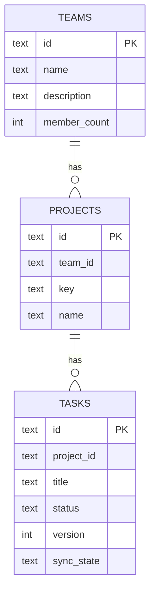
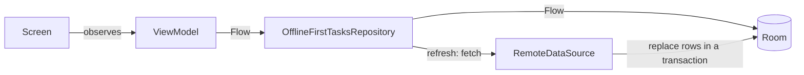

# 07. Room

> **Draft: written but not yet run.** The code and the expected output in this lesson were prepared by reading the code and the official documentation. They have not been executed yet. If something does not behave as described, trust your tool's real output and report it.

## What you will be able to do
- design Room entities, a DAO that returns `Flow`s, and a database with an exported schema;
- make the database the single source the screens read, with the network only updating it;
- replace a table's rows atomically with `@Transaction`;
- write a `Migration` and say why a shipped schema version is never edited.

## Recap
1. What did the repository interface in lesson 03 promise about reads? <details><summary>Answer</summary>They are `Flow`s that keep emitting; writes and refreshes are `suspend` functions.</details>
2. Why is `screenState` happy to show cached data after a failed refresh? <details><summary>Answer</summary>A refresh failure should not hide data the user already has.</details>
3. Where does `@Binds` pick the implementation? <details><summary>Answer</summary>In `RepositoryModule`; one line changes the whole app's data source.</details>

## Why it matters
Until now the cache was a variable: close the app and it was gone, and opening it offline showed nothing. A phone is often in a lift or a tunnel. An **offline-first** app treats the local database as the truth the screens read; the network only *updates* that database (capstone M-18). **Room** is Google's layer over SQLite: typed entities, compile-time-checked SQL and `Flow` results that re-emit whenever a table changes.

## What you will build
Teams, Projects and Tasks are stored in three tables. The repository's `refresh...` calls fetch from the API and replace the rows in a transaction; the screens observe the tables. After one successful load you can switch to airplane mode, kill the app and still open all three screens.




## Before you start
- The project from lesson 06. Time: about 75 to 90 minutes.
- Source pack (optional): https://github.com/Uee03/Code101 under `source/kotlin/201-hero-to-super-hero/phase-3-offline-and-quality/07-room/` (**Code, Download ZIP**, or `git clone https://github.com/Uee03/Code101.git`).

**Files that stay as in lesson 06:** everything not named below, including the auth classes, the generated client, `RemoteDataSource.kt`, `RemoteTasksRepository.kt` is **deleted**. Changed regions: `libs.versions.toml`, `app/build.gradle.kts`. New or changed in full: `Entities.kt`, `CacheDao.kt`, `TasksDatabase.kt`, `DatabaseModule.kt`, `OfflineFirstTasksRepository.kt`, `RepositoryModule.kt`.

New words: entity, DAO, `@Query`, primary key, index, schema export, transaction, migration, source of truth, offline-first.

## Steps

### Step 1. Libraries and the schema folder
**File: `gradle/libs.versions.toml`** (changed lines)
```toml
appauth = "0.11.1"
datastore = "1.3.0"
room = "2.8.5"
```
```toml
datastore = { module = "androidx.datastore:datastore-preferences", version.ref = "datastore" }
room-runtime = { module = "androidx.room:room-runtime", version.ref = "room" }
room-ktx = { module = "androidx.room:room-ktx", version.ref = "room" }
room-compiler = { module = "androidx.room:room-compiler", version.ref = "room" }
```
**File: `app/build.gradle.kts`** (changed regions)
```kotlin
kotlin {
    compilerOptions {
        jvmTarget.set(org.jetbrains.kotlin.gradle.dsl.JvmTarget.JVM_17)
    }
}

ksp {
    arg("room.schemaLocation", "$projectDir/schemas")
}
```
```kotlin
    implementation(libs.datastore)
    implementation(libs.room.runtime)
    implementation(libs.room.ktx)
    ksp(libs.room.compiler)
```
`ksp { arg("room.schemaLocation", ...) }` tells the Room compiler where to write a JSON description of every schema version (`app/schemas/.../1.json`). **Commit that folder.** It is the record that migrations are checked against and the proof of what version 1 looked like.

### Step 2. Entities
**File: `app/src/main/kotlin/com/code101/tasks/data/local/Entities.kt`**
```kotlin
package com.code101.tasks.data.local

import androidx.room.ColumnInfo
import androidx.room.Entity
import androidx.room.Index
import androidx.room.PrimaryKey
import com.code101.tasks.domain.model.Project
import com.code101.tasks.domain.model.TaskItem
import com.code101.tasks.domain.model.Team

@Entity(tableName = "teams")
data class TeamRow(
    @PrimaryKey val id: String,
    val name: String,
    val description: String,
    @ColumnInfo(name = "member_count") val memberCount: Int,
)

@Entity(tableName = "projects", indices = [Index("team_id")])
data class ProjectRow(
    @PrimaryKey val id: String,
    @ColumnInfo(name = "team_id") val teamId: String,
    val key: String,
    val name: String,
)

@Entity(tableName = "tasks", indices = [Index("project_id")])
data class TaskRow(
    @PrimaryKey val id: String,
    @ColumnInfo(name = "project_id") val projectId: String,
    val title: String,
    val status: String,
    val version: Int,
    @ColumnInfo(name = "sync_state") val syncState: String,
)

fun Team.toRow() = TeamRow(id, name, description, memberCount)

fun TeamRow.toDomain() = Team(id, name, description, memberCount)

fun Project.toRow() = ProjectRow(id, teamId, key, name)

fun ProjectRow.toDomain() = Project(id, teamId, key, name)

fun TaskItem.toRow() = TaskRow(id, projectId, title, status, version, syncState)

fun TaskRow.toDomain() = TaskItem(id, projectId, title, status, version, syncState)
```
- Rows are *data-layer* classes. The domain models stay free of Room annotations, so the domain does not depend on a database library. The mapping functions are the border.
- `@PrimaryKey val id: String` uses the server's UUID as the key. Replacing a row with the same id updates it.
- `@ColumnInfo(name = "member_count")` gives the column a SQL-style name; Kotlin names stay camelCase.
- `Index("team_id")` makes "projects of this team" fast; Room warns when a foreign-key-like column has no index.
- Dates are not stored in this slice. The capstone stores `updated_at`, `created_at` and more; the principle is the same.

### Step 3. The DAO
**File: `app/src/main/kotlin/com/code101/tasks/data/local/CacheDao.kt`**
```kotlin
package com.code101.tasks.data.local

import androidx.room.Dao
import androidx.room.Insert
import androidx.room.OnConflictStrategy
import androidx.room.Query
import androidx.room.Transaction
import kotlinx.coroutines.flow.Flow

@Dao
abstract class CacheDao {
    @Query("SELECT * FROM teams ORDER BY name")
    abstract fun observeTeams(): Flow<List<TeamRow>>

    @Query("SELECT * FROM projects WHERE team_id = :teamId ORDER BY name")
    abstract fun observeProjects(teamId: String): Flow<List<ProjectRow>>

    @Query("SELECT * FROM tasks WHERE project_id = :projectId ORDER BY title")
    abstract fun observeTasks(projectId: String): Flow<List<TaskRow>>

    @Insert(onConflict = OnConflictStrategy.REPLACE)
    abstract suspend fun upsertTeams(rows: List<TeamRow>)

    @Insert(onConflict = OnConflictStrategy.REPLACE)
    abstract suspend fun upsertProjects(rows: List<ProjectRow>)

    @Insert(onConflict = OnConflictStrategy.REPLACE)
    abstract suspend fun upsertTasks(rows: List<TaskRow>)

    @Query("DELETE FROM teams")
    abstract suspend fun clearTeams()

    @Query("DELETE FROM projects WHERE team_id = :teamId")
    abstract suspend fun clearProjects(teamId: String)

    @Query("DELETE FROM tasks WHERE project_id = :projectId")
    abstract suspend fun clearTasks(projectId: String)

    @Transaction
    open suspend fun replaceTeams(rows: List<TeamRow>) {
        clearTeams()
        upsertTeams(rows)
    }

    @Transaction
    open suspend fun replaceProjects(teamId: String, rows: List<ProjectRow>) {
        clearProjects(teamId)
        upsertProjects(rows)
    }

    @Transaction
    open suspend fun replaceTasks(projectId: String, rows: List<TaskRow>) {
        clearTasks(projectId)
        upsertTasks(rows)
    }
}
```
- Functions that return `Flow` are not `suspend`: Room runs the query on its own executor and re-emits when any table in the query changes.
- `@Insert(onConflict = REPLACE)` makes "insert or update by primary key" (an *upsert*).
- `@Transaction` on `replace...` runs the delete and the insert as **one unit**: observers see either the old list or the new one, never an empty list in between, and a crash cannot leave half of it. It is why the DAO is an `abstract class`: a transaction body needs a real function.
- Room validates the SQL against the entities while building. A typo in a column name is a build error, not a crash.

### Step 4. The database and its module
**File: `app/src/main/kotlin/com/code101/tasks/data/local/TasksDatabase.kt`**
```kotlin
package com.code101.tasks.data.local

import androidx.room.Database
import androidx.room.RoomDatabase

@Database(
    entities = [TeamRow::class, ProjectRow::class, TaskRow::class],
    version = 1,
    exportSchema = true,
)
abstract class TasksDatabase : RoomDatabase() {
    abstract fun cacheDao(): CacheDao
}
```
**File: `app/src/main/kotlin/com/code101/tasks/di/DatabaseModule.kt`**
```kotlin
package com.code101.tasks.di

import android.content.Context
import androidx.room.Room
import com.code101.tasks.data.local.CacheDao
import com.code101.tasks.data.local.TasksDatabase
import dagger.Module
import dagger.Provides
import dagger.hilt.InstallIn
import dagger.hilt.android.qualifiers.ApplicationContext
import dagger.hilt.components.SingletonComponent
import javax.inject.Singleton

@Module
@InstallIn(SingletonComponent::class)
object DatabaseModule {
    @Provides
    @Singleton
    fun database(@ApplicationContext context: Context): TasksDatabase =
        Room.databaseBuilder(context, TasksDatabase::class.java, "tasks.db").build()

    @Provides
    fun cacheDao(database: TasksDatabase): CacheDao = database.cacheDao()
}
```
One database instance per process (`@Singleton`): two instances over one file would not see each other's cache invalidation. The DAO is cheap to hand out, so it is unscoped.

### Step 5. The repository reads the database
**File: `app/src/main/kotlin/com/code101/tasks/data/repository/OfflineFirstTasksRepository.kt`**
```kotlin
package com.code101.tasks.data.repository

import com.code101.tasks.data.local.CacheDao
import com.code101.tasks.data.local.toDomain
import com.code101.tasks.data.local.toRow
import com.code101.tasks.data.remote.RemoteDataSource
import com.code101.tasks.domain.model.Project
import com.code101.tasks.domain.model.TaskItem
import com.code101.tasks.domain.model.Team
import com.code101.tasks.domain.repository.TasksRepository
import java.util.UUID
import javax.inject.Inject
import kotlinx.coroutines.flow.Flow
import kotlinx.coroutines.flow.map

class OfflineFirstTasksRepository @Inject constructor(
    private val dao: CacheDao,
    private val remote: RemoteDataSource,
) : TasksRepository {
    override fun teams(query: String): Flow<List<Team>> =
        dao.observeTeams().map { rows ->
            rows.filter { it.name.contains(query, ignoreCase = true) }.map { it.toDomain() }
        }

    override fun projects(teamId: String): Flow<List<Project>> =
        dao.observeProjects(teamId).map { rows -> rows.map { it.toDomain() } }

    override fun tasks(projectId: String): Flow<List<TaskItem>> =
        dao.observeTasks(projectId).map { rows -> rows.map { it.toDomain() } }

    override suspend fun refreshTeams() {
        dao.replaceTeams(remote.teams().map { it.toRow() })
    }

    override suspend fun refreshProjects(teamId: String) {
        dao.replaceProjects(teamId, remote.projects(teamId).map { it.toRow() })
    }

    override suspend fun refreshTasks(projectId: String) {
        dao.replaceTasks(projectId, remote.tasks(projectId).map { it.toRow() })
    }

    override suspend fun addTask(projectId: String, title: String) {
        val created = remote.createTask(projectId, title, UUID.randomUUID().toString())
        dao.upsertTasks(listOf(created.toRow()))
    }
}
```
**File: `app/src/main/kotlin/com/code101/tasks/di/RepositoryModule.kt`**
```kotlin
package com.code101.tasks.di

import com.code101.tasks.data.repository.OfflineFirstTasksRepository
import com.code101.tasks.domain.repository.TasksRepository
import dagger.Binds
import dagger.Module
import dagger.hilt.InstallIn
import dagger.hilt.components.SingletonComponent
import javax.inject.Singleton

@Module
@InstallIn(SingletonComponent::class)
abstract class RepositoryModule {
    @Binds
    @Singleton
    abstract fun tasksRepository(impl: OfflineFirstTasksRepository): TasksRepository
}
```
Notice what did **not** change: no ViewModel, screen or domain file. Swapping the in-memory cache for Room was one new class and one `@Binds` line, which is the proof that the layering of lessons 01 and 02 pays off.

Predict before you run: load the Mobile Team's tasks while online. Then switch the emulator to airplane mode and force-stop the app. Which of the three screens still has data after the restart, and what does the Teams screen show about the failed refresh?

## Run it
Sync Gradle and build. Run the app, sign in, open Teams, the Mobile Team, its project and its tasks. Then enable airplane mode, force-stop the app (**Settings > Apps > Tasks Mini > Force stop**) and start it again.

Expected result (described, not yet seen): the first build creates `app/schemas/com.code101.tasks.data.local.TasksDatabase/1.json`. After the restart in airplane mode you are still signed in; Teams shows the saved teams at once (the refresh fails silently because data exists, per `screenState`), and the Mobile Team, its project and its tasks open from the database. To look inside: **View > Tool Windows > App Inspection > Database Inspector**, choose the running process and open `tasks.db`.

## How it works
**Source of truth.** Screens never read the network. The only path to the screen is *network, then database, then flow, then UI*. That removes the "which copy is right" question, makes every state reproducible offline, and gives the UI one thing to observe.

**Flow from Room.** `observeTasks` is a *cold* flow with an observer on the table: each write to `tasks` triggers the query again and the new list arrives. The ViewModel's `stateIn(WhileSubscribed)` from lesson 03 shares one collection among all subscribers.

**Atomic replace.** Fetch first, then replace inside one transaction. If the fetch fails nothing is deleted. Caveat (capstone README, item 4): replacing the whole list is fine for hundreds of rows; for large caches update rows individually, and do not claim performance without measuring.

**Schema evolution.** Version 1 is released as soon as an installed app has it. After that you never edit it: you raise `version` and add a `Migration(1, 2)` whose SQL turns a version-1 database into a version-2 one. Room compares the result with the exported schema and fails fast if they disagree. The exercise writes one.

**Why this, not that.**

| Choice | Alternative | Why |
|---|---|---|
| Room | SQLDelight; raw SQLite | typed DAOs that return `Flow`, SQL checked at build time, schema export for migrations |
| Domain models separate from rows | annotate the domain classes | the domain stays free of library annotations; a table change does not leak into the UI |
| Replace the project's rows in a transaction | delete everything, then insert | readers never see a partial or empty state |
| `exportSchema = true` + committed JSON | no export | migrations can be verified and history is documented |

**Privacy.** The cache holds only what the screens show. Sign-out in the capstone offers "also delete offline data"; `database.clearAllTables()` is the tool (lesson 10 notes where it belongs). `allowBackup=false` and the extraction rules keep it out of cloud backups.

**Where this reappears.** Capstone chapter 04 adds an `outbox` table and `sync_state` handling to this schema (lesson 08 builds that).

## Try it
1. **Guided:** a new column `description` is needed on `tasks`. First change the three places in your project, then fill the migration in the starter.
   - `TaskRow`: add `@ColumnInfo(defaultValue = "''") val description: String = ""` as the last property (the default value must be declared so that Room's schema check matches the migrated table).
   - `TasksDatabase`: set `version = 2`.
   - `DatabaseModule`: `Room.databaseBuilder(...).addMigrations(MIGRATION_1_2).build()`.

**File: `app/src/main/kotlin/com/code101/tasks/data/local/Migrations.kt`**
```kotlin
package com.code101.tasks.data.local

import androidx.room.migration.Migration
import androidx.sqlite.db.SupportSQLiteDatabase

// TODO: a Migration from schema version 1 to 2 that adds the column description (text, never null,
// default empty text) to the table tasks. Use db.execSQL with an ALTER TABLE statement.
val MIGRATION_1_2: Migration = object : Migration(1, 2) {
    override fun migrate(db: SupportSQLiteDatabase) {
    }
}
```
Expected: after running the app over an existing version-1 install the app opens without losing the cached data, and `app/schemas/.../2.json` appears next to `1.json`.
2. **Change:** compare `1.json` and `2.json`. Which `createSql` line changed, and does it match your `ALTER TABLE` result?
3. **Stretch (optional):** find out why `fallbackToDestructiveMigration(dropAllTables = true)` is acceptable for a cache that can be re-downloaded but not for the outbox you add in lesson 08.

<details><summary>Solution</summary>

**File: `app/src/main/kotlin/com/code101/tasks/data/local/Migrations.kt`**
```kotlin
package com.code101.tasks.data.local

import androidx.room.migration.Migration
import androidx.sqlite.db.SupportSQLiteDatabase

val MIGRATION_1_2: Migration = object : Migration(1, 2) {
    override fun migrate(db: SupportSQLiteDatabase) {
        db.execSQL("ALTER TABLE tasks ADD COLUMN description TEXT NOT NULL DEFAULT ''")
    }
}
```
</details>

## Check yourself
1. Why does the repository fetch before it deletes? <details><summary>Answer</summary>A failed fetch must leave the existing cache untouched; the replace itself is one transaction.</details>
2. Why are domain models not Room entities? <details><summary>Answer</summary>The domain must not depend on a library or on table layout.</details>
3. What goes wrong if you edit `version = 1` entities after release without a migration? <details><summary>Answer</summary>Installed apps have a database whose schema no longer matches; Room throws at open time.</details>
4. Predict: you remove `@Transaction` from `replaceTasks`. What can a screen observe? <details><summary>Answer</summary>A moment with an empty list between the delete and the insert (and a half-written list after a crash).</details>

## Common mistakes
| Symptom or error text | Cause | Fix |
|---|---|---|
| A Room build error naming an unknown column or table (typical) | A typo in a `@Query` | Match `@ColumnInfo` and `tableName` exactly |
| Room cannot create an implementation for `CacheDao` (typical) | The KSP dependency line is missing | Add `ksp(libs.room.compiler)` |
| A crash at start about the schema changing without a version bump (typical wording: Room cannot verify the data integrity) | An entity changed but `version` did not | Bump the version and add a migration; during development uninstall the app |
| The schema JSON is not written | `room.schemaLocation` is not set | Add the `ksp { arg(...) }` block |
| A Flow emits an empty list on every refresh | The replace was not in one transaction | Keep `@Transaction` on the replace functions |
| `Unresolved reference 'toRow'` (typical) | Missing import of the extension | Import `com.code101.tasks.data.local.toRow` |

## Best practice
Keep the database as the single source of truth for screens, expose `Flow`s, change several rows in one transaction, export the schema and migrate instead of editing shipped versions. Source: Room https://developer.android.com/training/data-storage/room and Offline-first apps https://developer.android.com/topic/architecture/data-layer/offline-first

## Going further
- Room migrations: https://developer.android.com/training/data-storage/room/migrating-db-versions
- Capstone TDD section 5 for the full table set.

## Summary
- You designed three entities, a Flow-returning DAO and a database with exported schema.
- You made the database the source of truth and the repository the only writer.
- You replaced rows atomically and wrote a migration.

## Next lesson
08. WorkManager and an offline sync queue: writes that survive airplane mode and process death.
