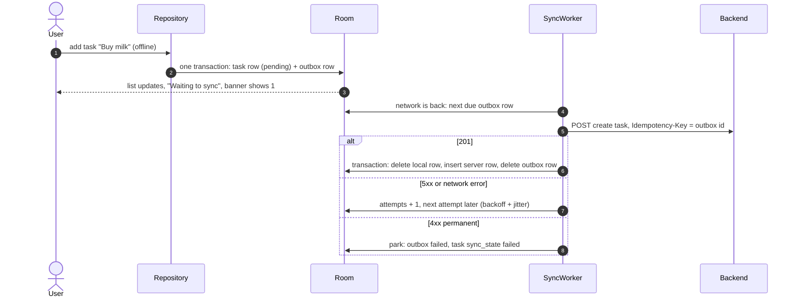

# 08. WorkManager and an offline sync queue

> **Draft: written but not yet run.** The code and the expected output in this lesson were prepared by reading the code and the official documentation. They have not been executed yet. If something does not behave as described, trust your tool's real output and report it.

## What you will be able to do
- explain the outbox pattern: write the local change and a "to send" record in one transaction;
- drain the queue in order with idempotency keys, exponential backoff with jitter and a retryable/permanent split;
- schedule background sync with WorkManager and a Hilt worker, and say what WorkManager does *not* promise;
- show the pending count in an accessible banner and "waiting to sync" on a row.

## Recap
1. Why does `replaceTasks` run in one transaction? <details><summary>Answer</summary>Readers never see a half-replaced list, and a crash cannot leave one.</details>
2. Which problems from lesson 05 are retryable? <details><summary>Answer</summary>Network errors, 408, 5xx, and 429 after `Retry-After`.</details>

## Why it matters
A letter box: you drop a letter and walk away; the postal service delivers it later and does not deliver it twice. An **outbox** is that box inside the app. If creating a task needs a connection, the app would lose your work in a tunnel. Instead it writes the task and a small "send this" record **in the same database transaction**, shows the task at once marked "waiting to sync", and lets a background job deliver it whenever the network is back (capstone M-19, M-20, M-21).

## What you will build
Adding a task now works offline. The row appears immediately with "Waiting to sync"; a banner says how many changes wait and offers **Sync now**; the queue drains in order with backoff when the server is unreachable; a refused change is *parked* and marked failed instead of retried forever.



## Before you start
- The project from lesson 07 (use its `code` folder; if you did the lesson 07 exercise, remove the `description` column and its migration first, and uninstall the app: this lesson's `MIGRATION_1_2` creates the outbox table instead). Time: about 90 to 120 minutes.
- Source pack (optional): https://github.com/Uee03/Code101 under `source/kotlin/201-hero-to-super-hero/phase-3-offline-and-quality/08-workmanager-offline-sync/` (**Code, Download ZIP**, or `git clone https://github.com/Uee03/Code101.git`).

**Files that stay as in lesson 07:** everything not listed below (auth, network, generated client, screens for Teams and Projects, all ViewModels except Tasks, `RepositoryModule.kt`, `DispatchersModule.kt`, `NetworkModule.kt`). Changed regions: `libs.versions.toml`, `app/build.gradle.kts`, `strings.xml`. New or changed in full: the manifest, `TasksRepository.kt`, `Entities.kt`, `CacheDao.kt`, `Migrations.kt`, `TasksDatabase.kt`, `DatabaseModule.kt`, `RetryPolicy.kt`, `OfflineFirstTasksRepository.kt`, `SyncWorker.kt`, `SyncScheduler.kt`, `TasksApplication.kt`, `SyncViewModel.kt`, `OfflineBanner.kt`, `AppGraph.kt`, `TasksViewModel.kt`, `TasksScreen.kt`.

New words: outbox, idempotency key, backoff, jitter, parked item, WorkManager, constraint, unique work, `HiltWorker`, `Configuration.Provider`.

## Steps

### Step 1. Libraries
**File: `gradle/libs.versions.toml`** (changed lines)
```toml
room = "2.8.5"
work = "2.12.0"
```
```toml
room-compiler = { module = "androidx.room:room-compiler", version.ref = "room" }
work = { module = "androidx.work:work-runtime-ktx", version.ref = "work" }
hilt-work = { module = "androidx.hilt:hilt-work", version.ref = "androidx-hilt" }
hilt-worker-compiler = { module = "androidx.hilt:hilt-compiler", version.ref = "androidx-hilt" }
```
**File: `app/build.gradle.kts`** (changed lines)
```kotlin
    ksp(libs.room.compiler)
    implementation(libs.work)
    implementation(libs.hilt.work)
    ksp(libs.hilt.worker.compiler)
```
`hilt-work` lets Hilt create workers; its separate compiler (`androidx.hilt:hilt-compiler`) is the processor for `@HiltWorker`. (The Dagger compiler is already there.)

### Step 2. WorkManager must use Hilt's worker factory
**File: `app/src/main/AndroidManifest.xml`**
```xml
<?xml version="1.0" encoding="utf-8"?>
<manifest xmlns:android="http://schemas.android.com/apk/res/android"
    xmlns:tools="http://schemas.android.com/tools">
    <uses-permission android:name="android.permission.INTERNET" />
    <application
        android:name=".TasksApplication"
        android:allowBackup="false"
        android:dataExtractionRules="@xml/data_extraction_rules"
        android:usesCleartextTraffic="false"
        android:label="@string/app_name"
        android:theme="@android:style/Theme.Material.Light.NoActionBar">
        <activity
            android:name=".MainActivity"
            android:exported="true">
            <intent-filter>
                <action android:name="android.intent.action.MAIN" />
                <category android:name="android.intent.category.LAUNCHER" />
            </intent-filter>
        </activity>
        <provider
            android:name="androidx.startup.InitializationProvider"
            android:authorities="${applicationId}.androidx-startup"
            android:exported="false"
            tools:node="merge">
            <meta-data
                android:name="androidx.work.WorkManagerInitializer"
                tools:node="remove" />
        </provider>
    </application>
</manifest>
```
By default WorkManager starts itself with a generic worker factory, which cannot build a worker that needs injected constructor parameters. The `<provider>` block **removes** that automatic start-up entry (`tools:node="remove"`), so WorkManager starts on demand with the configuration from the `Application` below. If you forget, workers crash with "could not instantiate".

**File: `app/src/main/kotlin/com/code101/tasks/TasksApplication.kt`**
```kotlin
package com.code101.tasks

import android.app.Application
import androidx.hilt.work.HiltWorkerFactory
import androidx.work.Configuration
import com.code101.tasks.data.sync.SyncScheduler
import dagger.hilt.android.HiltAndroidApp
import javax.inject.Inject

@HiltAndroidApp
class TasksApplication : Application(), Configuration.Provider {
    @Inject lateinit var workerFactory: HiltWorkerFactory
    @Inject lateinit var scheduler: SyncScheduler

    override val workManagerConfiguration: Configuration
        get() = Configuration.Builder().setWorkerFactory(workerFactory).build()

    override fun onCreate() {
        super.onCreate()
        scheduler.schedulePeriodic()
    }
}
```

### Step 3. The outbox table and its migration
**File: `app/src/main/kotlin/com/code101/tasks/data/local/Entities.kt`**
```kotlin
package com.code101.tasks.data.local

import androidx.room.ColumnInfo
import androidx.room.Entity
import androidx.room.Index
import androidx.room.PrimaryKey
import com.code101.tasks.domain.model.Project
import com.code101.tasks.domain.model.TaskItem
import com.code101.tasks.domain.model.Team

@Entity(tableName = "teams")
data class TeamRow(
    @PrimaryKey val id: String,
    val name: String,
    val description: String,
    @ColumnInfo(name = "member_count") val memberCount: Int,
)

@Entity(tableName = "projects", indices = [Index("team_id")])
data class ProjectRow(
    @PrimaryKey val id: String,
    @ColumnInfo(name = "team_id") val teamId: String,
    val key: String,
    val name: String,
)

@Entity(tableName = "tasks", indices = [Index("project_id")])
data class TaskRow(
    @PrimaryKey val id: String,
    @ColumnInfo(name = "project_id") val projectId: String,
    val title: String,
    val status: String,
    val version: Int,
    @ColumnInfo(name = "sync_state") val syncState: String,
)

@Entity(
    tableName = "outbox",
    indices = [
        Index(value = ["id"], unique = true),
        Index(value = ["state", "next_attempt_at"]),
    ],
)
data class OutboxRow(
    @PrimaryKey(autoGenerate = true) val seq: Long = 0,
    val id: String,
    val kind: String,
    @ColumnInfo(name = "entity_id") val entityId: String,
    @ColumnInfo(name = "parent_id") val parentId: String,
    val payload: String,
    @ColumnInfo(name = "base_version") val baseVersion: Int?,
    val state: String,
    val attempts: Int,
    @ColumnInfo(name = "next_attempt_at") val nextAttemptAt: Long,
    val problem: String?,
    @ColumnInfo(name = "created_at") val createdAt: Long,
)

fun Team.toRow() = TeamRow(id, name, description, memberCount)

fun TeamRow.toDomain() = Team(id, name, description, memberCount)

fun Project.toRow() = ProjectRow(id, teamId, key, name)

fun ProjectRow.toDomain() = Project(id, teamId, key, name)

fun TaskItem.toRow() = TaskRow(id, projectId, title, status, version, syncState)

fun TaskRow.toDomain() = TaskItem(id, projectId, title, status, version, syncState)
```
- `seq` is SQLite's auto-increment key and defines **order**; `id` is a UUID with a unique index and doubles as the **Idempotency-Key** of the request. (SQLite cannot auto-generate a second integer next to a text primary key, so the number is the key and the UUID is a unique column; capstone README, item 3.)
- `kind` says what to do (`create_task` here; lesson 10 adds `complete_task`); `entity_id` is the local row, `parent_id` the project; `payload` is JSON; `base_version` is the task version a later edit was based on (used by `If-Match` in lesson 10).
- `state` is `pending` or `failed` (parked); `attempts` and `next_attempt_at` drive the backoff.

**File: `app/src/main/kotlin/com/code101/tasks/data/local/Migrations.kt`**
```kotlin
package com.code101.tasks.data.local

import androidx.room.migration.Migration
import androidx.sqlite.db.SupportSQLiteDatabase

val MIGRATION_1_2: Migration = object : Migration(1, 2) {
    override fun migrate(db: SupportSQLiteDatabase) {
        db.execSQL(
            "CREATE TABLE IF NOT EXISTS `outbox` (" +
                "`seq` INTEGER PRIMARY KEY AUTOINCREMENT NOT NULL, " +
                "`id` TEXT NOT NULL, " +
                "`kind` TEXT NOT NULL, " +
                "`entity_id` TEXT NOT NULL, " +
                "`parent_id` TEXT NOT NULL, " +
                "`payload` TEXT NOT NULL, " +
                "`base_version` INTEGER, " +
                "`state` TEXT NOT NULL, " +
                "`attempts` INTEGER NOT NULL, " +
                "`next_attempt_at` INTEGER NOT NULL, " +
                "`problem` TEXT, " +
                "`created_at` INTEGER NOT NULL)",
        )
        db.execSQL("CREATE UNIQUE INDEX IF NOT EXISTS `index_outbox_id` ON `outbox` (`id`)")
        db.execSQL(
            "CREATE INDEX IF NOT EXISTS `index_outbox_state_next_attempt_at` " +
                "ON `outbox` (`state`, `next_attempt_at`)",
        )
    }
}
```
**This SQL must equal what Room generates.** After the first build open `app/schemas/.../2.json` and compare the `createSql` and the two index definitions with the strings above; Room refuses to open a migrated database whose table or index differs (nullability counts: `base_version` and `problem` have no `NOT NULL` because the Kotlin types are nullable).

**File: `app/src/main/kotlin/com/code101/tasks/data/local/TasksDatabase.kt`**
```kotlin
package com.code101.tasks.data.local

import androidx.room.Database
import androidx.room.RoomDatabase

@Database(
    entities = [TeamRow::class, ProjectRow::class, TaskRow::class, OutboxRow::class],
    version = 2,
    exportSchema = true,
)
abstract class TasksDatabase : RoomDatabase() {
    abstract fun cacheDao(): CacheDao
}
```
**File: `app/src/main/kotlin/com/code101/tasks/di/DatabaseModule.kt`**
```kotlin
package com.code101.tasks.di

import android.content.Context
import androidx.room.Room
import com.code101.tasks.data.local.CacheDao
import com.code101.tasks.data.local.MIGRATION_1_2
import com.code101.tasks.data.local.TasksDatabase
import dagger.Module
import dagger.Provides
import dagger.hilt.InstallIn
import dagger.hilt.android.qualifiers.ApplicationContext
import dagger.hilt.components.SingletonComponent
import javax.inject.Singleton

@Module
@InstallIn(SingletonComponent::class)
object DatabaseModule {
    @Provides
    @Singleton
    fun database(@ApplicationContext context: Context): TasksDatabase =
        Room.databaseBuilder(context, TasksDatabase::class.java, "tasks.db")
            .addMigrations(MIGRATION_1_2)
            .build()

    @Provides
    fun cacheDao(database: TasksDatabase): CacheDao = database.cacheDao()
}
```

### Step 4. The DAO: queue operations as transactions
**File: `app/src/main/kotlin/com/code101/tasks/data/local/CacheDao.kt`**
```kotlin
package com.code101.tasks.data.local

import androidx.room.Dao
import androidx.room.Insert
import androidx.room.OnConflictStrategy
import androidx.room.Query
import androidx.room.Transaction
import kotlinx.coroutines.flow.Flow

@Dao
abstract class CacheDao {
    @Query("SELECT * FROM teams ORDER BY name")
    abstract fun observeTeams(): Flow<List<TeamRow>>

    @Query("SELECT * FROM projects WHERE team_id = :teamId ORDER BY name")
    abstract fun observeProjects(teamId: String): Flow<List<ProjectRow>>

    @Query("SELECT * FROM tasks WHERE project_id = :projectId ORDER BY title")
    abstract fun observeTasks(projectId: String): Flow<List<TaskRow>>

    @Query("SELECT COUNT(*) FROM outbox WHERE state = 'pending'")
    abstract fun observePendingCount(): Flow<Int>

    @Insert(onConflict = OnConflictStrategy.REPLACE)
    abstract suspend fun upsertTeams(rows: List<TeamRow>)

    @Insert(onConflict = OnConflictStrategy.REPLACE)
    abstract suspend fun upsertProjects(rows: List<ProjectRow>)

    @Insert(onConflict = OnConflictStrategy.REPLACE)
    abstract suspend fun upsertTasks(rows: List<TaskRow>)

    @Query("DELETE FROM teams")
    abstract suspend fun clearTeams()

    @Query("DELETE FROM projects WHERE team_id = :teamId")
    abstract suspend fun clearProjects(teamId: String)

    @Query("DELETE FROM tasks WHERE project_id = :projectId AND sync_state = 'synced'")
    abstract suspend fun clearSyncedTasks(projectId: String)

    @Transaction
    open suspend fun replaceTeams(rows: List<TeamRow>) {
        clearTeams()
        upsertTeams(rows)
    }

    @Transaction
    open suspend fun replaceProjects(teamId: String, rows: List<ProjectRow>) {
        clearProjects(teamId)
        upsertProjects(rows)
    }

    @Transaction
    open suspend fun replaceTasks(projectId: String, rows: List<TaskRow>) {
        clearSyncedTasks(projectId)
        upsertTasks(rows)
    }

    @Insert
    abstract suspend fun insertOutbox(row: OutboxRow)

    @Query("SELECT * FROM outbox WHERE state = 'pending' AND next_attempt_at <= :now ORDER BY seq LIMIT 1")
    abstract suspend fun nextDue(now: Long): OutboxRow?

    @Query("DELETE FROM outbox WHERE id = :id")
    abstract suspend fun deleteOutbox(id: String)

    @Query("DELETE FROM tasks WHERE id = :id")
    abstract suspend fun deleteTask(id: String)

    @Query("UPDATE outbox SET attempts = :attempts, next_attempt_at = :nextAttemptAt WHERE id = :id")
    abstract suspend fun scheduleRetry(id: String, attempts: Int, nextAttemptAt: Long)

    @Query("UPDATE outbox SET state = 'failed', problem = :problem WHERE id = :id")
    abstract suspend fun parkOutbox(id: String, problem: String)

    @Query("UPDATE tasks SET sync_state = :state WHERE id = :id")
    abstract suspend fun setTaskSyncState(id: String, state: String)

    @Transaction
    open suspend fun queueCreate(task: TaskRow, outbox: OutboxRow) {
        upsertTasks(listOf(task))
        insertOutbox(outbox)
    }

    @Transaction
    open suspend fun completeCreate(outboxId: String, localId: String, server: TaskRow) {
        deleteTask(localId)
        upsertTasks(listOf(server))
        deleteOutbox(outboxId)
    }

    @Transaction
    open suspend fun park(outboxId: String, taskId: String, problem: String) {
        parkOutbox(outboxId, problem)
        setTaskSyncState(taskId, "failed")
    }
}
```
- A refresh now deletes only `sync_state = 'synced'` rows (`clearSyncedTasks`): a refresh must never wipe a task the server has not seen yet.
- `queueCreate` is the rule from the capstone's section 5: **the local change and the outbox row are written together or not at all.** Without that, a crash between them either loses the task or sends it twice.
- `nextDue` picks the oldest due row (`ORDER BY seq`): order per queue is preserved.
- `completeCreate` swaps the temporary local row for the server's row (the server assigns the real id) and removes the outbox row, atomically.

### Step 5. Retry rules in one place
**File: `app/src/main/kotlin/com/code101/tasks/data/sync/RetryPolicy.kt`**
```kotlin
package com.code101.tasks.data.sync

import kotlin.random.Random

object RetryPolicy {
    fun isRetryable(status: Int): Boolean = status == 408 || status == 425 || status == 429 || status in 500..599

    fun delayMillis(attempts: Int, retryAfterMillis: Long = 0, random: Random = Random.Default): Long {
        val base = minOf(30_000L * (1L shl minOf(attempts, 6)), 3_600_000L)
        return maxOf(base + random.nextLong(0, 1_000), retryAfterMillis)
    }
}
```
- **Retryable** failures can succeed later (server hiccup, rate limit); a **permanent** 4xx such as 422 will fail again with the same body, so retrying would only waste battery.
- **Backoff** doubles the wait: 60 s, 120 s, ... capped at one hour (`1L shl 6` is 64; `shl` shifts bits, so `1L shl n` is 2 to the power n). **Jitter** (up to one second of random extra) stops thousands of phones from retrying at the same instant after an outage.

### Step 6. The repository writes the queue and drains it
**File: `app/src/main/kotlin/com/code101/tasks/domain/repository/TasksRepository.kt`**
```kotlin
package com.code101.tasks.domain.repository

import com.code101.tasks.domain.model.Project
import com.code101.tasks.domain.model.TaskItem
import com.code101.tasks.domain.model.Team
import kotlinx.coroutines.flow.Flow

interface TasksRepository {
    val pendingCount: Flow<Int>

    fun teams(query: String): Flow<List<Team>>

    fun projects(teamId: String): Flow<List<Project>>

    fun tasks(projectId: String): Flow<List<TaskItem>>

    suspend fun refreshTeams()

    suspend fun refreshProjects(teamId: String)

    suspend fun refreshTasks(projectId: String)

    suspend fun addTask(projectId: String, title: String)

    suspend fun sync()
}
```
**File: `app/src/main/kotlin/com/code101/tasks/data/repository/OfflineFirstTasksRepository.kt`**
```kotlin
package com.code101.tasks.data.repository

import com.code101.tasks.data.local.CacheDao
import com.code101.tasks.data.local.OutboxRow
import com.code101.tasks.data.local.TaskRow
import com.code101.tasks.data.local.toDomain
import com.code101.tasks.data.local.toRow
import com.code101.tasks.data.remote.RemoteDataSource
import com.code101.tasks.data.remote.wireJson
import com.code101.tasks.data.sync.RetryPolicy
import com.code101.tasks.data.sync.SyncScheduler
import com.code101.tasks.domain.model.ApiFailure
import com.code101.tasks.domain.model.Project
import com.code101.tasks.domain.model.TaskItem
import com.code101.tasks.domain.model.Team
import com.code101.tasks.domain.repository.TasksRepository
import java.io.IOException
import java.util.UUID
import javax.inject.Inject
import kotlinx.coroutines.flow.Flow
import kotlinx.coroutines.flow.map
import kotlinx.coroutines.sync.Mutex
import kotlinx.coroutines.sync.withLock
import kotlinx.serialization.json.buildJsonObject
import kotlinx.serialization.json.jsonObject
import kotlinx.serialization.json.jsonPrimitive
import kotlinx.serialization.json.put

class OfflineFirstTasksRepository @Inject constructor(
    private val dao: CacheDao,
    private val remote: RemoteDataSource,
    private val scheduler: SyncScheduler,
) : TasksRepository {
    private val syncMutex = Mutex()

    override val pendingCount: Flow<Int> = dao.observePendingCount()

    override fun teams(query: String): Flow<List<Team>> =
        dao.observeTeams().map { rows ->
            rows.filter { it.name.contains(query, ignoreCase = true) }.map { it.toDomain() }
        }

    override fun projects(teamId: String): Flow<List<Project>> =
        dao.observeProjects(teamId).map { rows -> rows.map { it.toDomain() } }

    override fun tasks(projectId: String): Flow<List<TaskItem>> =
        dao.observeTasks(projectId).map { rows -> rows.map { it.toDomain() } }

    override suspend fun refreshTeams() {
        dao.replaceTeams(remote.teams().map { it.toRow() })
    }

    override suspend fun refreshProjects(teamId: String) {
        dao.replaceProjects(teamId, remote.projects(teamId).map { it.toRow() })
    }

    override suspend fun refreshTasks(projectId: String) {
        dao.replaceTasks(projectId, remote.tasks(projectId).map { it.toRow() })
    }

    override suspend fun addTask(projectId: String, title: String) {
        val id = UUID.randomUUID().toString()
        val now = System.currentTimeMillis()
        dao.queueCreate(
            task = TaskRow(id, projectId, title, "todo", 0, "pending"),
            outbox = OutboxRow(
                id = id,
                kind = "create_task",
                entityId = id,
                parentId = projectId,
                payload = buildJsonObject { put("title", title) }.toString(),
                baseVersion = null,
                state = "pending",
                attempts = 0,
                nextAttemptAt = now,
                problem = null,
                createdAt = now,
            ),
        )
        scheduler.syncSoon()
    }

    override suspend fun sync() {
        syncMutex.withLock {
            while (true) {
                val row = dao.nextDue(System.currentTimeMillis()) ?: break
                try {
                    send(row)
                } catch (e: ApiFailure) {
                    if (RetryPolicy.isRetryable(e.problem.status)) {
                        retryLater(row, e.problem.retryAfterMillis)
                        break
                    }
                    dao.park(row.id, row.entityId, "${e.problem.status} ${e.problem.title}")
                } catch (e: IOException) {
                    retryLater(row, 0)
                    break
                }
            }
        }
    }

    private suspend fun send(row: OutboxRow) {
        when (row.kind) {
            "create_task" -> {
                val title = wireJson.parseToJsonElement(row.payload).jsonObject["title"]?.jsonPrimitive?.content.orEmpty()
                val created = remote.createTask(row.parentId, title, row.id)
                dao.completeCreate(row.id, row.entityId, created.toRow())
            }
            else -> dao.park(row.id, row.entityId, "unknown kind")
        }
    }

    private suspend fun retryLater(row: OutboxRow, retryAfterMillis: Long) {
        val attempts = row.attempts + 1
        val next = System.currentTimeMillis() + RetryPolicy.delayMillis(attempts, retryAfterMillis)
        dao.scheduleRetry(row.id, attempts, next)
    }
}
```
Read `sync()` as the "outbox processor" of the TDD:
- **One drain at a time** (`Mutex`): the worker, the "Sync now" button and any other caller share it, so two loops never send the same row.
- Take the next due row. Send it with the row id as `Idempotency-Key`: if the answer is lost and the row is sent again, the server **replays** the first result instead of creating a duplicate.
- Retryable failure: record the attempt and next time, then **stop** (`break`) so later rows do not overtake this one. A permanent failure parks this row and **continues** with the next.
- Premature success claims are impossible: the outbox row is deleted in the *same transaction* that stores the server's task.
- Known limit (stated honestly): if the app dies between the server answering and the transaction committing, the next attempt replays and the second answer commits; the idempotency key is what makes that safe.

### Step 7. WorkManager
**File: `app/src/main/kotlin/com/code101/tasks/data/sync/SyncScheduler.kt`**
```kotlin
package com.code101.tasks.data.sync

import android.content.Context
import androidx.work.BackoffPolicy
import androidx.work.Constraints
import androidx.work.ExistingPeriodicWorkPolicy
import androidx.work.ExistingWorkPolicy
import androidx.work.NetworkType
import androidx.work.OneTimeWorkRequestBuilder
import androidx.work.PeriodicWorkRequestBuilder
import androidx.work.WorkManager
import dagger.hilt.android.qualifiers.ApplicationContext
import java.util.concurrent.TimeUnit
import javax.inject.Inject
import javax.inject.Singleton

@Singleton
class SyncScheduler @Inject constructor(
    @ApplicationContext private val context: Context,
) {
    private val constraints = Constraints.Builder()
        .setRequiredNetworkType(NetworkType.CONNECTED)
        .build()

    fun schedulePeriodic() {
        WorkManager.getInstance(context).enqueueUniquePeriodicWork(
            "tasks-periodic",
            ExistingPeriodicWorkPolicy.KEEP,
            PeriodicWorkRequestBuilder<SyncWorker>(15, TimeUnit.MINUTES)
                .setConstraints(constraints)
                .setBackoffCriteria(BackoffPolicy.EXPONENTIAL, 30, TimeUnit.SECONDS)
                .build(),
        )
    }

    fun syncSoon() {
        WorkManager.getInstance(context).enqueueUniqueWork(
            "tasks-sync",
            ExistingWorkPolicy.KEEP,
            OneTimeWorkRequestBuilder<SyncWorker>()
                .setConstraints(constraints)
                .setBackoffCriteria(BackoffPolicy.EXPONENTIAL, 30, TimeUnit.SECONDS)
                .build(),
        )
    }
}
```
**File: `app/src/main/kotlin/com/code101/tasks/data/sync/SyncWorker.kt`**
```kotlin
package com.code101.tasks.data.sync

import android.content.Context
import androidx.hilt.work.HiltWorker
import androidx.work.CoroutineWorker
import androidx.work.WorkerParameters
import com.code101.tasks.data.auth.AuthStateManager
import com.code101.tasks.domain.repository.SessionStatus
import com.code101.tasks.domain.repository.TasksRepository
import dagger.assisted.Assisted
import dagger.assisted.AssistedInject
import kotlinx.coroutines.CancellationException
import kotlinx.coroutines.flow.first

@HiltWorker
class SyncWorker @AssistedInject constructor(
    @Assisted context: Context,
    @Assisted parameters: WorkerParameters,
    private val repository: TasksRepository,
    private val auth: AuthStateManager,
) : CoroutineWorker(context, parameters) {
    override suspend fun doWork(): Result {
        if (auth.status.value == SessionStatus.Checking) auth.restore()
        if (auth.status.value != SessionStatus.SignedIn) return Result.success()
        return try {
            repository.sync()
            if (repository.pendingCount.first() > 0) Result.retry() else Result.success()
        } catch (e: CancellationException) {
            throw e
        } catch (e: Exception) {
            Result.retry()
        }
    }
}
```
- **Unique work** with `KEEP`: asking twice does not create two jobs; the name is the identity. `CONNECTED` is a **constraint**: WorkManager waits for a network.
- A worker may start when the app process was created only for it, so the session may still be `Checking`: the worker restores it first. Signed out means nothing to send (`Result.success()`); the queue is untouched and drains after the next sign-in.
- `Result.retry()` asks WorkManager to run again with its own exponential backoff (30 s here). Cancellation is rethrown, as in lesson 03.
- **What WorkManager does not promise.** The 15-minute period is a *minimum*, not a deadline; Doze, battery saver, app standby and force-stop can delay or stop background work (capstone README, item 7). Treat background sync as "eventually, usually soon", and give the user **Sync now** for the immediate case.

### Step 8. Banner, ViewModel and screens
**File: `app/src/main/kotlin/com/code101/tasks/ui/sync/SyncViewModel.kt`**
```kotlin
package com.code101.tasks.ui.sync

import androidx.lifecycle.ViewModel
import androidx.lifecycle.viewModelScope
import com.code101.tasks.domain.model.ApiFailure
import com.code101.tasks.domain.repository.TasksRepository
import dagger.hilt.android.lifecycle.HiltViewModel
import java.io.IOException
import javax.inject.Inject
import kotlinx.coroutines.flow.SharingStarted
import kotlinx.coroutines.flow.StateFlow
import kotlinx.coroutines.flow.stateIn
import kotlinx.coroutines.launch

@HiltViewModel
class SyncViewModel @Inject constructor(
    private val repository: TasksRepository,
) : ViewModel() {
    val pendingCount: StateFlow<Int> = repository.pendingCount.stateIn(
        scope = viewModelScope,
        started = SharingStarted.WhileSubscribed(5_000),
        initialValue = 0,
    )

    fun syncNow() {
        viewModelScope.launch {
            try {
                repository.sync()
            } catch (e: ApiFailure) {
                // The row stays in the queue and is retried with backoff.
            } catch (e: IOException) {
                // Offline: the queue keeps the work.
            }
        }
    }
}
```
**File: `app/src/main/kotlin/com/code101/tasks/ui/components/OfflineBanner.kt`**
```kotlin
package com.code101.tasks.ui.components

import androidx.compose.foundation.layout.Row
import androidx.compose.foundation.layout.fillMaxWidth
import androidx.compose.foundation.layout.padding
import androidx.compose.foundation.layout.statusBarsPadding
import androidx.compose.material3.MaterialTheme
import androidx.compose.material3.Surface
import androidx.compose.material3.Text
import androidx.compose.material3.TextButton
import androidx.compose.runtime.Composable
import androidx.compose.ui.Alignment
import androidx.compose.ui.Modifier
import androidx.compose.ui.res.stringResource
import androidx.compose.ui.semantics.LiveRegionMode
import androidx.compose.ui.semantics.liveRegion
import androidx.compose.ui.semantics.semantics
import androidx.compose.ui.unit.dp
import com.code101.tasks.R

@Composable
fun OfflineBanner(
    pendingCount: Int,
    onSyncNow: () -> Unit,
    modifier: Modifier = Modifier,
) {
    if (pendingCount > 0) {
        Surface(
            color = MaterialTheme.colorScheme.secondaryContainer,
            modifier = modifier
                .fillMaxWidth()
                .statusBarsPadding()
                .semantics { liveRegion = LiveRegionMode.Polite },
        ) {
            Row(
                modifier = Modifier.padding(horizontal = 16.dp, vertical = 8.dp),
                verticalAlignment = Alignment.CenterVertically,
            ) {
                Text(
                    text = stringResource(R.string.pending_banner, pendingCount),
                    modifier = Modifier.weight(1f),
                )
                TextButton(onClick = onSyncNow) {
                    Text(stringResource(R.string.sync_now))
                }
            }
        }
    }
}
```
The banner is a **polite live region**: TalkBack announces a change in the count without stealing focus. It is not a screen; it sits above the navigation host so every screen shares it (capstone S-banner).

**File: `app/src/main/kotlin/com/code101/tasks/ui/navigation/AppGraph.kt`**
```kotlin
package com.code101.tasks.ui.navigation

import androidx.compose.foundation.layout.Column
import androidx.compose.foundation.layout.fillMaxSize
import androidx.compose.runtime.Composable
import androidx.compose.runtime.getValue
import androidx.compose.ui.Modifier
import androidx.hilt.lifecycle.viewmodel.compose.hiltViewModel
import androidx.lifecycle.compose.collectAsStateWithLifecycle
import androidx.navigation.compose.NavHost
import androidx.navigation.compose.composable
import androidx.navigation.compose.rememberNavController
import com.code101.tasks.ui.components.OfflineBanner
import com.code101.tasks.ui.projects.ProjectsScreen
import com.code101.tasks.ui.projects.ProjectsViewModel
import com.code101.tasks.ui.sync.SyncViewModel
import com.code101.tasks.ui.tasks.TasksScreen
import com.code101.tasks.ui.tasks.TasksViewModel
import com.code101.tasks.ui.teams.ConnectionViewModel
import com.code101.tasks.ui.teams.TeamsScreen
import com.code101.tasks.ui.teams.TeamsViewModel

@Composable
fun AppGraph(onSignOut: () -> Unit) {
    val navController = rememberNavController()
    val syncViewModel: SyncViewModel = hiltViewModel()
    val pendingCount by syncViewModel.pendingCount.collectAsStateWithLifecycle()

    Column(modifier = Modifier.fillMaxSize()) {
        OfflineBanner(pendingCount = pendingCount, onSyncNow = syncViewModel::syncNow)
        NavHost(
            navController = navController,
            startDestination = TeamsRoute,
            modifier = Modifier.weight(1f),
        ) {
            composable<TeamsRoute> {
                val viewModel: TeamsViewModel = hiltViewModel()
                val connectionViewModel: ConnectionViewModel = hiltViewModel()
                val state by viewModel.state.collectAsStateWithLifecycle()
                val connection by connectionViewModel.state.collectAsStateWithLifecycle()
                val searchText by viewModel.searchText.collectAsStateWithLifecycle()
                TeamsScreen(
                    state = state,
                    connection = connection,
                    searchText = searchText,
                    onSearchChange = viewModel::onSearchChange,
                    onCheckConnection = connectionViewModel::check,
                    onSignOut = onSignOut,
                    onRetry = viewModel::refresh,
                    onOpenTeam = { teamId -> navController.navigate(ProjectsRoute(teamId)) },
                )
            }
            composable<ProjectsRoute> {
                val viewModel: ProjectsViewModel = hiltViewModel()
                val state by viewModel.state.collectAsStateWithLifecycle()
                ProjectsScreen(
                    state = state,
                    onRetry = viewModel::refresh,
                    onOpenProject = { projectId -> navController.navigate(TasksRoute(projectId)) },
                    onBack = { navController.popBackStack() },
                )
            }
            composable<TasksRoute> {
                val viewModel: TasksViewModel = hiltViewModel()
                val state by viewModel.state.collectAsStateWithLifecycle()
                val titleError by viewModel.titleError.collectAsStateWithLifecycle()
                TasksScreen(
                    state = state,
                    events = viewModel.events,
                    titleError = titleError,
                    onTitleEdited = viewModel::clearTitleError,
                    onRetry = viewModel::refresh,
                    onAdd = viewModel::addTask,
                    onBack = { navController.popBackStack() },
                )
            }
        }
    }
}
```
**File: `app/src/main/kotlin/com/code101/tasks/ui/tasks/TasksViewModel.kt`**
```kotlin
package com.code101.tasks.ui.tasks

import androidx.lifecycle.SavedStateHandle
import androidx.lifecycle.ViewModel
import androidx.lifecycle.viewModelScope
import androidx.navigation.toRoute
import com.code101.tasks.R
import com.code101.tasks.domain.model.ApiFailure
import com.code101.tasks.domain.model.TaskItem
import com.code101.tasks.domain.repository.TasksRepository
import com.code101.tasks.ui.common.UiState
import com.code101.tasks.ui.common.failureMessage
import com.code101.tasks.ui.common.screenState
import com.code101.tasks.ui.navigation.TasksRoute
import dagger.hilt.android.lifecycle.HiltViewModel
import java.io.IOException
import javax.inject.Inject
import kotlinx.coroutines.channels.Channel
import kotlinx.coroutines.flow.Flow
import kotlinx.coroutines.flow.MutableStateFlow
import kotlinx.coroutines.flow.SharingStarted
import kotlinx.coroutines.flow.StateFlow
import kotlinx.coroutines.flow.asStateFlow
import kotlinx.coroutines.flow.combine
import kotlinx.coroutines.flow.receiveAsFlow
import kotlinx.coroutines.flow.stateIn
import kotlinx.coroutines.launch

sealed interface TasksEvent {
    data object Added : TasksEvent
    data class Message(val messageRes: Int) : TasksEvent
}

@HiltViewModel
class TasksViewModel @Inject constructor(
    private val repository: TasksRepository,
    savedStateHandle: SavedStateHandle,
) : ViewModel() {
    private val projectId = savedStateHandle.toRoute<TasksRoute>().projectId
    private val refreshed = MutableStateFlow(false)
    private val failure = MutableStateFlow<Int?>(null)
    private val eventChannel = Channel<TasksEvent>(Channel.BUFFERED)
    private val _titleError = MutableStateFlow<Int?>(null)

    val events: Flow<TasksEvent> = eventChannel.receiveAsFlow()
    val titleError: StateFlow<Int?> = _titleError.asStateFlow()

    val state: StateFlow<UiState<List<TaskItem>>> = combine(
        repository.tasks(projectId),
        refreshed,
        failure,
    ) { tasks, isRefreshed, failureRes ->
        screenState(tasks, isRefreshed, failureRes)
    }.stateIn(
        scope = viewModelScope,
        started = SharingStarted.WhileSubscribed(5_000),
        initialValue = UiState.Loading,
    )

    init {
        refresh()
    }

    fun refresh() {
        viewModelScope.launch {
            failure.value = null
            try {
                repository.refreshTasks(projectId)
            } catch (e: ApiFailure) {
                failure.value = failureMessage(e)
            } catch (e: IOException) {
                failure.value = failureMessage(e)
            } finally {
                refreshed.value = true
            }
        }
    }

    fun clearTitleError() {
        _titleError.value = null
    }

    fun addTask(title: String) {
        val clean = title.trim()
        if (clean.isEmpty() || clean.length > MAX_TITLE) {
            _titleError.value = R.string.error_title_invalid
            return
        }
        viewModelScope.launch {
            repository.addTask(projectId, clean)
            _titleError.value = null
            eventChannel.send(TasksEvent.Added)
        }
    }

    private companion object {
        const val MAX_TITLE = 200
    }
}
```
Because the write no longer waits for the server, the ViewModel validates the title **locally** with the contract's limit (1 to 200 characters) before queueing; the server remains the final judge, and a 422 later parks the row.

**File: `app/src/main/kotlin/com/code101/tasks/ui/tasks/TasksScreen.kt`**
```kotlin
package com.code101.tasks.ui.tasks

import androidx.compose.foundation.layout.Arrangement
import androidx.compose.foundation.layout.Column
import androidx.compose.foundation.layout.Row
import androidx.compose.foundation.layout.fillMaxSize
import androidx.compose.foundation.layout.fillMaxWidth
import androidx.compose.foundation.layout.padding
import androidx.compose.foundation.lazy.LazyColumn
import androidx.compose.foundation.lazy.items
import androidx.compose.material3.Button
import androidx.compose.material3.Card
import androidx.compose.material3.MaterialTheme
import androidx.compose.material3.OutlinedTextField
import androidx.compose.material3.SnackbarHost
import androidx.compose.material3.SnackbarHostState
import androidx.compose.material3.Text
import androidx.compose.runtime.Composable
import androidx.compose.runtime.LaunchedEffect
import androidx.compose.runtime.getValue
import androidx.compose.runtime.mutableStateOf
import androidx.compose.runtime.remember
import androidx.compose.runtime.saveable.rememberSaveable
import androidx.compose.runtime.setValue
import androidx.compose.ui.Alignment
import androidx.compose.ui.Modifier
import androidx.compose.ui.platform.LocalContext
import androidx.compose.ui.res.stringResource
import androidx.compose.ui.unit.dp
import androidx.lifecycle.Lifecycle
import androidx.lifecycle.compose.LocalLifecycleOwner
import androidx.lifecycle.repeatOnLifecycle
import com.code101.tasks.R
import com.code101.tasks.domain.model.TaskItem
import com.code101.tasks.ui.common.UiState
import com.code101.tasks.ui.components.AppScaffold
import com.code101.tasks.ui.components.UiStateContent
import com.code101.tasks.ui.components.statusLabel
import kotlinx.coroutines.flow.Flow

@Composable
fun TasksScreen(
    state: UiState<List<TaskItem>>,
    events: Flow<TasksEvent>,
    titleError: Int?,
    onTitleEdited: () -> Unit,
    onRetry: () -> Unit,
    onAdd: (String) -> Unit,
    onBack: () -> Unit,
) {
    var draft by rememberSaveable { mutableStateOf("") }
    val snackbarHostState = remember { SnackbarHostState() }
    val lifecycleOwner = LocalLifecycleOwner.current
    val context = LocalContext.current
    val addedText = stringResource(R.string.task_added)

    LaunchedEffect(events, lifecycleOwner) {
        lifecycleOwner.lifecycle.repeatOnLifecycle(Lifecycle.State.STARTED) {
            events.collect { event ->
                val message = when (event) {
                    TasksEvent.Added -> addedText
                    is TasksEvent.Message -> context.getString(event.messageRes)
                }
                snackbarHostState.showSnackbar(message)
            }
        }
    }

    AppScaffold(
        titleRes = R.string.tasks,
        onBack = onBack,
        snackbarHost = { SnackbarHost(snackbarHostState) },
    ) { padding ->
        Column(
            modifier = Modifier
                .padding(padding)
                .padding(16.dp),
            verticalArrangement = Arrangement.spacedBy(12.dp),
        ) {
            Row(
                modifier = Modifier.fillMaxWidth(),
                verticalAlignment = Alignment.Top,
                horizontalArrangement = Arrangement.spacedBy(8.dp),
            ) {
                OutlinedTextField(
                    value = draft,
                    onValueChange = {
                        draft = it
                        onTitleEdited()
                    },
                    label = { Text(stringResource(R.string.new_task)) },
                    isError = titleError != null,
                    supportingText = {
                        if (titleError != null) Text(stringResource(titleError))
                    },
                    singleLine = true,
                    modifier = Modifier.weight(1f),
                )
                Button(
                    onClick = {
                        onAdd(draft)
                        draft = ""
                    },
                    enabled = draft.isNotBlank(),
                ) {
                    Text(stringResource(R.string.add))
                }
            }
            UiStateContent(
                state = state,
                onRetry = onRetry,
                modifier = Modifier.weight(1f),
            ) { tasks ->
                if (tasks.isEmpty()) {
                    Text(text = stringResource(R.string.empty))
                } else {
                    LazyColumn(
                        modifier = Modifier.fillMaxSize(),
                        verticalArrangement = Arrangement.spacedBy(12.dp),
                    ) {
                        items(tasks, key = { it.id }) { task ->
                            Card(modifier = Modifier.fillMaxWidth()) {
                                Column(modifier = Modifier.padding(16.dp)) {
                                    Text(task.title, style = MaterialTheme.typography.titleMedium)
                                    Text(stringResource(statusLabel(task.status)))
                                    when (task.syncState) {
                                        "pending" -> Text(stringResource(R.string.waiting_to_sync))
                                        "failed" -> Text(
                                            text = stringResource(R.string.sync_failed),
                                            color = MaterialTheme.colorScheme.error,
                                        )
                                    }
                                }
                            }
                        }
                    }
                }
            }
        }
    }
}
```
Sync state is shown in **words** ("Waiting to sync", an error colour plus text for a failure), never by colour alone.

**File: `app/src/main/res/values/strings.xml`** (four new lines after `problem_offline`)
```xml
    <string name="pending_banner">%1$d changes are waiting to sync</string>
    <string name="sync_now">Sync now</string>
    <string name="waiting_to_sync">Waiting to sync</string>
    <string name="sync_failed">Could not be saved. The server refused this change.</string>
```
Predict before you run: you switch to airplane mode, add two tasks, then close the app completely. Which numbers does the banner show, and what happens when you reconnect and do **not** open the app?

## Run it
Run the app signed in. Open a project's tasks, enable airplane mode, add "Buy milk" and "Call Ana". Force-stop the app and open it again, then turn the network back on.

Expected result (described, not yet seen): both tasks appear at once with "Waiting to sync"; the banner reads "2 changes are waiting to sync" (a quantity string would be nicer; see Going further). After you restart the app they are still listed and the banner still shows 2. When the network returns, WorkManager's job runs within moments (it may take longer on a battery-saving phone; **Sync now** forces it), the banner disappears and the two rows lose "Waiting to sync"; the server now holds exactly two new tasks (check with another client or the backend's list). Press **Sync now** repeatedly: still exactly two tasks, thanks to the idempotency key.

## How it works
**The outbox pattern.** Two writes (the user's change and the intent to tell the server) must happen atomically; Room's `@Transaction` gives that. The worker later *reads the intent*, does the network call, and records the result atomically again. Every crash point leaves a state that can be resumed.

**At-least-once plus idempotency = effectively once.** The queue may send a request more than once (a crash after the server answered). The server remembers the `Idempotency-Key` and returns the first result for a repeat, so the visible effect is once.

**Order.** `ORDER BY seq` and `break` on a retryable failure keep operations in the order the user made them. The capstone drains in order *per entity* (a comment depends on its task); this slice has one kind, so global order suffices.

**WorkManager vs the alternatives.**

| Option | Verdict |
|---|---|
| WorkManager (unique + constraints) | survives process death and reboot, honours the network constraint, standard for deferrable guaranteed work |
| `AlarmManager` | exact timing, but you rebuild persistence and constraints yourself |
| Foreground service | for user-visible long work; heavy and visible; not needed for a small queue |
| Plain coroutine in the app | dies with the process; fine for "Sync now", not for background delivery |

**Hilt workers.** `@HiltWorker` + `@AssistedInject` let a worker receive injected dependencies; the `@Assisted` parameters (`Context`, `WorkerParameters`) come from WorkManager. The factory is supplied through `Configuration.Provider`.

**Why this, not that (parked items).** A permanent failure is not deleted silently: the row stays visible as failed with its problem text, so the user (and later a "sync queue" screen: capstone S10) can retry or discard it. Dropping it would lose the user's work without telling them.

**Where this reappears.** Capstone chapter 04 (`capstones/mobile-kotlin/tutorials/phase-4-offline/04-offline.md`) adds ordering per entity, merge of edits into a pending create, 412 conflict handling and the queue screen.

## Try it
1. **Guided:** the starter `RetryPolicy.kt` has two empty rules. Fill them: 408, 425, 429 and every 5xx are retryable; the delay doubles from 30 seconds per attempt, is capped at one hour, has up to 1000 ms of jitter and is never shorter than `retryAfterMillis` (cap the shift at 6).

**File: `app/src/main/kotlin/com/code101/tasks/data/sync/RetryPolicy.kt`**
```kotlin
package com.code101.tasks.data.sync

import kotlin.random.Random

object RetryPolicy {
    // TODO: true for the statuses worth retrying: 408, 425, 429 and every 5xx
    fun isRetryable(status: Int): Boolean = false

    // TODO: exponential backoff: 30 seconds doubled for each attempt, capped at one hour,
    // plus up to 1000 ms of random jitter; never shorter than retryAfterMillis.
    // (Cap the shift at 6 so the number cannot overflow.)
    fun delayMillis(attempts: Int, retryAfterMillis: Long = 0, random: Random = Random.Default): Long = 0L
}
```
Expected: `isRetryable(503)` is `true`, `isRetryable(422)` is `false`; for attempts 1, 2, 3 the delay is about 60 s, 120 s, 240 s plus under a second.
2. **Change:** make the banner say "1 change is waiting to sync" for one item by replacing the string with a plural resource (`<plurals>` and `pluralStringResource`).
3. **Stretch (optional):** add a `failedCount` flow to the DAO and show a second line in the banner for parked items with a **Discard** action. What must happen to the local task row when its outbox row is discarded?

<details><summary>Solution</summary>

**File: `app/src/main/kotlin/com/code101/tasks/data/sync/RetryPolicy.kt`**
```kotlin
package com.code101.tasks.data.sync

import kotlin.random.Random

object RetryPolicy {
    fun isRetryable(status: Int): Boolean = status == 408 || status == 425 || status == 429 || status in 500..599

    fun delayMillis(attempts: Int, retryAfterMillis: Long = 0, random: Random = Random.Default): Long {
        val base = minOf(30_000L * (1L shl minOf(attempts, 6)), 3_600_000L)
        return maxOf(base + random.nextLong(0, 1_000), retryAfterMillis)
    }
}
```
</details>

## Check yourself
1. Why are the task row and the outbox row written in one transaction? <details><summary>Answer</summary>So a crash cannot leave a task that is never sent, or a send for a task that does not exist.</details>
2. What makes sending the same row twice safe? <details><summary>Answer</summary>The `Idempotency-Key` (the outbox id): the server replays the first result.</details>
3. Why does a refresh delete only `synced` rows? <details><summary>Answer</summary>Pending rows exist only locally; deleting them would lose the user's work.</details>
4. Give two reasons a background sync may run later than 15 minutes. <details><summary>Answer</summary>Doze or battery saver, app standby buckets, force-stop, no network (the period is a minimum).</details>

## Common mistakes
| Symptom or error text | Cause | Fix |
|---|---|---|
| A crash that the worker class cannot be instantiated (typical) | The default WorkManager initializer was not removed, or `Configuration.Provider` is missing | Use the manifest `<provider>` block and implement the provider |
| Room refuses the migrated database (typical wording: Migration didn't properly handle) | The SQL in `MIGRATION_1_2` differs from the generated schema | Compare with `app/schemas/.../2.json` and fix |
| Duplicate tasks on the server | The idempotency key changes per attempt | Use the outbox row id as the key |
| The queue never drains although online | The user is signed out, or a retry time is in the future | Sign in; **Sync now** ignores the timer only for due rows; wait or reset in the DB inspector |
| Pending tasks vanish after a refresh | `clearSyncedTasks` was replaced by a delete of all rows | Delete only `sync_state = 'synced'` |
| Hilt cannot create `SyncWorker` (typical) | Missing `ksp(libs.hilt.worker.compiler)` | Add it and rebuild |

## Best practice
Write the change and its outbox record in one transaction, send with idempotency keys, retry only retryable failures with backoff and jitter, park permanent ones visibly, and never promise background timing. Source: WorkManager https://developer.android.com/develop/background-work/background-tasks/persistent and Offline-first apps https://developer.android.com/topic/architecture/data-layer/offline-first

## Going further
- Plural strings: https://developer.android.com/guide/topics/resources/string-resource#Plurals
- Capstone TDD section 5 (outbox rules) and requirements M-19 to M-21.

## Summary
- You wrote a task and an outbox row atomically and showed the task immediately.
- You drained the queue in order with idempotency keys, backoff with jitter and a retryable/permanent split.
- You scheduled background work with a Hilt worker and an accurate expectation of its timing.
- You showed the pending count in a polite live region.

## Next lesson
09. Accessibility and performance basics: TalkBack, touch targets, large fonts and the first look at baseline profiles.
