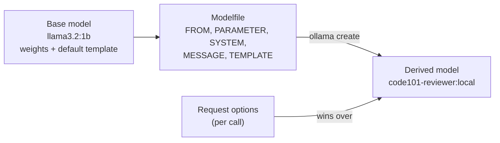

# 01. Modelfile in depth: parameters, system prompt and template

> **Draft: written but not yet run.** The code and the expected output in this lesson were prepared by reading the code and the official documentation. They have not been executed yet. If something does not behave as described, trust your tool's real output and report it.

## What you will be able to do
- Write a Modelfile that sets sampling parameters, a context size, a system prompt and a few example messages, and explain what each line does.
- Predict which setting wins when a Modelfile value and a request value disagree.
- Explain what a `TEMPLATE` is and why you normally should not override it.
- Check a Modelfile offline with a small linter and unit tests before you build a model from it.

## Recap
1. In lesson 101.08 you created `code101-study:local`. What does `ollama create` store: weights or a recipe?
   <details><summary>Answer</summary>Mostly a recipe (base model reference, parameters, system text, template). The large weight files of the base model are shared, not copied.</details>
2. Does a system prompt keep a model from doing something?
   <details><summary>Answer</summary>No. It is an instruction the model usually follows, not an access control.</details>
3. What does `temperature` change, and does a low value make an answer correct?
   <details><summary>Answer</summary>It changes how random the next-token choice is. A low value makes replies more repeatable, not more true.</details>

## Why it matters
In 101 you used a Modelfile as a recipe card. In real projects the Modelfile is where you pin the behaviour that every client of the model must share: the context size, the length cap and the house rules. If those settings live in each client instead, two clients quietly disagree. This lesson goes through every instruction, shows which values a request can override, and teaches the one instruction (`TEMPLATE`) that can silently break a model.

## What you will build
Two small Modelfiles, a linter that checks them without Ollama, nine unit tests for the linter, and a script that asks the server what a model really contains. You will build the model `code101-reviewer:local` (a code-review helper) and compare it with its base.



## Before you start
- **Prerequisites:** Ollama 101 lessons [03, pull and chat](../../101-zero-to-hero/phase-1-first-steps/03-pull-and-chat.md) and [08, conversation assistant](../../101-zero-to-hero/phase-2-building-with-ollama/08-conversation-assistant.md); [Python 101 lesson 12, expense tracker](../../../python/101-zero-to-hero/phase-3-real-programs/12-expense-tracker.md).
- Time: 70-90 minutes for a first timer. Two sittings are fine; pause after Step 5.
- Tools: Python 3.12+, native Ollama running on `127.0.0.1:11434`, and the base model `llama3.2:1b`. The tag was checked on 2026-11-23 at https://ollama.com/library/llama3.2 (about 1.3 GB, 128K context window listed, `tools` capability listed).
- No `pip install` is needed: this lesson uses only Python's standard library.
- Source pack (optional): every file is shown in full in this lesson, so you can follow without it. The finished code, the exercise starter and the solution are in the course repository https://github.com/Uee03/Code101 under `source/ollama/201-hero-to-super-hero/phase-1-customising/01-modelfile-in-depth/` (on that page choose **Code, Download ZIP**, or run `git clone https://github.com/Uee03/Code101.git`).
- Model replies are never shown as expected output here. Answers vary between runs and machines; this lesson shows only the shape of what you will see.

## Steps
### Step 1. Create the folder and the shared helper
Open a terminal. Windows: PowerShell. macOS/Linux: Terminal. Do not type the leading `>` or `$`.

**File: `Windows PowerShell; starting anywhere`**
```powershell
New-Item -ItemType Directory -Path "$HOME/code101/ollama201-01" -Force | Out-Null
Set-Location "$HOME/code101/ollama201-01"
```

**File: `macOS/Linux terminal; starting anywhere`**
```bash
mkdir -p ~/code101/ollama201-01
cd ~/code101/ollama201-01
```
Expected result: no output; the terminal is now inside the folder (the text before the prompt symbol shows it). If you get lost, repeat the second line.

Save the helper below as `ollama_http.py` in that folder. It is the only networking code the 201 Python lessons share, so it is written once here and copied unchanged into later lessons. It uses a fixed loopback URL, a short function per request style, and no proxy forwarding (the same safety choices as in 101).

**File: `~/code101/ollama201-01/ollama_http.py`**
```python
import json
import sys
import urllib.error
import urllib.request

BASE_URL = "http://127.0.0.1:11434"
_OPENER = urllib.request.build_opener(urllib.request.ProxyHandler({}))


def _request(path, body):
    data = None if body is None else json.dumps(body).encode("utf-8")
    return urllib.request.Request(
        BASE_URL + path,
        data=data,
        headers={"Content-Type": "application/json"},
        method="GET" if body is None else "POST",
    )


def post_json(path, body, timeout=180):
    with _OPENER.open(_request(path, body), timeout=timeout) as response:
        return json.load(response)


def get_json(path, timeout=10):
    return post_json(path, None, timeout)


def post_stream(path, body, timeout=180):
    with _OPENER.open(_request(path, body), timeout=timeout) as response:
        for raw in response:
            line = raw.decode("utf-8").strip()
            if line:
                yield json.loads(line)


def describe_error(error):
    if isinstance(error, urllib.error.HTTPError):
        return f"HTTP {error.code} from Ollama: check the model name and the request body."
    return "Cannot reach Ollama on 127.0.0.1:11434 (not running, or it timed out)."


def run_cli(main):
    try:
        main()
    except (urllib.error.URLError, TimeoutError, ConnectionError) as error:
        print(describe_error(error), file=sys.stderr)
        raise SystemExit(1)
```
How it reads: `post_json` sends one request and returns the parsed reply; `get_json` is the same with no body; `post_stream` yields one parsed JSON object per line (NDJSON, from 101 lesson 04); `run_cli` turns connection failures into one readable line instead of a traceback. `HTTPError` is a kind of `URLError`, so one `except` covers both.

### Step 2. Write the linter and its tests (no Ollama needed)
A Modelfile typo does not always fail loudly. A misspelt parameter name may be ignored or rejected only when you run `ollama create`. A small linter catches it first and teaches the grammar. Save this as `modelfile_lint.py`.

**File: `~/code101/ollama201-01/modelfile_lint.py`**
```python
import sys

INSTRUCTIONS = {"FROM", "PARAMETER", "TEMPLATE", "SYSTEM", "LICENSE", "MESSAGE", "REQUIRES", "CAPABILITY"}
PARAMETERS = {
    "num_ctx": int,
    "repeat_last_n": int,
    "repeat_penalty": float,
    "temperature": float,
    "seed": int,
    "stop": str,
    "num_predict": int,
    "top_k": int,
    "top_p": float,
    "min_p": float,
}
ROLES = {"system", "user", "assistant"}


def check_parameter(number, rest, seen, problems):
    name, _, value = rest.strip().partition(" ")
    value = value.strip()
    if name not in PARAMETERS:
        problems.append(f"line {number}: unknown parameter {name!r}")
        return
    if name != "stop" and name in seen:
        problems.append(f"line {number}: parameter {name!r} is set twice")
    seen.add(name)
    kind = PARAMETERS[name]
    if kind is not str:
        try:
            kind(value)
        except ValueError:
            problems.append(f"line {number}: {name} needs a {kind.__name__}, got {value!r}")


def lint(text):
    problems = []
    seen = set()
    has_from = False
    in_block = False
    for number, raw in enumerate(text.splitlines(), start=1):
        line = raw.strip()
        if in_block:
            if line.endswith('"""'):
                in_block = False
            continue
        if not line or line.startswith("#"):
            continue
        word, _, rest = line.partition(" ")
        word = word.upper()
        if word not in INSTRUCTIONS:
            problems.append(f"line {number}: unknown instruction {word!r}")
            continue
        if rest.count('"""') == 1:
            in_block = True
        if word == "FROM":
            has_from = True
        elif word == "PARAMETER":
            check_parameter(number, rest, seen, problems)
        elif word == "MESSAGE":
            role = rest.split(" ")[0]
            if role not in ROLES:
                problems.append(f"line {number}: MESSAGE role must be one of {sorted(ROLES)}")
    if not has_from:
        problems.append("no FROM instruction")
    if in_block:
        problems.append("a triple-quoted block is never closed")
    return problems


def main():
    if len(sys.argv) != 2:
        print("usage: python modelfile_lint.py <Modelfile>")
        raise SystemExit(2)
    path = sys.argv[1]
    with open(path, encoding="utf-8") as handle:
        problems = lint(handle.read())
    if not problems:
        print(f"{path}: OK")
        return
    for problem in problems:
        print(f"{path}: {problem}")
    raise SystemExit(1)


if __name__ == "__main__":
    main()
```
The known names and value types come from the parameter table in the official Modelfile reference (https://docs.ollama.com/modelfile, checked 2026-11-23). The linter is deliberately small: it does not know every parameter a future Ollama version may add, so treat an "unknown parameter" as a prompt to check the docs, not as proof of an error.

Now the tests. Each test is one rule the linter must keep.

**File: `~/code101/ollama201-01/test_modelfile_lint.py`**
```python
import unittest

from modelfile_lint import lint

GOOD = """# comment
FROM llama3.2:1b
PARAMETER temperature 0.2
PARAMETER stop "<|eot_id|>"
PARAMETER stop "<|end_header_id|>"
SYSTEM \"\"\"Answer briefly.
Answer with facts.\"\"\"
MESSAGE user Hello
MESSAGE assistant Hi
"""


class LintTests(unittest.TestCase):
    def test_good_file_has_no_problems(self):
        self.assertEqual(lint(GOOD), [])

    def test_missing_from(self):
        self.assertIn("no FROM instruction", lint("PARAMETER temperature 0.2\n"))

    def test_unknown_parameter(self):
        problems = lint("FROM x\nPARAMETER tempature 0.2\n")
        self.assertEqual(problems, ["line 2: unknown parameter 'tempature'"])

    def test_number_expected(self):
        problems = lint("FROM x\nPARAMETER temperature hot\n")
        self.assertEqual(problems, ["line 2: temperature needs a float, got 'hot'"])

    def test_duplicate_parameter(self):
        problems = lint("FROM x\nPARAMETER seed 1\nPARAMETER seed 2\n")
        self.assertEqual(problems, ["line 3: parameter 'seed' is set twice"])

    def test_stop_may_repeat(self):
        self.assertEqual(lint('FROM x\nPARAMETER stop "a"\nPARAMETER stop "b"\n'), [])

    def test_block_text_is_not_read_as_instructions(self):
        text = 'FROM x\nSYSTEM """First line\nAnswer in French\n"""\n'
        self.assertEqual(lint(text), [])

    def test_unterminated_block(self):
        self.assertIn("a triple-quoted block is never closed", lint('FROM x\nSYSTEM """open\n'))

    def test_bad_message_role(self):
        problems = lint("FROM x\nMESSAGE robot Hello\n")
        self.assertEqual(len(problems), 1)
        self.assertTrue(problems[0].startswith("line 2: MESSAGE role"))


if __name__ == "__main__":
    unittest.main()
```
The backslashes in `GOOD` (`\"\"\"`) only stop Python from ending the test string early; the linter sees ordinary triple quotes.

Run the tests (same command on every OS; use `python3` on macOS/Linux):

**File: `Terminal; folder ~/code101/ollama201-01`**
```text
python -m unittest -v
```
Expected result (not yet run): nine test names, each followed by `ok`, then a line `Ran 9 tests in` and a small time (the time differs on every run), then `OK`.

### Step 3. Write the reviewer Modelfile
Save as `Modelfile.reviewer` (no `.txt`: on Windows turn on **View > Show > File name extensions** in File Explorer if you use a graphical editor).

**File: `~/code101/ollama201-01/Modelfile.reviewer`**
```text
# Modelfile.reviewer: a short code-review helper built on llama3.2:1b
FROM llama3.2:1b
PARAMETER temperature 0.2
PARAMETER top_p 0.9
PARAMETER num_ctx 4096
PARAMETER num_predict 300
PARAMETER repeat_penalty 1.1
PARAMETER seed 42
SYSTEM """You are a careful code reviewer. Answer in at most five short bullet points. If the code looks correct, say so. Never invent line numbers."""
MESSAGE user Review: total = price * qty
MESSAGE assistant Looks correct. If price is money, consider a decimal type instead of a float.
```
Line by line:

| Line | What it does | If you change it |
|---|---|---|
| `FROM llama3.2:1b` | Names the base: weights, default template and defaults come from it. The only required line. | A tag that is not downloaded makes `ollama create` try to pull it or fail. |
| `PARAMETER temperature 0.2` | Low randomness: more repeatable replies, good for review work. | Higher (0.8 is the default) gives more varied wording. |
| `PARAMETER top_p 0.9` | Sample only from the smallest set of likely tokens whose probabilities add to 0.9. | Lower is more conservative. |
| `PARAMETER num_ctx 4096` | The context window: how many tokens of prompt plus reply fit. | Larger costs more memory (the KV cache grows with it); lesson 02 measures this. |
| `PARAMETER num_predict 300` | Hard cap on reply length in tokens. Default is no cap (-1). | Too small cuts replies mid-sentence (`done_reason` becomes `length`). |
| `PARAMETER repeat_penalty 1.1` | Mildly discourages repeating the same tokens. | Large values can make text odd. |
| `PARAMETER seed 42` | Fixes the random seed so the same prompt on the same setup tends to give the same text. | A guarantee only on the same Ollama version, model and hardware, not across them. |
| `SYSTEM """..."""` | The standing instruction placed in the template's system slot. | Not a security boundary (101 lesson 08). |
| `MESSAGE user` / `MESSAGE assistant` | One example exchange (few-shot) placed before every conversation. | More examples teach the format better but use context in every call. |

Check it offline first:

**File: `Terminal; folder ~/code101/ollama201-01`**
```text
python modelfile_lint.py Modelfile.reviewer
```
Expected output: `Modelfile.reviewer: OK`. Now break it on purpose: change `temperature` to `tempature`, run the linter again, read the message (`line 3: unknown parameter 'tempature'`), then fix it back.

### Step 4. Check the server, then build the model
Check health without starting the app (lesson 101.02): if no server answers, start Ollama the way you chose in 101.02 and repeat.

**File: `Windows PowerShell; folder ~/code101/ollama201-01`**
```powershell
Invoke-RestMethod -Uri http://127.0.0.1:11434/api/version -TimeoutSec 5
```

**File: `macOS/Linux terminal; folder ~/code101/ollama201-01`**
```bash
curl --fail --show-error --silent --max-time 5 http://127.0.0.1:11434/api/version
```
Expected result: a small JSON object with a `version` field; the number is your installed version. If the base model is not downloaded yet and you have about 1.3 GB free, run `ollama pull llama3.2:1b`.

Build the model. Ollama reads the Modelfile and stores the derived model.

**File: `Terminal, any OS; folder ~/code101/ollama201-01`**
```text
ollama create code101-reviewer:local -f Modelfile.reviewer
ollama list
```
Expected result: progress lines ending with `success` (exact lines vary), and `code101-reviewer:local` in the list. The derived model's size column is small because layers are shared with the base.

### Step 5. Ask the server what the model contains
`ollama show` is a command-line view; the API call behind it is `/api/show`. Save `show_model.py`. It has two actions: `show` prints stored parameters, system text and whether a template exists; `ask` sends one chat request and optionally overrides the temperature for that request only.

**File: `~/code101/ollama201-01/show_model.py`**
```python
import argparse

from ollama_http import post_json, run_cli

DEFAULT_MODEL = "code101-reviewer:local"


def show(model):
    info = post_json("/api/show", {"model": model}, timeout=30)
    print(f"model: {model}")
    print("parameters:")
    print(info.get("parameters") or "(none)")
    print("system:", info.get("system") or "(none)")
    print("template set:", bool(info.get("template")))


def ask(model, prompt, temperature):
    body = {
        "model": model,
        "messages": [{"role": "user", "content": prompt}],
        "stream": False,
    }
    if temperature is not None:
        body["options"] = {"temperature": temperature}
    data = post_json("/api/chat", body, timeout=180)
    print(data["message"]["content"])
    print(f"done_reason: {data.get('done_reason')}  tokens: {data.get('eval_count')}")


def main():
    parser = argparse.ArgumentParser(description="Inspect and ask a custom model.")
    parser.add_argument("action", choices=["show", "ask"])
    parser.add_argument("--model", default=DEFAULT_MODEL)
    parser.add_argument("--prompt", default="Review: for i in range(10): total += i")
    parser.add_argument("--temperature", type=float, default=None)
    args = parser.parse_args()
    if args.action == "show":
        show(args.model)
    else:
        ask(args.model, args.prompt, args.temperature)


if __name__ == "__main__":
    run_cli(main)
```

**File: `Terminal; folder ~/code101/ollama201-01`** (Windows `python`, macOS/Linux `python3`)
```text
python show_model.py show
```
Expected shape (not captured): the first line is `model: code101-reviewer:local`; the `parameters:` block lists the names from your Modelfile (`temperature`, `top_p`, `num_ctx`, ...) each with its value; `system:` repeats your system text; `template set:` is `True` because the template is inherited from the base. The exact spacing of the parameter lines is the server's choice.

### Step 6. Predict, then compare
Predict first, write your guess down: you run `python show_model.py ask --temperature 1.5`. The Modelfile says `temperature 0.2`. Which value does the server use for that request, and does the stored model change?

Run it:

**File: `Terminal; folder ~/code101/ollama201-01`**
```text
python show_model.py ask
python show_model.py ask --temperature 1.5
python show_model.py ask --model llama3.2:1b
```
Expected shape: each run prints a reply followed by a line `done_reason: stop  tokens: <number>`. The words differ from run to run and between the three commands; the first and second should look different in style more often than not (not guaranteed). `done_reason: length` would mean `num_predict 300` cut the reply. Answer to the prediction: the request value (1.5) wins for that one request; the stored model still says 0.2 (run `show` again to see it unchanged).

### Step 7. Understand the template, carefully
Every chat model was trained with its own markers around system, user and assistant text. The `TEMPLATE` instruction (Go template syntax) turns the message list into that exact text. See the template of your base model:

**File: `Terminal, any OS; folder ~/code101/ollama201-01`**
```text
ollama show --modelfile llama3.2:1b
```
Expected shape: a generated Modelfile with a `FROM` path to a blob, a `TEMPLATE """..."""` block using `{{ .System }}`, `{{ .Prompt }}` and `{{ .Response }}`, and several `PARAMETER stop` lines. The installed template may be longer than the one in the reference (newer templates can also contain tool-calling sections), so trust your own output.

The variable names are fixed: `{{ .System }}` is the system message, `{{ .Prompt }}` the user message, `{{ .Response }}` the model's reply (text after it is omitted while generating). Save the demo file below, which writes the reference's llama3.2 template by hand.

**File: `~/code101/ollama201-01/Modelfile.template`**
```text
# Modelfile.template: the llama3.2 prompt template written out by hand (shape from the Modelfile reference)
FROM llama3.2:1b
TEMPLATE """{{ if .System }}<|start_header_id|>system<|end_header_id|>

{{ .System }}<|eot_id|>{{ end }}{{ if .Prompt }}<|start_header_id|>user<|end_header_id|>

{{ .Prompt }}<|eot_id|>{{ end }}<|start_header_id|>assistant<|end_header_id|>

{{ .Response }}<|eot_id|>"""
PARAMETER stop "<|start_header_id|>"
PARAMETER stop "<|end_header_id|>"
PARAMETER stop "<|eot_id|>"
PARAMETER stop "<|reserved_special_token"
SYSTEM """You answer in exactly one sentence."""
```
Read it: `{{ if .System }}...{{ end }}` prints the system block only when a system message exists; `<|eot_id|>` ends a turn; the `stop` parameters tell the server to stop generating when the model would start a new turn. Lint it and build it as a throw-away demo:

**File: `Terminal, any OS; folder ~/code101/ollama201-01`**
```text
python modelfile_lint.py Modelfile.template
ollama create code101-template-demo:local -f Modelfile.template
python show_model.py ask --model code101-template-demo:local
```
Expected output of the linter: `Modelfile.template: OK`. The model's reply should be one sentence in style, but that is a tendency, not a guarantee.

> **Why this, not that.** Override `TEMPLATE` only when you import raw weights (`FROM ./model.gguf`) that have no template, or when a model page tells you the exact format. For a library model, inheriting is safer: your `TEMPLATE` replaces everything, including parts you may not see, such as tool-calling sections. Never override the template of a model you will use for tool calling (201 lesson 03 and 301 lesson 04).

### Step 8. Clean up what you created
Remove the two derived models. This frees almost no disk (layers are shared) and keeps `ollama list` tidy. Keep the base model for the next lessons.

**File: `Terminal, any OS; folder ~/code101/ollama201-01`**
```text
ollama rm code101-template-demo:local
```
Keep `code101-reviewer:local` if you want to experiment; remove it later with `ollama rm code101-reviewer:local`.

## Run it
The whole lesson in four commands from the folder (after Step 1 files exist):

**File: `Terminal; folder ~/code101/ollama201-01`**
```text
python -m unittest
python modelfile_lint.py Modelfile.reviewer
ollama create code101-reviewer:local -f Modelfile.reviewer
python show_model.py show
```
Expected: `OK` from the tests, `Modelfile.reviewer: OK`, a `success` from `ollama create`, then the parameter listing. Nothing here is a fixed model answer.

## How it works
1. **Layers.** A Modelfile is a build recipe. `ollama create` records your parameters, system text, messages and template as small layers on top of the base model's weights.
2. **Precedence.** Defaults (server) < Modelfile `PARAMETER` < request `options`. The most specific, latest value wins for that call only.
3. **The template** converts messages to the model's native text format. A wrong template does not raise an error; the model just behaves worse (ignores the system prompt, rambles, never stops). That is why `stop` parameters travel with templates.
4. **Common misconception:** "A bigger `num_ctx` makes the model smarter." It only lets more text fit. It costs memory and can slow generation; the default in current Ollama is 4096 tokens (https://docs.ollama.com/faq, checked 2026-11-23), so many models run with far less than their advertised maximum.

## Try it
Starter: `exercise/starter/Modelfile.summariser` (copy the `starter` folder to `~/code101/ollama201-01/try01`, keep `modelfile_lint.py` one folder up or copy it in).
1. **Guided.** Open the starter and complete the four TODO comments so that `python modelfile_lint.py Modelfile.summariser` prints `Modelfile.summariser: OK`. Before you fix it, run the linter on the starter and read what it reports.
2. **Change.** Build the model as `code101-summariser:local`, send it a three-sentence paragraph with `show_model.py ask --model code101-summariser:local --prompt "<your text>"`, then make the reply cut off on purpose by lowering `num_predict` and confirm `done_reason: length`.
3. **Stretch (no single answer).** Add two `MESSAGE` pairs that teach a strict output format (for example, a title line then two sentences). Decide whether the examples are worth the context they use in every call, and write down how you would tell.

<details><summary>Solution</summary>

**File: `exercise/solution/Modelfile.summariser`**
```text
# Modelfile.summariser: a two-sentence summariser on the same base model
FROM llama3.2:1b
PARAMETER temperature 0.1
PARAMETER num_ctx 2048
PARAMETER num_predict 120
SYSTEM """Summarise the user's text in two sentences. Do not add facts that are not in the text."""
```
The starter fails the linter with `no FROM instruction` because its lines are comments. For the Change step, `done_reason: length` appears when the reply hits the cap; a cap of about 10 tokens makes this easy to see.
</details>

## Check yourself
1. Which value does the server use if the Modelfile says `temperature 0.2` and the request says `temperature 1.5`? <details><summary>Answer</summary>1.5 for that request. The stored model is unchanged.</details>
2. What does `done_reason: length` tell you? <details><summary>Answer</summary>The reply stopped because it reached `num_predict` (or the context limit), not because the model finished.</details>
3. Why should you normally not write your own `TEMPLATE` for a library model? <details><summary>Answer</summary>It replaces the whole inherited template, which can silently remove behaviour (system handling, tool calling) and the matching stop tokens.</details>
4. Predict the linter output for `PARAMETER temperature hot` on line 4 of a file that has a `FROM`. <details><summary>Answer</summary>`line 4: temperature needs a float, got 'hot'` (printed after the file name).</details>

## Common mistakes
| Symptom | Cause | Fix |
|---|---|---|
| Linter prints `unknown instruction` for a line you meant as text | A multi-line `SYSTEM` or `TEMPLATE` block lost its closing `"""` or text sits outside the quotes | Close the triple quotes; keep the block text between them |
| `python` shows `can't open file 'modelfile_lint.py'` (typical message) | Terminal is in the wrong folder | `cd ~/code101/ollama201-01` (PowerShell: `Set-Location "$HOME/code101/ollama201-01"`) |
| `ollama create` reports the base model is missing (typical message) | `FROM` tag is not downloaded | `ollama pull llama3.2:1b`, then create again |
| `Modelfile.reviewer.txt` exists instead | The editor added `.txt` | Show file extensions and rename |
| Replies stop mid-sentence | `num_predict` is too small | Raise it or ask for shorter answers |
| `Cannot reach Ollama on 127.0.0.1:11434` | Server not running | Start it as in 101.02; the helper prints this line instead of a traceback |

## Best practice
Keep behaviour that every client must share (context size, length cap, house rules) in the Modelfile, and per-task choices (a one-off temperature) in the request. Never log or commit prompts that contain private text. Source: Ollama Modelfile reference https://docs.ollama.com/modelfile

## Going further
- `FROM` can also import a GGUF file or Safetensors directory (see the reference), and `REQUIRES` pins a minimum Ollama version.
- The OpenAI-compatible endpoint (lesson 06) cannot set `num_ctx` per request, so a Modelfile alias is the way to set it there.

## Summary
- You wrote a Modelfile using `FROM`, `PARAMETER`, `SYSTEM` and `MESSAGE` and explained each line.
- You predicted and observed that request options override stored parameters for one call.
- You explained why `TEMPLATE` is dangerous to override and read a real template.
- You built a linter with nine unit tests that checks a Modelfile without Ollama.

## Next lesson
02. Choosing and comparing models: size, quantisation and context length, and a small harness that times several models on the same prompts.
